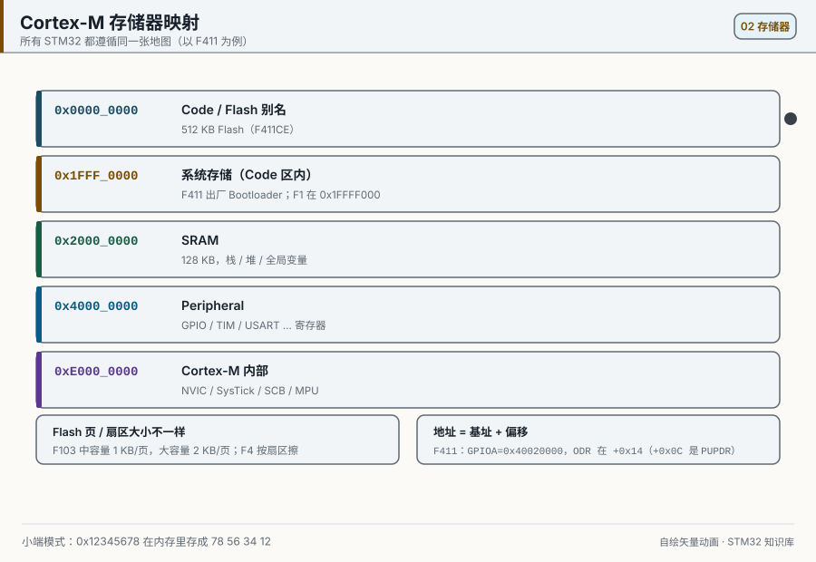
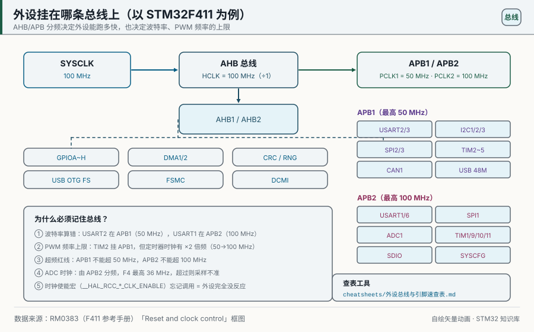

# 02 Choosing a Part, Memory, and Clocks
> 中文：[芯片选型与存储器时钟](../02-芯片选型与存储器时钟.md)

> Reading the STM32 name, where a family sits, the memory map, and the clock tree is the base for picking a part and setting the frequency.

<p align="center">
  
  <br><sub>▲ Animation: HSE 8 MHz → PLL ×9 → 72 MHz on the clock tree (vector drawing by the author)</sub>
</p>

<!-- video:ch02 -->
<p align="center">
  <video width="640" controls poster="../../assets/video/ch02-clock.png">
    <source src="../../assets/video/ch02-clock.mp4" type="video/mp4">
  </video>
  <br><sub>▲ Chinese voice-over, 2.5 min. Voice: Microsoft Edge neural voice zh-CN-XiaoxiaoNeural via edge-tts (library mostly LGPLv3; the voice model is an online Microsoft service, not an open model). Pictures are generated from this repo's SVGs, not photographs. Video: <a href="../../assets/video/ch02-clock.mp4">MP4</a> · subtitles: <a href="../../assets/video/ch02-clock.srt">SRT</a>. Rebuild with <code>python3 tools/gen_narrated.py --speak</code>.</sub>
</p>

**Narration script (Chinese, same text as the subtitles)**

1. 型号上的字母不是玄学。F103 告诉你系列，C8 这类字母看闪存容量，T6 这类看封装。先读数据手册封面和订购信息，再去数引脚。
2. 存储器地图把闪存、内存和外设分成几段。外设的本质，就是固定地址上的一排寄存器。地址抄错系列，写进去的就不是你要的那个外设。
3. F103 常见的一条路：外部 8 兆进 PLL，乘 9，系统时钟 72 兆。APB1 最高 36 兆，所以再除以 2。这条路径后面串口和 CAN 的波特率都靠它。
4. 这一帧是仓库画的时钟树。口诀你要刻进手上：先开时钟，再摸寄存器。时钟没开，写入就像写进虚空，调试器里看起来还像成功了。
5. 主频拉到 72 兆时，闪存要加等待。这一章写的是 48 到 72 兆用两个等待周期。只改 PLL、不改等待，常见的下场就是一跑就死。
6. APB 分频大于 1 的时候，定时器时钟还会再乘 2。算 PWM 前先问 HAL 要到的 PCLK，不要把 36 兆当成定时器的输入。差一倍，频率就差一倍。
7. 外部晶振起不来时，先退回内部时钟，证明芯片还活着，再查负载电容和焊点。一上来就把 PLL 乘到很高，是在用死机练习耐心。
8. 口诀再念一遍：先开时钟再摸寄存器。HSE 掉了靠时钟安全系统，想看频率可以走到时钟输出脚。别用Delay 的感觉去猜主频。
9. 动手时让串口打出主频、闪存容量和两条 APB。BluePill 上常见的是 72 兆和 64 KB 闪存。对不上，先别做后面的外设实验。
10. 合上书，三问。72 兆时闪存要几个等待？AHB 和 APB1 谁更慢？外设时钟门控没开时，写入会发生什么？
<!-- /video:ch02 -->
## 📌 Learning goals
- [ ] Split an STM32 part number piece by piece (what every character of STM32F103C8T6 means)
- [ ] Pick among F0/F1/F3/F4/F7/G0/G4/H7/L0/L4 for a real need
- [ ] State the FPU/DSP/MPU/cache differences among Cortex-M3/M4/M7
- [ ] Remember the memory-map regions and the BOOT0/BOOT1 boot modes
- [ ] Compute the HSE→PLL→SYSCLK→AHB/APB dividers, and find the important bits in RCC_CFGR

## 🧠 Core ideas

**Lead with the conclusion: pick a part by "core + clock + Flash/RAM + package + peripherals". Set the frequency by "clock tree + divider limits".**

### 1. The name, piece by piece

Take **STM32F103C8T6**:

| Piece | Value | Meaning |
| --- | --- | --- |
| STM32 | — | ST's 32-bit MCU brand |
| F | F | Family: F = foundation / mainstream, L = low power, G = general purpose, H = high performance |
| 103 | 103 | Sub-family: 103 = F1 performance line (72 MHz, USB/CAN), 030 = F0, 407 = F4 |
| C | C | Pin count: T=36, C=48, R=64, V=100, Z=144, I=176 |
| 8 | 8 | Flash size: 4=16K, 6=32K, 8=64K, B=128K, C=256K, E=512K, G=1M |
| T | T | Package: T=LQFP, U=QFN, H=BGA, P=TSSOP |
| 6 | 6 | Temperature: 6=−40 to 85 °C, 7=−40 to 105 °C, 3=−40 to 125 °C |
| A | (suffix) | Internal code / revision; you can ignore it when ordering |

So **STM32F103C8T6 = F1 performance line · 48 pins · 64 KB Flash · LQFP · −40 to 85 °C**.

### 2. Family comparison

| Family | Core | Clock | Typical Flash | Package | Typical use | Price (¥ each) |
| --- | --- | --- | --- | --- | --- | --- |
| F0 | M0 | 48 MHz | 16–256 KB | TSSOP/QFN | Cheap replacement for an 8-bit MCU | 4–10 |
| F1 | M3 | 72 MHz | 64–512 KB | LQFP | Teaching, the industrial classic | 8–20 |
| F3 | M4F | 72 MHz | 64–512 KB | LQFP | Op-amps and comparators, mixed signal | 15–30 |
| F4 | M4F | 100–180 MHz | 128–2048 KB | LQFP/BGA | Performance, DSP, FPU | 25–70 |
| F7 | M7F | 216 MHz | 512 KB–2 MB | LQFP/BGA | Graphics, audio, high speed | 60–150 |
| G0 | M0+ | 64 MHz | 16–512 KB | QFN/TSSOP | Low power and a good price | 6–15 |
| G4 | M4F | 170 MHz | 32–512 KB | LQFP | Motor control, digital power | 20–45 |
| H7 | M7F | 480 MHz | 512 KB–2 MB | LQFP/BGA | High-end graphics / AI | 80–200 |
| L0 | M0+ | 32 MHz | 8–192 KB | TSSOP | Ultra-low power | 5–12 |
| L4 | M4F | 80 MHz | 64–1 MB | LQFP | Low power and performance together | 20–50 |

### 3. Core features (Cortex-M)

| Feature | Cortex-M3 | Cortex-M4 | Cortex-M7 |
| --- | --- | --- | --- |
| Architecture | ARMv7-M | ARMv7E-M | ARMv7E-M |
| FPU | ❌ none | ✅ single precision (double optional) | ✅ double precision |
| DSP instructions | Partial | ✅ full SIMD/MAC | ✅ full |
| MPU | Optional | Optional | ✅ standard |
| Cache | ❌ | ❌ | ✅ I-cache / D-cache |
| TCM | ❌ | ❌ | ✅ ITCM/DTCM |
| Typical clock | ≤ 120 MHz | ≤ 200 MHz | ≤ 600 MHz |

### 4. Memory map

Cortex-M splits the 4 GB address space into fixed regions:

| Address range | Region | Contents |
| --- | --- | --- |
| 0x0000_0000–0x1FFF_FFFF | Code | Alias of Flash / system memory; interrupt vector table |
| 0x2000_0000–0x3FFF_FFFF | SRAM | On-chip SRAM |
| 0x4000_0000–0x5FFF_FFFF | Peripheral | Every peripheral register |
| 0x6000_0000–0x9FFF_FFFF | External RAM | FSMC/FMC expansion |
| 0xA000_0000–0xDFFF_FFFF | External device | External device interface |
| 0xE000_0000–0xFFFF_FFFF | System | NVIC, SysTick, SCB (PPB) |

The memory-map animation:

<p align="center">
  
  <br><sub>▲ Animation: Cortex-M memory map (Flash / SRAM / peripherals / system region) (vector drawing by the author)</sub>
</p>

A typical F103C8: **64 KB Flash at 0x0800_0000, 20 KB SRAM at 0x2000_0000**.

### 5. Boot mode: BOOT0 / BOOT1

| BOOT1 | BOOT0 | Boot region | Use |
| --- | --- | --- | --- |
| x | 0 | Main Flash (0x0800_0000) | Normal run |
| 0 | 1 | System memory | Factory bootloader, UART ISP download |
| 1 | 1 | Embedded SRAM | Debug / unbrick (lost when power drops) |

### 6. Clock tree and dividers

The chain: `HSE(8MHz) → PLL(×9) → SYSCLK(72MHz) → AHB prescaler → APB1/APB2`

| Clock | Source | Divider | Frequency | Ceiling |
| --- | --- | --- | --- | --- |
| SYSCLK | PLL | — | 72 MHz | 72 MHz |
| AHB (HCLK) | SYSCLK | ÷1 | 72 MHz | 72 MHz |
| APB1 (PCLK1) | AHB | ÷2 | 36 MHz | 36 MHz |
| APB2 (PCLK2) | AHB | ÷1 | 72 MHz | 72 MHz |
| ADC | APB2 ÷6 | — | 12 MHz | 14 MHz |
| USB | PLL ÷1.5 | — | 48 MHz | 48 MHz |

> ⚠️ When the APB divider is greater than 1, the timer clock is **×2**. Example: APB1 = 36 MHz, so TIM2–7 run at 72 MHz.

Which bus a peripheral sits on:

<p align="center">
  
  <br><sub>▲ Figure: which peripherals hang on AHB, APB1, and APB2 (vector drawing by the author)</sub>
</p>

**Important RCC_CFGR bits (RM0008 section 8.3.2):**

| Field | Name | Meaning |
| --- | --- | --- |
| [1:0] | SW | System clock source: 00=HSI, 01=HSE, 10=PLL |
| [3:2] | SWS | Current system clock source (read only) |
| [7:4] | HPRE | AHB divider |
| [10:8] | PPRE1 | APB1 divider |
| [13:11] | PPRE2 | APB2 divider |
| [21:18] | PLLMUL | PLL multiply (×2 to ×16) |
| [16] | PLLSRC | PLL input: 0=HSI/2, 1=HSE |
| [17] | PLLXTPRE | HSE predivider |

## 🛠️ Hardware and wiring

| Board | Peripheral / signal | Pin | Notes |
| --- | --- | --- | --- |
| BluePill | HSE crystal | PD0/PD1 (8 MHz) | Already soldered; external crystal |
| BluePill | LSE crystal | PC14/PC15 (32.768 kHz) | For the RTC |
| BluePill | BOOT0 jumper | BOOT0 | The jumper selects the boot mode |
| BluePill | USB 5 V | 5V | Power |

## 💻 Code

Read the unique ID, the Flash size, and the current core clock, and print them on the UART to check the clock setup:

```c
/* chip_info.c —— read the unique ID / Flash size / current core clock */
#include "stm32f1xx_hal.h"
#include <stdio.h>

void SystemClock_Config(void);

/* read the 96-bit unique ID (RM0008 chapter 30) */
static void print_uid(void)
{
    uint32_t uid0 = *(volatile uint32_t *)0x1FFFF7E8;
    uint32_t uid1 = *(volatile uint32_t *)0x1FFFF7EC;
    uint32_t uid2 = *(volatile uint32_t *)0x1FFFF7F0;
    printf("UID: %08lX-%08lX-%08lX\r\n", uid0, uid1, uid2);
}

/* read Flash size (KB, low 16 bits at 0x1FFFF7E0) */
static uint16_t get_flash_kb(void)
{
    return (uint16_t)(*(volatile uint16_t *)0x1FFFF7E0);
}

int main(void)
{
    HAL_Init();
    SystemClock_Config();       /* assume 72MHz is already configured */

    uint32_t sysclk = HAL_RCC_GetSysClockFreq();
    uint32_t hclk   = HAL_RCC_GetHCLKFreq();
    uint32_t pclk1  = HAL_RCC_GetPCLK1Freq();
    uint32_t pclk2  = HAL_RCC_GetPCLK2Freq();

    printf("SYSCLK=%lu Hz, HCLK=%lu Hz\r\n", sysclk, hclk);
    printf("PCLK1=%lu Hz, PCLK2=%lu Hz\r\n", pclk1, pclk2);
    printf("Flash=%u KB\r\n", get_flash_kb());
    print_uid();

    while (1) { }
}
```

The register equivalent (read RCC_CFGR by hand):

```c
uint32_t cfgr  = RCC->CFGR;
uint32_t sws   = cfgr & RCC_CFGR_SWS;              /* current system clock source */
uint32_t hpre  = (cfgr & RCC_CFGR_HPRE)  >> 4;     /* AHB divider */
uint32_t ppre1 = (cfgr & RCC_CFGR_PPRE1) >> 8;     /* APB1 divider */
```

## ⚠️ Pitfalls and troubleshooting

| Symptom | Cause | Fix |
| --- | --- | --- |
| The core clock is only 8 MHz | PLL is not enabled, or SW was not switched to PLL | Check `PLL.PLLState=RCC_PLL_ON` and `SYSCLKSource=PLLCLK` |
| Changing the PLL hangs the chip | Flash wait states were not set | 48–72 MHz needs `FLASH_LATENCY_2` |
| An APB1 peripheral misbehaves | APB1 is above 36 MHz | PPRE1 at least ÷2 |
| The timer frequency is off by 2× | You forgot that when the APB divider is >1 the timer clock is ×2 | Decide with `HAL_RCC_GetPCLK1Freq()` |
| After a part change the peripheral address is wrong | Base addresses differ by family | Use the macros in the CMSIS header. Do not hard-code them |
| HSE never starts | Crystal load capacitors or a bad solder joint | Fall back to HSI to test, and check the 8 MHz crystal |

## 🧪 Hands-on labs

1. **Lab 1 (read the chip):** Run the code above and print the core clock, Flash size, and unique ID. Check that they are 72 MHz and 64 KB.
2. **Lab 2 (overclock on purpose):** Change the PLL from ×9 to ×16 and see whether it hangs. That is the relationship between Flash wait states and the clock ceiling.
3. **Lab 3 (APB divider):** Change PPRE1 from ÷2 to ÷1 and see whether an APB1 peripheral (USART2, for example) still works.

### 7. Flash wait states and core clock

| Clock range | Wait states (LATENCY) |
| --- | --- |
| 0–24 MHz | 0 |
| 24–48 MHz | 1 |
| 48–72 MHz | 2 |

> Wait states are the LATENCY bits in `FLASH_ACR`. Set them wrong and the chip hangs or fetches bad instructions.

### 8. How the clock tree differs by family (the points that matter)

| Family | Max SYSCLK | PLL shape | Notes |
| --- | --- | --- | --- |
| F1 | 72 MHz | HSE or HSI/2 ×N | No PLLM/PLLN/PLLP |
| F4 | 168 MHz | M/N/P/Q dividers | 48 MHz USB is supported |
| F7 | 216 MHz | More complicated | Oversampling is supported |
| G0 | 64 MHz | Simplified | Low power |

### 9. Common peripheral base addresses (F103)

| Peripheral | Base address |
| --- | --- |
| GPIOA | 0x40010800 |
| GPIOB | 0x40010C00 |
| GPIOC | 0x40011000 |
| USART1 | 0x40013800 |
| TIM2 | 0x40000000 |
| RCC | 0x40021000 |
| FLASH | 0x40022000 |

> CMSIS headers already define these (for example `GPIOA_BASE`). Use the macro. Do not hard-code the address.

### 10. Turn the clock on before you talk about CSS and MCO

**Conclusion:** before the first write to any peripheral, call `__HAL_RCC_*_CLK_ENABLE()`. Power-up default is HSI at 8 MHz, not the 72 MHz you typed in Cube. Until `SystemClock_Config()` has actually run, the UART baud rate is wrong.

| Mechanism | What it does | One thing to remember |
| --- | --- | --- |
| Peripheral clock gate | If you do not turn it on, that peripheral does not exist | `CLK_ENABLE` first, then `HAL_xxx_Init` |
| CSS | If HSE stops, switch back to HSI and enter NMI | `HAL_RCC_EnableCSS()` |
| MCO | Send an internal clock out to a pin for a scope | On F1 it is PA8; on F4, MCO1/MCO2 are PA8/PC9 |

On F1, the MCO field in `RCC_CFGR` selects SYSCLK / HSI / HSE / PLL÷2. When the APB prescaler is greater than 1, the timer clock is ×2 again. The 72 MHz in that figure is already the doubled number.

Motto: **turn the clock on before you touch a register. If HSE drops, CSS catches it. If you want to see the frequency, use MCO.**

Self-test:

1. You wrote `GPIOA->CRL` and never enabled the GPIOA clock. Why does a read still come back 0?
2. The HSE crystal was never soldered. After CSS is enabled, where does the system clock land?
3. When the APB1 prescaler is 2, is TIM2's counter clock 36 MHz or 72 MHz?

## 🔗 Related resources

- Official manuals: **RM0008** (chapter 2 memory map, chapter 8 RCC, chapter 30 device electronic signature); **DS5319** (F103C8 datasheet)
- Previous: [01 Setting Up the Development Environment](01-dev-environment.md) | Next: [03 GPIO and LEDs](03-gpio-and-led.md)
- Figures: [`assets/animations/clock-tree.svg`](../../assets/animations/clock-tree.svg), [`assets/animations/memory-map.svg`](../../assets/animations/memory-map.svg), [`assets/diagrams/peripheral-bus.svg`](../../assets/diagrams/peripheral-bus.svg)
- Hardware and documents: the product-selector pages for each family on ST's website
- Disclaimer: every illustration in this repo is a vector drawing or a program-generated animation by the author, not a manufacturer's photograph.
