# 02 Choosing a Part, Memory, and Clocks
> 中文：[芯片选型与存储器时钟](../02-芯片选型与存储器时钟.md)

> When a peripheral-register write has no effect, read the clock gate and divider registers first. After calculating 8 MHz HSE to 72 MHz SYSCLK, check Flash latency, APB limits, and the clock source that hardware actually selected.

<p align="center">
  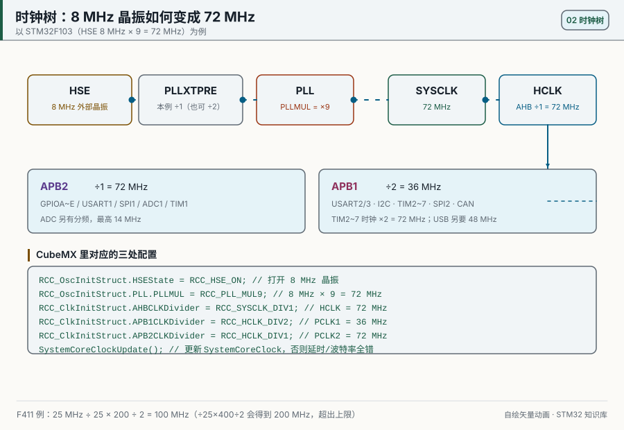
  <br><sub>▲ Animation: HSE 8 MHz → PLL ×9 → 72 MHz on the clock tree (vector drawing by the author)</sub>
</p>

<!-- video:ch02 -->
<p align="center">
  <video width="640" controls poster="../../assets/video/ch02-clock.png">
    <source src="../../assets/video/ch02-clock.mp4" type="video/mp4">
  </video>
  <br><sub>▲ Chapter video with Chinese voice-over (2.6 min). <a href="../../assets/video/ch02-clock.mp4">MP4</a> · <a href="../../assets/video/ch02-clock.srt">subtitles</a></sub>
</p>

<details>
<summary>Narration script (Chinese, same text as the subtitles)</summary>

1. 型号上的字母不是玄学。F103 告诉你系列，C8 这类字母看闪存容量，T6 这类看封装。先读数据手册封面和订购信息，再去数引脚。
2. 存储器地图把闪存、内存和外设分成几段。外设的本质，就是固定地址上的一排寄存器。地址抄错系列，写进去的就不是你要的那个外设。
3. F103 常见的一条路：外部 8 兆进 PLL，乘 9，系统时钟 72 兆。APB1 最高 36 兆，所以再除以 2。这条路径后面串口和 CAN 的波特率都靠它。
4. 这一帧是仓库画的时钟树。口诀你要刻进手上：先开时钟，再摸寄存器。时钟没开，写入就像写进虚空，调试器里看起来还像成功了。
5. 主频拉到 72 兆时，闪存要加等待。这一章写的是 48 到 72 兆用两个等待周期。只改 PLL、不改等待，常见的下场就是一跑就死。
6. APB 分频大于 1 的时候，定时器时钟还会再乘 2。算 PWM 前先问 HAL 要到的 PCLK，不要把 36 兆当成定时器的输入。差一倍，频率就差一倍。
7. 外部晶振起不来时，先退回内部时钟，证明芯片还活着，再查负载电容和焊点。一上来就把 PLL 乘到很高，是在用死机练习耐心。
8. 口诀再念一遍：先开时钟再摸寄存器。HSE 掉了靠时钟安全系统，想看频率可以走到时钟输出脚。别用Delay 的感觉去猜主频。
9. 动手时让串口打出主频、闪存容量和两条 APB。BluePill 上常见的是 72 兆和 64 KB 闪存。对不上，先别做后面的外设实验。
10. 带走两条边界：HSE 失败时，时钟安全系统把你送回内部时钟，主频随之改变；Flash 等待拍数跟着主频走，换主频就要重查等待。别人的主频数字，不能抄进你的工程。

</details>
<!-- /video:ch02 -->
## Principle and scope

Clock numbers in this chapter are for the STM32F103C8T6 in LQFP48 and match the clock table in Appendix D. The connectivity line (F105/F107) lays out its RCC registers differently; for those parts read section 8.3.2 of the manual instead of 7.3.2. The Flash wait states assume a 2.7–3.6 V supply; at another voltage, look the steps up again.

HSE enters on pin 5 PD0-OSC_IN and pin 6 PD1-OSC_OUT at 8 MHz. `PLLXTPRE=0` (HSE is not prescaled), `PLLSRC=1` (the PLL input is HSE), `PLLMUL=0111` (×9). `8 × 9 = 72` MHz. With `SW=10`, SYSCLK uses the PLL. HPRE divides by 1, so HCLK = 72 MHz. PPRE1 = `100` (÷2), so PCLK1 = 36 MHz and must not exceed 36 MHz. PPRE2 divides by 1, so PCLK2 = 72 MHz. When an APB prescaler is not 1, timers on that bus clock at twice PCLK, so TIM2–TIM7 are still 72 MHz. TIM1 is on APB2 with a prescaler of 1, so it is not doubled again. Source: [RM0008 Rev 21 section 7.3.2](#source-rm0008-rcc).

`FLASH_ACR` is at base `0x40022000`, offset `0x00`. LATENCY for 48 MHz to 72 MHz is `010`, which is 2. From 0 to 24 MHz it is 0. From 24 to 48 MHz it is 1. These steps assume a 2.7–3.6 V supply. Flash cannot keep up with 72 MHz, so each fetch waits two extra cycles. Set the PLL to ×9 but leave LATENCY at 0 and the CPU reads wrong instructions; the program runs away or lands in HardFault.

<p align="center">
  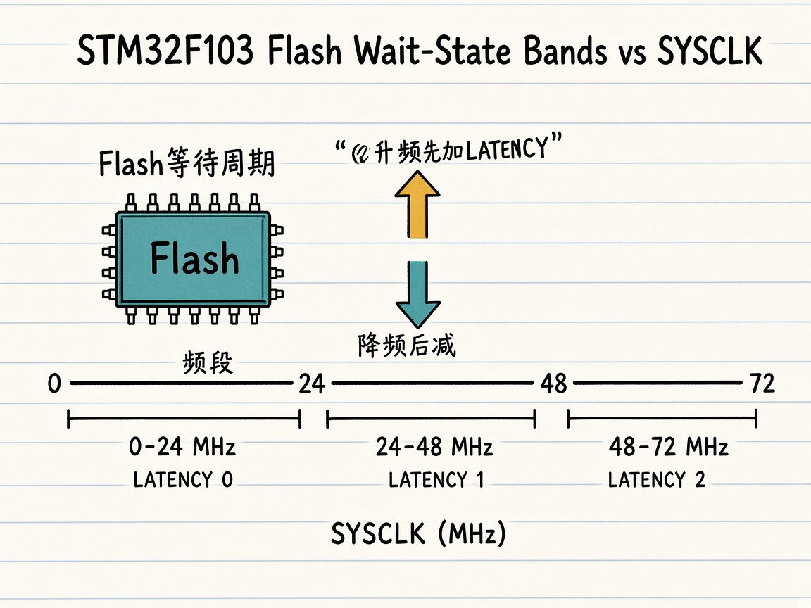
  <br><sub>▲ Knowledge track (Handraw · 原理示意 / not a photo). Where to look: the three bands 0–24 / 24–48 / 48–72 MHz against LATENCY = 0 / 1 / 2, and the red banner "reverse the order and it is an accident"; proves that wait states must be written before raising SYSCLK; does not replace the FLASH_ACR register definition, nor a measured fetch waveform. See [RM0008 Rev 21](#source-rm0008-rcc).</sub>
</p>

With `USBPRE=0`, the 72 MHz PLL is divided by 1.5 and the result is 48 MHz. `USBPRE=1` does not divide, so the result is 72 MHz, which is not 48 MHz. `ADCPRE=10` is PCLK2÷6, and `72 / 6 = 12` MHz. `ADCPRE=01` is ÷4, which is 18 MHz and crosses the RM0008 ceiling of 14 MHz. Sample time and successive approximation are covered in chapter 09.

When HSE stops and CSS is on, if HSE is the system clock directly or through the PLL, hardware switches to HSI and turns HSE off. If HSE was the PLL input, the PLL turns off too. The CSS interrupt is NMI. The NMI handler writes CSSC in `RCC_CIR`, or NMI keeps returning. The same event also reaches the TIM1 and TIM8 break inputs. After reset the system clock is HSI at 8 MHz, not the 72 MHz filled in by Cube. Chapter 04 covers how NMI preempts.

Pin 29 PA8 includes MCO in its alternate function. The pin is in [DS5319 Rev 20 Figure 8](#source-ds5319-clock). `MCO=111` drives PLL÷2, which is 36 MHz, under the 50 MHz I/O limit written in the manual. `MCO=100` drives SYSCLK straight out, and 72 MHz is over that limit, so the manual no longer guarantees the pin's output, and neither the amplitude nor the frequency on the scope can be trusted as a reading. To check the core clock, output PLL÷2 at 36 MHz and double it. HSE bypass is only for an oscillator module or an external clock input; with a plain crystal, leave bypass off.

Many online notes mix in section 8.3.2, the connectivity line: the `OTGFSPRE` bit, the reserved `PLLMUL` encoding `000x`, and ×6.5. None of these exist on the STM32F103C8T6; copied over, they give a wrong configuration. The C8 uses section 7.3.2 for `RCC_CFGR`. `0111` is still ×9. `0000` is still ×2.

## Key figures


<p align="center">
  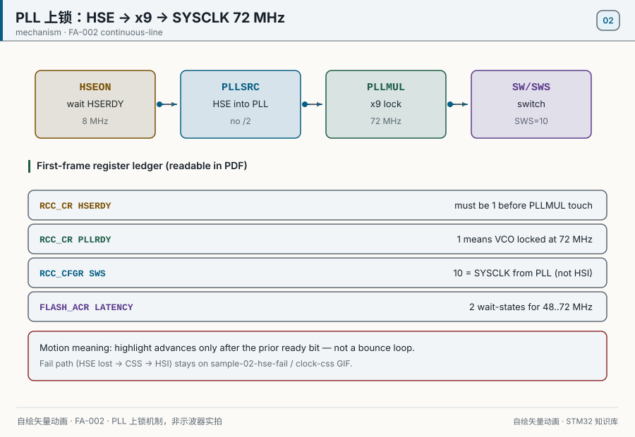
  <br><sub>▲ Hand-drawn CSS animation (FA-002). Lock steps advance; fail path on clock-css GIF / HSE-fail SVG.</sub>
</p>


<p align="center">
  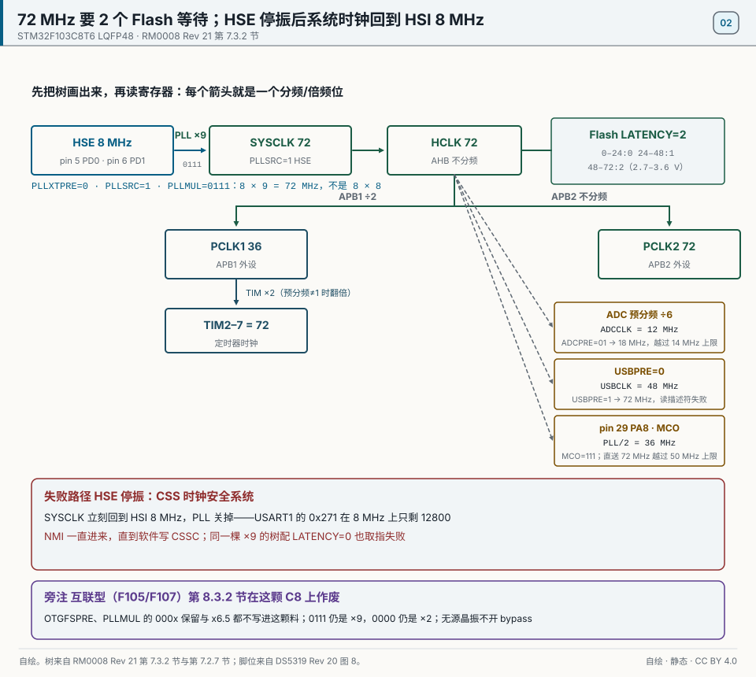
  <br><sub>▲ Drawn for this book. STM32F103C8T6, LQFP48. Pin 5 PD0 and pin 6 PD1 bring in 8 MHz. PLLMUL=0111, PLLSRC=1, and PLLXTPRE=0 produce 72 MHz. PCLK1 = 36 MHz, PCLK2 = 72 MHz, TIM2–TIM7 = 72 MHz, ADCCLK = 12 MHz, and USBPRE=0 produces 48 MHz. Configured correctly, LATENCY = 2 and MCO on pin 29 PA8 is 36 MHz. The figure also marks the same tree with LATENCY still 0, where fetches go wrong. After HSE stops, SYSCLK returns to HSI at 8 MHz and the NMI handler writes CSSC. Two limits are noted at the edge: ADC at 18 MHz is over 14 MHz, and 72 MHz straight out of MCO is over 50 MHz. Sources: [RM0008 Rev 21 sections 7.3.2 and 7.2.7](#source-rm0008-rcc) and [DS5319 Rev 20 Figure 8](#source-ds5319-clock).</sub>
</p>
<p align="center">
  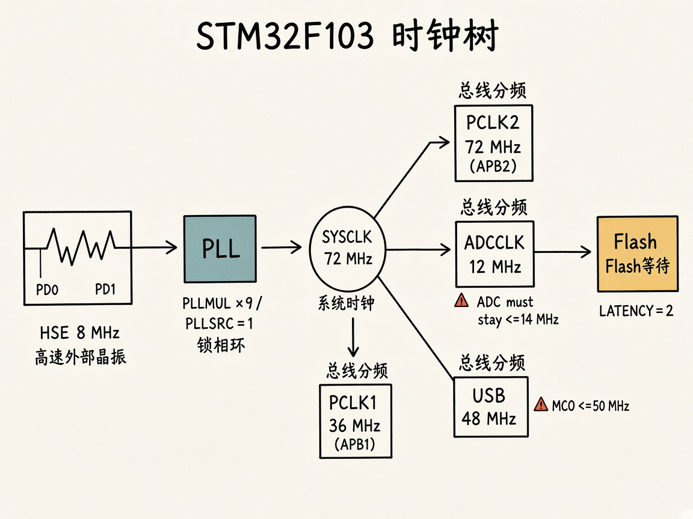
  <br><sub>▲ Knowledge track (Handraw · 原理示意 / not a photo). HSE 8 MHz through PLL×9 to SYSCLK 72 MHz, then PCLK1/PCLK2/ADC/USB; not a scope capture.</sub>
</p>


<p align="center">
  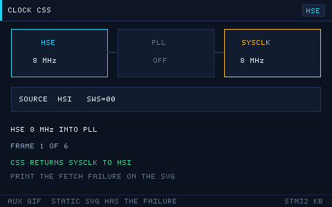
  <br><sub>▲ Animated version. It shows only CSS switching the system clock back to HSI after HSE stops. The printed book has only the static figure above.</sub>
</p>

## Timing and state

| Phase | SWS / switch | Clock | State |
| --- | --- | --- | --- |
| Reset | SWS points at HSI | HSI 8 MHz | The system clock is not the 72 MHz filled in by Cube |
| HSE ready | HSE enters on pin 5 and pin 6 | 8 MHz | The PLL is not selected yet |
| PLL locks | PLLMUL=0111, PLLSRC=1, PLLXTPRE=0 | 72 MHz | Write LATENCY before switching SW |
| Write the wait | LATENCY = 2 | 72 MHz | The 48 MHz to 72 MHz step |
| Switch to the PLL | SW=10, SWS reads back PLL | SYSCLK = HCLK = 72 MHz | PCLK1 = 36 MHz, PCLK2 = 72 MHz, USBPRE=0 produces 48 MHz |
| Failure: wait still 0 | LATENCY = 0 | 72 MHz | Instruction fetch fails |
| CSS | HSE fails | SYSCLK returns to HSI 8 MHz | The PLL is off. NMI stays pending until software writes CSSC |
| ADC | ADCPRE=10 | 12 MHz | ADCPRE=01 produces 18 MHz and crosses 14 MHz |

ADC sample time is in chapter 09. Source: [RM0008 Rev 21 section 7.3.2](#source-rm0008-rcc).

## Pitfalls and sources

| What you see | Why | What to do | Source | What the source shows |
| --- | --- | --- | --- | --- |
| The core stops as soon as the PLL is set to ×9 | LATENCY is still 0 | Write LATENCY = 2 before switching SYSCLK | [RM0008](#source-rm0008-rcc) | The 48–72 MHz step is two wait states. The voltage cell is Appendix D, 2.7–3.6 V |
| PWM frequency is off by 2× | The division used PCLK1 at 36 MHz | Use the 72 MHz timer clock | [RM0008](#source-rm0008-rcc) | When the APB prescaler is not 1, the timer clock is doubled. TIM1 on APB2 with prescaler 1 is not doubled again |
| The crystal never starts and the core sits outside | HSE stopped and CSS left NMI pending | After CSS is on, the clock returns to HSI, and the NMI handler writes CSSC | [RM0008](#source-rm0008-rcc) | When HSE is the PLL input, the failure turns the PLL off and SYSCLK uses HSI |
| PLLMUL was filled from section 8.3.2 | That section is the connectivity line | This C8 uses section 7.3.2. 0111 is still ×9 and 0000 is still ×2 | [RM0008](#source-rm0008-rcc) | The connectivity-line 000x reserved encoding and OTGFSPRE do not exist on STM32F103C8T6 |
| The waveform on MCO is too fast for the pin | SYSCLK at 72 MHz was driven straight onto PA8 | Drive PLL÷2, which is 36 MHz | [RM0008](#source-rm0008-rcc) | The clock sent to the MCO pin must not exceed 50 MHz |
| ADC was set to ÷4 to go faster | ADCPRE=01 produces 18 MHz | Change it back to ÷6, which is 12 MHz | [RM0008](#source-rm0008-rcc) | 14 MHz is the ceiling. ÷4 produces 18 MHz. Sample time is in chapter 09 |

## Learning goals
- [ ] Split an STM32 part number piece by piece (what every character of STM32F103C8T6 means)
- [ ] Pick among F0/F1/F3/F4/F7/G0/G4/H7/L0/L4 for a real need
- [ ] State the FPU/DSP/MPU/cache differences among Cortex-M3/M4/M7
- [ ] Remember the memory-map regions and the BOOT0/BOOT1 boot modes
- [ ] Compute the HSE→PLL→SYSCLK→AHB/APB dividers, and find the important bits in RCC_CFGR

## Core ideas

Use package, memory, and peripherals to reject unsuitable order codes, then calculate each stage of the clock tree from the manual. Parts in one family can still differ in capacity, pins, and clock configuration.

### 1. The name, piece by piece


<p align="center">
  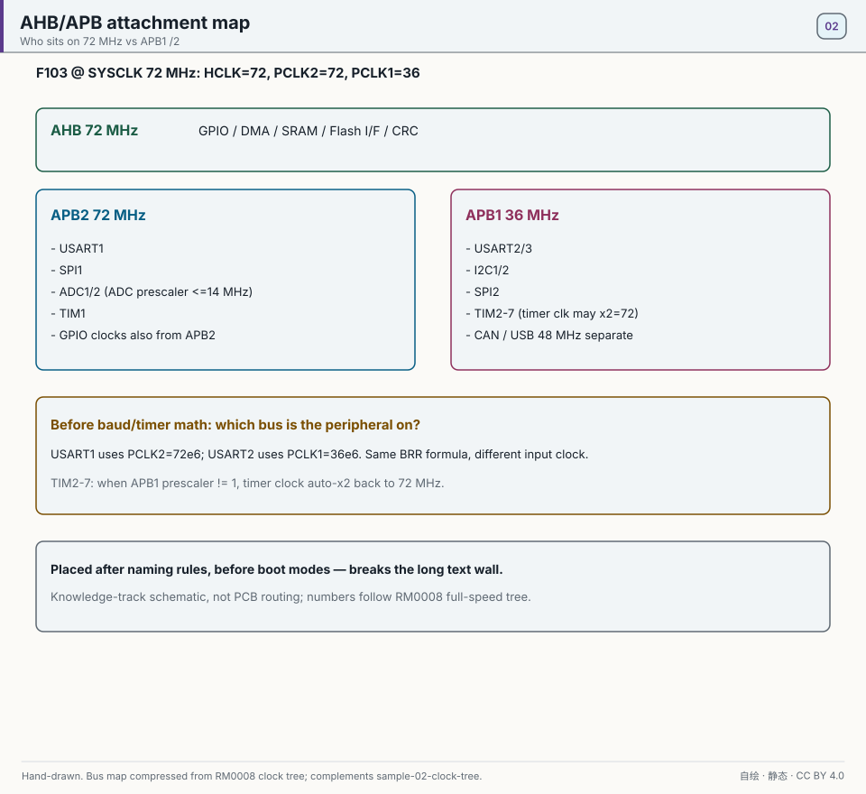
  <br><sub>▲ Drawn for this book. Ask which bus a peripheral sits on before baud/timer math.</sub>
</p>
<p align="center">
  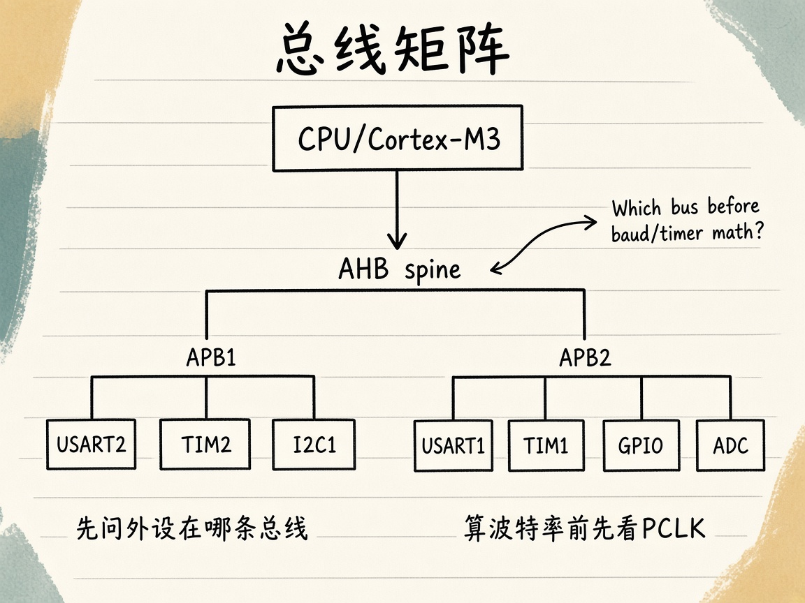
  <br><sub>▲ Knowledge track (Handraw · 原理示意 / not a photo). Ask which bus and which PCLK before baud or timer math; not a die photo.</sub>
</p>


Take **STM32F103C8T6**:

| Piece | Value | Meaning |
| --- | --- | --- |
| STM32 | — | ST's 32-bit MCU brand |
| F | F | Family: F = foundation / mainstream, L = low power, G = general purpose, H = high performance |
| 103 | 103 | Sub-family: 103 = F1 performance line (72 MHz, USB/CAN), 030 = F0, 407 = F4 |
| C | C | Pin count: T=36, C=48, R=64, V=100, Z=144, I=176 |
| 8 | 8 | Flash size: 4=16K, 6=32K, 8=64K, B=128K, C=256K, E=512K, G=1M |
| T | T | Package: T=LQFP, U=QFN, H=BGA, P=TSSOP |
| 6 | 6 | Temperature: 6=−40 to 85 °C, 7=−40 to 105 °C, 3=−40 to 125 °C |
| A | (optional suffix) | Part of the order code; check the complete code in the datasheet instead of guessing that it can be omitted |

So **STM32F103C8T6 = F1 performance line · 48 pins · 64 KB Flash · LQFP · −40 to 85 °C**.

<p align="center">
  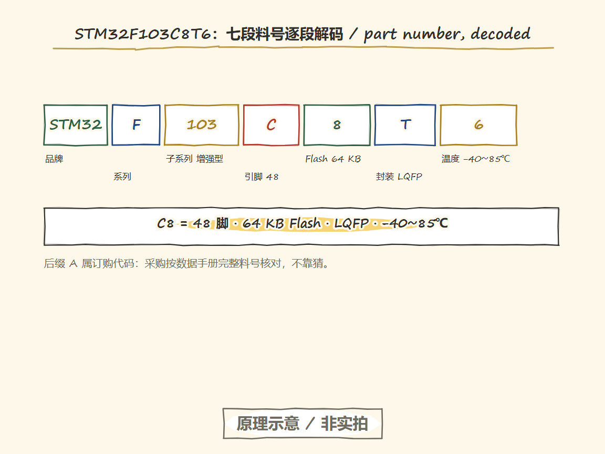
  <br><sub>▲ Knowledge track (Handraw · 原理示意 / not a photo). Where to look: the seven colored blocks with staggered labels — what STM32 / F / 103 / C / 8 / T / 6 each mean — and the banner "C8 = 48 pins · 64 KB Flash · LQFP · −40 to 85 °C"; proves every segment of the part number has a datasheet entry and ordering must use the complete code; does not replace the datasheet ordering-information table, nor a photo of the real silkscreen. See [DS5319](#source-ds5319-clock).</sub>
</p>

### 2. Family comparison

| Family | Common core | Common clock tier | Example Flash range | First selection boundary |
| --- | --- | --- | --- | --- |
| F0 | M0 | 48 MHz tier | 16–256 KB | Cost, package, and basic peripherals |
| F1 | M3 | 72 MHz tier | 64–512 KB | Legacy compatibility and available material |
| F3 | M4F | 72 MHz tier | 64–512 KB | Analog peripherals and motor control |
| F4 | M4F | 100–180 MHz tier | 128 KB–2 MB | FPU, DSP, and memory bandwidth |
| F7 | M7F | 216 MHz tier | 512 KB–2 MB | Cache, graphics, and fast interfaces |
| G0 | M0+ | 64 MHz tier | 16–512 KB | Cost, low power, and newer peripherals |
| G4 | M4F | 170 MHz tier | 32–512 KB | High-resolution timers and analog chains |
| H7 | M7F | Above 400 MHz | 512 KB–2 MB | Power domains, cache, and external memory |
| L0 | M0+ | 32 MHz tier | 8–192 KB | Standby current and wake sources |
| L4 | M4F | 80 MHz tier | 64 KB–1 MB | Run performance and low-power modes |

> This is a first-pass elimination table, not numbers from DS5319 or RM0008 and not a guarantee for every part. Check the candidate datasheet and ordering information before committing to a device.

### 3. Core features (Cortex-M)

| Feature | Cortex-M3 | Cortex-M4 | Cortex-M7 |
| --- | --- | --- | --- |
| Architecture | ARMv7-M | ARMv7E-M | ARMv7E-M |
| FPU | None | Optional single precision | Optional: none, single precision, or single + double precision |
| DSP extension | No | Yes | Yes |
| Maximum MPU regions | 8 | 8 | 16 |
| Cache | None | None | I-cache / D-cache; size is implementation-defined |
| TCM | None | None | ITCM / DTCM; size is implementation-defined |

These are processor-IP limits. Check the target MCU datasheet and reference manual for the FPU, cache, TCM, and MPU configuration that the silicon actually implements.

### 4. Memory map

Cortex-M splits the 4 GB address space into fixed regions:

| Address range | Region | Contents |
| --- | --- | --- |
| 0x0000_0000–0x1FFF_FFFF | Code | Alias of Flash / system memory; interrupt vector table |
| 0x2000_0000–0x3FFF_FFFF | SRAM | On-chip SRAM |
| 0x4000_0000–0x5FFF_FFFF | Peripheral | Every peripheral register |
| 0x6000_0000–0x9FFF_FFFF | External RAM | FSMC/FMC expansion |
| 0xA000_0000–0xDFFF_FFFF | External device | External device interface |
| 0xE000_0000–0xFFFF_FFFF | System | NVIC, SysTick, SCB (PPB) |

The memory-map animation:

<p align="center">
  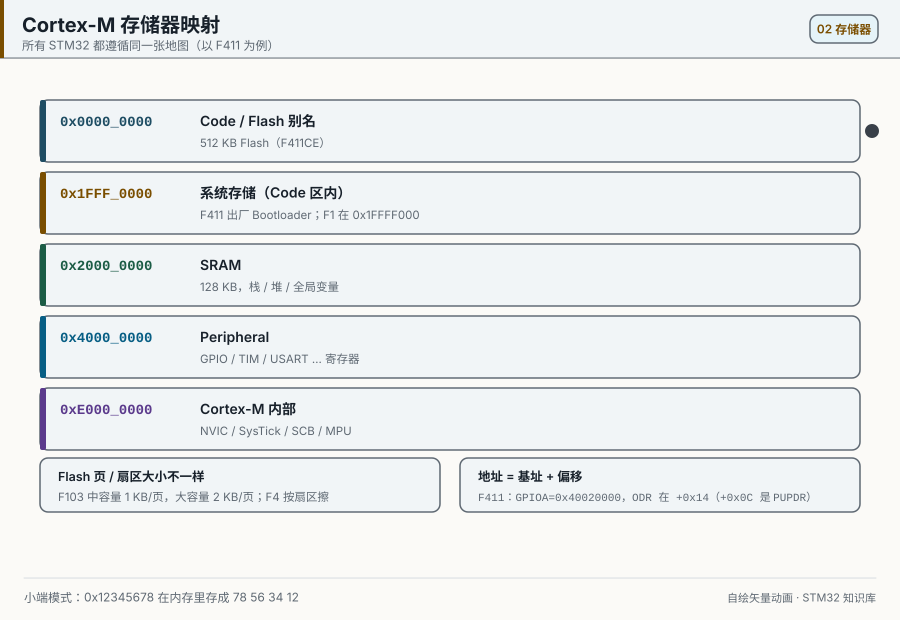
  <br><sub>▲ Animation: Cortex-M memory map (Flash / SRAM / peripherals / system region) (vector drawing by the author)</sub>
</p>

A typical F103C8: **64 KB Flash at 0x0800_0000, 20 KB SRAM at 0x2000_0000**.

The next figure turns "the board and the code disagree" into one ledger: it is written for Flash while the pins select SRAM.

<p align="center">
  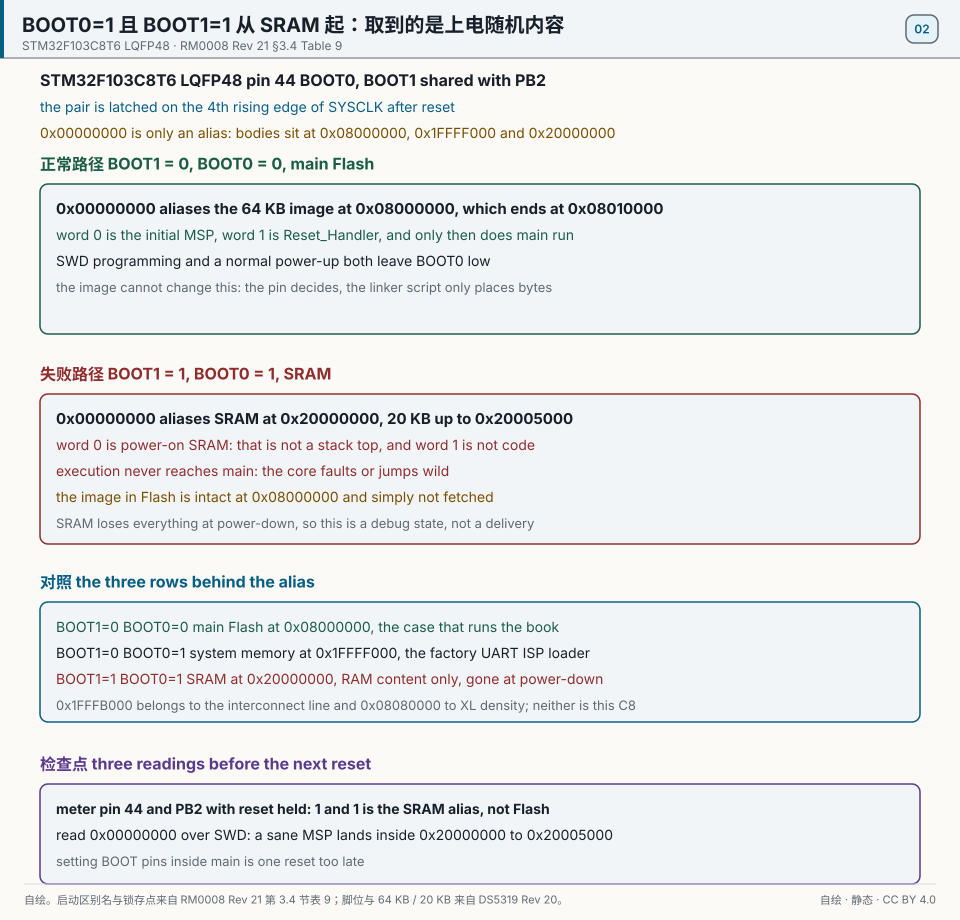
  <br><sub>▲ Drawn for this book. The top row is the selection chain: pin 44 BOOT0 and BOOT1 sharing PB2 decide which body 0x00000000 aliases - main Flash at 0x08000000 holding 64 KB (word 0 is the MSP, word 1 is Reset_Handler), system memory at 0x1FFF F000 with the factory bootloader, or internal SRAM at 0x20000000 with 20 KB up to 0x2000 5000, where word 0 is power-on content and not a stack top. The three rows in the middle are the three combinations; with BOOT0=0 the region is main Flash whatever BOOT1 reads, and the image in Flash is still there at 0x08000000, simply not fetched. The checkpoints below are the level on pin 44 and PB2 while reset is held, word 0 read at 0x00000000, and the fact that changing the BOOT pins while running waits for the next reset. The figure measures pin levels and says nothing about which bytes happen to sit in SRAM. Source: [RM0008 Rev 21 section 3.4 table 9](#source-rm0008-boot).</sub>
</p>
<p align="center">
  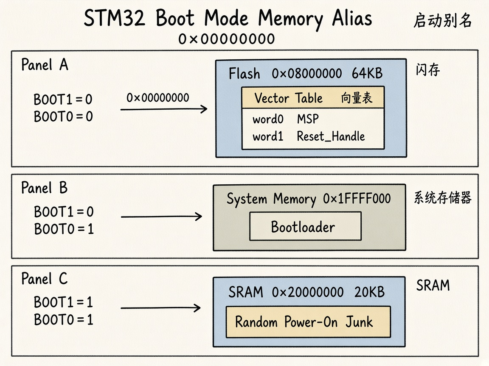
  <br><sub>▲ Knowledge track (Handraw · 原理示意 / not a photo). BOOT1/BOOT0 alias 0x00000000 to Flash / system memory / SRAM; not a board photograph.</sub>
</p>


### 5. Boot mode: BOOT0 / BOOT1

| BOOT1 | BOOT0 | Boot region | Use |
| --- | --- | --- | --- |
| x | 0 | Main Flash (0x0800_0000) | Normal run |
| 0 | 1 | System memory | Factory bootloader, UART ISP download |
| 1 | 1 | Embedded SRAM | Debug / unbrick (lost when power drops) |

### 6. Clock tree and dividers


<p align="center">
  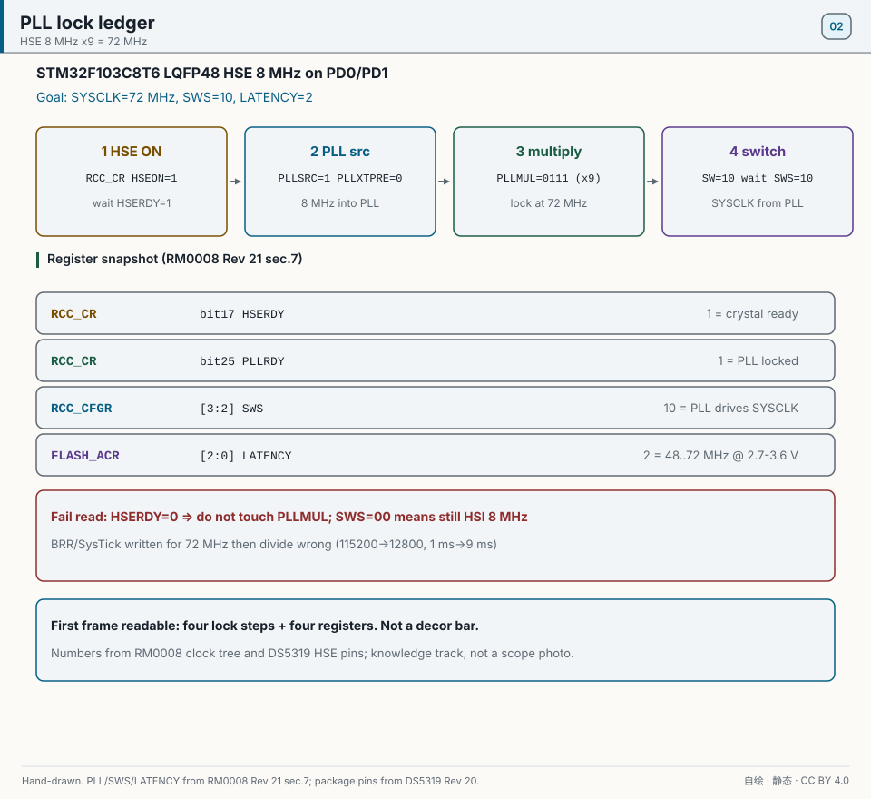
  <br><sub>▲ Drawn for this book. PLL lock ledger: HSERDY → PLLMUL×9 → SWS=10 → LATENCY=2. Knowledge track, not a scope photo.</sub>
</p>
<p align="center">
  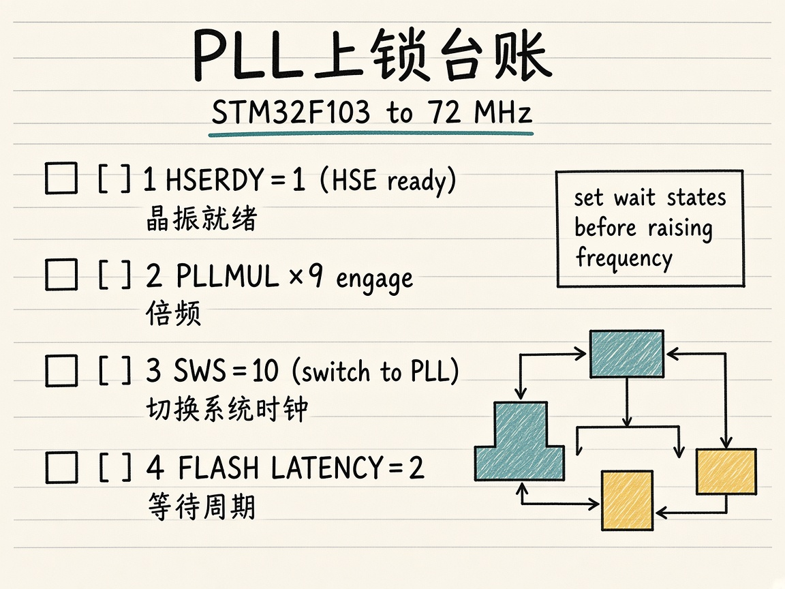
  <br><sub>▲ Knowledge track (Handraw · 原理示意 / not a photo). HSERDY → PLLMUL×9 → SWS=10 → LATENCY=2; raise wait states before raising frequency; not a register screenshot.</sub>
</p>


The chain: `HSE(8MHz) → PLL(×9) → SYSCLK(72MHz) → AHB prescaler → APB1/APB2`

| Clock | Source | Divider | Frequency | Ceiling |
| --- | --- | --- | --- | --- |
| SYSCLK | PLL | — | 72 MHz | 72 MHz |
| AHB (HCLK) | SYSCLK | ÷1 | 72 MHz | 72 MHz |
| APB1 (PCLK1) | AHB | ÷2 | 36 MHz | 36 MHz |
| APB2 (PCLK2) | AHB | ÷1 | 72 MHz | 72 MHz |
| ADC | APB2 ÷6 | — | 12 MHz | 14 MHz |
| USB | PLL ÷1.5 | — | 48 MHz | 48 MHz |

> [!WARNING]
> When the APB divider is greater than 1, the timer clock is **×2**. Example: APB1 = 36 MHz, so TIM2–7 run at 72 MHz.

Which bus a peripheral sits on:

<p align="center">
  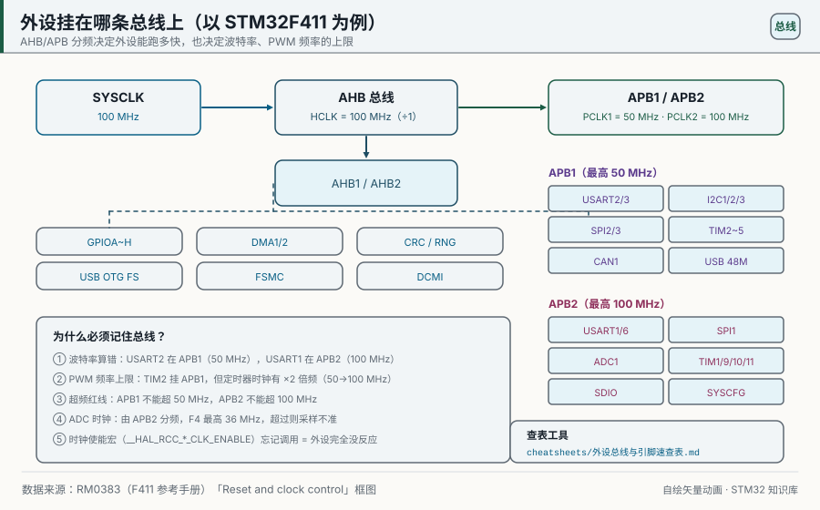
  <br><sub>▲ Figure: which peripherals hang on AHB, APB1, and APB2 (vector drawing by the author)</sub>
</p>

**Important RCC_CFGR bits (RM0008 Rev 21 medium-density section 7.3.2. Section 8.3.2 is the connectivity line and does not apply to STM32F103C8T6):**

| Field | Name | Meaning |
| --- | --- | --- |
| [1:0] | SW | System clock source: 00=HSI, 01=HSE, 10=PLL |
| [3:2] | SWS | Current system clock source (read only) |
| [7:4] | HPRE | AHB divider |
| [10:8] | PPRE1 | APB1 divider |
| [13:11] | PPRE2 | APB2 divider |
| [21:18] | PLLMUL | PLL multiply (×2 to ×16) |
| [16] | PLLSRC | PLL input: 0=HSI/2, 1=HSE |
| [17] | PLLXTPRE | HSE predivider |

The most common clock-tree failure is an HSE that never starts while the code computes everything for 72 MHz. Reading back the bits in the table above is exactly the debugging ledger below:

<p align="center">
  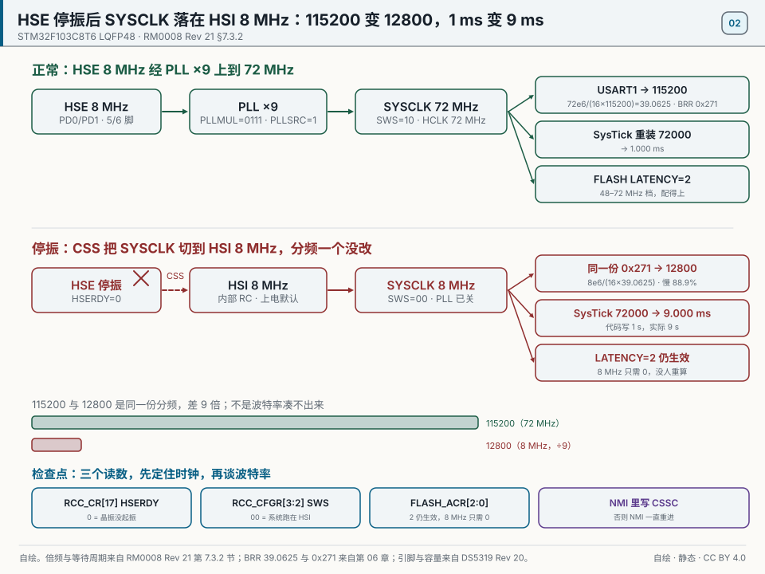
  <br><sub>▲ Drawn for this book. The top row is the 72 MHz ledger: HSE 8 MHz enters on pins 5 and 6, PLLMUL=0111 with PLLSRC=1 gives 72 MHz and SWS reads 10; USART1 at 115200 divides 72 MHz into 39.0625 so BRR holds 0x271, a SysTick reload of 72000 is 1.000 ms, and LATENCY=2 is the 48 to 72 MHz row. The middle row keeps that same ledger after the HSE stops and CSS moves SYSCLK to HSI at 8 MHz: 0x271 now divides 8 MHz down to 12800, one ninth of the rate, the 72000 reload becomes 9.000 ms, and LATENCY is still 2 because nobody recomputed it. The two bars below are the same divider nine times apart, and the three checkpoints are RCC_CR bit 17 HSERDY, SWS [3:2] in RCC_CFGR and LATENCY [2:0] in FLASH_ACR, followed by the CSSC write the NMI needs. The figure draws no crystal start-up waveform and cannot prove the 8 MHz part on your board is good; it only shows that every divider was computed for 72 MHz. Source: [RM0008 Rev 21 section 7.3.2](#source-rm0008-rcc).</sub>
</p>
<p align="center">
  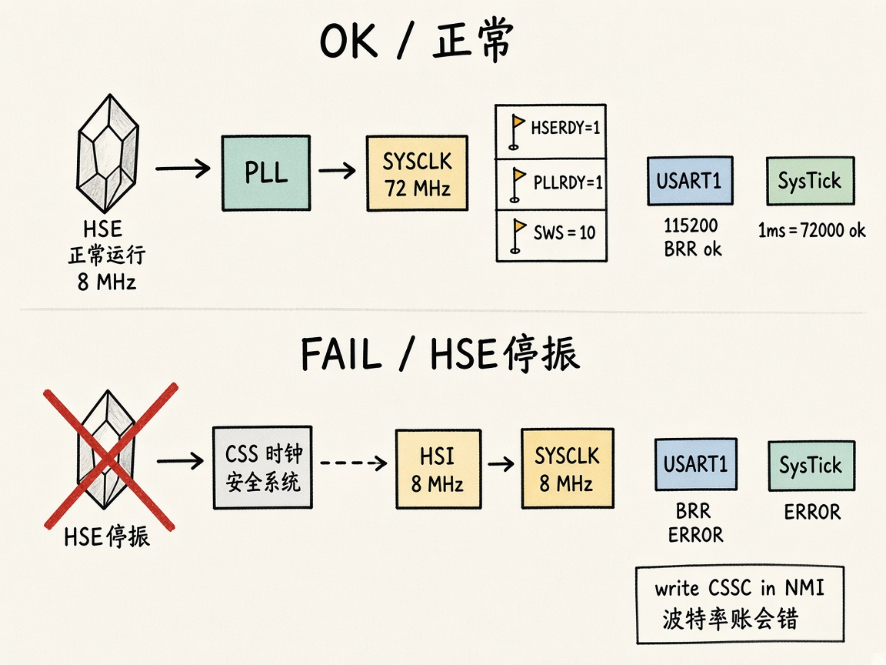
  <br><sub>▲ Knowledge track (Handraw · 原理示意 / not a photo). After CSS drops SYSCLK from 72 MHz to HSI 8 MHz, baud/SysTick math still assuming 72 MHz is wrong; not a scope capture.</sub>
</p>


## Hardware and wiring

| Board | Peripheral / signal | Pin | Notes |
| --- | --- | --- | --- |
| BluePill | HSE crystal | PD0/PD1 (8 MHz) | Already soldered; external crystal |
| BluePill | LSE crystal | PC14/PC15 (32.768 kHz) | For the RTC |
| BluePill | BOOT0 jumper | BOOT0 | The jumper selects the boot mode |
| BluePill | USB 5 V | 5V | Power |

## Code

Read the unique ID, the Flash size, and the current core clock, and print them on the UART to check the clock setup:

```c
/* chip_info.c —— read the unique ID / Flash size / current core clock */
#include "stm32f1xx_hal.h"
#include <stdio.h>

void SystemClock_Config(void);

/* read the 96-bit unique ID (RM0008 chapter 30) */
static void print_uid(void)
{
    uint32_t uid0 = *(volatile uint32_t *)0x1FFFF7E8;
    uint32_t uid1 = *(volatile uint32_t *)0x1FFFF7EC;
    uint32_t uid2 = *(volatile uint32_t *)0x1FFFF7F0;
    printf("UID: %08lX-%08lX-%08lX\r\n", uid0, uid1, uid2);
}

/* read Flash size (KB, low 16 bits at 0x1FFFF7E0) */
static uint16_t get_flash_kb(void)
{
    return (uint16_t)(*(volatile uint16_t *)0x1FFFF7E0);
}

int main(void)
{
    HAL_Init();
    SystemClock_Config();       /* assume 72MHz is already configured */

    uint32_t sysclk = HAL_RCC_GetSysClockFreq();
    uint32_t hclk   = HAL_RCC_GetHCLKFreq();
    uint32_t pclk1  = HAL_RCC_GetPCLK1Freq();
    uint32_t pclk2  = HAL_RCC_GetPCLK2Freq();

    printf("SYSCLK=%lu Hz, HCLK=%lu Hz\r\n", sysclk, hclk);
    printf("PCLK1=%lu Hz, PCLK2=%lu Hz\r\n", pclk1, pclk2);
    printf("Flash=%u KB\r\n", get_flash_kb());
    print_uid();

    while (1) { }
}
```

The register equivalent (read RCC_CFGR by hand):

```c
uint32_t cfgr  = RCC->CFGR;
uint32_t sws   = cfgr & RCC_CFGR_SWS;              /* current system clock source */
uint32_t hpre  = (cfgr & RCC_CFGR_HPRE)  >> 4;     /* AHB divider */
uint32_t ppre1 = (cfgr & RCC_CFGR_PPRE1) >> 8;     /* APB1 divider */
```

## Hands-on labs

1. **Lab 1 (read the chip):** Run the code above and print the core clock, Flash size, and unique ID. Check that they are 72 MHz and 64 KB.
2. **Lab 2 (measure the clock):** Select PLL÷2 for MCO, output 36 MHz on PA8, and measure it with a scope or frequency counter. Do not drive the 72 MHz SYSCLK directly onto MCO.
3. **Lab 3 (safe divider change):** Change PPRE1 from ÷2 to ÷4 and read back PCLK1 = 18 MHz with a 36 MHz TIM2 clock. Set TIM2_CH1 to PSC = 35 and ARR = 999; PA0 should output 1 kHz. Restore the original configuration afterward.

### 7. Flash wait states and core clock


<p align="center">
  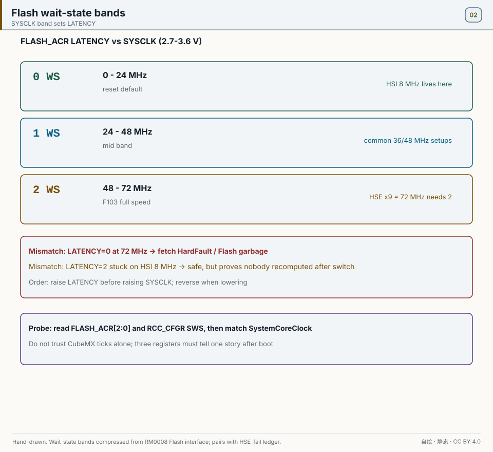
  <br><sub>▲ Drawn for this book. Wait-state bands: raise LATENCY before raising SYSCLK; reverse when lowering. Knowledge track.</sub>
</p>
<p align="center">
  
  <br><sub>▲ Knowledge track (Handraw · 原理示意 / not a photo). 0–24 / 24–48 / 48–72 MHz map to LATENCY 0/1/2; raise LATENCY first, lower it after; not a datasheet scan.</sub>
</p>


| Clock range | Wait states (LATENCY) |
| --- | --- |
| 0–24 MHz | 0 |
| 24–48 MHz | 1 |
| 48–72 MHz | 2 |

> Wait states are the LATENCY bits in `FLASH_ACR`. Set them wrong and the chip hangs or fetches bad instructions.

<p align="center">
  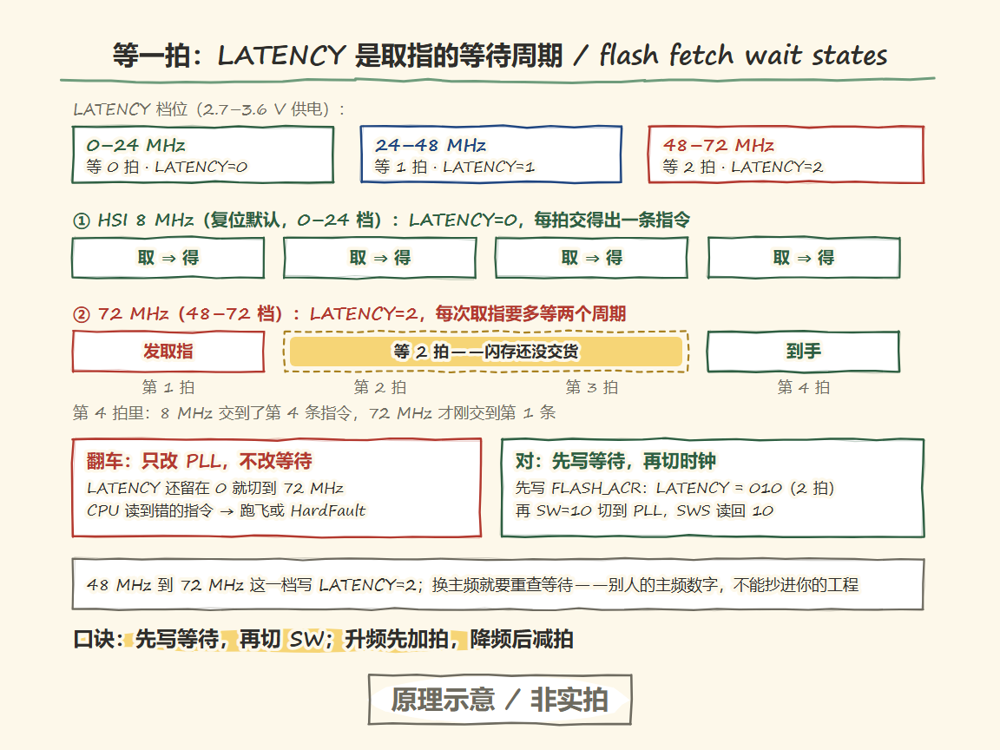
  <br><sub>▲ Knowledge track (Handraw · 原理示意 / not a photo). 0–24/24–48/48–72 MHz map to 0/1/2 wait cycles; at 72 MHz each fetch waits two extra cycles; write LATENCY=2 in FLASH_ACR before switching SW; not a scope capture.</sub>
</p>


### 8. How the clock tree differs by family (the points that matter)

| Family | Max SYSCLK | PLL shape | Notes |
| --- | --- | --- | --- |
| F1 | 72 MHz | HSE or HSI/2 ×N | No PLLM/PLLN/PLLP |
| F4 | 168 MHz | M/N/P/Q dividers | 48 MHz USB is supported |
| F7 | 216 MHz | More complicated | Oversampling is supported |
| G0 | 64 MHz | Simplified | Low power |

### 9. Common peripheral base addresses (F103)

| Peripheral | Base address |
| --- | --- |
| GPIOA | 0x40010800 |
| GPIOB | 0x40010C00 |
| GPIOC | 0x40011000 |
| USART1 | 0x40013800 |
| TIM2 | 0x40000000 |
| RCC | 0x40021000 |
| FLASH | 0x40022000 |

> CMSIS headers already define these (for example `GPIOA_BASE`). Use the macro. Do not hard-code the address.

### 10. Turn the clock on before you talk about CSS and MCO

Before the first write to a peripheral, call `__HAL_RCC_*_CLK_ENABLE()`. Power-up default is HSI at 8 MHz, not the 72 MHz shown on the Cube configuration page. If `SystemClock_Config()` has not completed, read `SWS` instead of guessing the core frequency from whether UART output looks normal.

| Mechanism | What it does | One thing to remember |
| --- | --- | --- |
| Peripheral clock gate | If you do not turn it on, that peripheral does not exist | `CLK_ENABLE` first, then `HAL_xxx_Init` |
| CSS | If HSE stops, switch back to HSI and enter NMI | `HAL_RCC_EnableCSS()` |
| MCO | Send an internal clock out to a pin for a scope | On F1 it is PA8; on F4, MCO1/MCO2 are PA8/PC9 |

On F1, the MCO field in `RCC_CFGR` selects SYSCLK / HSI / HSE / PLL÷2. When the APB prescaler is greater than 1, the timer clock is ×2 again. The 72 MHz in that figure is already the doubled number.

When the family changes, peripheral base addresses change. Use the CMSIS macros and do not hard-code them.

Before leaving this chapter, read the active source and APB dividers from `RCC_CFGR`, then keep one 36 MHz measurement from PA8 with MCO set to PLL÷2.

Self-test:

1. You wrote `GPIOA->CRL` and never enabled the GPIOA clock. Why does a read still come back 0?
2. The HSE crystal was never soldered. After CSS is enabled, where does the system clock land?
3. When the APB1 prescaler is 2, is TIM2's counter clock 36 MHz or 72 MHz?

## Related resources

- Official manuals: **RM0008** (chapter 2 memory map, chapter 8 RCC, chapter 30 device electronic signature); **DS5319** (F103C8 datasheet)
- Previous: [01 Setting Up the Development Environment](01-dev-environment.md) | Next: [03 GPIO and LEDs](03-gpio-and-led.md)
- Figures: [`assets/animations/clock-tree.svg`](../../assets/animations/clock-tree.svg), [`assets/animations/memory-map.svg`](../../assets/animations/memory-map.svg), [`assets/diagrams/peripheral-bus.svg`](../../assets/diagrams/peripheral-bus.svg)
- Hardware and documents: the product-selector pages for each family on ST's website
- Disclaimer: every illustration in this repo is a vector drawing or a program-generated animation by the author, not a manufacturer's photograph.
