# 03 GPIO and LEDs
> 中文：[GPIO 与 LED](../03-GPIO与LED.md)

> Writing 0 lights PC13, writing 1 lights the external LED on PA0, and pressing the PA1 button reads as 0. Measure those three relationships before discussing modes, registers, and debounce.

<p align="center">
  
  <br><sub>▲ Animation: a GPIO push-pull output lighting an LED (level, current, and waveform together; vector drawing by the author)</sub>
</p>

<!-- video:ch03 -->
<p align="center">
  <video width="640" controls poster="../../assets/video/ch03-gpio.png">
    <source src="../../assets/video/ch03-gpio.mp4" type="video/mp4">
  </video>
  <br><sub>▲ Chapter video with Chinese voice-over (2.9 min). <a href="../../assets/video/ch03-gpio.mp4">MP4</a> · <a href="../../assets/video/ch03-gpio.srt">subtitles</a></sub>
</p>

<details>
<summary>Narration script (Chinese, same text as the subtitles)</summary>


1. 先问一个反常识的问题。BluePill 的板载灯接在 PC13，你写 1，灯反而灭；写 0，它才亮。别急着背结论，先看电流到底从哪儿走。
2. 先别翻八种模式表。打开 GPIOC 时钟，把 PC13 配成推挽输出：写 RESET 灯应亮，写 SET 灯应灭。调试器读 ODR 的 bit13，或量 PC13 对地电压；对上了再往下听。
3. 共阳接法：阳极在 3.3 伏，PC13 拉低才有灌电流，灯才亮。写 1 时 PMOS 拉高，灌电流断开，灯灭。这张图是原理演示，不是实测电流。
4. 推挽高低都有人驱动；开漏只会拉低，高电平靠外部上拉，I2C 就靠这个。按键另一端接 GND 时引脚要上拉：空闲为高，按下为低。内部上拉只管空闲，不给外设供电。
5. PA0 共阴常写 1 才亮；PC13 共阳写 0 才亮。亮灭反了先翻译有效电平。PC13 灌电流上限 3 毫安，不能当电流源点外接灯。
6. F1 把外设换脚要先开 AFIO，再写 MAPR。5 伏只认数据手册标了 FT 的脚。锁定是掩码不变，写 1、写 0、再写 1，然后读两次，第二次确认 LCKK 等于 1。
7. 离开前只留一件验收：让 PC13 按你算过的延时以 1 赫兹翻转，并能口述从 3.3 伏经灯流入引脚的路径。主循环一堵，短按会丢——下一章用边沿敲门，这里不背三道题。

</details>
<!-- /video:ch03 -->
## Minimum victory

Ignore the eight-mode table for a moment. Flash [`examples/gpio-blink/`](../../examples/gpio-blink/) and do only this:

1. Enable the `GPIOC` port clock and configure PC13 as a push-pull output.
2. `HAL_GPIO_WritePin(GPIOC, GPIO_PIN_13, GPIO_PIN_RESET)` — expect the **onboard LED on**.
3. Write `GPIO_PIN_SET` — expect the **LED off**.
4. Accept it: read bit 13 of `GPIOC->ODR` in the debugger, or measure PC13 to ground with a meter. When the lamp is on the bit is 0 and the voltage is near 0 V; when it is off the bit is 1 and the voltage is near 3.3 V.

Only after that match, read modes, series resistance, and the lock. If it does not match, use the three ODR / clock / common-anode rows in Pitfalls and sources before rewriting the resistor formula.

<p align="center">
  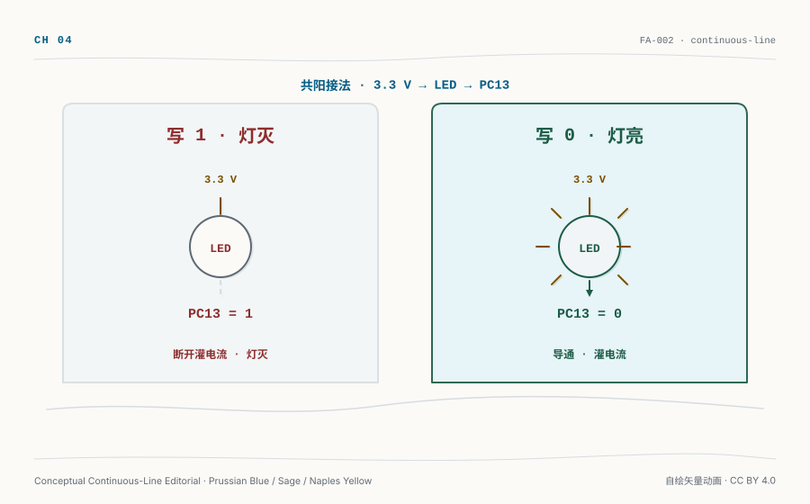
  <br><sub>▲ Knowledge track (Handraw · principle diagram / not a photograph). It shows the write versus the common-anode current direction. It is not a meter reading and not a photograph. File <code>assets/illustrations/ch03-handdraw.svg</code>; full SHA-256 is in <code>stm32-book/audits/ch03-converge-gate.md</code>.</sub>
</p>

<p align="center">
  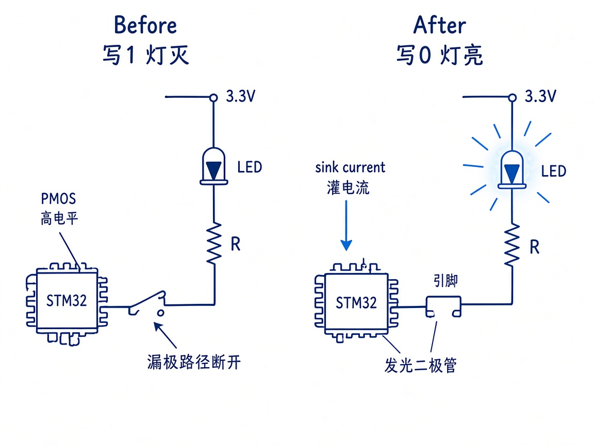
  <br><sub>▲ Knowledge track (Handraw · 原理示意 / not a photo). Side-by-side write 0 versus write 1 on a common-anode path; not a meter reading and not a board photograph.</sub>
</p>


## Principle and scope

After the minimum victory matches the lamp, pin numbers and current limits start to matter. Pin numbers and current limits in this chapter are for the STM32F103C8T6 in LQFP48. [DS5319 Rev 20](#source-ds5319-gpio) Figure 8 and Table 5 place PA0-WKUP on pin 10 and PC13-TAMPER-RTC on pin 2.

PA0 may source current. As a push-pull output written to 1, current leaves the pin from 3.3 V through the internal PMOS, then through the resistor and the LED to ground. The example arithmetic is `(3.3 − 2.0) / 0.005 = 260`, fitted as 270 Ω. The 2.0 V and 5 mA are estimates the [example](#source-project-examples) picked for an ordinary red LED, not a datasheet recommendation. An LED of another colour has a different drop, so recompute the resistor.

PC13, PC14, and PC15 sit behind the power switch. Note 5 of the same datasheet limits them to 3 mA of sink current, 2 MHz, and 30 pF, and they must not source an LED. The BluePill onboard LED can still use PC13 because its anode is at 3.3 V and the pin only sinks; writing 0 lights it. So the PA0 "write 1 to light" circuit cannot be copied onto PC13 as is.

The 25 mA and 50 MHz in the speed table later do not apply to PC13–PC15. A different package moves pins 2 and 10, so look them up again in Table 5. F1 moves alternate functions in groups through the AFIO MAPR register; F4 gives every pin its own AFR field, which is not in RM0008, so read the F4 reference manual for that.

## Key figures


<p align="center">
  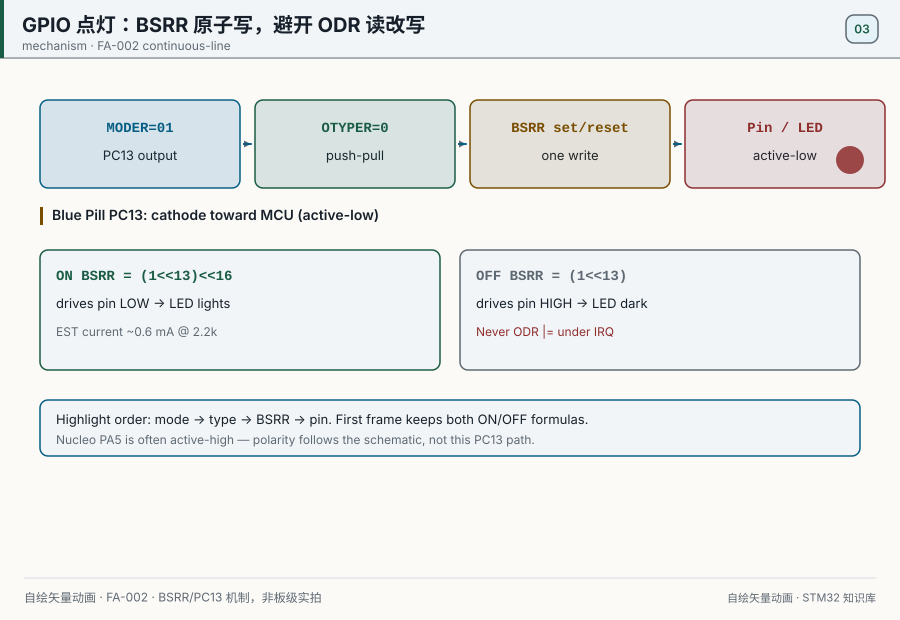
  <br><sub>▲ Hand-drawn CSS animation (FA-002). Mode→type→BSRR→pin; polarity follows the wiring.</sub>
</p>


<p align="center">
  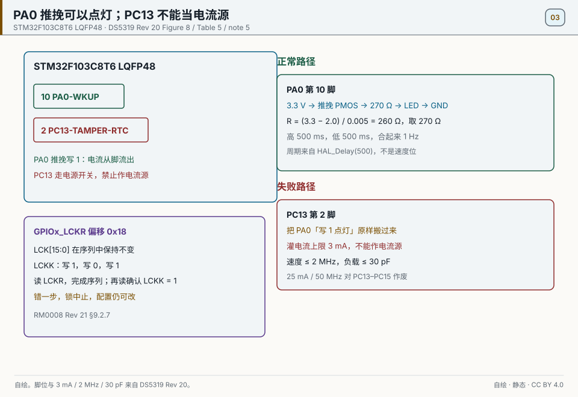
  <br><sub>▲ Drawn for this book. STM32F103C8T6, LQFP48: PA0 is pin 10 and PC13 is pin 2. The upper half is the correct wiring: 3.3 V through a push-pull pin and 270 Ω into the LED; 260 Ω is the quotient (3.3 − 2.0) / 0.005. The lower half is the mistake of copying that circuit onto PC13: note 5 allows 3 mA sink, at most 2 MHz, into 30 pF. The lock sequence is GPIOx_LCKR at offset 0x18. Pin and current facts are [DS5319 Rev 20](#source-ds5319-gpio) Table 5, Figure 8, and note 5. The lock and SWD pins are [RM0008 Rev 21](#source-rm0008-gpio) section 9.2.7 and section 9.3.5 Table 36.</sub>
</p>

<p align="center">
  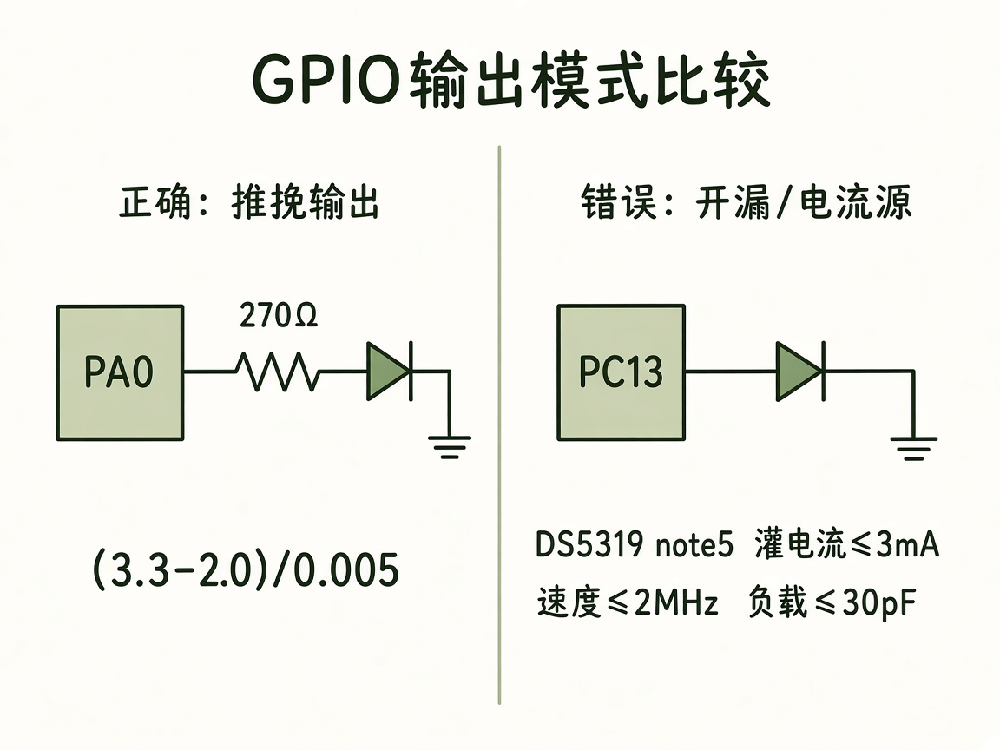
  <br><sub>▲ Knowledge track (Handraw · 原理示意 / not a photo). Correct PA0 external LED versus the mistake of putting that current on PC13; not a wiring photograph.</sub>
</p>


## Timing and state

The 1 Hz high and low times are not a GPIO speed-bit result. High 500 ms and low 500 ms come from the [gpio-blink example](#source-project-examples) `HAL_Delay(500)`. Writing the speed bits as 50 MHz does not turn PC13 into a pin that may source an LED.

| Step | LCK[15:0] | LCKK | Read-back | Result |
| --- | --- | --- | --- | --- |
| 1 | Hold the pins to lock | Write 1 | — | Sequence starts |
| 2 | Same mask | Write 0 | — | Sequence continues |
| 3 | Same mask | Write 1 | — | Writes are done |
| 4 | Same mask | — | First read of LCKR completes the write/read sequence | Sequence complete |
| 5 | Same mask | — | Second read confirms LCKK = 1 | Locked until reset |
| Failure | Mask changes, or a write/read is skipped | — | Second confirmation is not 1 | Lock aborts; the configuration can still change |

The register is `GPIOx_LCKR` at offset `0x18`. Source: [RM0008 Rev 21 section 9.2.7](#source-rm0008-gpio).

<p align="center">
  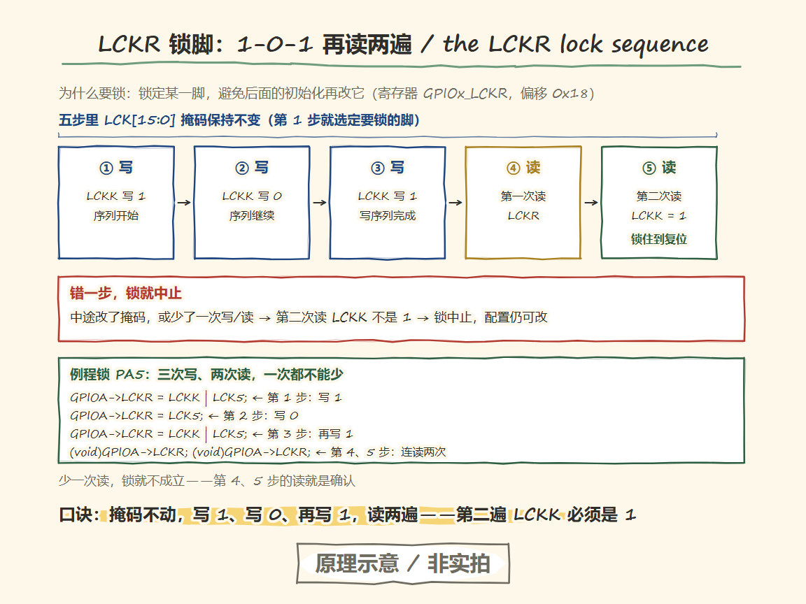
  <br><sub>▲ Knowledge track (Handraw · 原理示意 / not a photo). GPIOx_LCKR at offset 0x18: the mask stays unchanged, LCKK is written 1-0-1, then two reads — the second must confirm LCKK = 1, locked until reset; not a register screenshot.</sub>
</p>


## Pitfalls and sources

| Symptom | Cause | What to do | Source | What the source shows |
| --- | --- | --- | --- | --- |
| An external LED on PC13 does not behave like PA0 when the pin is written 1 | PC13 must not source the LED | Move the external LED to PA0 with 270 Ω | [DS5319 Rev 20 note 5](#source-ds5319-gpio) | LQFP48 pin 2 is PC13; PC13–PC15 sink at most 3 mA, at or below 2 MHz, into 30 pF |
| The onboard LED stays dark when PC13 is written 1 | The onboard LED is common-anode; PC13 lights it by sinking | Write 0 | [gpio-blink example](#source-project-examples) | The BluePill wiring. The 3 mA limit is in the datasheet |
| An ODR write does nothing on the pin | The port clock is still off | Enable that GPIO port clock, then write CRL/CRH | [RM0008 GPIO](#source-rm0008-gpio) | Enable the port clock before writing the section 9 configuration registers |
| Three writes to LCKR still leave the pin editable | The sequence was broken, or the confirming read was not 1 | Keep the mask, write 1, write 0, write 1, then make two consecutive reads; the second must confirm LCKK = 1 | [RM0008 section 9.2.7](#source-rm0008-gpio) | A finished lock holds until reset; one bad step aborts it |
| The probe never connects after a flash | PA13 and PA14 were configured as ordinary GPIO | Leave SWD on PA13 and PA14 | [RM0008 Table 36](#source-rm0008-gpio) | SWDIO is PA13 and SWCLK is PA14 |

Button bounce is not in this table: the usual 10 ms to 20 ms debounce time is a rule of thumb, and neither RM0008 nor DS5319 gives it. The lab still debounces the button; just do not treat that number as a manual requirement.
## Learning goals

Before you leave, without looking back you should be able to:

- [ ] Say that common-anode PC13 lights on write 0 and goes dark on write 1, and name the break case (an external common-cathode LED)
- [ ] Use an ODR readback or a pin voltage to tell “the config never reached the peripheral” from “the wiring is inverted”
- [ ] Compute a series resistor for a PA0 external LED with `R = (Vcc − Vf) / I`, and mark Vf and I as example estimates
- [ ] Drive PC13 with both HAL and BSRR, and name the concurrency boundary of an ODR read-modify-write
- [ ] List what must be rechecked on a port: package pin numbers, note 5 for PC13–PC15, the FT mark, and F1 AFIO versus F4 AFR


## Core ideas

A GPIO configuration must answer three questions: who drives the signal, what sets the idle level, and whether GPIO or a peripheral owns the pin. Miss one and the register write may succeed while the pin still has the wrong level.


<p align="center">
  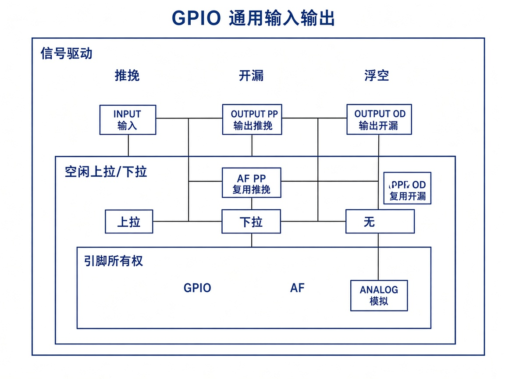
  <br><sub>▲ Knowledge track (Handraw · 原理示意 / not a photo). Answer driver, idle level, and pin ownership before configuring; not a register screenshot.</sub>
</p>

### 1. The 8 GPIO modes

| Mode (HAL macro) | Direction | Output stage | Pull | Typical use |
| --- | --- | --- | --- | --- |
| `GPIO_MODE_INPUT` + Pull=`GPIO_NOPULL` | Input | — | Floating | Something else already pulls the pin, or you are reading a digital output |
| `GPIO_MODE_INPUT` + Pull=UP | Input | — | Pull-up | Button to GND (active low) |
| `GPIO_MODE_INPUT` + Pull=DOWN | Input | — | Pull-down | Button to VCC (active high) |
| `GPIO_MODE_ANALOG` | Input | Off | — | ADC sample, low power |
| `GPIO_MODE_OUTPUT_PP` | Output | Push-pull | — | LED, a drive signal (strong high and low) |
| `GPIO_MODE_OUTPUT_OD` | Output | Open-drain | — | I2C, an external pull-up, or wired-AND |
| `GPIO_MODE_AF_PP` | Alternate | Push-pull | — | UART / SPI / PWM output |
| `GPIO_MODE_AF_OD` | Alternate | Open-drain | — | Hardware I2C, SMBus |

> On F1, a peripheral input is normally configured as an input; alternate output uses `GPIO_MODE_AF_PP/OD`. F4/F7 also require an `Alternate` function number. Do not copy HAL mode names from one family into another.

### 2. Output speed and current

| Parameter | Value | Notes |
| --- | --- | --- |
| Output speed (F1) | 2/10/50 MHz | Steeper edges cost more EMI. PC13, PC14, and PC15 do not use this row; their limit is in Principle and boundary. |
| Output speed (F4 and later) | Low/Medium/High/Very High | These are different drive strengths |
| Sink or source, one pin | 25 mA (F103) | Other pins still use this row. PC13, PC14, and PC15 do not use this row; their limit is in Principle and boundary. |
| Current for the whole port | 150 mA (F103) | The sum of every IO |
| Internal pull-up / pull-down | 30–50 kΩ (F1) | A weak pull. The drive is limited |

### 3. Push-pull versus open-drain

| Comparison | Push-pull | Open-drain |
| --- | --- | --- |
| Where a high comes from | The PMOS actively pulls up to VDD | High impedance; an external pull-up provides the high |
| Where a low comes from | The NMOS actively pulls down to GND | The NMOS actively pulls down to GND |
| Wired-AND? | No | Yes, tie pins together and you get wired-AND |
| Typical use | LED, ordinary digital output | I2C, level shift, a shared bus |
| Current path | High: VDD→PMOS→pin. Low: pin→NMOS→GND | Low: pin→NMOS→GND. High: none (the external pull-up does it) |


<p align="center">
  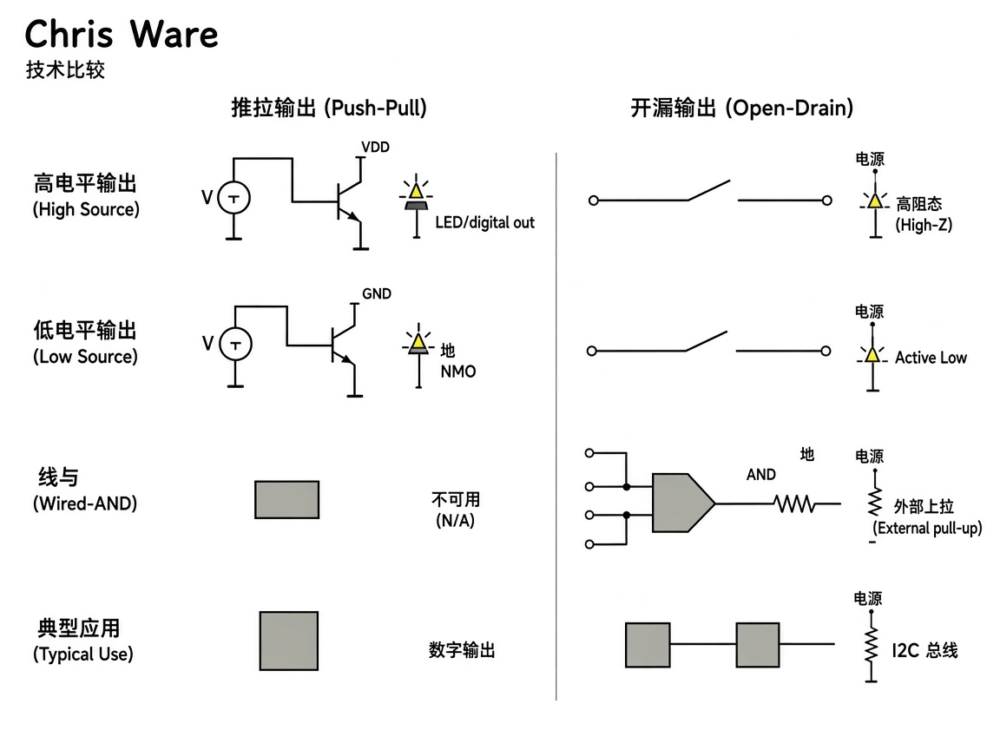
  <br><sub>▲ Knowledge track (Handraw · 原理示意 / not a photo). Push-pull drives high and low; open-drain only sinks, with the high from an external pull-up; not a scope capture.</sub>
</p>

### 4. LED series resistor


<p align="center">
  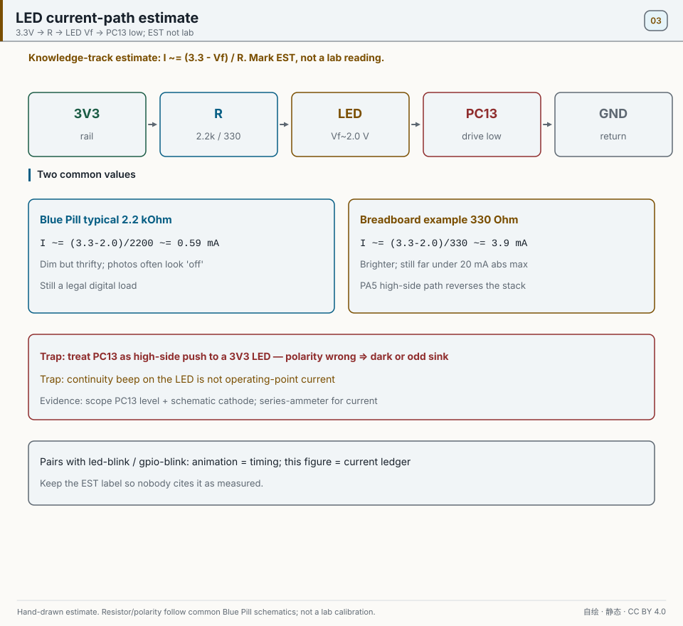
  <br><sub>▲ Hand-drawn EST. ~0.59 mA @ 2.2k; ~3.9 mA @ 330. Not a lab reading.</sub>
</p>

<p align="center">
  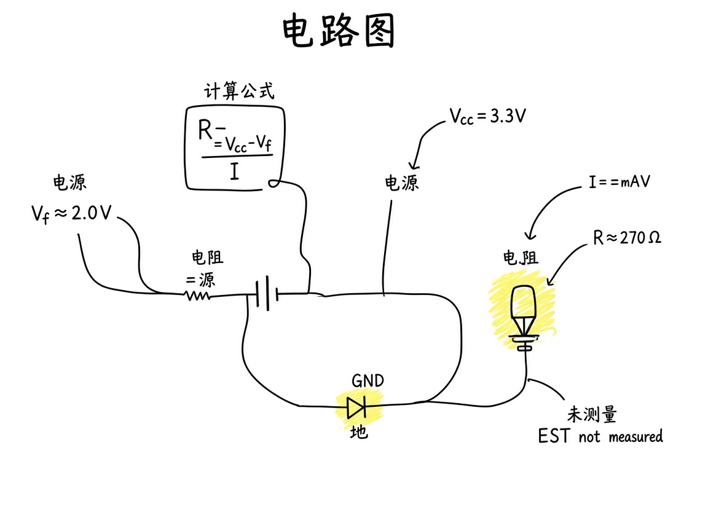
  <br><sub>▲ Knowledge track (Handraw · 原理示意 / not a photo). Choose R from estimated Vf and target current; not a measured current reading.</sub>
</p>


`R = (Vcc − Vf) / I`

| Parameter | Typical value | Notes |
| --- | --- | --- |
| Vcc | 3.3 V | Supply |
| Vf (red) | 1.8–2.2 V | Forward drop |
| Vf (green / blue / white) | 2.8–3.2 V | Blue and white are higher, and on 3.3 V they can look dim |
| I (target) | 5–10 mA | Enough for an ordinary indicator LED |

The worked example for this orderable is in Principle and boundary, and it is an example-project fact rather than a datasheet cell. This section keeps only the formula.

### 5. GPIO registers (F1)


<p align="center">
  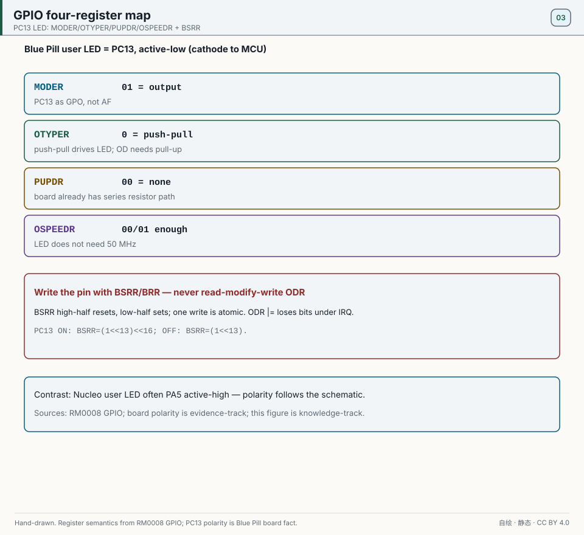
  <br><sub>▲ Drawn for this book. Four-register setup + atomic BSRR; never ODR RMW.</sub>
</p>


| Register | Role |
| --- | --- |
| CRL / CRH | Mode and speed for the low 8 pins / the high 8 pins |
| IDR | Input data register (read the pin level) |
| ODR | Output data register (read or write the pin level) |
| BSRR | Bit set/reset register. Writing 1 is what acts. Atomic |
| BRR | Bit reset register (F1 has it; on F4 it is folded into BSRR) |

## Hardware and wiring

> **Evidence-track status:** The figures below are three third-party Blue Pill photographs (two CC BY-SA 4.0: Avandalen `Blue_Pill.jpg`; Popolon `Core Learning Board module Arduino STM32 F103 C8T6.jpg`, 2018-09-08; one MIT: Paul Gallagher / tardate `BluePill_usb_powered.jpg`, USB-powered with one onboard LED lit). They are only for recognizing the board's overall look and pin layout (the onboard PC13 LED sits on the USB-connector side per the board schematic/silkscreen; too small to resolve in these photos, and the lit LED in the MIT photo cannot be identified as PC13) — not a measurement from this book's lab. **A PC13 LED close-up and the meter or logic-analyzer capture from this experiment are still to be supplied** — do not use an AI-generated image as evidence. The Handraw and stack figures above are knowledge-track only (labeled principle diagram / not a photograph) and must not be registered as evidence-track. Knowledge-track files and SHA-256 values are recorded in stm32-book/audits/ch03-converge-gate.md; photo source and license are registered in assets/photos/README.md.

<figure class="photo-spread">
  <div class="photo-pair">
    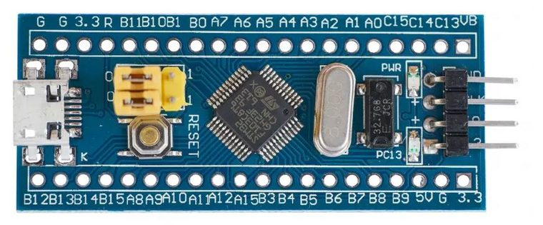
    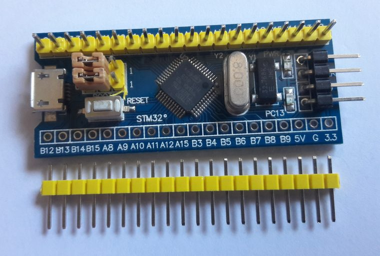
  </div>
  <figcaption>▲ Hardware reference photos (two CC BY-SA 4.0 photographs): left Avandalen / Wikimedia Commons <code>Blue_Pill.jpg</code>; right Popolon / Wikimedia Commons <code>Core Learning Board module Arduino STM32 F103 C8T6.jpg</code> (2018-09-08). Both carry the STM32F103C8T6 — the same part used in this chapter's lab. The onboard PC13 LED sits on the USB-connector side (per schematic/silkscreen; too small to resolve here). Use them only to recognize the board's overall look and pin layout; a PC13 LED close-up and meter capture are still missing; these photos contain no wiring or measurement scene and are not experimental evidence. Source and processing are in <code>assets/photos/README.md</code>.</figcaption>
</figure>

<figure class="photo-spread">
  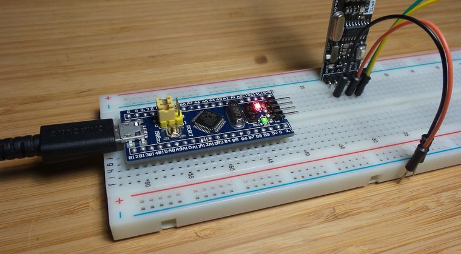
  <figcaption>▲ Photo: Paul Gallagher / <code>tardate/LittleArduinoProjects</code> (MIT, Copyright (c) 2014 Paul Gallagher). The board is an STM32F103C8T6 Blue Pill on USB power with one onboard LED lit. The silkscreen is not readable, so it cannot be confirmed whether this is the PC13 user LED or the power LED; it is not a PC13 LED close-up, and it contains no meter scene, so it is not experimental evidence. Source and processing are in <code>assets/photos/README.md</code>.</figcaption>
</figure>

| Board | Peripheral | Pin | Notes |
| --- | --- | --- | --- |
| BluePill | Onboard LED | PC13 | **Common-anode wiring; lights when the pin is low** |
| BluePill | External LED | PA0 | 270 Ω in series; lights when the pin is high |
| BluePill | Button | PA1 | The other side to GND; internal pull-up |

External LED wiring: PA0 → 270 Ω → LED anode, LED cathode → GND (**common cathode**, lights when the pin is high).
The onboard LED is **common anode**: the anode is tied to 3.3 V, and PC13 has to pull low before current flows, so it **lights when the pin is low**.

<p align="center" class="wide-figure" tabindex="0">
  <a href="../../assets/diagrams/stack-gpio-pc13-led.png">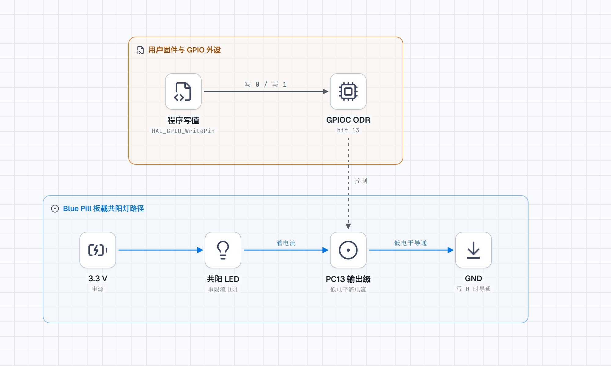</a>
  <br><sub>▲ Knowledge track (principle diagram / not a photograph). The diagram separates a program write from electrical current. Writing 0 turns on the PC13 output stage, so current flows from 3.3 V through the common-anode LED and its series resistor into the pin. It explains active-low behaviour; it does not measure current or replace the schematic of a particular clone board. <a href="../../assets/diagrams/stack-gpio-pc13-led.html">HTML source</a> · <a href="../../assets/diagrams/stack-gpio-pc13-led-dark.png">dark image</a> · Lucide icons.</sub>
</p>

<p align="center">
  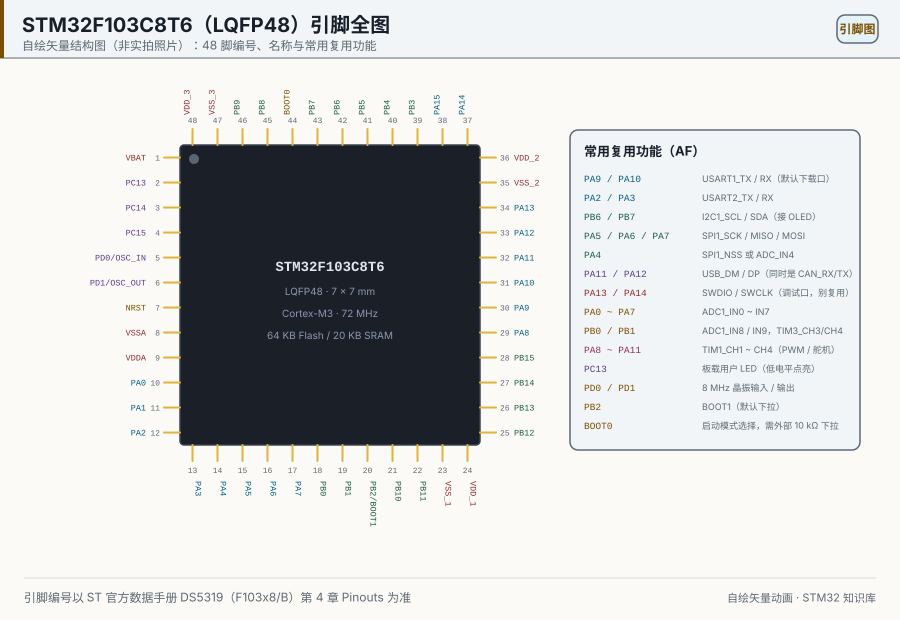
  <br><sub>▲ This chapter uses PA0, PA1, and PC13; PA13 and PA14 stay assigned to SWD. The drawing locates pins and silkscreen labels. It does not replace the clone board's schematic or prove that a pin has the correct electrical level (FA-029 · IG-002 · C-03/C-10/C-27/C-31).</sub>
</p>

This chapter polls PA1 in the main loop. Chapter 04 moves the button to PA0/EXTI0; remove the external LED from PA0 first, while PC13 remains the result indicator.

## Code

```c
/* gpio_blink.c —— GPIO output blinks an LED and reads a button (HAL) */
#include "stm32f1xx_hal.h"

#define LED_PIN    GPIO_PIN_13
#define LED_PORT   GPIOC
#define KEY_PIN    GPIO_PIN_1
#define KEY_PORT   GPIOA

void SystemClock_Config(void);

static void gpio_init(void)
{
    GPIO_InitTypeDef io = {0};

    __HAL_RCC_GPIOC_CLK_ENABLE();
    __HAL_RCC_GPIOA_CLK_ENABLE();

    /* PC13 push-pull output (onboard LED, lights when low) */
    io.Pin   = LED_PIN;
    io.Mode  = GPIO_MODE_OUTPUT_PP;
    io.Pull  = GPIO_NOPULL;
    io.Speed = GPIO_SPEED_FREQ_LOW;
    HAL_GPIO_Init(LED_PORT, &io);

    /* PA1 input, internal pull-up (button to ground reads low) */
    io.Pin  = KEY_PIN;
    io.Mode = GPIO_MODE_INPUT;
    io.Pull = GPIO_PULLUP;
    HAL_GPIO_Init(KEY_PORT, &io);
}

int main(void)
{
    HAL_Init();
    SystemClock_Config();
    gpio_init();

    while (1)
    {
        /* while the button is pressed (low), light the LED */
        GPIO_PinState key = HAL_GPIO_ReadPin(KEY_PORT, KEY_PIN);
        HAL_GPIO_WritePin(LED_PORT, LED_PIN,
                          (key == GPIO_PIN_RESET) ? GPIO_PIN_RESET : GPIO_PIN_SET);
    }
}
```

Three ways to drive PC13, with on and off kept separate. HAL and direct BSRR are both atomic; ODR read-modify-write is not:

```c
/* 1) HAL function: it also writes BSRR underneath */
HAL_GPIO_WritePin(GPIOC, GPIO_PIN_13, GPIO_PIN_RESET);   /* PC13 = 0: LED on */
HAL_GPIO_WritePin(GPIOC, GPIO_PIN_13, GPIO_PIN_SET);     /* PC13 = 1: LED off */

/* 2) direct BSRR: atomic set/reset */
GPIOC->BSRR = GPIO_BSRR_BR13;   /* reset PC13 = 0: LED on */
GPIOC->BSRR = GPIO_BSRR_BS13;   /* set PC13 = 1: LED off */

/* 3) ODR read-modify-write: a concurrency race boundary */
GPIOC->ODR &= ~GPIO_ODR_ODR13;  /* PC13 = 0: LED on */
GPIOC->ODR |= GPIO_ODR_ODR13;   /* PC13 = 1: LED off */
```

Bit-banding (F1 supports it: one alias address drives a single bit):

```c
/* bit-band alias: map bit 13 of peripheral address 0x4001100C (GPIOC_ODR) to an alias address */
#define BITBAND_PERIPH(addr, bit) \
    (*(volatile uint32_t *)(0x42000000UL + ((addr) - 0x40000000UL) * 32 + (bit) * 4))

#define PC13_OUT  BITBAND_PERIPH(0x4001100CUL, 13)   /* GPIOC->ODR bit13 */
PC13_OUT = 0;   /* write 0 or 1 directly, no read-modify-write, same effect as ODR */
```

The full project is in [`examples/gpio-blink/`](../../examples/gpio-blink/).

<p align="center">
  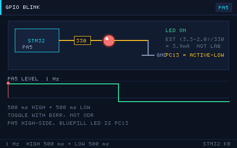
  <br><sub>▲ Expected result: PC13 is active low, and toggling every 500 ms gives a 1 s period. The animation shows the logic only; acceptance still requires an ODR/IDR readback or a measured pin period.</sub>
</p>

## Hands-on labs

1. **Lab 1:** Blink the PC13 onboard LED at 1 Hz (compare with `gpio-blink.svg` and `led-blink.gif`).
2. **Lab 2:** Put an external LED on PA0, compute and fit a 270 Ω resistor, and let the PA1 button control the LED.
3. **Lab 3 (expose the polling boundary):** Add a blocking 100 ms task to each main-loop pass, then make a short press on PA1. Record the missed press or response delay; remove the block and repeat. Chapter 04 fixes this with EXTI.

### 6. Button circuits and debounce


<p align="center">
  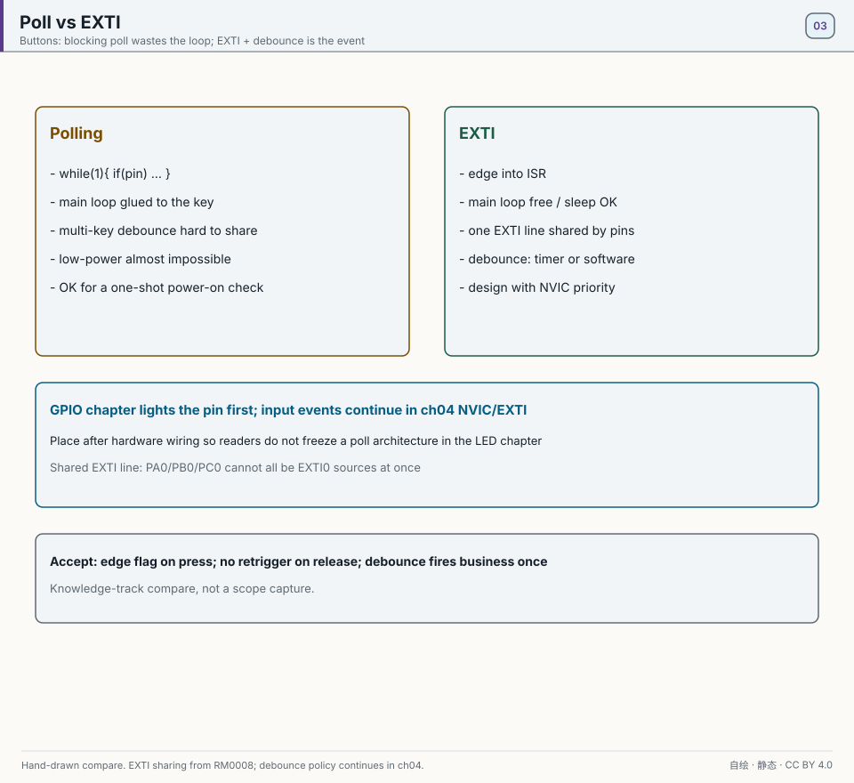
  <br><sub>▲ Drawn compare. Light the pin here; continue events in the NVIC/EXTI chapter.</sub>
</p>

<p align="center">
  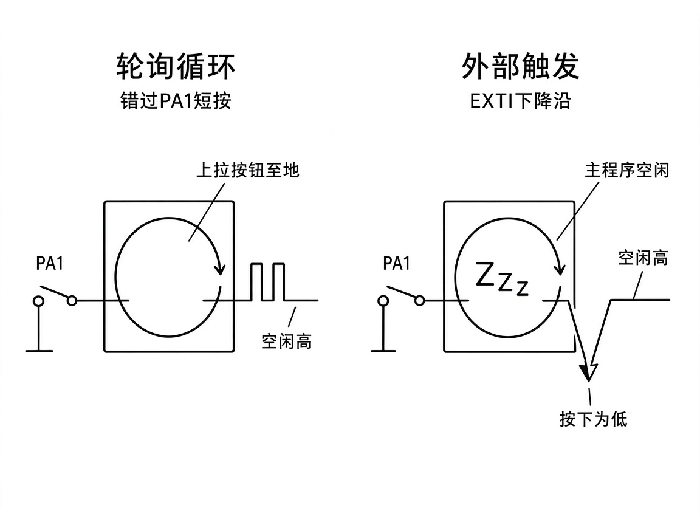
  <br><sub>▲ Knowledge track (Handraw · 原理示意 / not a photo). Main-loop polling cost versus an edge interrupt path; not a scope capture and not board evidence.</sub>
</p>


| Wiring | Idle level | Pressed level | Edge |
| --- | --- | --- | --- |
| Pull-up, button to ground | High | Low | Falling |
| Pull-down, button to VCC | Low | High | Rising |

| Debounce | Notes |
| --- | --- |
| Software delay | After a change, wait 10–20 ms and check again |
| Timer scan | Sample on a timer period; accept it only when several samples agree |
| RC filter | Add a 0.1 µF capacitor and a resistor in hardware |
| Schmitt trigger | Shape it in hardware |

```c
/* software debounce: wait until it is stable */
static uint8_t key_scan(GPIO_TypeDef *port, uint16_t pin)
{
    if (HAL_GPIO_ReadPin(port, pin) == GPIO_PIN_RESET)   /* saw a low */
    {
        HAL_Delay(20);                                    /* debounce delay */
        if (HAL_GPIO_ReadPin(port, pin) == GPIO_PIN_RESET) return 1;
    }
    return 0;
}
```

### 7. GPIO setup for common peripherals

| Peripheral | Pin mode |
| --- | --- |
| LED output | OUTPUT_PP |
| Button input | INPUT + PULLUP/PULLDOWN |
| UART TX | AF_PP |
| UART RX | INPUT + PULLUP |
| I2C SDA/SCL | AF_OD (or OUTPUT_OD) |
| SPI SCK/MOSI | AF_PP |
| SPI MISO | INPUT |
| ADC channel | ANALOG |
| PWM output | AF_PP |

### 8. Bit-band address formula

- Peripheral region alias: `alias = 0x42000000 + (peripheral address − 0x40000000) × 32 + bit × 4`
- SRAM region alias: `alias = 0x22000000 + (SRAM address − 0x20000000) × 32 + bit × 4`

> STM32F103 provides SRAM and peripheral bit-band aliases. On another core or STM32 family, check the processor and device reference manuals again instead of carrying this F1 rule over.

### 9. Driving an LED or a digit display, briefly

| Device | How you drive it | Watch out |
| --- | --- | --- |
| Single-color LED | GPIO directly, plus a series resistor | Current < 20 mA |
| High-brightness or high-power LED | A BJT or MOSFET | The GPIO only supplies base current |
| Digit display (common anode / common cathode) | Digit select + segment select; a 74HC595 is optional | Multiplex refresh |
| RGB LED | Three PWM channels | Mixing the color |

### 10. A few more electrical numbers

| Parameter | Value |
| --- | --- |
| Input high VIH | 0.7×VDD ≈ 2.31 V |
| Input low VIL | 0.3×VDD ≈ 0.99 V |
| Output high VOH | VDD−0.4 ≈ 2.9 V (light load) |
| Output low VOL | 0.4 V |
| Internal pull-up | 30–50 kΩ |

### 11. Remap, 5 V tolerance, and the lock

On F1 you move a function with AFIO remap. On F4 each pin picks its own AF number. A pin may see 5 V only when its datasheet cell says FT; 5 V tolerance is not a family-wide default.

| Family | How you change the function | What has to happen first |
| --- | --- | --- |
| F1 | `AFIO->MAPR` remaps a whole group (USART1 from PA9/10 to PB6/7, for example) | `__HAL_RCC_AFIO_CLK_ENABLE()` first |
| F4 | `GPIOx->AFR` gets the AF number for that pin | Set the mode to alternate first |

Five-volt-tolerant (FT) pins are marked on their own in the datasheet pin table. A plain pin tied straight to 5 V is damaged. This repo will not hand you a "probably fine" current for that.

Lock one pin so later init cannot change it. The sequence is write 1, write 0, write 1 again, then read once:

```c
GPIOA->LCKR = GPIO_LCKR_LCKK | GPIO_LCKR_LCK5;
GPIOA->LCKR = GPIO_LCKR_LCK5;
GPIOA->LCKR = GPIO_LCKR_LCKK | GPIO_LCKR_LCK5;
(void)GPIOA->LCKR;   /* first read: complete the write/read sequence */
(void)GPIOA->LCKR;   /* second read: confirm LCKK = 1 until reset */
```

Before leaving this chapter, keep records of the PA0 high/low levels, the PA1 pressed/released readings, and the 1 s PC13 period, and explain why polling can miss a short pulse.

Self-test:

1. On an F103 you remap USART1 to PB6/PB7 and forget the AFIO clock. What do you see?
2. PA0 is not marked FT in the datasheet. Can you tie a 5 V sensor to it directly?
3. You finish the `LCKR` writes and never read it back. Is the lock in effect?

## Related resources

- Official manuals: **RM0008** chapter 9 (GPIO) and section 9.2 (register description); **DS5319** pin definitions
- Previous: [02 Choosing a Part, Memory, and Clocks](02-part-and-clock.md) | Next: [04 Interrupts and the NVIC](04-interrupts-nvic.md)
- Figures: [`assets/animations/gpio-blink.svg`](../../assets/animations/gpio-blink.svg), [`assets/gif/led-blink.gif`](../../assets/gif/led-blink.gif)
- Hardware and documents: Nucleo board schematics on ST's website (a reference for how the LED is wired)
- Disclaimer: every illustration in this repo is a vector drawing or a program-generated animation by the author, not a manufacturer's photograph.
