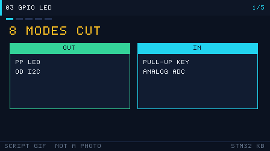

# 03 GPIO and LEDs
> 中文：[GPIO 与 LED](../03-GPIO与LED.md)

> GPIO is the most basic peripheral. Driving a level and reading a button with it is the door into every other peripheral.

<p align="center">
  
  <br><sub>▲ Animation: a GPIO push-pull output lighting an LED (level, current, and waveform together; vector drawing by the author)</sub>
</p>

<!-- video:ch03 -->
<p align="center">
  
  <br><sub>▲ Lecture slides for this chapter: a program-generated GIF (tools/gen_videos.py, reproducible, not a live shot). The narration matches the five frames one to one.</sub>
</p>

**Narration (read along with the frames, about one minute)**

1. GPIO is the front door of every peripheral. Pick the wrong mode and every bus after it looks haunted.
2. Push-pull can drive high hard and pull low hard. An open-drain high depends on an external pull-up. That is what you want for wired-AND and for I2C.
3. Size the series resistor with R=(Vcc−Vf)/I. A red LED on 3.3 V is bright enough at about 270 ohms.
4. The BluePill onboard LED is on PC13, and it lights only when the pin is low. Do not mix that up with an external common-cathode LED.
5. Motto: on F1, enable AFIO before you remap. Self-test: a button tied to GND — pull-up or pull-down?
<!-- /video:ch03 -->


## 📌 Learning goals
- [ ] Remember the 8 GPIO modes and where each one belongs
- [ ] Understand the current path of push-pull versus open-drain, and what the pull-up resistor is doing
- [ ] Compute an LED series resistor R=(Vcc−Vf)/I
- [ ] Drive GPIO both with HAL and with registers
- [ ] Know the usual traps: SWD pin reuse, and forgetting the clock enable

## 🧠 Core ideas

**Lead with the conclusion: the 8 GPIO modes are the combinations of input/output × push-pull/open-drain × alternate/GPIO × pull-up/pull-down/floating. The wrong mode is the root of most problems.**

### 1. The 8 GPIO modes

| Mode (HAL macro) | Direction | Output stage | Pull | Typical use |
| --- | --- | --- | --- | --- |
| `GPIO_MODE_INPUT` + Pull=NPU | Input | — | Floating | Something else already pulls the pin, or you are reading a digital output |
| `GPIO_MODE_INPUT` + Pull=UP | Input | — | Pull-up | Button to GND (active low) |
| `GPIO_MODE_INPUT` + Pull=DOWN | Input | — | Pull-down | Button to VCC (active high) |
| `GPIO_MODE_ANALOG` | Input | Off | — | ADC sample, low power |
| `GPIO_MODE_OUTPUT_PP` | Output | Push-pull | — | LED, a drive signal (strong high and low) |
| `GPIO_MODE_OUTPUT_OD` | Output | Open-drain | — | I2C, an external pull-up, or wired-AND |
| `GPIO_MODE_AF_PP` | Alternate | Push-pull | — | UART / SPI / PWM output |
| `GPIO_MODE_AF_OD` | Alternate | Open-drain | — | Hardware I2C, SMBus |

> F1 also has `GPIO_MODE_AF_INPUT`. F4/F7 use `GPIO_MODE_AF_OD/PP` plus the `Alternate` field to pick the alternate-function number. Name the mode by the HAL macro.

### 2. Output speed and current

| Parameter | Value | Notes |
| --- | --- | --- |
| Output speed (F1) | 2/10/50 MHz | Faster edges are steeper, and EMI is worse. Use only what you need |
| Output speed (F4 and later) | Low/Medium/High/Very High | These are different drive strengths |
| Sink or source, one pin | 25 mA (F103) | More than that damages the pin |
| Current for the whole port | 150 mA (F103) | The sum of every IO |
| Internal pull-up / pull-down | 30–50 kΩ (F1) | A weak pull. The drive is limited |

### 3. Push-pull versus open-drain

| Comparison | Push-pull | Open-drain |
| --- | --- | --- |
| Where a high comes from | The PMOS actively pulls up to VDD | High impedance; an external pull-up provides the high |
| Where a low comes from | The NMOS actively pulls down to GND | The NMOS actively pulls down to GND |
| Wired-AND? | ❌ | ✅ Tie pins together and you get wired-AND |
| Typical use | LED, ordinary digital output | I2C, level shift, a shared bus |
| Current path | High: VDD→PMOS→pin. Low: pin→NMOS→GND | Low: pin→NMOS→GND. High: none (the external pull-up does it) |

### 4. LED series resistor

`R = (Vcc − Vf) / I`

| Parameter | Typical value | Notes |
| --- | --- | --- |
| Vcc | 3.3 V | Supply |
| Vf (red) | 1.8–2.2 V | Forward drop |
| Vf (green / blue / white) | 2.8–3.2 V | Blue and white are higher, and on 3.3 V they can look dim |
| I (target) | 5–10 mA | Enough for an ordinary indicator LED |

Example: 3.3 V, red LED Vf=2.0 V, I=5 mA → R=(3.3−2.0)/0.005 = **260 Ω**. Take the standard value 270 Ω.

### 5. GPIO registers (F1)

| Register | Role |
| --- | --- |
| CRL / CRH | Mode and speed for the low 8 pins / the high 8 pins |
| IDR | Input data register (read the pin level) |
| ODR | Output data register (read or write the pin level) |
| BSRR | Bit set/reset register. Writing 1 is what acts. Atomic |
| BRR | Bit reset register (F1 has it; on F4 it is folded into BSRR) |

## 🛠️ Hardware and wiring

| Board | Peripheral | Pin | Notes |
| --- | --- | --- | --- |
| BluePill | Onboard LED | PC13 | **Common-anode wiring; lights when the pin is low** |
| BluePill | External LED | PA0 | 270 Ω in series; lights when the pin is high |
| BluePill | Button | PA1 | The other side to GND; internal pull-up |

External LED wiring: PA0 → 270 Ω → LED anode, LED cathode → GND (**common cathode**, lights when the pin is high).
The onboard LED is **common anode**: the anode is tied to 3.3 V, and PC13 has to pull low before current flows, so it **lights when the pin is low**.

## 💻 Code

```c
/* gpio_blink.c —— GPIO output blinks an LED and reads a button (HAL) */
#include "stm32f1xx_hal.h"

#define LED_PIN    GPIO_PIN_13
#define LED_PORT   GPIOC
#define KEY_PIN    GPIO_PIN_1
#define KEY_PORT   GPIOA

void SystemClock_Config(void);

static void gpio_init(void)
{
    GPIO_InitTypeDef io = {0};

    __HAL_RCC_GPIOC_CLK_ENABLE();
    __HAL_RCC_GPIOA_CLK_ENABLE();

    /* PC13 push-pull output (onboard LED, lights when low) */
    io.Pin   = LED_PIN;
    io.Mode  = GPIO_MODE_OUTPUT_PP;
    io.Pull  = GPIO_NOPULL;
    io.Speed = GPIO_SPEED_FREQ_LOW;
    HAL_GPIO_Init(LED_PORT, &io);

    /* PA1 input, internal pull-up (button to ground reads low) */
    io.Pin  = KEY_PIN;
    io.Mode = GPIO_MODE_INPUT;
    io.Pull = GPIO_PULLUP;
    HAL_GPIO_Init(KEY_PORT, &io);
}

int main(void)
{
    HAL_Init();
    SystemClock_Config();
    gpio_init();

    while (1)
    {
        /* while the button is pressed (low), light the LED */
        GPIO_PinState key = HAL_GPIO_ReadPin(KEY_PORT, KEY_PIN);
        HAL_GPIO_WritePin(LED_PORT, LED_PIN,
                          (key == GPIO_PIN_RESET) ? GPIO_PIN_RESET : GPIO_PIN_SET);
    }
}
```

Three ways to do the same thing (light PC13):

```c
/* 1) HAL function */
HAL_GPIO_WritePin(GPIOC, GPIO_PIN_13, GPIO_PIN_RESET);   /* low lights the LED */

/* 2) atomic BSRR (preferred; avoids read-modify-write) */
GPIOC->BSRR = GPIO_BSRR_BR13;   /* reset PC13 (BR = bit reset) */
GPIOC->BSRR = GPIO_BSRR_BS13;   /* set PC13 (BS = bit set)   */

/* 3) ODR read-modify-write (simple, but not atomic) */
GPIOC->ODR &= ~GPIO_ODR_ODR13;  /* clear the bit */
```

Bit-banding (F1 supports it: one alias address drives a single bit):

```c
/* bit-band alias: map bit 13 of peripheral address 0x4001100C (GPIOC_ODR) to an alias address */
#define BITBAND_PERIPH(addr, bit) \
    (*(volatile uint32_t *)(0x42000000UL + ((addr) - 0x40000000UL) * 32 + (bit) * 4))

#define PC13_OUT  BITBAND_PERIPH(0x4001100CUL, 13)   /* GPIOC->ODR bit13 */
PC13_OUT = 0;   /* write 0 or 1 directly, no read-modify-write, same effect as ODR */
```

The full project is in [`examples/gpio-blink/`](../../examples/gpio-blink/).

## ⚠️ Pitfalls and troubleshooting

| Symptom | Cause | Fix |
| --- | --- | --- |
| The LED never lights | CubeMX never enabled the GPIO clock | Add `__HAL_RCC_GPIOx_CLK_ENABLE()` |
| The LED stays on, or on and off are swapped | Common-anode and common-cathode were mixed up | The onboard LED lights when low. Wire an external LED by its polarity |
| The button chatters, and one press fires many times | No debounce | Add a 10–20 ms debounce delay, or an RC filter |
| After a flash you can never connect again | SWD pins PA13/PA14 were set as ordinary GPIO | In CubeMX, set SYS to Serial Wire; or recover with connect-under-reset |
| A high output is only a volt or so | Open-drain with no pull-up | Use push-pull, or add an external pull-up |
| The LED flickers or gets hot | The series resistor is too small, or missing | Compute R=(Vcc−Vf)/I and aim for 5–10 mA |
| The pin level you read never changes | Input mode has no pull, and the pin is floating | Set PULLUP or PULLDOWN, or add an external pull |

## 🧪 Hands-on labs

1. **Lab 1:** Blink the PC13 onboard LED at 1 Hz (compare with `gpio-blink.svg` and `led-blink.gif`).
2. **Lab 2:** Put an external LED on PA0, compute and fit a 270 Ω resistor, and let the PA1 button control the LED.
3. **Lab 3:** Toggle PA0 with BSRR, with ODR, and with bit-banding. Compare the waveforms on a logic analyzer and see what atomic means.

### 6. Button circuits and debounce

| Wiring | Idle level | Pressed level | Edge |
| --- | --- | --- | --- |
| Pull-up, button to ground | High | Low | Falling |
| Pull-down, button to VCC | Low | High | Rising |

| Debounce | Notes |
| --- | --- |
| Software delay | After a change, wait 10–20 ms and check again |
| Timer scan | Sample on a timer period; accept it only when several samples agree |
| RC filter | Add a 0.1 µF capacitor and a resistor in hardware |
| Schmitt trigger | Shape it in hardware |

```c
/* software debounce: wait until it is stable */
static uint8_t key_scan(GPIO_TypeDef *port, uint16_t pin)
{
    if (HAL_GPIO_ReadPin(port, pin) == GPIO_PIN_RESET)   /* saw a low */
    {
        HAL_Delay(20);                                    /* debounce delay */
        if (HAL_GPIO_ReadPin(port, pin) == GPIO_PIN_RESET) return 1;
    }
    return 0;
}
```

### 7. GPIO setup for common peripherals

| Peripheral | Pin mode |
| --- | --- |
| LED output | OUTPUT_PP |
| Button input | INPUT + PULLUP/PULLDOWN |
| UART TX | AF_PP |
| UART RX | INPUT + PULLUP |
| I2C SDA/SCL | AF_OD (or OUTPUT_OD) |
| SPI SCK/MOSI | AF_PP |
| SPI MISO | INPUT |
| ADC channel | ANALOG |
| PWM output | AF_PP |

### 8. Bit-band address formula

- Peripheral region alias: `alias = 0x42000000 + (peripheral address − 0x40000000) × 32 + bit × 4`
- SRAM region alias: `alias = 0x22000000 + (SRAM address − 0x20000000) × 32 + bit × 4`

> Bit-banding covers only SRAM and the AHB1 peripheral region. It is generally available on F1. From F4 on, some peripherals no longer support it.

### 9. Driving an LED or a digit display, briefly

| Device | How you drive it | Watch out |
| --- | --- | --- |
| Single-color LED | GPIO directly, plus a series resistor | Current < 20 mA |
| High-brightness or high-power LED | A BJT or MOSFET | The GPIO only supplies base current |
| Digit display (common anode / common cathode) | Digit select + segment select; a 74HC595 is optional | Multiplex refresh |
| RGB LED | Three PWM channels | Mixing the color |

### 10. A few more electrical numbers

| Parameter | Value |
| --- | --- |
| Input high VIH | 0.7×VDD ≈ 2.31 V |
| Input low VIL | 0.3×VDD ≈ 0.99 V |
| Output high VOH | VDD−0.4 ≈ 2.9 V (light load) |
| Output low VOL | 0.4 V |
| Internal pull-up | 30–50 kΩ |

### 11. Remap, 5 V tolerance, and the lock

**Conclusion:** on F1 you move a function with AFIO remap. On F4 each pin picks its own AF number. Whether a pin may see 5 V depends only on whether that datasheet column says FT. It is not "every STM32 tolerates 5 V".

| Family | How you change the function | What has to happen first |
| --- | --- | --- |
| F1 | `AFIO->MAPR` remaps a whole group (USART1 from PA9/10 to PB6/7, for example) | `__HAL_RCC_AFIO_CLK_ENABLE()` first |
| F4 | `GPIOx->AFR` gets the AF number for that pin | Set the mode to alternate first |

Five-volt-tolerant (FT) pins are marked on their own in the datasheet pin table. A plain pin tied straight to 5 V is damaged. This repo will not hand you a "probably fine" current for that.

Lock one pin so later init cannot change it. The sequence is write 1, write 0, write 1 again, then read once:

```c
GPIOA->LCKR = GPIO_LCKR_LCKK | GPIO_LCKR_LCK5;
GPIOA->LCKR = GPIO_LCKR_LCK5;
GPIOA->LCKR = GPIO_LCKR_LCKK | GPIO_LCKR_LCK5;
(void)GPIOA->LCKR;   /* only after the read-back does LCKK actually lock, until reset */
```

Motto: **on F1, enable AFIO before you remap. 5 V only if the pin is FT. The lock is 1-0-1, then a read.**

Self-test:

1. On an F103 you remap USART1 to PB6/PB7 and forget the AFIO clock. What do you see?
2. PA0 is not marked FT in the datasheet. Can you tie a 5 V sensor to it directly?
3. You finish the `LCKR` writes and never read it back. Is the lock in effect?

## 🔗 Related resources

- Official manuals: **RM0008** chapter 9 (GPIO) and section 9.2 (register description); **DS5319** pin definitions
- Previous: [02 Choosing a Part, Memory, and Clocks](02-part-and-clock.md) | Next: [04 Interrupts and the NVIC](04-interrupts-nvic.md)
- Figures: [`assets/animations/gpio-blink.svg`](../../assets/animations/gpio-blink.svg), [`assets/gif/led-blink.gif`](../../assets/gif/led-blink.gif)
- Hardware and documents: Nucleo board schematics on ST's website (a reference for how the LED is wired)
- Disclaimer: every illustration in this repo is a vector drawing or a program-generated animation by the author, not a manufacturer's photograph.
