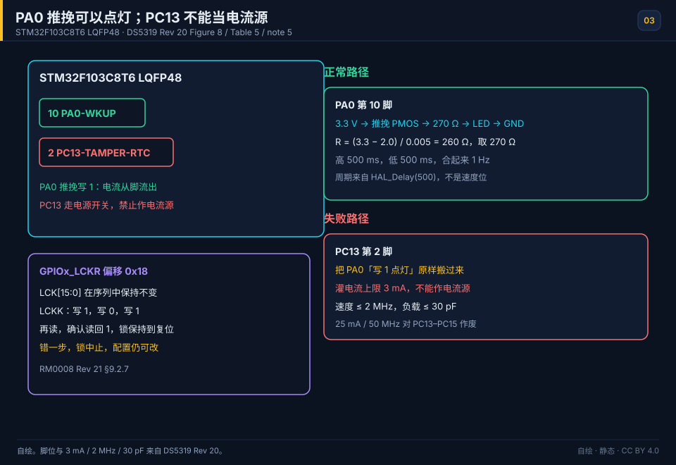

# 03 GPIO and LEDs
> 中文：[GPIO 与 LED](../03-GPIO与LED.md)

> GPIO is the most basic peripheral. Driving a level and reading a button with it is the door into every other peripheral.

<p align="center">
  
  <br><sub>▲ Animation: a GPIO push-pull output lighting an LED (level, current, and waveform together; vector drawing by the author)</sub>
</p>

<!-- video:ch03 -->
<p align="center">
  <video width="640" controls poster="../../assets/video/ch03-gpio.png">
    <source src="../../assets/video/ch03-gpio.mp4" type="video/mp4">
  </video>
  <br><sub>▲ Chinese voice-over, 2.4 min. Voice: Microsoft Edge neural voice zh-CN-XiaoxiaoNeural via edge-tts (library mostly LGPLv3; the voice model is an online Microsoft service, not an open model). Pictures are generated from this repo's SVGs, not photographs. Video: <a href="../../assets/video/ch03-gpio.mp4">MP4</a> · subtitles: <a href="../../assets/video/ch03-gpio.srt">SRT</a>. Rebuild with <code>python3 tools/gen_narrated.py --speak</code>.</sub>
</p>

**Narration script (Chinese, same text as the subtitles)**

1. GPIO 看起来就是高低电平，真正要选的是模式。先分清输入还是输出，推挽还是开漏，要不要上下拉。模式选错，电平会和你想的相反。
2. BluePill 的板载灯在 PC13，接法是低电平才亮。你写 1，灯反而是灭的。别拿共阴外接灯的习惯去套这颗板载灯，否则你会以为端口坏了。
3. 按键另一端接 GND 时，引脚要上拉。没按下是高，按下被拉成低。再外加一个下拉，电平会和上拉打架，读到的就飘着。
4. 这一帧是仓库里的点灯动画，不是实拍。推挽输出能主动拉高也能主动拉低。开漏则要靠上拉，适合和别人共享一根线，比如 I2C。
5. 在 F1 上把外设换到另一组脚，要先打开 AFIO 的时钟，再写重映射。只改模式、不开 AFIO，示波器上会一直安静。这是这章最容易漏的一步。
6. 不是每只脚都能碰 5 伏。数据手册里标了 FT 的才比较容忍。普通脚直接接 5 伏模块，轻则电平不对，重则把片打伤。先翻表，再接线。
7. 引脚锁定用来防止后面的代码把手脚改掉。顺序是写 1、写 0、再写 1，然后读一次才真正锁上。少读那一下，你以为锁了，其实没有。
8. 口诀：F1 重映射先开 AFIO；5 伏只认 FT；锁定是 1、0、1 再读。三件都是手上的动作，不是概念题。
9. 实验让 PC13 以 1 赫兹翻转。眼睛只能看出大概，频率要用你算过的延时或定时器来对。对上了，这章才算过关。
10. 合上书，三问。PC13 写高还是写低才会亮？按键接 GND 该上拉还是下拉？F1 重映射之前必须先开哪个时钟？
<!-- /video:ch03 -->
## Principle and boundary

The LED conclusion of this chapter holds for orderable STM32F103C8T6 in LQFP48. [DS5319 Rev 20](#source-ds5319-gpio) Figure 8 and Table 5 place PA0-WKUP on pin 10 and PC13-TAMPER-RTC on pin 2.

PA0 may source current. As a push-pull output written to 1, current leaves the pin from 3.3 V through the internal PMOS, then through the resistor and the LED to ground. The example arithmetic is `(3.3 − 2.0) / 0.005 = 260`, fitted as 270 Ω. The [example](#source-project-examples) supports those three inputs and that quotient. It does not support calling 270 Ω a datasheet recommendation.

PC13, PC14, and PC15 sit behind the power switch. Note 5 of the same datasheet limits them to 3 mA of sink current, 2 MHz, and 30 pF, and they must not source an LED. The BluePill onboard LED can still use PC13 because its anode is at 3.3 V and the pin only sinks; writing 0 lights it. Copying the PA0 "write 1 to light" circuit onto PC13 makes that row void.

The 25 mA and 50 MHz cells in the speed table are void for these three pins. A different package or orderable rewrites pin 2 and pin 10 as a whole row. F4 per-pin AFR is outside RM0008. The older sentence "F1 remaps through AFIO MAPR" holds on F1; on F4 that row is void.

## Key figures

<p align="center">
  
  <br><sub>▲ Drawn for this book. STM32F103C8T6, LQFP48: PA0 is pin 10 and PC13 is pin 2. The normal path is 3.3 V through a push-pull pin and 270 Ω into the LED; 260 Ω is the quotient (3.3 − 2.0) / 0.005. The failure path copies that circuit onto PC13: note 5 allows 3 mA sink, at most 2 MHz, into 30 pF. The lock sequence is GPIOx_LCKR at offset 0x18. Pin and current facts are [DS5319 Rev 20](#source-ds5319-gpio) Table 5, Figure 8, and note 5. The lock and SWD pins are [RM0008 Rev 21](#source-rm0008-gpio) section 9.2.7 and section 9.3.5 Table 36.</sub>
</p>

The opening `gpio-blink.svg` stays an animated side figure. This key figure still shows the failure on PC13 when the animation is not playing.

## Timing or state

The 1 Hz high and low times are not a GPIO speed-bit result. High 500 ms and low 500 ms come from the [gpio-blink example](#source-project-examples) `HAL_Delay(500)`. Writing the speed bits as 50 MHz does not turn PC13 into a pin that may source an LED.

| Step | LCK[15:0] | LCKK | Read-back | Result |
| --- | --- | --- | --- | --- |
| 1 | Hold the pins to lock | Write 1 | — | Sequence starts |
| 2 | Same mask | Write 0 | — | Sequence continues |
| 3 | Same mask | Write 1 | — | Writes are done |
| 4 | Same mask | — | Read again and see 1 | Locked until reset |
| Failure | Mask changes, or a write is skipped | — | Confirming read is not 1 | Lock aborts; the configuration can still change |

The register is `GPIOx_LCKR` at offset `0x18`. Source: [RM0008 Rev 21 section 9.2.7](#source-rm0008-gpio).

## Pitfalls and source cards

| Symptom | Cause | What to do | Source | Claim this source may support |
| --- | --- | --- | --- | --- |
| An external LED on PC13 does not behave like PA0 when the pin is written 1 | PC13 must not source the LED | Move the external LED to PA0 with 270 Ω | [DS5319 Rev 20 note 5](#source-ds5319-gpio) | LQFP48 pin 2 is PC13; PC13–PC15 sink at most 3 mA, at or below 2 MHz, into 30 pF |
| The onboard LED stays dark when PC13 is written 1 | The onboard LED is common-anode; PC13 lights it by sinking | Write 0 | [gpio-blink example](#source-project-examples) | Only the BluePill wiring. Not the 3 mA datasheet limit |
| An ODR write does nothing on the pin | The port clock is still off | Enable that GPIO port clock, then write CRL/CRH | [RM0008 GPIO](#source-rm0008-gpio) | Enable the port clock before writing the section 9 configuration registers |
| Three writes to LCKR still leave the pin editable | The sequence was broken, or the confirming read was not 1 | Keep the mask, write 1, write 0, write 1, and read 1 | [RM0008 section 9.2.7](#source-rm0008-gpio) | A finished lock holds until reset; one bad step aborts it |
| The probe never connects after a flash | PA13 and PA14 were configured as ordinary GPIO | Leave SWD on PA13 and PA14 | [RM0008 Table 36](#source-rm0008-gpio) | SWDIO is PA13 and SWCLK is PA14 |

The old debounce row stays out of this card. A 10 ms to 20 ms debounce is not pinned to RM0008 or DS5319. The lab may still debounce a button without calling that interval a manual number.
## 📌 Learning goals
- [ ] Remember the 8 GPIO modes and where each one belongs
- [ ] Understand the current path of push-pull versus open-drain, and what the pull-up resistor is doing
- [ ] Compute an LED series resistor R=(Vcc−Vf)/I
- [ ] Drive GPIO both with HAL and with registers
- [ ] Know the usual traps: SWD pin reuse, and forgetting the clock enable

## 🧠 Core ideas

**Lead with the conclusion: the 8 GPIO modes are the combinations of input/output × push-pull/open-drain × alternate/GPIO × pull-up/pull-down/floating. The wrong mode is the root of most problems.**

### 1. The 8 GPIO modes

| Mode (HAL macro) | Direction | Output stage | Pull | Typical use |
| --- | --- | --- | --- | --- |
| `GPIO_MODE_INPUT` + Pull=NPU | Input | — | Floating | Something else already pulls the pin, or you are reading a digital output |
| `GPIO_MODE_INPUT` + Pull=UP | Input | — | Pull-up | Button to GND (active low) |
| `GPIO_MODE_INPUT` + Pull=DOWN | Input | — | Pull-down | Button to VCC (active high) |
| `GPIO_MODE_ANALOG` | Input | Off | — | ADC sample, low power |
| `GPIO_MODE_OUTPUT_PP` | Output | Push-pull | — | LED, a drive signal (strong high and low) |
| `GPIO_MODE_OUTPUT_OD` | Output | Open-drain | — | I2C, an external pull-up, or wired-AND |
| `GPIO_MODE_AF_PP` | Alternate | Push-pull | — | UART / SPI / PWM output |
| `GPIO_MODE_AF_OD` | Alternate | Open-drain | — | Hardware I2C, SMBus |

> F1 also has `GPIO_MODE_AF_INPUT`. F4/F7 use `GPIO_MODE_AF_OD/PP` plus the `Alternate` field to pick the alternate-function number. Name the mode by the HAL macro.

### 2. Output speed and current

| Parameter | Value | Notes |
| --- | --- | --- |
| Output speed (F1) | 2/10/50 MHz | Steeper edges cost more EMI. PC13, PC14, and PC15 do not use this row; their limit is in Principle and boundary. |
| Output speed (F4 and later) | Low/Medium/High/Very High | These are different drive strengths |
| Sink or source, one pin | 25 mA (F103) | Other pins still use this row. PC13, PC14, and PC15 do not use this row; their limit is in Principle and boundary. |
| Current for the whole port | 150 mA (F103) | The sum of every IO |
| Internal pull-up / pull-down | 30–50 kΩ (F1) | A weak pull. The drive is limited |

### 3. Push-pull versus open-drain

| Comparison | Push-pull | Open-drain |
| --- | --- | --- |
| Where a high comes from | The PMOS actively pulls up to VDD | High impedance; an external pull-up provides the high |
| Where a low comes from | The NMOS actively pulls down to GND | The NMOS actively pulls down to GND |
| Wired-AND? | ❌ | ✅ Tie pins together and you get wired-AND |
| Typical use | LED, ordinary digital output | I2C, level shift, a shared bus |
| Current path | High: VDD→PMOS→pin. Low: pin→NMOS→GND | Low: pin→NMOS→GND. High: none (the external pull-up does it) |

### 4. LED series resistor

`R = (Vcc − Vf) / I`

| Parameter | Typical value | Notes |
| --- | --- | --- |
| Vcc | 3.3 V | Supply |
| Vf (red) | 1.8–2.2 V | Forward drop |
| Vf (green / blue / white) | 2.8–3.2 V | Blue and white are higher, and on 3.3 V they can look dim |
| I (target) | 5–10 mA | Enough for an ordinary indicator LED |

The worked example for this orderable is in Principle and boundary, and it is an example-project fact rather than a datasheet cell. This section keeps only the formula.

### 5. GPIO registers (F1)

| Register | Role |
| --- | --- |
| CRL / CRH | Mode and speed for the low 8 pins / the high 8 pins |
| IDR | Input data register (read the pin level) |
| ODR | Output data register (read or write the pin level) |
| BSRR | Bit set/reset register. Writing 1 is what acts. Atomic |
| BRR | Bit reset register (F1 has it; on F4 it is folded into BSRR) |

## 🛠️ Hardware and wiring

| Board | Peripheral | Pin | Notes |
| --- | --- | --- | --- |
| BluePill | Onboard LED | PC13 | **Common-anode wiring; lights when the pin is low** |
| BluePill | External LED | PA0 | 270 Ω in series; lights when the pin is high |
| BluePill | Button | PA1 | The other side to GND; internal pull-up |

External LED wiring: PA0 → 270 Ω → LED anode, LED cathode → GND (**common cathode**, lights when the pin is high).
The onboard LED is **common anode**: the anode is tied to 3.3 V, and PC13 has to pull low before current flows, so it **lights when the pin is low**.

## 💻 Code

```c
/* gpio_blink.c —— GPIO output blinks an LED and reads a button (HAL) */
#include "stm32f1xx_hal.h"

#define LED_PIN    GPIO_PIN_13
#define LED_PORT   GPIOC
#define KEY_PIN    GPIO_PIN_1
#define KEY_PORT   GPIOA

void SystemClock_Config(void);

static void gpio_init(void)
{
    GPIO_InitTypeDef io = {0};

    __HAL_RCC_GPIOC_CLK_ENABLE();
    __HAL_RCC_GPIOA_CLK_ENABLE();

    /* PC13 push-pull output (onboard LED, lights when low) */
    io.Pin   = LED_PIN;
    io.Mode  = GPIO_MODE_OUTPUT_PP;
    io.Pull  = GPIO_NOPULL;
    io.Speed = GPIO_SPEED_FREQ_LOW;
    HAL_GPIO_Init(LED_PORT, &io);

    /* PA1 input, internal pull-up (button to ground reads low) */
    io.Pin  = KEY_PIN;
    io.Mode = GPIO_MODE_INPUT;
    io.Pull = GPIO_PULLUP;
    HAL_GPIO_Init(KEY_PORT, &io);
}

int main(void)
{
    HAL_Init();
    SystemClock_Config();
    gpio_init();

    while (1)
    {
        /* while the button is pressed (low), light the LED */
        GPIO_PinState key = HAL_GPIO_ReadPin(KEY_PORT, KEY_PIN);
        HAL_GPIO_WritePin(LED_PORT, LED_PIN,
                          (key == GPIO_PIN_RESET) ? GPIO_PIN_RESET : GPIO_PIN_SET);
    }
}
```

Three ways to do the same thing (light PC13):

```c
/* 1) HAL function */
HAL_GPIO_WritePin(GPIOC, GPIO_PIN_13, GPIO_PIN_RESET);   /* low lights the LED */

/* 2) atomic BSRR (preferred; avoids read-modify-write) */
GPIOC->BSRR = GPIO_BSRR_BR13;   /* reset PC13 (BR = bit reset) */
GPIOC->BSRR = GPIO_BSRR_BS13;   /* set PC13 (BS = bit set)   */

/* 3) ODR read-modify-write (simple, but not atomic) */
GPIOC->ODR &= ~GPIO_ODR_ODR13;  /* clear the bit */
```

Bit-banding (F1 supports it: one alias address drives a single bit):

```c
/* bit-band alias: map bit 13 of peripheral address 0x4001100C (GPIOC_ODR) to an alias address */
#define BITBAND_PERIPH(addr, bit) \
    (*(volatile uint32_t *)(0x42000000UL + ((addr) - 0x40000000UL) * 32 + (bit) * 4))

#define PC13_OUT  BITBAND_PERIPH(0x4001100CUL, 13)   /* GPIOC->ODR bit13 */
PC13_OUT = 0;   /* write 0 or 1 directly, no read-modify-write, same effect as ODR */
```

The full project is in [`examples/gpio-blink/`](../../examples/gpio-blink/).

## 🧪 Hands-on labs

1. **Lab 1:** Blink the PC13 onboard LED at 1 Hz (compare with `gpio-blink.svg` and `led-blink.gif`).
2. **Lab 2:** Put an external LED on PA0, compute and fit a 270 Ω resistor, and let the PA1 button control the LED.
3. **Lab 3:** Toggle PA0 with BSRR, with ODR, and with bit-banding. Compare the waveforms on a logic analyzer and see what atomic means.

### 6. Button circuits and debounce

| Wiring | Idle level | Pressed level | Edge |
| --- | --- | --- | --- |
| Pull-up, button to ground | High | Low | Falling |
| Pull-down, button to VCC | Low | High | Rising |

| Debounce | Notes |
| --- | --- |
| Software delay | After a change, wait 10–20 ms and check again |
| Timer scan | Sample on a timer period; accept it only when several samples agree |
| RC filter | Add a 0.1 µF capacitor and a resistor in hardware |
| Schmitt trigger | Shape it in hardware |

```c
/* software debounce: wait until it is stable */
static uint8_t key_scan(GPIO_TypeDef *port, uint16_t pin)
{
    if (HAL_GPIO_ReadPin(port, pin) == GPIO_PIN_RESET)   /* saw a low */
    {
        HAL_Delay(20);                                    /* debounce delay */
        if (HAL_GPIO_ReadPin(port, pin) == GPIO_PIN_RESET) return 1;
    }
    return 0;
}
```

### 7. GPIO setup for common peripherals

| Peripheral | Pin mode |
| --- | --- |
| LED output | OUTPUT_PP |
| Button input | INPUT + PULLUP/PULLDOWN |
| UART TX | AF_PP |
| UART RX | INPUT + PULLUP |
| I2C SDA/SCL | AF_OD (or OUTPUT_OD) |
| SPI SCK/MOSI | AF_PP |
| SPI MISO | INPUT |
| ADC channel | ANALOG |
| PWM output | AF_PP |

### 8. Bit-band address formula

- Peripheral region alias: `alias = 0x42000000 + (peripheral address − 0x40000000) × 32 + bit × 4`
- SRAM region alias: `alias = 0x22000000 + (SRAM address − 0x20000000) × 32 + bit × 4`

> Bit-banding covers only SRAM and the AHB1 peripheral region. It is generally available on F1. From F4 on, some peripherals no longer support it.

### 9. Driving an LED or a digit display, briefly

| Device | How you drive it | Watch out |
| --- | --- | --- |
| Single-color LED | GPIO directly, plus a series resistor | Current < 20 mA |
| High-brightness or high-power LED | A BJT or MOSFET | The GPIO only supplies base current |
| Digit display (common anode / common cathode) | Digit select + segment select; a 74HC595 is optional | Multiplex refresh |
| RGB LED | Three PWM channels | Mixing the color |

### 10. A few more electrical numbers

| Parameter | Value |
| --- | --- |
| Input high VIH | 0.7×VDD ≈ 2.31 V |
| Input low VIL | 0.3×VDD ≈ 0.99 V |
| Output high VOH | VDD−0.4 ≈ 2.9 V (light load) |
| Output low VOL | 0.4 V |
| Internal pull-up | 30–50 kΩ |

### 11. Remap, 5 V tolerance, and the lock

**Conclusion:** on F1 you move a function with AFIO remap. On F4 each pin picks its own AF number. Whether a pin may see 5 V depends only on whether that datasheet column says FT. It is not "every STM32 tolerates 5 V".

| Family | How you change the function | What has to happen first |
| --- | --- | --- |
| F1 | `AFIO->MAPR` remaps a whole group (USART1 from PA9/10 to PB6/7, for example) | `__HAL_RCC_AFIO_CLK_ENABLE()` first |
| F4 | `GPIOx->AFR` gets the AF number for that pin | Set the mode to alternate first |

Five-volt-tolerant (FT) pins are marked on their own in the datasheet pin table. A plain pin tied straight to 5 V is damaged. This repo will not hand you a "probably fine" current for that.

Lock one pin so later init cannot change it. The sequence is write 1, write 0, write 1 again, then read once:

```c
GPIOA->LCKR = GPIO_LCKR_LCKK | GPIO_LCKR_LCK5;
GPIOA->LCKR = GPIO_LCKR_LCK5;
GPIOA->LCKR = GPIO_LCKR_LCKK | GPIO_LCKR_LCK5;
(void)GPIOA->LCKR;   /* only after the read-back does LCKK actually lock, until reset */
```

Motto: **on F1, enable AFIO before you remap. 5 V only if the pin is FT. The lock is 1-0-1, then a read.**

Self-test:

1. On an F103 you remap USART1 to PB6/PB7 and forget the AFIO clock. What do you see?
2. PA0 is not marked FT in the datasheet. Can you tie a 5 V sensor to it directly?
3. You finish the `LCKR` writes and never read it back. Is the lock in effect?

## 🔗 Related resources

- Official manuals: **RM0008** chapter 9 (GPIO) and section 9.2 (register description); **DS5319** pin definitions
- Previous: [02 Choosing a Part, Memory, and Clocks](02-part-and-clock.md) | Next: [04 Interrupts and the NVIC](04-interrupts-nvic.md)
- Figures: [`assets/animations/gpio-blink.svg`](../../assets/animations/gpio-blink.svg), [`assets/gif/led-blink.gif`](../../assets/gif/led-blink.gif)
- Hardware and documents: Nucleo board schematics on ST's website (a reference for how the LED is wired)
- Disclaimer: every illustration in this repo is a vector drawing or a program-generated animation by the author, not a manufacturer's photograph.
