# 04 Interrupts and the NVIC
> 中文：[中断与 NVIC](../04-中断与NVIC.md)

> Chapter 03's polling loop can miss a short press. After EXTI takes over the same input, verify that the pending bit clears, the ISR does no slow work, and a higher priority really interrupts a lower one.

<p align="center">
  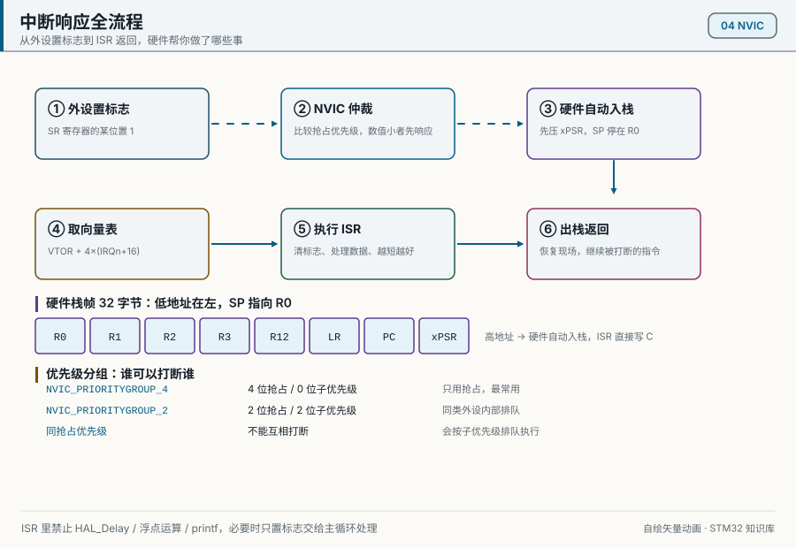
  <br><sub>▲ Animation: the full interrupt response (stack the context → fetch the vector → ISR → unstack; vector drawing by the author)</sub>
</p>

<!-- video:ch04 -->
<p align="center">
  <video width="640" controls poster="../../assets/video/ch04-nvic.png">
    <source src="../../assets/video/ch04-nvic.mp4" type="video/mp4">
  </video>
  <br><sub>▲ Chapter video with Chinese voice-over (2.5 min). <a href="../../assets/video/ch04-nvic.mp4">MP4</a> · <a href="../../assets/video/ch04-nvic.srt">subtitles</a></sub>
</p>

<details>
<summary>Narration script (Chinese, same text as the subtitles)</summary>

1. 轮询是你不停去问，中断是事情来了敲你的门。主程序可以继续干别的。进了中断服务，办完要清标志，不然门会一直响。
2. NVIC 这道总闸可以分成三档来记：这路中断开了没有，优先级谁高，有没有挂起还没处理。三档看全，才不会觉得中断时灵时不灵。
3. EXTI 的编号就是引脚号。EXTI0 同时只能留给一个端口。PA0 和 PB0 不能一起拿这条线。要两只按键，就换不同的脚号。
4. 这一帧是仓库画的中断路径。引脚边沿先进 EXTI，再由 NVIC 决定要不要打断当前程序，最后才进你写的服务函数。路径上任何一扇门关着，回调都不会来。
5. 优先级不是数字越大越急。F1 上要先看优先级分组切成什么样，才知道哪些位是抢占、哪些是子优先级。抄例程时把分组改了，顺序会整个翻掉。
6. 中断服务要短。别在里面调用会阻塞的延时，也别做很重的打印。置一个标志，或者塞进缓冲区，把慢活交回主循环。服务函数一长，别的中断就饿着。
7. 主循环和中断一起碰的变量，编译器可能会缓存。单字节标志加 volatile。超过一个字的数据，读的时候还得短暂关中断，否则会撕成两半。
8. 口诀：总闸分三档；同一编号的脚，EXTI 只能留一个端口。记住这两句，按键中断的大多数玄学都会消失。
9. 实验用一只按键走下降沿，服务函数里只翻转 PC13。按下能亮、松开不连翻，说明边沿和清标志都做对了。连翻多半是没清，或者抖动没处理。
10. 合上书，三问。EXTI0 能同时留给 PA0 和 PB0 吗？服务函数里为什么别写阻塞延时？总闸那三档各管什么？

</details>
<!-- /video:ch04 -->
## Principle and scope

This chapter uses the STM32F103C8T6, with the clock from Appendix D: SYSCLK = HCLK = 72 MHz. Priority grouping is the HAL default, `NVIC_PRIORITYGROUP_4`: all 4 bits go to preemption priority and subpriority gets 0 bits. A smaller number is a higher priority.

An exception with a higher preemption priority (a smaller number) may interrupt an ISR that is running at a lower preemption priority. Subpriority only chooses which already-pending request is taken first. It does not nest. Under `GROUP_4` the subpriority field has no bits, so the subpriority argument of `HAL_NVIC_SetPriority` does not create nesting. Seeing subpriority act means the grouping is not `GROUP_4`. Change the grouping and the same number means a different preemption level, so comparing old numbers after the change gives the wrong answer about nesting. Source: [PM0056 section 2.3.6](#source-pm0056-nvic).

On exit, if an exception is already pending, hardware may skip part of the unstack and the next stack. Tail-chaining cuts overhead. It does not change who may preempt. A lower priority does not enter a higher-priority ISR because tail-chaining is on. "Tail-chaining lets a lower priority insert itself into a higher one" is a common misunderstanding. PM0056 section 2.3.7 does not say how many cycles tail-chaining saves, so this chapter gives no number; the figure only shows one unstack-and-restack skipped.

`PRIMASK` masks exceptions of configurable priority. NMI and HardFault still enter. `FAULTMASK` also masks HardFault and still leaves NMI. `BASEPRI` masks only the band whose priority number is greater than or equal to the threshold. NMI does not take part in the EXTI0 versus TIM2 preemption comparison. The three registers mask different ranges, so check which one you are using. Chapter 02 showed that the clock security system (CSS) interrupt arrives as NMI, which is why disabling interrupts does not stop it.

A bare-metal priority setup does not automatically meet the chapter 15 FromISR constraint. FreeRTOS requires any interrupt that calls a FromISR function to have a priority number no smaller than the syscall threshold; see chapter 15 and the [FreeRTOS priority note](#source-freertos-priority).

EXTI lines are shared by pin number: PA0 and PB0 are both EXTI0, so they cannot both be external interrupts. On F1, enabling a different port means enabling the AFIO clock and then writing `EXTICR`. That is the F1 way. F4, L4, and H7 keep these registers in SYSCFG (`SYSCFG_EXTICR`), so you enable the SYSCFG clock instead. G0 moved them again, into the EXTI block itself (`EXTI_EXTICR`), and needs neither AFIO nor SYSCFG. [RM0008 Rev 21](#source-rm0008-exti) places EXTICR in sections 9.4.3 through 9.4.6. Section 9.2.7 is `GPIOx_LCKR`, not EXTICR. `EXTI_PR` has to be cleared by writing 1 to the pending bit.

## Key figures


<p align="center">
  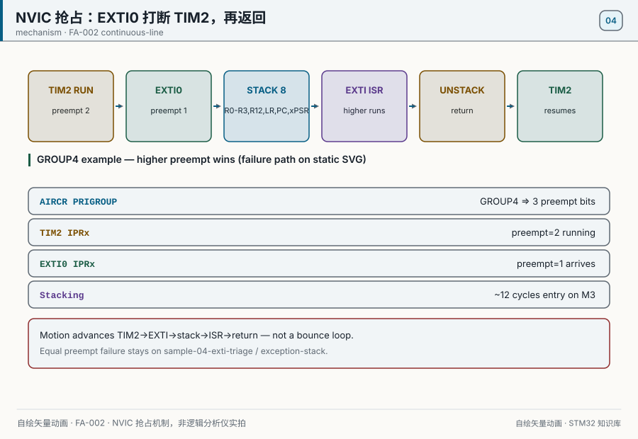
  <br><sub>▲ Hand-drawn CSS animation (FA-002). TIM2→EXTI0→stack→ISR→return.</sub>
</p>


<p align="center">
  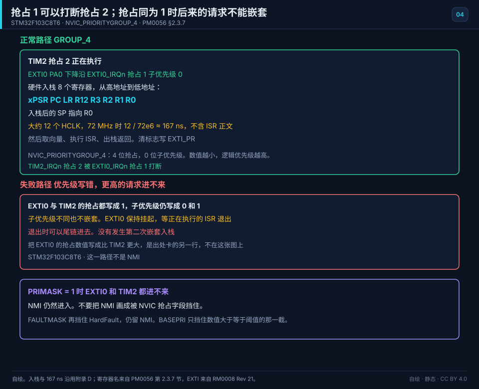
  <br><sub>▲ Drawn for this book. STM32F103C8T6, NVIC_PRIORITYGROUP_4. Upper half: TIM2 at preemption 2 is running, and EXTI0 (PA0, EXTI0_IRQn) at preemption 1 and subpriority 0 interrupts it. Eight registers stack from high address to low address: xPSR, PC, LR, R12, R3, R2, R1, R0, and SP points at R0. About 12 HCLK, 167 ns at 72 MHz, not the ISR body. Lower half: both are written as preemption 1, subpriorities 0 and 1 still do not nest, tail-chaining can happen on exit, and there is no second nested stack. With PRIMASK = 1, EXTI0 and TIM2 stay out and NMI still enters. Sources: [PM0056 section 2.3.7](#source-pm0056-nvic) and [RM0008 Rev 21 EXTICR](#source-rm0008-exti).</sub>
</p>
<p align="center">
  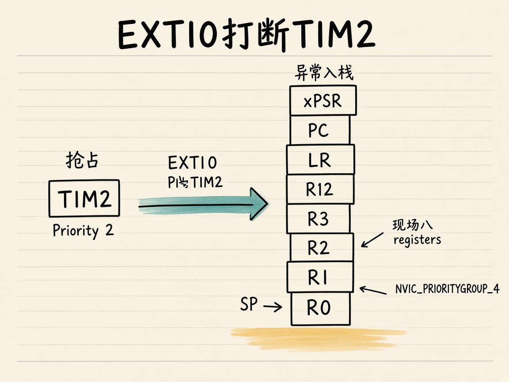
  <br><sub>▲ Knowledge track (Handraw · 原理示意 / not a photo). EXTI0 at preempt 1 cuts into TIM2 at preempt 2; eight registers stacked; not a scope capture.</sub>
</p>


<p align="center">
  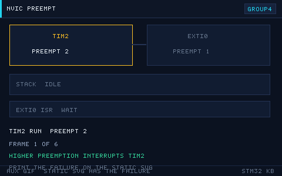
  <br><sub>▲ Animated version. It shows only EXTI0 preempting TIM2 successfully. The printed book has only the static figure above.</sub>
</p>

## Timing and state

| Phase | Grouping | EXTI0 preemption | TIM2 preemption | State | Time |
| --- | --- | --- | --- | --- | --- |
| Normal: TIM2 is running | GROUP_4 | — | 2 | The TIM2 ISR is running | — |
| Normal: EXTI0 arrives | GROUP_4 | 1 | 2 | Stack xPSR, PC, LR, R12, R3, R2, R1, R0 | 12 HCLK, about 167 ns |
| Normal: handler and return | GROUP_4 | 1 | 2 | Vector fetch, ISR, unstack, return | 167 ns excludes the ISR body |
| Failure: preemption written equal | GROUP_4 | 1 | 1 | EXTI0 stays pending. Tail-chaining happens only after exit. No second nested stack | The manual gives no cycle count |
| PRIMASK = 1 | GROUP_4 | 1 | 2 | Configurable interrupts do not enter. NMI still enters | — |

Stacking takes about 12 HCLK, about 167 ns at 72 MHz, matching Appendix D. Source: [PM0056 section 2.3.7](#source-pm0056-nvic). Clearing `EXTI_PR` is [RM0008](#source-rm0008-exti).

## Pitfalls and sources

| Symptom | Cause | What to do | Source | What the source shows |
| --- | --- | --- | --- | --- |
| A smaller subpriority still cannot interrupt the running ISR | Equal preemption does not nest | Change the preemption level, not the subpriority | [PM0056](#source-pm0056-nvic) | Equal preemption does not nest; GROUP_4 has no subpriority bits |
| The button interrupt cannot break into the timer | EXTI0's preemption number is not smaller than TIM2 | Give EXTI0 a smaller preemption number than TIM2 | [PM0056](#source-pm0056-nvic) | A smaller number wins; reversing them fails nesting |
| After tail-chaining is on, a lower priority enters a higher one | That is not what tail-chaining means | Check the preemption levels | [PM0056 section 2.3.7](#source-pm0056-nvic) | Tail-chaining does not change who may preempt |
| NMI still enters after `__disable_irq()` | PRIMASK does not cover NMI | This is expected, not a broken PRIMASK | [PM0056 Table 7](#source-pm0056-nvic) | PRIMASK masks configurable priority; NMI is outside it |
| PA0 already owns EXTI0, and PB0 never fires | One pin number shares one EXTI line | Use a different pin number | [RM0008 EXTICR](#source-rm0008-exti) | PA0 and PB0 are both EXTI0 |
| EXTI never fires on F1 | The AFIO clock is off, or EXTICR was not written | Enable the AFIO clock, write EXTICR, and clear EXTI_PR | [RM0008 section 9.4.3](#source-rm0008-exti) | On F1 the EXTI port select is in AFIO_EXTICR |

## Learning goals
- [ ] Say how an interrupt differs from polling, and when each one fits
- [ ] Know the NVIC rules for preemption priority and subpriority grouping
- [ ] Follow the hardware path of an interrupt (stack → fetch the vector → ISR → unstack)
- [ ] Configure an EXTI external interrupt and remember the AFIO clock
- [ ] Use `volatile` and a critical section, and know why `HAL_Delay` does not belong in an interrupt

## Core ideas

EXTI decides when an event is noticed; the NVIC decides which event runs first. Prompt detection is only one part of correctness. Flags, shared data, and ISR execution time still need separate evidence.

### 1. Interrupt versus polling

There are two ways to wait for a parcel. You can walk down to the mailbox every five minutes; that is polling, the CPU reading the button level again and again in its main loop. Or you can fit a doorbell and go down only when it rings; that is an interrupt, the hardware telling the CPU the button was pressed. With a doorbell you do not have to keep watching, but when it rings you have to drop what you are doing, so the handler must be quick and the dropped work must be picked up again.

| Dimension | Polling | Interrupt |
| --- | --- | --- |
| CPU use | High (it keeps checking) | Low (it responds when the event happens) |
| Response delay | Depends on the poll period | Usually a few clocks up to microseconds |
| Code complexity | Low | Medium (priority and shared variables) |
| Real-time behavior | Poor (an event can be missed) | Good |
| Fits | Simple, rare events, when you want a fixed path | Asynchronous events that need a fast response |

### 2. How NVIC priority works


<p align="center">
  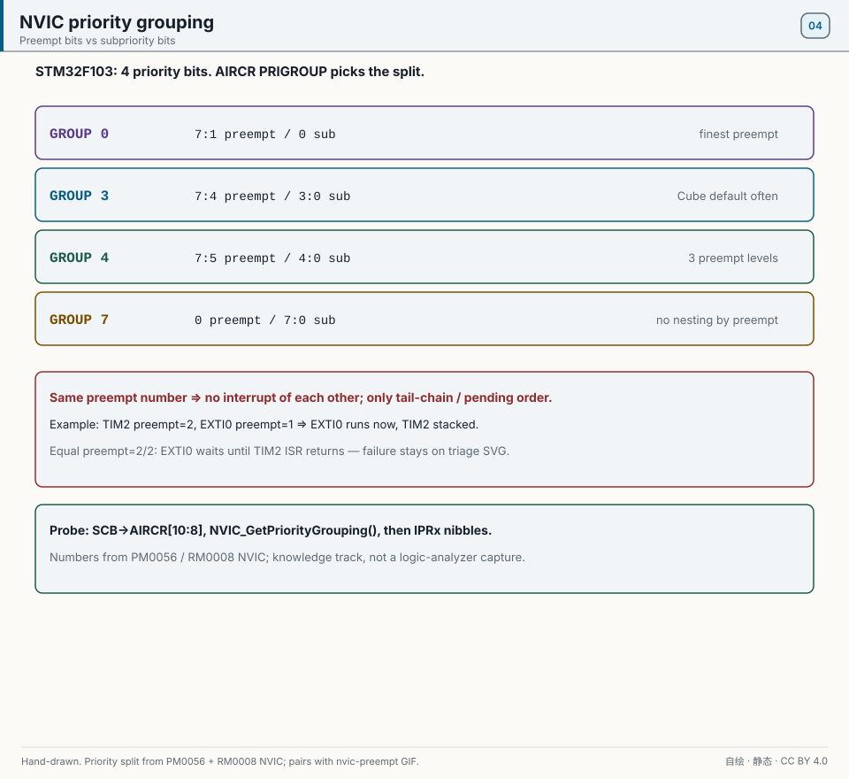
  <br><sub>▲ Drawn for this book. AIRCR PRIGROUP splits four priority bits; equal preempt does not nest.</sub>
</p>
<p align="center">
  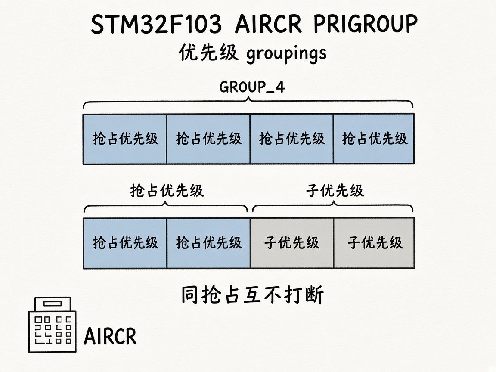
  <br><sub>▲ Knowledge track (Handraw · 原理示意 / not a photo). PRIGROUP splits preempt vs subpriority; same preempt cannot interrupt; not a register screenshot.</sub>
</p>


The NVIC is the chip's front desk for interrupts. When several requests arrive at once, it sorts them by two numbers. Preemption priority is like triage in an emergency room: a critical patient can send the doctor's current, milder patient out to wait, and that is nesting. Subpriority only decides the queue: when two patients of the same grade arrive together, which one is called first, but a patient already in the room is never sent out for someone of the same grade. One rule runs against intuition: a smaller number is more urgent, and 0 is the most urgent.

- A **smaller** priority number is a **higher** priority.
- Priority splits into preemption priority and subpriority.
- A higher preemption priority can interrupt an ISR with a lower preemption priority. **Interrupts that share a preemption priority cannot interrupt each other** (even if the subpriorities differ).
- Subpriority only decides who runs first when several interrupts are **pending at the same time**. It does not nest.
- The split is set by `HAL_NVIC_SetPriorityGrouping()` / `NVIC_PriorityGroupConfig()`.

| Grouping macro (HAL) | Preemption bits | Subpriority bits | How many preemption levels |
| --- | --- | --- | --- |
| `NVIC_PRIORITYGROUP_0` | 0 | 4 | 1 (no preemption) |
| `NVIC_PRIORITYGROUP_1` | 1 | 3 | 2 |
| `NVIC_PRIORITYGROUP_2` | 2 | 2 | 4 |
| `NVIC_PRIORITYGROUP_3` | 3 | 1 | 8 |
| `NVIC_PRIORITYGROUP_4` | 4 | 0 | 16 (HAL default) |

How the arbitration looks:

<p align="center">
  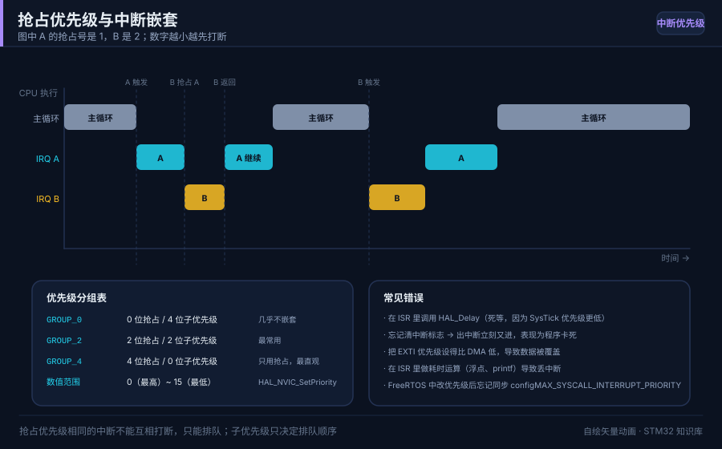
  <br><sub>▲ Figure: preemption priority versus subpriority (vector drawing by the author)</sub>
</p>
<p align="center">
  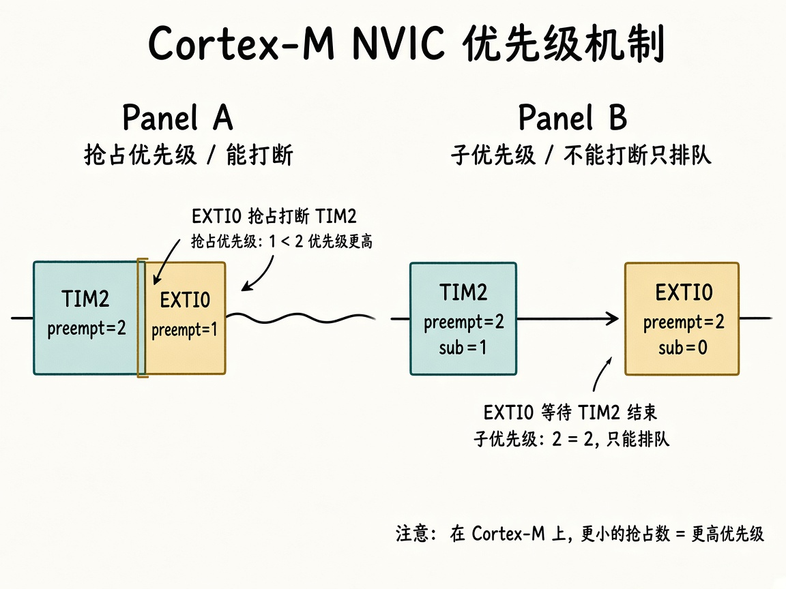
  <br><sub>▲ Knowledge track (Handraw · 原理示意 / not a photo). Smaller preempt number is higher and can nest; same preempt only queues by subpriority; not a debugger photo.</sub>
</p>


### 3. The full interrupt response

Everything between the button press and the first line of your handler is done by hardware. The step that matters most is 4: the CPU pushes 8 registers onto the stack, like slipping a bookmark into a book before getting up to answer the door. On the way back the hardware restores from that bookmark, and the main program never knows it was interrupted. Your code only owns step 6, and it must clear the interrupt flag; otherwise the doorbell keeps ringing and the CPU enters the same interrupt over and over.

| Stage | What the hardware does |
| --- | --- |
| 1 | The peripheral event sets a flag (the matching bit in `EXTI_PR`, for example) |
| 2 | The peripheral sends the request to the NVIC, and the NVIC sets the pending bit |
| 3 | The CPU finishes the current instruction, compares priority, and decides whether to take it |
| 4 | Hardware automatically stacks 8 registers (xPSR, PC, LR, R12, R3, R2, R1, R0) |
| 5 | The ISR address is taken from the vector table and execution jumps there |
| 6 | Your ISR runs, and **clears the interrupt flag** |
| 7 | The stacked context is restored and execution returns to the main program |

Watch these seven steps side by side — polling, an external interrupt, and EXTI triggering — in this animation:

<p align="center">
  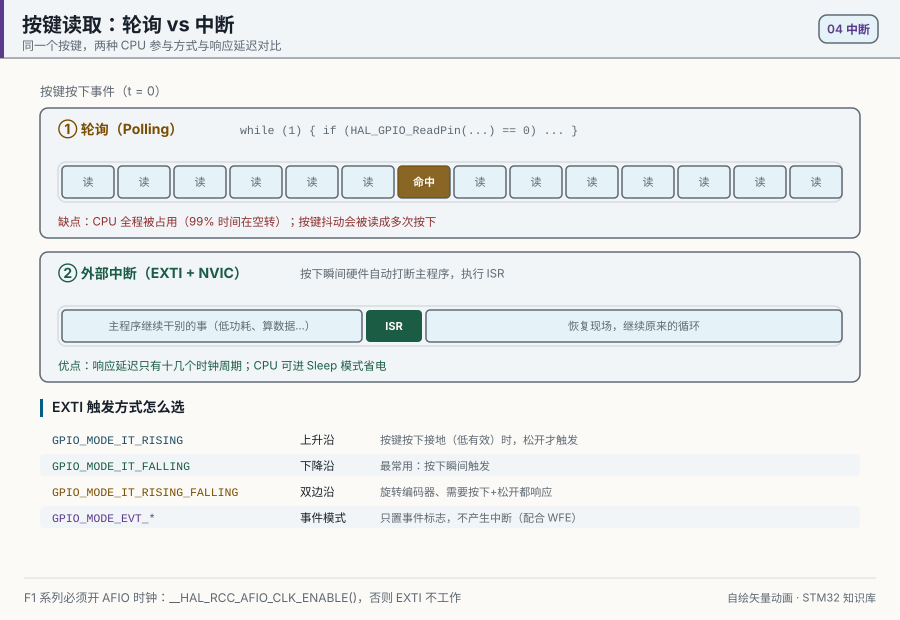
  <br><sub>▲ Animation: polling versus an external interrupt versus EXTI trigger choices (vector drawing by the author)</sub>
</p>

### 4. EXTI external interrupts


<p align="center">
  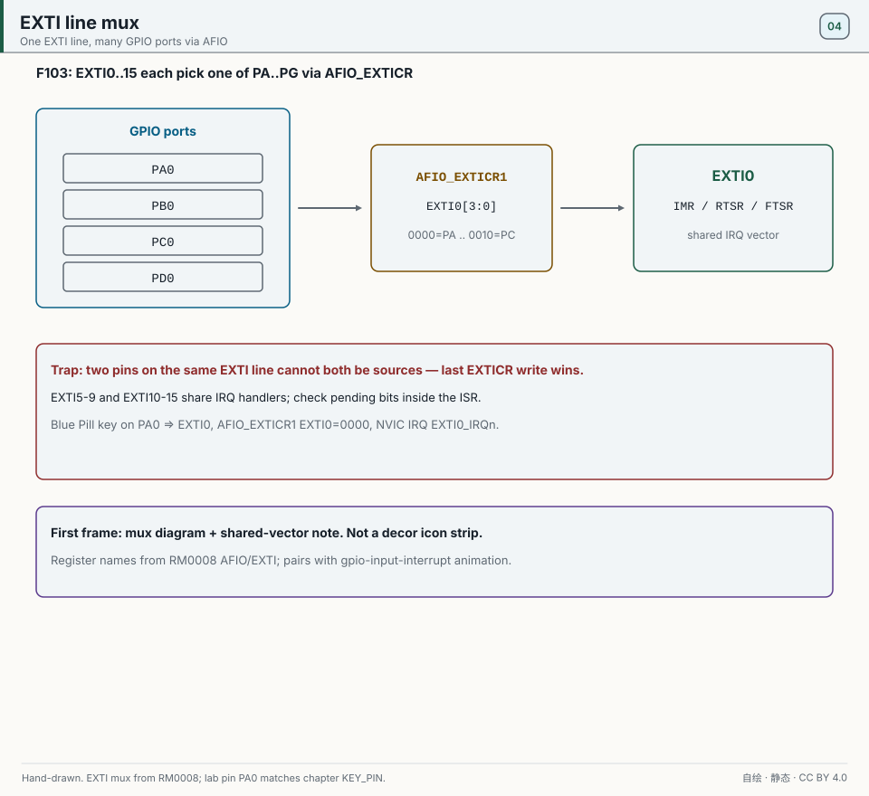
  <br><sub>▲ Drawn for this book. One port per EXTI line; EXTI5-9 and 10-15 share IRQs.</sub>
</p>
<p align="center">
  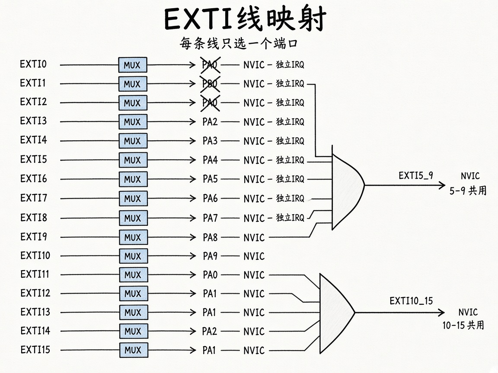
  <br><sub>▲ Knowledge track (Handraw · 原理示意 / not a photo). Each EXTI line picks one port; 5–9 and 10–15 share IRQs; not a die photo.</sub>
</p>


EXTI is the layer that turns a pin change into an interrupt request. The F103 has 16 EXTI lines, split by pin number: pin 0 of every port (PA0, PB0, PC0, ...) shares EXTI0, every pin 1 shares EXTI1, and so on. One line can serve only one port at a time, like a building with one doorbell button per floor: floor 1 of block A and floor 1 of block B cannot both use it. The `EXTICR` registers choose the port, and on F1 they live in AFIO, which is why the AFIO clock must be on first.

| Idea | Meaning |
| --- | --- |
| EXTI line | Each line corresponds to one GPIO pin (or one group of them) |
| Trigger | Rising edge / falling edge / both edges |
| AFIO | On F1, mapping an EXTI pin requires `__HAL_RCC_AFIO_CLK_ENABLE()` (**an F1-only trap**) |
| Mapping | `AFIO->EXTICR[x]` chooses which port the EXTI line connects to (PAx / PBx / …) |

<p align="center">
  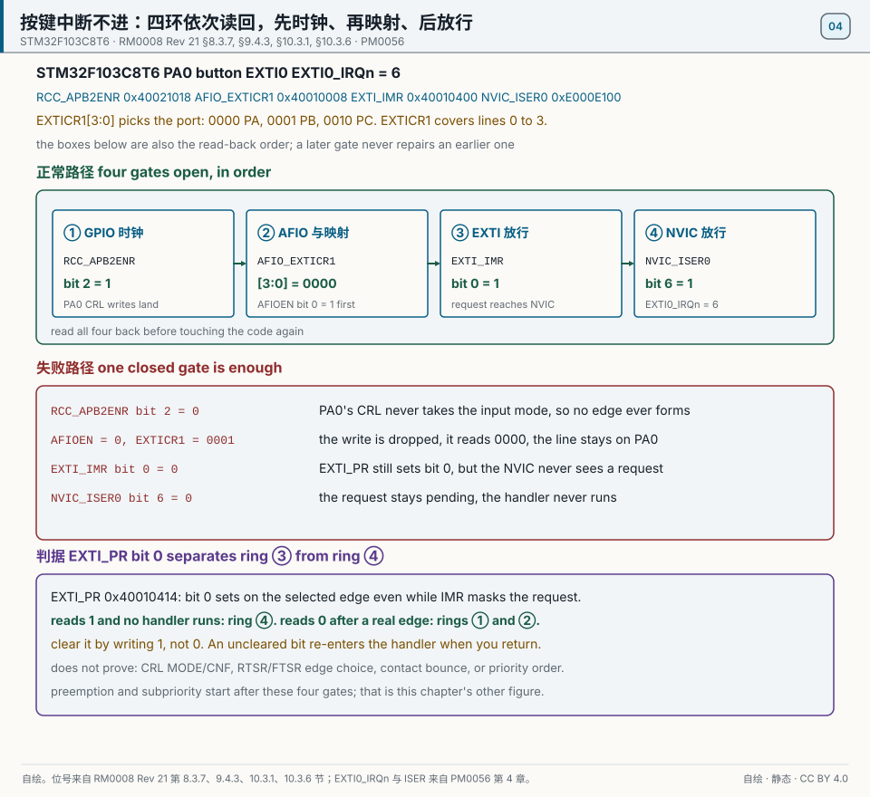
  <br><sub>▲ Drawn for this book. STM32F103C8T6, button on PA0, EXTI0_IRQn = 6. Where to look: follow the PA0 edge towards the ISR and read four registers in order — RCC_APB2ENR bit 2 (IOPAEN), AFIO_EXTICR1 [3:0] (0000 selects PA0), EXTI_IMR bit 0, and NVIC_ISER0 bit 6. The path is open only when all four read back 1. What it proves: with EXTI_IMR at 0, EXTI_PR bit 0 is still set by the edge, so "PR reads 1 but the handler never runs" separates ring ④ from ring ③; a PR that reads 0 means the edge never reached EXTI at all, so go back to rings ① and ②. What it does not prove: the pin mode (GPIOx_CRL MODE/CNF), the edge chosen by RTSR/FTSR, contact bounce, or preemption and subpriority. Sources: RM0008 Rev 21 sections 8.3.7, 9.4.3, 10.3.1, and 10.3.6 ([EXTICR and EXTI_PR](#source-rm0008-exti)), and [PM0056 section 4](#source-pm0056-nvic) for NVIC_ISERx and the exception number.</sub>
</p>
<p align="center">
  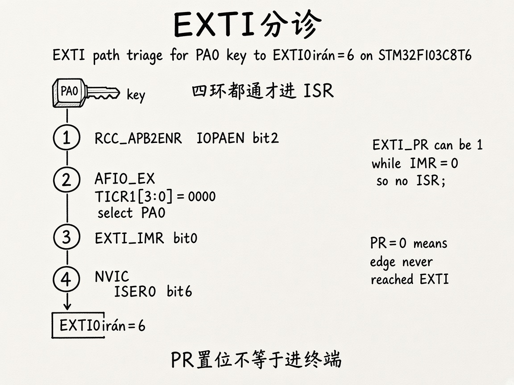
  <br><sub>▲ Knowledge track (Handraw · 原理示意 / not a photo). IOPAEN → EXTICR → IMR → NVIC_ISER all must be open; PR set does not mean ISR entry; not a board photograph.</sub>
</p>


### 5. The C that matters

When an interrupt and the main program share a variable, two things go wrong most often. First, the compiler helpfully keeps the variable in a register, so the main loop keeps reading the old value and never sees what the interrupt wrote; mark such variables `volatile`. Second, the main program is halfway through updating a multi-byte value when the interrupt comes in and reads a half-old, half-new value; put those reads and writes in a critical section with interrupts off.

| Idea | What it does |
| --- | --- |
| `volatile` | Tells the compiler the variable may change inside an ISR, so it must not cache it in a register |
| Critical section `__disable_irq()` / `__enable_irq()` | Mask or unmask all interrupts, to protect shared data |
| `__DSB()` | Data synchronization barrier; memory accesses finish before you continue |
| No `HAL_Delay` in an interrupt | It depends on the SysTick interrupt. If that interrupt is masked at the same or a higher level, the delay waits forever |

## Hardware and wiring

| Board | Peripheral | Pin | Notes |
| --- | --- | --- | --- |
| BluePill | Button (EXTI) | PA0 | The other side to GND; falling-edge trigger |
| BluePill | LED | PC13 | Toggled inside the interrupt path |

To continue from chapter 03, remove the external LED from PA0 and move the button from PA1 to PA0. PA13 and PA14 remain assigned to SWD.

## Code

```c
/* exti_key.c —— PA0 button external interrupt toggles PC13 (flag + debounce in the main loop) */
#include "stm32f1xx_hal.h"

#define LED_PIN   GPIO_PIN_13
#define LED_PORT  GPIOC
#define KEY_PIN   GPIO_PIN_0
#define KEY_PORT  GPIOA

static volatile uint8_t g_key_flag = 0;   /* shared by the ISR and the main loop; must be volatile */

void SystemClock_Config(void);

int main(void)
{
    HAL_Init();
    SystemClock_Config();

    __HAL_RCC_GPIOA_CLK_ENABLE();
    __HAL_RCC_GPIOC_CLK_ENABLE();
    __HAL_RCC_AFIO_CLK_ENABLE();          /* F1: EXTI needs the AFIO clock */

    GPIO_InitTypeDef io = {0};

    /* PC13 LED output */
    io.Pin = LED_PIN; io.Mode = GPIO_MODE_OUTPUT_PP;
    io.Pull = GPIO_NOPULL; io.Speed = GPIO_SPEED_FREQ_LOW;
    HAL_GPIO_Init(LED_PORT, &io);

    /* PA0 button, falling-edge interrupt (button to GND, idle pulled high) */
    io.Pin  = KEY_PIN;
    io.Mode = GPIO_MODE_IT_FALLING;       /* falling-edge interrupt */
    io.Pull = GPIO_PULLUP;
    HAL_GPIO_Init(KEY_PORT, &io);

    /* NVIC: preemption priority 1, subpriority 0 */
    HAL_NVIC_SetPriority(EXTI0_IRQn, 1, 0);
    HAL_NVIC_EnableIRQ(EXTI0_IRQn);

    while (1)
    {
        if (g_key_flag)
        {
            g_key_flag = 0;
            HAL_GPIO_TogglePin(LED_PORT, LED_PIN);
        }
    }
}

/* EXTI0 service routine (PA0 is mapped to EXTI0) */
void EXTI0_IRQHandler(void)
{
    if (__HAL_GPIO_EXTI_GET_IT(KEY_PIN) != RESET)
    {
        __HAL_GPIO_EXTI_CLEAR_IT(KEY_PIN);   /* the flag must be cleared, or the interrupt keeps re-entering */
        g_key_flag = 1;                      /* set the flag only; do no slow work */
    }
}
```

Software debounce on the main-loop side (so contact bounce does not toggle many times):

```c
if (g_key_flag)
{
    HAL_Delay(20);                          /* a delay in the main loop is safe */
    if (HAL_GPIO_ReadPin(KEY_PORT, KEY_PIN) == GPIO_PIN_RESET)  /* still low */
    {
        HAL_GPIO_TogglePin(LED_PORT, LED_PIN);
    }
    g_key_flag = 0;
}
```

A critical section (when the main loop reads a multi-byte shared variable):

```c
uint32_t snapshot;
__disable_irq();          /* mask all interrupts */
snapshot = g_shared_counter;
__enable_irq();           /* unmask all interrupts */
```

The full project is in [`examples/exti-key/`](../../examples/exti-key/).

## Hands-on labs

1. **Lab 1 (event loop):** Let the PA0 falling edge set a flag in the ISR and toggle PC13 in the main loop. Press 10 times, record 10 valid toggles, and confirm in the debugger that the matching `EXTI_PR` bit has cleared.
2. **Lab 2 (bounce evidence):** Temporarily remove main-loop debounce and count the flags produced by 10 presses. Restore debounce and repeat. Keep both counts instead of judging by appearance.
3. **Lab 3 (preemption evidence):** Add a TIM2 interrupt. In each ISR, drive one spare GPIO high on entry and low on exit. Capture both traces with a logic analyzer and verify that preemption priority 1 EXTI0 enters during preemption priority 2 TIM2.

### 6. NVIC registers and functions

| Item | Meaning |
| --- | --- |
| ISER | Interrupt set-enable register |
| ICER | Interrupt clear-enable register |
| ISPR/ICPR | Set pending / clear pending |
| IPR | Priority registers (one interrupt per 8 bits) |
| `HAL_NVIC_SetPriority` | Set preemption and subpriority |
| `HAL_NVIC_EnableIRQ` | Enable the interrupt |
| `HAL_NVIC_SetPriorityGrouping` | Set the grouping |

### 7. SysTick and the HAL time base

- `HAL_Init()` configures SysTick as a 1 ms interrupt. `HAL_Delay()` depends on it.
- SysTick priority is usually the lowest (`TICK_INT_PRIORITY`), so it does not cut into application interrupts.
- If an ISR calls `HAL_Delay()` and that ISR's priority is higher than SysTick, the tick never advances, and the delay waits forever.

### 8. Nesting, with numbers

```c
/* a higher preemption (smaller number) can interrupt a lower one; the same preemption cannot */
HAL_NVIC_SetPriority(EXTI0_IRQn, 1, 0);   /* preemption 1 */
HAL_NVIC_SetPriority(TIM2_IRQn, 2, 0);    /* preemption 2; EXTI0 can interrupt it */
HAL_NVIC_EnableIRQ(EXTI0_IRQn);
HAL_NVIC_EnableIRQ(TIM2_IRQn);
```

### 9. Which grouping to pick

| Situation | Grouping |
| --- | --- |
| No RTOS | GROUP_4 (all preemption) |
| FreeRTOS | GROUP_4 (the RTOS requires all preemption) |
| You need subpriority to break ties | GROUP_2 |

### 10. Interrupt overhead, and the hardware shortcuts


<p align="center">
  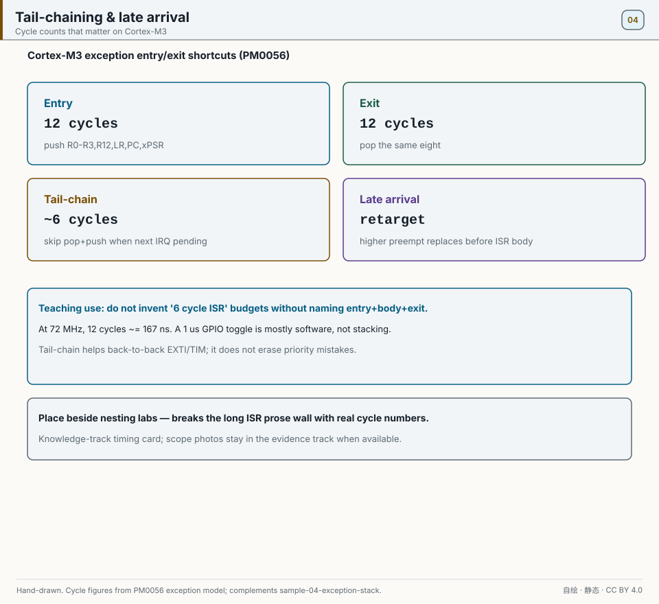
  <br><sub>▲ Drawn for this book. ~12-cycle entry; ~6-cycle tail-chain. The 6-cycle figure is for tail-chain only, not the ISR body.</sub>
</p>
<p align="center">
  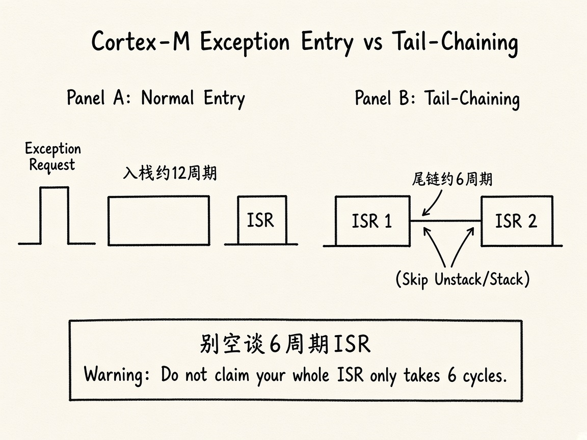
  <br><sub>▲ Knowledge track (Handraw · 原理示意 / not a photo). Entry stacking ~12 cycles, tail-chaining ~6; do not treat hardware chaining as whole ISR time; not a scope capture.</sub>
</p>


| Mechanism | Meaning |
| --- | --- |
| Hardware stacking | 8 registers are saved automatically, about 12 clock cycles |
| Tail-chaining | On exit, hardware may skip part of the unstack and the next stack. It does not change who may preempt. The account is in Timing or state |
| Late-arriving | A higher priority can take over while the stack is still happening |
| What to do about it | Keep the ISR short. Hand the slow work to the main loop |

### 11. Three master gates, and a shared EXTI line

`PRIMASK` masks every interrupt except NMI and HardFault. `FAULTMASK` also masks HardFault, and leaves only NMI. `BASEPRI` blocks only the band whose priority number is greater than or equal to the threshold (a larger number is a lower priority).

| Register | Who it blocks | The usual spelling |
| --- | --- | --- |
| PRIMASK | Every maskable interrupt | `__disable_irq()` / `__enable_irq()` |
| FAULTMASK | Those, plus HardFault | `__disable_fault_irq()` |
| BASEPRI | The ones whose number is not urgent enough | `__set_BASEPRI(prio << (8 - __NVIC_PRIO_BITS))` |

EXTI lines are shared by **pin number**: PA0 and PB0 both sit on EXTI0, so they cannot both be external interrupts at once. To change the port, write `AFIO->EXTICR` (F1) or `SYSCFG->EXTICR` (F4). They are not two lines in parallel.

Before leaving this chapter, keep the button-event count, the before/after debounce count, and one preemption trace, and explain why PA0 and PB0 cannot occupy two independent EXTI0 lines.

Self-test:

1. After `__disable_irq()`, can HardFault still enter?
2. PA0 already has a button interrupt. Can PB0 still take an EXTI falling edge?
3. Does a larger BASEPRI threshold mean higher priority, or the opposite?

## Related resources

- Official manuals: **RM0008** chapter 10 (interrupts and events, EXTI), sections 9.4.3 through 9.4.6 (AFIO_EXTICR). Section 9.2.7 is GPIOx_LCKR, not EXTICR. Stacking is [PM0056 section 2.3.7](#source-pm0056-nvic)
- Previous: [03 GPIO and LEDs](03-gpio-and-led.md) | Next: [05 Timers and PWM](05-timer-pwm.md)
- Figures: [`assets/animations/nvic-interrupt-flow.svg`](../../assets/animations/nvic-interrupt-flow.svg), [`assets/animations/gpio-input-interrupt.svg`](../../assets/animations/gpio-input-interrupt.svg), [`assets/diagrams/interrupt-priority.svg`](../../assets/diagrams/interrupt-priority.svg)
- Disclaimer: every illustration in this repo is a vector drawing or a program-generated animation by the author, not a manufacturer's photograph.
