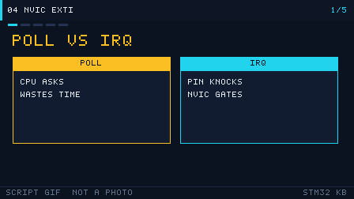

# 04 Interrupts and the NVIC
> 中文：[中断与 NVIC](../04-中断与NVIC.md)

> An interrupt means the CPU does not have to sit and wait on a peripheral. When the event arrives, execution jumps to the handler. That is the core mechanism of a real-time system.

<p align="center">
  
  <br><sub>▲ Animation: the full interrupt response (stack the context → fetch the vector → ISR → unstack; vector drawing by the author)</sub>
</p>

<!-- video:ch04 -->
<p align="center">
  
  <br><sub>▲ Lecture slides for this chapter: a program-generated GIF (tools/gen_videos.py, reproducible, not a live shot). The narration matches the five frames one to one.</sub>
</p>

**Narration (read along with the frames, about one minute)**

1. Polling is the CPU asking over and over. An interrupt is a pin knocking on the door. Before it knocks, open the NVIC's door.
2. Priority grouping decides how many bits are preemption and how many are subpriority. Inside a group, the smaller preemption number runs first.
3. One EXTI line can be tied to only one port at a time. PA0 and PB0 cannot both hang on EXTI0.
4. Inside an interrupt you may only raise a flag. A printf, a delay, or another I2C read leaves later interrupts standing outside.
5. Motto: the master gate has three settings. Self-test: can EXTI0 be left to PA0 and PB0 at the same time?
<!-- /video:ch04 -->


## 📌 Learning goals
- [ ] Say how an interrupt differs from polling, and when each one fits
- [ ] Know the NVIC rules for preemption priority and subpriority grouping
- [ ] Follow the hardware path of an interrupt (stack → fetch the vector → ISR → unstack)
- [ ] Configure an EXTI external interrupt and remember the AFIO clock
- [ ] Use `volatile` and a critical section, and know why `HAL_Delay` does not belong in an interrupt

## 🧠 Core ideas

**Lead with the conclusion: an interrupt replaces "the CPU keeps asking" with "the peripheral speaks up". The cost is that you have to handle priority, shared variables, and time spent in the handler.**

### 1. Interrupt versus polling

| Dimension | Polling | Interrupt |
| --- | --- | --- |
| CPU use | High (it keeps checking) | Low (it responds when the event happens) |
| Response delay | Depends on the poll period | Usually a few clocks up to microseconds |
| Code complexity | Low | Medium (priority and shared variables) |
| Real-time behavior | Poor (an event can be missed) | Good |
| Fits | Simple, rare events, when you want a fixed path | Asynchronous events that need a fast response |

### 2. How NVIC priority works

- A **smaller** priority number is a **higher** priority.
- Priority splits into preemption priority and subpriority.
- A higher preemption priority can interrupt an ISR with a lower preemption priority. **Interrupts that share a preemption priority cannot interrupt each other** (even if the subpriorities differ).
- Subpriority only decides who runs first when several interrupts are **pending at the same time**. It does not nest.
- The split is set by `HAL_NVIC_SetPriorityGrouping()` / `NVIC_PriorityGroupConfig()`.

| Grouping macro (HAL) | Preemption bits | Subpriority bits | How many preemption levels |
| --- | --- | --- | --- |
| `NVIC_PRIORITYGROUP_0` | 0 | 4 | 1 (no preemption) |
| `NVIC_PRIORITYGROUP_1` | 1 | 3 | 2 |
| `NVIC_PRIORITYGROUP_2` | 2 | 2 | 4 |
| `NVIC_PRIORITYGROUP_3` | 3 | 1 | 8 |
| `NVIC_PRIORITYGROUP_4` | 4 | 0 | 16 (HAL default) |

How the arbitration looks:

<p align="center">
  
  <br><sub>▲ Figure: preemption priority versus subpriority (vector drawing by the author)</sub>
</p>

### 3. The full interrupt response

| Stage | What the hardware does |
| --- | --- |
| 1 | The peripheral event sets a flag (the matching bit in `EXTI_PR`, for example) |
| 2 | The peripheral sends the request to the NVIC, and the NVIC sets the pending bit |
| 3 | The CPU finishes the current instruction, compares priority, and decides whether to take it |
| 4 | Hardware automatically stacks 8 registers (xPSR, PC, LR, R12, R3, R2, R1, R0) |
| 5 | The ISR address is taken from the vector table and execution jumps there |
| 6 | Your ISR runs, and **clears the interrupt flag** |
| 7 | The stacked context is restored and execution returns to the main program |

### 4. EXTI external interrupts

| Idea | Meaning |
| --- | --- |
| EXTI line | Each line corresponds to one GPIO pin (or one group of them) |
| Trigger | Rising edge / falling edge / both edges |
| AFIO | On F1, mapping an EXTI pin requires `__HAL_RCC_AFIO_CLK_ENABLE()` (**an F1-only trap**) |
| Mapping | `AFIO->EXTICR[x]` chooses which port the EXTI line connects to (PAx / PBx / …) |

Polling versus interrupt versus EXTI:

<p align="center">
  
  <br><sub>▲ Animation: polling versus an external interrupt versus EXTI trigger choices (vector drawing by the author)</sub>
</p>

### 5. The C that matters

| Idea | What it does |
| --- | --- |
| `volatile` | Tells the compiler the variable may change inside an ISR, so it must not cache it in a register |
| Critical section `__disable_irq()` / `__enable_irq()` | Mask or unmask all interrupts, to protect shared data |
| `__DSB()` | Data synchronization barrier; memory accesses finish before you continue |
| No `HAL_Delay` in an interrupt | It depends on the SysTick interrupt. If that interrupt is masked at the same or a higher level, the delay waits forever |

## 🛠️ Hardware and wiring

| Board | Peripheral | Pin | Notes |
| --- | --- | --- | --- |
| BluePill | Button (EXTI) | PA0 | The other side to GND; falling-edge trigger |
| BluePill | LED | PC13 | Toggled inside the interrupt path |

## 💻 Code

```c
/* exti_key.c —— PA0 button external interrupt toggles PC13 (flag + debounce in the main loop) */
#include "stm32f1xx_hal.h"

#define LED_PIN   GPIO_PIN_13
#define LED_PORT  GPIOC
#define KEY_PIN   GPIO_PIN_0
#define KEY_PORT  GPIOA

static volatile uint8_t g_key_flag = 0;   /* shared by the ISR and the main loop; must be volatile */

void SystemClock_Config(void);

int main(void)
{
    HAL_Init();
    SystemClock_Config();

    __HAL_RCC_GPIOA_CLK_ENABLE();
    __HAL_RCC_GPIOC_CLK_ENABLE();
    __HAL_RCC_AFIO_CLK_ENABLE();          /* F1: EXTI needs the AFIO clock */

    GPIO_InitTypeDef io = {0};

    /* PC13 LED output */
    io.Pin = LED_PIN; io.Mode = GPIO_MODE_OUTPUT_PP;
    io.Pull = GPIO_NOPULL; io.Speed = GPIO_SPEED_FREQ_LOW;
    HAL_GPIO_Init(LED_PORT, &io);

    /* PA0 button, falling-edge interrupt (button to GND, idle pulled high) */
    io.Pin  = KEY_PIN;
    io.Mode = GPIO_MODE_IT_FALLING;       /* falling-edge interrupt */
    io.Pull = GPIO_PULLUP;
    HAL_GPIO_Init(KEY_PORT, &io);

    /* NVIC: preemption priority 1, subpriority 0 */
    HAL_NVIC_SetPriority(EXTI0_IRQn, 1, 0);
    HAL_NVIC_EnableIRQ(EXTI0_IRQn);

    while (1)
    {
        if (g_key_flag)
        {
            g_key_flag = 0;
            HAL_GPIO_TogglePin(LED_PORT, LED_PIN);
        }
    }
}

/* EXTI0 service routine (PA0 is mapped to EXTI0) */
void EXTI0_IRQHandler(void)
{
    if (__HAL_GPIO_EXTI_GET_IT(KEY_PIN) != RESET)
    {
        __HAL_GPIO_EXTI_CLEAR_IT(KEY_PIN);   /* the flag must be cleared, or the interrupt keeps re-entering */
        g_key_flag = 1;                      /* set the flag only; do no slow work */
    }
}
```

Software debounce on the main-loop side (so contact bounce does not toggle many times):

```c
if (g_key_flag)
{
    HAL_Delay(20);                          /* a delay in the main loop is safe */
    if (HAL_GPIO_ReadPin(KEY_PORT, KEY_PIN) == GPIO_PIN_RESET)  /* still low */
    {
        HAL_GPIO_TogglePin(LED_PORT, LED_PIN);
    }
    g_key_flag = 0;
}
```

A critical section (when the main loop reads a multi-byte shared variable):

```c
uint32_t snapshot;
__disable_irq();          /* mask all interrupts */
snapshot = g_shared_counter;
__enable_irq();           /* unmask all interrupts */
```

The full project is in [`examples/exti-key/`](../../examples/exti-key/).

## ⚠️ Pitfalls and troubleshooting

| Symptom | Cause | Fix |
| --- | --- | --- |
| The interrupt never enters | NVIC was not enabled, EXTI was not configured, or the AFIO clock is off | Add `HAL_NVIC_EnableIRQ` and `__HAL_RCC_AFIO_CLK_ENABLE` |
| The interrupt re-enters forever | The flag was never cleared | Call `__HAL_GPIO_EXTI_CLEAR_IT()` in the ISR |
| One press fires many times | Contact bounce | Software debounce or an RC filter |
| The flag the main loop reads never updates | The variable is not `volatile` | Mark shared variables `volatile` |
| The program locks up inside the interrupt | It called `HAL_Delay` | In the interrupt, only set a flag. Do the slow work in the main loop |
| A high-priority interrupt loses events | A lower-priority ISR masks it for a long time | Keep the ISR short. Use two levels: the interrupt sets a flag, the main loop does the work |
| EXTI works on F4 and never fires on F1 | On F1 the AFIO clock was left off | Add `__HAL_RCC_AFIO_CLK_ENABLE()` |

## 🧪 Hands-on labs

1. **Lab 1:** A falling edge on the PA0 button toggles PC13. One press, one on or off.
2. **Lab 2:** Remove the software debounce and press quickly. Watch the extra toggles. Put the debounce back and compare.
3. **Lab 3 (priority):** Add a second timer interrupt at a different preemption priority, and confirm that the higher preemption can interrupt the lower ISR.

### 6. NVIC registers and functions

| Item | Meaning |
| --- | --- |
| ISER | Interrupt set-enable register |
| ICER | Interrupt clear-enable register |
| ISPR/ICPR | Set pending / clear pending |
| IPR | Priority registers (one interrupt per 8 bits) |
| `HAL_NVIC_SetPriority` | Set preemption and subpriority |
| `HAL_NVIC_EnableIRQ` | Enable the interrupt |
| `HAL_NVIC_SetPriorityGrouping` | Set the grouping |

### 7. SysTick and the HAL time base

- `HAL_Init()` configures SysTick as a 1 ms interrupt. `HAL_Delay()` depends on it.
- SysTick priority is usually the lowest (`TICK_INT_PRIORITY`), so it does not cut into application interrupts.
- If an ISR calls `HAL_Delay()` and that ISR's priority is higher than SysTick, the tick never advances, and the delay waits forever.

### 8. Nesting, with numbers

```c
/* a higher preemption (smaller number) can interrupt a lower one; the same preemption cannot */
HAL_NVIC_SetPriority(EXTI0_IRQn, 1, 0);   /* preemption 1 */
HAL_NVIC_SetPriority(TIM2_IRQn, 2, 0);    /* preemption 2; EXTI0 can interrupt it */
HAL_NVIC_EnableIRQ(EXTI0_IRQn);
HAL_NVIC_EnableIRQ(TIM2_IRQn);
```

### 9. Which grouping to pick

| Situation | Grouping |
| --- | --- |
| No RTOS | GROUP_4 (all preemption) |
| FreeRTOS | GROUP_4 (the RTOS requires all preemption) |
| You need subpriority to break ties | GROUP_2 |

### 10. Interrupt overhead, and the hardware shortcuts

| Mechanism | Meaning |
| --- | --- |
| Hardware stacking | 8 registers are saved automatically, about 12 clock cycles |
| Tail-chaining | Back-to-back interrupts skip the unstack-then-stack |
| Late-arriving | A higher priority can take over while the stack is still happening |
| What to do about it | Keep the ISR short. Hand the slow work to the main loop |

### 11. Three master gates, and a shared EXTI line

**Conclusion:** `PRIMASK` masks every interrupt except NMI and HardFault. `FAULTMASK` also masks HardFault, and leaves only NMI. `BASEPRI` blocks only the band whose priority number is greater than or equal to the threshold (a larger number is a lower priority).

| Register | Who it blocks | The usual spelling |
| --- | --- | --- |
| PRIMASK | Every maskable interrupt | `__disable_irq()` / `__enable_irq()` |
| FAULTMASK | Those, plus HardFault | `__disable_fault_irq()` |
| BASEPRI | The ones whose number is not urgent enough | `__set_BASEPRI(prio << (8 - __NVIC_PRIO_BITS))` |

EXTI lines are shared by **pin number**: PA0 and PB0 both sit on EXTI0, so they cannot both be external interrupts at once. To change the port, write `AFIO->EXTICR` (F1) or `SYSCFG->EXTICR` (F4). They are not two lines in parallel.

Motto: **the master gate has three settings. For one pin number, EXTI keeps only one port.**

Self-test:

1. After `__disable_irq()`, can HardFault still enter?
2. PA0 already has a button interrupt. Can PB0 still take an EXTI falling edge?
3. Does a larger BASEPRI threshold mean higher priority, or the opposite?

## 🔗 Related resources

- Official manuals: **RM0008** chapter 10 (interrupts and events, EXTI), section 9.2.7 (AFIO_EXTICR); *The Definitive Guide to the Cortex-M3* (NVIC / exception handling)
- Previous: [03 GPIO and LEDs](03-gpio-and-led.md) | Next: [05 Timers and PWM](05-timer-pwm.md)
- Figures: [`assets/animations/nvic-interrupt-flow.svg`](../../assets/animations/nvic-interrupt-flow.svg), [`assets/animations/gpio-input-interrupt.svg`](../../assets/animations/gpio-input-interrupt.svg), [`assets/diagrams/interrupt-priority.svg`](../../assets/diagrams/interrupt-priority.svg)
- Disclaimer: every illustration in this repo is a vector drawing or a program-generated animation by the author, not a manufacturer's photograph.
