# 05 Timers and PWM
> 中文：[定时器与 PWM](../05-定时器与PWM.md)

> Chapter 04 responds to events with interrupts; this chapter lets hardware generate the beat. Confirm the 72 MHz TIM3 input from chapter 02, then use PSC, ARR, and CCR to generate and measure back a 1 kHz, 50% PWM.

<p align="center">
  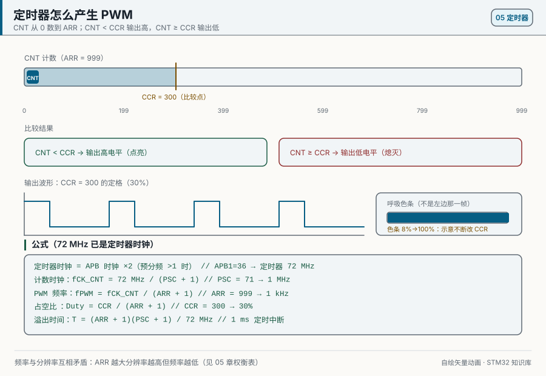
  <br><sub>▲ Animation: timer count, compare match, and PWM duty (a breathing LED; vector drawing by the author)</sub>
</p>

<!-- video:ch05 -->
<p align="center">
  <video width="640" controls poster="../../assets/video/ch05-tim.png">
    <source src="../../assets/video/ch05-tim.mp4" type="video/mp4">
  </video>
  <br><sub>▲ Chapter video with Chinese voice-over (2.7 min). <a href="../../assets/video/ch05-tim.mp4">MP4</a> · <a href="../../assets/video/ch05-tim.srt">subtitles</a></sub>
</p>

<details>
<summary>Narration script (Chinese, same text as the subtitles)</summary>

1. 定时器不是魔法，就是一个被时钟推着走的计数器。CNT 加到 ARR 就回头，这一圈就是周期。先把这句话讲顺，再去看 PWM。
2. 三个数各管一件事。PSC 把时钟变慢，ARR 决定一圈多长，CCR 决定方波在哪里翻。频率不对先看前两个，亮度不对再看 CCR。
3. 频率等于定时器时钟，除以 ARR 加 1，再除以 PSC 加 1。想要 1 千赫，先选定分频后的计数时钟，再反推 ARR。不要三个数一起瞎试。
4. 这一帧是仓库画的 PWM。计数器一边跑，一边和 CCR 比。低于和高于可以是两种电平，占空比就出来了。示波器上的高电平宽度，应该和你算的 CCR 一致。
5. 想要 1 千赫，你先定谁？先定 PSC，让计数时钟变成好算的整数，再定 ARR 加 1。CCR 最后填，因为它不改变频率，只改变占空比。
6. 输入捕获不是去量电压。边沿到来时，硬件把当时的 CNT 锁进捕获寄存器。两个边沿相减，再乘上计数周期，就是脉宽。口诀：捕获锁的是 CNT。
7. 回到时钟那一章：APB 分频大于 1 时，定时器时钟常常还要乘 2。公式里的时钟用错，你算的 1 千赫会变成 2 千赫或 500 赫。先问到真实的定时器时钟。
8. 三个数按顺序拧：先用 PSC 把时钟分到好算，再用 ARR 定周期，最后 CCR 定占空比。每拧一步记下算出的数，出错时才知道是哪一步的账不对。
9. 实验输出大约 1 千赫、占空比三成的 PWM。用逻辑分析仪或示波器对一下。对不上时，先核对定时器时钟，再核对 ARR 和 CCR，别先怀疑探头。
10. 离开前把账读回一遍：PSC 和 ARR 是不是你写的值，CNT 有没有真的在跑。寄存器读回和示波器对上，PWM 这一章才算闭环。

</details>
<!-- /video:ch05 -->
## Principle and scope

Every waveform number in this chapter is for the STM32F103C8T6, with the 72 MHz counter clock from Appendix D. On a family with 32-bit timers, redo the "does not fit in 16 bits" part below.

TIM3 sits on APB1, where PCLK1 = 36 MHz. When the APB1 prescaler is not 1, the timer clock is twice PCLK1, so TIM3 really counts at 72 MHz. PSC = 71 and ARR = 999 give `72e6 / ((71+1) × (999+1)) = 1000` Hz. The counter clock is first divided down to 1 MHz, then counts 1000 steps, so the period is 1 ms. If you work out the same PSC and ARR from 36 MHz, you get 500 Hz; a scope reading of 500 Hz usually means exactly that mistake. Source: [RM0008 Rev 21 chapter 15](#source-rm0008-tim).

PWM mode 1 drives the active level while CNT < CCR. With CCR = 500 the duty cycle is `500 / (999+1) = 50%`, and the high time is 500 µs.

TIM2 to TIM5 on the C8 are all 16-bit, so ARR tops out at 65535. PSC = 71 with ARR = 999999 for a 1 second period does not fit. The version that fits is PSC = 7199 and ARR = 9999: `72e6 / (7200 × 10000) = 1` Hz. The 32-bit TIM2 and TIM5 belong to other families such as the F4.

With no remap, TIM3_CH1 is on PA6, LQFP48 pin 16. DS5319 Rev 20 Table 5 lists both TIM3_CH1 and SPI1_MISO as default functions of that pin, and only one can be in use at a time. Chapter 08 uses it as SPI1_MISO. Moving the channel to PB4 or PC6 needs `TIM3_REMAP`. Source: [DS5319 Rev 20 Table 5](#source-ds5319-tim).

The advanced timers TIM1 and TIM8 have an extra break and dead-time register, `TIMx_BDTR`, at offset `0x44` with reset value `0x0000`. While bit 15 MOE is 0 the main output is off and the pin stays quiet. `HAL_TIM_PWM_Start` sets MOE for you; register-level code often forgets it. General-purpose TIM3 has no such bit.

## Key figures


<p align="center">
  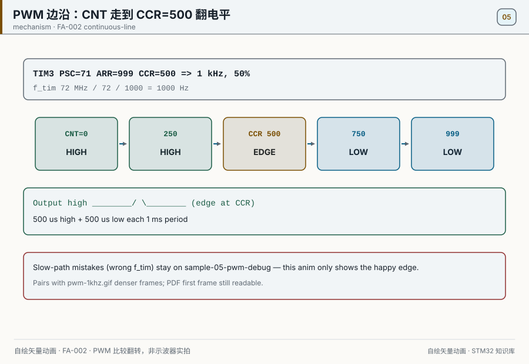
  <br><sub>▲ Hand-drawn CSS animation (FA-002). 1 kHz, 50% high for 500 µs.</sub>
</p>


<p align="center">
  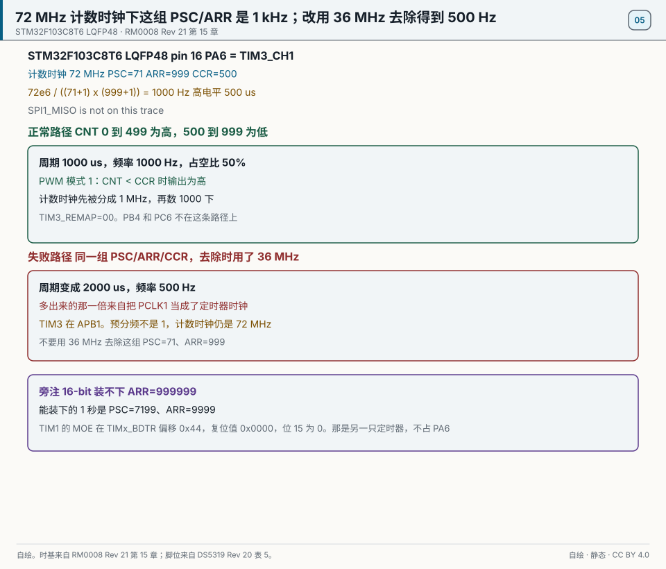
  <br><sub>▲ Drawn for this book. STM32F103C8T6, LQFP48 pin 16 PA6 = TIM3_CH1. Counter clock 72 MHz, PSC = 71, ARR = 999, CCR = 500. The top half is the correct waveform: 1 ms period, 500 µs high, 1000 Hz. The bottom half is what you get when the numbers are worked out from 36 MHz: 2 ms period, 500 Hz. The figure also marks that ARR = 999999 does not fit in a 16-bit counter. TIM1 MOE at offset 0x44, reset value 0x0000, has nothing to do with this TIM3 waveform. Sources: [RM0008 Rev 21 chapter 15](#source-rm0008-tim) and [DS5319 Rev 20 Table 5](#source-ds5319-tim).</sub>
</p>

<p align="center">
  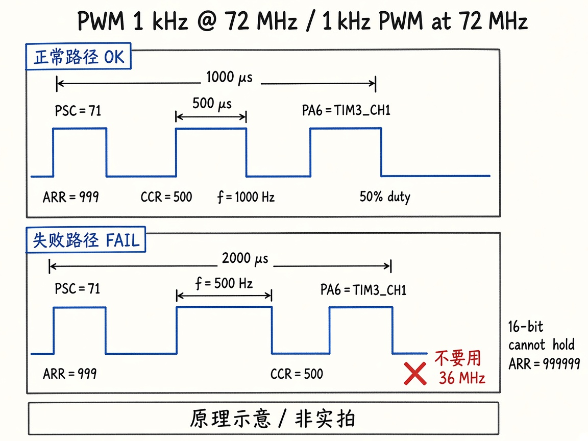
  <br><sub>▲ Knowledge track (Handraw · 原理示意 / not a photo). Top: 72 MHz → 1000 Hz; bottom: wrong 36 MHz → 500 Hz; not a scope capture.</sub>
</p>

<p align="center">
  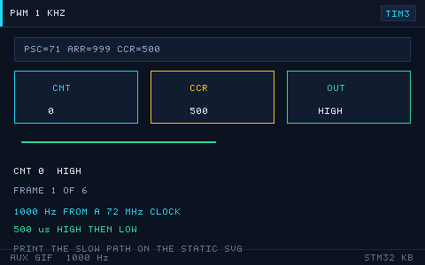
  <br><sub>▲ Animated version. It shows only the correct 1000 Hz waveform with 500 µs high. The printed book has only the static figure above.</sub>
</p>

## Timing and state

| Case | Counter clock | PSC | ARR | CCR | CNT | Output | Time |
| --- | --- | --- | --- | --- | --- | --- | --- |
| Correct, high part | 72 MHz | 71 | 999 | 500 | 0 through 499 | high | 500 µs |
| Correct, low part | 72 MHz | 71 | 999 | 500 | 500 through 999 | low | another 500 µs, period 1000 µs, 1000 Hz |
| Worked out from 36 MHz | 36 MHz | 71 | 999 | 500 | 0 through 999 | same compare | period 2000 µs, 500 Hz |
| ARR does not fit | 72 MHz | 71 | 999999 | — | — | no 1 s period | truncated by the 16-bit register |
| 1 second that fits | 72 MHz | 7199 | 9999 | — | 0 through 9999 | — | 1 Hz |

Source: [RM0008 Rev 21 chapter 15](#source-rm0008-tim).

## Pitfalls and sources

| What you see | Why | What to do | Source | What the source shows |
| --- | --- | --- | --- | --- |
| The scope shows 500 Hz | PSC and ARR were worked out from 36 MHz | Work them out from 72 MHz: PSC = 71, ARR = 999 | [RM0008](#source-rm0008-tim) | This set is 1000 Hz at 72 MHz and 500 Hz at 36 MHz |
| ARR was written as 999999 for a 1 s period | A 16-bit counter cannot hold it | Use PSC = 7199 and ARR = 9999 | [RM0008](#source-rm0008-tim) | The general-purpose timers on the C8 are 16-bit and cannot hold 999999 |
| TIM1 has no waveform at all | BDTR bit 15 MOE is still 0 | Set MOE | [RM0008](#source-rm0008-tim) | The reset value is 0x0000. With MOE at 0 the main output stays off. The offset is 0x44. TIM3 has no such bit |
| PWM appears on some other pin | TIM3_REMAP is not 00 | Keep TIM3_REMAP=00 and use PA6 | [DS5319](#source-ds5319-tim) | LQFP48 pin 16 is PA6, and the default alternate function includes TIM3_CH1 |

## Learning goals
- [ ] Tell the STM32 timer classes apart (advanced / general-purpose / basic / watchdog / SysTick)
- [ ] Use the time-base formulas to get PSC and ARR for any period
- [ ] Understand count modes, the update event, and shadow registers
- [ ] Configure a PWM mode and derive the duty and frequency formulas
- [ ] Measure frequency and duty with input capture, and know the encoder interface exists

## Core ideas

Determine the timer input clock before calculating PSC and ARR. CCR only sets the compare point. If 36 MHz PCLK1 is mistaken for the 72 MHz timer clock, every later result is off by two.

### 1. Timer classes

A timer is a counter that ticks along with a clock, plus a few comparators. The classes differ in how many extras they carry. A basic timer only counts, which makes it a good alarm clock. A general-purpose timer adds 4 channels, so it can drive PWM and measure pulses. An advanced timer adds complementary outputs and dead time for motor drives. SysTick is the one built into the core, and HAL and RTOS both use it as their heartbeat.


<p align="center">
  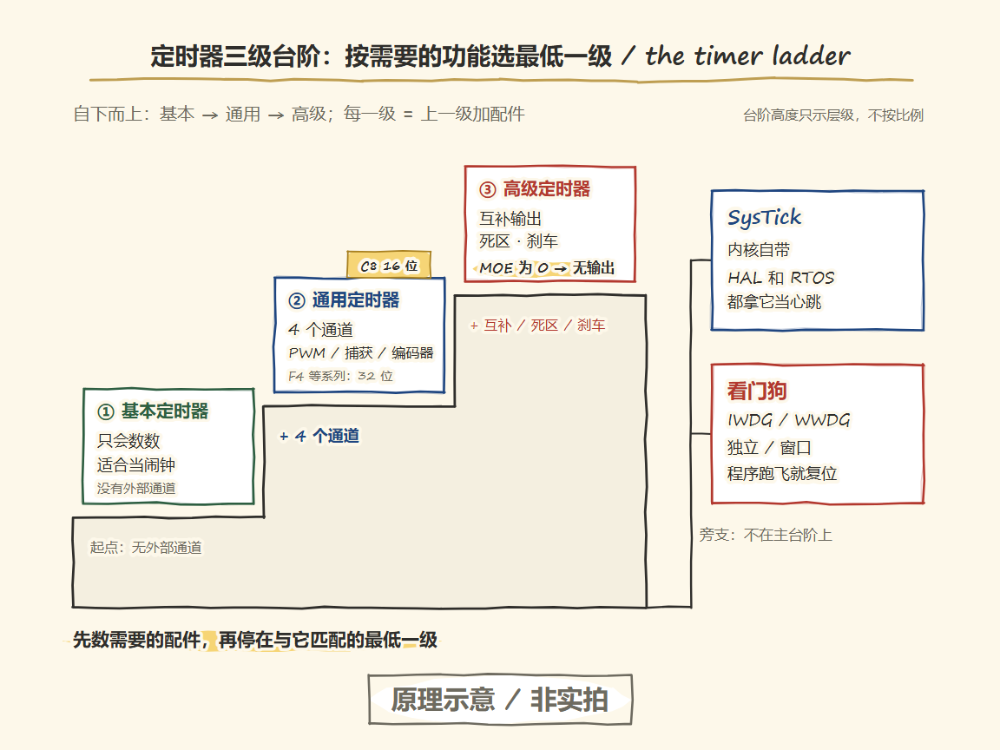
  <br><sub>▲ Knowledge track (Handraw · 原理示意 / not a photo). Where to look: three ascending rungs — basic counts only, general-purpose adds 4 channels (PWM / capture / encoder), advanced adds complementary outputs, dead time and break, with MOE on the top rung; SysTick and the watchdog sit on a side branch, and the C8's general-purpose timers carry a 16-bit tag; Proves each class is the one below plus extras, so pick the lowest rung that has the feature you need; Cannot show register offsets or measured waveforms, and the class table stays the lookup; See [RM0008 Rev 21 chapter 15](#source-rm0008-tim).</sub>
</p>

| Class | Instance | Width | What is special | Typical use |
| --- | --- | --- | --- | --- |
| Advanced | TIM1/TIM8 | 16-bit | Complementary outputs, dead time, break, MOE | Motors, three-phase PWM |
| General-purpose | TIM2–TIM5 | 16-bit | 4 channels, PWM / capture / encoder | 16-bit on the STM32F103C8T6. TIM2/TIM5 are 32-bit on families such as the F4 |
| Basic | TIM6/TIM7 | 16-bit | Counting only, no external channel | A time base, triggering a DAC |
| Watchdog | IWDG/WWDG | 12/7-bit | Independent / window watchdog | Reset a program that has run away |
| System | SysTick | 24-bit | Built into the core | HAL time base, RTOS tick |

### 2. Time-base formulas


<p align="center">
  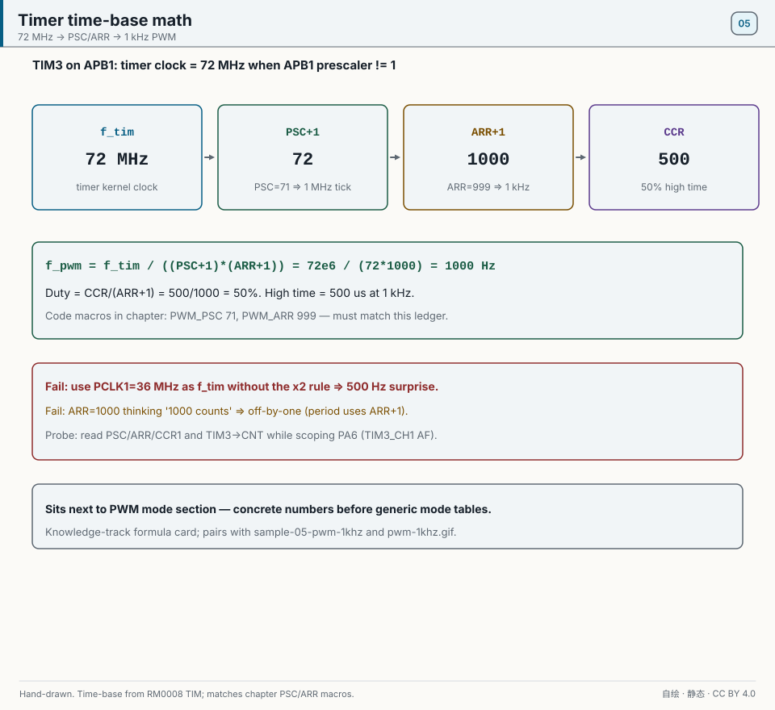
  <br><sub>▲ Drawn for this book. PSC=71 ARR=999 CCR=500 matches the chapter macros.</sub>
</p>

<p align="center">
  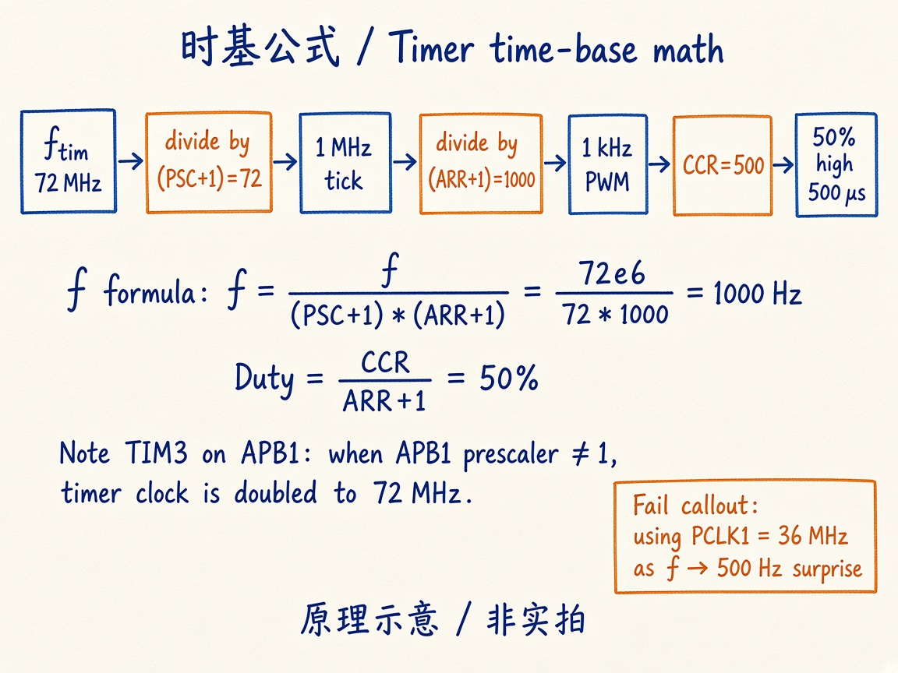
  <br><sub>▲ Knowledge track (Handraw · 原理示意 / not a photo). 72 MHz → (PSC+1) → (ARR+1) → 1 kHz; CCR/1000 = 50%; not a photo.</sub>
</p>


Think of the timer as two gears. PSC is the first gear and slows the 72 MHz clock down: PSC = 71 means one step every 72 clocks, so each step is 1 µs. ARR is the second gear. The counter wraps to zero after ARR: ARR = 999 means 1000 steps per lap, so each lap is 1 ms. In both registers the real count is the value you write plus 1, and that +1 is the most common off-by-one.

- Counter clock: `fCK_CNT = fCK_PSC / (PSC + 1)`
- Period: `T = (ARR + 1) × (PSC + 1) / fCK_PSC`
- Frequency: `f = fCK_PSC / ((ARR + 1)(PSC + 1))`

Useful values at 72 MHz:

| Target period | PSC | ARR | Actual T | Notes |
| --- | --- | --- | --- | --- |
| 1 ms | 71 | 999 | 1.000 ms | 1 kHz |
| 10 ms | 7199 | 99 | 10.00 ms | 100 Hz |
| 100 ms | 7199 | 999 | 100.0 ms | 10 Hz |
| 1 s | 7199 | 9999 | 1.000 s | 1 Hz |
| 1 s (large ARR) | 71 | 999999 | does not fit | TIM2–TIM5 on the C8 are 16-bit and cannot hold 999999. The 1 s that fits is the row above, PSC = 7199 and ARR = 9999 |

> Fix `fCK_CNT` first (pick PSC), then `ARR+1 = T × fCK_CNT`.

### 3. Count modes and shadow registers


<p align="center">
  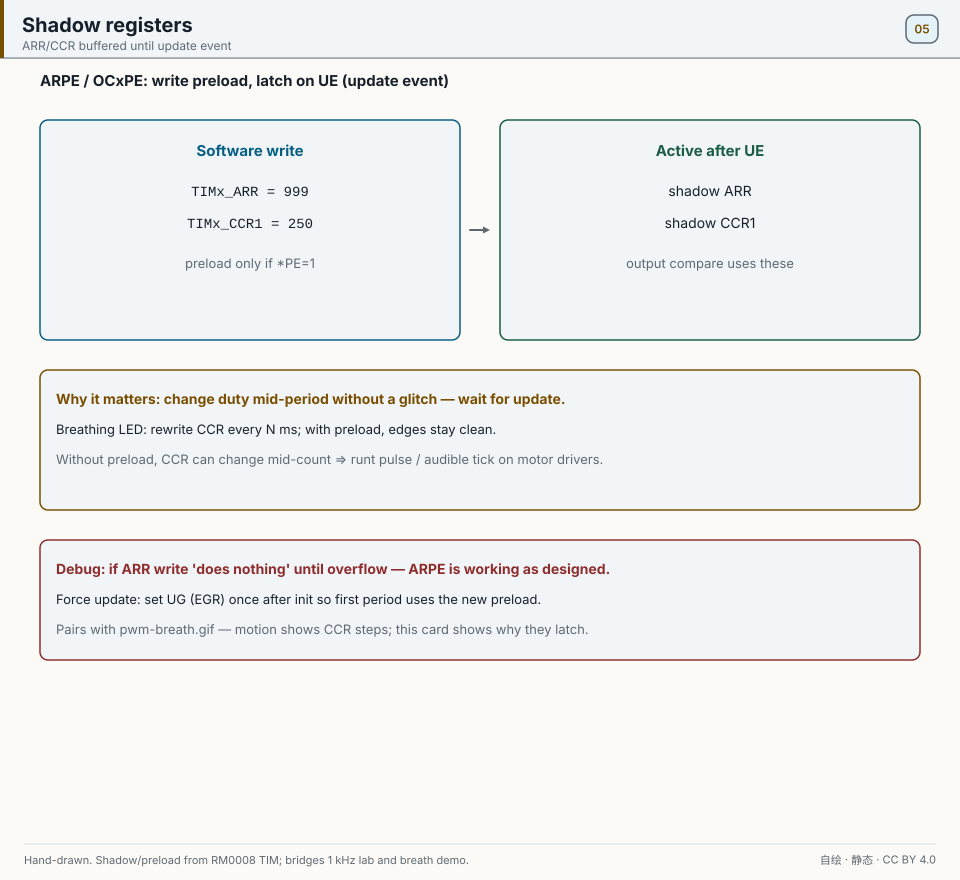
  <br><sub>▲ Drawn for this book. ARPE/OCxPE: write preload; latch on update event.</sub>
</p>

<p align="center">
  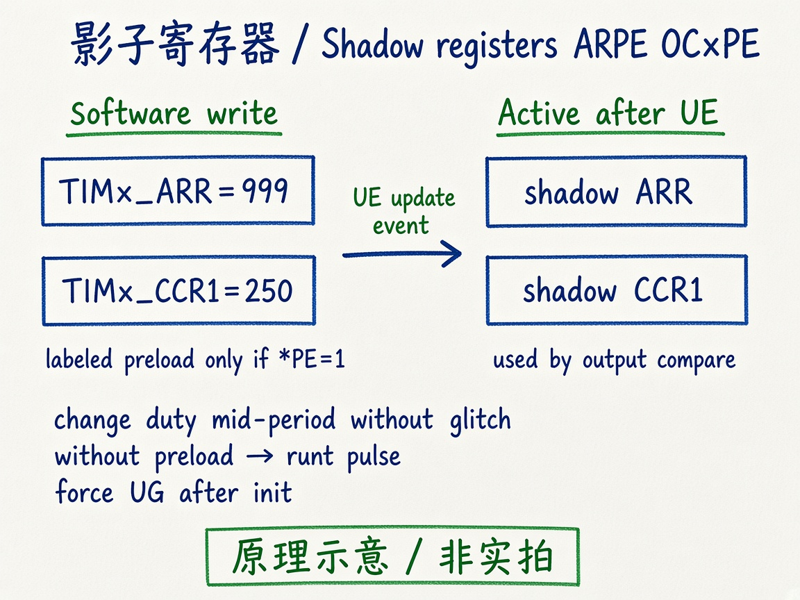
  <br><sub>▲ Knowledge track (Handraw · 原理示意 / not a photo). Write preload; latch on UE; without preload → runt pulse; not a photo.</sub>
</p>


A shadow register works like a restaurant changing its menu. The new ARR or CCR you write waits in the back (the preload register). It moves to the front, where the comparison happens, only when the current lap ends and the update event fires. A PWM lap therefore never changes length halfway through and never emits a stray pulse. The cost is that a new value takes effect one lap later.

| Mode | Meaning |
| --- | --- |
| Up | 0→ARR. Reaching ARR makes an update event (the usual choice) |
| Down | ARR→0 |
| Center-aligned | 0→ARR→0. Used for motors, symmetric PWM |

| Idea | Meaning |
| --- | --- |
| Update event UEV | Produced on overflow or underflow. Can raise an interrupt or a DMA request |
| ARR preload | ARR is written to the shadow register and takes effect at the UEV |
| CCR preload | Same idea, so PWM does not glitch halfway (ARPE/OCxPE) |
| Shadow register | You write the preload register. The value that is actually compared is the shadow register |

<p align="center">
  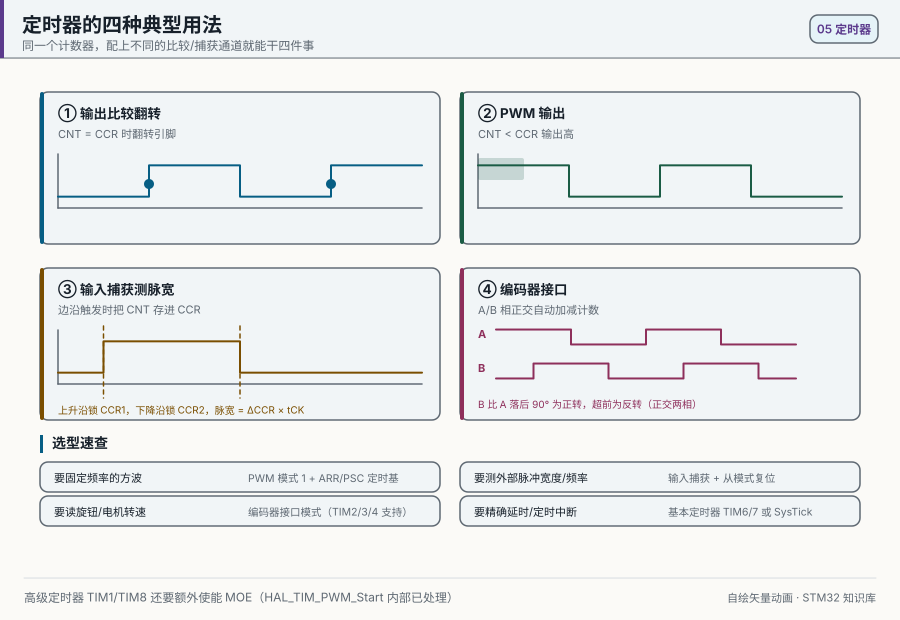
  <br><sub>▲ Counter state: CNT, ARR, and CCR determine update events and compare output. The first frame remains readable in the PDF. It explains order and boundaries; it is not an oscilloscope capture (FA-002 · IG-009 · C-03/C-10/C-27/C-31).</sub>
</p>

When the output is silent or the frequency is wrong, read the three rings below back in order and change one register at a time. A waveform that is still there but off by a whole ratio points at ring ①, the divider. Only when PA6 is completely quiet do you walk ring ② CC1E and ring ③ GPIO alternate-function setup.

<p align="center">
  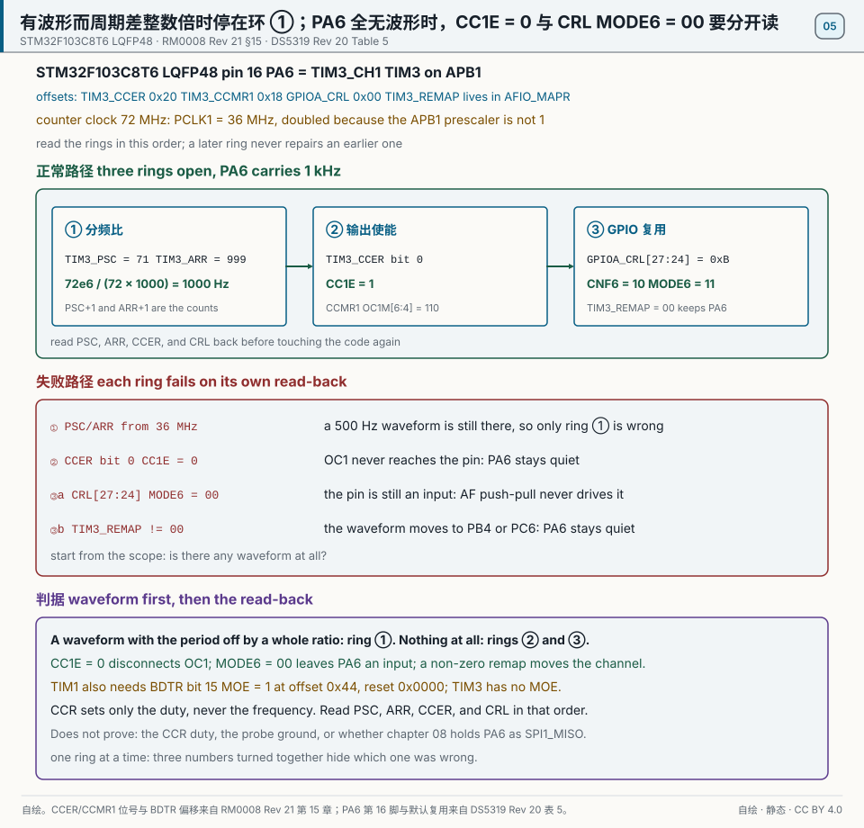
  <br><sub>▲ Drawn for this book. Where to look: the top row of three waveforms is the verdict — 1 kHz passes, 500 Hz off by a whole ratio checks ring ① only, and a dead line checks rings ②③; the three-ring signal chain runs left to right into PA6. Ring ① reads TIM3_PSC = 71 and TIM3_ARR = 999 back and recomputes 72e6 / (72 × 1000) = 1000 Hz; the same pair divided by 36 MHz gives 500 Hz. Ring ② reads CC1E = 1 in bit 0 of TIM3_CCER, with OC1M[6:4] = 110 in TIM3_CCMR1 selecting PWM mode 1. Ring ③ reads GPIOA_CRL[27:24] = 0xB: CNF6 = 10 is alternate-function push-pull and MODE6 = 11 is 50 MHz, while TIM3_REMAP = 00 keeps the channel on pin 16 PA6. What it proves: the read-backs separate a frequency error from a dead pin — the 500 Hz verdict tile is exactly what a ring-①-only error looks like; CC1E = 0 and MODE6 = 00 both leave PA6 quiet, and a non-zero remap moves the waveform to PB4 or PC6. What it does not prove: the duty set by CCR, the probe ground, or whether chapter 08 has taken PA6 as SPI1_MISO; TIM1's extra BDTR bit 15 MOE at offset 0x44 is only named, not drawn. Sources: [RM0008 Rev 21 chapter 15](#source-rm0008-tim) and [DS5319 Rev 20 Table 5](#source-ds5319-tim).</sub>
</p>

<p align="center">
  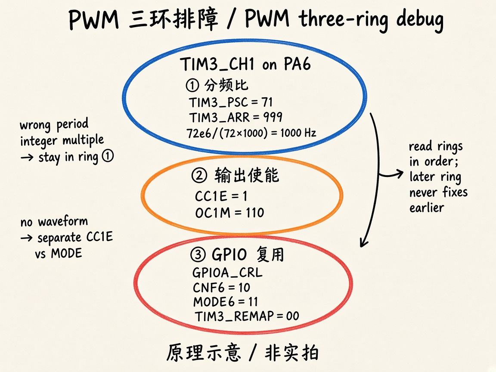
  <br><sub>▲ Knowledge track (Handraw · 原理示意 / not a photo). ① divider ② CC1E/OC1M ③ GPIO AF; later ring never fixes earlier; not a photo.</sub>
</p>

### 4. PWM modes and formulas

PWM flips a switch thousands of times a second, and the load only feels the average: the LED looks half bright, the motor runs at half speed. The counter runs from 0 to ARR. The output is high until the count reaches CCR and low after it, so CCR is the switch point. A lap has only ARR+1 steps, so the higher the frequency, the shorter the lap and the fewer duty steps you get.

| Mode | Behavior |
| --- | --- |
| PWM mode 1 | While CNT < CCR, the output is the active level |
| PWM mode 2 | While CNT < CCR, the output is the inactive level (inverted) |

- Frequency: `f_PWM = fCK_PSC / ((ARR + 1)(PSC + 1))`
- Duty: `Duty = CCR / (ARR + 1) × 100%`

Frequency versus resolution, at the same fCK_PSC:

| Target PWM frequency | PSC | ARR+1 | Duty resolution | Notes |
| --- | --- | --- | --- | --- |
| 1 kHz | 1 | 36000 | 1/36000 | A different high-resolution set. With PSC = 0, ARR+1 would be 72000, past the 16-bit limit of 65536, so PSC is 1. Not the Appendix D 1 kHz cell (PSC = 71, ARR = 999) |
| 10 kHz | 0 | 7200 | 1/7200 | A common motor PWM |
| 20 kHz | 0 | 3600 | 1/3600 | Often moves switching noise beyond the main audible range; still measure the motor and driver |
| 50 Hz (servo) | 71 | 20000 | 1/20000 | 1 µs per step and 20 ms per lap, so a 1–2 ms servo pulse is CCR = 1000–2000 |

> **the higher the PWM frequency, the fewer ARR steps you have left for duty, and the resolution gets worse.** The two fight each other. Split the difference for the job.

<p align="center">
  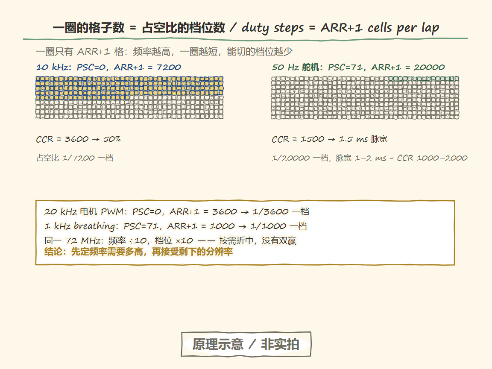
  <br><sub>▲ Knowledge track (Handraw · 原理示意 / not a photo). Same 72 MHz: 10 kHz gets 7200 cells per lap, a 50 Hz servo gets 20000; the cells per lap are the duty steps, and higher frequency means fewer of them; not a photo.</sub>
</p>


### 5. Input capture, the encoder, and slave mode

Input capture uses the counter the other way round. When the outside signal changes, the hardware copies the current CNT into CCR at once, like a race timer pressing the stopwatch at the finish line. Subtract two captured values and you have the period or the pulse width. The encoder interface watches two square waves 90° apart. Which one changes first decides whether the counter goes up or down, so the count is the motor's position.

<p align="center">
  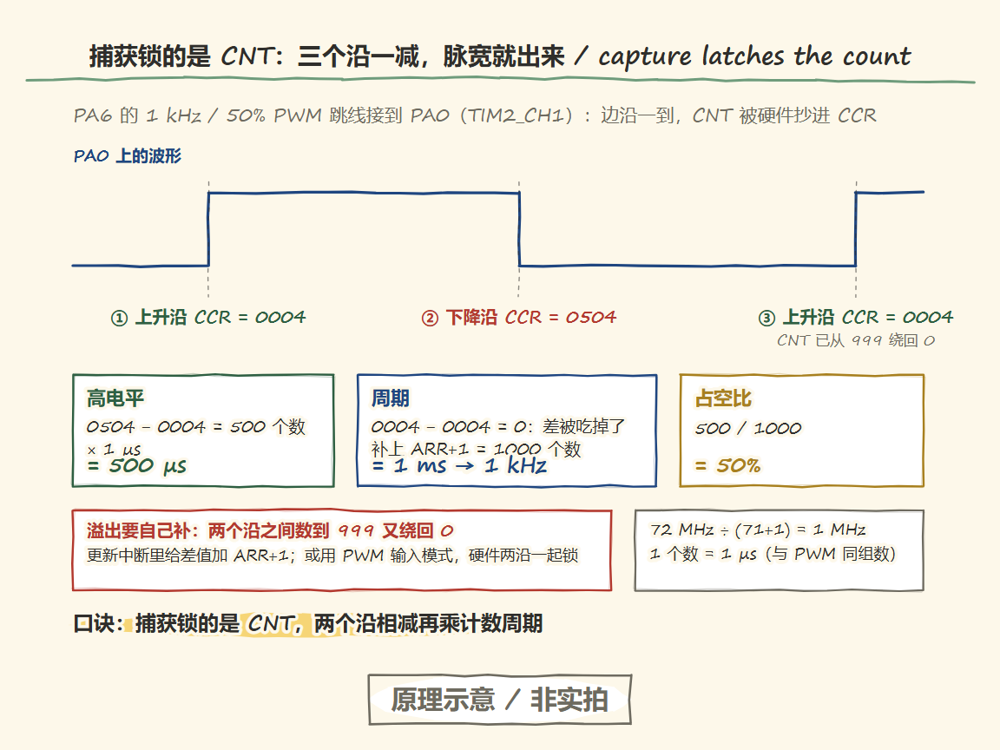
  <br><sub>▲ Knowledge track (Handraw · 原理示意 / not a photo). Where to look: the three latched edges on PA0 — the two rising edges read the same CCR because CNT wrapped from 999 back to 0; the three boxes work out 0504 − 0004 = 500 counts x 1 us = 500 us of high level, the period with one ARR+1 added = 1 ms → 1 kHz, and 500/1000 = 50% duty. What it proves: width and frequency come from subtracting two CCR reads and multiplying by the count period — no voltmeter needed — and an overflow must be paid back one ARR+1. What it does not prove: this is arithmetic at a 72 MHz ÷ 72 = 1 MHz count clock, not the signal generator's real jitter, capture filter settings or interrupt latency, and it is not a scope capture. Source: [RM0008 Rev 21 ch.15](#source-rm0008-tim).</sub>
</p>

| Function | How it works | Use |
| --- | --- | --- |
| Input capture | On an edge, CNT is latched into CCR | Measure frequency, pulse width, or duty |
| PWM input | Two channels capture the rising and falling edges | Period and high time come out directly |
| Encoder interface | A/B quadrature decode, count up and down automatically | Motor speed or position |
| Slave mode | An external signal resets or gates the counter | Period measurement, gated counting |

## Hardware and wiring

| Board | Peripheral | Pin | Notes |
| --- | --- | --- | --- |
| BluePill | LED (PWM dimming) | PA6 (TIM3_CH1) | 270 Ω in series; watch it breathe |
| BluePill | Input capture | PA0 (TIM2_CH1) | A signal generator, or another PWM |

> F1 timer-channel pinout is in the DS5319 alternate-function table. TIM1 is an advanced timer. PWM output needs **MOE**.

To continue from chapter 04, remove the button from PA0. For the capture lab, jumper the PA6 PWM output to PA0, keep a common ground, and leave PA0 configured as an input.

## Code

```c
/* timer_pwm.c —— TIM3_CH1 (PA6) outputs 1 kHz PWM; software walks the duty for a breathing LED */
#include "stm32f1xx_hal.h"

TIM_HandleTypeDef htim3;

#define PWM_TIM    TIM3
#define PWM_CH     TIM_CHANNEL_1
#define PWM_PSC    71        /* 72MHz/(71+1)=1MHz counter clock */
#define PWM_ARR    999       /* 1MHz/(999+1)=1kHz PWM */

void SystemClock_Config(void);

static void pwm_init(void)
{
    __HAL_RCC_TIM3_CLK_ENABLE();
    __HAL_RCC_GPIOA_CLK_ENABLE();

    /* PA6 alternate push-pull (TIM3_CH1) */
    GPIO_InitTypeDef io = {0};
    io.Pin   = GPIO_PIN_6;
    io.Mode  = GPIO_MODE_AF_PP;
    io.Speed = GPIO_SPEED_FREQ_HIGH;
    HAL_GPIO_Init(GPIOA, &io);

    htim3.Instance               = PWM_TIM;
    htim3.Init.Prescaler         = PWM_PSC;
    htim3.Init.CounterMode       = TIM_COUNTERMODE_UP;
    htim3.Init.Period            = PWM_ARR;          /* = ARR */
    htim3.Init.ClockDivision     = TIM_CLOCKDIVISION_DIV1;
    htim3.Init.AutoReloadPreload = TIM_AUTORELOAD_PRELOAD_ENABLE;
    HAL_TIM_PWM_Init(&htim3);

    TIM_OC_InitTypeDef oc = {0};
    oc.OCMode     = TIM_OCMODE_PWM1;
    oc.Pulse      = 500;                             /* CCR = 500. 500 / (ARR + 1) = 50%, high for 500 µs */
    oc.OCPolarity = TIM_OCPOLARITY_HIGH;
    oc.OCFastMode = TIM_OCFAST_DISABLE;
    HAL_TIM_PWM_ConfigChannel(&htim3, &oc, PWM_CH);

    HAL_TIM_PWM_Start(&htim3, PWM_CH);               /* start the PWM output */
}

int main(void)
{
    HAL_Init();
    SystemClock_Config();
    pwm_init();

    int16_t duty = 0;
    int16_t step = 10;

    while (1)
    {
        duty += step;
        if (duty >= PWM_ARR || duty <= 0) step = -step;   /* sweep 0→100% and back */
        __HAL_TIM_SET_COMPARE(&htim3, PWM_CH, duty);      /* update CCR */
        HAL_Delay(10);
    }
}
```

The extra requirement on advanced timer TIM1:

```c
/* TIM1/TIM8 are advanced timers; the main output MOE must be enabled before they drive a pin */
HAL_TIM_PWM_Start(&htim1, TIM_CHANNEL_1);   /* HAL sets MOE for you */
/* if you are on registers: __HAL_TIM_MOE_ENABLE(&htim1); */
```

Input capture only works once the channel is actually configured. A rising edge latches CCR, a falling edge latches it again, and the difference times the counter period is the pulse width:

```c
TIM_IC_InitTypeDef ic = {0};
ic.ICPolarity  = TIM_INPUTCHANNELPOLARITY_RISING;
ic.ICSelection = TIM_ICSELECTION_DIRECTTI;
ic.ICPrescaler = TIM_ICPSC_DIV1;
ic.ICFilter    = 0;
HAL_TIM_IC_ConfigChannel(&htim2, &ic, TIM_CHANNEL_1);
HAL_TIM_IC_Start_IT(&htim2, TIM_CHANNEL_1);

void HAL_TIM_IC_CaptureCallback(TIM_HandleTypeDef *htim)
{
    if (htim->Channel == HAL_TIM_ACTIVE_CHANNEL_1)
    {
        uint32_t ccr = HAL_TIM_ReadCapturedValue(htim, TIM_CHANNEL_1);
        (void)ccr; /* pulse width = (CCR2 - CCR1) / fCK_CNT; on overflow add one (ARR+1) */
    }
}
```

The full project is in [`examples/timer-pwm/`](../../examples/timer-pwm/).

## Hands-on labs

1. **Lab 1 (PWM out):** Output 1 kHz at 50% on TIM3_CH1. Record frequency, period, high time, and duty, then reconcile them with PSC = 71, ARR = 999, and CCR = 500.
2. **Lab 2 (duty steps):** Write CCR = 100, 500, and 900 and measure about 10%, 50%, and 90% before running the breathing effect. Brightness is only an observation; the three traces are the acceptance evidence.
3. **Lab 3 (capture loop):** Jumper PA6 to PA0 and capture lab 1's PWM with TIM2. Print the captured period and high counts, compare them with the settings, and add ARR+1 when a capture crosses an overflow.

<p align="center">
  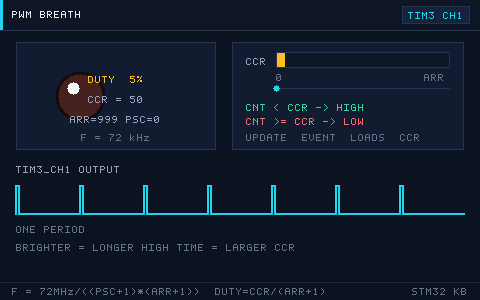
  <br><sub>▲ The breathing effect shows CCR changing over time. Use the saved traces from labs 1 and 2 to prove that frequency remains 1 kHz and the three duty settings are correct.</sub>
</p>

### 6. Complementary outputs and dead time (advanced timers)


<p align="center">
  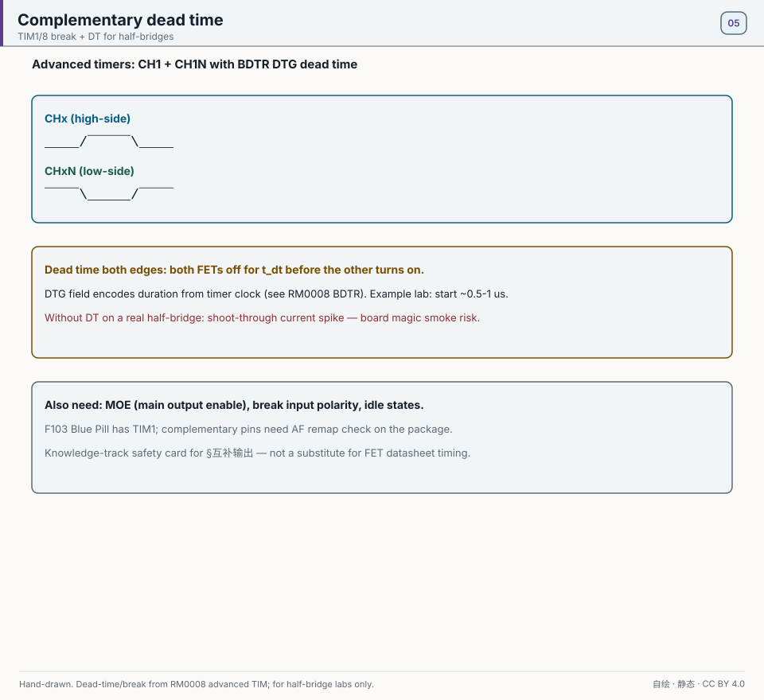
  <br><sub>▲ Drawn for this book. BDTR DTG + MOE; for half-bridge labs only.</sub>
</p>

<p align="center">
  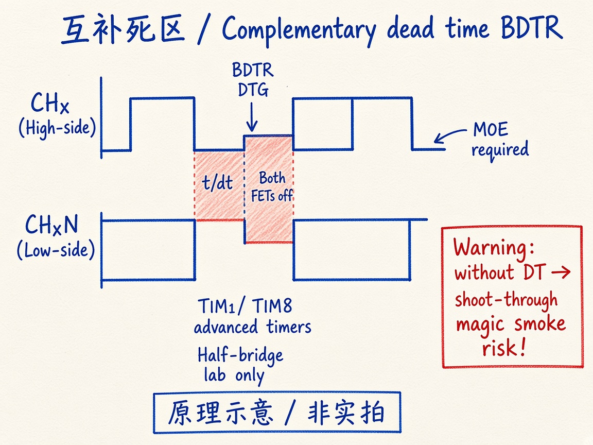
  <br><sub>▲ Knowledge track (Handraw · 原理示意 / not a photo). CHx/CHxN dead time both edges; no DT → shoot-through risk; half-bridge labs only; not a photo.</sub>
</p>


| Idea | Meaning |
| --- | --- |
| Complementary outputs | CH1 and CH1N are a pair, for an H-bridge |
| Dead time | A blank inserted when the high and low switches trade places, so they never conduct together |
| Break | BKIN shuts the outputs off immediately |
| MOE | Main output enable. It has to be set or there is no output |

```c
/* configure dead time and the complementary output */
TIM_BreakDeadTimeConfigTypeDef bd = {0};
bd.OffStateRunMode = TIM_OSSR_ENABLE;
bd.DeadTime        = 0x10;        /* dead time */
bd.BreakState      = TIM_BREAK_DISABLE;
HAL_TIMEx_ConfigBreakDeadTime(&htim1, &bd);
```

### 7. A timer interrupt that toggles an LED at 1 Hz

```c
/* TIM2 update interrupt every 1 s toggles PC13 */
void HAL_TIM_PeriodElapsedCallback(TIM_HandleTypeDef *htim)
{
    if (htim->Instance == TIM2)
    {
        HAL_GPIO_TogglePin(GPIOC, GPIO_PIN_13);
    }
}

/* start it with Start_IT, not Start */
HAL_TIM_Base_Start_IT(&htim2);
```

### 8. Which timer to pick

| Need | Timer |
| --- | --- |
| General timing | TIM2–5 |
| Advanced PWM (complementary) | TIM1/TIM8 |
| A time base only | TIM6/TIM7 |
| A long 32-bit interval | TIM2/TIM5 (F4) |
| The system tick | SysTick |

### 9. Input capture and TRGO

Measure a pulse width with input capture. If the ADC must sample on a fixed interval, send the update event through master mode (TRGO) instead of software-triggering it from the main loop.

<p align="center">
  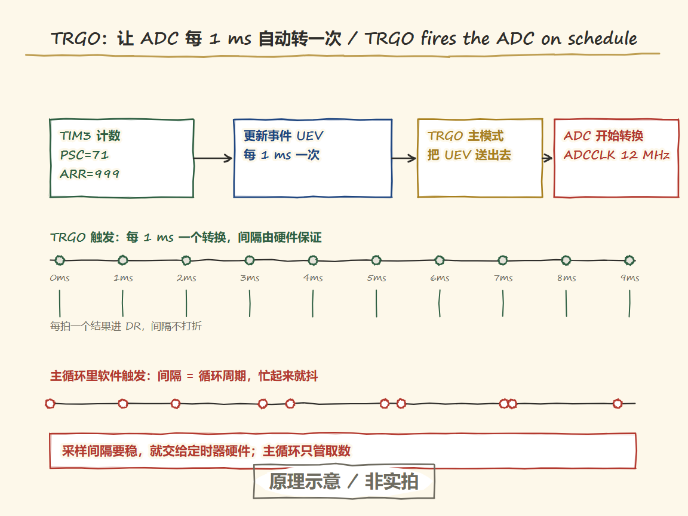
  <br><sub>▲ Knowledge track (Handraw · 原理示意 / not a photo). TIM3's 1 ms update event starts the ADC through TRGO, the spacing is guaranteed by hardware; software triggers from the main loop jitter when it gets busy; not a photo.</sub>
</p>


```c
TIM_MasterConfigTypeDef mst = {0};
mst.MasterOutputTrigger = TIM_TRGO_UPDATE;          /* one pulse on every overflow */
mst.MasterSlaveMode     = TIM_MASTERSLAVEMODE_DISABLE;
HAL_TIMEx_MasterConfigSynchronization(&htim3, &mst);
```

Quadrature looks at both phases: B lagging A by about 90° is one direction, and B leading is the other. With only one square wave, the hardware cannot tell forward from reverse.

<p align="center">
  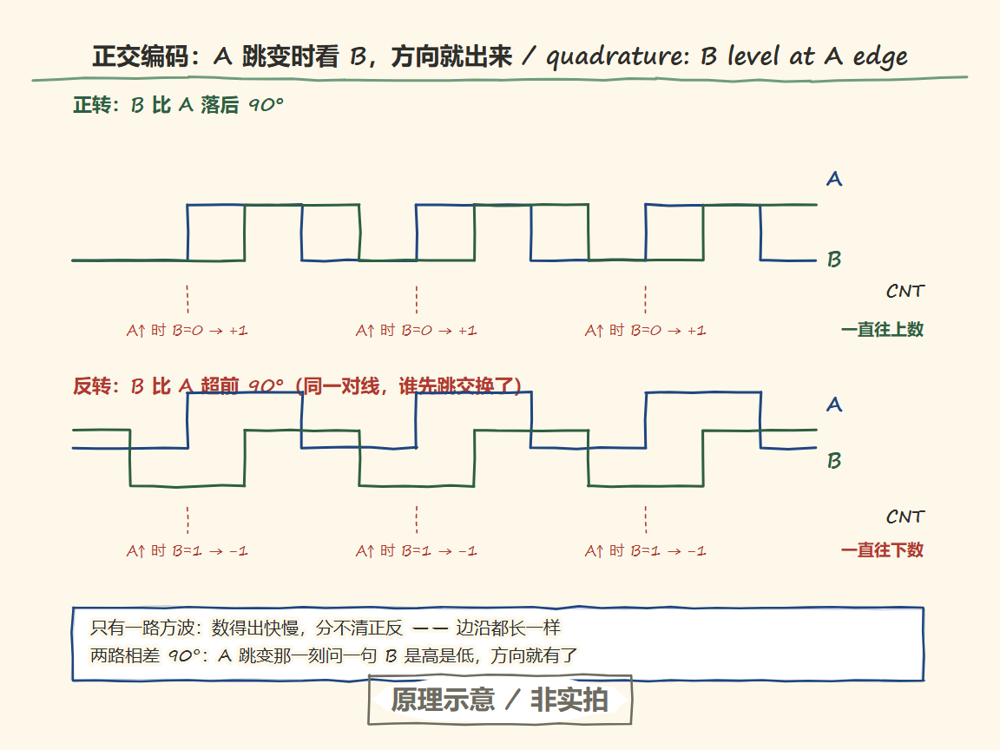
  <br><sub>▲ Knowledge track (Handraw · 原理示意 / not a photo). At every A edge read B: forward B=0 counts up, reverse B=1 counts down; one wire alone cannot tell direction; not a photo.</sub>
</p>


Before leaving this chapter, keep the 1 kHz/50% output trace, the three duty-step traces, and one input-capture reading, and derive PSC, ARR, and CCR from the 72 MHz timer clock.

Self-test:

1. If you captured only the rising edge, can you compute the duty?
2. The ADC should convert every 1 ms. Which event should the timer's TRGO select?
3. The encoder is wired to phase A only. What happens to the count when the shaft reverses?

## Related resources

- Official manuals: **RM0008** chapter 14 (advanced timers TIM1/8), chapter 15 (general-purpose timers TIM2–5), chapter 16 (basic timers TIM6/7)
- Previous: [04 Interrupts and the NVIC](04-interrupts-nvic.md) | Next: [06 UART](06-uart.md)
- Figures: [`assets/animations/timer-pwm.svg`](../../assets/animations/timer-pwm.svg), [`assets/animations/timer-modes.svg`](../../assets/animations/timer-modes.svg), [`assets/gif/pwm-breath.gif`](../../assets/gif/pwm-breath.gif)
- Disclaimer: every illustration in this repo is a vector drawing or a program-generated animation by the author, not a manufacturer's photograph.
