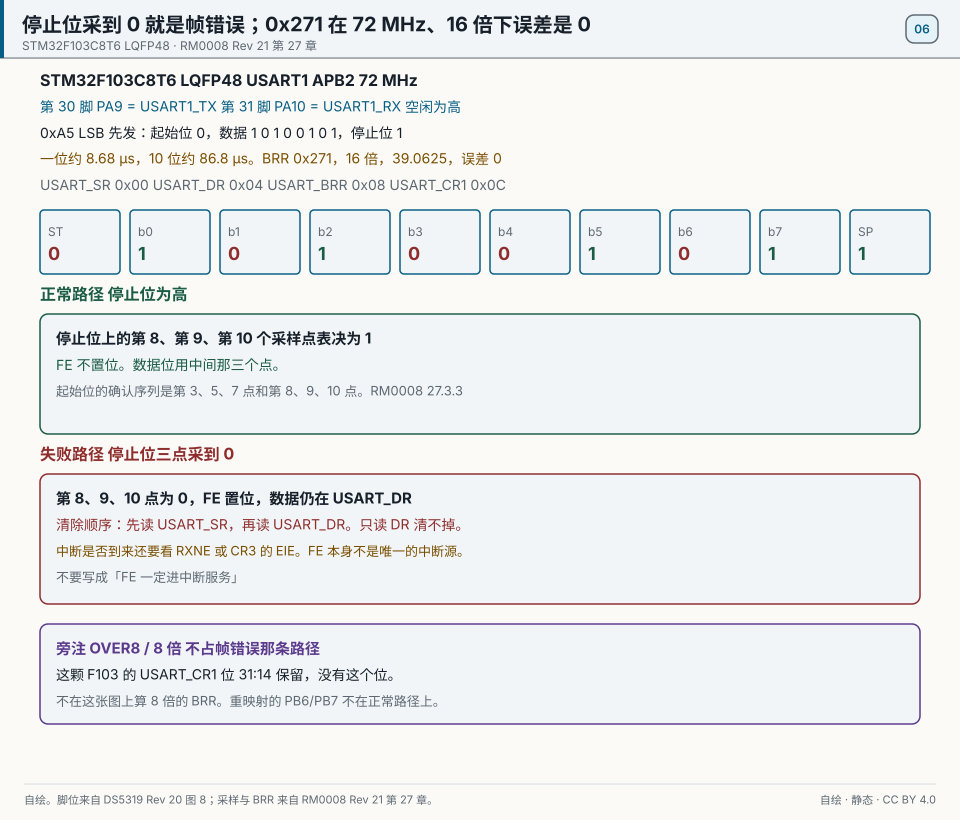
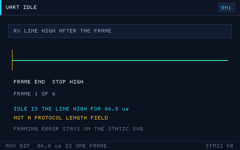

# 06 UART
> 中文：[串口 UART](../06-串口UART.md)

> UART is the asynchronous serial interface you will use most: logs, modules, and a program on the PC.

<p align="center">
  
  <br><sub>▲ Animation: a UART frame bit by bit (start / data / parity / stop; vector drawing by the author)</sub>
</p>

<!-- video:ch06 -->
<p align="center">
  <video width="640" controls poster="../../assets/video/ch06-uart.png">
    <source src="../../assets/video/ch06-uart.mp4" type="video/mp4">
  </video>
  <br><sub>▲ Chinese voice-over, 2.6 min. Voice: Microsoft Edge neural voice zh-CN-XiaoxiaoNeural via edge-tts (library mostly LGPLv3; the voice model is an online Microsoft service, not an open model). Pictures are generated from this repo's SVGs, not photographs. Video: <a href="../../assets/video/ch06-uart.mp4">MP4</a> · subtitles: <a href="../../assets/video/ch06-uart.srt">SRT</a>. Rebuild with <code>python3 tools/gen_narrated.py --speak</code>.</sub>
</p>

**Narration script (Chinese, same text as the subtitles)**

1. 115200 8N1 里的 8，是数据位，不是波特率的一部分。一帧通常是起始位、八位数据、没有校验、一位停止。位数说错，对方会一直解出错帧。
2. 波特率是双方约好的速度，由总线时钟分频得到。F103 上 APB 时钟不对，分频再准也会偏。一边 115200，另一边 9600，你只能看到乱码。
3. 溢出错误 ORE 表示你来不及把数据取走。清除时要先读状态寄存器，再读数据寄存器。顺序反了，标志清不掉，后面的字节会全部卡住。
4. 这一帧是仓库画的串口帧，一位一位排开。看图时对照你的初始化：数据位、停止位、校验，要和上位机软件里的设置逐项相同。差一项就乱码。
5. 不定长的一包数据，可以用 DMA 接着收，再用空闲线判断对方说完了。别在中断里一个字节一个字节地阻塞等待。Wokwi 里这套 DMA 目前对不上，接线可以看，收包要上真板。
6. RS485 要控制收发方向。最后一个字节离开移位寄存器，发送完成标志才会起来。标志没起来就转身去收，最后一个字节会被你自己截掉。
7. TX 接对方的 RX，RX 接对方的 TX，地必须连在一起。只接两根信号、不共地，电平没有参考，有时能蒙对，有时完全没字。先共地，再谈波特率。
8. 口诀：ORE 要先读状态再读数据；RS485 等发送完成再转身。这两句能省掉一半「串口偶发丢字」的下午。
9. 实验可以先把 TX 和 RX 短接，确认自己能收到自己发出的字，再接到电脑。短接都收不到，就先别怀疑 USB 转串口线。
10. 合上书，三问。8N1 的 8 是什么？清除溢出时先读哪个寄存器？RS485 为什么要等发送完成才能转换方向？
<!-- /video:ch06 -->
## Principle and boundary

The frame in this chapter holds for orderable STM32F103C8T6 in LQFP48. USART1 is on APB2. When the core clock is 72 MHz, PCLK2 is 72 MHz, and the peripheral base is `0x40013800`. The default pins are PA9 = USART1_TX = pin 30 and PA10 = USART1_RX = pin 31, from [DS5319 Rev 20 Figure 8](#source-ds5319-usart). After reset the pins are not PB6/PB7. A remap needs AFIO as well, and the remapped pins are not on the normal path.

The receiver on this part samples with a 16× baud clock. One stop bit is voted at samples 8, 9, and 10. The start bit is checked at samples 3, 5, and 7 and at samples 8, 9, and 10, as written in [RM0008 27.3.3](#source-rm0008-usart). Data bits use the middle three samples.

At 16×, `USARTDIV = fPCLK / (16 × baud)`. At 72 MHz and 115200, `72e6 / (16 × 115200) = 39.0625`, the fraction `0.0625 × 16 = 1`, BRR = `0x271`, `72e6 / (16 × 39.0625) = 115200`, and the divider error is 0. `USART_BRR` is at offset `0x08`, and the low 4 bits are the fraction. Copy this cell from Appendix D. The error on the 72 MHz row is 0%. About 0.16% stays on the 36 MHz row, BRR `0x138`, and that row is USART2 on APB1, not this USART1. Dropping the fraction and dividing by 39 also yields about 0.16%. That is not what writing `0x271` does. Do not edit Appendix A or Appendix D.

8× oversampling is void on this F103. `USART_CR1` is at offset `0x0C`, and bits 31:14 are reserved, so there is no OVER8. F103 has only 16×. 8× means a family that has OVER8. This chapter does not invent an 8× BRR and does not add `rm0090-usart-over8`.

At 115200 and 8N1, one bit is about 8.68 µs and a 10-bit frame is about 86.8 µs. In RM0008 an idle line is a whole frame of high. One IDLE means the line has been idle for about one frame time. It does not mean the length field of the other side's protocol has arrived. In circular DMA, `Size` is still the write position, not the increment of this transfer.

When the stop bit is not high at the expected samples, hardware sets `USART_SR.FE`. The invalid byte still enters `USART_DR`. Clearing it is a read of SR and then a read of DR. Reading only DR does not clear it. Whether an interrupt arrives still depends on RXNE or on EIE in CR3. In a one-byte exchange, FE itself is not the only interrupt source. Do not write "FE always enters the service routine."

## Key figures

<p align="center">
  
  <br><sub>▲ Drawn for this book. STM32F103C8T6, LQFP48 pin 30 PA9 = USART1_TX, pin 31 PA10 = USART1_RX. The frame is 0xA5, LSB first. One bit is about 8.68 µs and 10 bits are about 86.8 µs. BRR `0x271`, 39.0625, 16×, error 0. Offsets: USART_SR 0x00, USART_DR 0x04, USART_BRR 0x08, USART_CR1 0x0C. Normal path: stop-bit samples 8, 9, and 10 are 1, and FE stays clear. Failure path: those three samples are 0, FE is set, the byte remains in DR, and the clear order is SR then DR. Side note: on this F103, CR1 bits 31:14 are reserved, there is no OVER8, and the figure does not compute an 8× BRR. Pins are [DS5319 Rev 20 Figure 8](#source-ds5319-usart). Sampling and BRR are [RM0008 Rev 21 chapter 27](#source-rm0008-usart).</sub>
</p>

<p align="center">
  
  <br><sub>▲ Auxiliary figure for the web and the article channel. It only marks the idle line and 86.8 µs. Print uses the static figure. The three framing-error samples are not on this GIF.</sub>
</p>

`uart-frame.svg` and `uart-bits.gif` stay in the frame section as side figures. When a PDF does not play the GIF, the start bit, the stop bit, samples 8, 9, and 10, and the FE path are all on the static figure.

## Timing or state

| Phase | Line | Bits of 0xA5 | Samples 8, 9, 10 | FE | Time | BRR |
| --- | --- | --- | --- | --- | --- | --- |
| Idle | High | — | — | 0 | — | — |
| Start bit | 0 | — | The start bit is also checked at samples 3, 5, and 7 | 0 | about 8.68 µs | — |
| Data, LSB first | 1 0 1 0 0 1 0 1 | 0xA5 | Data bits use the middle three samples | 0 | 8 bits | — |
| Normal stop | 1 | Stop | Voted as 1 | 0 | about 8.68 µs | USART1, 72 MHz, `0x271`, error 0% |
| Failed stop | 0 | Stop | The three samples are 0 | 1 | about 8.68 µs | Clear by reading SR, then DR |
| Whole frame | — | 10 bits | — | — | about 86.8 µs | 39.0625 |
| USART2 contrast | — | — | — | — | — | APB1, 36 MHz, `0x138`, about 0.16%. Not this USART1 |
| IDLE | Stays high after the stop bit | — | — | 0 | One full frame, about 86.8 µs | Not the end of a protocol frame |

Do not put 0.16% back into the `0x271` cell. Source: [RM0008 section 27.3.3](#source-rm0008-usart).

## Pitfalls and source cards

| Symptom | Cause | What to do | Source | Claim this source may support |
| --- | --- | --- | --- | --- |
| The table says USART1 `0x271` is already off | That cell dropped the fraction, or it copied the USART2 row | At 72 MHz and 16×, with the fraction kept, the error is 0% | [RM0008 BRR](#source-rm0008-usart) | The divider result of `0x271` is 115200. This cell's error is 0% |
| A bad stop bit still yields a byte, and then reception sticks | FE is set and the byte is still in DR; reading only DR does not clear the flag | Read SR, then DR, to clear FE | [RM0008 27.3.3](#source-rm0008-usart) | When FE is set the byte still enters DR; reading only DR does not clear the flag |
| IDLE is treated as the end of the other side's packet | An idle line only means the wire is idle | Use a length or a protocol, not 86.8 µs as the frame boundary | [RM0008](#source-rm0008-usart) | IDLE is the line staying idle for one full frame time |
| OVER8 is turned on to fix high-baud errors on F103 | This part does not have that bit | Check 72 MHz and `0x271` first; the error is 0% | [RM0008 CR1](#source-rm0008-usart) | CR1 bits 31:14 are reserved |
| Circular DMA treats `Size` as the new bytes of this transfer | `Size` is the write position | Save the previous position, subtract, and handle the wrap | [STM32CubeF4 v1.28.3](#source-stm32cube-f4) | Only that Size is the write position in the v1.28.3 example. Not an F103 pin proof |
| The application reads the DMA buffer once as one flat frame | The buffer is not one flat frame | Read only up to the DMA write position | [MaJerle USART DMA](#source-majerle-uart) | The restated ring-position boundary. Not a new baud rate or a new pin |
| Half-transfer and IDLE seem to arrive as a pair every time | The timing in the post was not promoted to a manual number | Do not write the post's timing as a manual number; the idle length stays the 86.8 µs cell | [ST community thread](#source-st-uart-idle) | Experience only, not promoted to a specification. No new register value |
## 📌 Learning goals
- [ ] Describe a UART frame (start / data / parity / stop)
- [ ] Compute BRR for 16× oversampling on this F103. This part has no OVER8
- [ ] Choose among blocking, interrupt, and DMA
- [ ] Redirect printf, and stay out of the semihosting trap
- [ ] Understand a ring buffer, and variable-length receive with DMA+IDLE

## 🧠 Core ideas

**Lead with the conclusion: UART is asynchronous. The two sides stay aligned only by the baud rate they agreed on, so the frame format and the baud error are the two keys.**

### 1. The frame

One frame = 1 start bit + 8 or 9 data bits (LSB first) + an optional parity bit + 0.5 / 1 / 1.5 / 2 stop bits

| Piece | Value | Meaning |
| --- | --- | --- |
| Start bit | 1 bit (low) | Marks the start of a frame |
| Data bits | 8 or 9 | LSB first |
| Parity | None / odd / even | A simple check |
| Stop bits | 0.5 / 1 / 1.5 / 2 bits (high) | Marks the end of a frame |
| Idle | High | The default between frames |

<p align="center">
  
  <br><sub>▲ Animation: UART sending bit by bit (with a baud-rate timeline; program-generated GIF)</sub>
</p>

### 2. Baud rate and error

- Baud rate is bits per second. 9600 and 115200 are the common ones.
- Time per bit = 1 / baud rate. 115200 → about 8.68 µs.
- **Error budget:** the accumulated error of both sides needs to stay under about ±2% to ±3% (a 10-bit frame, sampled at the middle of three points).
- Error formula: `error = (actual baud − target baud) / target baud × 100%`

BRR on F1, 16× oversampling: `USARTDIV = fPCLK / (16 × baud)`, and BRR = integer part << 4 | fractional part × 16

| USART | Target baud | Bus | PCLK | USARTDIV | BRR (hex) | Error |
| --- | --- | --- | --- | --- | --- | --- |
| USART1 | 9600 | APB2 | 72 MHz | 468.75 | 0x1D4C | 0% |
| USART1 | 115200 | APB2 | 72 MHz | 39.0625 | 0x271 | 0% |
| USART2 | 115200 | APB1 | 36 MHz | 19.531 | 0x138 | about 0.16% |

> On this STM32F103C8T6, USART_CR1 bits 31:14 are reserved, so there is no OVER8. 8× oversampling means moving to a family that has that bit. On F103, do not switch OVER8 on to chase high-baud errors; check 72 MHz and BRR `0x271` first. `HAL_UART_Init` still computes BRR at 16×.

### 3. Three ways to send and receive

| Dimension | Blocking (polling) | Interrupt (IT) | DMA |
| --- | --- | --- | --- |
| CPU use | High (it waits) | Medium (an interrupt per byte) | Low (an interrupt when the move finishes) |
| Throughput | Low | Medium | High |
| Code complexity | Low | Medium | Medium to high |
| Fits | Simple debug | A little data of unknown length | A lot of data, or a continuous stream, or a frame of unknown length |

## 🛠️ Hardware and wiring

| Board | Peripheral | Pin | Notes |
| --- | --- | --- | --- |
| BluePill | USART1 TX | PA9 | To the USB-TTL RX |
| BluePill | USART1 RX | PA10 | To the USB-TTL TX |
| BluePill | GND | GND | Common ground with the USB-TTL |

> ⚠️ TX and RX must be crossed. Set the USB-TTL to 3.3 V. Do not let the USB-TTL and the ST-Link both try to power the board.

## 💻 Code

Blocking echo:

```c
/* uart_blocking.c —— USART1 echo (blocking) */
#include "stm32f1xx_hal.h"

UART_HandleTypeDef huart1;

void SystemClock_Config(void);

static void uart_init(void)
{
    __HAL_RCC_USART1_CLK_ENABLE();
    __HAL_RCC_GPIOA_CLK_ENABLE();

    /* PA9 = TX alternate push-pull, PA10 = RX input with pull-up */
    GPIO_InitTypeDef io = {0};
    io.Pin = GPIO_PIN_9; io.Mode = GPIO_MODE_AF_PP; io.Speed = GPIO_SPEED_FREQ_HIGH;
    HAL_GPIO_Init(GPIOA, &io);
    io.Pin = GPIO_PIN_10; io.Mode = GPIO_MODE_INPUT; io.Pull = GPIO_PULLUP;
    HAL_GPIO_Init(GPIOA, &io);

    huart1.Instance          = USART1;
    huart1.Init.BaudRate     = 115200;
    huart1.Init.WordLength   = UART_WORDLENGTH_8B;
    huart1.Init.StopBits     = UART_STOPBITS_1;
    huart1.Init.Parity       = UART_PARITY_NONE;
    huart1.Init.Mode         = UART_MODE_TX_RX;
    huart1.Init.HwFlowCtl    = UART_HWCONTROL_NONE;
    huart1.Init.OverSampling = UART_OVERSAMPLING_16;
    HAL_UART_Init(&huart1);
}

int main(void)
{
    HAL_Init();
    SystemClock_Config();
    uart_init();

    uint8_t ch;
    while (1)
    {
        if (HAL_UART_Receive(&huart1, &ch, 1, 1000) == HAL_OK)
        {
            HAL_UART_Transmit(&huart1, &ch, 1, 1000);   /* echo */
        }
    }
}
```

Redirect printf (method 1: `fputc` / `_write`):

```c
#include <stdio.h>

/* Keil uses fputc; GCC uses _write. Pick one. */
#ifdef __GNUC__
int _write(int fd, char *ptr, int len)
{
    HAL_UART_Transmit(&huart1, (uint8_t *)ptr, len, HAL_MAX_DELAY);
    return len;
}
#else
int fputc(int ch, FILE *f)
{
    HAL_UART_Transmit(&huart1, (uint8_t *)&ch, 1, HAL_MAX_DELAY);
    return ch;
}
#endif
```

> ⚠️ In Keil, check "Use MicroLIB". Otherwise it can stall in semihosting.

Method 2 (preferred; it does not depend on semihosting):

```c
#include <stdarg.h>
#include <stdio.h>

void log_printf(const char *fmt, ...)
{
    char buf[128];
    va_list ap;
    va_start(ap, fmt);
    int n = vsnprintf(buf, sizeof(buf), fmt, ap);
    va_end(ap);
    if (n > 0) HAL_UART_Transmit(&huart1, (uint8_t *)buf, (uint16_t)n, HAL_MAX_DELAY);
}
```

Variable-length receive with DMA + IDLE:

```c
/* In circular DMA, Size in the callback is the write position, not this transfer's increment.
   The call below starts the reception again. The position difference is in the source cards. */
#define RX_BUF_SIZE 128
uint8_t rx_buf[RX_BUF_SIZE];
volatile uint16_t rx_len = 0;

void uart_dma_idle_start(void)
{
    HAL_UARTEx_ReceiveToIdle_DMA(&huart1, rx_buf, RX_BUF_SIZE);
    __HAL_DMA_DISABLE_IT(huart1.hdmarx, DMA_IT_HT);   /* turn off the half-transfer interrupt; only the IDLE callback */
}

/* callback: fires on IDLE or when the buffer is full */
void HAL_UARTEx_RxEventCallback(UART_HandleTypeDef *huart, uint16_t Size)
{
    if (huart->Instance == USART1)
    {
        rx_len = Size;                                 /* write position; subtract the previous one and handle wrap */
        HAL_UARTEx_ReceiveToIdle_DMA(&huart1, rx_buf, RX_BUF_SIZE);  /* start receiving again */
    }
}
```

A ring buffer (the interrupt only enqueues; the main loop dequeues and handles it):

```c
/* the ISR advances the write pointer; the main loop advances the read pointer.
   Use a count, or leave one slot empty, to tell full from empty */
static volatile uint16_t head, tail;
static uint8_t ring[256];
/* ISR: ring[head++ & 255] = ch;  main loop: ch = ring[tail++ & 255]; */
```

The full project is in [`examples/uart-dma-idle/`](../../examples/uart-dma-idle/).

## 🧪 Hands-on labs

1. **Lab 1 (echo):** USART1 at 115200 echoes. Whatever the serial terminal sends, it gets back.
2. **Lab 2 (printf):** Redirect printf and print the core clock and a counter once a second.
3. **Lab 3 (DMA+IDLE):** Receive a frame of unknown length. The terminal sends a string of any length, and the MCU echoes the whole frame (compare the bit timing in `uart-bits.gif`).

### 4. USART registers that matter (F1)

| Register | Role |
| --- | --- |
| SR | Status (TXE / RXNE / TC / IDLE / ORE) |
| DR | Data |
| BRR | Baud rate |
| CR1 | Enable, word length, parity, interrupts |
| CR2 | Stop bits |
| CR3 | DMA enable, flow control |

### 5. UART DMA transmit

```c
/* start a DMA transmit (TX side) */
extern uint8_t msg[];            /* buffer waiting to be sent */
uint16_t msg_len = 10;
HAL_UART_Transmit_DMA(&huart1, msg, msg_len);

/* transmit-complete callback */
void HAL_UART_TxCpltCallback(UART_HandleTypeDef *huart)
{
    if (huart->Instance == USART1)
    {
        /* start the next frame here, or set a flag */
    }
}
```

### 6. Usual serial-terminal settings

| Setting | Usual value |
| --- | --- |
| Baud rate | 115200 |
| Data bits / stop bits / parity | 8 / 1 / none |
| Flow control | None |
| Newline on send | Add CRLF if the protocol wants it |
| Encoding | The same as the MCU side |

### 7. Overrun, and the RS485 direction pin

**Conclusion:** once ORE is set, a new byte no longer enters DR until you **read SR and then read DR**. Reading DR alone does not clear ORE, and reception stays dead.

| Flag | Meaning | How to clear it |
| --- | --- | --- |
| ORE | The previous byte was still unread when the next one arrived | Read SR, then read DR |
| FE | The stop bit was not 1, usually a baud-rate error | Read SR, then read DR |
| NE | The level was not clean inside the sample window | Read SR, then read DR |
| PE | Parity did not match | Read SR, then read DR |

The RS485 direction pin (DE) is high while transmitting. `TXE` only means the data has entered the shift register; the wire is still shifting it out. To turn back to receive you have to wait for `TC`:

```c
HAL_GPIO_WritePin(DE_PORT, DE_PIN, GPIO_PIN_SET);
HAL_UART_Transmit(&huart1, buf, len, 20);
while (__HAL_UART_GET_FLAG(&huart1, UART_FLAG_TC) == RESET) { }
HAL_GPIO_WritePin(DE_PORT, DE_PIN, GPIO_PIN_RESET);
```

Motto: **ORE is SR first, then DR. On RS485, wait for TC before you turn around.**

Self-test:

1. The interrupt only read DR. Does ORE stay set?
2. `TXE` is already 1. Why can a scope still see the last few bits?
3. On an 8N1 drawing, why is the stop bit marked SP and not P?

## 🔗 Related resources

- Official manuals: **RM0008** chapter 27 (USART); **DS5319** USART alternate-function pin table
- Previous: [05 Timers and PWM](05-timer-pwm.md) | Next: [07 The I2C Bus](07-i2c.md)
- Figures: [`assets/animations/uart-frame.svg`](../../assets/animations/uart-frame.svg), [`assets/gif/uart-bits.gif`](../../assets/gif/uart-bits.gif)
- Disclaimer: every illustration in this repo is a vector drawing or a program-generated animation by the author, not a manufacturer's photograph.
