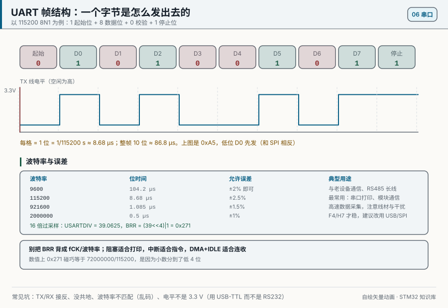
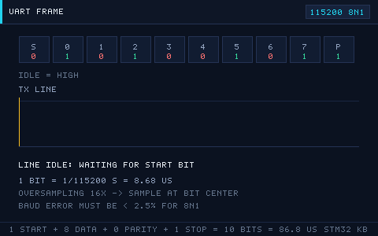
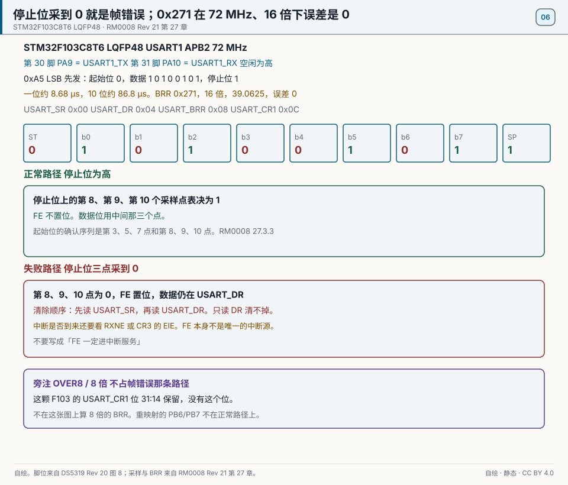
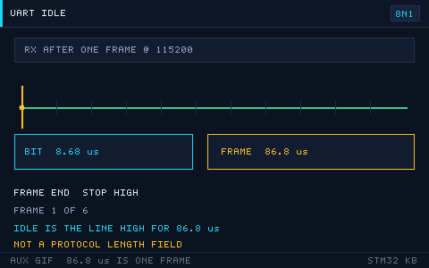

# 06 UART
> 中文：[串口 UART](../06-串口UART.md)

> UART is the asynchronous serial interface you will use most: logs, modules, and a program on the PC.

<p align="center">
  
  <br><sub>▲ Animation: a UART frame bit by bit (start / data / parity / stop; vector drawing by the author)</sub>
</p>

<!-- video:ch06 -->
<p align="center">
  <video width="640" controls poster="../../assets/video/ch06-uart.png">
    <source src="../../assets/video/ch06-uart.mp4" type="video/mp4">
  </video>
  <br><sub>▲ Chapter video with Chinese voice-over (2.6 min). <a href="../../assets/video/ch06-uart.mp4">MP4</a> · <a href="../../assets/video/ch06-uart.srt">subtitles</a></sub>
</p>

<details>
<summary>Narration script (Chinese, same text as the subtitles)</summary>

1. 115200 8N1 里的 8，是数据位，不是波特率的一部分。一帧通常是起始位、八位数据、没有校验、一位停止。位数说错，对方会一直解出错帧。
2. 波特率是双方约好的速度，由总线时钟分频得到。F103 上 APB 时钟不对，分频再准也会偏。一边 115200，另一边 9600，你只能看到乱码。
3. 溢出错误 ORE 表示你来不及把数据取走。清除时要先读状态寄存器，再读数据寄存器。顺序反了，标志清不掉，后面的字节会全部卡住。
4. 这一帧是仓库画的串口帧，一位一位排开。看图时对照你的初始化：数据位、停止位、校验，要和上位机软件里的设置逐项相同。差一项就乱码。
5. 不定长的一包数据，可以用 DMA 接着收，再用空闲线判断对方说完了。别在中断里一个字节一个字节地阻塞等待。Wokwi 里这套 DMA 目前对不上，接线可以看，收包要上真板。
6. RS485 要控制收发方向。最后一个字节离开移位寄存器，发送完成标志才会起来。标志没起来就转身去收，最后一个字节会被你自己截掉。
7. TX 接对方的 RX，RX 接对方的 TX，地必须连在一起。只接两根信号、不共地，电平没有参考，有时能蒙对，有时完全没字。先共地，再谈波特率。
8. 口诀：ORE 要先读状态再读数据；RS485 等发送完成再转身。这两句能省掉一半「串口偶发丢字」的下午。
9. 实验可以先把 TX 和 RX 短接，确认自己能收到自己发出的字，再接到电脑。短接都收不到，就先别怀疑 USB 转串口线。
10. 合上书，三问。8N1 的 8 是什么？清除溢出时先读哪个寄存器？RS485 为什么要等发送完成才能转换方向？

</details>
<!-- /video:ch06 -->

## Learning goals

Before this chapter: you need the system clock and the APB1 and APB2 bus dividers from chapter 02, alternate-function push-pull output and input pull-up from chapter 03, and interrupts from chapter 04. DMA gets its own chapter (10); here you only need the idea that a peripheral can move data into memory by itself. If binary, hex, and bit operations are new to you, read "Zero-background primer" in chapter 00 first.

- [ ] Draw the whole 8N1 frame of 0x31 and of 0xA5: start bit, 8 data bits LSB first, stop bit, 10 bits in all
- [ ] Use USARTDIV = fPCLK / (16 × baud) to work out BRR and the error for USART1 (72 MHz) and USART2 (36 MHz) at 115200
- [ ] Cross-wire a USB-to-serial module to the BluePill (TX to RX, RX to TX, ground to ground) and get a blocking echo running
- [ ] Send printf to USART1, and say which function you write for Keil and which for GCC
- [ ] Receive data of unknown length with DMA + IDLE, and explain that IDLE only means "the line was idle for one frame time"
- [ ] Clear ORE and FE by reading SR and then DR, so reception does not stall
- [ ] On RS485, wait for TC after the last byte before you switch the direction pin back to receive

## Core ideas

**In one sentence: a UART sends no clock, so each side times the bits on its own at the agreed baud rate. If both sides use the same frame format (data bits, parity, stop bits) and the baud error is small enough, the bytes line up.**

### An analogy first

Two people signal across a street with flashlights. They agree on three things in advance:

- Normally the light stays on, meaning "nothing to say".
- To send a letter, first switch the light off for one beat, meaning "starting". For the next 8 beats, on is 1 and off is 0.
- Then switch it on for one beat, meaning "letter done". The next letter can follow right away.

As soon as the receiver sees the light go off, they count beats at the agreed pace and glance at the light in the middle of each beat. The agreed pace is the baud rate; the beat with the light off at the start is the start bit, and the beat with the light on at the end is the stop bit. If their watches run at different speeds, they misread the last few beats. That is baud error.

The analogy stops here. A real receiver does not glance once per beat: it cuts each bit into 16 slices and takes three samples in the middle, then goes with the majority (section 4). It also resets its watch at every start bit, so the error only builds up over one frame (about 10 bits) and does not grow over a long transfer.

### 1. What a UART is: two signal wires, no clock

UART stands for Universal Asynchronous Receiver/Transmitter. "Asynchronous" means there is no clock wire; the two sides stay aligned by their own clocks and an agreed speed. On STM32 the peripheral is called USART. The extra S is for Synchronous: it can also drive a clock wire. This chapter only uses its asynchronous mode, so it calls it a UART, as most people do.

A serial link needs three wires:

| Wire | Full name | Seen from the STM32 |
| --- | --- | --- |
| TX | Transmit | Output, to the other side's RX |
| RX | Receive | Input, from the other side's TX |
| GND | Ground | Both sides measure their levels against it, so it must be shared |

How to read this table: one side's "send" faces the other side's "receive", so TX and RX cross over. Each direction has its own wire, so sending and receiving can happen at the same time. That is called full duplex.

The STM32F103C8T6 has 3 USARTs (DS5319 Rev 20 Table 2). USART1 sits on the APB2 bus; USART2 and USART3 sit on APB1. With the 72 MHz setup from chapter 02, APB2 runs at 72 MHz and APB1 at 36 MHz. The same baud rate needs a different divider on each bus, and section 3 works both out.

The pins use 3.3 V logic: high is 1 and low is 0, which people often call a "TTL-level UART". The old 9-pin serial port on a PC uses RS-232 levels, which represent 0 and 1 with positive and negative voltages and are inverted. Never connect it straight to an STM32 pin; a level shifter such as a MAX3232 goes in between. The usual setup today is a USB-to-TTL serial module (common chips are the CH340 and the CP2102), which the PC sees as a COM port.

### 2. The frame: one byte on the wire

A frame is everything one byte looks like on the wire. The most common setting is written 8N1: 8 data bits, N for no parity bit (None), and 1 stop bit.

| Piece | Value | What it does |
| --- | --- | --- |
| Idle | High | The line stays high when there is no data |
| Start bit | 1 bit, low | The falling edge from high to low tells the receiver to start timing |
| Data bits | 8 or 9, LSB first | The byte itself |
| Parity bit | Optional: none, odd, even | A simple check: count whether the number of 1s is odd or even |
| Stop bits | 1 or 2, high | Pull the line back high so the next frame has a falling edge to start from |

The rows are in time order, so top to bottom is left to right on the wire. These rules come from RM0008 Rev 21 sections 27.3.1 and 27.3.2. The manual also lists 0.5 and 1.5 stop bits; those are for Smartcard mode. A normal serial link uses 1 or 2.

Walk through the character "1" (0x31). In binary 0x31 is 0011 0001. LSB first means the 8 data bits leave in the order bit0 to bit7: 1 0 0 0 1 1 0 0. Add the start bit in front and the stop bit at the end, and the wire carries 10 bits:

```text
        idle  start  b0 b1 b2 b3 b4 b5 b6 b7  stop  idle
0x31:    1     0     1  0  0  0  1  1  0  0    1     1
0xA5:    1     0     1  0  1  0  0  1  0  1    1     1
```

The figures in this book use 0xA5 (1010 0101). Its 8 bits read the same forwards and backwards, so the figure cannot show which end goes first, which leaves you free to study the frame structure. To practise "LSB first", use a lopsided byte like 0x31.

<p align="center">
  
  <br><sub>▲ Animation: UART sending bit by bit (with a baud-rate timeline; program-generated GIF)</sub>
</p>

Parity has one rule on F1 that catches people: the parity bit takes the top bit of the word length. The M bit in USART_CR1 picks the word length, 0 for 8 bits and 1 for 9. With parity on (PCE = 1), the hardware puts the parity bit in bit 8 (M = 0) or bit 9 (M = 1) (RM0008 Rev 21 section 27.6.4). So "8 data bits + even parity + 1 stop bit" (8E1) needs the 9-bit word length; in HAL that is `UART_WORDLENGTH_9B` with `UART_PARITY_EVEN`. Pick the 8-bit word length and turn parity on, and only 7 data bits are left.

### 3. Baud rate and error

The baud rate is how many bits go by per second, in bit/s. A UART sends one bit at a time, so the baud rate is the bit rate. One bit lasts the reciprocal of the baud rate:

```text
bit time   = 1 / baud                115200: 1 / 115200 ≈ 8.68 µs
frame time = bits per frame × bit time   8N1 has 10 bits: 10 × 8.68 µs ≈ 86.8 µs
```

So an 8N1 link at 115200 carries at most 115200 / 10 = 11520 bytes per second.

The STM32 divides a peripheral clock down to the baud rate. RM0008 Rev 21 section 27.3.4 gives the formula:

```text
baud     = fCK / (16 × USARTDIV)
USARTDIV = fCK / (16 × baud)
fCK: PCLK2 for USART1, PCLK1 for the other USARTs
```

The 16 is the oversampling factor: the receiver takes 16 samples per bit (section 4). USARTDIV has a fractional part and goes into the USART_BRR register: bits 15:4 hold the integer part (DIV_Mantissa) and bits 3:0 hold the fraction times 16 (DIV_Fraction), as RM0008 Rev 21 section 27.6.3 shows. The fraction has only 4 bits, so the step is 1/16 = 0.0625.

USART1 at 72 MHz and 115200, step by step:

1. USARTDIV = 72 000 000 / (16 × 115200) = 39.0625
2. Integer part 39 = 0x27; fraction 0.0625 × 16 = 1 = 0x1
3. BRR = (0x27 << 4) | 0x1 = 0x271
4. Back-check: 72 000 000 / (16 × 39.0625) = 115200, so the error is 0

The error is defined as (actual baud − target baud) / target baud. The table below holds the cells you will use most with this book's clock setup. How to read it: find the USART you use and the bus it sits on, then look up BRR by target baud rate.

| USART | Bus and clock | Target baud | USARTDIV | BRR | Actual baud | Error |
| --- | --- | --- | --- | --- | --- | --- |
| USART1 | APB2, 72 MHz | 9600 | 468.75 | 0x1D4C | 9600 | 0% |
| USART1 | APB2, 72 MHz | 115200 | 39.0625 | 0x271 | 115200 | 0% |
| USART2 | APB1, 36 MHz | 115200 | 19.53125, use 19.5 | 0x138 | about 115384.6 | about 0.16% |

The USART2 cell: the fraction of 19.53125 is 0.53125 × 16 = 8.5. Four fraction bits cannot hold the half step, so take 8 and get 19.5: BRR = 0x138, and the actual rate is 36 000 000 / (16 × 19.5) ≈ 115384.6, about 0.16% fast. RM0008 Rev 21 Table 192 lists these same cells: at 72 MHz, 115.2 kbps is 39.0625 with 0% error; at 36 MHz it is 19.5, and the error column prints 0.15%. The table's own footnote definition gives 0.160%, and this book writes 0.16%.

How much error is too much? RM0008 Rev 21 section 27.3.5 gives the receiver's tolerance in Tables 193 and 194. The total deviation adds four things: the transmitter's error, the receiver's BRR rounding, the drift of the receiver's own clock, and edge asymmetry from the line and the transceivers.

| M bit (word length) | BRR fraction | NE counted as an error | NE ignored |
| --- | --- | --- | --- |
| 0 (8 bits) | Zero | 3.75% | 4.375% |
| 0 (8 bits) | Not zero | 3.33% | 3.88% |
| 1 (9 bits) | Zero | 3.41% | 3.97% |
| 1 (9 bits) | Not zero | 3.03% | 3.53% |

How to use this table: check the word length and whether BRR has a fraction, then whether your code treats the noise flag NE as an error; the number you land on is the ceiling for the total deviation. 0x271 and 0x138 both have a non-zero fraction, so with 8-bit words the ceiling is 3.33%. When the two ends err in opposite directions, the errors add: a PC 2% fast and a board 2% slow make 4% in total, which is already over. A common practice is to keep each end within about half the ceiling (rule of thumb).

The clock source counts too. The BluePill multiplies an 8 MHz external crystal (HSE) up to 72 MHz, and a crystal is usually off by only tens of parts per million (rule of thumb), which you can ignore. If you run from the internal RC oscillator HSI instead, DS5319 Rev 20 Table 24 gives a factory-calibrated accuracy of −1.1% to +1.8% at 25 °C and −2% to +2.5% from −40 to 105 °C. That alone can eat most of the budget.

> [!NOTE]
> On this STM32F103C8T6, USART_CR1 bits 31:14 are reserved. There is no OVER8 bit, so the only choice is 16× oversampling (RM0008 Rev 21 section 27.6.4). HAL's `UART_InitTypeDef` has an `OverSampling` field; on F1 you set it to `UART_OVERSAMPLING_16`. 8× oversampling means moving to a family whose CR1 has OVER8, such as F4.

### 4. How the receiver decides 0 or 1

The receiver watches RX with a sampling clock at 16 times the baud rate (RM0008 Rev 21 section 27.3.3):

- Start bit: after the line falls from high to low, the hardware checks for low again at samples 3, 5, and 7 and at samples 8, 9, and 10. Only then does a frame begin. A short glitch makes it give up and return to idle.
- Data bits: samples 8, 9, and 10 in the middle of each bit decide 0 or 1 by majority. If they disagree, the majority wins and NE is set (Table 191).
- Stop bit: samples 8, 9, and 10 should read 1. A 0 is a framing error, and FE is set.

This is where the error budget comes from. When the two clocks differ slightly, the sampling point drifts a little further inside every bit, and it has drifted furthest by the stop bit at the end of the frame. Once it drifts outside the three middle samples, a bit is read wrong.

### 5. Three ways to move data: blocking, interrupt, DMA

- Blocking (polling): the CPU loops on a flag until it can receive or send. It is the simplest code, and the CPU can do nothing else while it waits.
- Interrupt: each received byte makes the hardware interrupt the CPU, and the interrupt handler takes the byte. The rest of the time the CPU does other work.
- DMA (Direct Memory Access): a separate piece of hardware moves data between a peripheral and memory and tells the CPU only when a whole batch is done.

| Comparison | Blocking | Interrupt | DMA |
| --- | --- | --- | --- |
| What the CPU does while waiting | Waits on the spot | Other work, interrupted once per byte | Other work, interrupted once per batch |
| Interruptions while receiving continuously at 115200 | None, but the CPU is tied up | About 11520 per second | One per batch |
| Amount of code | Least | Medium | Most; you set up a DMA channel |
| Fits | Debugging, one-off small data | Scattered short commands | Lots of data, a continuous stream, packets of unknown length |

Look at the second row: at 115200 one byte takes 86.8 µs, and a 72 MHz CPU runs 72 000 000 × 86.8 µs ≈ 6250 clock cycles in that time, so interrupts are a light load at 115200. Push the baud rate into the Mbit/s range, or receive on several ports at once, and it is time for DMA.

### 6. Overrun, framing errors, and the other status flags

The USART reports its state in the status register USART_SR (offset 0x00), one flag per bit. Reading the data register USART_DR (offset 0x04) gives the received byte; writing it sends a byte. The table lists the bits this chapter uses, from RM0008 Rev 21 section 27.6.1:

| Bit | Name | Set means | How it clears |
| --- | --- | --- | --- |
| 7 | TXE | The transmit data register is empty; you can write the next byte | Write DR |
| 6 | TC | Transmission complete: the last frame, stop bit included, has left the pin | Read SR then write DR, or write 0 to it |
| 5 | RXNE | A byte has arrived; read DR | Read DR |
| 4 | IDLE | Idle line: after data, the line stayed high for a full frame time | Read SR then read DR |
| 3 | ORE | Overrun: the previous byte was still unread when the next one finished | Read SR then read DR |
| 2 | NE | Noise: the three samples of some bit disagreed | Read SR then read DR |
| 1 | FE | Framing error: the stop bit was sampled as 0 | Read SR then read DR |
| 0 | PE | Parity error | Read SR then read DR |

Read the last column carefully. There are three ways to clear: read DR, write DR, or read SR then read DR. RXNE clears with one read of DR; IDLE and the four error flags need both steps, in that order.

Where ORE comes from: the receiver has two stages, the shift register that collects a byte bit by bit, and DR, which holds a finished byte until you read it. If the byte in DR has not been read (RXNE is still 1) when the shift register finishes another one, that is an overrun: the old byte in DR is kept, the new byte is lost, and ORE is set (RM0008 Rev 21 section 27.3.3). At 115200 you have about one frame, 86.8 µs, to read DR. Doing too much in an interrupt handler, or keeping interrupts off too long, causes overruns.

FE usually means the two baud rates do not match, or there is noise on the line. The bad byte still goes into DR, so check FE before you trust it. If one byte has both a framing error and an overrun, only ORE is set.

On F1, HAL's `__HAL_UART_CLEAR_OREFLAG()` and `__HAL_UART_CLEAR_FEFLAG()` both do the same read of SR followed by a read of DR, which clears these flags together.

### 7. RS485: wait for TC before you turn around

RS485 is a serial bus that sends a differential signal on two wires (A and B). Only one side may transmit at a time, which is called half duplex. The transceiver chip (a MAX485, for example) has a direction pin DE (Driver Enable): with DE high it drives the bus, which is sending; with DE low it lets go of the bus and listens. Many modules tie DE and /RE together so one GPIO controls both.

This is exactly where TXE and TC differ. TXE = 1 only says the byte in DR has moved into the shift register, and that byte is still going out bit by bit. TC = 1 says the stop bit has left too (RM0008 Rev 21 section 27.3.2). Switch DE as soon as TXE is set and up to one whole frame of the last byte is cut off, about 86.8 µs at 115200. The manual also requires waiting for TC = 1 before disabling the USART or entering a low-power mode.

Motto: **ORE is SR first, then DR. On RS485, wait for TC before you turn around.**

### 8. DMA + IDLE: receiving data of unknown length

Many devices (a GPS module, an AT-command module, commands from a PC program) send a burst of bytes of unknown length and then stop. The IDLE flag is how you notice the stop: after data, when RX stays high for a full frame time (about 86.8 µs at 8N1 and 115200), the hardware sets IDLE. Once IDLE is cleared it is not set again until a new byte arrives, so one burst gives one IDLE (RM0008 Rev 21 section 27.6.1).

HAL wraps the two into `HAL_UARTEx_ReceiveToIdle_DMA()`: it starts one DMA reception and calls `HAL_UARTEx_RxEventCallback(huart, Size)` on any of the events below.

| Event | Size in normal mode (DMA_NORMAL) | Size in circular mode (DMA_CIRCULAR) |
| --- | --- | --- |
| IDLE: the line was idle for one frame time | Bytes received this time; reception stops | The position DMA writes next |
| Half transfer HT: the buffer is half full | Half the buffer length; reception goes on | Half the buffer length |
| Transfer complete TC: the buffer is full | The buffer length; reception stops | The buffer length; the position wraps to 0 |

How to use this table: first decide whether DMA runs in normal or circular mode, then read what Size means for each event. In normal mode the HT row is the trap: when a packet is longer than half the buffer, the callback first arrives with Size = half, and then again at IDLE with Size = the total, both counted from the start of the buffer. Take both at face value and the first half gets processed twice. The code in this chapter turns the HT interrupt off after every start, so only IDLE and TC remain. The HAL behavior in this table is as implemented in the STM32CubeF1 version you use; check its source.

IDLE is not "the other side's packet is complete". If the sender pauses for more than one frame time in the middle, one packet arrives as two callbacks; if two packets come back to back with less than one idle frame between them, they arrive as one. IDLE is only a line state. Reliable framing needs a length field or an end marker in the protocol, such as `\r\n` for AT commands.

### 9. Sending printf to the UART

printf only formats characters and hands them to a low-level output function in the C library. Write that low-level function so it sends through USART1, and printf prints to the serial port. The function's name depends on the toolchain:

| Toolchain | Function you write | Also watch |
| --- | --- | --- |
| Keil MDK (Arm Compiler 5 or 6) | `fputc` | Tick "Use MicroLIB", or turn semihosting off yourself |
| arm-none-eabi-gcc (newlib) | `_write` | stdout is buffered by default; a string without `\n` may not come out for a while |

How to read the table: find the row for your compiler and write only that row's function. Semihosting is a mechanism that lets a program use the PC's input and output through the debugger. When Keil uses the standard C library instead of MicroLIB, printf goes through semihosting, and with no debugger attached the program often hangs inside it and looks dead.

Arm Compiler 6 also defines `__GNUC__`, for GCC compatibility, so `#ifdef __GNUC__` cannot tell Keil from GCC: Keil compiles the `_write` branch, its library never calls that function, and printf prints nothing. Test for `__ARMCC_VERSION` first; only Keil's compilers define it (Arm Compiler 5 and 6 both do). What these two macros mean comes from the Arm Compiler and GCC documentation, not from an ST manual.

## Hardware and wiring

| Board | Peripheral | Pin | Notes |
| --- | --- | --- | --- |
| BluePill | USART1_TX | PA9 (LQFP48 pin 30) | Alternate-function push-pull; to the module's RXD |
| BluePill | USART1_RX | PA10 (pin 31) | Input with pull-up; from the module's TXD |
| BluePill | GND | GND | To the module's GND |
| BluePill | RS485 direction (optional) | PA8 | Example setting; to the MAX485's DE and /RE |

The pin numbers come from DS5319 Rev 20 Table 5. TX as alternate-function push-pull and RX as floating or pull-up input are the settings RM0008 Rev 21 Table 24 gives for a full-duplex USART.

```text
BluePill                               USB-to-TTL module
PA9  (USART1_TX, pin 30) ────────────▶ RXD
PA10 (USART1_RX, pin 31) ◀──────────── TXD
GND  ───────────────────────────────── GND
```

When wiring: TX goes to RX and RX to TX, and GND must be connected; set the module's level jumper to 3.3 V; if the board is already powered by the ST-Link or USB, do not also connect the module's 5V or 3V3 pin to the board, or two supplies will fight.

The serial terminal on the PC must match the program:

| Setting | Value in this chapter |
| --- | --- |
| Baud rate | 115200 |
| Data bits / parity / stop bits | 8 / none / 1 |
| Flow control | None |
| Newline on send | Add `\r\n` if the protocol wants it |

Get any one of the four wrong and you see garbage, or nothing at all.

## Code

The first program: a blocking echo on USART1. At power-up it runs one loopback self-check, then sends back whatever it receives.

```c
/* uart_echo.c —— USART1 115200 8N1 blocking echo (HAL, STM32F103C8T6) */
#include "stm32f1xx_hal.h"

#define UART_BAUD        115200U
#define LOOPBACK_BYTE    0xA5U
#define LOOPBACK_MS      10U
#define ECHO_RX_MS       1000U
#define ECHO_TX_MS       100U

UART_HandleTypeDef huart1;
volatile uint8_t g_loopback = 0;            /* watch this in the loopback lab */

void SystemClock_Config(void);
void error_handler(void);
static void uart1_init(void);

int main(void)
{
    uint8_t tx = LOOPBACK_BYTE;
    uint8_t rx = 0;
    uint8_t ch;

    HAL_Init();
    SystemClock_Config();                   /* BRR 0x271 assumes PCLK2 = 72 MHz */
    uart1_init();

    /* loopback self-check: with PA9 and PA10 shorted, the 0xA5 sent should come back */
    HAL_UART_Transmit(&huart1, &tx, 1, LOOPBACK_MS);
    if (HAL_UART_Receive(&huart1, &rx, 1, LOOPBACK_MS) == HAL_OK)
    {
        g_loopback = rx;
    }

    while (1)
    {
        if (HAL_UART_Receive(&huart1, &ch, 1, ECHO_RX_MS) == HAL_OK)
        {
            HAL_UART_Transmit(&huart1, &ch, 1, ECHO_TX_MS);     /* echo */
        }
    }
}

static void uart1_init(void)
{
    GPIO_InitTypeDef io = {0};

    __HAL_RCC_GPIOA_CLK_ENABLE();
    __HAL_RCC_USART1_CLK_ENABLE();

    io.Pin   = GPIO_PIN_9;                  /* PA9 = USART1_TX: alternate push-pull */
    io.Mode  = GPIO_MODE_AF_PP;
    io.Speed = GPIO_SPEED_FREQ_HIGH;
    HAL_GPIO_Init(GPIOA, &io);

    io.Pin  = GPIO_PIN_10;                  /* PA10 = USART1_RX: input with pull-up */
    io.Mode = GPIO_MODE_INPUT;
    io.Pull = GPIO_PULLUP;
    HAL_GPIO_Init(GPIOA, &io);

    huart1.Instance          = USART1;
    huart1.Init.BaudRate     = UART_BAUD;
    huart1.Init.WordLength   = UART_WORDLENGTH_8B;
    huart1.Init.StopBits     = UART_STOPBITS_1;
    huart1.Init.Parity       = UART_PARITY_NONE;
    huart1.Init.Mode         = UART_MODE_TX_RX;
    huart1.Init.HwFlowCtl    = UART_HWCONTROL_NONE;
    huart1.Init.OverSampling = UART_OVERSAMPLING_16;    /* F1 has 16x only */
    if (HAL_UART_Init(&huart1) != HAL_OK)
    {
        error_handler();
    }
}

/* HSE 8 MHz x 9 = 72 MHz; APB2 undivided, APB1 divided by 2 */
void SystemClock_Config(void)
{
    RCC_OscInitTypeDef osc = {0};
    RCC_ClkInitTypeDef clk = {0};

    osc.OscillatorType = RCC_OSCILLATORTYPE_HSE;
    osc.HSEState       = RCC_HSE_ON;
    osc.HSEPredivValue = RCC_HSE_PREDIV_DIV1;
    osc.PLL.PLLState   = RCC_PLL_ON;
    osc.PLL.PLLSource  = RCC_PLLSOURCE_HSE;
    osc.PLL.PLLMUL     = RCC_PLL_MUL9;
    if (HAL_RCC_OscConfig(&osc) != HAL_OK)
    {
        error_handler();
    }

    clk.ClockType      = RCC_CLOCKTYPE_HCLK | RCC_CLOCKTYPE_SYSCLK |
                         RCC_CLOCKTYPE_PCLK1 | RCC_CLOCKTYPE_PCLK2;
    clk.SYSCLKSource   = RCC_SYSCLKSOURCE_PLLCLK;
    clk.AHBCLKDivider  = RCC_SYSCLK_DIV1;   /* HCLK  = 72 MHz */
    clk.APB1CLKDivider = RCC_HCLK_DIV2;     /* PCLK1 = 36 MHz: USART2, USART3 */
    clk.APB2CLKDivider = RCC_HCLK_DIV1;     /* PCLK2 = 72 MHz: USART1 */
    if (HAL_RCC_ClockConfig(&clk, FLASH_LATENCY_2) != HAL_OK)
    {
        error_handler();
    }
}

void error_handler(void)
{
    __disable_irq();
    while (1)
    {
    }
}
```

Piece by piece:

- `SystemClock_Config()` must run first. `HAL_UART_Init()` computes BRR from whatever PCLK2 is at that moment; if the clock is still the 8 MHz HSI from reset, the BRR it writes is not 0x271.
- Clocks first, then the pins and the UART. TX is alternate-function push-pull, so USART1 drives it. RX is an input with the pull-up on, so the line sits high when idle, which matches "idle is high".
- The loopback self-check only means something when PA9 and PA10 are shorted. With a PC attached, that 0xA5 shows up in the terminal as an odd character, the receive step times out, and `g_loopback` stays 0.
- The echo uses blocking calls. If you paste a long string at once, characters may be lost: while one echo frame goes out, more bytes keep arriving. That is the reason to move to interrupts or DMA later.

The second piece sends printf to USART1. Put it in its own file in the same project:

```c
/* retarget.c —— send printf to USART1 */
#include <stdarg.h>
#include <stdio.h>
#include "stm32f1xx_hal.h"

#define LOG_BUF_SIZE  128U

extern UART_HandleTypeDef huart1;

#if defined(__ARMCC_VERSION)                /* Keil MDK: Arm Compiler 5 or 6 */
int fputc(int ch, FILE *f)
{
    uint8_t c = (uint8_t)ch;

    (void)f;
    HAL_UART_Transmit(&huart1, &c, 1, HAL_MAX_DELAY);
    return ch;
}
#elif defined(__GNUC__)                     /* arm-none-eabi-gcc + newlib */
int _write(int fd, char *ptr, int len)
{
    (void)fd;
    HAL_UART_Transmit(&huart1, (uint8_t *)ptr, (uint16_t)len, HAL_MAX_DELAY);
    return len;
}
#endif

/* a version that needs no C-library hook: format into a buffer, then send it */
void log_printf(const char *fmt, ...)
{
    char buf[LOG_BUF_SIZE];
    va_list ap;
    int n;

    va_start(ap, fmt);
    n = vsnprintf(buf, sizeof(buf), fmt, ap);
    va_end(ap);

    if (n <= 0)
    {
        return;
    }
    if (n >= (int)sizeof(buf))              /* when truncated, n is the length it would have had */
    {
        n = (int)sizeof(buf) - 1;
    }
    HAL_UART_Transmit(&huart1, (uint8_t *)buf, (uint16_t)n, HAL_MAX_DELAY);
}
```

Piece by piece:

- Test `__ARMCC_VERSION` before `__GNUC__`. The other way round, Arm Compiler 6 takes the GCC branch (section 9).
- `fputc` converts `ch` to one `uint8_t` before sending, instead of passing the address of an `int` as if it were a byte array.
- When the string is truncated, `vsnprintf` returns the length the whole string would have had, which can be larger than the buffer. Without clamping to `sizeof(buf) - 1`, `HAL_UART_Transmit` would also send the stack memory past the buffer.
- With GCC, add `setvbuf(stdout, NULL, _IONBF, 0);` at the top of `main()` to turn off stdout buffering, so strings without `\n` come out at once.

The third program receives data of unknown length with DMA + IDLE and sends each packet back with DMA. `SystemClock_Config()` and `error_handler()` are the same as in the echo program and are not repeated.

```c
/* uart_dma_idle.c —— USART1 DMA + IDLE receive of unknown length, whole-packet DMA echo (HAL, STM32F103C8T6) */
#include "stm32f1xx_hal.h"

#define UART_BAUD         115200U
#define DMA_RX_BUF_SIZE   64U       /* DMA receives at most 64 bytes at a time */
#define RING_SIZE         512U      /* ring buffer size; must be a power of 2 */
#define TX_BUF_SIZE       64U

UART_HandleTypeDef huart1;
DMA_HandleTypeDef  hdma_usart1_rx;  /* USART1_RX: DMA1 channel 5 */
DMA_HandleTypeDef  hdma_usart1_tx;  /* USART1_TX: DMA1 channel 4 */

static uint8_t dma_rx_buf[DMA_RX_BUF_SIZE];
static uint8_t tx_buf[TX_BUF_SIZE]; /* must not change while DMA sends it, so it is separate */

/* ring buffer: the callback (in an interrupt) only moves head; the main loop only moves tail */
static uint8_t ring[RING_SIZE];
static volatile uint16_t ring_head;
static volatile uint16_t ring_tail;
static volatile uint32_t ring_dropped;      /* bytes dropped because the ring was full */

void SystemClock_Config(void);
void error_handler(void);
static void uart1_dma_init(void);
static void uart_rx_start(void);

static void ring_push(const uint8_t *data, uint16_t len)
{
    for (uint16_t i = 0; i < len; i++)
    {
        uint16_t next = (uint16_t)((ring_head + 1U) & (RING_SIZE - 1U));
        if (next == ring_tail)              /* keep one slot empty to tell full from empty */
        {
            ring_dropped += (uint32_t)(len - i);
            return;
        }
        ring[ring_head] = data[i];
        ring_head = next;
    }
}

static uint16_t ring_pop(uint8_t *out, uint16_t max)
{
    uint16_t n = 0;

    while ((n < max) && (ring_tail != ring_head))
    {
        out[n++] = ring[ring_tail];
        ring_tail = (uint16_t)((ring_tail + 1U) & (RING_SIZE - 1U));
    }
    return n;
}

int main(void)
{
    HAL_Init();
    SystemClock_Config();
    uart1_dma_init();
    uart_rx_start();

    while (1)
    {
        /* take the next batch only after the last DMA send has finished and the state is READY */
        if (huart1.gState == HAL_UART_STATE_READY)
        {
            uint16_t n = ring_pop(tx_buf, TX_BUF_SIZE);
            if (n > 0U)
            {
                HAL_UART_Transmit_DMA(&huart1, tx_buf, n);
            }
        }
        /* other work goes here; reception carries on regardless */
    }
}

/* start one DMA + IDLE reception. The start call turns HT back on, so turn it off every time */
static void uart_rx_start(void)
{
    if (HAL_UARTEx_ReceiveToIdle_DMA(&huart1, dma_rx_buf, DMA_RX_BUF_SIZE) == HAL_OK)
    {
        __HAL_DMA_DISABLE_IT(&hdma_usart1_rx, DMA_IT_HT);
    }
}

/* called on IDLE or when the buffer is full. In normal mode Size is the bytes received this time */
void HAL_UARTEx_RxEventCallback(UART_HandleTypeDef *huart, uint16_t Size)
{
    if (huart->Instance == USART1)
    {
        ring_push(dma_rx_buf, Size);
        uart_rx_start();
    }
}

/* ORE, FE, NE and the like: read SR then DR to clear, drop this packet, and receive again */
void HAL_UART_ErrorCallback(UART_HandleTypeDef *huart)
{
    if (huart->Instance == USART1)
    {
        __HAL_UART_CLEAR_OREFLAG(huart);
        uart_rx_start();
    }
}

static void uart1_dma_init(void)
{
    GPIO_InitTypeDef io = {0};

    __HAL_RCC_GPIOA_CLK_ENABLE();
    __HAL_RCC_USART1_CLK_ENABLE();
    __HAL_RCC_DMA1_CLK_ENABLE();

    io.Pin   = GPIO_PIN_9;                  /* TX: alternate push-pull */
    io.Mode  = GPIO_MODE_AF_PP;
    io.Speed = GPIO_SPEED_FREQ_HIGH;
    HAL_GPIO_Init(GPIOA, &io);
    io.Pin  = GPIO_PIN_10;                  /* RX: input with pull-up */
    io.Mode = GPIO_MODE_INPUT;
    io.Pull = GPIO_PULLUP;
    HAL_GPIO_Init(GPIOA, &io);

    huart1.Instance          = USART1;
    huart1.Init.BaudRate     = UART_BAUD;
    huart1.Init.WordLength   = UART_WORDLENGTH_8B;
    huart1.Init.StopBits     = UART_STOPBITS_1;
    huart1.Init.Parity       = UART_PARITY_NONE;
    huart1.Init.Mode         = UART_MODE_TX_RX;
    huart1.Init.HwFlowCtl    = UART_HWCONTROL_NONE;
    huart1.Init.OverSampling = UART_OVERSAMPLING_16;
    if (HAL_UART_Init(&huart1) != HAL_OK)
    {
        error_handler();
    }

    hdma_usart1_rx.Instance                 = DMA1_Channel5;
    hdma_usart1_rx.Init.Direction           = DMA_PERIPH_TO_MEMORY;
    hdma_usart1_rx.Init.PeriphInc           = DMA_PINC_DISABLE;
    hdma_usart1_rx.Init.MemInc              = DMA_MINC_ENABLE;
    hdma_usart1_rx.Init.PeriphDataAlignment = DMA_PDATAALIGN_BYTE;
    hdma_usart1_rx.Init.MemDataAlignment    = DMA_MDATAALIGN_BYTE;
    hdma_usart1_rx.Init.Mode                = DMA_NORMAL;
    hdma_usart1_rx.Init.Priority            = DMA_PRIORITY_HIGH;
    if (HAL_DMA_Init(&hdma_usart1_rx) != HAL_OK)
    {
        error_handler();
    }
    __HAL_LINKDMA(&huart1, hdmarx, hdma_usart1_rx);

    hdma_usart1_tx.Instance                 = DMA1_Channel4;
    hdma_usart1_tx.Init.Direction           = DMA_MEMORY_TO_PERIPH;
    hdma_usart1_tx.Init.PeriphInc           = DMA_PINC_DISABLE;
    hdma_usart1_tx.Init.MemInc              = DMA_MINC_ENABLE;
    hdma_usart1_tx.Init.PeriphDataAlignment = DMA_PDATAALIGN_BYTE;
    hdma_usart1_tx.Init.MemDataAlignment    = DMA_MDATAALIGN_BYTE;
    hdma_usart1_tx.Init.Mode                = DMA_NORMAL;
    hdma_usart1_tx.Init.Priority            = DMA_PRIORITY_LOW;
    if (HAL_DMA_Init(&hdma_usart1_tx) != HAL_OK)
    {
        error_handler();
    }
    __HAL_LINKDMA(&huart1, hdmatx, hdma_usart1_tx);

    /* the three interrupts share one preemption priority, so callbacks never preempt each other */
    HAL_NVIC_SetPriority(USART1_IRQn, 1, 0);            /* IDLE, transmit complete TC, errors */
    HAL_NVIC_EnableIRQ(USART1_IRQn);
    HAL_NVIC_SetPriority(DMA1_Channel5_IRQn, 1, 0);     /* receive buffer full */
    HAL_NVIC_EnableIRQ(DMA1_Channel5_IRQn);
    HAL_NVIC_SetPriority(DMA1_Channel4_IRQn, 1, 0);     /* transmit transfer done */
    HAL_NVIC_EnableIRQ(DMA1_Channel4_IRQn);
}

void USART1_IRQHandler(void)
{
    HAL_UART_IRQHandler(&huart1);
}

void DMA1_Channel5_IRQHandler(void)
{
    HAL_DMA_IRQHandler(&hdma_usart1_rx);
}

void DMA1_Channel4_IRQHandler(void)
{
    HAL_DMA_IRQHandler(&hdma_usart1_tx);
}
```

Piece by piece:

- The channels are fixed: RM0008 Rev 21 Table 78 puts USART1_RX on DMA1 channel 5 and USART1_TX on channel 4. F1 DMA requests cannot be moved to another channel.
- `uart_rx_start()` turns HT off after every start. Turn it off only at the first start and not on the restart in the callback, and any packet over 32 bytes triggers the "first half twice" problem from section 8.
- The callback runs in an interrupt and does two things only: push the data into the ring buffer and restart reception. Slow work such as parsing commands or printing belongs in the main loop.
- A ring buffer is an array whose end wraps around to its start. The callback only changes `ring_head` and the main loop only changes `ring_tail`; each owns one index, so no interrupt locking is needed. One slot stays empty so that "full" and "empty" look different.
- While DMA sends, the hardware is still reading `tx_buf`, so it must be a global or static array, never a local array in a function, and must not change until the send ends.
- When DMA has moved the last byte, the last frame is still on the wire. F1's HAL then enables the TC interrupt and only sets `gState` back to READY and calls `HAL_UART_TxCpltCallback()` once the frame is really out, so `USART1_IRQn` must be enabled; DMA interrupts alone are not enough. This is as implemented in the STM32CubeF1 version you use; check its source.

If you switch the DMA to circular mode, the callback has to change: in circular mode Size is a position, so you subtract the previous position and handle the wrap.

```c
/* circular variant: set hdma_usart1_rx.Init.Mode to DMA_CIRCULAR, start reception once,
   keep HT on, and do not restart in the callback. This callback replaces the one above.
   When an error restarts reception, reset rx_old_pos to 0. */
static uint16_t rx_old_pos;                 /* where the last callback stopped */

void HAL_UARTEx_RxEventCallback(UART_HandleTypeDef *huart, uint16_t Size)
{
    uint16_t pos = Size;                    /* in circular mode Size is the position DMA writes next */

    if (huart->Instance != USART1)
    {
        return;
    }
    if (pos > rx_old_pos)
    {
        ring_push(&dma_rx_buf[rx_old_pos], (uint16_t)(pos - rx_old_pos));
    }
    else if (pos < rx_old_pos)              /* DMA wrapped: take up to the end, then from the start to pos */
    {
        ring_push(&dma_rx_buf[rx_old_pos], (uint16_t)(DMA_RX_BUF_SIZE - rx_old_pos));
        ring_push(&dma_rx_buf[0], pos);
    }
    rx_old_pos = (pos == DMA_RX_BUF_SIZE) ? 0U : pos;
}
```

In circular mode keep HT on: at most half a buffer can arrive between two callbacks, so DMA cannot overwrite data you have not read yet.

The fourth piece drives the RS485 direction pin and waits for TC before switching back to receive. Use it with the echo program:

```c
/* rs485.c —— PA8 drives the MAX485's DE and /RE (example setting) */
#include "stm32f1xx_hal.h"

#define RS485_DE_PORT        GPIOA
#define RS485_DE_PIN         GPIO_PIN_8
#define RS485_TX_TIMEOUT_MS  100U
#define RS485_TC_TIMEOUT_MS  5U

extern UART_HandleTypeDef huart1;

void rs485_de_init(void)
{
    GPIO_InitTypeDef io = {0};

    __HAL_RCC_GPIOA_CLK_ENABLE();
    HAL_GPIO_WritePin(RS485_DE_PORT, RS485_DE_PIN, GPIO_PIN_RESET);   /* receive by default */
    io.Pin   = RS485_DE_PIN;
    io.Mode  = GPIO_MODE_OUTPUT_PP;
    io.Speed = GPIO_SPEED_FREQ_LOW;
    HAL_GPIO_Init(RS485_DE_PORT, &io);
}

HAL_StatusTypeDef rs485_send(const uint8_t *buf, uint16_t len)
{
    HAL_StatusTypeDef st;
    uint32_t t0;

    HAL_GPIO_WritePin(RS485_DE_PORT, RS485_DE_PIN, GPIO_PIN_SET);     /* take the bus */
    st = HAL_UART_Transmit(&huart1, (uint8_t *)buf, len, RS485_TX_TIMEOUT_MS);

    t0 = HAL_GetTick();
    while (__HAL_UART_GET_FLAG(&huart1, UART_FLAG_TC) == RESET)      /* has the stop bit left? */
    {
        if ((HAL_GetTick() - t0) > RS485_TC_TIMEOUT_MS)
        {
            st = HAL_TIMEOUT;
            break;
        }
    }
    HAL_GPIO_WritePin(RS485_DE_PORT, RS485_DE_PIN, GPIO_PIN_RESET);   /* release the bus and listen */
    return st;
}
```

Piece by piece:

- On F1, `HAL_UART_Transmit()` already waits for TC before it returns. Checking again puts "wait for TC before you turn around" in plain sight, and the loop has its own timeout, so it does not wait forever if `HAL_UART_Transmit()` returns early on a timeout.
- When you send with interrupts or DMA, pull DE low in `HAL_UART_TxCpltCallback()`. F1's HAL calls it only after TC (as implemented in the STM32CubeF1 version you use).
- Write the DE level before configuring the pin as an output, so the board never grabs the bus at power-up.

The register version. The same USART1 at 115200 8N1, so you can see which registers HAL writes for you:

```c
/* register version: USART1, 115200 8N1, PCLK2 = 72 MHz */
RCC->APB2ENR |= RCC_APB2ENR_IOPAEN | RCC_APB2ENR_USART1EN;

/* PA9: alternate push-pull 50 MHz (CNF = 10, MODE = 11 -> 0xB)
   PA10: input with pull-up (CNF = 10, MODE = 00 -> 0x8); ODR10 = 1 picks pull-up */
GPIOA->CRH  = (GPIOA->CRH & ~(0xFFUL << 4)) | (0xBUL << 4) | (0x8UL << 8);
GPIOA->BSRR = GPIO_BSRR_BS10;

USART1->BRR = 0x271;                                        /* 39.0625 */
USART1->CR1 = USART_CR1_UE | USART_CR1_TE | USART_CR1_RE;   /* M = 0: 8 bits; PCE = 0: no parity */

/* send one byte */
while ((USART1->SR & USART_SR_TXE) == 0) { }
USART1->DR = 0xA5;
while ((USART1->SR & USART_SR_TC) == 0) { }                 /* this frame is really out */

/* clear ORE, FE, NE: read SR, then read DR */
(void)USART1->SR;
(void)USART1->DR;
```

`CRH` covers PA8 to PA15 with 4 bits per pin, so PA9 is bits 7:4 and PA10 is bits 11:8; whether an input pulls up or down is set by ODR, as chapter 03 explained. After TE is set, the hardware first sends an idle frame (one whole frame of high) and then the first data byte (RM0008 Rev 21 section 27.3.2).

The full project is in [`examples/uart-dma-idle/`](../../examples/uart-dma-idle/). It follows the normal-mode pattern from section 8 and restarts reception in the callback, but it never turns HT off, so a packet over 32 bytes puts its first half into the ring buffer twice. Change it to use `uart_rx_start()` from this section.

## Hands-on labs

1. **Lab 1: short PA9 to PA10 and receive yourself.** Unplug the USB-to-TTL module, join PA9 and PA10 with a jumper wire, and load the echo program.
   - Expected: in the debugger's Watch window, `g_loopback` is 0xA5.
   - How to check: put a logic analyzer on PA9 and decode at 115200 8N1; you see one 0xA5. From the falling edge of the start bit to the end of the stop bit is about 86.8 µs, and each bit is about 8.68 µs.
   - If it fails, check first: whether the jumper really joins PA9 and PA10; whether the GPIOA and USART1 clocks are on; whether PA9 is alternate-function push-pull. A loopback does not test whether the baud rate is accurate, because sender and receiver share one clock; this step only tests the pins and the setup.
2. **Lab 2: echo with a PC, then switch to printf.** Remove the jumper, wire the module as in "Hardware and wiring", and set the terminal to 115200 8N1. Once the echo works, add `retarget.c` and print one line per second in the main loop: `printf("tick=%lu\r\n", (unsigned long)HAL_GetTick());`.
   - Expected: at power-up one odd character arrives (the 0xA5 from the self-check), then whatever you type comes back; with printf, one line arrives per second, and the number grows by about 1000 each line.
   - How to check: set the terminal to 9600 and type again; you should see only garbage, and back at 115200 it recovers, which shows the baud rate matters on both sides. Measure one bit with a logic analyzer: about 8.68 µs.
   - If it fails, check first: whether TX and RX are crossed; whether GND is connected; the terminal's data bits, parity, and stop bits; whether Keil has MicroLIB ticked; whether your GCC strings end in `\n`.
3. **Lab 3: whole-packet echo with DMA + IDLE.** Load the third program and send 5, 40, and 100 characters at a time from the terminal.
   - Expected: all three strings come back unchanged, with nothing doubled and nothing missing.
   - How to check: 40 characters is more than half of the 64-byte buffer, which tests whether HT is really off; the first 32 characters must not appear twice. 100 characters overflow the buffer and arrive as two callbacks, 64 and 36, and the echo is still complete. Add a counter in the callback and watch it in the debugger: one 40-character string adds exactly 1.
   - If it fails, check first: whether USART1_RX uses DMA1 channel 5 and USART1_TX channel 4; whether the USART1 interrupt and the DMA1 channel 5 and channel 4 interrupts are all enabled; whether HT is turned off after every restart.

## Self-test

1. USART2 sits on APB1 at 36 MHz. What do you write into BRR for 9600, and what is the error?
2. At 9600 8N1, how long after the stop bit of the last byte ends, at the least, is IDLE set?
3. The PC's baud rate is 2% fast and the board's is 2% slow, with 8-bit data and a BRR that has a fraction. Can they talk reliably?
4. In 8N1, what are the 10 bits on the wire for the character "1" (0x31), in order?
5. On a scope, the last byte on RS485 is only partly sent, and the code pulled DE low as soon as TXE was set. At 115200, how much can be cut off at most? Which flag should the code wait for?

Answers:

1. USARTDIV = 36 000 000 / (16 × 9600) = 234.375. Integer 234 = 0xEA, fraction 0.375 × 16 = 6, so BRR = 0xEA6. Back-check: 36 000 000 / (16 × 234.375) = 9600, error 0%, which matches the 234.375 and 0% in RM0008 Table 192.
2. One frame time: 10 / 9600 ≈ 1.04 ms. IDLE needs the line to stay high for a full frame time.
3. No. The two deviations point in opposite directions and add: 2% + 2% = 4%. RM0008 Table 194 sets the ceiling for 8-bit words with a fractional BRR at 3.33% (NE counted as an error) or 3.88% (NE ignored), and 4% exceeds both.
4. 0x31 = 0011 0001, LSB first 1 0 0 0 1 1 0 0. With the start and stop bits: 0, 1 0 0 0 1 1 0 0, 1.
5. When TXE is set, the last byte has only just moved into the shift register, and a whole frame is still to go: 10 / 115200 ≈ 86.8 µs. Wait for TC, which is set only after the stop bit has left the pin.

## Principle and scope

> [!NOTE]
> From this section to "Pitfalls and sources" is the deep part. It pins the conclusions above to one part number, one manual section, and numbers you can recompute. On a first read you can skip it and come back after the labs.

The frame format and the sampling rules above hold for most STM32 parts. Pin numbers, clocks, and register bits have to be pinned to one chip; this book uses the STM32F103C8T6 in LQFP48, the chip on the BluePill.

**Pins.** [DS5319 Rev 20](#source-ds5319-usart) Figure 8 and Table 5 show PA9 at pin 30, whose default alternate functions include USART1_TX, and PA10 at pin 31, with USART1_RX. After reset USART1 is not on PB6/PB7. To move it there, turn on the AFIO clock first and then set USART1_REMAP in AFIO_MAPR ([RM0008 Rev 21](#source-rm0008) section 9.3.8, Table 54). A different package means different pin numbers; look them up again.

**Clocks.** USART1 sits on APB2 and runs from PCLK2, at most 72 MHz; the other USARTs run from PCLK1, at most 36 MHz. RM0008 Rev 21 says so right under the formula in section 27.3.4. This book's clock setup runs both buses at their maximum.

**Sampling.** The receiver on this part samples with a clock at 16 times the baud rate. The start bit is confirmed at samples 3, 5, and 7 and at samples 8, 9, and 10; data bits and the stop bit go by the majority of samples 8, 9, and 10, and a disagreement sets NE ([RM0008 section 27.3.3](#source-rm0008-usart), Table 191).

**The BRR cell.** At 16×, `USARTDIV = fPCLK / (16 × baud)`. At 72 MHz and 115200, `72e6 / (16 × 115200) = 39.0625`, the fraction is `0.0625 × 16 = 1`, BRR = `0x271`, and the back-check `72e6 / (16 × 39.0625) = 115200` gives a divider error of 0. `USART_BRR` is at offset `0x08`, and its low 4 bits are the fraction. The figure of about 0.16% belongs to the 36 MHz row with BRR `0x138`, which is USART2 on APB1, not this USART1. Drop the fraction and divide by the mantissa 39 alone and you also get about 0.16%. That is not what writing `0x271` does.

**Tolerance.** The total deviation must stay under the ceiling in RM0008 Rev 21 section 27.3.5, Tables 193 and 194. The fraction of `0x271` is not zero, so with 8-bit words the ceiling is 3.33% (NE counted as an error) or 3.88% (NE ignored).

**No 8× oversampling.** `USART_CR1` is at offset `0x0C`, and bits 31:14 are reserved, so there is no OVER8; the F103 has 16× only. 8× oversampling means a family with OVER8, such as F4: [RM0090 Rev 22](#source-rm0090) section 30.6.4 puts it in bit 15 of CR1. This chapter does not compute an 8× BRR for the F103.

**IDLE.** At 115200 and 8N1, one bit is about 8.68 µs and a 10-bit frame is about 86.8 µs. In RM0008 an idle frame is a whole frame of high. One IDLE means the line has been idle for one frame time; it does not mean the other side's protocol packet is complete. In circular DMA, `Size` is the write position, not this transfer's increment.

**FE.** When the stop bit is not high at the expected samples, hardware sets `USART_SR.FE`, and the bad byte still goes into `USART_DR`. Clearing it takes a read of SR and then a read of DR; reading DR alone does not clear it. In single-byte communication FE raises no interrupt of its own: it is set together with RXNE, and RXNE's interrupt brings you in. With DMA, error interrupts need EIE in CR3. So you cannot say "FE always enters the interrupt handler."

**Other families.** The clearing method changes. The newer USART in parts like G0 has a separate USART_ICR register, where you write 1 to bits such as ORECF and FECF (RM0444 Rev 6). "Read SR, then read DR" only applies to the F1 and F4 generation of the USART.

## Key figures

<p align="center">
  
  <br><sub>▲ Drawn for this book. STM32F103C8T6, LQFP48 pin 30 PA9 = USART1_TX, pin 31 PA10 = USART1_RX. The frame is 0xA5, LSB first. One bit is about 8.68 µs and 10 bits are about 86.8 µs. BRR `0x271` = 39.0625, 16× oversampling, error 0. Offsets: USART_SR 0x00, USART_DR 0x04, USART_BRR 0x08, USART_CR1 0x0C. Normal path: stop-bit samples 8, 9, and 10 are 1, and FE stays clear. Failure path: those three samples are 0, FE is set, the byte stays in DR, and it clears only when SR is read and then DR. On this F103, CR1 bits 31:14 are reserved and there is no OVER8, so the figure computes no 8× BRR. Pins are from [DS5319 Rev 20 Figure 8](#source-ds5319-usart); sampling and BRR are from [RM0008 Rev 21 chapter 27](#source-rm0008-usart).</sub>
</p>

<p align="center">
  
  <br><sub>▲ A side figure for the web and the article channel. It marks only the idle line and 86.8 µs. Print uses the static figure above; the three framing-error samples are not on this GIF.</sub>
</p>

From left to right the static figure is one frame of 0xA5: start bit, 8 data bits, stop bit, with samples 8, 9, and 10 marked under each bit. Its lower half splits into two paths: a stop bit sampled as 1 is a byte received normally; sampled as 0, it is a framing error, FE is set, and the byte still goes into DR. The GIF continues after the frame and shows IDLE being set only after the line has been idle for a full frame time. `uart-frame.svg` at the top of the chapter and `uart-bits.gif` in the frame section are the moving versions; when a PDF does not play the GIF, the start bit, the stop bit, samples 8, 9, and 10, and the FE path are all on the static figure.

## Timing and state

Top to bottom, the table follows one frame in time; the last two rows are states a finished frame can lead to. Every time is derived from 1/115200, and the sample points and flags come from [RM0008 section 27.3.3](#source-rm0008-usart).

| Phase | RX line | Sampling | Flags | Time (115200) |
| --- | --- | --- | --- | --- |
| Idle | High | — | — | — |
| Start bit | Low | Samples 3, 5, 7 and 8, 9, 10 all confirm 0 | — | about 8.68 µs |
| Data, 0xA5, LSB first | 1 0 1 0 0 1 0 1 | Majority of samples 8, 9, 10 per bit | NE if the three disagree | 8 × 8.68 ≈ 69.4 µs |
| Stop bit, good | High | Samples 8, 9, 10 are 1 | RXNE set, FE clear | about 8.68 µs |
| Stop bit, bad | Low | Samples 8, 9, 10 are 0 | RXNE and FE set together; the byte still enters DR | about 8.68 µs |
| Whole frame | — | 10 bits | USART1, 72 MHz, BRR `0x271`, error 0% | about 86.8 µs, USARTDIV 39.0625 |
| USART2 contrast | — | 10 bits | APB1, 36 MHz, BRR `0x138`, about 0.16%; not this USART1 | about 86.7 µs |
| IDLE | Stays high after the stop bit | — | IDLE after one full frame time; not the end of a protocol packet | about 86.8 µs |
| ORE | Next frame finishes while DR is unread | — | ORE set; the old byte in DR is kept, the new one is lost | About one frame to read DR |

## Pitfalls and sources

| Symptom | Cause | What to do | Source | What the source supports |
| --- | --- | --- | --- | --- |
| Someone says USART1's `0x271` is already off | The fraction was dropped and only the mantissa 39 was used, or the USART2 row was copied | At 72 MHz and 16×, with the fraction kept, the error is 0% | [RM0008 BRR](#source-rm0008-usart) | `0x271` is 39.0625 and divides to exactly 115200; this cell's error is 0% |
| A bad stop bit still yields a byte, and then reception seems stuck | With FE set the byte still enters DR, and reading only DR leaves the flag | Read SR, then DR | [RM0008 section 27.3.3](#source-rm0008-usart) | With FE set the bad byte still enters DR; reading only DR does not clear FE |
| IDLE is treated as the end of the other side's packet | IDLE only says the line was idle for one frame time | Frame packets with a length field or an end marker, not with 86.8 µs | [RM0008 USART](#source-rm0008-usart) | IDLE is the line idle for one full frame time |
| OVER8 is turned on to fix high-baud errors on F103 | This part's CR1 has no such bit | Check 72 MHz and `0x271` first; the error is 0% | [RM0008 CR1](#source-rm0008-usart) | USART_CR1 bits 31:14 are reserved |
| A slow interrupt handler sets ORE, and nothing arrives after that | The previous byte was unread when the next one finished, so the new one is lost | Only move data in the handler, use DMA for volume, and clear ORE by reading SR then DR | [RM0008](#source-rm0008) | How ORE arises, and the SR-then-DR clearing order |
| The last byte on RS485 is cut off | DE was pulled low as soon as TXE was set | Wait for TC before switching direction | [RM0008](#source-rm0008) | TXE only means the data reached the shift register; TC means the whole frame is out |
| Circular DMA treats `Size` as the new bytes of this transfer | In circular mode `Size` is the write position | Save the previous position, subtract, and handle the wrap | [STM32CubeF4 v1.28.3](#source-stm32cube-f4) | Only that Size is the write position in that F4 example; nothing about F103 pins |
| The application reads the DMA buffer as one flat frame | Data in a circular buffer wraps to the start | Read only up to the DMA write position, in two pieces when it wraps | [MaJerle USART DMA](#source-majerle-uart) | The ring position and where the application stops reading; nothing about baud rates or pins |
| In normal mode the first half of a packet is processed twice | Both HT and IDLE call the callback, and both count Size from the start of the buffer | Turn HT off after every start of reception | [ST community thread](#source-st-uart-idle) | Experience only, not promoted to a specification: HT and IDLE can fire back to back; the HAL source of your version decides |

Two pitfalls are not in the table because no source card in the manifest covers them: that Arm Compiler 6 also defines `__GNUC__` comes from the Arm Compiler documentation; that 8E1 needs the 9-bit word length comes from the PCE bit description in RM0008 section 27.6.4, which section 2 above already uses, but the RM0008 USART card's scope does not include it.

## Related resources

- Official manuals: **RM0008** chapter 27 (USART); **DS5319** USART alternate-function pin table
- Previous: [05 Timers and PWM](05-timer-pwm.md) | Next: [07 The I2C Bus](07-i2c.md)
- Figures: [`assets/animations/uart-frame.svg`](../../assets/animations/uart-frame.svg), [`assets/gif/uart-bits.gif`](../../assets/gif/uart-bits.gif)
- Disclaimer: every illustration in this repo is a vector drawing or a program-generated animation by the author, not a manufacturer's photograph.
