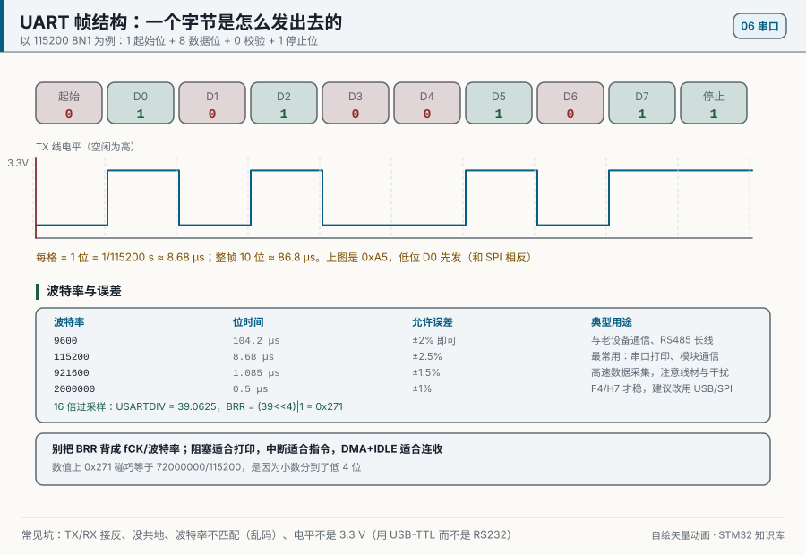
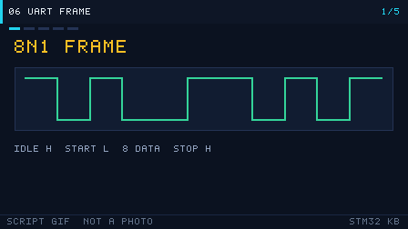

# 06 UART
> 中文：[串口 UART](../06-串口UART.md)

> UART is the asynchronous serial interface you will use most: logs, modules, and a program on the PC.

<p align="center">
  
  <br><sub>▲ Animation: a UART frame bit by bit (start / data / parity / stop; vector drawing by the author)</sub>
</p>

<!-- video:ch06 -->
<p align="center">
  
  <br><sub>▲ Lecture slides for this chapter: a program-generated GIF (tools/gen_videos.py, reproducible, not a live shot). The narration matches the five frames one to one.</sub>
</p>

**Narration (read along with the frames, about one minute)**

1. A UART frame starts on the falling edge of the start bit, then 8 data bits, optional parity, and finally the stop bit.
2. Baud rate is the step both sides agreed on. If the error is large, the sample point slides out of the data bit.
3. An idle interrupt plus DMA fits a frame whose length you do not know. For ORE, read SR first and DR second.
4. RS485 changes direction on TC, not on TXE. TXE only means the data has entered the shift register.
5. Motto: ORE is SR first, then DR. Self-test: in 115200 8N1, what is the 8?
<!-- /video:ch06 -->


## 📌 Learning goals
- [ ] Describe a UART frame (start / data / parity / stop)
- [ ] Compute baud-rate error, and understand BRR and OVER8
- [ ] Choose among blocking, interrupt, and DMA
- [ ] Redirect printf, and stay out of the semihosting trap
- [ ] Understand a ring buffer, and variable-length receive with DMA+IDLE

## 🧠 Core ideas

**Lead with the conclusion: UART is asynchronous. The two sides stay aligned only by the baud rate they agreed on, so the frame format and the baud error are the two keys.**

### 1. The frame

One frame = 1 start bit + 8 or 9 data bits (LSB first) + an optional parity bit + 0.5 / 1 / 1.5 / 2 stop bits

| Piece | Value | Meaning |
| --- | --- | --- |
| Start bit | 1 bit (low) | Marks the start of a frame |
| Data bits | 8 or 9 | LSB first |
| Parity | None / odd / even | A simple check |
| Stop bits | 0.5 / 1 / 1.5 / 2 bits (high) | Marks the end of a frame |
| Idle | High | The default between frames |

<p align="center">
  
  <br><sub>▲ Animation: UART sending bit by bit (with a baud-rate timeline; program-generated GIF)</sub>
</p>

### 2. Baud rate and error

- Baud rate is bits per second. 9600 and 115200 are the common ones.
- Time per bit = 1 / baud rate. 115200 → about 8.68 µs.
- **Error budget:** the accumulated error of both sides needs to stay under about ±2% to ±3% (a 10-bit frame, sampled at the middle of three points).
- Error formula: `error = (actual baud − target baud) / target baud × 100%`

BRR on F1, 16× oversampling: `USARTDIV = fPCLK / (16 × baud)`, and BRR = integer part << 4 | fractional part × 16

| Target baud | PCLK | USARTDIV | BRR (hex) | Error |
| --- | --- | --- | --- | --- |
| 9600 | 72 MHz | 468.75 | 0x1D4C | 0% |
| 115200 | 72 MHz | 39.0625 | 0x271 | 0.16% |
| 115200 | 36 MHz | 19.531 | 0x138 | 0.16% |

> F1 and F4 have the OVER8 bit (8× oversampling), which improves the divider at high baud rates. In HAL, `HAL_UART_Init` computes BRR for you.

### 3. Three ways to send and receive

| Dimension | Blocking (polling) | Interrupt (IT) | DMA |
| --- | --- | --- | --- |
| CPU use | High (it waits) | Medium (an interrupt per byte) | Low (an interrupt when the move finishes) |
| Throughput | Low | Medium | High |
| Code complexity | Low | Medium | Medium to high |
| Fits | Simple debug | A little data of unknown length | A lot of data, or a continuous stream, or a frame of unknown length |

## 🛠️ Hardware and wiring

| Board | Peripheral | Pin | Notes |
| --- | --- | --- | --- |
| BluePill | USART1 TX | PA9 | To the USB-TTL RX |
| BluePill | USART1 RX | PA10 | To the USB-TTL TX |
| BluePill | GND | GND | Common ground with the USB-TTL |

> ⚠️ TX and RX must be crossed. Set the USB-TTL to 3.3 V. Do not let the USB-TTL and the ST-Link both try to power the board.

## 💻 Code

Blocking echo:

```c
/* uart_blocking.c —— USART1 echo (blocking) */
#include "stm32f1xx_hal.h"

UART_HandleTypeDef huart1;

void SystemClock_Config(void);

static void uart_init(void)
{
    __HAL_RCC_USART1_CLK_ENABLE();
    __HAL_RCC_GPIOA_CLK_ENABLE();

    /* PA9 = TX alternate push-pull, PA10 = RX input with pull-up */
    GPIO_InitTypeDef io = {0};
    io.Pin = GPIO_PIN_9; io.Mode = GPIO_MODE_AF_PP; io.Speed = GPIO_SPEED_FREQ_HIGH;
    HAL_GPIO_Init(GPIOA, &io);
    io.Pin = GPIO_PIN_10; io.Mode = GPIO_MODE_INPUT; io.Pull = GPIO_PULLUP;
    HAL_GPIO_Init(GPIOA, &io);

    huart1.Instance          = USART1;
    huart1.Init.BaudRate     = 115200;
    huart1.Init.WordLength   = UART_WORDLENGTH_8B;
    huart1.Init.StopBits     = UART_STOPBITS_1;
    huart1.Init.Parity       = UART_PARITY_NONE;
    huart1.Init.Mode         = UART_MODE_TX_RX;
    huart1.Init.HwFlowCtl    = UART_HWCONTROL_NONE;
    huart1.Init.OverSampling = UART_OVERSAMPLING_16;
    HAL_UART_Init(&huart1);
}

int main(void)
{
    HAL_Init();
    SystemClock_Config();
    uart_init();

    uint8_t ch;
    while (1)
    {
        if (HAL_UART_Receive(&huart1, &ch, 1, 1000) == HAL_OK)
        {
            HAL_UART_Transmit(&huart1, &ch, 1, 1000);   /* echo */
        }
    }
}
```

Redirect printf (method 1: `fputc` / `_write`):

```c
#include <stdio.h>

/* Keil uses fputc; GCC uses _write. Pick one. */
#ifdef __GNUC__
int _write(int fd, char *ptr, int len)
{
    HAL_UART_Transmit(&huart1, (uint8_t *)ptr, len, HAL_MAX_DELAY);
    return len;
}
#else
int fputc(int ch, FILE *f)
{
    HAL_UART_Transmit(&huart1, (uint8_t *)&ch, 1, HAL_MAX_DELAY);
    return ch;
}
#endif
```

> ⚠️ In Keil, check "Use MicroLIB". Otherwise it can stall in semihosting.

Method 2 (preferred; it does not depend on semihosting):

```c
#include <stdarg.h>
#include <stdio.h>

void log_printf(const char *fmt, ...)
{
    char buf[128];
    va_list ap;
    va_start(ap, fmt);
    int n = vsnprintf(buf, sizeof(buf), fmt, ap);
    va_end(ap);
    if (n > 0) HAL_UART_Transmit(&huart1, (uint8_t *)buf, (uint16_t)n, HAL_MAX_DELAY);
}
```

Variable-length receive with DMA + IDLE:

```c
/* idea: DMA fills the buffer in a circle; bus idle (IDLE) raises the interrupt.
   The Size argument is how many bytes arrived, and the application parses them. */
#define RX_BUF_SIZE 128
uint8_t rx_buf[RX_BUF_SIZE];
volatile uint16_t rx_len = 0;

void uart_dma_idle_start(void)
{
    HAL_UARTEx_ReceiveToIdle_DMA(&huart1, rx_buf, RX_BUF_SIZE);
    __HAL_DMA_DISABLE_IT(huart1.hdmarx, DMA_IT_HT);   /* turn off the half-transfer interrupt; only the IDLE callback */
}

/* callback: fires on IDLE or when the buffer is full */
void HAL_UARTEx_RxEventCallback(UART_HandleTypeDef *huart, uint16_t Size)
{
    if (huart->Instance == USART1)
    {
        rx_len = Size;                                 /* Size = bytes received */
        HAL_UARTEx_ReceiveToIdle_DMA(&huart1, rx_buf, RX_BUF_SIZE);  /* start receiving again */
    }
}
```

A ring buffer (the interrupt only enqueues; the main loop dequeues and handles it):

```c
/* the ISR advances the write pointer; the main loop advances the read pointer.
   Use a count, or leave one slot empty, to tell full from empty */
static volatile uint16_t head, tail;
static uint8_t ring[256];
/* ISR: ring[head++ & 255] = ch;  main loop: ch = ring[tail++ & 255]; */
```

The full project is in [`examples/uart-dma-idle/`](../../examples/uart-dma-idle/).

## ⚠️ Pitfalls and troubleshooting

| Symptom | Cause | Fix |
| --- | --- | --- |
| Everything is garbage | Baud rates do not match | Use the same baud on both sides, and check the crystal frequency |
| Nothing arrives at all | TX and RX are not crossed | Cross them: board TX → module RX |
| The level is wrong, or something is damaged | The USB-TTL was set to 5 V | Use 3.3 V (or add a level shifter) |
| Chinese text is garbled | Encoding or font does not match | Agree on UTF-8 or GBK, or use a bitmap font |
| DMA receive is occasionally scrambled | The buffer is not `volatile`, or it is not aligned | Mark the buffer `volatile`, and align it to 4 bytes |
| printf prints nothing | Keil MicroLIB is off (semihosting) | Check MicroLIB, or use the method-2 log function |
| Errors at a high baud rate | The clock error is large | Use OVER8, check BRR, or lower the baud rate |

## 🧪 Hands-on labs

1. **Lab 1 (echo):** USART1 at 115200 echoes. Whatever the serial terminal sends, it gets back.
2. **Lab 2 (printf):** Redirect printf and print the core clock and a counter once a second.
3. **Lab 3 (DMA+IDLE):** Receive a frame of unknown length. The terminal sends a string of any length, and the MCU echoes the whole frame (compare the bit timing in `uart-bits.gif`).

### 4. USART registers that matter (F1)

| Register | Role |
| --- | --- |
| SR | Status (TXE / RXNE / TC / IDLE / ORE) |
| DR | Data |
| BRR | Baud rate |
| CR1 | Enable, word length, parity, interrupts |
| CR2 | Stop bits |
| CR3 | DMA enable, flow control |

### 5. UART DMA transmit

```c
/* start a DMA transmit (TX side) */
extern uint8_t msg[];            /* buffer waiting to be sent */
uint16_t msg_len = 10;
HAL_UART_Transmit_DMA(&huart1, msg, msg_len);

/* transmit-complete callback */
void HAL_UART_TxCpltCallback(UART_HandleTypeDef *huart)
{
    if (huart->Instance == USART1)
    {
        /* start the next frame here, or set a flag */
    }
}
```

### 6. Usual serial-terminal settings

| Setting | Usual value |
| --- | --- |
| Baud rate | 115200 |
| Data bits / stop bits / parity | 8 / 1 / none |
| Flow control | None |
| Newline on send | Add CRLF if the protocol wants it |
| Encoding | The same as the MCU side |

### 7. Overrun, and the RS485 direction pin

**Conclusion:** once ORE is set, a new byte no longer enters DR until you **read SR and then read DR**. Reading DR alone does not clear ORE, and reception stays dead.

| Flag | Meaning | How to clear it |
| --- | --- | --- |
| ORE | The previous byte was still unread when the next one arrived | Read SR, then read DR |
| FE | The stop bit was not 1, usually a baud-rate error | Read SR, then read DR |
| NE | The level was not clean inside the sample window | Read SR, then read DR |
| PE | Parity did not match | Read SR, then read DR |

The RS485 direction pin (DE) is high while transmitting. `TXE` only means the data has entered the shift register; the wire is still shifting it out. To turn back to receive you have to wait for `TC`:

```c
HAL_GPIO_WritePin(DE_PORT, DE_PIN, GPIO_PIN_SET);
HAL_UART_Transmit(&huart1, buf, len, 20);
while (__HAL_UART_GET_FLAG(&huart1, UART_FLAG_TC) == RESET) { }
HAL_GPIO_WritePin(DE_PORT, DE_PIN, GPIO_PIN_RESET);
```

Motto: **ORE is SR first, then DR. On RS485, wait for TC before you turn around.**

Self-test:

1. The interrupt only read DR. Does ORE stay set?
2. `TXE` is already 1. Why can a scope still see the last few bits?
3. On an 8N1 drawing, why is the stop bit marked SP and not P?

## 🔗 Related resources

- Official manuals: **RM0008** chapter 27 (USART); **DS5319** USART alternate-function pin table
- Previous: [05 Timers and PWM](05-timer-pwm.md) | Next: [07 The I2C Bus](07-i2c.md)
- Figures: [`assets/animations/uart-frame.svg`](../../assets/animations/uart-frame.svg), [`assets/gif/uart-bits.gif`](../../assets/gif/uart-bits.gif)
- Disclaimer: every illustration in this repo is a vector drawing or a program-generated animation by the author, not a manufacturer's photograph.
