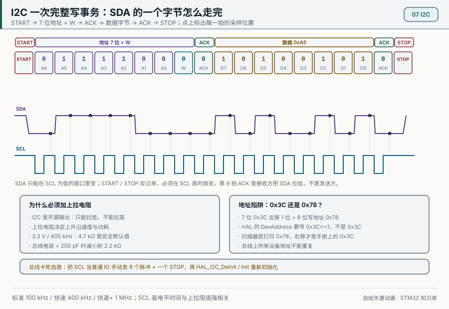
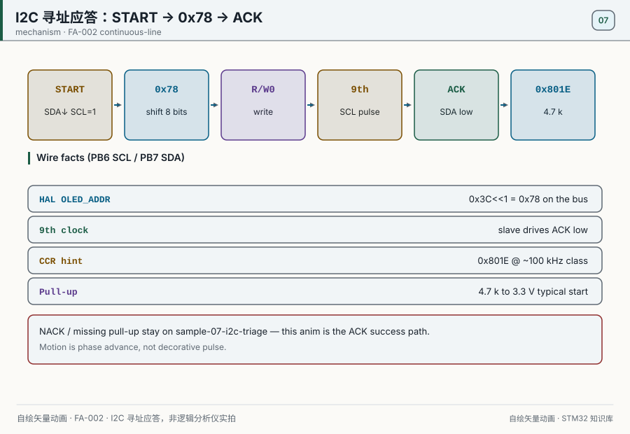
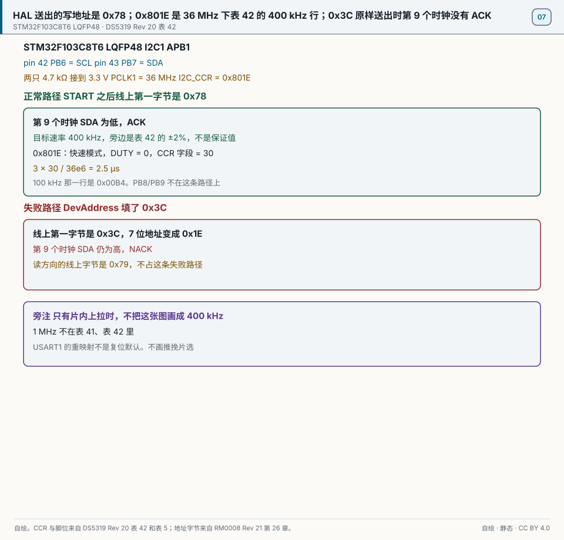
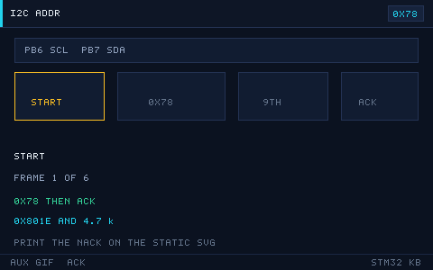
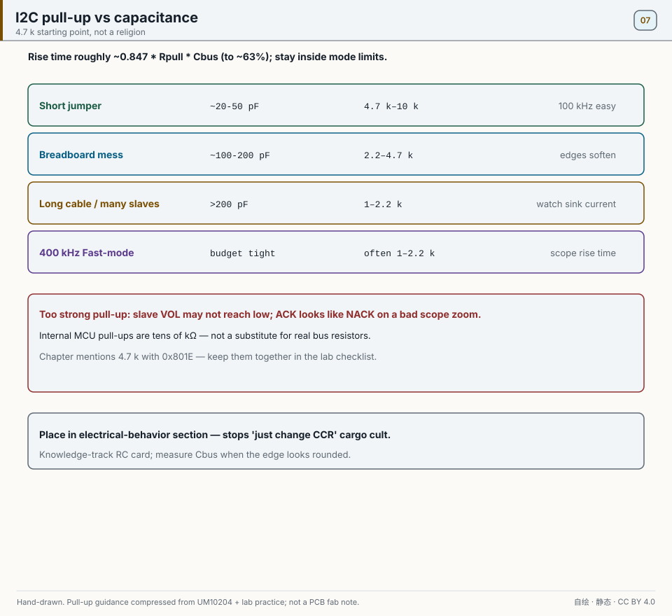
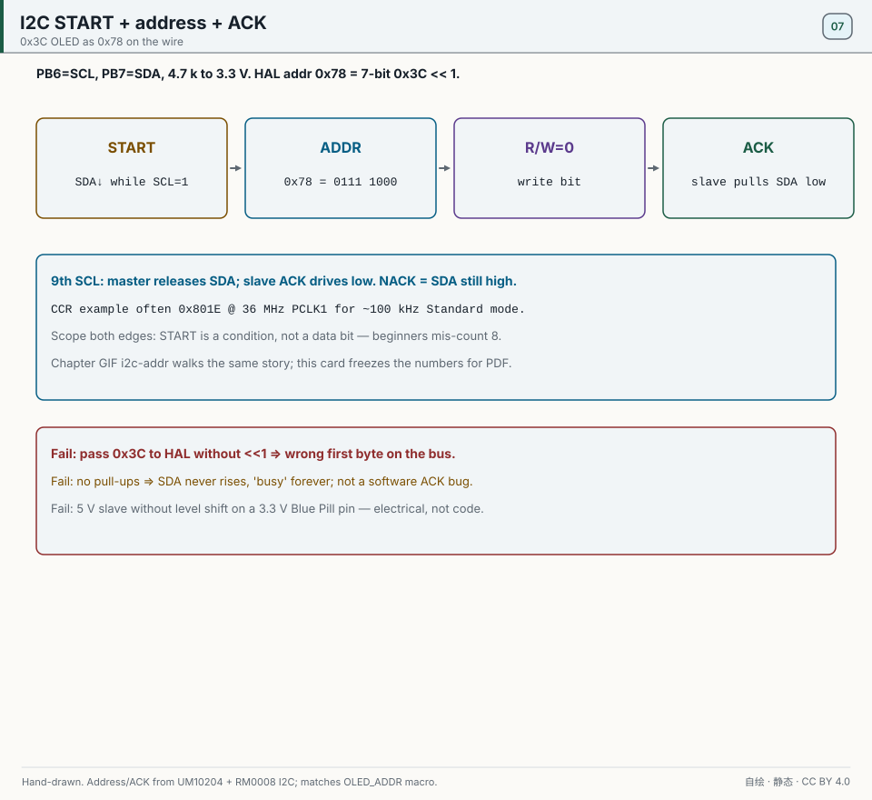
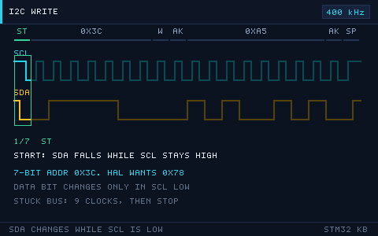
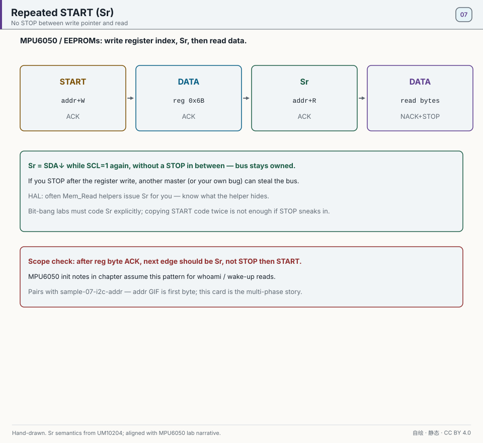
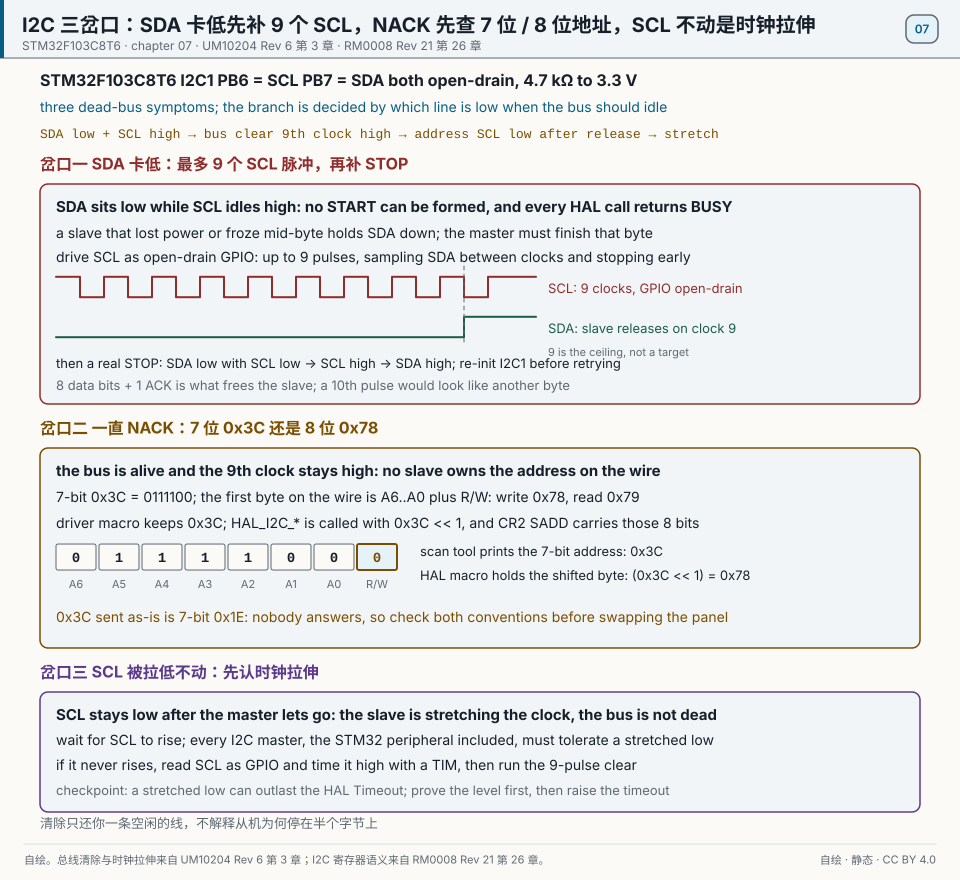

# 07 The I2C Bus
> 中文：[I2C 总线](../07-I2C总线.md)

> If the OLED stays dark, capture the first byte after START and the ninth clock. `0x78` with no ACK points to address selection, power, or wiring; `0x3C` on the wire points back to the HAL address argument.

<p align="center">
  
  <br><sub>▲ Animation: a complete I2C transaction (START, address, ACK, data, STOP; vector drawing by the author)</sub>
</p>

<!-- video:ch07 -->
<p align="center">
  <video width="640" controls poster="../../assets/video/ch07-i2c.png">
    <source src="../../assets/video/ch07-i2c.mp4" type="video/mp4">
  </video>
  <br><sub>▲ Chapter video with Chinese voice-over (2.5 min). <a href="../../assets/video/ch07-i2c.mp4">MP4</a> · <a href="../../assets/video/ch07-i2c.srt">subtitles</a></sub>
</p>

<details>
<summary>Narration script (Chinese, same text as the subtitles)</summary>

1. I2C 只有时钟和数据两根线，都是开漏，所以都要上拉。没有上拉，线放不回高电平，主机会一直等，最后告诉你超时。
2. 应答是接收方把数据线拉低。高电平反而是不应答。地址不对、线没接好，你就会看到 NACK。记反的人会把好设备当成坏设备。
3. 很多芯片的寄存器要先写下寄存器地址，中间来一个重复起始，再读数据。不要先停止、再重新起始。HAL 里这条路就是存储器读。
4. 这一帧是仓库画的一次写事务。起始之后是地址，对方拉低应答，再送数据，最后停止。示波器上每一段都能对上，总线上的玄学就会少很多。
5. 七位地址和八位写地址差一位。屏幕模块常见 0x3C，放进 HAL 时往往要左移成 0x78。对不上时，先确认你手里的是哪一种写法，别把设备换掉。
6. 从机如果还死死拉着数据线，主机再发起始也没用。恢复的办法是在时钟线上补若干个脉冲，把从机的状态机推完，再发一个停止。然后才重新初始化。
7. 线上拉电阻不是随便贴一个。太弱，上升沿爬不完，高速时会错；太强，灌电流大，有的脚吃不消。短线实验可以用芯片内部上拉凑合，产品里要算一下。
8. 口诀：读寄存器走存储器读；中间是重复起始，不是停止再起始。地址先确认七位还是八位。这三句能对付大多数传感器例程。
9. 实验先在空闲总线上扫描地址。一个应答都没有，先查上拉和接线，不要先改协议。扫到了，再按手册读一个寄存器核对。
10. 合上书，三问。ACK 是高电平还是低电平？读寄存器时，写地址和读数据中间应该是停止还是重复起始？总线被拉死时先补什么？

</details>
<!-- /video:ch07 -->

## Principle and scope

Every I2C number in this chapter is for the STM32F103C8T6. I2C1 sits on APB1 with PCLK1 = 36 MHz, as in Appendix D. The working point is one row of DS5319 Table 42: pull-up Rp = 4.7 kΩ, a 400 kHz target, and `I2C_CCR = 0x801E`. The OLED address matches Appendix D: 7-bit `0x3C`, which HAL takes as `0x78`.

After reset, I2C1 is on pin 42 PB6 = I2C1_SCL and pin 43 PB7 = I2C1_SDA. Both pins are alternate-function open-drain, each with a 4.7 kΩ resistor to 3.3 V. Open-drain means the chip can only pull the line low; the high level comes entirely from the pull-up. That differs from the push-pull chip select in the SPI chapter. With the remap, I2C1 moves to pin 45 PB8 and pin 46 PB9. The remap column of DS5319 Table 5 also lets PB6/PB7 serve as USART1_TX / USART1_RX, but only after a remap, not after reset, and the two pins can serve only one peripheral at a time. Pins: [DS5319 Rev 20 Tables 5 and 42](#source-ds5319-i2c).

The 7-bit address `0x3C` is `0111100` in binary. The first I2C byte is the 7-bit address shifted left by one, with the direction in the lowest bit: a write is `0x3C << 1` = `0x78`, a read is `0x79`. HAL's DevAddress expects the shifted value, so you pass `0x78`. Pass the scanner's `0x3C` straight into `HAL_I2C_Master_Transmit` and `0x3C` goes on the wire; that addresses 7-bit `0x1E`, and the OLED never answers. This is the most common mistake in this chapter. The macro in [examples/i2c-oled](#source-project-examples) is already `0x78`. The address byte format is in [RM0008 Rev 21 chapter 26](#source-rm0008-i2c).

The 9th clock is the acknowledge bit. The receiver pulls SDA low for ACK; SDA left high is NACK. With a wrong address no device pulls SDA low, so you see NACK.

`HAL_I2C_Mem_Read` runs START, address plus write, register address, repeated START, address plus read, data, STOP. The middle uses a repeated START, not a STOP. Calling `Master_Transmit` and then `Master_Receive` puts a STOP in between, and some devices then forget the register address you just wrote.

Taking `0x801E` apart: the fast-mode bit is set, DUTY = 0, and the CCR field is 30. At PCLK1 = 36 MHz one SCL period is `3 × 30 / 36e6 = 2.5` µs, which is 400 kHz. For 100 kHz use `0x00B4`: standard mode, CCR field 180, `36e6 / (2 × 180) = 100` kHz. Table 41 says 400 kHz is reached exactly only when PCLK1 is an integer multiple of 10 MHz. 36 MHz is not, so per Table 42 note 2 the actual rate is within ±2%. Neither Table 41 nor Table 42 lists 1 MHz; the F103 I2C has no Fast-mode Plus, so any "up to 1 MHz" claim does not hold for this chip.

This Table 42 row uses an external 4.7 kΩ pull-up. The on-chip pull-up is about 30–50 kΩ (Appendix D and chapter 03). That is too large: the rising edge is too slow for 400 kHz. The rise-time limit is 1000 ns in standard mode and 300 ns in fast mode. The bus capacitance Cb may be at most 400 pF. How to size the pull-up from Cb is in the core ideas below.

In open-drain mode the PMOS to VDD stays off and only the NMOS can pull the line low, which is why the external pull-up is required.

## Key figures


<p align="center">
  
  <br><sub>▲ Hand-drawn CSS animation (FA-002). 0x78 → 9th-clock ACK; NACK stays on the triage card.</sub>
</p>


<p align="center">
  
  <br><sub>▲ Drawn for this book. STM32F103C8T6. Pin 42 PB6 = SCL and pin 43 PB7 = SDA, each with 4.7 kΩ to 3.3 V. PCLK1 = 36 MHz and I2C_CCR = 0x801E, a 400 kHz target within ±2%. The top half is a correct write address: first byte 0x78, ACK on the 9th clock. The bottom half is DevAddress set to 0x3C: SDA is still high on the 9th clock. Sources: [DS5319 Rev 20 Tables 42 and 5](#source-ds5319-i2c) and [RM0008 Rev 21 chapter 26](#source-rm0008-i2c).</sub>
</p>

<p align="center">
  
  <br><sub>▲ Animated version. It shows only the correct write address: START, 0x78 on the wire, ACK on the 9th clock, with 0x801E and 4.7 kΩ marked. The printed book has only the static figure above.</sub>
</p>

`i2c-transaction.svg` and `i2c-timing.gif` in the core ideas below show one complete read and write transaction.

## Timing and state

| Phase | SCL | SDA | Byte on the wire |
| --- | --- | --- | --- |
| START | High | High to low | No address byte yet |
| Correct: write address | 8 clocks | Shifted out | `0x78` |
| Correct: 9th clock | 9th clock | Low | ACK |
| Wrong: write address | 8 clocks | Shifted out | `0x3C`, which addresses `0x1E` |
| Wrong: 9th clock | 9th clock | High | NACK |
| Read direction | After repeated START | Address byte | `0x79`, with no STOP in between |
| Rate | `0x801E` is 400 kHz | `0x00B4` is 100 kHz | Within ±2%. CCR fields 30 and 180 |
| Pull-up | External 4.7 kΩ to 3.3 V | 36 MHz, 3.3 V | On-chip pull-ups alone cannot run 400 kHz |

Rise-time limits: 1000 ns in standard mode, 300 ns in fast mode. The F103 does not support 1 MHz.

## Pitfalls and sources

| What you see | Why | What to do | Source | What the source shows |
| --- | --- | --- | --- | --- |
| A scanner shows `0x3C` and HAL gets no ACK | DevAddress was the unshifted 7-bit value | Pass `0x78` as DevAddress. The read byte on the wire is `0x79` | [RM0008](#source-rm0008-i2c) | Shift the 7-bit address left by 1 and add the R/W bit. Sending `0x3C` unchanged addresses `0x1E` |
| The example and the manual write the address differently | One uses 7-bit, the other 8-bit | The example macro is already `0x78` | [Examples](#source-project-examples) | `examples/i2c-oled` uses device address `0x78`, from `0x3C << 1` |
| Only on-chip pull-ups, and 400 kHz times out | About 30–50 kΩ is too large | Add 4.7 kΩ to 3.3 V as in Table 42 | [DS5319](#source-ds5319-i2c) | At 36 MHz and 3.3 V the 400 kHz row uses Rp = 4.7 kΩ. The on-chip values are in Appendix D |
| SCL is slightly off 400 kHz | CCR is not the Table 42 row, or it is the offset that 36 MHz causes | Check that `I2C_CCR` is `0x801E`; within ±2% is normal | [DS5319](#source-ds5319-i2c) | Table 42 at 36 MHz gives `0x801E` for 400 kHz. 36 MHz is not an integer multiple of 10 MHz, so the rate is not exactly 400 kHz |
| The waveform is on PB8/PB9, or the UART took PB6 | A remap is on, or USART1 is also mapped to that pin | Use the reset-default pin 42 and pin 43, with only I2C1 enabled | [DS5319](#source-ds5319-i2c) | Pin 42's default includes I2C1_SCL and pin 43's default includes I2C1_SDA. USART1 needs a remap to use these pins |

## Learning goals
- [ ] Understand open-drain plus pull-up, and how to pick the pull-up resistor
- [ ] Describe START/STOP, the address, ACK/NACK, arbitration, and clock synchronization
- [ ] Compare bit-banged I2C with the hardware peripheral
- [ ] Use `HAL_I2C_Mem_Read` / `Write` and read the error codes
- [ ] Recover a locked bus, and know the timing points for SSD1306 and AT24C02

## Core ideas

I2C high levels come from the pull-up resistors; devices only drive the bus low. The debug order follows from that: check idle levels and rise time, then address and ACK, and only then inspect the receive buffer.

### 1. Electrical behavior


<p align="center">
  
  <br><sub>▲ Drawn for this book. 4.7 k is a starting point; long buses need measurement.</sub>
</p>


Both I2C wires are pulled gently high by resistors, and every device on the bus can do only one thing: pull a wire to ground. If nobody pulls, the wire is high. If anyone pulls, it is low. This is wired-AND, and it is why two I2C devices cannot fight: nobody ever drives a wire high, so the worst case is two devices pulling together. The cost is that after everyone lets go, the wire climbs back slowly through the resistor. A bigger resistor or a longer wire makes it slower.

| Property | Meaning |
| --- | --- |
| Pin type | Open-drain. Both SDA and SCL need pull-ups |
| Wired-AND | If any device pulls low, the line is low. It is high only when everyone releases it |
| Pull-up | 4.7 kΩ is the usual value. Faster, or more capacitance, wants a smaller one |
| Multi-master, multi-slave | Multi-master arbitration and multi-slave addressing are both supported |

Pull-up versus bus capacitance Cb:

| Speed mode | Max rate | Typical pull-up | Notes |
| --- | --- | --- | --- |
| Standard mode | 100 kHz | 4.7 kΩ to 10 kΩ | A long wire or a large capacitance wants a smaller resistor |
| Fast mode | 400 kHz | 2.2 kΩ to 4.7 kΩ | The usual sensors |
| Fast+ | 1 MHz | — | Not supported on STM32F103C8T6 |

> An estimate, not the DS5319 standard-mode limit: `Rp(max) ≈ 300ns / Cb`. More capacitance means a smaller pull-up. The standard-mode rise-time limit is 1000 ns and the fast-mode limit is 300 ns; see the start of this chapter.

### 2. Timing and the protocol


<p align="center">
  
  <br><sub>▲ Drawn for this book. HAL 0x3C<<1=0x78; slave ACK on the 9th clock.</sub>
</p>


The rule is that SDA must not move while SCL is high, and when it does, it means something special. SDA falling while SCL is high is START. SDA rising while SCL is high is STOP. Ordinary data changes only while SCL is low. After every 8 bits, the receiver pulls SDA low on the 9th clock to say "got it", and that is ACK. The master opens with an address. The slave that matches answers ACK, and the rest stay quiet until the next START.

| Signal | Condition | Meaning |
| --- | --- | --- |
| START | While SCL is high, SDA falls | Start of a transfer |
| STOP | While SCL is high, SDA rises | End of a transfer |
| Data bit | SDA is stable while SCL is high | One clock per bit |
| ACK | On the 9th clock, the slave pulls SDA low | Acknowledge |
| NACK | On the 9th clock, SDA stays high | Not acknowledged, or the end of a read |

Address: 7 address bits + 1 R/W bit (0 = write, 1 = read), 8 bits in all. A 10-bit address uses two bytes.

<p align="center">
  
  <br><sub>▲ Animation: I2C timing in detail (program-generated GIF)</sub>
</p>

### 3. Clock synchronization and arbitration

Wired-AND makes arbitration natural. Two masters talking at once each listen to the wire as they send. The one that wants a 1 but hears a 0 knows someone is "louder", so it drops out, and the other carries on without ever noticing. Clock stretching works the same way: a slave that is not ready holds SCL low, and the master lets go, sees the wire stay down, and has to wait.

| Mechanism | Meaning |
| --- | --- |
| Clock synchronization | SCL is wired-AND. The device that holds low the longest decides how long the low lasts |
| Arbitration | If several masters transmit at once, the one whose own bit does not match the SDA level drops out |
| Clock stretching | A slave holds SCL low to stretch the clock, and the master has to wait (this is an easy way to get HAL_BUSY) |

### 4. Bit-banged versus hardware I2C

Bit-banging means using two ordinary pins and toggling them bit by bit to the timing yourself. It is slower, but every step is in your hands and any pin will do. Hardware I2C hands the timing to the peripheral and saves the CPU work. The F1 hardware I2C tends to get stuck busy when a slave holds SDA low. The recovery is under "Recover a stuck bus" later in this chapter, so many F1 projects bit-bang instead.

| Dimension | Bit-banged (GPIO toggles) | Hardware I2C |
| --- | --- | --- |
| Pins | Any GPIO | Fixed alternate-function pins |
| Flexibility | High (several buses) | Low |
| CPU use | High | Low (the hardware makes the timing) |
| How solid it is | High (you control it) | On F1 it deadlocks easily |
| Speed | Lower | Fast mode targets 400 kHz. The STM32F103C8T6 does not support 1 MHz |

## Hardware and wiring

| Board | Peripheral | Pin | Notes |
| --- | --- | --- | --- |
| BluePill | SSD1306 OLED | PB6=SCL, PB7=SDA | 4.7 kΩ pull-ups, address 0x3C |
| BluePill | AT24C02 EEPROM | Same pins | Address 0x50 |
| BluePill | MPU6050 | Same pins | Address 0x68 |

## Code

```c
/* i2c_oled.c —— hardware I2C1 reads and writes an SSD1306 (HAL) */
#include "stm32f1xx_hal.h"

I2C_HandleTypeDef hi2c1;

#define OLED_ADDR   (0x3C << 1)     /* HAL wants the 8-bit address: shift the 7-bit address left by 1 */
#define OLED_CMD    0x00
#define OLED_DATA   0x40

void SystemClock_Config(void);

static void i2c_init(void)
{
    __HAL_RCC_I2C1_CLK_ENABLE();
    __HAL_RCC_GPIOB_CLK_ENABLE();

    /* PB6/PB7 alternate open-drain; external pull-ups are required */
    GPIO_InitTypeDef io = {0};
    io.Pin   = GPIO_PIN_6 | GPIO_PIN_7;
    io.Mode  = GPIO_MODE_AF_OD;
    io.Speed = GPIO_SPEED_FREQ_HIGH;
    HAL_GPIO_Init(GPIOB, &io);

    hi2c1.Instance             = I2C1;
    hi2c1.Init.ClockSpeed      = 400000;
    hi2c1.Init.DutyCycle       = I2C_DUTYCYCLE_2;
    hi2c1.Init.OwnAddress1     = 0;
    hi2c1.Init.AddressingMode  = I2C_ADDRESSINGMODE_7BIT;
    hi2c1.Init.DualAddressMode = I2C_DUALADDRESS_DISABLE;
    hi2c1.Init.GeneralCallMode = I2C_GENERALCALL_DISABLE;
    hi2c1.Init.NoStretchMode   = I2C_NOSTRETCH_DISABLE;
    HAL_I2C_Init(&hi2c1);
}

/* write a command or data to the OLED */
static HAL_StatusTypeDef oled_write(uint8_t ctrl, uint8_t *buf, uint16_t len)
{
    uint8_t tmp[129];
    tmp[0] = ctrl;                       /* 0x00 command / 0x40 data */
    for (uint16_t i = 0; i < len; i++) tmp[i + 1] = buf[i];
    return HAL_I2C_Master_Transmit(&hi2c1, OLED_ADDR, tmp, len + 1, 100);
}

int main(void)
{
    HAL_Init();
    SystemClock_Config();
    i2c_init();

    /* probe whether the device is present */
    if (HAL_I2C_IsDeviceReady(&hi2c1, OLED_ADDR, 3, 100) == HAL_OK)
    {
        uint8_t init_cmd[] = {0xAE, 0x20, 0x00, 0xAF};   /* display off → addressing mode → display on */
        oled_write(OLED_CMD, init_cmd, sizeof(init_cmd));
    }

    while (1) { }
}
```

Read an EEPROM (AT24C02) with the Mem API:

```c
/* write one byte to AT24C02 address 0x00 */
uint8_t val = 0x5A;
HAL_I2C_Mem_Write(&hi2c1, 0x50 << 1, 0x00, I2C_MEMADD_SIZE_8BIT, &val, 1, 100);
HAL_Delay(5);   /* the EEPROM needs a write cycle */

/* read it back */
uint8_t rd = 0;
HAL_I2C_Mem_Read(&hi2c1, 0x50 << 1, 0x00, I2C_MEMADD_SIZE_8BIT, &rd, 1, 100);
```

Recover a stuck bus (when a slave is holding SDA, clock it nine times by hand):

```c
/* set SCL to open-drain GPIO, toggle it 9 times to release a stuck slave, then send STOP */
static void i2c_bus_recover(void)
{
    for (int i = 0; i < 9; i++)
    {
        HAL_GPIO_WritePin(GPIOB, GPIO_PIN_6, GPIO_PIN_RESET);   /* SCL low */
        HAL_Delay(1);
        HAL_GPIO_WritePin(GPIOB, GPIO_PIN_6, GPIO_PIN_SET);     /* SCL high */
        HAL_Delay(1);
    }
    /* then call HAL_I2C_Init again to reset the peripheral */
}
```

The full project is in [`examples/i2c-oled/`](../../examples/i2c-oled/).

## Hands-on labs

1. **Lab 1 (wire waveform):** Scan the bus and capture `START → 0x78 → ACK`. Record SCL frequency, SDA rise time, and the ACK bit. Temporarily pass `0x3C` and save the no-ACK trace for comparison.
2. **Lab 2 (peripheral state):** Write 16 bytes to an AT24C02 and poll until it is ready. Record the HAL result or AF flag, and confirm a repeated start before the read.
3. **Lab 3 (memory result):** Read the 16 bytes back and compare every byte, then power-cycle and read them again. Displaying a string is optional; the receive buffer is the acceptance result.

### 5. I2C registers that matter (F1)

| Register | Role |
| --- | --- |
| CR1 | Enable, ACK, clock |
| CR2 | Frequency, interrupts, DMA |
| OAR1/OAR2 | Own address |
| DR | Data |
| SR1/SR2 | Status (SB / ADDR / RXNE / TXE / AF) |
| CCR | Clock control (the rate) |
| TRISE | Rise time |

### 6. The core of a bit-banged I2C

```c
/* bit-bang I2C with open-drain GPIO (SDA=PB7, SCL=PB6) */
#define SCL_H() HAL_GPIO_WritePin(GPIOB, GPIO_PIN_6, GPIO_PIN_SET)
#define SCL_L() HAL_GPIO_WritePin(GPIOB, GPIO_PIN_6, GPIO_PIN_RESET)
#define SDA_H() HAL_GPIO_WritePin(GPIOB, GPIO_PIN_7, GPIO_PIN_SET)
#define SDA_L() HAL_GPIO_WritePin(GPIOB, GPIO_PIN_7, GPIO_PIN_RESET)

static void i2c_start(void)
{
    SDA_H(); SCL_H(); i2c_delay();
    SDA_L(); i2c_delay();          /* SDA falling while SCL is high = START */
    SCL_L(); i2c_delay();
}
```

### 7. What MPU6050 init has to do

| Step | Register | Value |
| --- | --- | --- |
| Wake | PWR_MGMT_1 (0x6B) | 0x00 |
| Sample rate | SMPLRT_DIV (0x19) | Whatever you need |
| Gyro range | GYRO_CONFIG (0x1B) | ±2000 °/s = 0x18 |
| Accel range | ACCEL_CONFIG (0x1C) | ±2 g = 0x00 |

> The MPU6050 powers up asleep. Write PWR_MGMT_1 to wake it first, or every read comes back 0.

### 8. Common I2C addresses

| Device | 7-bit address | HAL 8-bit address |
| --- | --- | --- |
| SSD1306 | 0x3C | 0x78 |
| AT24C02 | 0x50 | 0xA0 |
| MPU6050 | 0x68 | 0xD0 |
| PCF8574 | 0x20–0x27 | 0x40–0x4E |

### 9. Bus capacitance and pull-up

| Bus capacitance Cb | Suggested pull-up |
| --- | --- |
| < 100 pF | 10 kΩ |
| 100–200 pF | 4.7 kΩ |
| 200–400 pF | 2.2 kΩ |

### 10. Repeated start (Sr)


<p align="center">
  
  <br><sub>▲ Drawn for this book. MPU6050/EEPROM pattern: write pointer → Sr → read.</sub>
</p>


When you read a register-style device, the start bit in the middle is a repeated start. It does not send STOP first. `HAL_I2C_Mem_Read` already does it for you: START, device address + write, register address, Sr, device address + read, data, STOP.

If you call `Master_Transmit` and then `Master_Receive` yourself, a STOP lands in between. Many EEPROMs and sensors drop the address, and what you read back is some other register.

The 7-bit address `0x3C` is written in HAL as `0x3C << 1`, which is `0x78`. The bit pattern of `0x3C` is `0111100`. It is not "take `0x3C` as 8 bits and drop the top bit".

Before leaving this chapter, keep one ACK trace, one wrong-address NACK trace, and matching EEPROM buffers from before and after a power cycle.

Self-test:

1. The OLED address is 0x3C. Does HAL's DevAddress get 0x3C or 0x78?
2. Where do a repeated start and an ordinary START differ — which edge, on which wire?
3. Why does I2C send 0xA5 MSB first, while UART sends LSB first?

The next figure collects the three ways this chapter's experiments usually get "stuck": SDA held low, NACK, and SCL pinned low.

<p align="center">
  
  <br><sub>▲ Drawn for this book. Branch one: with SDA low and SCL idling high, no START can form and every HAL call returns BUSY — drive SCL as an open-drain GPIO and emit at most 9 pulses (8 data bits plus 1 ACK is exactly what frees the bit the slave holds), sampling SDA between clocks and stopping early, then issue a real STOP (SDA low with SCL low → SCL high → SDA high) and re-init I2C1 before retrying; 9 is a ceiling, not a target. Branch two: the 9th clock stays high, so no device owns that address — the 7-bit address `0x3C = 0111100` puts A6..A0 plus R/W on the wire: write 0x78, read 0x79. The driver macro keeps 0x3C, `HAL_I2C_*` is called with `0x3C << 1`, and CR2 SADD carries those 8 bits; sending 0x3C as-is as 8 bits actually addresses 7-bit 0x1E. Branch three: SCL stays low after the master lets go — the slave is stretching the clock and the bus is not dead. Wait for it to rise; every I2C master, the STM32 peripheral included, must tolerate a stretched low. If it never rises, read SCL as a GPIO, time the high level with a TIM, then run the 9-pulse clear; a stretched low can outlast the HAL timeout — prove the level first, then raise the timeout. Bus clearing and clock stretching: UM10204 Rev 6, chapter 3. Register semantics: [RM0008 Rev 21 chapter 26](#source-rm0008-i2c).</sub>
</p>

## Related resources

- Official manuals: **RM0008** chapter 26 (I2C); the SSD1306, AT24C02, and MPU6050 datasheets
- Previous: [06 UART](06-uart.md) | Next: [08 The SPI Bus](08-spi.md)
- Figures: [`assets/animations/i2c-transaction.svg`](../../assets/animations/i2c-transaction.svg), [`assets/gif/i2c-timing.gif`](../../assets/gif/i2c-timing.gif)
- Disclaimer: every illustration in this repo is a vector drawing or a program-generated animation by the author, not a manufacturer's photograph.
