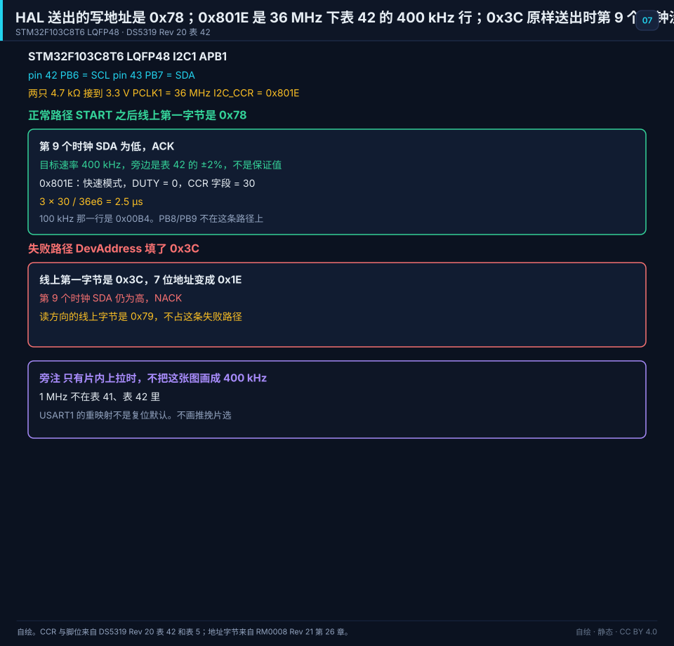
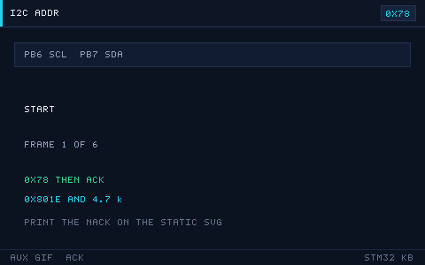

# 07 The I2C Bus
> 中文：[I2C 总线](../07-I2C总线.md)

> I2C connects several devices with two wires. It is the usual bus for sensors, EEPROM, and an OLED.

<p align="center">
  
  <br><sub>▲ Animation: a complete I2C transaction (START, address, ACK, data, STOP; vector drawing by the author)</sub>
</p>

<!-- video:ch07 -->
<p align="center">
  <video width="640" controls poster="../../assets/video/ch07-i2c.png">
    <source src="../../assets/video/ch07-i2c.mp4" type="video/mp4">
  </video>
  <br><sub>▲ Chinese voice-over, 2.5 min. Voice: Microsoft Edge neural voice zh-CN-XiaoxiaoNeural via edge-tts (library mostly LGPLv3; the voice model is an online Microsoft service, not an open model). Pictures are generated from this repo's SVGs, not photographs. Video: <a href="../../assets/video/ch07-i2c.mp4">MP4</a> · subtitles: <a href="../../assets/video/ch07-i2c.srt">SRT</a>. Rebuild with <code>python3 tools/gen_narrated.py --speak</code>.</sub>
</p>

**Narration script (Chinese, same text as the subtitles)**

1. I2C 只有时钟和数据两根线，都是开漏，所以都要上拉。没有上拉，线放不回高电平，主机会一直等，最后告诉你超时。
2. 应答是接收方把数据线拉低。高电平反而是不应答。地址不对、线没接好，你就会看到 NACK。记反的人会把好设备当成坏设备。
3. 很多芯片的寄存器要先写下寄存器地址，中间来一个重复起始，再读数据。不要先停止、再重新起始。HAL 里这条路就是存储器读。
4. 这一帧是仓库画的一次写事务。起始之后是地址，对方拉低应答，再送数据，最后停止。示波器上每一段都能对上，总线上的玄学就会少很多。
5. 七位地址和八位写地址差一位。屏幕模块常见 0x3C，放进 HAL 时往往要左移成 0x78。对不上时，先确认你手里的是哪一种写法，别把设备换掉。
6. 从机如果还死死拉着数据线，主机再发起始也没用。恢复的办法是在时钟线上补若干个脉冲，把从机的状态机推完，再发一个停止。然后才重新初始化。
7. 线上拉电阻不是随便贴一个。太弱，上升沿爬不完，高速时会错；太强，灌电流大，有的脚吃不消。短线实验可以用芯片内部上拉凑合，产品里要算一下。
8. 口诀：读寄存器走存储器读；中间是重复起始，不是停止再起始。地址先确认七位还是八位。这三句能对付大多数传感器例程。
9. 实验先在空闲总线上扫描地址。一个应答都没有，先查上拉和接线，不要先改协议。扫到了，再按手册读一个寄存器核对。
10. 合上书，三问。ACK 是高电平还是低电平？读寄存器时，写地址和读数据中间应该是停止还是重复起始？总线被拉死时先补什么？
<!-- /video:ch07 -->

## Principle and boundary

The I2C conclusion in this chapter is pinned to order code STM32F103C8T6. I2C1 is on APB1 and PCLK1 = 36 MHz, the same Appendix D cell. The working point is copied whole from DS5319 Table 42: Rp = 4.7 kΩ, a 400 kHz target, and `I2C_CCR = 0x801E`. The address is copied whole from Appendix D: 7-bit `0x3C`, and HAL writes `0x78`.

The reset-default pins are pin 42 PB6 = I2C1_SCL and pin 43 PB7 = I2C1_SDA. Both pins are alternate-function open-drain, each with 4.7 kΩ to 3.3 V. The remap onto pin 45 PB8 and pin 46 PB9 is not on the normal path. Table 5's remap column places USART1_TX / USART1_RX on PB6/PB7. That is not the reset default, the same ledger as chapter file 06. This figure draws only I2C. The two pins cannot be USART1 at the same time. Pins: [DS5319 Rev 20 Tables 5 and 42](#source-ds5319-i2c).

The bit pattern of 7-bit `0x3C` is `0111100`. The first byte on the wire for a write is `0x3C << 1`, which is `0x78`. The read byte is `0x79`. HAL's DevAddress is `0x78`, not `0x3C`. Passing the scanner's `0x3C` straight into `HAL_I2C_Master_Transmit` puts `0x3C` on the wire, and the 7-bit address becomes `0x1E`. That is the failure path. The example macro is already `0x78`. See [examples/i2c-oled](#source-project-examples). The address byte: [RM0008 Rev 21 chapter 26](#source-rm0008-i2c).

The receiver pulling SDA low is ACK. SDA staying high is NACK. A wrong address shows NACK. A high level is not "yes".

`HAL_I2C_Mem_Read` is START, address plus write, register address, repeated START, address plus read, data, STOP. `Master_Transmit` followed by `Master_Receive` inserts a STOP in the middle.

`0x801E`: the fast-mode bit is set, DUTY = 0, and the CCR field is 30. At PCLK1 = 36 MHz one SCL period is `3 × 30 / 36e6 = 2.5` µs, a 400 kHz target. The 100 kHz row is `0x00B4`, CCR field 180, standard mode, `36e6 / (2 × 180) = 100` kHz. 36 MHz is not an integer multiple of 10 MHz, so Table 41's condition for the "400 kHz ceiling" is not met. Table 42 still prints 400 kHz and `0x801E` in the 36 MHz column. Keep the ±2% tolerance from Table 42 note 2. Do not call 400 kHz a guaranteed edge. 1 MHz is not in Table 41 or Table 42. It is void on STM32F103C8T6.

The external pull-up on this Table 42 row is 4.7 kΩ. The on-chip 30–50 kΩ is Appendix D and chapter file 03. It does not replace this resistor at 400 kHz. The standard-mode rise-time limit is 1000 ns and the fast-mode limit is 300 ns. The `300ns/Cb` estimate does not enter the four blocks. The 400 pF Cb ceiling can be written here. Do not turn it into another picofarad table.

In open-drain the PMOS that would connect to VDD is off. The transistor is still there. The external pull-up is still required.

## Key figures

<p align="center">
  
  <br><sub>▲ Drawn for this book. STM32F103C8T6. Pin 42 PB6 = SCL and pin 43 PB7 = SDA, each with 4.7 kΩ to 3.3 V. PCLK1 = 36 MHz and I2C_CCR = 0x801E, a 400 kHz target with ±2% tolerance. The normal path's first byte is 0x78 and the 9th clock is ACK. The failure is DevAddress set to 0x3C, with SDA still high on the 9th clock. Sources: [DS5319 Rev 20 Tables 42 and 5](#source-ds5319-i2c) and [RM0008 Rev 21 chapter 26](#source-rm0008-i2c).</sub>
</p>

<p align="center">
  
  <br><sub>▲ Auxiliary figure for the web and the article channel. It only plays the normal path: START, 0x78 on the wire, ACK on the 9th clock, with 0x801E and 4.7 kΩ marked. Print uses the static figure. A raw 0x3C and a missing pull-up are not on this GIF.</sub>
</p>

`i2c-transaction.svg` and `i2c-timing.gif` stay in their original section and are marked as side figures.

## Timing or state

| Segment | SCL | SDA | Byte on the wire |
| --- | --- | --- | --- |
| START | High | High to low | No address byte yet |
| Normal: write address | 8 clocks | Shifted out | `0x78` |
| Normal: 9th clock | 9th clock | Low | ACK |
| Failure: write address | 8 clocks | Shifted out | `0x3C`, which addresses `0x1E` |
| Failure: 9th clock | 9th clock | High | NACK |
| Read direction | After repeated START | Address byte | `0x79`, with no STOP in between |
| Rate | `0x801E` targets 400 kHz | `0x00B4` is 100 kHz | Tolerance ±2%. CCR fields 30 and 180 |
| Pull-up | External 4.7 kΩ to 3.3 V | 36 MHz, 3.3 V | On-chip pull-ups alone do not run this 400 kHz row |

Rise time: 1000 ns in standard mode, 300 ns in fast mode. 1 MHz is void on this part and is not a working point.

## Pitfalls and source cards

| What you see | Why | What to do | Source | Claim this source may support |
| --- | --- | --- | --- | --- |
| A scanner shows `0x3C` and HAL gets no ACK | DevAddress was the 7-bit value | Write DevAddress as `0x78`. The read byte on the wire is `0x79` | [RM0008](#source-rm0008-i2c) | Shift the 7-bit address left by 1 and add the R/W bit. Sending `0x3C` unchanged addresses `0x1E` |
| The example and the manual disagree on the address form | 7-bit and 8-bit were mixed | The example macro is already `0x78` | [Examples](#source-project-examples) | `examples/i2c-oled` uses device address `0x78`, from `0x3C << 1` |
| The only pull-up is on-chip and 400 kHz times out | About 30–50 kΩ is not enough | Add the Table 42 4.7 kΩ to 3.3 V | [DS5319](#source-ds5319-i2c) | At 36 MHz and 3.3 V the 400 kHz row uses Rp = 4.7 kΩ. The on-chip kilohms stay with Appendix D and are not restated by this source |
| SCL is off from 400 kHz | CCR is not the Table 42 row | Check that `I2C_CCR` is `0x801E`, and keep ±2% | [DS5319](#source-ds5319-i2c) | Table 42 at 36 MHz prints 400 kHz as `0x801E`. 36 MHz is not an integer multiple of 10 MHz, so the achieved rate is not a guaranteed 400 kHz |
| The waveform is on PB8/PB9, or the UART takes PB6 | A remap is on, or USART1 shares the pin | The reset default is pin 42 and pin 43, with only I2C1 enabled | [DS5319](#source-ds5319-i2c) | Pin 42's default includes I2C1_SCL and pin 43's default includes I2C1_SDA. The USART1 remap is not the reset default |

## 📌 Learning goals
- [ ] Understand open-drain plus pull-up, and how to pick the pull-up resistor
- [ ] Describe START/STOP, the address, ACK/NACK, arbitration, and clock synchronization
- [ ] Compare bit-banged I2C with the hardware peripheral
- [ ] Use `HAL_I2C_Mem_Read` / `Write` and read the error codes
- [ ] Recover a locked bus, and know the timing points for SSD1306 and AT24C02

## 🧠 Core ideas

**Lead with the conclusion: I2C is a two-wire bus of "open-drain + pull-up + wired-AND". A device can only pull a line low. The high comes back through the pull-up resistor.**

### 1. Electrical behavior

| Property | Meaning |
| --- | --- |
| Pin type | Open-drain. Both SDA and SCL need pull-ups |
| Wired-AND | If any device pulls low, the line is low. It is high only when everyone releases it |
| Pull-up | 4.7 kΩ is the usual value. Faster, or more capacitance, wants a smaller one |
| Multi-master, multi-slave | Multi-master arbitration and multi-slave addressing are both supported |

Pull-up versus bus capacitance Cb:

| Speed mode | Max rate | Typical pull-up | Notes |
| --- | --- | --- | --- |
| Standard mode | 100 kHz | 4.7 kΩ to 10 kΩ | A long wire or a large capacitance wants a smaller resistor |
| Fast mode | 400 kHz | 2.2 kΩ to 4.7 kΩ | The usual sensors |
| Fast+ | 1 MHz | — | Void on STM32F103C8T6. Not a working point in the four blocks |

> An estimate, not the DS5319 standard-mode limit: `Rp(max) ≈ 300ns / Cb`. More capacitance means a smaller pull-up. The standard-mode rise-time limit is 1000 ns and the fast-mode limit is 300 ns. Those two sentences are in the four blocks.

### 2. Timing and the protocol

| Signal | Condition | Meaning |
| --- | --- | --- |
| START | While SCL is high, SDA falls | Start of a transfer |
| STOP | While SCL is high, SDA rises | End of a transfer |
| Data bit | SDA is stable while SCL is high | One clock per bit |
| ACK | On the 9th clock, the slave pulls SDA low | Acknowledge |
| NACK | On the 9th clock, SDA stays high | Not acknowledged, or the end of a read |

Address: 7 address bits + 1 R/W bit (0 = write, 1 = read), 8 bits in all. A 10-bit address uses two bytes.

<p align="center">
  
  <br><sub>▲ Animation: I2C timing in detail (program-generated GIF)</sub>
</p>

### 3. Clock synchronization and arbitration

| Mechanism | Meaning |
| --- | --- |
| Clock synchronization | SCL is wired-AND. The device that holds low the longest decides how long the low lasts |
| Arbitration | If several masters transmit at once, the one whose own bit does not match the SDA level drops out |
| Clock stretching | A slave holds SCL low to stretch the clock, and the master has to wait (this is an easy way to get HAL_BUSY) |

### 4. Bit-banged versus hardware I2C

| Dimension | Bit-banged (GPIO toggles) | Hardware I2C |
| --- | --- | --- |
| Pins | Any GPIO | Fixed alternate-function pins |
| Flexibility | High (several buses) | Low |
| CPU use | High | Low (the hardware makes the timing) |
| How solid it is | High (you control it) | On F1 it deadlocks easily |
| Speed | Lower | Fast mode targets 400 kHz. 1 MHz is void on STM32F103C8T6 |

## 🛠️ Hardware and wiring

| Board | Peripheral | Pin | Notes |
| --- | --- | --- | --- |
| BluePill | SSD1306 OLED | PB6=SCL, PB7=SDA | 4.7 kΩ pull-ups, address 0x3C |
| BluePill | AT24C02 EEPROM | Same pins | Address 0x50 |
| BluePill | MPU6050 | Same pins | Address 0x68 |

## 💻 Code

```c
/* i2c_oled.c —— hardware I2C1 reads and writes an SSD1306 (HAL) */
#include "stm32f1xx_hal.h"

I2C_HandleTypeDef hi2c1;

#define OLED_ADDR   (0x3C << 1)     /* HAL wants the 8-bit address: shift the 7-bit address left by 1 */
#define OLED_CMD    0x00
#define OLED_DATA   0x40

void SystemClock_Config(void);

static void i2c_init(void)
{
    __HAL_RCC_I2C1_CLK_ENABLE();
    __HAL_RCC_GPIOB_CLK_ENABLE();

    /* PB6/PB7 alternate open-drain; external pull-ups are required */
    GPIO_InitTypeDef io = {0};
    io.Pin   = GPIO_PIN_6 | GPIO_PIN_7;
    io.Mode  = GPIO_MODE_AF_OD;
    io.Speed = GPIO_SPEED_FREQ_HIGH;
    HAL_GPIO_Init(GPIOB, &io);

    hi2c1.Instance             = I2C1;
    hi2c1.Init.ClockSpeed      = 400000;
    hi2c1.Init.DutyCycle       = I2C_DUTYCYCLE_2;
    hi2c1.Init.OwnAddress1     = 0;
    hi2c1.Init.AddressingMode  = I2C_ADDRESSINGMODE_7BIT;
    hi2c1.Init.DualAddressMode = I2C_DUALADDRESS_DISABLE;
    hi2c1.Init.GeneralCallMode = I2C_GENERALCALL_DISABLE;
    hi2c1.Init.NoStretchMode   = I2C_NOSTRETCH_DISABLE;
    HAL_I2C_Init(&hi2c1);
}

/* write a command or data to the OLED */
static HAL_StatusTypeDef oled_write(uint8_t ctrl, uint8_t *buf, uint16_t len)
{
    uint8_t tmp[129];
    tmp[0] = ctrl;                       /* 0x00 command / 0x40 data */
    for (uint16_t i = 0; i < len; i++) tmp[i + 1] = buf[i];
    return HAL_I2C_Master_Transmit(&hi2c1, OLED_ADDR, tmp, len + 1, 100);
}

int main(void)
{
    HAL_Init();
    SystemClock_Config();
    i2c_init();

    /* probe whether the device is present */
    if (HAL_I2C_IsDeviceReady(&hi2c1, OLED_ADDR, 3, 100) == HAL_OK)
    {
        uint8_t init_cmd[] = {0xAE, 0x20, 0x00, 0xAF};   /* display off → addressing mode → display on */
        oled_write(OLED_CMD, init_cmd, sizeof(init_cmd));
    }

    while (1) { }
}
```

Read an EEPROM (AT24C02) with the Mem API:

```c
/* write one byte to AT24C02 address 0x00 */
uint8_t val = 0x5A;
HAL_I2C_Mem_Write(&hi2c1, 0x50 << 1, 0x00, I2C_MEMADD_SIZE_8BIT, &val, 1, 100);
HAL_Delay(5);   /* the EEPROM needs a write cycle */

/* read it back */
uint8_t rd = 0;
HAL_I2C_Mem_Read(&hi2c1, 0x50 << 1, 0x00, I2C_MEMADD_SIZE_8BIT, &rd, 1, 100);
```

Recover a stuck bus (when a slave is holding SDA, clock it nine times by hand):

```c
/* set SCL to open-drain GPIO, toggle it 9 times to release a stuck slave, then send STOP */
static void i2c_bus_recover(void)
{
    for (int i = 0; i < 9; i++)
    {
        HAL_GPIO_WritePin(GPIOB, GPIO_PIN_6, GPIO_PIN_RESET);   /* SCL low */
        HAL_Delay(1);
        HAL_GPIO_WritePin(GPIOB, GPIO_PIN_6, GPIO_PIN_SET);     /* SCL high */
        HAL_Delay(1);
    }
    /* then call HAL_I2C_Init again to reset the peripheral */
}
```

The full project is in [`examples/i2c-oled/`](../../examples/i2c-oled/).

## 🧪 Hands-on labs

1. **Lab 1:** Scan the bus with `HAL_I2C_IsDeviceReady` and confirm the OLED and EEPROM addresses.
2. **Lab 2:** Write a string of bytes to the AT24C02 and read them back. Confirm they survive a power cycle.
3. **Lab 3:** Show a string on the SSD1306 (use `i2c-transaction.svg` to see what each transfer is).

### 5. I2C registers that matter (F1)

| Register | Role |
| --- | --- |
| CR1 | Enable, ACK, clock |
| CR2 | Frequency, interrupts, DMA |
| OAR1/OAR2 | Own address |
| DR | Data |
| SR1/SR2 | Status (SB / ADDR / RXNE / TXE / AF) |
| CCR | Clock control (the rate) |
| TRISE | Rise time |

### 6. The core of a bit-banged I2C

```c
/* bit-bang I2C with open-drain GPIO (SDA=PB7, SCL=PB6) */
#define SCL_H() HAL_GPIO_WritePin(GPIOB, GPIO_PIN_6, GPIO_PIN_SET)
#define SCL_L() HAL_GPIO_WritePin(GPIOB, GPIO_PIN_6, GPIO_PIN_RESET)
#define SDA_H() HAL_GPIO_WritePin(GPIOB, GPIO_PIN_7, GPIO_PIN_SET)
#define SDA_L() HAL_GPIO_WritePin(GPIOB, GPIO_PIN_7, GPIO_PIN_RESET)

static void i2c_start(void)
{
    SDA_H(); SCL_H(); i2c_delay();
    SDA_L(); i2c_delay();          /* SDA falling while SCL is high = START */
    SCL_L(); i2c_delay();
}
```

### 7. What MPU6050 init has to do

| Step | Register | Value |
| --- | --- | --- |
| Wake | PWR_MGMT_1 (0x6B) | 0x00 |
| Sample rate | SMPLRT_DIV (0x19) | Whatever you need |
| Gyro range | GYRO_CONFIG (0x1B) | ±2000 °/s = 0x18 |
| Accel range | ACCEL_CONFIG (0x1C) | ±2 g = 0x00 |

> The MPU6050 powers up asleep. Write PWR_MGMT_1 to wake it first, or every read comes back 0.

### 8. Common I2C addresses

| Device | 7-bit address | HAL 8-bit address |
| --- | --- | --- |
| SSD1306 | 0x3C | 0x78 |
| AT24C02 | 0x50 | 0xA0 |
| MPU6050 | 0x68 | 0xD0 |
| PCF8574 | 0x20–0x27 | 0x40–0x4E |

### 9. Bus capacitance and pull-up

| Bus capacitance Cb | Suggested pull-up |
| --- | --- |
| < 100 pF | 10 kΩ |
| 100–200 pF | 4.7 kΩ |
| 200–400 pF | 2.2 kΩ |

### 10. Repeated start (Sr)

**Conclusion:** when you read a register-style device, the start bit in the middle is a repeated start. It does not send STOP first. `HAL_I2C_Mem_Read` already does it for you: START, device address + write, register address, Sr, device address + read, data, STOP.

If you call `Master_Transmit` and then `Master_Receive` yourself, a STOP lands in between. Many EEPROMs and sensors drop the address, and what you read back is some other register.

The 7-bit address `0x3C` is written in HAL as `0x3C << 1`, which is `0x78`. The bit pattern of `0x3C` is `0111100`. It is not "take `0x3C` as 8 bits and drop the top bit".

Motto: **to read a register, use Mem_Read. The middle is Sr, not STOP and then START.**

Self-test:

1. The OLED address is 0x3C. Does HAL's DevAddress get 0x3C or 0x78?
2. Where do a repeated start and an ordinary START differ — which edge, on which wire?
3. Why does I2C send 0xA5 MSB first, while UART sends LSB first?

## 🔗 Related resources

- Official manuals: **RM0008** chapter 26 (I2C); the SSD1306, AT24C02, and MPU6050 datasheets
- Previous: [06 UART](06-uart.md) | Next: [08 The SPI Bus](08-spi.md)
- Figures: [`assets/animations/i2c-transaction.svg`](../../assets/animations/i2c-transaction.svg), [`assets/gif/i2c-timing.gif`](../../assets/gif/i2c-timing.gif)
- Disclaimer: every illustration in this repo is a vector drawing or a program-generated animation by the author, not a manufacturer's photograph.
