# 08 The SPI Bus
> 中文：[SPI 总线](../08-SPI总线.md)

> A W25Q64 JEDEC-ID read should show `0x9F` leaving on MOSI while `0xEF 0x40 0x17` returns on MISO. The wire bytes, SPI_SR, and receive array must agree.

<p align="center">
  
  <br><sub>▲ Animation: SPI full-duplex shifting, and the timing of the four CPOL/CPHA modes (vector drawing by the author)</sub>
</p>

<!-- video:ch08 -->
<p align="center">
  <video width="640" controls poster="../../assets/video/ch08-spi.png">
    <source src="../../assets/video/ch08-spi.mp4" type="video/mp4">
  </video>
  <br><sub>▲ Chapter video with Chinese voice-over (2.6 min). <a href="../../assets/video/ch08-spi.mp4">MP4</a> · <a href="../../assets/video/ch08-spi.srt">subtitles</a></sub>
</p>

<details>
<summary>Narration script (Chinese, same text as the subtitles)</summary>

1. SPI 通常是时钟、主机输出、主机输入、片选。名字要按方向记：主机出去的那根不能和进来的那根对调。对调之后，两边都在听，谁也不说话。
2. 模式由时钟空闲电平和在哪个沿采样决定。模式 0 是空闲为低，第一个有效沿就采样。主机和从机模式不一致时，数据会整字节错位，看起来像随机数。
3. 片选是一次事务的括号。拉低表示开始，拉高表示结束。有的从机只在片选上升沿才把数据收下。一直压着片选，下一包会粘在上一包后面。
4. 这一帧是仓库画的移位过程。时钟每走一拍，主机和从机同时移出一位。所以 SPI 没有应答位。你发出去的同时，也会收到一位，哪怕你并不关心它。
5. 全双工意味着你发送的时候，接收缓冲也在进数。只写不读，下一次读到的可能是上一包的剩菜。HAL 里能用收发一起的接口，把两边一次做完。
6. 时钟多快，从机手册说了才算。杜邦线很长时，沿会变钝，实验能过、产品会偶发。先把分频放到从机舒服的范围，再谈把速率拧高。
7. 多个从机可以共享时钟和两根数据线，但片选要各走各的。选中谁，谁才应该回应。两根片选同时为低，两个从机一起说话，线上就是冲突。
8. 接线前数四根：SCK 管节拍，主机输出和主机输入各归各，不能接反；片选包住一次事务。模式 0 的空闲时钟是低，先背下来再插线。
9. 实验找一个带只读寄存器的器件，用正确的模式读回来。数值和手册复位值一致，这章才算过。读出全是 FF 或 00，先查模式和进出线。
10. 读回来的数会说话：全是 FF 多半线没通，全是 00 先看时钟极性。两个都解释不了，就回手册对照复位值，再查一遍线。

</details>
<!-- /video:ch08 -->
## Principle and scope

Every number in this chapter is for the STM32F103C8T6. SPI1 sits on APB2 at 72 MHz. The working point matches Appendix D: Mode 0, `BR=010`, SCK = 9 MHz. If you use the remap, read PB3/PB4/PB5 wherever this chapter says PA5/PA6/PA7.

After reset, SPI1 is on LQFP48 pins 14 to 17: pin 14 PA4 = SPI1_NSS, pin 15 PA5 = SPI1_SCK, pin 16 PA6 = SPI1_MISO, pin 17 PA7 = SPI1_MOSI. Chip select does not use hardware NSS. PA4 is a push-pull output that software drives low and high, unlike the open-drain lines in the I2C chapter. Pin 16 is also the TIM3_CH1 output from chapter 05, and only one of the two functions can be in use at a time. Source: [DS5319 Rev 20 Table 5](#source-ds5319-spi).

Mode 0 is CPOL = 0 and CPHA = 0: SCK idles low and data is sampled on the first (rising) edge. The matching HAL settings are `SPI_POLARITY_LOW`, `SPI_PHASE_1EDGE`, `SPI_NSS_SOFT`, `SPI_FIRSTBIT_MSB`, and `SPI_BAUDRATEPRESCALER_8`.

`BR[2:0]` offers eight dividers, ÷2 through ÷256, and no ÷3. `010` is ÷8, so `72 / 8 = 9` MHz. `001` is ÷4, 18 MHz. `000` is ÷2, 36 MHz, which is too fast for a W25Q64 on jumper wires; the bytes come back garbled. Source: [RM0008 Rev 21 section 25.5.1](#source-rm0008-spi).

To read the ID, the master sends `{0x9F, 0xFF, 0xFF, 0xFF}`. SPI is full duplex, so during the eight clocks that send `0x9F` a byte also shifts in on MISO. That byte, `rx[0]`, means nothing and is not the manufacturer id. The ID is the next three bytes: `rx[1]=0xEF` (Winbond), `rx[2]=0x40` (memory type, not capacity), `rx[3]=0x17` (capacity, 64 Mbit). Put together, `rx[1] << 16 | rx[2] << 8 | rx[3]` = `0xEF4017`. A W25Q64 page is 256 bytes. The [example](#source-project-examples) waits on bit 0 of the status register as the busy flag.

When the three bytes do not match `0xEF 0x40 0x17`, the usual cause is MOSI and MISO swapped. Other causes: chip select never goes high, so the next command runs on from the last one; a Transmit that never reads MISO leaves an old byte in the receive register for the next read; CPHA set to the second edge shifts every byte by one bit.

<p align="center">
  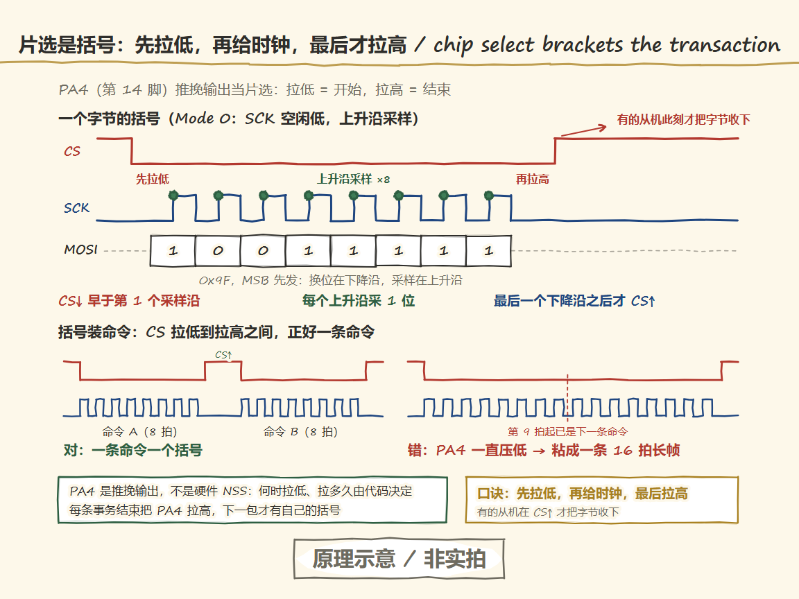
  <br><sub>▲ Knowledge track (Handraw · 原理示意 / not a photo). PA4 (pin 14) is a push-pull chip select: low starts the transaction, high ends it; CS falls before the first sampling edge and rises after the last falling edge. Some devices latch the byte only on the chip-select rising edge; with PA4 held low, the next command runs on from the last one. In Mode 0 SCK idles low and samples on the rising edge. Source: [RM0008 Rev 21 ch.25](#source-rm0008-spi) and [DS5319 Rev 20 Table 5](#source-ds5319-spi).</sub>
</p>

## Key figures


<p align="center">
  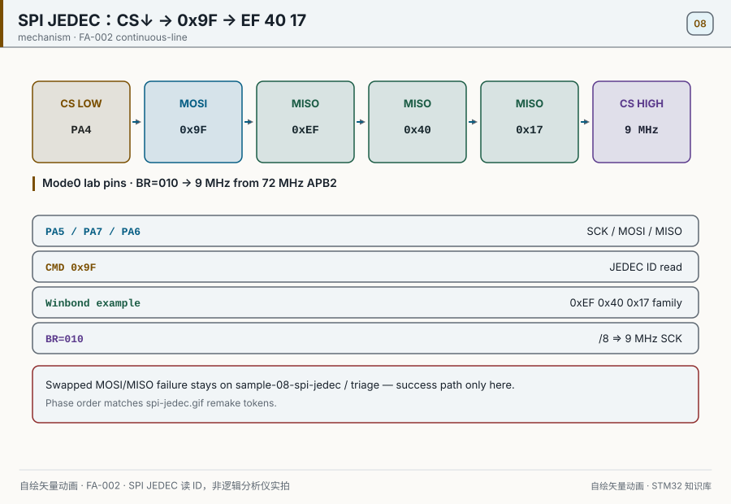
  <br><sub>▲ Hand-drawn CSS animation (FA-002). CS↓ 0x9F → EF 40 17 @ 9 MHz.</sub>
</p>


<p align="center">
  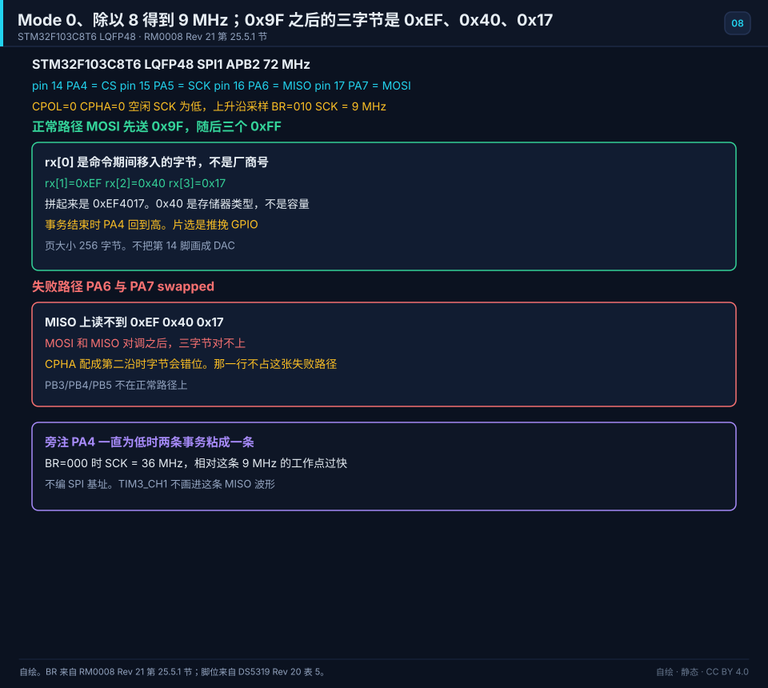
  <br><sub>▲ Drawn for this book. STM32F103C8T6, LQFP48. Pin 14 PA4 = CS (push-pull, low during the transaction), pin 15 PA5 = SCK, pin 16 PA6 = MISO, pin 17 PA7 = MOSI. CPOL = 0, CPHA = 0, BR=010, SCK = 9 MHz. On the normal path MOSI sends 0x9F and then three 0xFF bytes; rx[1] through rx[3] are 0xEF, 0x40, and 0x17. The lower half shows the wrong bytes you get with PA6 and PA7 swapped. The right side marks two more cases: PA4 held low glues two commands into one, and BR=000 makes SCK = 36 MHz. Sources: [RM0008 Rev 21 section 25.5.1](#source-rm0008-spi) and [DS5319 Rev 20 Table 5](#source-ds5319-spi).</sub>
</p>

<p align="center">
  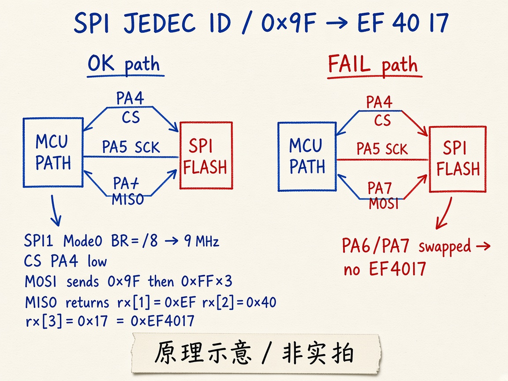
  <br><sub>▲ Knowledge track (Handraw · 原理示意 / not a photo). 0x9F → EF4017; swapped MISO/MOSI fails; not a scope capture.</sub>
</p>

<p align="center">
  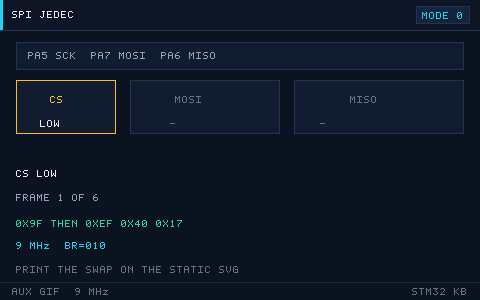
  <br><sub>▲ Animated version. It shows only a normal ID read, with SCK at 9 MHz. The printed book has only the static figure above.</sub>
</p>

## Timing and state

| Row | Byte | MOSI | MISO | CS | SCK |
| --- | --- | --- | --- | --- | --- |
| Normal | 1 | 0x9F | rx[0], not the manufacturer id | low | sample on the rising edge |
| Normal | 2 | 0xFF | 0xEF | low | sample on the rising edge |
| Normal | 3 | 0xFF | 0x40 | low | sample on the rising edge |
| Normal | 4 | 0xFF | 0x17 | low | sample on the rising edge |
| End | — | — | — | returns high | idle low |
| Mode | — | — | — | — | CPOL = 0, CPHA = 0 |
| Rate | — | — | — | — | BR=010 is 9 MHz, BR=001 is 18 MHz, BR=000 is 36 MHz |
| Failure | 2 through 4 | — | not 0xEF 0x40 0x17 | low | PA6 and PA7 swapped |

The page is 256 bytes. Sources: [RM0008](#source-rm0008-spi) and the [example](#source-project-examples).

## Pitfalls and sources

| What you see | Why | What to do | Source | What the source shows |
| --- | --- | --- | --- | --- |
| The ID that comes back is not 0xEF4017 | PA7 is not MOSI, or PA6 is not MISO, or the mode is not 0 | Keep Mode 0, and check that PA7 is MOSI and PA6 is MISO | [DS5319](#source-ds5319-spi) | LQFP48 pin 16 is MISO and pin 17 is MOSI. The three bytes themselves are the next row |
| rx[0] was treated as the manufacturer id | The eight SCK edges of the command also shift rx[0] in | The manufacturer id is rx[1], the type is rx[2], and the capacity is rx[3] | [example](#source-project-examples) | The command is 0x9F. The three bytes are 0xEF, 0x40, and 0x17. 0x40 is not the capacity. The page is 256 bytes |
| SCK runs at 36 MHz | BR was written as 000 | Use BR 010, which is 9 MHz | [RM0008](#source-rm0008-spi) | Among the eight dividers, 010 is ÷8. 000 is ÷2 = 36 MHz. There is no ÷3 |
| Two commands are glued together | PA4 stayed low | Drive PA4 high at the end of each transaction | [DS5319](#source-ds5319-spi) | Pin 14 is SPI1_NSS. This chapter uses it as a push-pull chip select. On the C8 it is not a DAC output |
| The ID shows up on PB3/PB4/PB5 | A remap was treated as the reset default | The reset-default pins are PA5/PA6/PA7 | [DS5319](#source-ds5319-spi) | Pin 15 is SCK, pin 16 is MISO, and pin 17 is MOSI |
| Bit 0 of the status byte is treated as a protocol busy flag | That is what the example does | Wait on that bit only as the example does | [example](#source-project-examples) | The example treats bit 0 of the status byte as busy |

## Learning goals
- [ ] Understand the four SPI wires and full-duplex shifting
- [ ] Know the four CPOL/CPHA modes, and which mode common parts use
- [ ] Compute the SPI rate and the clock divider (the BR field)
- [ ] Compare bit-banged SPI with the hardware peripheral, and know DMA can refresh a display
- [ ] Read a W25Q64 ID, read and write a page, and initialize an ST7789

## Core ideas

Every SCK edge moves one bit on both MOSI and MISO. A master that wants to read must still transmit dummy bytes; checking the transmit array alone does not prove what the slave returned.

### 1. Four wires, and how the shift works

SPI is like two people swapping cards across a table. Master and slave each hold 8 cards. Every time the master taps the table (one SCK clock), both push their outermost card to the other side. After 8 taps, every card has changed hands. So SPI has no "read only": to read a byte from the slave, the master must push a byte across too, usually 0xFF as filler. Pulling CS low tells one slave "this round is with you".

| Wire | Full name | Direction | Meaning |
| --- | --- | --- | --- |
| SCK | Serial Clock | Master → slave | Clock |
| MOSI | Master Out Slave In | Master → slave | The master sends |
| MISO | Master In Slave Out | Slave → master | The slave sends |
| NSS/CS | Slave Select | Master → slave | Chip select, active low |

<p align="center">
  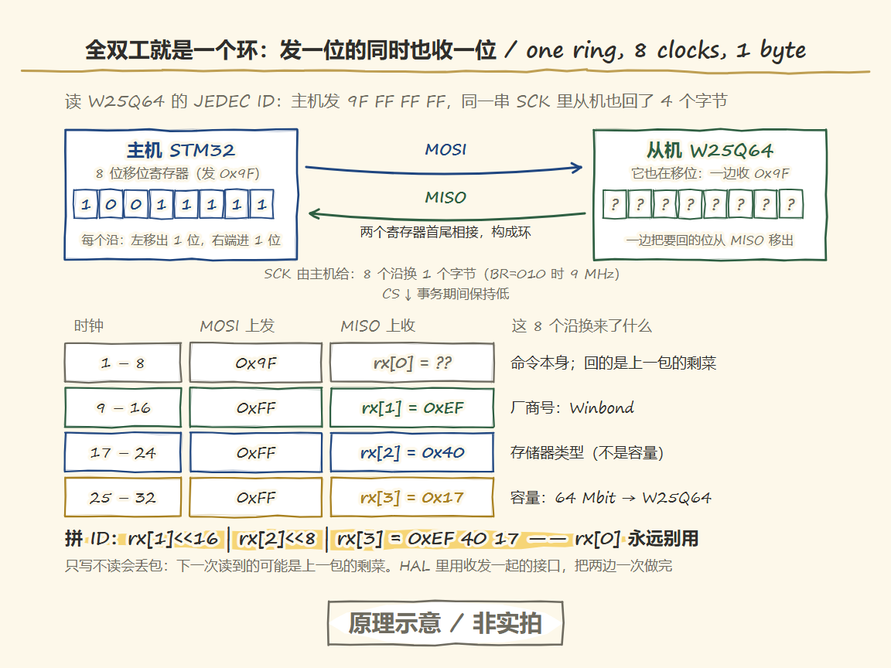
  <br><sub>▲ Knowledge track (Handraw · 原理示意 / not a photo). Where to look: the top half shows the master and slave shift registers joined through MOSI/MISO into one ring, each SCK edge shifting one bit out and one bit in on both sides; the bottom half is the four-row JEDEC ledger — 9F FF FF FF sent, ?? EF 40 17 received. What it proves: 8 clocks exchange one byte in both directions at once; rx[0] is the tail of the previous transaction, so the id is assembled from rx[1] on. What it does not prove: this is the logic at BR=010 (9 MHz), not setup/hold margins, CS setup delay or real waveforms, and it is not a logic-analyzer capture. Source: [RM0008 Rev 21 §25.5.1](#source-rm0008-spi).</sub>
</p>

How the shift works: master and slave each have an 8-bit shift register, and the two form a ring. On each clock edge both sides shift one bit out and one bit in. After 8 clocks, one byte has been exchanged.

### 2. The four CPOL/CPHA modes


<p align="center">
  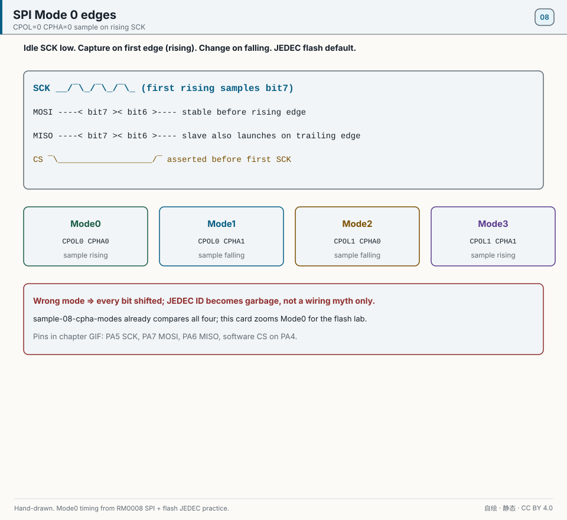
  <br><sub>▲ Drawn for this book. CPOL0 CPHA0: sample on first rising edge; common JEDEC flash default.</sub>
</p>


The four modes settle two questions. CPOL says where the hand rests between taps, which is whether the idle clock is low or high. CPHA says whether you read the cards as the hand comes down or as it comes up, which is whether sampling happens on the 1st or the 2nd edge. If the two sides disagree, every bit is half a tap off, and what comes back is all 0, all FF, or shifted.

| Mode | CPOL | CPHA | Idle clock | Sample edge | Common parts |
| --- | --- | --- | --- | --- | --- |
| Mode 0 | 0 | 0 | Low | 1st edge (rising) | W25Q64, ST7789, most parts |
| Mode 1 | 0 | 1 | Low | 2nd edge (falling) | Some sensors |
| Mode 2 | 1 | 0 | High | 1st edge (falling) | Uncommon |
| Mode 3 | 1 | 1 | High | 2nd edge (rising) | W25Q64 (also supported) |

> This W25Q64 example uses Mode 0. Other devices require the CPOL/CPHA pair in their datasheet. If an ID is all 0s or all FFs, check mode, chip select, and MISO wiring together.

The four modes are not four protocols; they are the two CR1 bits CPOL and CPHA. Count edges correctly and the mode picks itself.

<p align="center">
  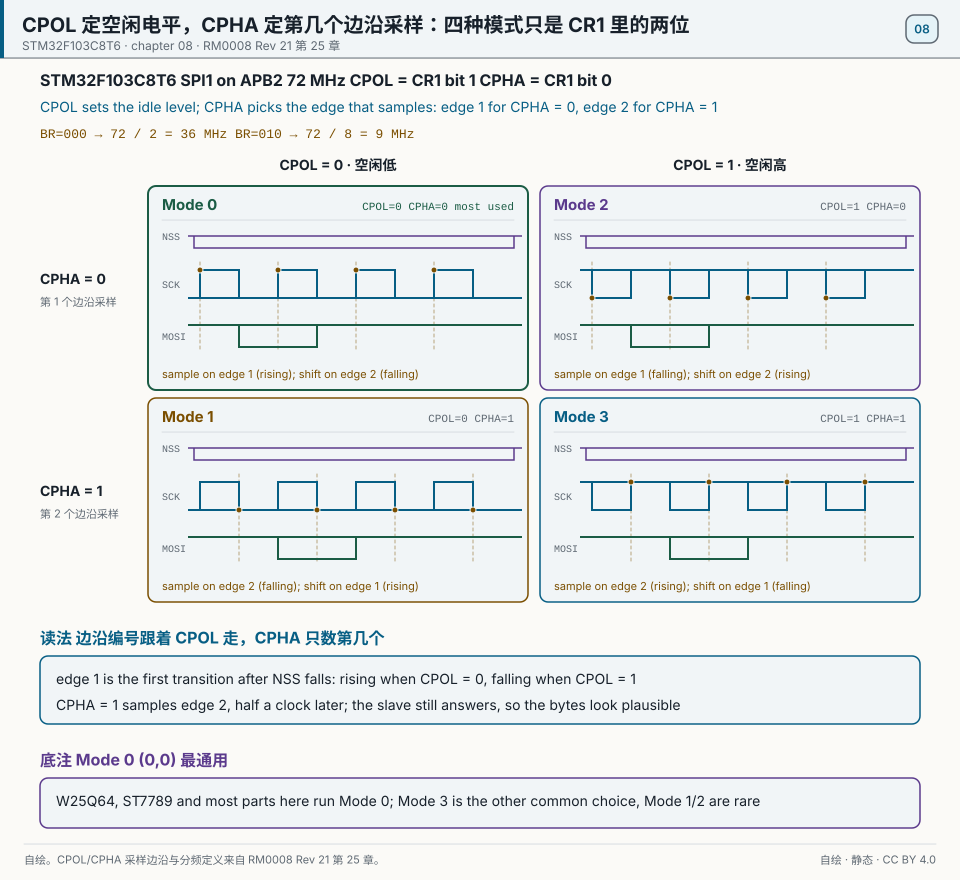
  <br><sub>▲ Drawn for this book. Column heads are CPOL (0 = idle low, 1 = idle high); row heads are CPHA (0 = sample on edge 1, 1 = sample on edge 2). Each cell carries NSS/SCK/MOSI mini traces with dots on the sampling edges. Edge numbering follows CPOL: the first transition after NSS falls is rising when CPOL = 0 and falling when CPOL = 1. CPHA = 1 samples on edge 2, half a clock later — the slave still answers, so the bytes look plausible, which is exactly why a wrong mode is hard to spot. Mode 0 (0,0) is the default: W25Q64 and ST7789 run it; Mode 3 is the other common choice; Modes 1 and 2 are rare. The header lists two SPI1 rates at APB2 72 MHz: BR=000 → 36 MHz, BR=010 → 9 MHz. Sampling-edge and divider definitions: [RM0008 Rev 21 chapter 25](#source-rm0008-spi).</sub>
</p>

<p align="center">
  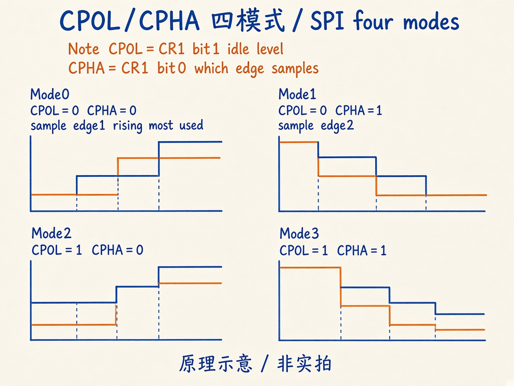
  <br><sub>▲ Knowledge track (Handraw · 原理示意 / not a photo). CPOL = idle level; CPHA = sample edge; Mode0 most used; not a photo.</sub>
</p>

### 3. Rate and the divider


<p align="center">
  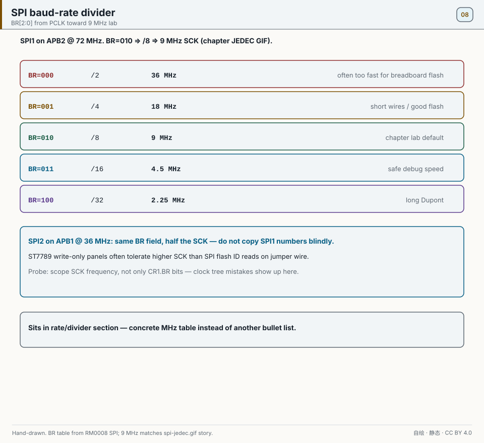
  <br><sub>▲ Drawn for this book. SPI1@72 MHz, BR=010 → 9 MHz, matches the JEDEC GIF.</sub>
</p>

<p align="center">
  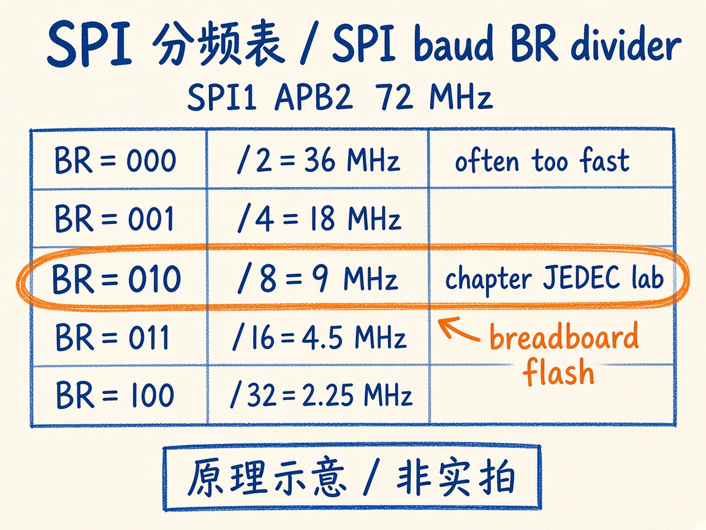
  <br><sub>▲ Knowledge track (Handraw · 原理示意 / not a photo). SPI1@72 MHz, BR=010 → 9 MHz lab; keep breadboard slower; not a photo.</sub>
</p>


The master supplies the SPI clock, so the speed is the master's bus clock divided by a power of 2. The divider has only eight steps, from 2 to 256, so 10 MHz is not available: you choose between 9 MHz and 18 MHz. The real speed limit is usually the wiring rather than the chip. On jumper wires above 18 MHz, the square wave has already rounded off into something like a sine.

- SPI clock = fPCLK / divider (BR field: 2/4/8/16/32/64/128/256).
- Example: APB2 = 72 MHz, divider 8 → 9 MHz.

| BR[2:0] | Divider | SCK at 72 MHz |
| --- | --- | --- |
| 000 | 2 | 36 MHz |
| 001 | 4 | 18 MHz |
| 010 | 8 | 9 MHz |
| 011 | 16 | 4.5 MHz |
| 100 | 32 | 2.25 MHz |
| 101 | 64 | 1.125 MHz |
| 110 | 128 | 0.5625 MHz |
| 111 | 256 | 0.28125 MHz |

### 4. NSS, and more than one slave


<p align="center">
  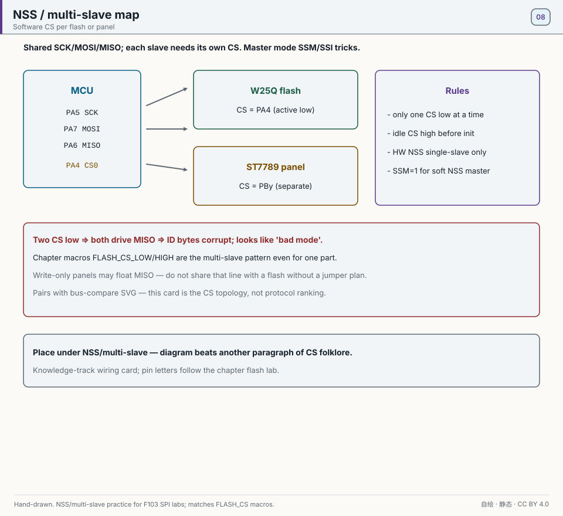
  <br><sub>▲ Drawn for this book. Shared SCK/MOSI/MISO; two CS low fights the bus.</sub>
</p>

<p align="center">
  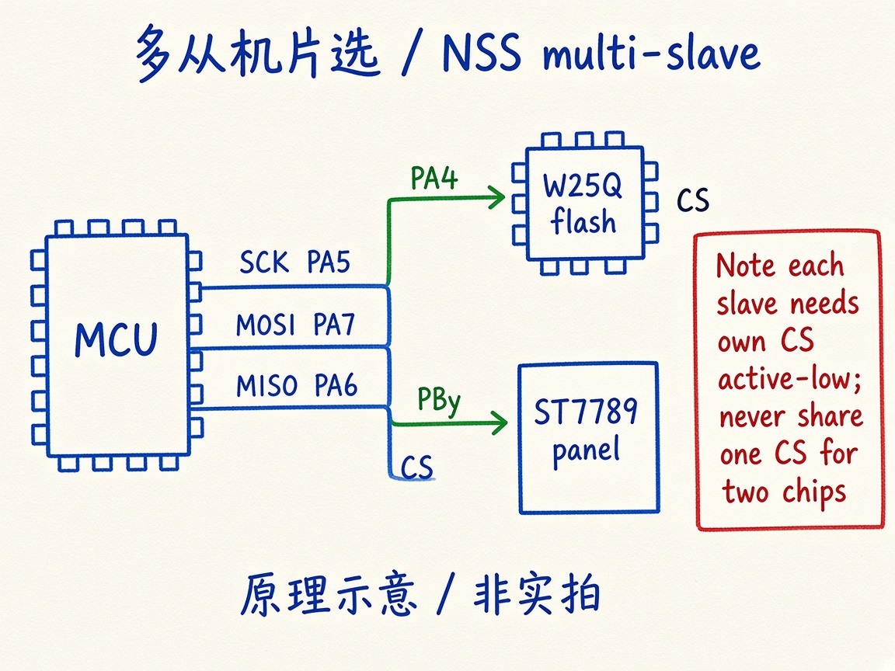
  <br><sub>▲ Knowledge track (Handraw · 原理示意 / not a photo). Shared SCK/MOSI/MISO; one CS per slave; never share CS; not a photo.</sub>
</p>


Several slaves share SCK, MOSI and MISO, and each has its own CS. The master pulls low the CS of the one it wants to talk to. The others see their CS high and let go of MISO. The easiest approach is to drive CS as an ordinary GPIO yourself, so you can see exactly when it goes low and for how long.

| Method | Meaning |
| --- | --- |
| Software NSS | An ordinary GPIO drives chip select. The most flexible choice (recommended) |
| Hardware NSS | The hardware manages it. Used with multiple masters |
| Several slaves | Each slave has its own CS. They share SCK, MOSI, and MISO |

<p align="center">
  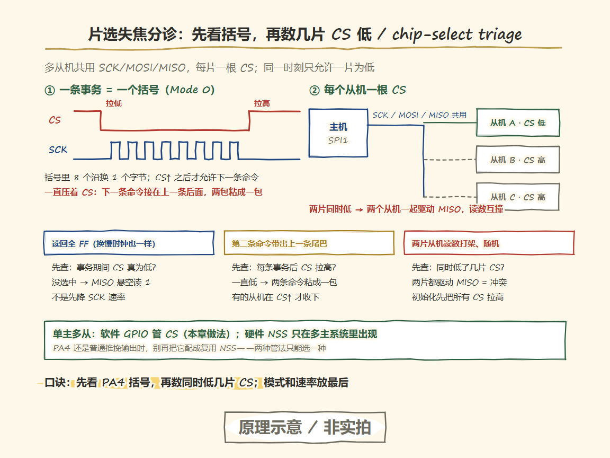
  <br><sub>▲ Knowledge track (Handraw · 原理示意 / not a photo). Look at: the top-left CS bracket around eight SCK edges, the top-right CS topology with three slaves (only A is low), and the three triage cards below, each ordered by what to check first. What it proves: on an all-FF read, first confirm CS is actually asserted during the transaction (an unselected MISO floats to 1, so do not lower SCK first); when two commands merge, check that CS went high; two CS low at once make two slaves drive MISO together. What it does not prove: this is logic, not a logic-analyzer capture, and it excludes CS setup/hold time, daisy chains, and address decoding. Sources: [RM0008 Rev 21 ch.25](#source-rm0008-spi) and [DS5319 Rev 20 Table 5](#source-ds5319-spi).</sub>
</p>

### 5. Bit-banged versus hardware SPI

| Dimension | Bit-banged | Hardware SPI |
| --- | --- | --- |
| Speed | Low (tens of kHz up to a few MHz) | High (tens of MHz) |
| CPU use | High | Low |
| Flexibility | High | Low (fixed pins) |
| DMA | None | Supported (fast for a display refresh or a Flash read) |

## Hardware and wiring

| Board | Peripheral | Pin | Notes |
| --- | --- | --- | --- |
| BluePill | W25Q64 | PA5=SCK, PA6=MISO, PA7=MOSI, PA4=CS | Mode 0 or 3 |
| BluePill | ST7789/ILI9341 | PA5=SCK, PA7=MOSI, PA4=CS, PA3=DC, PA2=RST | Write only; MISO is unused |

## Code

```c
/* spi_flash.c —— hardware SPI1 reads the W25Q64 JEDEC ID (HAL) */
#include "stm32f1xx_hal.h"

SPI_HandleTypeDef hspi1;

#define FLASH_CS_LOW()   HAL_GPIO_WritePin(GPIOA, GPIO_PIN_4, GPIO_PIN_RESET)
#define FLASH_CS_HIGH()  HAL_GPIO_WritePin(GPIOA, GPIO_PIN_4, GPIO_PIN_SET)

#define CMD_JEDEC_ID     0x9F
#define CMD_READ_STATUS1 0x05
#define CMD_WRITE_ENABLE 0x06
#define CMD_PAGE_PROGRAM 0x02
#define CMD_READ_DATA    0x03

void SystemClock_Config(void);

static void spi_init(void)
{
    __HAL_RCC_SPI1_CLK_ENABLE();
    __HAL_RCC_GPIOA_CLK_ENABLE();

    /* PA5/PA7 alternate push-pull, PA6 input, PA4 ordinary output as CS */
    GPIO_InitTypeDef io = {0};
    io.Pin = GPIO_PIN_5 | GPIO_PIN_7; io.Mode = GPIO_MODE_AF_PP;
    io.Speed = GPIO_SPEED_FREQ_HIGH; HAL_GPIO_Init(GPIOA, &io);
    io.Pin = GPIO_PIN_6; io.Mode = GPIO_MODE_INPUT; io.Pull = GPIO_NOPULL;
    HAL_GPIO_Init(GPIOA, &io);
    io.Pin = GPIO_PIN_4; io.Mode = GPIO_MODE_OUTPUT_PP; io.Pull = GPIO_NOPULL;
    HAL_GPIO_Init(GPIOA, &io);
    FLASH_CS_HIGH();

    hspi1.Instance               = SPI1;
    hspi1.Init.Mode              = SPI_MODE_MASTER;
    hspi1.Init.Direction         = SPI_DIRECTION_2LINES;
    hspi1.Init.DataSize          = SPI_DATASIZE_8BIT;
    hspi1.Init.CLKPolarity       = SPI_POLARITY_LOW;   /* CPOL=0 */
    hspi1.Init.CLKPhase          = SPI_PHASE_1EDGE;    /* CPHA=0 → Mode 0 */
    hspi1.Init.NSS               = SPI_NSS_SOFT;
    hspi1.Init.BaudRatePrescaler = SPI_BAUDRATEPRESCALER_8;   /* 9MHz */
    hspi1.Init.FirstBit          = SPI_FIRSTBIT_MSB;
    HAL_SPI_Init(&hspi1);
}

/* read the W25Q64 JEDEC ID: expect 0xEF4017 */
static uint32_t w25q_read_id(void)
{
    uint8_t tx[4] = {CMD_JEDEC_ID, 0xFF, 0xFF, 0xFF};
    uint8_t rx[4] = {0};

    FLASH_CS_LOW();
    HAL_SPI_TransmitReceive(&hspi1, tx, rx, 4, 100);
    FLASH_CS_HIGH();

    return ((uint32_t)rx[1] << 16) | ((uint32_t)rx[2] << 8) | rx[3];
}

int main(void)
{
    HAL_Init();
    SystemClock_Config();
    spi_init();

    uint32_t id = w25q_read_id();   /* expect 0xEF4017 (Winbond 25Q64) */

    while (1) { (void)id; }
}
```

A page write (W25Q64 page size is 256 bytes. Before a write you must write-enable, then wait while it is busy):

```c
static void w25q_write_enable(void)
{
    uint8_t cmd = CMD_WRITE_ENABLE;
    FLASH_CS_LOW();
    HAL_SPI_Transmit(&hspi1, &cmd, 1, 100);
    FLASH_CS_HIGH();
}

static void w25q_wait_busy(void)
{
    uint8_t cmd = CMD_READ_STATUS1, st = 0;
    do {
        FLASH_CS_LOW();
        HAL_SPI_Transmit(&hspi1, &cmd, 1, 100);
        HAL_SPI_Receive(&hspi1, &st, 1, 100);
        FLASH_CS_HIGH();
    } while (st & 0x01);   /* BUSY bit */
}
```

The idea of a DMA display refresh: send a whole frame buffer in one `HAL_SPI_Transmit_DMA`. The CPU goes off to prepare the next frame, and the refresh gets much faster.

The full project is in [`examples/spi-flash/`](../../examples/spi-flash/).

## Hands-on labs

1. **Lab 1 (wire waveform):** Read the JEDEC ID and save all four traces: CS, SCK, MOSI, and MISO. Verify Mode 0, 9 MHz, `0x9F`, and `0xEF4017`.
2. **Lab 2 (peripheral state):** Skip WREN once and confirm that WEL stays clear and the data does not change. Restore WREN and poll until WIP clears. Record the status register in both runs.
3. **Lab 3 (memory result):** Program a known 16-byte pattern, read it into an array, and compare every byte. ST7789 DMA refresh is an extension; frame-rate appearance does not replace the Flash readback.

Before leaving this chapter, keep one four-wire JEDEC capture, status-register records before and after WREN, and the 16-byte readback comparison.

### 6. SPI registers that matter (F1)

| Register | Role |
| --- | --- |
| CR1 | Enable, master/slave, CPOL/CPHA, BR, NSS |
| CR2 | Interrupt and DMA enables |
| SR | Status (TXE / RXNE / BSY) |
| DR | Data |

### 7. The core of a bit-banged SPI

```c
/* bit-bang SPI Mode 0 with GPIO (SCK=PA5, MOSI=PA7, MISO=PA6) */
static uint8_t spi_soft_xfer(uint8_t tx)
{
    uint8_t rx = 0;
    for (int i = 7; i >= 0; i--)
    {
        HAL_GPIO_WritePin(GPIOA, GPIO_PIN_7, (tx >> i) & 1);  /* set up the data */
        HAL_GPIO_WritePin(GPIOA, GPIO_PIN_5, GPIO_PIN_SET);   /* sample on the rising edge */
        rx = (rx << 1) | HAL_GPIO_ReadPin(GPIOA, GPIO_PIN_6);
        HAL_GPIO_WritePin(GPIOA, GPIO_PIN_5, GPIO_PIN_RESET);
    }
    return rx;
}
```

### 8. Common ST7789 init commands

| Command | Value | Role |
| --- | --- | --- |
| SWRESET | 0x01 | Software reset |
| SLPOUT | 0x11 | Exit sleep |
| COLMOD | 0x3A | Pixel format (0x55 = 16-bit) |
| MADCTL | 0x36 | Scan direction |
| DISPON | 0x29 | Display on |

> On a display, command versus data is usually the DC pin, not something inside the SPI protocol itself.

### 9. Full duplex, and write-only parts

- A write-only part (a display, for example) can leave MISO unconnected. `HAL_SPI_Transmit` is enough.
- A part you read (Flash, for example) must have MISO connected. Use `HAL_SPI_TransmitReceive`.
- In full duplex, a receive happens at the same time as a transmit, and what you receive may be leftover data from the previous transfer.
- To read a single byte you still have to send a clock. The master usually sends a dummy `0xFF`, which is the only way the slave can shift its data out.

### 10. SPI, I2C, and UART side by side

| Dimension | SPI | I2C | UART |
| --- | --- | --- | --- |
| Wires | 4 | 2 | 2 (including GND) |
| Speed | High | Medium | Medium |
| Several devices | One CS per device | Addressed | Point to point |
| Full duplex | Yes | Half duplex | Yes |

<p align="center">
  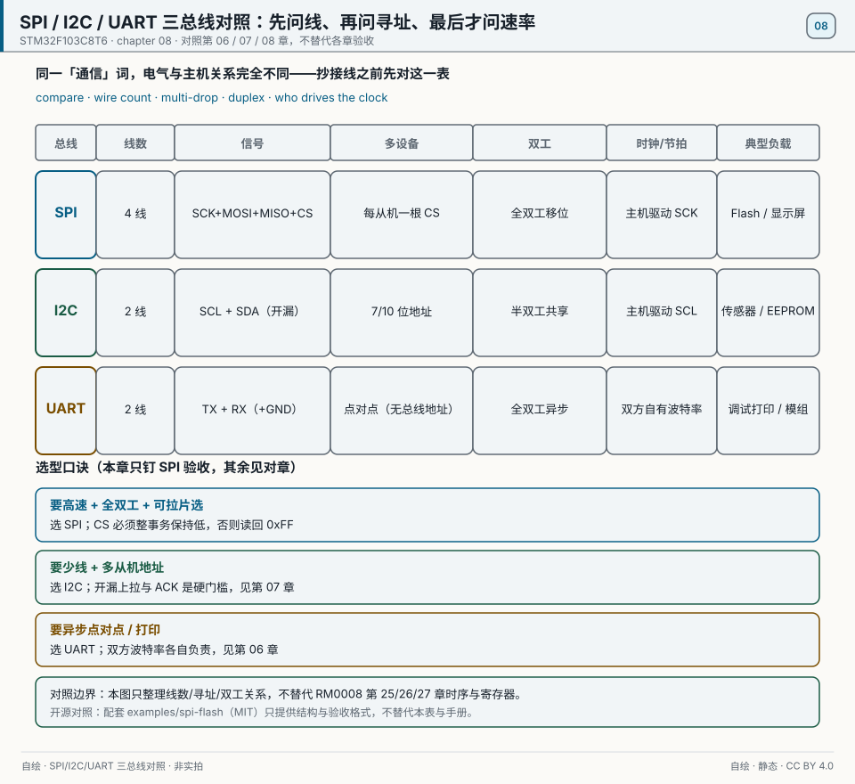
  <br><sub>▲ Drawn for this book. Three-bus compare: SPI is four-wire full duplex with one CS per slave and the master driving SCK; I2C is two open-drain wires with addressing and half duplex; UART is point-to-point async with each side owning its baud rate. This figure only organizes wires, addressing, and duplex — it does not replace the timing chapters in [RM0008](#source-rm0008-spi). Open-source compare: [examples/](#source-project-examples) (MIT) supplies structure and acceptance format only.</sub>
</p>

When SPI "does nothing," check in a fixed order: chip select and MISO first, the clock second, and only then suspect the speed.

<p align="center">
  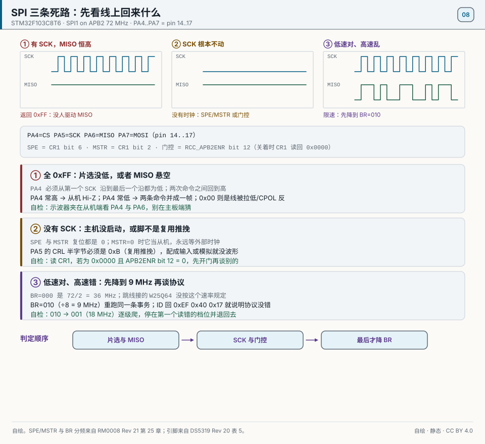
  <br><sub>▲ Drawn for this book. Branch one: every byte reading 0xFF means nothing is driving MISO (a floating input reads 1) — check that PA4 sits low for the whole transfer (stuck high leaves the slave in Hi-Z; stuck low merges two commands into one frame), and check PA6 (pin 16), the wiring, and power. A 0x00 instead means something holds the line low: MOSI/MISO are swapped, or CPOL/CPHA are wrong. Branch two: no SCK at all — SPE (CR1 bit 6) and MSTR (CR1 bit 2) must both be set; with MSTR = 0 the part waits for an external clock that never comes. Also check the `RCC_APB2ENR` bit 12 gate (CR1 reads back 0x0000 with it off) and that PA5 is alternate-function push-pull (`GPIOA_CRL` nibble 5 = 0xB). Branch three: right at low speed, wrong at high — BR=000 is 72/2 = 36 MHz, which a W25Q64 on jumper wires is not rated for. Repeat the same transaction at BR=010 (9 MHz); if the ID comes back 0xEF 0x40 0x17, the protocol is fine and the limit is the wire — climb 010 → 001 (18 MHz) one step at a time and stop at the first bad read. Registers and divider: [RM0008 Rev 21 chapter 25](#source-rm0008-spi). Pins: [DS5319 Rev 20 Table 5](#source-ds5319-spi).</sub>
</p>

<p align="center">
  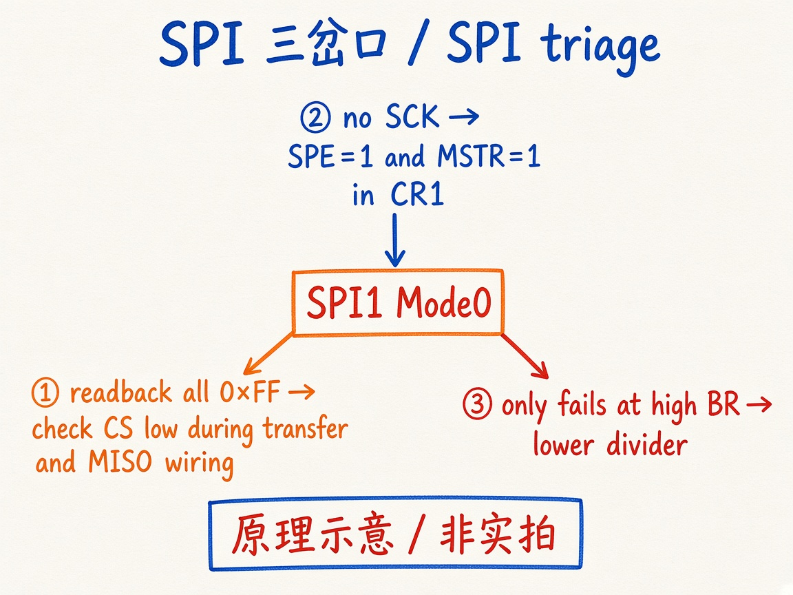
  <br><sub>▲ Knowledge track (Handraw · 原理示意 / not a photo). All 0xFF → CS/MISO; no SCK → SPE/MSTR; high-BR only → lower divider; not a photo.</sub>
</p>

## Related resources

- Official manuals: **RM0008** chapter 25 (SPI); the W25Q64 and ST7789 datasheets
- Previous: [07 The I2C Bus](07-i2c.md)
- Figures: [`assets/animations/spi-transfer.svg`](../../assets/animations/spi-transfer.svg)
- Disclaimer: every illustration in this repo is a vector drawing or a program-generated animation by the author, not a manufacturer's photograph.
