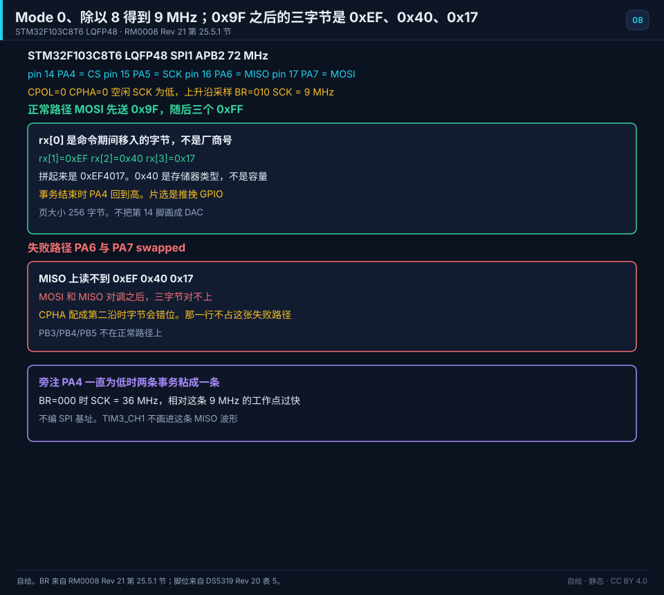
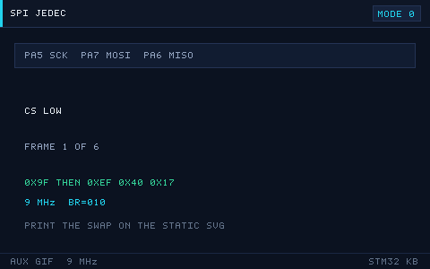

# 08 The SPI Bus
> 中文：[SPI 总线](../08-SPI总线.md)

> SPI is a fast full-duplex link on four wires. Flash, displays, and sensors use it all the time.

<p align="center">
  
  <br><sub>▲ Animation: SPI full-duplex shifting, and the timing of the four CPOL/CPHA modes (vector drawing by the author)</sub>
</p>

<!-- video:ch08 -->
<p align="center">
  <video width="640" controls poster="../../assets/video/ch08-spi.png">
    <source src="../../assets/video/ch08-spi.mp4" type="video/mp4">
  </video>
  <br><sub>▲ Chinese voice-over, 2.6 min. Voice: Microsoft Edge neural voice zh-CN-XiaoxiaoNeural via edge-tts (library mostly LGPLv3; the voice model is an online Microsoft service, not an open model). Pictures are generated from this repo's SVGs, not photographs. Video: <a href="../../assets/video/ch08-spi.mp4">MP4</a> · subtitles: <a href="../../assets/video/ch08-spi.srt">SRT</a>. Rebuild with <code>python3 tools/gen_narrated.py --speak</code>.</sub>
</p>

**Narration script (Chinese, same text as the subtitles)**

1. SPI 通常是时钟、主机输出、主机输入、片选。名字要按方向记：主机出去的那根不能和进来的那根对调。对调之后，两边都在听，谁也不说话。
2. 模式由时钟空闲电平和在哪个沿采样决定。模式 0 是空闲为低，第一个有效沿就采样。主机和从机模式不一致时，数据会整字节错位，看起来像随机数。
3. 片选是一次事务的括号。拉低表示开始，拉高表示结束。有的从机只在片选上升沿才把数据收下。一直压着片选，下一包会粘在上一包后面。
4. 这一帧是仓库画的移位过程。时钟每走一拍，主机和从机同时移出一位。所以 SPI 没有应答位。你发出去的同时，也会收到一位，哪怕你并不关心它。
5. 全双工意味着你发送的时候，接收缓冲也在进数。只写不读，下一次读到的可能是上一包的剩菜。HAL 里能用收发一起的接口，把两边一次做完。
6. 时钟多快，从机手册说了才算。杜邦线很长时，沿会变钝，实验能过、产品会偶发。先把分频放到从机舒服的范围，再谈把速率拧高。
7. 多个从机可以共享时钟和两根数据线，但片选要各走各的。选中谁，谁才应该回应。两根片选同时为低，两个从机一起说话，线上就是冲突。
8. 口诀：模式 0 的空闲时钟是低；主机输出和主机输入不能接反。片选用上升沿结束一次事务。三句先背下来再接线。
9. 实验找一个带只读寄存器的器件，用正确的模式读回来。数值和手册复位值一致，这章才算过。读出全是 FF 或 00，先查模式和进出线。
10. 合上书，三问。模式 0 时空闲时钟是高还是低？主机输出和主机输入能不能接反？一次事务结束时片选应该怎样？
<!-- /video:ch08 -->

## Principle and boundary

The SPI conclusion in this chapter is pinned to order code STM32F103C8T6. SPI1 is on APB2 and the kernel clock is 72 MHz. The working point is copied whole from Appendix D: Mode 0, `BR=010`, SCK = 9 MHz. On the remapped pins, the PA5/PA6/PA7 sentence below is void.

The reset-default pins are LQFP48 pin 15 PA5 = SPI1_SCK, pin 17 PA7 = SPI1_MOSI, pin 16 PA6 = SPI1_MISO, and pin 14 PA4 = SPI1_NSS. This chapter does not use hardware NSS. PA4 is a push-pull GPIO, driven low and then high in software. That is not the open-drain of chapter file 07. The remap onto PB3/PB4/PB5 is not on the normal path. Pin 16 is also TIM3_CH1 in chapter file 05. This figure draws only MISO. Source: [DS5319 Rev 20 Table 5](#source-ds5319-spi).

Mode 0 is CPOL = 0 and CPHA = 0. SCK idles low, and the data is sampled on the first edge, which is the rising edge. The chapter code uses `SPI_POLARITY_LOW`, `SPI_PHASE_1EDGE`, `SPI_NSS_SOFT`, `SPI_FIRSTBIT_MSB`, and `SPI_BAUDRATEPRESCALER_8`.

`BR[2:0]` has only the eight dividers 2, 4, 8, 16, 32, 64, 128, and 256. `010` is ÷8, and `72 / 8 = 9` MHz. `001` is ÷4, 18 MHz. `000` is ÷2, 36 MHz. 36 MHz is the too-fast failure next to the 9 MHz working point. There is no second ledger. There is no ÷3. Do not invent an SPI base address. Source: [RM0008 Rev 21 section 25.5.1](#source-rm0008-spi).

The master sends `{0x9F, 0xFF, 0xFF, 0xFF}`. In full duplex, the eight SCK edges that shift out `0x9F` also shift `rx[0]` in, and that byte is not the manufacturer id. The next three bytes are `rx[1]=0xEF`, `rx[2]=0x40`, and `rx[3]=0x17`. The assembly is `rx[1] << 16 | rx[2] << 8 | rx[3]`, which is `0xEF4017`. `0x40` is the memory type, not the capacity. The page is 256 bytes. Those two sentences link the [existing example](#source-project-examples) and Appendix D. The example treats bit 0 of the status byte as busy. `0x05`, `0x06`, `0x02`, and `0x03` stay in the core ideas.

After MOSI and MISO are swapped, the three bytes do not match `0xEF 0x40 0x17`. That is the failure path on the key figure. While chip select stays low, the next command is glued to the previous one. A Transmit that never reads MISO leaves a stale byte for the next read. CPHA on the second edge shifts the byte. The stuck chip select and `BR=000` at 36 MHz stay in the margin.

## Key figures

<p align="center">
  
  <br><sub>▲ Drawn for this book. STM32F103C8T6, LQFP48. Pin 14 PA4 = CS (push-pull, low during the transaction), pin 15 PA5 = SCK, pin 16 PA6 = MISO, pin 17 PA7 = MOSI. CPOL = 0, CPHA = 0, BR=010, SCK = 9 MHz. On the normal path MOSI sends 0x9F and then three 0xFF bytes; rx[1] through rx[3] are 0xEF, 0x40, and 0x17. The failure path swaps PA6 and PA7. In the margin, a PA4 that stays low glues two transactions, and BR=000 makes SCK = 36 MHz. Pin 14 is not drawn as DAC. Sources: [RM0008 Rev 21 section 25.5.1](#source-rm0008-spi) and [DS5319 Rev 20 Table 5](#source-ds5319-spi).</sub>
</p>

<p align="center">
  
  <br><sub>▲ Auxiliary figure for the web and the article channel. It only plays the normal path and marks 9 MHz. Print uses the static figure. The swapped wires and 36 MHz are not on this GIF.</sub>
</p>

The opening `spi-transfer.svg` stays a side figure. Without playing it, the pins, 9 MHz, and the three ID bytes are all on the static figure.

## Timing or state

| Row | Byte | MOSI | MISO | CS | SCK |
| --- | --- | --- | --- | --- | --- |
| Normal | 1 | 0x9F | rx[0], not the manufacturer id | low | sample on the rising edge |
| Normal | 2 | 0xFF | 0xEF | low | sample on the rising edge |
| Normal | 3 | 0xFF | 0x40 | low | sample on the rising edge |
| Normal | 4 | 0xFF | 0x17 | low | sample on the rising edge |
| End | — | — | — | returns high | idle low |
| Mode | — | — | — | — | CPOL = 0, CPHA = 0 |
| Rate | — | — | — | — | BR=010 is 9 MHz, BR=001 is 18 MHz, BR=000 is 36 MHz |
| Failure | 2 through 4 | — | not 0xEF 0x40 0x17 | low | PA6 and PA7 swapped |

The page is 256 bytes. Sources: [RM0008](#source-rm0008-spi) and the [example](#source-project-examples).

## Pitfalls and source cards

| What you see | Why | What to do | Source | Claim this source may support |
| --- | --- | --- | --- | --- |
| The ID that comes back is not 0xEF4017 | PA7 is not MOSI, or PA6 is not MISO, or the mode is not 0 | Keep Mode 0, and check that PA7 is MOSI and PA6 is MISO | [DS5319](#source-ds5319-spi) | LQFP48 pin 16 is MISO and pin 17 is MOSI. The three bytes themselves are the next row |
| rx[0] was treated as the manufacturer id | The eight SCK edges of the command also shift rx[0] in | The manufacturer id is rx[1], the type is rx[2], and the capacity is rx[3] | [example](#source-project-examples) | The command is 0x9F. The three bytes are 0xEF, 0x40, and 0x17. 0x40 is not the capacity. The page is 256 bytes |
| SCK runs at 36 MHz | BR was written as 000 | Use BR 010, which is 9 MHz | [RM0008](#source-rm0008-spi) | Among the eight dividers, 010 is ÷8. 000 is ÷2 = 36 MHz. There is no ÷3 |
| Two commands are glued together | PA4 stayed low | Drive PA4 high at the end of each transaction | [DS5319](#source-ds5319-spi) | Pin 14 is SPI1_NSS. This chapter uses it as a push-pull chip select. On the C8 it is not a DAC output |
| The ID shows up on PB3/PB4/PB5 | A remap was treated as the reset default | The reset-default pins are PA5/PA6/PA7 | [DS5319](#source-ds5319-spi) | Pin 15 is SCK, pin 16 is MISO, and pin 17 is MOSI |
| Bit 0 of the status byte is treated as a protocol busy flag | That is what the example does | Wait on that bit only as the example does | [example](#source-project-examples) | The example treats bit 0 of the status byte as busy |

## 📌 Learning goals
- [ ] Understand the four SPI wires and full-duplex shifting
- [ ] Know the four CPOL/CPHA modes, and which mode common parts use
- [ ] Compute the SPI rate and the clock divider (the BR field)
- [ ] Compare bit-banged SPI with the hardware peripheral, and know DMA can refresh a display
- [ ] Read a W25Q64 ID, read and write a page, and initialize an ST7789

## 🧠 Core ideas

**Lead with the conclusion: SPI is a ring exchange — one master, several slaves, and one shift register on each side. The master sends one bit, and the slave returns one bit at the same time.**

### 1. Four wires, and how the shift works

| Wire | Full name | Direction | Meaning |
| --- | --- | --- | --- |
| SCK | Serial Clock | Master → slave | Clock |
| MOSI | Master Out Slave In | Master → slave | The master sends |
| MISO | Master In Slave Out | Slave → master | The slave sends |
| NSS/CS | Slave Select | Master → slave | Chip select, active low |

How the shift works: master and slave each have an 8-bit shift register, and the two form a ring. On each clock edge both sides shift one bit out and one bit in. After 8 clocks, one byte has been exchanged.

### 2. The four CPOL/CPHA modes

| Mode | CPOL | CPHA | Idle clock | Sample edge | Common parts |
| --- | --- | --- | --- | --- | --- |
| Mode 0 | 0 | 0 | Low | 1st edge (rising) | W25Q64, ST7789, most parts |
| Mode 1 | 0 | 1 | Low | 2nd edge (falling) | Some sensors |
| Mode 2 | 1 | 0 | High | 1st edge (falling) | Uncommon |
| Mode 3 | 1 | 1 | High | 2nd edge (rising) | W25Q64 (also supported) |

> Conclusion: **try Mode 0 first. If a read ID is all 0s or all FFs, suspect the mode before anything else.**

### 3. Rate and the divider

- SPI clock = fPCLK / divider (BR field: 2/4/8/16/32/64/128/256).
- Example: APB2 = 72 MHz, divider 8 → 9 MHz.

| BR[2:0] | Divider | SCK at 72 MHz |
| --- | --- | --- |
| 000 | 2 | 36 MHz |
| 001 | 4 | 18 MHz |
| 010 | 8 | 9 MHz |
| 011 | 16 | 4.5 MHz |
| 100 | 32 | 2.25 MHz |
| 101 | 64 | 1.125 MHz |
| 110 | 128 | 0.5625 MHz |
| 111 | 256 | 0.28125 MHz |

### 4. NSS, and more than one slave

| Method | Meaning |
| --- | --- |
| Software NSS | An ordinary GPIO drives chip select. The most flexible choice (recommended) |
| Hardware NSS | The hardware manages it. Used with multiple masters |
| Several slaves | Each slave has its own CS. They share SCK, MOSI, and MISO |

### 5. Bit-banged versus hardware SPI

| Dimension | Bit-banged | Hardware SPI |
| --- | --- | --- |
| Speed | Low (tens of kHz up to a few MHz) | High (tens of MHz) |
| CPU use | High | Low |
| Flexibility | High | Low (fixed pins) |
| DMA | None | Supported (fast for a display refresh or a Flash read) |

## 🛠️ Hardware and wiring

| Board | Peripheral | Pin | Notes |
| --- | --- | --- | --- |
| BluePill | W25Q64 | PA5=SCK, PA6=MISO, PA7=MOSI, PA4=CS | Mode 0 or 3 |
| BluePill | ST7789/ILI9341 | PA5=SCK, PA7=MOSI, PA4=CS, PA3=DC, PA2=RST | Write only; MISO is unused |

## 💻 Code

```c
/* spi_flash.c —— hardware SPI1 reads the W25Q64 JEDEC ID (HAL) */
#include "stm32f1xx_hal.h"

SPI_HandleTypeDef hspi1;

#define FLASH_CS_LOW()   HAL_GPIO_WritePin(GPIOA, GPIO_PIN_4, GPIO_PIN_RESET)
#define FLASH_CS_HIGH()  HAL_GPIO_WritePin(GPIOA, GPIO_PIN_4, GPIO_PIN_SET)

#define CMD_JEDEC_ID     0x9F
#define CMD_READ_STATUS1 0x05
#define CMD_WRITE_ENABLE 0x06
#define CMD_PAGE_PROGRAM 0x02
#define CMD_READ_DATA    0x03

void SystemClock_Config(void);

static void spi_init(void)
{
    __HAL_RCC_SPI1_CLK_ENABLE();
    __HAL_RCC_GPIOA_CLK_ENABLE();

    /* PA5/PA7 alternate push-pull, PA6 input, PA4 ordinary output as CS */
    GPIO_InitTypeDef io = {0};
    io.Pin = GPIO_PIN_5 | GPIO_PIN_7; io.Mode = GPIO_MODE_AF_PP;
    io.Speed = GPIO_SPEED_FREQ_HIGH; HAL_GPIO_Init(GPIOA, &io);
    io.Pin = GPIO_PIN_6; io.Mode = GPIO_MODE_INPUT; io.Pull = GPIO_NOPULL;
    HAL_GPIO_Init(GPIOA, &io);
    io.Pin = GPIO_PIN_4; io.Mode = GPIO_MODE_OUTPUT_PP; io.Pull = GPIO_NOPULL;
    HAL_GPIO_Init(GPIOA, &io);
    FLASH_CS_HIGH();

    hspi1.Instance               = SPI1;
    hspi1.Init.Mode              = SPI_MODE_MASTER;
    hspi1.Init.Direction         = SPI_DIRECTION_2LINES;
    hspi1.Init.DataSize          = SPI_DATASIZE_8BIT;
    hspi1.Init.CLKPolarity       = SPI_POLARITY_LOW;   /* CPOL=0 */
    hspi1.Init.CLKPhase          = SPI_PHASE_1EDGE;    /* CPHA=0 → Mode 0 */
    hspi1.Init.NSS               = SPI_NSS_SOFT;
    hspi1.Init.BaudRatePrescaler = SPI_BAUDRATEPRESCALER_8;   /* 9MHz */
    hspi1.Init.FirstBit          = SPI_FIRSTBIT_MSB;
    HAL_SPI_Init(&hspi1);
}

/* read the W25Q64 JEDEC ID: expect 0xEF4017 */
static uint32_t w25q_read_id(void)
{
    uint8_t tx[4] = {CMD_JEDEC_ID, 0xFF, 0xFF, 0xFF};
    uint8_t rx[4] = {0};

    FLASH_CS_LOW();
    HAL_SPI_TransmitReceive(&hspi1, tx, rx, 4, 100);
    FLASH_CS_HIGH();

    return ((uint32_t)rx[1] << 16) | ((uint32_t)rx[2] << 8) | rx[3];
}

int main(void)
{
    HAL_Init();
    SystemClock_Config();
    spi_init();

    uint32_t id = w25q_read_id();   /* expect 0xEF4017 (Winbond 25Q64) */

    while (1) { (void)id; }
}
```

A page write (W25Q64 page size is 256 bytes. Before a write you must write-enable, then wait while it is busy):

```c
static void w25q_write_enable(void)
{
    uint8_t cmd = CMD_WRITE_ENABLE;
    FLASH_CS_LOW();
    HAL_SPI_Transmit(&hspi1, &cmd, 1, 100);
    FLASH_CS_HIGH();
}

static void w25q_wait_busy(void)
{
    uint8_t cmd = CMD_READ_STATUS1, st = 0;
    do {
        FLASH_CS_LOW();
        HAL_SPI_Transmit(&hspi1, &cmd, 1, 100);
        HAL_SPI_Receive(&hspi1, &st, 1, 100);
        FLASH_CS_HIGH();
    } while (st & 0x01);   /* BUSY bit */
}
```

The idea of a DMA display refresh: send a whole frame buffer in one `HAL_SPI_Transmit_DMA`. The CPU goes off to prepare the next frame, and the refresh gets much faster.

The full project is in [`examples/spi-flash/`](../../examples/spi-flash/).

## 🧪 Hands-on labs

1. **Lab 1:** Read the W25Q64 JEDEC ID and confirm it is 0xEF4017 (use `spi-transfer.svg` to see the shift).
2. **Lab 2:** Write 16 bytes to a page and read them back. Confirm they match. On purpose, skip the write enable and watch it fail.
3. **Lab 3:** Initialize an ST7789 and fill a color. Refresh the whole screen with DMA, and compare the frame rate with blocking transmits.

### 6. SPI registers that matter (F1)

| Register | Role |
| --- | --- |
| CR1 | Enable, master/slave, CPOL/CPHA, BR, NSS |
| CR2 | Interrupt and DMA enables |
| SR | Status (TXE / RXNE / BSY) |
| DR | Data |

### 7. The core of a bit-banged SPI

```c
/* bit-bang SPI Mode 0 with GPIO (SCK=PA5, MOSI=PA7, MISO=PA6) */
static uint8_t spi_soft_xfer(uint8_t tx)
{
    uint8_t rx = 0;
    for (int i = 7; i >= 0; i--)
    {
        HAL_GPIO_WritePin(GPIOA, GPIO_PIN_7, (tx >> i) & 1);  /* set up the data */
        HAL_GPIO_WritePin(GPIOA, GPIO_PIN_5, GPIO_PIN_SET);   /* sample on the rising edge */
        rx = (rx << 1) | HAL_GPIO_ReadPin(GPIOA, GPIO_PIN_6);
        HAL_GPIO_WritePin(GPIOA, GPIO_PIN_5, GPIO_PIN_RESET);
    }
    return rx;
}
```

### 8. Common ST7789 init commands

| Command | Value | Role |
| --- | --- | --- |
| SWRESET | 0x01 | Software reset |
| SLPOUT | 0x11 | Exit sleep |
| COLMOD | 0x3A | Pixel format (0x55 = 16-bit) |
| MADCTL | 0x36 | Scan direction |
| DISPON | 0x29 | Display on |

> On a display, command versus data is usually the DC pin, not something inside the SPI protocol itself.

### 9. Full duplex, and write-only parts

- A write-only part (a display, for example) can leave MISO unconnected. `HAL_SPI_Transmit` is enough.
- A part you read (Flash, for example) must have MISO connected. Use `HAL_SPI_TransmitReceive`.
- In full duplex, a receive happens at the same time as a transmit, and what you receive may be leftover data from the previous transfer.
- To read a single byte you still have to send a clock. The master usually sends a dummy `0xFF`, which is the only way the slave can shift its data out.

### 10. SPI, I2C, and UART side by side

| Dimension | SPI | I2C | UART |
| --- | --- | --- | --- |
| Wires | 4 | 2 | 2 (including GND) |
| Speed | High | Medium | Medium |
| Several devices | One CS per device | Addressed | Point to point |
| Full duplex | Yes | Half duplex | Yes |

## 🔗 Related resources

- Official manuals: **RM0008** chapter 25 (SPI); the W25Q64 and ST7789 datasheets
- Previous: [07 The I2C Bus](07-i2c.md)
- Figures: [`assets/animations/spi-transfer.svg`](../../assets/animations/spi-transfer.svg)
- Disclaimer: every illustration in this repo is a vector drawing or a program-generated animation by the author, not a manufacturer's photograph.
