# 09 ADC and DAC
> 中文：[09 ADC 与 DAC](../09-ADC与DAC.md)

> A meter may read 1.65 V while the ADC does not return exactly 2048. Check VDDA, sample time, ADC state, and the DMA array together to separate quantization, source impedance, and buffer-order errors.

<p align="center">
  
  <br><sub>▲ Animation: ADC sample-and-hold plus successive-approximation (SAR) compare (vector animation drawn by the author, not a live recording)</sub>
</p>

<!-- video:ch09 -->
<p align="center">
  <video width="640" controls poster="../../assets/video/ch09-adc.png">
    <source src="../../assets/video/ch09-adc.mp4" type="video/mp4">
  </video>
  <br><sub>▲ Chapter video with Chinese voice-over (2.7 min). <a href="../../assets/video/ch09-adc.mp4">MP4</a> · <a href="../../assets/video/ch09-adc.srt">subtitles</a></sub>
</p>

<details>
<summary>Narration script (Chinese, same text as the subtitles)</summary>

1. 逐次逼近之前，要先让采样电容充满。源阻抗越大，需要的采样时间越长。充不满就转换，读数会偏向你上一次采过的电压。
2. F1 的 ADC 是 12 位。换算时用读数除以 4096，再乘参考电压。用 4095 做口算会有一个最小步长的差别。参考电压不是想当然的 3.3，要看你接到哪。
3. STM32F103C8 有 ADC，没有 DAC。把 F4 的 DAC 例程抄过来，编译或许能过，引脚上不会出现你要的模拟电压。换芯片前先看数据手册的功能表。
4. 这一帧是仓库画的逐次逼近：从最高位开始试，比参考大了就清掉，再试下一位。它帮助你记得，转换需要时间，不是把引脚读进来就结束。
5. 引脚要设成模拟输入，ADC 时钟要开，规则通道和采样时间都要写上。少一项，读数会停在一个奇怪的常数。先读一个已知电压，比如分压后的参考，再去测传感器。
6. 连续采样不要在每个转换完成里做重活。让 DMA 把结果搬进数组，半满和全满时再去算。Wokwi 的 BluePill 模型没有 DMA，这章的连续采样要在真板上对。
7. 读数乱跳时，先看参考电压和模拟地，再谈软件平均。平均能盖住一点噪声，盖不住一根飞线当成天线。实验板上，传感器线短一点，结果会诚实很多。
8. 三句挡住三件事：采样时间看信号阻抗，挡住采不准；换算除以 4096，挡住算不准；C8 没有 DAC，挡住抄错芯片。
9. 实验用电位器做分压，两端接地和参考，中间进 ADC。慢慢旋转，读数应该单调变化。跳变或反向，先查接线和参考，不要先改分辨率。
10. 读数跳变时按顺序查：先看接线和参考稳不稳，再看采样时间够不够，分辨率放在最后动。顺序反了，会把好配置改坏。

</details>
<!-- /video:ch09 -->
## Principle and scope

Every sampling number in this chapter is for the STM32F103C8T6, with the 12 MHz ADC clock from Appendix D and 4096 as the conversion divisor. The C8 has no DAC. On an F4 the conversion time and the power-up calibration also differ; each is noted below.

PCLK2 = 72 MHz, and `ADCPRE=10` (÷6) gives ADCCLK = 12 MHz. The ADC clock limit is 14 MHz. ÷4 would give 18 MHz, over the limit, so with a 72 MHz system clock ÷6 is the only choice. How to set the prescaler is in the chapter 02 clock tree. The often-quoted `Tconv = 1 µs` from RM0008 is the 14 MHz, 1.5-cycle example. A C8 running at 72 MHz cannot reach 14 MHz, so work from 12 MHz. Source: [RM0008 Rev 21 chapter 11](#source-rm0008-adc).

How the SAR ADC works: the sample switch closes and the input charges the sample capacitor through the source impedance; the switch opens and the capacitor holds that voltage; then the converter compares 12 times, one bit at a time, starting at the MSB. Conversion time is the sample cycles plus 12.5 ADCCLK cycles. The longest sample step, 239.5 plus 12.5, is 252 cycles, and `252 / 12e6 = 21 µs`. Sample times at 12 MHz: 1.5 cycles = 125 ns, 13.5 cycles = 1.125 µs, 55.5 cycles = 4.625 µs, 71.5 cycles = 5.958 µs, and 239.5 cycles = 19.958 µs. On an F4 a conversion is the sample plus 12 cycles; do not mix the two.

The temperature sensor needs a sample time of at least 17.1 µs. `17.1e-6 × 12e6 = 205.2` cycles, so pick 239.5 cycles; 71.5 cycles is too short. The temperature sensor is on ADC1 input 16. The internal reference VREFINT is on ADC1 input 17, typically about 1.20 V; use it to work out the real VDDA on your own board. Both are connected only after TSVREFE in `ADC_CR2` is set. On a chip with two ADCs that bit exists only in ADC1, and ADC2 channels 16 and 17 are tied to VSS. The temperature formula is `(V25 − VSENSE) / Avg_Slope + 25`. V25 ≈ 1.43 V and the slope ≈ 4.3 mV/°C are typical values from the electrical characteristics, not factory calibration, so the result is good for trends and can be several degrees off in absolute terms. The F4 has factory values `TS_CAL1`, `TS_CAL2`, and `VREFINT_CAL`; the F103C8 does not.

DS5319 says every medium-density device has two 12-bit ADCs. The C8 has ADC1 and ADC2, no ADC3, and no DAC, so `HAL_DAC_Start` produces no output. A DAC exists on high-density F103 parts and on the F4. The DAC buffer, noise, and triangle wave in the core ideas below apply only to parts that have a DAC. Source: [DS5319 Rev 20](#source-ds5319-adc).

LQFP48 pin 10 PA0 = ADC12_IN0. The reference is pin 9 VDDA itself; this package has no separate VREF+, which appears only on packages with 100 pins or more. Chapter 03 lit an LED from pin 10 as a push-pull output. Reconfigure it as an analog input before sampling, or you read back the level the output is driving. Pin 14 PA4 on the C8 is ADC12_IN4 / SPI1_NSS and has no DAC_OUT1 function.

Voltage = code × VDDA / 4096. At a nominal 3.3 V, 1 LSB = `3.3 / 4096 ≈ 0.806` mV, the 806 µV in the table later in this chapter. Code 2048 is `2048 / 4096 = 1/2`, exactly 1.65 V at a nominal 3.3 V. Dividing by 4095 pushes every reading slightly high, by about one LSB near full scale.

RM0008 section 11.4 asks for one calibration after power-up: set ADON, wait at least two ADC clocks, then set CAL in `ADC_CR2`. In HAL that is `HAL_ADCEx_Calibration_Start`, called before Start. The F4 ADC has no such step.

Moving samples continuously with DMA is covered in chapter 10 and Appendix D: the C8 has only DMA1, and ADC1 uses channel 1.

## Key figures


<p align="center">
  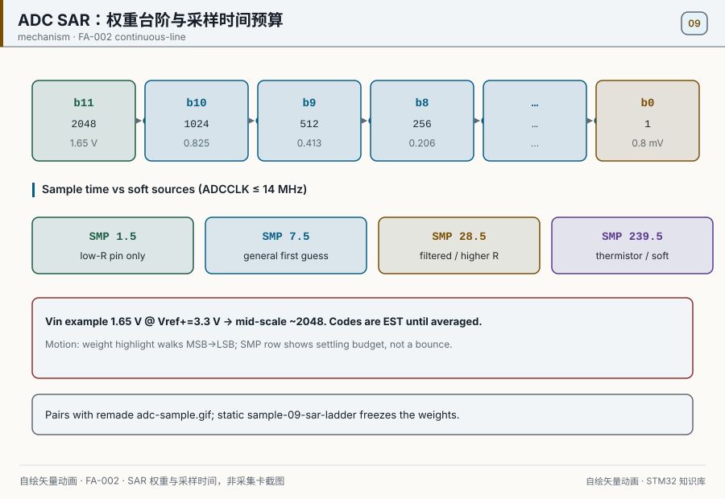
  <br><sub>▲ Hand-drawn CSS animation (FA-002). Weight highlight MSB→LSB, not empty bounce.</sub>
</p>


<p align="center">
  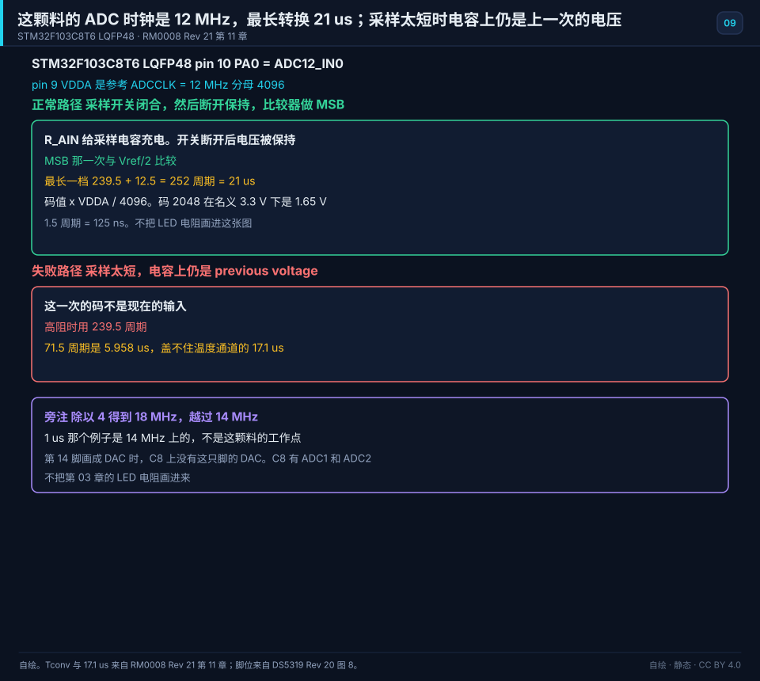
  <br><sub>▲ Drawn for this book. STM32F103C8T6, LQFP48 pin 10 PA0 = ADC12_IN0, pin 9 VDDA is the reference. ADCCLK = 12 MHz. The top half is a normal conversion: the sample switch closes and opens, and the comparator starts at the MSB. The longest step is 239.5 + 12.5 = 21 µs, and the code times VDDA / 4096 gives the voltage. The bottom half is a sample that is too short: the capacitor has not charged and still holds the previous voltage. The right side marks two more points: ÷4 gives 18 MHz, over 14 MHz, and pin 14 on the C8 has no DAC. Sources: [RM0008 Rev 21 chapter 11](#source-rm0008-adc) and [DS5319 Rev 20 Figure 8](#source-ds5319-adc).</sub>
</p>

<p align="center">
  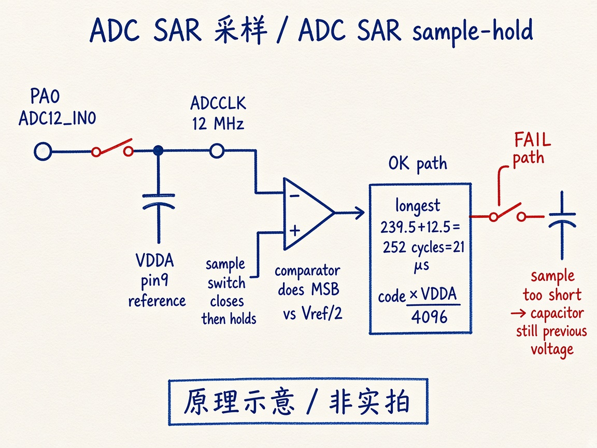
  <br><sub>▲ Knowledge track (Handraw · 原理示意 / not a photo). ADCCLK 12 MHz; longest 239.5+12.5=21 µs; short sample leaves prior voltage; not a scope capture.</sub>
</p>

<p align="center">
  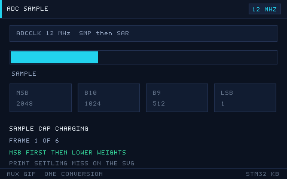
  <br><sub>▲ Animated version. It shows only one normal sample and the MSB compare. The printed book has only the static figure above.</sub>
</p>

The opening `adc-sar.svg` and `sar-adc.gif` in the core ideas show all 12 bit-by-bit compares.

## Timing and state

| Case | Sample cycles | Sample time | After adding 12.5 |
| --- | --- | --- | --- |
| Shortest | 1.5 | 125 ns | 14 / 12e6 |
| Longest | 239.5 | 19.958 µs | 252 / 12e6 = 21 µs |
| Temperature sensor | 239.5, not 71.5 | 17.1 µs needs 205.2 cycles | 71.5 cycles is only 5.958 µs, too short |
| Wrong prescaler | — | — | ADCCLK = 18 MHz, over the 14 MHz limit; none of the times apply |
| Conversion | — | — | Code 2048 is 1.65 V at a nominal 3.3 V, divisor 4096 |

ADC clock 12 MHz. Source: [RM0008 Rev 21 chapter 11](#source-rm0008-adc).

## Pitfalls and sources

| What you see | Why | What to do | Source | What the source shows |
| --- | --- | --- | --- | --- |
| The reading is still near the previous voltage | The sample time is too short for the capacitor to charge, often because it was worked out from another clock | Lengthen the sample at 12 MHz. Use 239.5 cycles for a high-impedance source | [RM0008](#source-rm0008-adc) | Conversion time = sample + 12.5. At 12 MHz the longest 252 cycles is 21 µs |
| ADC was set to ÷4 to go faster | ADCPRE selected ÷4 | Change it back to ÷6, 12 MHz | [RM0008](#source-rm0008-adc) | 14 MHz is the limit and 18 MHz is over it. The 1 µs example is at 14 MHz |
| The temperature channel is noisy and the reading wanders | The sample is shorter than 17.1 µs, or the channel is wrong | Sample for at least 17.1 µs, use ADC1 channel 16, and set TSVREFE | [RM0008](#source-rm0008-adc) | 17.1 µs is 205.2 cycles at 12 MHz. VREFINT is ADC1 channel 17. ADC2 inputs 16 and 17 are tied to VSS |
| The first readings after power-up are all shifted | There was no calibration | Calibrate before Start | [RM0008](#source-rm0008-adc) | Section 11.4: CAL may be set only after ADON has been 1 for at least two ADC clocks |
| The converted voltage reads slightly higher than the meter | The divisor was 4095 | Use 4096 | [RM0008](#source-rm0008-adc) | A 12-bit full scale is 4096 steps. Code 2048 is half scale. The reference is pin 9 VDDA |
| HAL_DAC_Start on a Blue Pill leaves no analog voltage on PA4 | The C8 has no DAC | For an analog voltage use PWM plus an RC filter, or change to a part that has a DAC | [DS5319](#source-ds5319-adc) | Medium-density devices have two 12-bit ADCs. There is no ADC3 and no DAC. Pin 14 is not DAC_OUT1 |
| Pin 10 once lit an LED, and now the sample reads a fixed level | The pin is still configured as a push-pull output | Switch PA0 to analog input before sampling | [DS5319](#source-ds5319-adc) | LQFP48 pin 10 PA0 is ADC12_IN0 |

## Learning goals

- [ ] Know the quantitative relationship among resolution, reference voltage, and quantization error, and be able to estimate the voltage of 1 LSB.
- [ ] Understand the sample–hold–compare sequence of a successive-approximation (SAR) ADC, and choose the sample time from the source impedance.
- [ ] Configure the four conversion modes — single, continuous, scan, and discontinuous — and use DMA for multi-channel acquisition.
- [ ] Use the internal temperature sensor and Vrefint to work backward to the die temperature and the real VDDA.
- [ ] Know the DAC output modes, and how the output buffer changes accuracy and noise.

## Core ideas

Keep three forms of evidence throughout this chapter: input voltage at the pin, ADC configuration and status, and the code sequence in memory. A single printed voltage cannot locate the source of an error.

### 1. Resolution, reference voltage, and quantization error


<p align="center">
  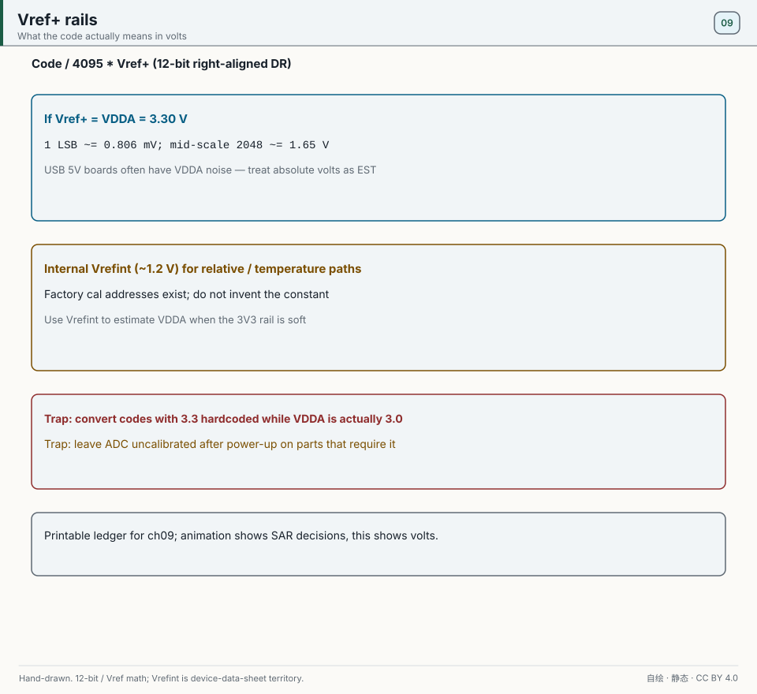
  <br><sub>▲ Drawn for this book. Code/4095×Vref+; mark absolute volts EST.</sub>
</p>

<p align="center">
  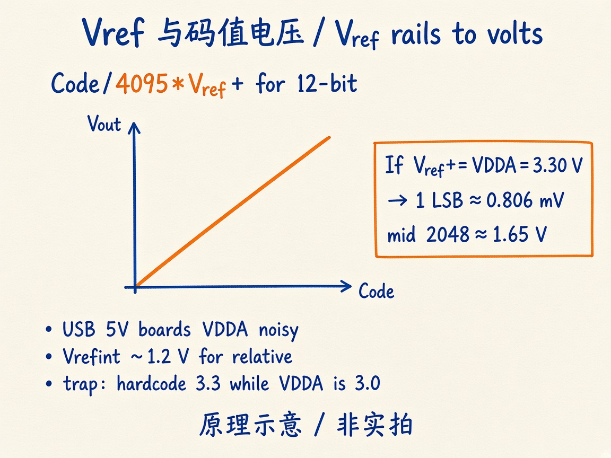
  <br><sub>▲ Knowledge track (Handraw · 原理示意 / not a photo). Code/4095×Vref+; mark absolute volts EST; not a photo.</sub>
</p>


An ADC is a ruler with tick marks and no vernier. 12 bits cuts the span from 0 to Vref into 4096 steps, so at Vref = 3.3 V one step is about 0.8 mV. When the input falls between two marks, the ADC can only report the nearest one, so every reading carries up to half a step of error by design. The length of the ruler is Vref. If Vref wobbles, every reading wobbles with it.

At a 3.3 V reference, 1 LSB of a 12-bit ADC is about **0.806 mV**. The ideal quantization error is **±0.5 LSB**.

| Resolution N | Number of steps, 2^N | 1 LSB at Vref = 3.3 V | 1 LSB at Vref = 5.0 V | Notes |
| --- | --- | --- | --- | --- |
| 8-bit | 256 | 12.89 mV | 19.5 mV | Fast / coarse |
| 10-bit | 1024 | 3.22 mV | 4.88 mV | — |
| 12-bit | 4096 | 806 µV | 1.22 mV | Mainstream on STM32F1/F4 |
| 16-bit | 65536 | 50.4 µV | 76.3 µV | F3/G4/L4 and similar |

The formulas:

```text
1 LSB        = Vref / 2^N                          (N-bit resolution)
V_in         = ADC_Code × Vref / 2^N               (proportional reading)
quantization error = ±0.5 LSB = ±Vref / 2^(N+1)   (ideal ADC, quantization only)
full-scale voltage = Vref × (2^N - 1) / 2^N ≈ Vref - 1 LSB
```

> [!WARNING]
> On STM32F1, `Vref` is `VDDA` (the analog supply). They share a pin. Only packages with 100 pins or more have a separate `VREF+` / `VREF-`. So **VDDA ripple is a direct error in the reading**. For a precise measurement, either bring in an external reference, or measure Vrefint first and calibrate in software.

### 2. Successive approximation (SAR): sample-and-hold plus binary compare


<p align="center">
  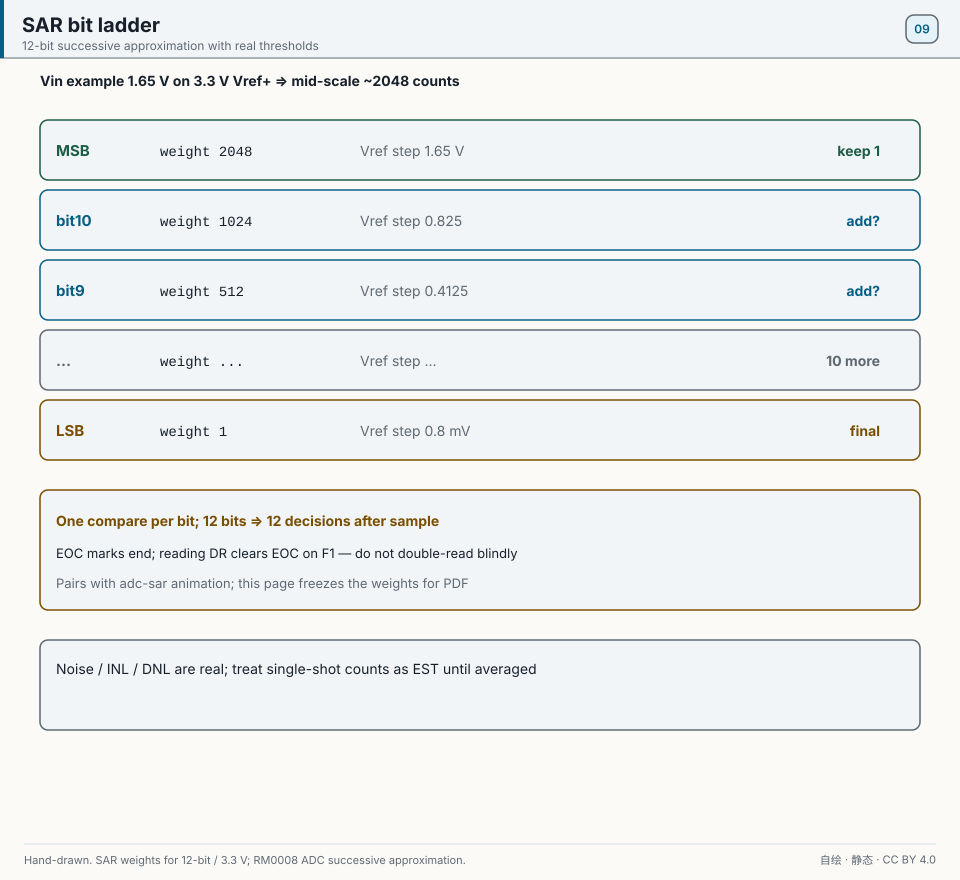
  <br><sub>▲ Drawn for this book. MSB→LSB weights; read DR after EOC.</sub>
</p>

<p align="center">
  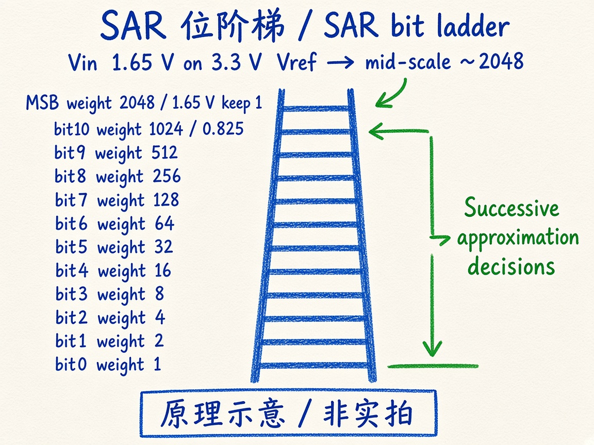
  <br><sub>▲ Knowledge track (Handraw · 原理示意 / not a photo). MSB→LSB weights; read DR after EOC; not a photo.</sub>
</p>


A SAR ADC plays a guessing game. First it takes a snapshot: the input charges a small capacitor, then the switch opens so the voltage stays put while it compares. Then it guesses from the middle: "is it above Vref/2?" If yes, it writes 1 and keeps guessing in the upper half. If no, it writes 0 and guesses in the lower half. 12 bits means 12 guesses. The snapshot is where things go wrong. If the source resistance is high, the capacitor does not fill in the sample time, and the snapshot comes out blurred.

A SAR ADC approaches the input voltage by binary search. An N-bit result needs N compares, and the bits are decided from MSB down to LSB.

The conversion, for 12 bits:

1. **Sample**: the sample switch closes. The external input charges the internal sample capacitor `C_ADC` through `R_AIN`, and the voltage on `C_ADC` follows the input.
2. **Hold**: the switch opens. The voltage on `C_ADC` is frozen and stays put for the rest of the conversion.
3. **Successive approximation (SAR)**: the comparator first compares the held voltage with `Vref/2` (MSB set to 1). If the input is larger, that bit stays; if it is smaller, the bit is cleared. Then it compares `Vref/4`, and so on. Twelve compares produce a 12-bit result.

<p align="center">
  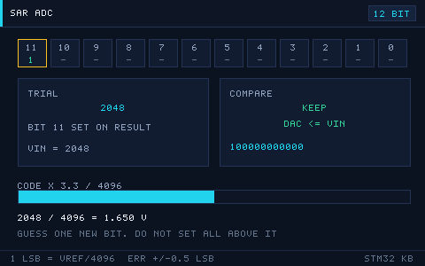
  <br><sub>▲ Animation: SAR ADC successive-approximation compare (program-generated raster animation, not a live recording)</sub>
</p>

**Sample time and source impedance** is the easiest place to get hurt. The sample switch and the signal source form an RC charge path. The capacitor has to charge to within 1/2 LSB during the sample time. ST's rule of thumb is:

```text
t_s (minimum) ≈ (R_AIN + R_ADC) × C_ADC × ln(2^(N+2))
For STM32F1: R_ADC ≈ 1 kΩ, C_ADC ≈ 8 pF, N = 12 → ln(2^14) ≈ 9.7
```

| Source impedance R_AIN | Minimum sample time t_s (estimate) | Sample step on the C8 at ADCCLK = 12 MHz | Notes |
| --- | --- | --- | --- |
| ≤ 1 kΩ | ≈ 78 ns | `000` = 1.5 cycles (125 ns) | Op-amp drive, or a small divider |
| ≈ 10 kΩ | ≈ 0.78 µs | `010` = 13.5 cycles (1.125 µs) | A typical potentiometer |
| ≈ 50 kΩ | ≈ 3.9 µs | `101` = 55.5 cycles (4.625 µs) | A high-impedance sensor |
| ≈ 100 kΩ | ≈ 7.8 µs | `111` = 239.5 cycles (19.958 µs) | Use this step for a high impedance |
| ≥ 1 MΩ | ≥ 78 µs | 239.5 cycles is still not enough | **You must add a voltage-follower buffer** |

The 1 µs that RM0008 prints at 14 MHz and 1.5 cycles is the example with the ADC clock at its limit. 71.5 cycles is 5.958 µs at 12 MHz, short of the 17.1 µs the temperature channel needs. All times in this chapter use 12 MHz. The F4 column “t_s + 12 cycles” in the comparison table does not apply to the F103.

During a scan, a high-impedance channel can pick up the previous channel if that capacitor has not finished discharging. Lengthen the sample, or insert a gap in the sequence.

On F1, `SMPx[2:0]` can be 1.5 / 7.5 / 13.5 / 28.5 / 41.5 / 55.5 / 71.5 / 239.5 ADCCLK cycles (see RM0008, Chapter 11, ADC, "Channel-wise programmable sampling time"). **The higher the source impedance, the longer the sample time has to be.** Otherwise the reading sits low and wobbles.

### 3. Four conversion modes

The four modes differ in when the ADC stops. Single converts once each time you ask. Continuous starts again as soon as it finishes and never stops. Scan works down a list of channels in order. Discontinuous splits a long list so that each trigger converts only a few channels. Real projects most often use scan plus continuous, with DMA moving the results.

Single is for sampling on demand and saving power. Continuous is for live monitoring. Scan walks several channels. Discontinuous means "one trigger converts a group."

| Mode | Key bits | Behavior | Typical use |
| --- | --- | --- | --- |
| Single | `CR2.CONT=0` plus a software or external trigger | One trigger, one conversion, then stop | Battery-voltage patrol |
| Continuous | `CR2.CONT=1` | Restarts as soon as it finishes; the data keeps refreshing | Live waveform / monitoring |
| Scan | `CR2.SCAN=1` | Converts the channels in the SQR sequence, in order | Polling several sensors |
| Discontinuous | `CR1.DISCEN=1`, `DISCNUM` | Each trigger converts only n channels, then pauses | Grouped sampling |
| External trigger | `CR2.EXTSEL` / `EXTTRIG` | A timer or EXTI triggers the regular group | Sampling locked to PWM |

The regular group holds up to 16 conversions in the sequence. The injected group holds up to 4, and it can interrupt the regular group. That is the "urgent" sample used for motor current.

<p align="center">
  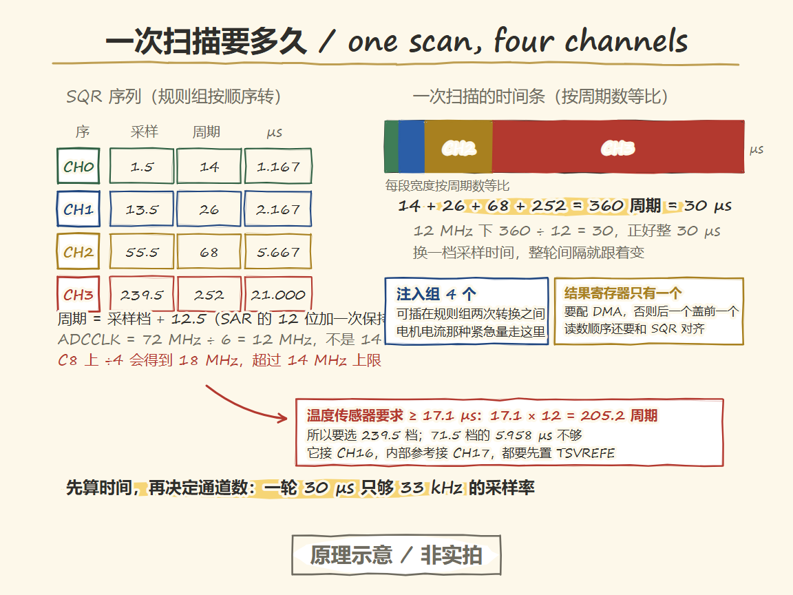
  <br><sub>▲ Knowledge track (Handraw · 原理示意 / not a photo). Where to look: the left column is the SQR sequence, each row giving the sample setting, the total cycles including the 12.5, and the microseconds; the bar on the right is proportional to those cycles, and the four segments add up to 360 cycles — exactly 30 us at 12 MHz. What it proves: the interval of one scan is set by every sample setting in it, so changing one changes the whole round; the temperature channel needs the 239.5 setting because 17.1 us x 12 MHz = 205.2 cycles. What it does not prove: this is arithmetic at a 12 MHz ADCCLK, not a measured source impedance, crosstalk or DMA overhead, and it is not a scope capture. Source: [RM0008 Rev 21 ch.11](#source-rm0008-adc).</sub>
</p>

### 4. Multi-channel plus DMA

In a continuous multi-channel scan, the ADC drops each result into the same DR register, and the next result overwrites it straight away. The CPU cannot keep up with fetching every one, so DMA stands at the DR door and carries each result into the next slot of an array, wrapping to the start at the end. When the CPU wants the latest values, it reads the array.

The standard shape for fast multi-channel acquisition is scan mode plus continuous conversion plus circular DMA. The CPU does not take part at all.

- In scan mode, each finished channel raises one DMA request (`CR2.DMA=1`) and moves `DR` into an array in memory.
- DMA runs in **circular mode**. The array wraps by itself and becomes a ring buffer.
- Data alignment, `CR2.ALIGN`: right-aligned (the default; the low 12 bits are valid) or left-aligned (the high 12 bits are valid, which makes a direct compare against a 16-bit integer easy).
- An STM32F103C8 has ADC1 and ADC2. It has no ADC3 and no DAC. The C8 has only DMA1, and ADC1 is channel 1. Half-word width and CNDTR are worked out in chapter 10.

| Item | F1 (RM0008, Chapter 11) | F4 (RM0090, Chapter 13) |
| --- | --- | --- |
| Resolution | 12-bit | 12-bit |
| Maximum sample rate | 1 MSPS (ADCCLK = 14 MHz) | 2.4 MSPS (triple interleaved can reach 7.2 MSPS) |
| Regular channels | 16 | 16 |
| Injected channels | 4 | 4 |
| Conversion time | t_s + 12.5 cycles | t_s + 12 cycles |
| Internal channels | Temperature CH16, Vrefint CH17 | Temperature, Vrefint, VBAT |

<p align="center">
  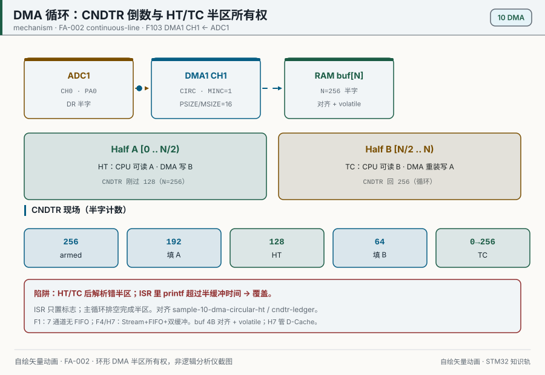
  <br><sub>▲ Multi-channel results leave one ADC_DR and enter the array in sequence; HT and TC only identify the half that is ready. The figure cannot prove channel order, data width, or sample time. Reconcile those with SQR, DMA configuration, and the measured input (FA-002 · IG-012 · C-03/C-10/C-27/C-31).</sub>
</p>

### 5. Internal temperature sensor and Vrefint

The chip has two channels that need no wiring. One is the temperature sensor, which gives a rough idea of how hot the die is and is only good for trends. The other is Vrefint, a fixed voltage of about 1.20 V. Its job is to measure the ruler itself: since the input is known to be 1.20 V, the code you read tells you what VDDA really is right now, and you can use that to correct the other channels.

The temperature sensor and Vrefint are "internal channels" of the ADC. You get the die temperature and the real VDDA for free, and you use them to calibrate the external readings.

**Temperature (F1, RM0008 Chapter 11, "Temperature sensor")**: set `CR2.TSVREFE=1` to enable it, and select channel 16.

```text
V_sense = V25 - Slope × (T - 25)
=> T(°C) = (V25 - V_sense) / Slope + 25
F1 typical values: V25 ≈ 1.43 V, Slope ≈ 4.3 mV/°C
```

**Working backward from Vrefint to VDDA**: channel 17 measures a fixed internal reference of about 1.20 V.

```text
VDDA       = 1.20 V × 4096 / ADC_Read(Vrefint_CH17)
real V_in  = ADC_Read(ch) × VDDA / 4096
```

> F4, L4, and similar families provide **factory calibration values**: `TS_CAL1` (30°C), `TS_CAL2` (110°C), and `VREFINT_CAL`. They live in the system memory area. Read them directly. They are far more accurate than looking up a typical value.

### 6. DAC output modes, the buffer, and noise

A DAC is an ADC run backwards: you give it a number from 0 to 4095 and it puts the matching voltage on the pin. The output buffer is a helper that lets the pin drive a heavier load, but the buffer itself cannot reach all the way to 0 V or VDDA. To make the voltage follow a waveform, let a timer trigger at a fixed beat and have DMA feed one value from a table on each beat.

The F1 DAC is 12-bit and dual-channel. The output voltage is `V_out = Vref × DOR / 4096`. The output buffer can drive a heavier load, but it adds offset and cannot swing all the way to the rails.

| Feature | What it means | Key bits / registers |
| --- | --- | --- |
| Resolution | 12-bit, two channels, DAC1 and DAC2 | `DHR12Rx` / `DHR12Lx` / `DHR8Rx` |
| Output buffer | When enabled it can drive a real load, but the output cannot reach the 0 V or VDDA rail | `DAC_CR.BOFFx` |
| Trigger mode | A timer or EXTI updates the output; triangle and noise can be configured | `DAC_CR.TSELx` / `TENx` |
| Noise / triangle | Built-in LFSR noise and a triangle-wave generator | `DAC_CR.WAVEx` / `MAMPx` |
| DMA | Continuous update by DMA (pair it with a timer for an arbitrary waveform) | `DAC_CR.DMAENx` |

- With the **buffer off**, the output impedance is high (≈15 kΩ). The pin can get close to the full swing, which suits a high-impedance load. With the buffer **on**, it drives a heavier load, but the typical offset is ±10 mV and it cannot reach the rails.
- Noise comes from VDDA ripple, coupling from digital switching, buffer noise, and LSB quantization noise. For precision work, add an external RC low-pass or an op-amp buffer.
- To make a sine or an arbitrary waveform: a timer trigger plus circular DMA of a lookup table. The trigger rate sets the output frequency.

> The F103C8 (the part you usually find on a BluePill) **has no DAC**. The DAC shows up on high-density F103 (xC / xD / xE) and on F4. On a medium-density part, analog voltage means PWM plus an RC, or an external DAC chip.

## Hardware and wiring

| Board | Function | Pin | Notes |
| --- | --- | --- | --- |
| BluePill / Nucleo F103 | ADC1_IN0 | PA0 | Analog input. Do not use it as GPIO as well |
| Same | Internal temperature / Vrefint | No external pin | F1 channels 16 / 17. Enable TSVREFE first |
| Parts that have a DAC | DAC_OUT1 | PA4 | The F103C8 does not have DAC on this pin |

Pick the source impedance from the sample-time table above. Put a follower in front of a high-impedance sensor. Do not try to brute-force it by stretching the sample time out to 239.5 cycles.

## Code

On F1 you must calibrate once before you start a conversion. Use DMA for continuous multi-channel acquisition. Polling is enough for a single slow signal.

```c
HAL_ADCEx_Calibration_Start(&hadc1);          /* Required on F1; F4 does not have this step */
HAL_ADC_Start(&hadc1);
HAL_ADC_PollForConversion(&hadc1, 10);
uint16_t code = HAL_ADC_GetValue(&hadc1);
/* voltage = code * VDDA / 4096; the divisor is 4096, not 4095 */
```

Circular multi-channel moves are in [`examples/adc-dma/`](../../examples/adc-dma/). Calibrate before `HAL_ADC_Start_DMA` as well. Handle the first half in the half-transfer callback, and the second half in the transfer-complete callback.

A timer trigger (TRGO) makes the sample interval independent of the main loop:

```c
TIM_MasterConfigTypeDef mst = {0};
mst.MasterOutputTrigger = TIM_TRGO_UPDATE;
mst.MasterSlaveMode     = TIM_MASTERSLAVEMODE_DISABLE;
HAL_TIMEx_MasterConfigSynchronization(&htim3, &mst);
/* ADC external trigger source: TIM3_TRGO, then HAL_ADC_Start */
```

Write the next block only on a chip that has a DAC. On an F103C8 the call does nothing useful. Do not copy it onto a BluePill:

```c
HAL_DAC_Start(&hdac, DAC_CHANNEL_1);
HAL_DAC_SetValue(&hdac, DAC_CHANNEL_1, DAC_ALIGN_12B_R, 2048); /* 2048 / 4096 = 1/2, which is 1.65 V at a nominal 3.3 V */
```

## Hands-on labs

1. **Input/code reconciliation:** Put a 10 kΩ potentiometer on PA0 and choose low, middle, and high points. At each point record meter voltage, ADC code, and voltage computed with the measured VDDA.
2. **Peripheral-state reconciliation:** Read Vrefint to estimate VDDA and save readings before and after calibration together with EOC state and sample time. Do not treat the typical 1.20 V as a per-device calibration value.
3. **Memory-result reconciliation:** Scan PA0 and PA1 into a 64-half-word circular DMA buffer. Record array order, HT/TC counts, and CNDTR. Then use a 100 kΩ source and compare 100 readings at 1.5 and 239.5 cycles by mean and range.

### 7. Calibration, the analog watchdog, and injected channels


<p align="center">
  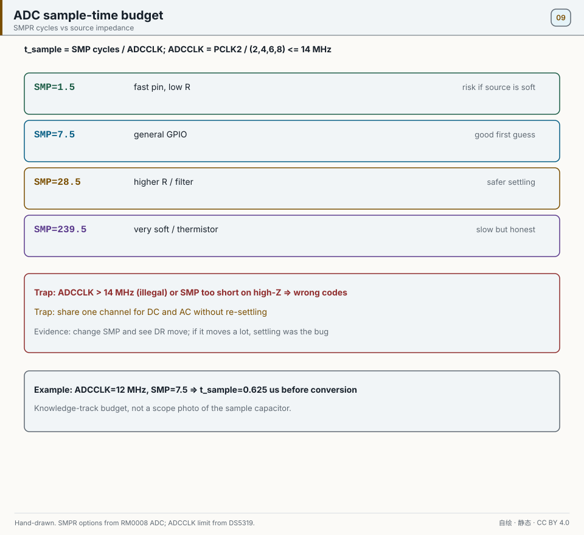
  <br><sub>▲ Drawn for this book. ADCCLK≤14 MHz; lengthen SMP for soft sources.</sub>
</p>

<p align="center">
  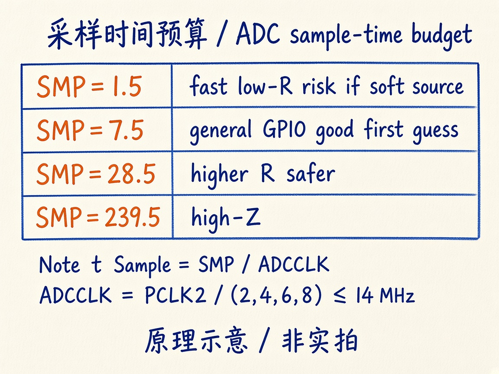
  <br><sub>▲ Knowledge track (Handraw · 原理示意 / not a photo). ADCCLK≤14 MHz; lengthen SMP for soft sources; not a photo.</sub>
</p>


Calibration is done once on F1, after power-up and before Start. The analog watchdog's job is "interrupt the CPU only when the value leaves the window." An injected channel can cut in line without disturbing the regular group's DMA.

| Feature | When to use it | HAL |
| --- | --- | --- |
| Calibration | On F1, every power-up, before Start | `HAL_ADCEx_Calibration_Start` |
| Analog watchdog | Enter the interrupt only when the voltage leaves the window | `HAL_ADC_AnalogWDGConfig` |
| Injected group | The regular group's DMA is already running, and you occasionally insert one channel | `HAL_ADCEx_InjectedStart_IT` |

The injected group holds at most 4 channels. Do not mix the regular group's DMA buffer and the injected results in the same array.

"The ADC reads wrong" splits into three: low-bit jitter, a code pinned to a rail, and a systematic offset — different roots, different fixes.

<p align="center">
  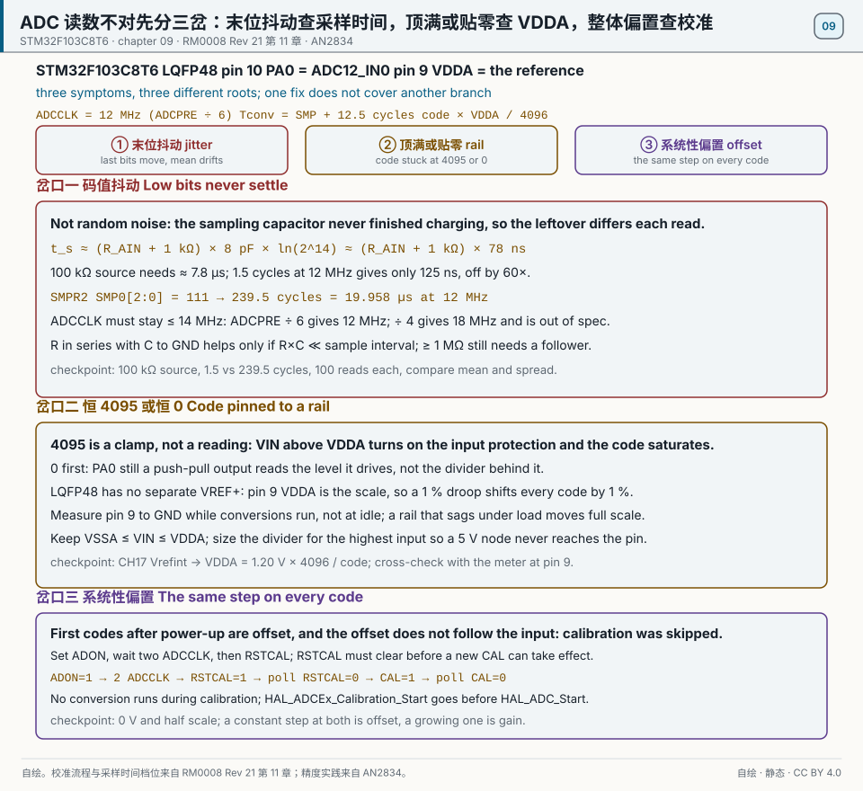
  <br><sub>▲ Drawn for this book. Branch one: low-bit jitter is not random noise; the sampling capacitor never finishes charging — `t_s ≈ (R_AIN + 1 kΩ) × 8 pF × ln(2^14) ≈ (R_AIN + 1 kΩ) × 78 ns`, so a 100 kΩ source needs about 7.8 µs while 1.5 cycles at 12 MHz gives only 125 ns, off by 60×. Set `SMPR2 SMP0[2:0]` to 111 (239.5 cycles = 19.958 µs). ADCCLK must stay ≤ 14 MHz (÷6 gives 12 MHz; ÷4 gives 18 MHz and is out of spec). An RC buffer helps only when R×C ≪ the sample interval; at ≥ 1 MΩ you still need a follower. Branch two: 4095 is a clamp, not a reading — VIN above VDDA turns on the input protection. A constant 0 first raises the question of whether PA0 is still a push-pull output. LQFP48 has no separate VREF+; pin 9 VDDA is the scale, so a 1 % droop shifts every code by 1 %. Measure pin 9 while conversions run, keep VSSA ≤ VIN ≤ VDDA, and cross-check with CH17 Vrefint: VDDA = 1.20 V × 4096 / code. Branch three: the first codes after power-up carry an offset that ignores the input — calibration was skipped. Set ADON, wait two ADCCLK, then RSTCAL = 1 and poll until it clears, then CAL = 1 and poll; no conversion runs during calibration, and `HAL_ADCEx_Calibration_Start` goes before `HAL_ADC_Start`. Take one reading at 0 V and one at half scale: a constant step at both is offset, a growing one is gain. Calibration flow and sample-time table: [RM0008 Rev 21 chapter 11](#source-rm0008-adc). Precision practice: AN2834.</sub>
</p>

<p align="center">
  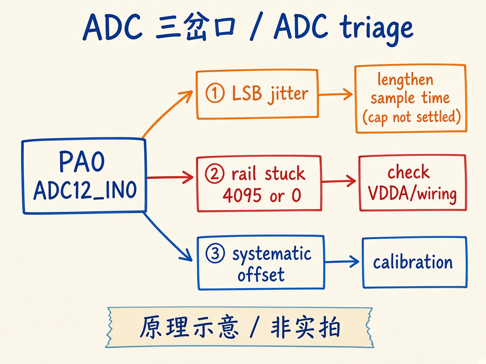
  <br><sub>▲ Knowledge track (Handraw · 原理示意 / not a photo). Branches: under-sampled / VDDA clamp / missing calibration; not a photo.</sub>
</p>

### 8. Channels and pins (F103 ADC1)

| Channel | Pin / source |
| --- | --- |
| IN0 through IN7 | PA0 through PA7 |
| IN8, IN9 | PB0, PB1 |
| IN16 | On-chip temperature sensor |
| IN17 | Vrefint (about 1.20 V) |

Other packages, and the F4 channel table, follow the pinout in that part's datasheet. Do not stretch this table onto an H7.

### 9. Self-test

1. 12-bit, VREF = 3.3 V. What voltage does code 2048 correspond to? Why is it not `2048/4095*3.3`?
2. SAR is testing bit10, and bit11 has already been kept. Should the trial value be 3072 or 1024?
3. Why should an F103C8 project not contain `HAL_DAC_Start`?

Before leaving this chapter, keep a three-point voltage/code table, the VDDA estimated from Vrefint, and one DMA-array record with channel order and CNDTR.

## Related resources

- RM0008, Chapter 11 ADC, and Chapter 12 DAC (the DAC exists only on high-density parts).
- Datasheet DS5319: ADC pins, sample time, and source impedance.
- Example: [`examples/adc-dma/`](../../examples/adc-dma/).
- Figures: [`assets/animations/adc-sar.svg`](../../assets/animations/adc-sar.svg), [`assets/gif/sar-adc.gif`](../../assets/gif/sar-adc.gif) (drawn by the author / program-generated, not a live recording).
