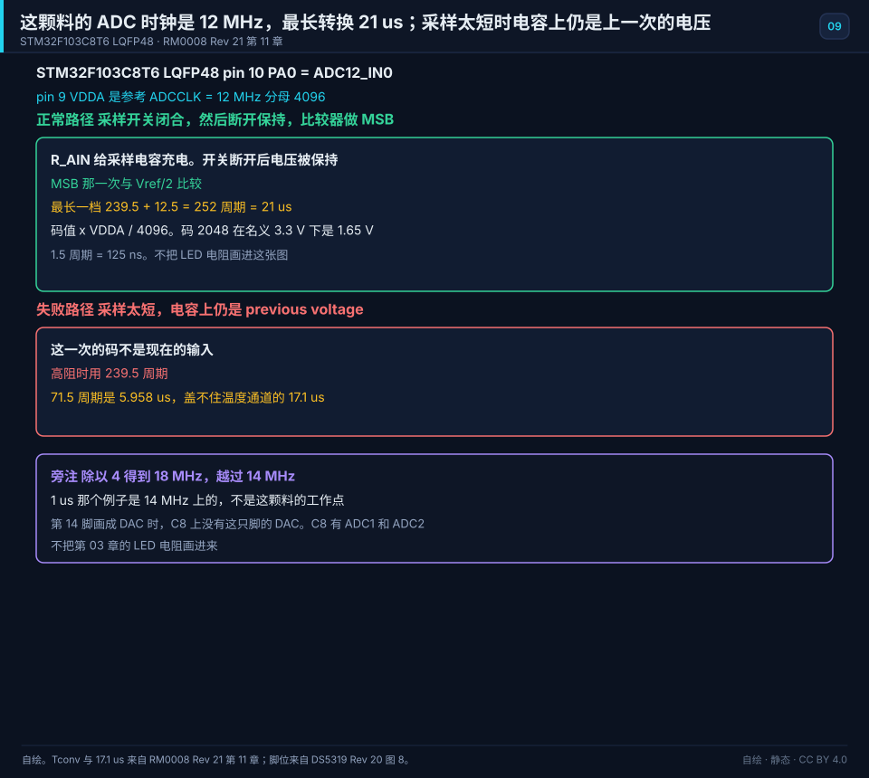
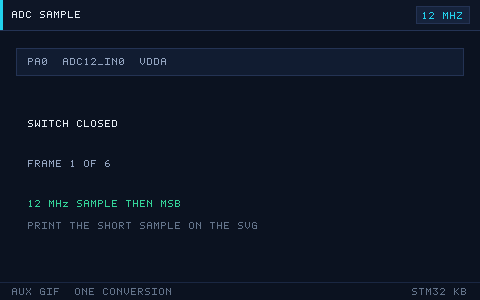

# 09 ADC and DAC
> 中文：[09 ADC 与 DAC](../09-ADC与DAC.md)

> An ADC turns an analog voltage into a number. A DAC turns a number back into an analog voltage. On an STM32 they are the two ends that touch the real world.

<p align="center">
  
  <br><sub>▲ Animation: ADC sample-and-hold plus successive-approximation (SAR) compare (vector animation drawn by the author, not a live recording)</sub>
</p>

<!-- video:ch09 -->
<p align="center">
  <video width="640" controls poster="../../assets/video/ch09-adc.png">
    <source src="../../assets/video/ch09-adc.mp4" type="video/mp4">
  </video>
  <br><sub>▲ Chinese voice-over, 2.6 min. Voice: Microsoft Edge neural voice zh-CN-XiaoxiaoNeural via edge-tts (library mostly LGPLv3; the voice model is an online Microsoft service, not an open model). Pictures are generated from this repo's SVGs, not photographs. Video: <a href="../../assets/video/ch09-adc.mp4">MP4</a> · subtitles: <a href="../../assets/video/ch09-adc.srt">SRT</a>. Rebuild with <code>python3 tools/gen_narrated.py --speak</code>.</sub>
</p>

**Narration script (Chinese, same text as the subtitles)**

1. 逐次逼近之前，要先让采样电容充满。源阻抗越大，需要的采样时间越长。充不满就转换，读数会偏向你上一次采过的电压。
2. F1 的 ADC 是 12 位。换算时用读数除以 4096，再乘参考电压。用 4095 做口算会有一个最小步长的差别。参考电压不是想当然的 3.3，要看你接到哪。
3. STM32F103C8 有 ADC，没有 DAC。把 F4 的 DAC 例程抄过来，编译或许能过，引脚上不会出现你要的模拟电压。换芯片前先看数据手册的功能表。
4. 这一帧是仓库画的逐次逼近：从最高位开始试，比参考大了就清掉，再试下一位。它帮助你记得，转换需要时间，不是把引脚读进来就结束。
5. 引脚要设成模拟输入，ADC 时钟要开，规则通道和采样时间都要写上。少一项，读数会停在一个奇怪的常数。先读一个已知电压，比如分压后的参考，再去测传感器。
6. 连续采样不要在每个转换完成里做重活。让 DMA 把结果搬进数组，半满和全满时再去算。Wokwi 的 BluePill 模型没有 DMA，这章的连续采样要在真板上对。
7. 读数乱跳时，先看参考电压和模拟地，再谈软件平均。平均能盖住一点噪声，盖不住一根飞线当成天线。实验板上，传感器线短一点，结果会诚实很多。
8. 口诀：采样看阻抗，换算除以 4096，C8 没有 DAC。三句分别挡住采不准、算不准、抄错芯片这三件最常见的事。
9. 实验用电位器做分压，两端接地和参考，中间进 ADC。慢慢旋转，读数应该单调变化。跳变或反向，先查接线和参考，不要先改分辨率。
10. 合上书，三问。采样时间主要看什么？12 位换算要除以多少？STM32F103C8 有没有 DAC？
<!-- /video:ch09 -->

## Principle and boundary

The sampling conclusion in this chapter is pinned to order code STM32F103C8T6. The sample clock is the 12 MHz from Appendix D. The conversion divisor is 4096. On a part that has a DAC, the sentence “this part has no DAC” is void. On an F4, the sentences “sample plus 12.5” and “calibrate after power-up” are void.

PCLK2 = 72 MHz, and `ADCPRE=10` (÷6) gives ADCCLK = 12 MHz. ÷4 gives 18 MHz and crosses 14 MHz. The prescaler sentence cross-references chapter file 02. This chapter does not redraw the clock tree. RM0008 prints `Tconv = 1 µs` at 14 MHz and 1.5 cycles. That is an example at the ceiling. This part's working point is 12 MHz. The four blocks do not put 1 µs and 21 µs in the same cell. Source: [RM0008 Rev 21 chapter 11](#source-rm0008-adc).

While the sample switch is closed, the input charges the sample capacitor through the source impedance. After the switch opens, the voltage on the capacitor is held. The converter then compares 12 times, starting at the MSB. Conversion time is the sample cycles plus 12.5 ADCCLK cycles. The longest sample step, 239.5 plus 12.5, is 252 cycles, and `252 / 12e6 = 21 µs`. At 12 MHz: 1.5 cycles = 125 ns, 13.5 cycles = 1.125 µs, 55.5 cycles = 4.625 µs, 71.5 cycles = 5.958 µs, and 239.5 cycles = 19.958 µs. The F4 sentence “sample plus 12 cycles” is void on this part.

The recommended sample time for the temperature sensor is 17.1 µs. `17.1e-6 × 12e6 = 205.2` cycles, so 239.5 cycles covers it and 71.5 cycles does not. The channel is ADC1 input 16. VREFINT is ADC1 input 17. The prose keeps “about 1.20 V” and does not invent a measured VDDA for one board. TSVREFE is in `ADC_CR2`. On a dual-ADC device that bit is only in ADC1. ADC2 channels 16 and 17 are tied to VSS. The temperature formula is `(V25 − VSENSE) / Avg_Slope + 25`. V25 ≈ 1.43 V and the slope ≈ 4.3 mV/°C are typical values from the electrical characteristics, not a guaranteed calibration. F4 `TS_CAL1`, `TS_CAL2`, and `VREFINT_CAL` are void on F103C8.

DS5319 says every medium-density device has two 12-bit ADCs. The C8 has ADC1 and ADC2. It has no ADC3 and no DAC. `HAL_DAC_Start` does nothing useful on this part. A DAC exists on high-density F103 parts and on F4. The DAC buffer, noise, and triangle wave stay in the core ideas, and they hold only after you change to a part that has a DAC. Source: [DS5319 Rev 20](#source-ds5319-adc).

LQFP48 pin 10 PA0 = ADC12_IN0, and pin 9 VDDA is the reference. This package has no separate VREF+. Packages with 100 pins and up have separate VREF+ / VREF−, and the C8 does not use that sentence. Pin 10 is the LED current pin in chapter file 03. When this figure draws it as an analog input, the chapter 03 sentence “write 1 to source current” is void at the same time. Do not redraw `sample-03-gpio-led.svg`. Pin 14 PA4 on the C8 is ADC12_IN4 / SPI1_NSS, not DAC_OUT1. Drawing a DAC on pin 14 is a failure note in the margin.

Voltage = code × VDDA / 4096. At a nominal 3.3 V, 1 LSB = `3.3 / 4096 ≈ 0.806` mV, the same cell as the 806 µV already in the chapter. Code 2048 is `2048 / 4096 = 1/2`, which is exactly 1.65 V at a nominal 3.3 V. A divisor of 4095 is off by one LSB.

RM0008 section 11.4: calibrate once after power-up. Before setting CAL in `ADC_CR2`, ADON has already been 1 for at least two ADC clocks. On the HAL side that is `HAL_ADCEx_Calibration_Start`, placed before Start. An F4 does not have this step, and that sentence is void when the family changes.

DMA is only a cross-reference to chapter file 10 and Appendix D: this part has only DMA1, and ADC1 is channel 1. Do not move the half-word or the “5 samples already written” arithmetic into this chapter.

## Key figures

<p align="center">
  
  <br><sub>▲ Drawn for this book. STM32F103C8T6, LQFP48 pin 10 PA0 = ADC12_IN0, pin 9 VDDA is the reference. ADCCLK = 12 MHz. The normal path closes the sample switch and then opens it, and the comparator takes the MSB step. The longest step is 239.5 + 12.5 = 21 µs, and the code is multiplied by VDDA / 4096. The failure path is a sample so short that the capacitor still holds the previous voltage. In the margin, ÷4 produces 18 MHz and crosses 14 MHz; a DAC drawn on pin 14 does not exist on the C8. The chapter 03 LED resistor is not on this figure. Sources: [RM0008 Rev 21 chapter 11](#source-rm0008-adc) and [DS5319 Rev 20 Figure 8](#source-ds5319-adc).</sub>
</p>

<p align="center">
  
  <br><sub>▲ Auxiliary figure for the web and the article channel. It only plays one successful sample and the MSB. Print uses the static figure. The short sample and 18 MHz are not on this GIF.</sub>
</p>

The opening `adc-sar.svg` stays a side figure. `sar-adc.gif` stays in its original section. Its pixels are not replaced.

## Timing or state

| Row | Sample cycles | Sample time | After adding 12.5 |
| --- | --- | --- | --- |
| Shortest | 1.5 | 125 ns | 14 / 12e6 |
| Longest | 239.5 | 19.958 µs | 252 / 12e6 = 21 µs |
| Temperature | 239.5, not 71.5 | 17.1 µs needs 205.2 cycles | 71.5 cycles is only 5.958 µs and does not cover it |
| Failure | — | — | ADCCLK = 18 MHz, which crosses 14 MHz. This row is not divided again into a second set of microseconds beside 21 µs |
| Conversion | — | — | Code 2048 is 1.65 V at a nominal 3.3 V, divisor 4096 |

The clock is 12 MHz. Source: [RM0008 Rev 21 chapter 11](#source-rm0008-adc).

## Pitfalls and source cards

| What you see | Why | What to do | Source | Claim this source may support |
| --- | --- | --- | --- | --- |
| The reading is still near the previous voltage | The sample time used the wrong clock | Lengthen the sample at 12 MHz. Use 239.5 cycles for a high impedance | [RM0008](#source-rm0008-adc) | Conversion time = sample + 12.5. At 12 MHz the longest 252 cycles is 21 µs |
| ADC was set to ÷4 to go faster | ADCPRE selected ÷4 | Change it back to ÷6, 12 MHz | [RM0008](#source-rm0008-adc) | 14 MHz is the ceiling. 18 MHz crosses it. The 1 µs example is at 14 MHz, not this part's working point |
| The temperature channel is noisy and the reading wanders | The sample does not cover 17.1 µs, or the channel is wrong | Cover at least 17.1 µs, use ADC1 channel 16, and set TSVREFE | [RM0008](#source-rm0008-adc) | 17.1 µs is 205.2 cycles at 12 MHz. VREFINT is ADC1 channel 17. ADC2 inputs 16 and 17 are tied to VSS |
| The first reading after power-up is shifted as a whole | There was no calibration | Calibrate before Start | [RM0008](#source-rm0008-adc) | Section 11.4: ADON has been 1 for at least two ADC clocks before CAL |
| The converted voltage reads higher than the meter | The divisor was 4095 | Use 4096 | [RM0008](#source-rm0008-adc) | A 12-bit full scale is 4096 steps. Code 2048 is half of full scale. The reference is pin 9 VDDA |
| HAL_DAC_Start on a Blue Pill leaves no analog voltage on PA4 | This C8 has no DAC | For an analog voltage use PWM plus an RC, or change to a part that has a DAC | [DS5319](#source-ds5319-adc) | Medium-density devices have two 12-bit ADCs. There is no ADC3 and no DAC. Pin 14 is not DAC_OUT1 |
| Pin 10 used to light an LED, and the sample looks like a push-pull read | The pin is still an output | While sampling, this pin is an analog input and no longer sources the chapter 03 current | [DS5319](#source-ds5319-adc) | LQFP48 pin 10 PA0 is ADC12_IN0. Do not rewrite the chapter 03 LED figure |

## 📌 Learning goals

- [ ] Know the quantitative relationship among resolution, reference voltage, and quantization error, and be able to estimate the voltage of 1 LSB.
- [ ] Understand the sample–hold–compare sequence of a successive-approximation (SAR) ADC, and choose the sample time from the source impedance.
- [ ] Configure the four conversion modes — single, continuous, scan, and discontinuous — and use DMA for multi-channel acquisition.
- [ ] Use the internal temperature sensor and Vrefint to work backward to the die temperature and the real VDDA.
- [ ] Know the DAC output modes, and how the output buffer changes accuracy and noise.

## 🧠 Core ideas

### 1. Resolution, reference voltage, and quantization error

**Conclusion**: At a 3.3 V reference, 1 LSB of a 12-bit ADC is about **0.806 mV**. The ideal quantization error is **±0.5 LSB**.

| Resolution N | Number of steps, 2^N | 1 LSB at Vref = 3.3 V | 1 LSB at Vref = 5.0 V | Notes |
| --- | --- | --- | --- | --- |
| 8-bit | 256 | 12.89 mV | 19.5 mV | Fast / coarse |
| 10-bit | 1024 | 3.22 mV | 4.88 mV | — |
| 12-bit | 4096 | 806 µV | 1.22 mV | Mainstream on STM32F1/F4 |
| 16-bit | 65536 | 50.4 µV | 76.3 µV | F3/G4/L4 and similar |

The formulas:

```
1 LSB        = Vref / 2^N                          (N-bit resolution)
V_in         = ADC_Code × Vref / 2^N               (proportional reading)
quantization error = ±0.5 LSB = ±Vref / 2^(N+1)   (ideal ADC, quantization only)
full-scale voltage = Vref × (2^N - 1) / 2^N ≈ Vref - 1 LSB
```

> ⚠️ On STM32F1, `Vref` is `VDDA` (the analog supply). They share a pin. Only packages with 100 pins or more have a separate `VREF+` / `VREF-`. So **VDDA ripple is a direct error in the reading**. For a precise measurement, either bring in an external reference, or measure Vrefint first and calibrate in software.

### 2. Successive approximation (SAR): sample-and-hold plus binary compare

**Conclusion**: A SAR ADC approaches the input voltage by binary search. An N-bit result needs N compares, and the bits are decided from MSB down to LSB.

The conversion, for 12 bits:

1. **Sample**: the sample switch closes. The external input charges the internal sample capacitor `C_ADC` through `R_AIN`, and the voltage on `C_ADC` follows the input.
2. **Hold**: the switch opens. The voltage on `C_ADC` is frozen and stays put for the rest of the conversion.
3. **Successive approximation (SAR)**: the comparator first compares the held voltage with `Vref/2` (MSB set to 1). If the input is larger, that bit stays; if it is smaller, the bit is cleared. Then it compares `Vref/4`, and so on. Twelve compares produce a 12-bit result.

<p align="center">
  
  <br><sub>▲ Animation: SAR ADC successive-approximation compare (program-generated raster animation, not a live recording)</sub>
</p>

**Sample time and source impedance** is the easiest place to get hurt. The sample switch and the signal source form an RC charge path. The capacitor has to charge to within 1/2 LSB during the sample time. ST's rule of thumb is:

```
t_s (minimum) ≈ (R_AIN + R_ADC) × C_ADC × ln(2^(N+2))
For STM32F1: R_ADC ≈ 1 kΩ, C_ADC ≈ 8 pF, N = 12 → ln(2^14) ≈ 9.7
```

| Source impedance R_AIN | Minimum sample time t_s (an estimate, not a source card) | Sample step on this part at ADCCLK = 12 MHz | Notes |
| --- | --- | --- | --- |
| ≤ 1 kΩ | ≈ 78 ns | `000` = 1.5 cycles (125 ns) | Op-amp drive, or a small divider |
| ≈ 10 kΩ | ≈ 0.78 µs | `010` = 13.5 cycles (1.125 µs) | A typical potentiometer |
| ≈ 50 kΩ | ≈ 3.9 µs | `101` = 55.5 cycles (4.625 µs) | A high-impedance sensor |
| ≈ 100 kΩ | ≈ 7.8 µs | `111` = 239.5 cycles (19.958 µs) | Use this step for a high impedance |
| ≥ 1 MΩ | ≥ 78 µs | 239.5 cycles is still not enough | **You must add a voltage-follower buffer** |

The 1 µs that RM0008 prints at 14 MHz and 1.5 cycles is an example at the ceiling. 71.5 cycles is 5.958 µs at 12 MHz and does not cover the temperature channel's 17.1 µs. Times that share a cell with 21 µs use 12 MHz only. The F4 column “t_s + 12 cycles” in the comparison table is void on this part.

During a scan, a high-impedance channel can pick up the previous channel if that capacitor has not finished discharging. Lengthen the sample, or insert a gap in the sequence. This sentence does not enter a source card.

On F1, `SMPx[2:0]` can be 1.5 / 7.5 / 13.5 / 28.5 / 41.5 / 55.5 / 71.5 / 239.5 ADCCLK cycles (see RM0008, Chapter 11, ADC, "Channel-wise programmable sampling time"). **The higher the source impedance, the longer the sample time has to be.** Otherwise the reading sits low and wobbles.

### 3. Four conversion modes

**Conclusion**: Single is for sampling on demand and saving power. Continuous is for live monitoring. Scan walks several channels. Discontinuous means "one trigger converts a group."

| Mode | Key bits | Behavior | Typical use |
| --- | --- | --- | --- |
| Single | `CR2.CONT=0` plus a software or external trigger | One trigger, one conversion, then stop | Battery-voltage patrol |
| Continuous | `CR2.CONT=1` | Restarts as soon as it finishes; the data keeps refreshing | Live waveform / monitoring |
| Scan | `CR2.SCAN=1` | Converts the channels in the SQR sequence, in order | Polling several sensors |
| Discontinuous | `CR1.DISCEN=1`, `DISCNUM` | Each trigger converts only n channels, then pauses | Grouped sampling |
| External trigger | `CR2.EXTSEL` / `EXTTRIG` | A timer or EXTI triggers the regular group | Sampling locked to PWM |

The regular group holds up to 16 conversions in the sequence. The injected group holds up to 4, and it can interrupt the regular group. That is the "urgent" sample used for motor current.

### 4. Multi-channel plus DMA

**Conclusion**: The standard shape for fast multi-channel acquisition is scan mode plus continuous conversion plus circular DMA. The CPU does not take part at all.

- In scan mode, each finished channel raises one DMA request (`CR2.DMA=1`) and moves `DR` into an array in memory.
- DMA runs in **circular mode**. The array wraps by itself and becomes a ring buffer.
- Data alignment, `CR2.ALIGN`: right-aligned (the default; the low 12 bits are valid) or left-aligned (the high 12 bits are valid, which makes a direct compare against a 16-bit integer easy).
- An STM32F103C8 has ADC1 and ADC2. It has no ADC3 and no DAC. This part has only DMA1, and ADC1 is channel 1. Half-word and CNDTR arithmetic stays in chapter file 10.

| Item | F1 (RM0008, Chapter 11) | F4 (RM0090, Chapter 13) |
| --- | --- | --- |
| Resolution | 12-bit | 12-bit |
| Maximum sample rate | 1 MSPS (ADCCLK = 14 MHz) | 2.4 MSPS (triple interleaved can reach 7.2 MSPS) |
| Regular channels | 16 | 16 |
| Injected channels | 4 | 4 |
| Conversion time | t_s + 12.5 cycles | t_s + 12 cycles |
| Internal channels | Temperature CH16, Vrefint CH17 | Temperature, Vrefint, VBAT |

### 5. Internal temperature sensor and Vrefint

**Conclusion**: The temperature sensor and Vrefint are "internal channels" of the ADC. You get the die temperature and the real VDDA for free, and you use them to calibrate the external readings.

**Temperature (F1, RM0008 Chapter 11, "Temperature sensor")**: set `CR2.TSVREFE=1` to enable it, and select channel 16.

```
V_sense = V25 - Slope × (T - 25)
=> T(°C) = (V25 - V_sense) / Slope + 25
F1 typical values: V25 ≈ 1.43 V, Slope ≈ 4.3 mV/°C
```

**Working backward from Vrefint to VDDA**: channel 17 measures a fixed internal reference of about 1.20 V.

```
VDDA       = 1.20 V × 4096 / ADC_Read(Vrefint_CH17)
real V_in  = ADC_Read(ch) × VDDA / 4096
```

> F4, L4, and similar families provide **factory calibration values**: `TS_CAL1` (30°C), `TS_CAL2` (110°C), and `VREFINT_CAL`. They live in the system memory area. Read them directly. They are far more accurate than looking up a typical value.

### 6. DAC output modes, the buffer, and noise

**Conclusion**: The F1 DAC is 12-bit and dual-channel. The output voltage is `V_out = Vref × DOR / 4096`. The output buffer can drive a heavier load, but it adds offset and cannot swing all the way to the rails.

| Feature | What it means | Key bits / registers |
| --- | --- | --- |
| Resolution | 12-bit, two channels, DAC1 and DAC2 | `DHR12Rx` / `DHR12Lx` / `DHR8Rx` |
| Output buffer | When enabled it can drive a real load, but the output cannot reach the 0 V or VDDA rail | `DAC_CR.BOFFx` |
| Trigger mode | A timer or EXTI updates the output; triangle and noise can be configured | `DAC_CR.TSELx` / `TENx` |
| Noise / triangle | Built-in LFSR noise and a triangle-wave generator | `DAC_CR.WAVEx` / `MAMPx` |
| DMA | Continuous update by DMA (pair it with a timer for an arbitrary waveform) | `DAC_CR.DMAENx` |

- With the **buffer off**, the output impedance is high (≈15 kΩ). The pin can get close to the full swing, which suits a high-impedance load. With the buffer **on**, it drives a heavier load, but the typical offset is ±10 mV and it cannot reach the rails.
- Noise comes from VDDA ripple, coupling from digital switching, buffer noise, and LSB quantization noise. For precision work, add an external RC low-pass or an op-amp buffer.
- To make a sine or an arbitrary waveform: a timer trigger plus circular DMA of a lookup table. The trigger rate sets the output frequency.

> The F103C8 (the part you usually find on a BluePill) **has no DAC**. The DAC shows up on high-density F103 (xC / xD / xE) and on F4. On a medium-density part, analog voltage means PWM plus an RC, or an external DAC chip.

## 🛠️ Hardware and wiring

| Board | Function | Pin | Notes |
| --- | --- | --- | --- |
| BluePill / Nucleo F103 | ADC1_IN0 | PA0 | Analog input. Do not use it as GPIO as well |
| Same | Internal temperature / Vrefint | No external pin | F1 channels 16 / 17. Enable TSVREFE first |
| Parts that have a DAC | DAC_OUT1 | PA4 | The F103C8 does not have DAC on this pin |

Pick the source impedance from the sample-time table above. Put a follower in front of a high-impedance sensor. Do not try to brute-force it by stretching the sample time out to 239.5 cycles.

## 💻 Code

**Conclusion**: On F1 you must calibrate once before you start a conversion. Use DMA for continuous multi-channel acquisition. Polling is enough for a single slow signal.

```c
HAL_ADCEx_Calibration_Start(&hadc1);          /* Required on F1; F4 does not have this step */
HAL_ADC_Start(&hadc1);
HAL_ADC_PollForConversion(&hadc1, 10);
uint16_t code = HAL_ADC_GetValue(&hadc1);
/* voltage = code * VDDA / 4096; the divisor is 4096, not 4095 */
```

Circular multi-channel moves are in [`examples/adc-dma/`](../../examples/adc-dma/). Calibrate before `HAL_ADC_Start_DMA` as well. Handle the first half in the half-transfer callback, and the second half in the transfer-complete callback.

A timer trigger (TRGO) makes the sample interval independent of the main loop:

```c
TIM_MasterConfigTypeDef mst = {0};
mst.MasterOutputTrigger = TIM_TRGO_UPDATE;
mst.MasterSlaveMode     = TIM_MASTERSLAVEMODE_DISABLE;
HAL_TIMEx_MasterConfigSynchronization(&htim3, &mst);
/* ADC external trigger source: TIM3_TRGO, then HAL_ADC_Start */
```

Write the next block only on a chip that has a DAC. On an F103C8 the call does nothing useful. Do not copy it onto a BluePill:

```c
HAL_DAC_Start(&hdac, DAC_CHANNEL_1);
HAL_DAC_SetValue(&hdac, DAC_CHANNEL_1, DAC_ALIGN_12B_R, 2048); /* 2048 / 4096 = 1/2, which is 1.65 V at a nominal 3.3 V */
```

## 🧪 Hands-on labs

1. **Potentiometer**: wire the wiper of a 10 kΩ potentiometer to PA0, and the two ends to 3.3 V and GND. Print the code and `code * 3.3f / 4096` on the UART. Expected: the ends land near 0 V and 3.3 V, and the middle is about 1.65 V (code about 2048).
2. **Internal reference**: read Vrefint and work backward with `VDDA = 1.20f * 4096 / code`. Expected: on USB power, VDDA sits near 3.3 V. The exact number is whatever your meter says. This page does not give a "standard measured value."
3. **Sample-time comparison**: use the same high-impedance divider. Take 100 readings at 1.5 cycles and 100 at 239.5 cycles. Expected: the short sample time has a low mean and a large variance.

### 7. Calibration, the analog watchdog, and injected channels

**Conclusion**: Calibration is done once on F1, after power-up and before Start. The analog watchdog's job is "interrupt the CPU only when the value leaves the window." An injected channel can cut in line without disturbing the regular group's DMA.

| Feature | When to use it | HAL |
| --- | --- | --- |
| Calibration | On F1, every power-up, before Start | `HAL_ADCEx_Calibration_Start` |
| Analog watchdog | Enter the interrupt only when the voltage leaves the window | `HAL_ADC_AnalogWDGConfig` |
| Injected group | The regular group's DMA is already running, and you occasionally insert one channel | `HAL_ADCEx_InjectedStart_IT` |

The injected group holds at most 4 channels. Do not mix the regular group's DMA buffer and the injected results in the same array.

### 8. Channels and pins (F103 ADC1)

| Channel | Pin / source |
| --- | --- |
| IN0 through IN7 | PA0 through PA7 |
| IN8, IN9 | PB0, PB1 |
| IN16 | On-chip temperature sensor |
| IN17 | Vrefint (about 1.20 V) |

Other packages, and the F4 channel table, follow the pinout in that part's datasheet. Do not stretch this table onto an H7.

### 9. Self-test

1. 12-bit, VREF = 3.3 V. What voltage does code 2048 correspond to? Why is it not `2048/4095*3.3`?
2. SAR is testing bit10, and bit11 has already been kept. Should the trial value be 3072 or 1024?
3. Why should an F103C8 project not contain `HAL_DAC_Start`?

Motto: **sample time follows impedance, conversion divides by 4096, and the C8 has no DAC.**

## 🔗 Related resources

- RM0008, Chapter 11 ADC, and Chapter 12 DAC (the DAC exists only on high-density parts).
- Datasheet DS5319: ADC pins, sample time, and source impedance.
- Example: [`examples/adc-dma/`](../../examples/adc-dma/).
- Figures: [`assets/animations/adc-sar.svg`](../../assets/animations/adc-sar.svg), [`assets/gif/sar-adc.gif`](../../assets/gif/sar-adc.gif) (drawn by the author / program-generated, not a live recording).
