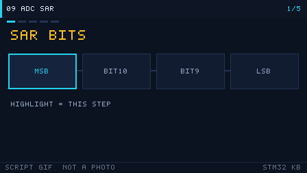

# 09 ADC and DAC
> 中文：[09 ADC 与 DAC](../09-ADC与DAC.md)

> An ADC turns an analog voltage into a number. A DAC turns a number back into an analog voltage. On an STM32 they are the two ends that touch the real world.

<p align="center">
  
  <br><sub>▲ Animation: ADC sample-and-hold plus successive-approximation (SAR) compare (vector animation drawn by the author, not a live recording)</sub>
</p>

<!-- video:ch09 -->
<p align="center">
  
  <br><sub>▲ Lecture slides for this chapter: a generated GIF (tools/gen_videos.py, reproducible, not a live recording). The narration lines up with the five frames, one to one.</sub>
</p>

**Narration (read along with the frames, about one minute)**

1. SAR starts guessing from the highest bit. Each step, the comparator decides whether that bit stays 1 or becomes 0.
2. Sample time has to cover the source impedance. If the potentiometer resistance is too high, the result drifts.
3. Turn a 12-bit result into a voltage: multiply the code by Vref, then divide by 4096. The divisor is 4096, not 4095.
4. The F103C8 has no DAC. To output an analog voltage, switch to a part that has a DAC, or add an external chip.
5. Motto: sample time follows impedance, conversion divides by 4096, and the C8 has no DAC.
<!-- /video:ch09 -->


## 📌 Learning goals

- [ ] Know the quantitative relationship among resolution, reference voltage, and quantization error, and be able to estimate the voltage of 1 LSB.
- [ ] Understand the sample–hold–compare sequence of a successive-approximation (SAR) ADC, and choose the sample time from the source impedance.
- [ ] Configure the four conversion modes — single, continuous, scan, and discontinuous — and use DMA for multi-channel acquisition.
- [ ] Use the internal temperature sensor and Vrefint to work backward to the die temperature and the real VDDA.
- [ ] Know the DAC output modes, and how the output buffer changes accuracy and noise.

## 🧠 Core ideas

### 1. Resolution, reference voltage, and quantization error

**Conclusion**: At a 3.3 V reference, 1 LSB of a 12-bit ADC is about **0.806 mV**. The ideal quantization error is **±0.5 LSB**.

| Resolution N | Number of steps, 2^N | 1 LSB at Vref = 3.3 V | 1 LSB at Vref = 5.0 V | Notes |
| --- | --- | --- | --- | --- |
| 8-bit | 256 | 12.89 mV | 19.5 mV | Fast / coarse |
| 10-bit | 1024 | 3.22 mV | 4.88 mV | — |
| 12-bit | 4096 | 806 µV | 1.22 mV | Mainstream on STM32F1/F4 |
| 16-bit | 65536 | 50.4 µV | 76.3 µV | F3/G4/L4 and similar |

The formulas:

```
1 LSB        = Vref / 2^N                          (N-bit resolution)
V_in         = ADC_Code × Vref / 2^N               (proportional reading)
quantization error = ±0.5 LSB = ±Vref / 2^(N+1)   (ideal ADC, quantization only)
full-scale voltage = Vref × (2^N - 1) / 2^N ≈ Vref - 1 LSB
```

> ⚠️ On STM32F1, `Vref` is `VDDA` (the analog supply). They share a pin. Only packages with 100 pins or more have a separate `VREF+` / `VREF-`. So **VDDA ripple is a direct error in the reading**. For a precise measurement, either bring in an external reference, or measure Vrefint first and calibrate in software.

### 2. Successive approximation (SAR): sample-and-hold plus binary compare

**Conclusion**: A SAR ADC approaches the input voltage by binary search. An N-bit result needs N compares, and the bits are decided from MSB down to LSB.

The conversion, for 12 bits:

1. **Sample**: the sample switch closes. The external input charges the internal sample capacitor `C_ADC` through `R_AIN`, and the voltage on `C_ADC` follows the input.
2. **Hold**: the switch opens. The voltage on `C_ADC` is frozen and stays put for the rest of the conversion.
3. **Successive approximation (SAR)**: the comparator first compares the held voltage with `Vref/2` (MSB set to 1). If the input is larger, that bit stays; if it is smaller, the bit is cleared. Then it compares `Vref/4`, and so on. Twelve compares produce a 12-bit result.

<p align="center">
  
  <br><sub>▲ Animation: SAR ADC successive-approximation compare (program-generated raster animation, not a live recording)</sub>
</p>

**Sample time and source impedance** is the easiest place to get hurt. The sample switch and the signal source form an RC charge path. The capacitor has to charge to within 1/2 LSB during the sample time. ST's rule of thumb is:

```
t_s (minimum) ≈ (R_AIN + R_ADC) × C_ADC × ln(2^(N+2))
For STM32F1: R_ADC ≈ 1 kΩ, C_ADC ≈ 8 pF, N = 12 → ln(2^14) ≈ 9.7
```

| Source impedance R_AIN | Minimum sample time t_s | F1 recommended SMPx (ADCCLK = 14 MHz) | Notes |
| --- | --- | --- | --- |
| ≤ 1 kΩ | ≈ 78 ns | `000` = 1.5 cycles (≈107 ns) | Op-amp drive, or a small divider |
| ≈ 10 kΩ | ≈ 0.78 µs | `010` = 13.5 cycles (≈0.96 µs) | A typical potentiometer |
| ≈ 50 kΩ | ≈ 3.9 µs | `101` = 55.5 cycles (≈3.96 µs) | A high-impedance sensor |
| ≈ 100 kΩ | ≈ 7.8 µs | `111` = 239.5 cycles (≈17 µs) | You also need to slow ADCCLK |
| ≥ 1 MΩ | ≥ 78 µs | 239.5 cycles is still not enough | **You must add a voltage-follower buffer** |

On F1, `SMPx[2:0]` can be 1.5 / 7.5 / 13.5 / 28.5 / 41.5 / 55.5 / 71.5 / 239.5 ADCCLK cycles (see RM0008, Chapter 11, ADC, "Channel-wise programmable sampling time"). **The higher the source impedance, the longer the sample time has to be.** Otherwise the reading sits low and wobbles.

### 3. Four conversion modes

**Conclusion**: Single is for sampling on demand and saving power. Continuous is for live monitoring. Scan walks several channels. Discontinuous means "one trigger converts a group."

| Mode | Key bits | Behavior | Typical use |
| --- | --- | --- | --- |
| Single | `CR2.CONT=0` plus a software or external trigger | One trigger, one conversion, then stop | Battery-voltage patrol |
| Continuous | `CR2.CONT=1` | Restarts as soon as it finishes; the data keeps refreshing | Live waveform / monitoring |
| Scan | `CR2.SCAN=1` | Converts the channels in the SQR sequence, in order | Polling several sensors |
| Discontinuous | `CR1.DISCEN=1`, `DISCNUM` | Each trigger converts only n channels, then pauses | Grouped sampling |
| External trigger | `CR2.EXTSEL` / `EXTTRIG` | A timer or EXTI triggers the regular group | Sampling locked to PWM |

The regular group holds up to 16 conversions in the sequence. The injected group holds up to 4, and it can interrupt the regular group. That is the "urgent" sample used for motor current.

### 4. Multi-channel plus DMA

**Conclusion**: The standard shape for fast multi-channel acquisition is scan mode plus continuous conversion plus circular DMA. The CPU does not take part at all.

- In scan mode, each finished channel raises one DMA request (`CR2.DMA=1`) and moves `DR` into an array in memory.
- DMA runs in **circular mode**. The array wraps by itself and becomes a ring buffer.
- Data alignment, `CR2.ALIGN`: right-aligned (the default; the low 12 bits are valid) or left-aligned (the high 12 bits are valid, which makes a direct compare against a 16-bit integer easy).
- An F1 has only one ADC (only high-density parts have ADC3). ADC1 and ADC2 share DMA1 channel 1.

| Item | F1 (RM0008, Chapter 11) | F4 (RM0090, Chapter 13) |
| --- | --- | --- |
| Resolution | 12-bit | 12-bit |
| Maximum sample rate | 1 MSPS (ADCCLK = 14 MHz) | 2.4 MSPS (triple interleaved can reach 7.2 MSPS) |
| Regular channels | 16 | 16 |
| Injected channels | 4 | 4 |
| Conversion time | t_s + 12.5 cycles | t_s + 12 cycles |
| Internal channels | Temperature CH16, Vrefint CH17 | Temperature, Vrefint, VBAT |

### 5. Internal temperature sensor and Vrefint

**Conclusion**: The temperature sensor and Vrefint are "internal channels" of the ADC. You get the die temperature and the real VDDA for free, and you use them to calibrate the external readings.

**Temperature (F1, RM0008 Chapter 11, "Temperature sensor")**: set `CR2.TSVREFE=1` to enable it, and select channel 16.

```
V_sense = V25 - Slope × (T - 25)
=> T(°C) = (V25 - V_sense) / Slope + 25
F1 typical values: V25 ≈ 1.43 V, Slope ≈ 4.3 mV/°C
```

**Working backward from Vrefint to VDDA**: channel 17 measures a fixed internal reference of about 1.20 V.

```
VDDA       = 1.20 V × 4096 / ADC_Read(Vrefint_CH17)
real V_in  = ADC_Read(ch) × VDDA / 4096
```

> F4, L4, and similar families provide **factory calibration values**: `TS_CAL1` (30°C), `TS_CAL2` (110°C), and `VREFINT_CAL`. They live in the system memory area. Read them directly. They are far more accurate than looking up a typical value.

### 6. DAC output modes, the buffer, and noise

**Conclusion**: The F1 DAC is 12-bit and dual-channel. The output voltage is `V_out = Vref × DOR / 4096`. The output buffer can drive a heavier load, but it adds offset and cannot swing all the way to the rails.

| Feature | What it means | Key bits / registers |
| --- | --- | --- |
| Resolution | 12-bit, two channels, DAC1 and DAC2 | `DHR12Rx` / `DHR12Lx` / `DHR8Rx` |
| Output buffer | When enabled it can drive a real load, but the output cannot reach the 0 V or VDDA rail | `DAC_CR.BOFFx` |
| Trigger mode | A timer or EXTI updates the output; triangle and noise can be configured | `DAC_CR.TSELx` / `TENx` |
| Noise / triangle | Built-in LFSR noise and a triangle-wave generator | `DAC_CR.WAVEx` / `MAMPx` |
| DMA | Continuous update by DMA (pair it with a timer for an arbitrary waveform) | `DAC_CR.DMAENx` |

- With the **buffer off**, the output impedance is high (≈15 kΩ). The pin can get close to the full swing, which suits a high-impedance load. With the buffer **on**, it drives a heavier load, but the typical offset is ±10 mV and it cannot reach the rails.
- Noise comes from VDDA ripple, coupling from digital switching, buffer noise, and LSB quantization noise. For precision work, add an external RC low-pass or an op-amp buffer.
- To make a sine or an arbitrary waveform: a timer trigger plus circular DMA of a lookup table. The trigger rate sets the output frequency.

> The F103C8 (the part you usually find on a BluePill) **has no DAC**. The DAC shows up on high-density F103 (xC / xD / xE) and on F4. On a medium-density part, analog voltage means PWM plus an RC, or an external DAC chip.

## 🛠️ Hardware and wiring

| Board | Function | Pin | Notes |
| --- | --- | --- | --- |
| BluePill / Nucleo F103 | ADC1_IN0 | PA0 | Analog input. Do not use it as GPIO as well |
| Same | Internal temperature / Vrefint | No external pin | F1 channels 16 / 17. Enable TSVREFE first |
| Parts that have a DAC | DAC_OUT1 | PA4 | The F103C8 does not have DAC on this pin |

Pick the source impedance from the sample-time table above. Put a follower in front of a high-impedance sensor. Do not try to brute-force it by stretching the sample time out to 239.5 cycles.

## 💻 Code

**Conclusion**: On F1 you must calibrate once before you start a conversion. Use DMA for continuous multi-channel acquisition. Polling is enough for a single slow signal.

```c
HAL_ADCEx_Calibration_Start(&hadc1);          /* Required on F1; F4 does not have this step */
HAL_ADC_Start(&hadc1);
HAL_ADC_PollForConversion(&hadc1, 10);
uint16_t code = HAL_ADC_GetValue(&hadc1);
/* voltage = code * VDDA / 4096; the divisor is 4096, not 4095 */
```

Circular multi-channel moves are in [`examples/adc-dma/`](../../examples/adc-dma/). Calibrate before `HAL_ADC_Start_DMA` as well. Handle the first half in the half-transfer callback, and the second half in the transfer-complete callback.

A timer trigger (TRGO) makes the sample interval independent of the main loop:

```c
TIM_MasterConfigTypeDef mst = {0};
mst.MasterOutputTrigger = TIM_TRGO_UPDATE;
mst.MasterSlaveMode     = TIM_MASTERSLAVEMODE_DISABLE;
HAL_TIMEx_MasterConfigSynchronization(&htim3, &mst);
/* ADC external trigger source: TIM3_TRGO, then HAL_ADC_Start */
```

Write the next block only on a chip that has a DAC. On an F103C8 the call does nothing useful. Do not copy it onto a BluePill:

```c
HAL_DAC_Start(&hdac, DAC_CHANNEL_1);
HAL_DAC_SetValue(&hdac, DAC_CHANNEL_1, DAC_ALIGN_12B_R, 2048); /* about VREF/2 */
```

## ⚠️ Pitfalls and troubleshooting

| What you see | Cause | Fix |
| --- | --- | --- |
| The reading sits low and jumps around | Sample time is shorter than the source impedance needs | Lengthen the sample time, or add a follower |
| The converted voltage reads higher than the meter | You divided by 4095 | Use code × VREF / 4096 |
| The first reading after power-up on F1 is off | No calibration | Call `HAL_ADCEx_Calibration_Start` before Start |
| Channels bleed into each other | In scan mode the previous channel has not finished discharging | Lengthen the sample time on high-impedance channels, or insert a gap |
| You expected a BluePill to produce an analog voltage | The C8 has no DAC | Use PWM plus RC, or move to a high-density part or an F4 |
| The DMA buffer only has the new half | Half-word transfers, but you treated the half-transfer as a byte count | 4 half-words = 8 bytes. See [Chapter 10](10-dma.md) |

## 🧪 Hands-on labs

1. **Potentiometer**: wire the wiper of a 10 kΩ potentiometer to PA0, and the two ends to 3.3 V and GND. Print the code and `code * 3.3f / 4096` on the UART. Expected: the ends land near 0 V and 3.3 V, and the middle is about 1.65 V (code about 2048).
2. **Internal reference**: read Vrefint and work backward with `VDDA = 1.20f * 4096 / code`. Expected: on USB power, VDDA sits near 3.3 V. The exact number is whatever your meter says. This page does not give a "standard measured value."
3. **Sample-time comparison**: use the same high-impedance divider. Take 100 readings at 1.5 cycles and 100 at 239.5 cycles. Expected: the short sample time has a low mean and a large variance.

### 7. Calibration, the analog watchdog, and injected channels

**Conclusion**: Calibration is done once on F1, after power-up and before Start. The analog watchdog's job is "interrupt the CPU only when the value leaves the window." An injected channel can cut in line without disturbing the regular group's DMA.

| Feature | When to use it | HAL |
| --- | --- | --- |
| Calibration | On F1, every power-up, before Start | `HAL_ADCEx_Calibration_Start` |
| Analog watchdog | Enter the interrupt only when the voltage leaves the window | `HAL_ADC_AnalogWDGConfig` |
| Injected group | The regular group's DMA is already running, and you occasionally insert one channel | `HAL_ADCEx_InjectedStart_IT` |

The injected group holds at most 4 channels. Do not mix the regular group's DMA buffer and the injected results in the same array.

### 8. Channels and pins (F103 ADC1)

| Channel | Pin / source |
| --- | --- |
| IN0 through IN7 | PA0 through PA7 |
| IN8, IN9 | PB0, PB1 |
| IN16 | On-chip temperature sensor |
| IN17 | Vrefint (about 1.20 V) |

Other packages, and the F4 channel table, follow the pinout in that part's datasheet. Do not stretch this table onto an H7.

### 9. Self-test

1. 12-bit, VREF = 3.3 V. What voltage does code 2048 correspond to? Why is it not `2048/4095*3.3`?
2. SAR is testing bit10, and bit11 has already been kept. Should the trial value be 3072 or 1024?
3. Why should an F103C8 project not contain `HAL_DAC_Start`?

Motto: **sample time follows impedance, conversion divides by 4096, and the C8 has no DAC.**

## 🔗 Related resources

- RM0008, Chapter 11 ADC, and Chapter 12 DAC (the DAC exists only on high-density parts).
- Datasheet DS5319: ADC pins, sample time, and source impedance.
- Example: [`examples/adc-dma/`](../../examples/adc-dma/).
- Figures: [`assets/animations/adc-sar.svg`](../../assets/animations/adc-sar.svg), [`assets/gif/sar-adc.gif`](../../assets/gif/sar-adc.gif) (drawn by the author / program-generated, not a live recording).
