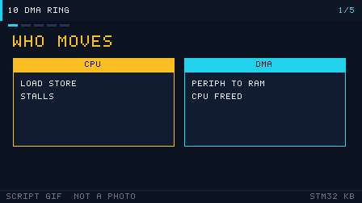

# 10 DMA
> 中文：[10 DMA](../10-DMA.md)

> DMA (direct memory access) moves data between a peripheral and memory on its own. The CPU does not have to touch every byte, so the cycles stay available for the actual computation.

<p align="center">
  
  <br><sub>▲ Animation: DMA circular mode moving ADC data while the CPU does other work (vector animation drawn by the author, not a live recording)</sub>
</p>

<!-- video:ch10 -->
<p align="center">
  
  <br><sub>▲ Lecture slides for this chapter: a generated GIF (tools/gen_videos.py, reproducible, not a live recording). The narration lines up with the five frames, one to one.</sub>
</p>

**Narration (read along with the frames, about one minute)**

1. DMA moves the data for the CPU. The CPU keeps computing, and peripheral data walks into memory by itself.
2. F1 calls them channels. F4 calls them streams. The map is in the reference manual. Do not pick one by feel.
3. Circular mode treats the buffer as a ring. The count left in NDTR tells you where the write has reached.
4. On a half-word transfer, the half-full interrupt is counted in elements. Multiply by 2 to get bytes.
5. Motto: what is left is in NDTR. Self-test: in circular mode, who rewinds the pointer?
<!-- /video:ch10 -->


## 📌 Learning goals

- [ ] Describe the DMA controller layout: the F1 "channel" model, and the F4 "stream × channel" model.
- [ ] Look up the request map and connect a peripheral request to the right channel or stream.
- [ ] Know peripheral↔memory, memory↔memory, normal and circular mode, the FIFO (F4), and double buffering.
- [ ] Use the transfer-complete (TC) and half-transfer (HT) interrupts to process data while it is still arriving.
- [ ] Understand bus contention between DMA and the CPU, and the cache-coherency problem on H7 and F7.

## 🧠 Core ideas

### 1. Controller layout: F1 "channels" vs F4 "stream × channel"

**Conclusion**: On F1, a peripheral request is fixed to one DMA channel. On F4, you first bind the request to a stream, then pick the channel with `CHSEL`. That is more flexible.

| Item | STM32F1 (RM0008, Chapter 10, DMA controller) | STM32F4 (RM0090, Chapter 9, DMA controller) |
| --- | --- | --- |
| Controllers | DMA1 (7 channels), DMA2 (5 channels, high-density) | DMA1 and DMA2, 8 streams each |
| Request binding | Each channel serves a fixed set of peripherals (see the map) | Each stream has 8 channels; `SxCR.CHSEL` selects one |
| Priority | Fixed priority between channels, plus a software priority | 4 software priority levels, plus arbitration by stream number |
| FIFO | None | Yes (4 × 32-bit), with burst support |
| Double buffer | None | Yes (double-buffer mode) |
| Data width | 8 / 16 / 32-bit | 8 / 16 / 32-bit |
| Memory↔memory | Supported (`CCR.MEM2MEM`) | Supported |

### 2. The request map (picking the right channel or stream is the whole game)

**F1 DMA1 request map (excerpt; the full tables are RM0008 Table 78 and Table 79)**:

| Channel | Main requests (excerpt) |
| --- | --- |
| CH1 | ADC1, TIM2_CH3, TIM4_CH1 |
| CH2 | SPI1_RX, USART3_TX, TIM1_CH1, TIM3_CH3 |
| CH3 | SPI1_TX, USART3_RX, TIM1_CH2, TIM3_CH4 |
| CH4 | SPI2/I2S2_RX, USART1_TX, I2C2_TX, TIM1_CH4 |
| CH5 | SPI2/I2S2_TX, USART1_RX, I2C2_RX, TIM1_UP |
| CH6 | USART2_RX, I2C1_TX, TIM1_CH3, TIM3_CH1 |
| CH7 | USART2_TX, I2C1_RX, TIM2_UP, TIM4_CH2 |

**Typical F4 requests (RM0090 Table 42 and Table 43)**:

| Peripheral request | Controller / stream | Channel |
| --- | --- | --- |
| ADC1 | DMA2 Stream0 / Stream4 | CH0 |
| SPI1_RX | DMA2 Stream0 / Stream2 | CH3 |
| SPI1_TX | DMA2 Stream3 / Stream5 | CH3 |
| USART1_TX | DMA2 Stream7 | CH4 |
| USART1_RX | DMA2 Stream5 | CH4 |
| TIM1_CH1 | DMA2 Stream1 / Stream5 | CH6 |

> A memory hook: **on F4, TX and RX of the same peripheral often use different streams but the same channel.** When you look at the table, settle the stream first, then the channel.

### 3. Transfer direction and operating modes

| Mode / setting | Key bits | What it means |
| --- | --- | --- |
| Peripheral → memory | `DIR=0` (F4) / `CCR.DIR` | ADC or UART_RX into an array |
| Memory → peripheral | `DIR=1` | An array out to UART_TX or the DAC |
| Memory → memory | `MEM2MEM=1` | A fast memcpy (F1 supports this too) |
| Normal mode | `CIRC=0` | Stop after N items (raises the TC interrupt) |
| Circular mode | `CIRC=1` | Wrap automatically and keep refreshing |
| Pointer increment | `PINC` / `MINC` | Memory usually increments; a peripheral register does not |
| Data width | `PSIZE` / `MSIZE` | Source and destination can differ; DMA packs the data |
| Priority | `PL` | Low / medium / high / very high |
| FIFO / burst | `FCR` (F4) | Accumulate, then take the bus, so you occupy it less often |
| Double buffer | `DBM` (F4) | Two memory regions alternate, so processing and moving overlap |

### 4. Interrupts

| Interrupt | When it fires | Use |
| --- | --- | --- |
| TC (transfer complete) | All N items have moved | The data is ready to process |
| HT (half transfer) | N/2 items have moved | The "first half is full" side of a double buffer |
| TE (transfer error) | A bus error | Hunt down a bad configuration |
| DME / FE (F4) | Direct-mode error / FIFO error | Deeper debugging |

"Half-transfer plus circular mode" is the classic pair. While DMA fills the first half, the CPU processes the second half, and the other way around. The stream never has a gap.

### 5. Bus contention and cache coherency

- **Bus contention**: DMA and the CPU share the bus matrix. While DMA is moving data it periodically occupies the bus, and in the extreme it slows the CPU. The F4 FIFO and burst mode can merge many small transfers and occupy the bus less often.
- **Cache coherency (H7 / F7)**: if D-Cache is on, a DMA write into memory can bypass the cache, so the CPU reads a stale value. A CPU write can also still be sitting in the cache and not in RAM, so DMA reads a stale value. The fix: put the DMA buffer in a **non-cacheable region (MPU set to Non-Cacheable)**, or call `SCB_CleanDCache_by_Addr` / `SCB_InvalidateDCache_by_Addr` around the transfer. **F1 and F4 have no D-Cache, so this problem does not exist there.**

## 🛠️ Hardware and wiring

DMA is entirely on-chip. It needs no extra wires. Its value shows up in how it drives a peripheral. The pins below are the typical cases:

| Board | Use | Peripheral / pin | Notes |
| --- | --- | --- | --- |
| BluePill (F103) | UART DMA transmit | USART1_TX = PA9 → DMA1_CH4 | Connect a USB-TTL adapter |
| BluePill | Multi-channel ADC | PA0 / PA1 / PA4 → DMA1_CH1 | See [Chapter 09](09-adc-dac.md) |
| Nucleo-F411RE | UART DMA | USART2_TX = PA2 → DMA1 Stream6 Channel 4 | ST-Link virtual COM port |
| Any | Memory-to-memory copy | No pin | For measuring throughput |

## 💻 Code

**① UART DMA transmit (memory → peripheral, normal mode)**

```c
#include "stm32f1xx_hal.h"

UART_HandleTypeDef huart1;
DMA_HandleTypeDef  hdma_usart1_tx;

static void MX_DMA_Init(void)
{
    __HAL_RCC_DMA1_CLK_ENABLE();
    HAL_NVIC_SetPriority(DMA1_Channel4_IRQn, 0, 0);   /* USART1_TX = DMA1_CH4 */
    HAL_NVIC_EnableIRQ(DMA1_Channel4_IRQn);
}

static void MX_USART1_DMA_Init(void)
{
    /* USART1 basic init omitted (PA9=TX, PA10=RX, 115200-8-N-1) */
    hdma_usart1_tx.Instance                 = DMA1_Channel4;
    hdma_usart1_tx.Init.Direction           = DMA_MEMORY_TO_PERIPH;
    hdma_usart1_tx.Init.PeriphInc           = DMA_PINC_DISABLE;  /* peripheral address does not increment */
    hdma_usart1_tx.Init.MemInc              = DMA_MINC_ENABLE;   /* memory address increments */
    hdma_usart1_tx.Init.PeriphDataAlignment = DMA_PDATAALIGN_BYTE;
    hdma_usart1_tx.Init.MemDataAlignment    = DMA_MDATAALIGN_BYTE;
    hdma_usart1_tx.Init.Mode                = DMA_NORMAL;
    hdma_usart1_tx.Init.Priority            = DMA_PRIORITY_LOW;
    HAL_DMA_Init(&hdma_usart1_tx);
    __HAL_LINKDMA(&huart1, hdmatx, hdma_usart1_tx);
}

void Uart_Dma_Send(const uint8_t *buf, uint16_t len)
{
    HAL_UART_Transmit_DMA(&huart1, (uint8_t *)buf, len);   /* returns immediately; the copy runs in the background */
}
```

**② Memory-to-memory copy (MEM2MEM)**

```c
static void DMA_MemCopy(const uint8_t *src, uint8_t *dst, uint16_t len)
{
    DMA_HandleTypeDef hdma = {0};
    hdma.Instance                 = DMA1_Channel1;
    hdma.Init.Direction           = DMA_MEMORY_TO_MEMORY;
    hdma.Init.PeriphInc           = DMA_PINC_ENABLE;
    hdma.Init.MemInc              = DMA_MINC_ENABLE;
    hdma.Init.PeriphDataAlignment = DMA_PDATAALIGN_BYTE;
    hdma.Init.MemDataAlignment    = DMA_MDATAALIGN_BYTE;
    hdma.Init.Mode                = DMA_NORMAL;
    hdma.Init.Priority            = DMA_PRIORITY_HIGH;
    HAL_DMA_Init(&hdma);
    HAL_DMA_Start(&hdma, (uint32_t)src, (uint32_t)dst, len);
    HAL_DMA_PollForTransfer(&hdma, HAL_DMA_FULL_TRANSFER, 100);
    HAL_DMA_DeInit(&hdma);
}
```

**③ Half-transfer plus circular (the double-buffer idea, on F1)**

```c
#define BUF_LEN  64
uint8_t rx_buf[BUF_LEN];

/* DMA circular mode plus HT/TC interrupts; process the matching half in the callback */
void HAL_UART_RxHalfCpltCallback(UART_HandleTypeDef *huart)  /* first half full */
{
    ProcessData(&rx_buf[0], BUF_LEN / 2);
}
void HAL_UART_RxCpltCallback(UART_HandleTypeDef *huart)      /* second half full */
{
    ProcessData(&rx_buf[BUF_LEN / 2], BUF_LEN / 2);
}
```

> F4 can also use hardware **double-buffer mode** (`DBM`). The two memory pointers `M0AR` and `M1AR` switch automatically, and the `CT` bit tells you which block is in use.

## ⚠️ Pitfalls and troubleshooting

| What you see | Cause | Fix |
| --- | --- | --- |
| DMA does not move anything | The request is mapped to the wrong channel or stream | Check the map; on F4 also set `CHSEL` |
| It moves once and stops | You wanted circular mode but configured normal mode | Change it to `DMA_CIRCULAR` |
| The data is shifted or scrambled | The address does not increment, or the width does not match | Check `MINC` / `PINC` and `PSIZE` / `MSIZE` |
| The high byte disappears when widths differ | Source and destination widths differ and the transfer is not aligned | Use one width, or use the FIFO |
| The interrupt never runs | The DMA channel interrupt is not enabled, or NVIC is off | Enable the TC/HT interrupt and call `HAL_NVIC_EnableIRQ` |
| The UART sends half the buffer and then stalls | The buffer is a local variable and dies when the function returns | Use a `static` or global buffer |
| Occasional bad data on F4 | The FIFO is not configured, or the burst does not match | Set the FIFO threshold and the burst size |
| DMA data never updates on H7 | D-Cache is not maintained | A non-cacheable MPU region, or clean / invalidate |
| Transfer-error interrupt | The peripheral's clock was never enabled | Call `__HAL_RCC_xxx_CLK_ENABLE` first |

## 🧪 Hands-on labs

1. **UART DMA loopback print**: send a long string with `HAL_UART_Transmit_DMA`, and toggle an LED in the main loop at the same time. Expected: the LED keeps blinking (the transmit does not block the CPU) and the UART data is complete.
2. **Memory-to-memory throughput**: use `DMA_MemCopy` to move 64 KB, and time it with the DWT against `memcpy`. Expected: the DMA version uses less CPU (see [Chapter 17](17-debug.md) for DWT timing).
3. **UART idle interrupt plus DMA for variable-length receive**: DMA receives in circular mode. When the `USART_IDLE` interrupt fires, compute how many bytes have arrived. Expected: variable-length frames come in steadily, with no dropped bytes.
4. **(Further) Double-buffer ping-pong**: on F4, turn on `DBM`. Two buffers alternate, and the `CT` bit indicates the current block, so the stream is processed with no extra copy.

### 6. How much is left: read NDTR

**Conclusion**: In circular mode, do not guess "which index are we on." On F1 the remaining count is in `CNDTR`. HAL writes it as `__HAL_DMA_GET_COUNTER`.

```c
/* half-word buffer: number of samples already written, not a byte count */
uint16_t left = __HAL_DMA_GET_COUNTER(&hdma_adc1);
uint16_t got  = ADC_BUF_SIZE - left;
```

On a half-word transfer, the half-full interrupt happens at 4 samples, which is 8 bytes. If you handle it as "an interrupt every 4 bytes," you will treat the second half as new data.

Motto: **what is left is in NDTR. For a half-word HT, count samples, then multiply by 2 to get bytes.**

Self-test:

1. The buffer length is 8, the width is a half-word, and `CNDTR` reads back 3. How many samples have already been written?
2. Why should you not process only 4 bytes in the HT interrupt?
3. Is the F1 DMA on AHB or on APB?

## 🔗 Related resources

- RM0008, *STM32F10xxx Reference Manual*, Chapter 10, DMA controller (including request-map tables 78 and 79).
- RM0090, *STM32F4 Reference Manual*, Chapter 9, DMA controller (stream / channel, FIFO, double buffer).
- Application note AN4031, *Using the STM32F2/F4 DMA controller*.
- Related chapters in this repo: [Chapter 09](09-adc-dac.md) ADC + DMA, and [Chapter 17](17-debug.md) DWT timing.
- Figures: `../../assets/animations/dma-circular.svg`, `../../assets/gif/dma-ring.gif` (both drawn by the author or program-generated).
