# 10 DMA
> 中文：[10 DMA](../10-DMA.md)

> If DMA is enabled but no data moves, check the request map first, then direction and width, and finally CNDTR to see how many items moved. Callback counts and array contents must agree with the remaining count.

<p align="center">
  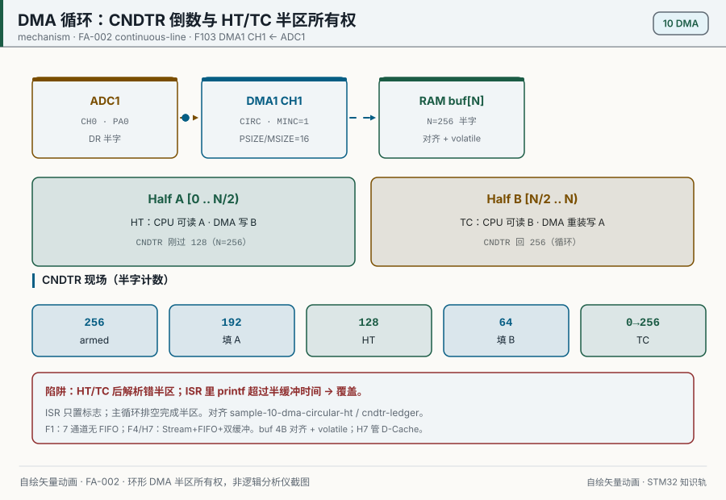
  <br><sub>▲ Animation: DMA circular mode moving ADC data while the CPU does other work (vector animation drawn by the author, not a live recording)</sub>
</p>

<!-- video:ch10 -->
<p align="center">
  <video width="640" controls poster="../../assets/video/ch10-dma.png">
    <source src="../../assets/video/ch10-dma.mp4" type="video/mp4">
  </video>
  <br><sub>▲ Chapter video with Chinese voice-over (2.6 min). <a href="../../assets/video/ch10-dma.mp4">MP4</a> · <a href="../../assets/video/ch10-dma.srt">subtitles</a></sub>
</p>

<details>
<summary>Narration script (Chinese, same text as the subtitles)</summary>

1. DMA 是搬运工。外设来了新数据，或者内存里有一包要送出去，它可以自己搬，CPU 继续算别的。前提是你把源、目的和数量写对。
2. 剩余数量记在 NDTR 里。它减到 0，这一轮就搬完了。循环模式下，硬件会把数量装回去，指针也回到起点。你不用在中断里手动重置。
3. 半传输标志按元素个数算。如果每个元素是半字，两个字节，你要再乘 2 才是字节数。用字节去切半字数组，后半段会从奇数地址开始，读出来是错的。
4. 这一帧是仓库画的循环搬运。写指针走到头就绕回来，旧数据会被新数据盖住。你如果处理得比 DMA 慢，就会丢一圈。速度要算得过，不能只看灯还在闪。
5. 外设数据宽度、内存宽度、地址增不增加，三项要和真实的寄存器一致。ADC 结果是半字，你却按字节去增地址，内存里会插进一堆空隙。
6. 半满的时候可以处理前半段，全满的时候处理后半段。中断里只做这个切换和必要的计算，不要阻塞。一阻塞，下一圈 DMA 已经把你还没看的数据盖掉了。
7. F103 没有数据缓存，DMA 和 CPU 看的是同一份内存。到了带缓存的 H7，CPU 看到的数组可能和总线上的不一样。那一章会再提，这里先把 F1 的搬运做对。
8. 调试 DMA 就盯一个数：把 NDTR 打印出来。它在倒数，说明搬运真的在走；半字的半传输按元素算，乘 2 才是字节。
9. 实验让 DMA 把一串数搬进数组，断点时后半段应该已经变了，NDTR 也在减小。数组纹丝不动，先查通道、方向和使能，别先改算法。
10. 数组不动就按顺序三查：通道映射对不对，方向有没有配反，使能位置了没有。三样都过再谈算法，DMA 的错大多在这三处。

</details>
<!-- /video:ch10 -->
## Principle and scope

Every number in this chapter is for the STM32F103C8T6. Channel numbers and the half-word arithmetic match Appendix D.

The C8 is medium-density. It has one DMA1 with 7 channels and no DMA2. The "DMA2 (5 channels)" row you see in the family tables belongs to high-density parts. See [DS5319 Rev 20 section 2.3.13](#source-ds5319-dma). F4 numbers its DMA by stream and channel: USART1_RX is DMA2 Stream 5, Channel 4, with a FIFO four 32-bit words deep. Copy those numbers from an F4 example onto a C8 and the writes raise no error, but the counter never moves. See [RM0090](#source-rm0090).

The three requests this chapter uses on the C8: ADC1 on DMA1 channel 1, USART1_TX on DMA1 channel 4, USART1_RX on DMA1 channel 5. The full map is in [RM0008 Rev 21 chapter 13](#source-rm0008-dma).

`CNDTR` counts data items not yet moved, in the configured width, not in bytes. With an 8-half-word buffer and `CNDTR` reading 3, `8 − 3 = 5` samples have been written, which is `5 × 2 = 10` bytes. The half-transfer interrupt fires at sample 4, when 8 bytes are written, not 4. Read `CNDTR` as remaining bytes and "3 left" becomes 3 bytes, so every slice you cut is shifted.

In circular mode the hardware reloads `CNDTR` when it reaches zero, so `length − CNDTR` is only the position in the current lap, not cumulative progress. To know where the writer is, use `Size` from the callback and the `old_pos` you saved last time, as Appendix A does.

The F1 DMA controller is a master on AHB, and the peripheral registers sit on APB. F1 has no D-Cache, so once DMA has written memory the CPU reads the new data directly. H7 has a D-Cache and needs cache maintenance first; that is covered later in the core ideas.

USART1_TX is still pin 30 PA9 from chapter 06. ADC sample time is in chapter 09.

## Key figures


<p align="center">
  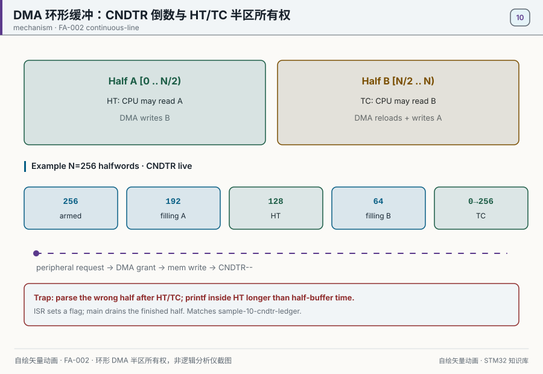
  <br><sub>▲ Hand-drawn CSS animation (FA-002). Alternating A/B ownership; request flow.</sub>
</p>


<p align="center">
  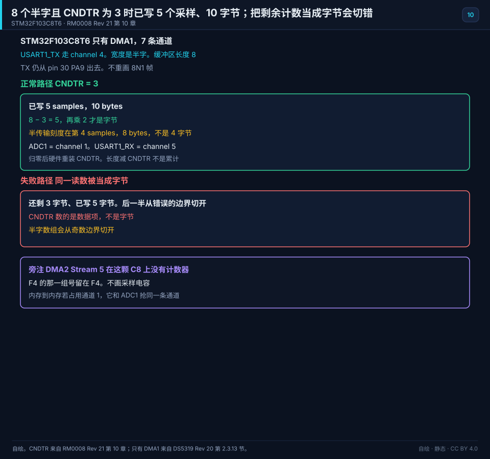
  <br><sub>▲ Drawn for this book. STM32F103C8T6 has only DMA1. USART1_TX uses channel 4, the width is a half-word, and the buffer length is 8. With CNDTR = 3, 5 samples and 10 bytes have been written. Half-transfer is at sample 4, 8 bytes. The lower half shows where the slice lands if that same reading is taken as bytes. TX leaves on pin 30 PA9. The C8 has no DMA2, so configuring Stream 5 produces no count. Sources: [RM0008 Rev 21 chapter 13](#source-rm0008-dma) and [DS5319 Rev 20 section 2.3.13](#source-ds5319-dma).</sub>
</p>

<p align="center">
  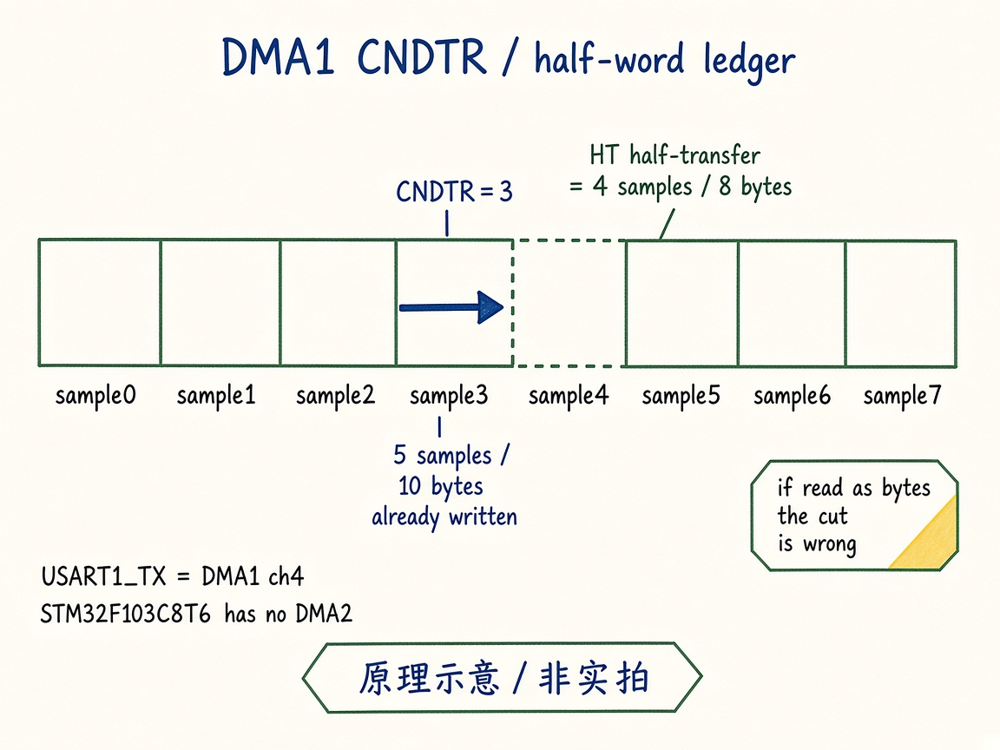
  <br><sub>▲ Knowledge track (Handraw · 原理示意 / not a photo). 8 half-word buffer; CNDTR=3 means 5 samples / 10 bytes written; HT at 4 samples / 8 bytes; byte-wise cut is wrong; not a photo.</sub>
</p>

<p align="center">
  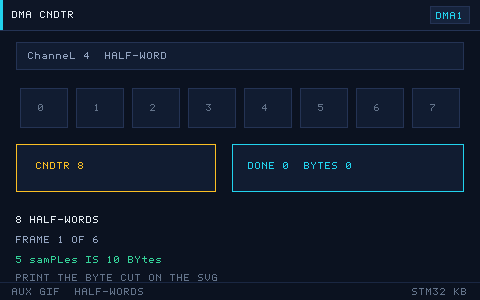
  <br><sub>▲ Animated version. CNDTR falls from 8 to 3, marked as 5 samples and 10 bytes written. The printed book has only the static figure above.</sub>
</p>

The circular-mode animations `dma-circular.svg` and `dma-ring.gif` are in the core ideas below.

## Timing and state

| Length | Width | CNDTR | Samples written | Bytes written |
| --- | --- | --- | --- | --- |
| 8 | half-word | 3 | 5 | 10 |
| 8 | half-word | half-transfer | 4 | 8, not 4 bytes |
| 8 | treated as bytes | 3 | cut wrong | "3 left" was read as 3 bytes |
| USART1_TX | DMA1 channel 4 | — | — | Pin 30 PA9 |
| USART1_RX | DMA1 channel 5 | — | — | Not DMA2 Stream 5 |
| ADC1 | DMA1 channel 1 | — | — | The memory-to-memory example contends for this channel |
| F4 numbers | DMA2 Stream 5 | does not exist on the C8; the counter never moves | — | The F4 FIFO is four 32-bit words; the C8 has no FIFO |
| Circular | reload at zero | the reloaded CNDTR | not a cumulative total | `length − CNDTR` is not progress |

## Pitfalls and sources

| What you see | Why | What to do | Source | What the source shows |
| --- | --- | --- | --- | --- |
| The second half of a half-word array looks like new data | Half-transfer was treated as 4 bytes | Handle half-transfer as 4 samples, 8 bytes | [RM0008](#source-rm0008-dma) | `CNDTR` counts data items. 5 of 8 half-words is 10 bytes. Half-transfer is not 4 bytes |
| `CNDTR` reads 3 and the byte count does not match | The remaining count was treated as bytes | Subtract samples first, then multiply by 2 | [RM0008](#source-rm0008-dma) | 3 half-words left is not 3 bytes left |
| DMA2 Stream 5 was configured and the C8 does not move | This part has no DMA2 | Use DMA1 channel 5 for USART1_RX | [DS5319](#source-ds5319-dma) | Medium-density parts have one 7-channel DMA1 and no DMA2 |
| An F4 example's channel numbers match the text and not the board | The F4 numbers were written onto the C8 | When porting, look the channel up again in the RM0008 map | [RM0090](#source-rm0090) | F4 USART1_RX is DMA2 Stream 5, Channel 4, and the FIFO is four 32-bit words. These numbers hold only on F4 |
| Progress in circular mode keeps growing | `length − CNDTR` was used as a cumulative total | Use the write position from the callback | [RM0008](#source-rm0008-dma) | Hardware reloads the count at zero. Progress uses the write position in the callback |

## Learning goals

- [ ] Describe the DMA controller layout: the F1 "channel" model, and the F4 "stream × channel" model.
- [ ] Look up the request map and connect a peripheral request to the right channel or stream.
- [ ] Know peripheral↔memory, memory↔memory, normal and circular mode, the FIFO (F4), and double buffering.
- [ ] Use the transfer-complete (TC) and half-transfer (HT) interrupts to process data while it is still arriving.
- [ ] Understand bus contention between DMA and the CPU, and the cache-coherency problem on H7 and F7.

## Core ideas

DMA understands neither frames nor sample groups. It moves a configured number of fixed-width items, and the CPU interprets the buffer boundary. Treating CNDTR as bytes is the common slicing error for half-word and word transfers.

### 1. Controller layout: F1 "channels" vs F4 "stream × channel"


<p align="center">
  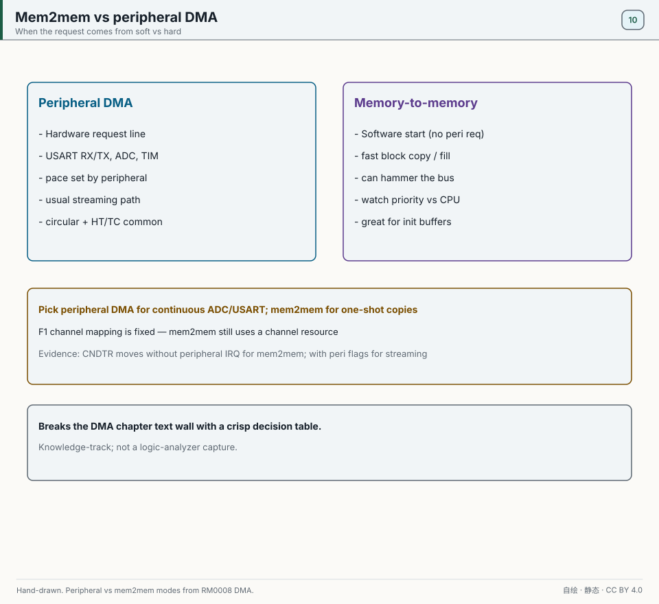
  <br><sub>▲ Drawn decision table. Streaming peripherals vs one-shot mem2mem.</sub>
</p>

<p align="center">
  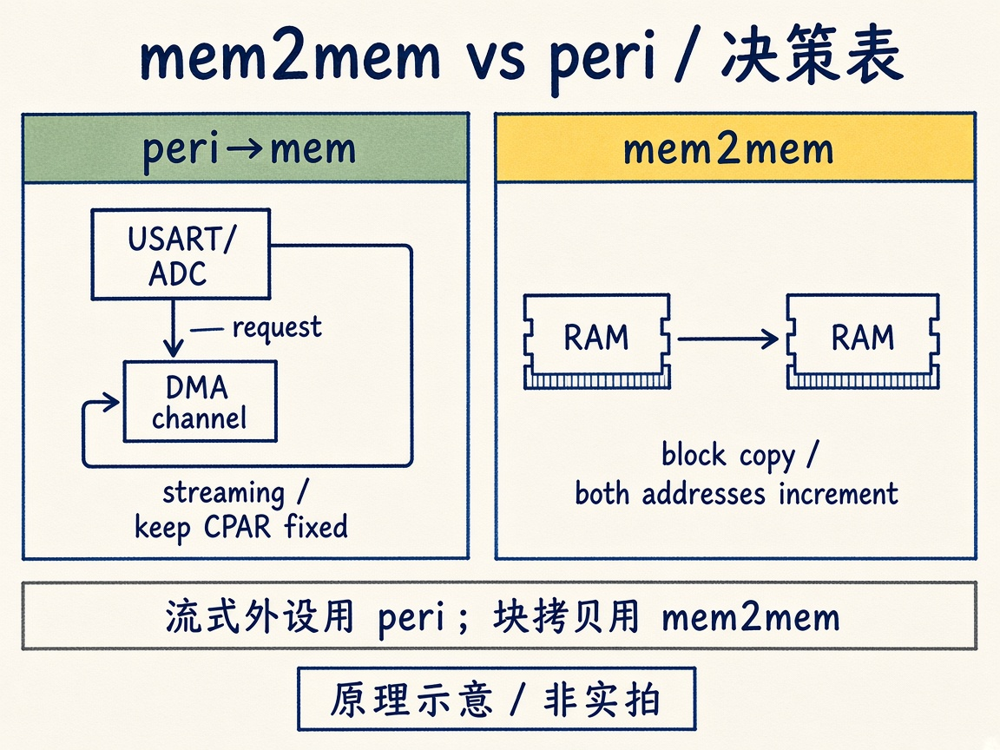
  <br><sub>▲ Knowledge track (Handraw · 原理示意 / not a photo). Streaming peripherals use peri; block copy uses mem2mem; not a photo.</sub>
</p>


DMA is the chip's porter. The CPU tells it where to carry from, where to carry to, and how much, and then it runs back and forth on the bus by itself and reports when it is done. On the F1, the porters are split by workstation, and each workstation takes jobs from a fixed set of peripherals. The F4 adds a layer: you first choose a workstation (the stream), then one of its 8 sockets (the channel), so one peripheral can move to another workstation.

On F1, a peripheral request is fixed to one DMA channel. On F4, you first bind the request to a stream, then pick the channel with `CHSEL`. That is more flexible.

| Item | STM32F1 (RM0008, Chapter 13, DMA controller) | STM32F4 (RM0090, Chapter 9, DMA controller) |
| --- | --- | --- |
| Controllers | DMA1 (7 channels). High-density parts add DMA2 (5 channels); the STM32F103C8T6 does not have it | DMA1 and DMA2, 8 streams each |
| Request binding | Each channel serves a fixed set of peripherals (see the map) | Each stream has 8 channels; `SxCR.CHSEL` selects one |
| Priority | Fixed priority between channels, plus a software priority | 4 software priority levels, plus arbitration by stream number |
| FIFO | None | Yes (4 × 32-bit), with burst support |
| Double buffer | None | Yes (double-buffer mode) |
| Data width | 8 / 16 / 32-bit | 8 / 16 / 32-bit |
| Memory↔memory | Supported (`CCR.MEM2MEM`) | Supported |

### 2. The request map (picking the right channel or stream is the whole game)

The wires between peripherals and DMA channels are fixed inside the chip. On the F1, the USART1 transmit request is wired only to DMA1 channel 4. If you set up channel 5 instead, it waits forever for a request that never comes, and nothing reports an error. So the first step in setting up DMA is to look up this table rather than guess.

**F1 DMA1 request map (excerpt; the full tables are RM0008 Table 78 and Table 79)**:

| Channel | Main requests (excerpt) |
| --- | --- |
| CH1 | ADC1, TIM2_CH3, TIM4_CH1 |
| CH2 | SPI1_RX, USART3_TX, TIM1_CH1, TIM3_CH3 |
| CH3 | SPI1_TX, USART3_RX, TIM3_CH4, TIM3_UP |
| CH4 | SPI2/I2S2_RX, USART1_TX, I2C2_TX, TIM1_CH4 |
| CH5 | SPI2/I2S2_TX, USART1_RX, I2C2_RX, TIM1_UP |
| CH6 | USART2_RX, I2C1_TX, TIM1_CH3, TIM3_CH1 |
| CH7 | USART2_TX, I2C1_RX, TIM2_CH2, TIM2_CH4, TIM4_UP |

**Typical F4 requests (RM0090 Table 42 and Table 43)**:

| Peripheral request | Controller / stream | Channel |
| --- | --- | --- |
| ADC1 | DMA2 Stream0 / Stream4 | CH0 |
| SPI1_RX | DMA2 Stream0 / Stream2 | CH3 |
| SPI1_TX | DMA2 Stream3 / Stream5 | CH3 |
| USART1_TX | DMA2 Stream7 | CH4 |
| USART1_RX | DMA2 Stream5 | CH4 |
| TIM1_CH1 | DMA2 Stream1 / Stream5 | CH6 |

> A memory hook: **on F4, TX and RX of the same peripheral often use different streams but the same channel.** When you look at the table, settle the stream first, then the channel.

After the mapping table, DMA stalls on the F103 also fall into a fixed three branches: read CNDTR first, then the buffer, then the interrupt flags.

<p align="center">
  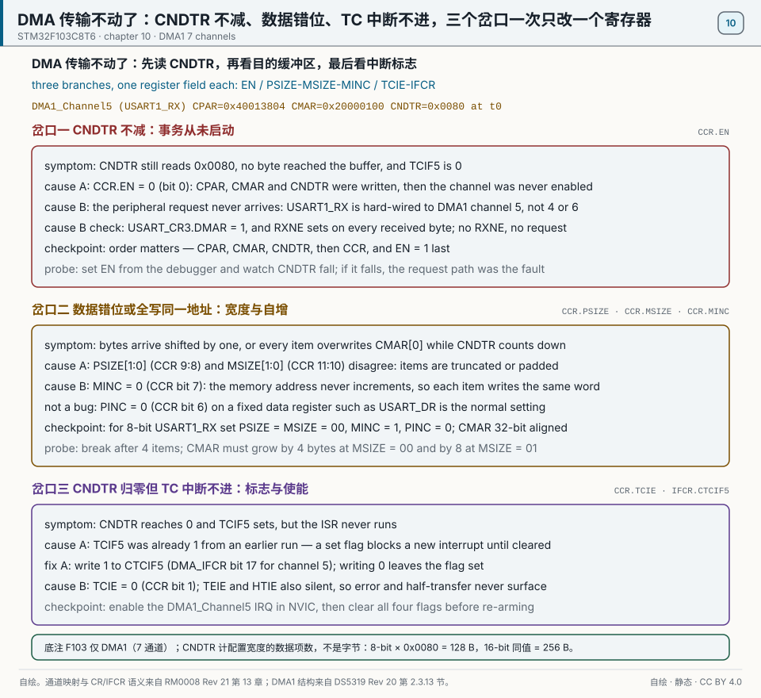
  <br><sub>▲ Drawn for this book, with DMA1 channel 5 (USART1_RX), CPAR=0x40013804, CMAR=0x20000100, CNDTR=0x0080 as the standing example. Branch one: CNDTR stuck at 0x0080 with TCIF5 = 0 — either `CCR.EN` (bit 0) was never set, or the peripheral request never arrives: USART1_RX is hard-wired to DMA1 channel 5 (not 4 or 6), which needs `USART_CR3.DMAR = 1` and RXNE setting on every received byte. Configure in the order CPAR → CMAR → CNDTR → CCR, with EN last. Branch two: bytes arrive shifted by one, or every item lands in CMAR[0] — `PSIZE` (CCR bits 9:8) and `MSIZE` (CCR bits 11:10) disagreeing truncates or pads items, and `MINC = 0` (CCR bit 7) means the memory address never increments. Note that `PINC = 0` (CCR bit 6) on a fixed data register such as USART_DR is the normal setting, not a bug. For 8-bit USART1_RX use PSIZE = MSIZE = 00, MINC = 1, PINC = 0, with CMAR 32-bit aligned. Branch three: CNDTR reaches 0 and TCIF5 sets, but the ISR never runs — write 1 to CTCIF5 (bit 17 of DMA_IFCR for channel 5; writing 0 does nothing), then check `TCIE` (CCR bit 1) and the DMA1_Channel5 IRQ in the NVIC, and clear all four flags before re-arming. Footnote: the F103 has only DMA1 with 7 channels; CNDTR counts items of the configured width, not bytes — 8-bit × 0x0080 = 128 B, the same value at 16-bit = 256 B. Channel mapping and CR/IFCR semantics: [RM0008 Rev 21 chapter 13](#source-rm0008-dma). DMA1 layout: [DS5319 Rev 20 section 2.3.13](#source-ds5319-dma).</sub>
</p>

<p align="center">
  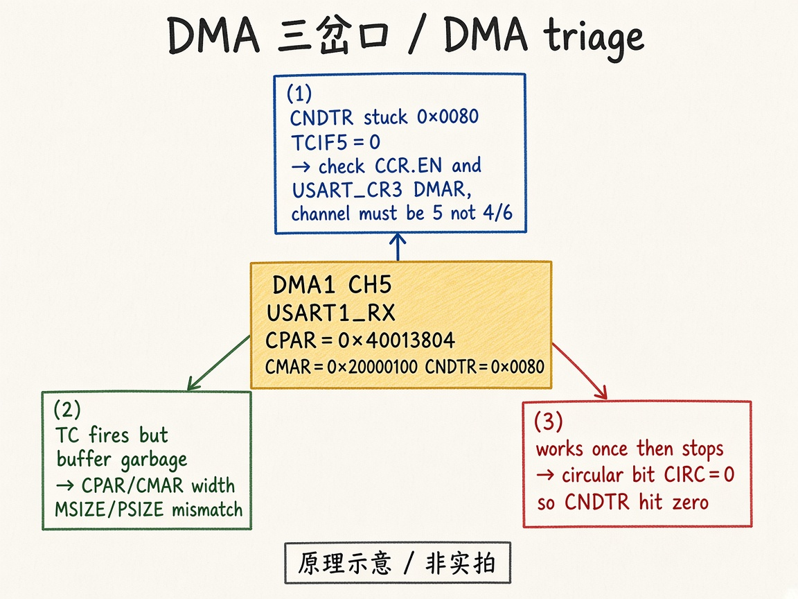
  <br><sub>▲ Knowledge track (Handraw · 原理示意 / not a photo). Branches: CNDTR stuck / width mismatch / CIRC=0 one-shot; not a photo.</sub>
</p>

### 3. Transfer direction and operating modes


<p align="center">
  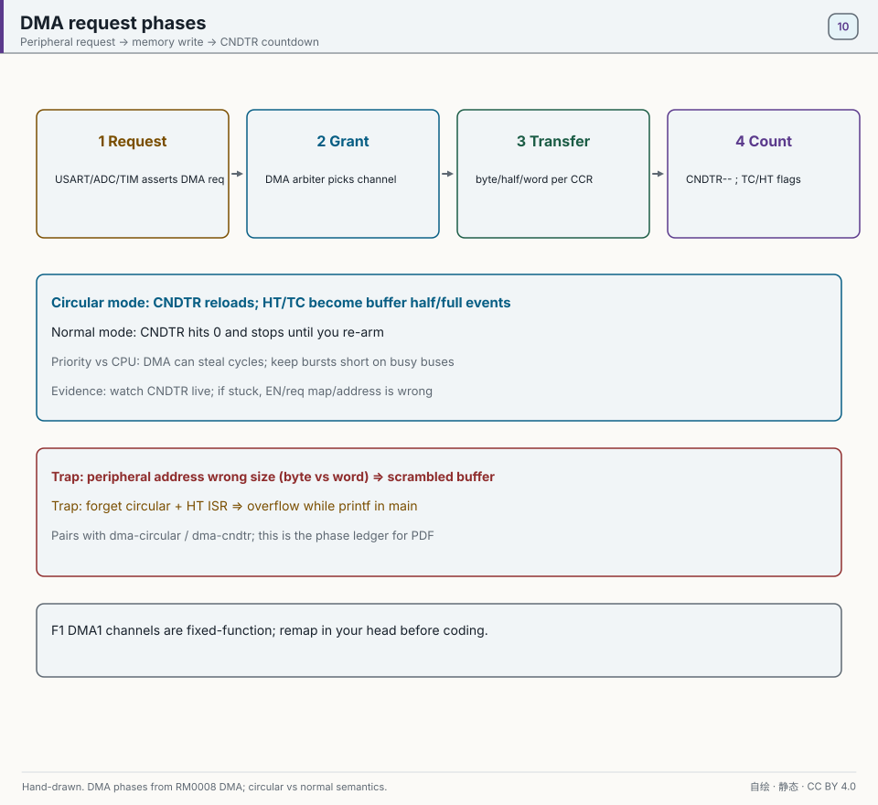
  <br><sub>▲ Drawn for this book. Circular HT/TC; normal stops at zero.</sub>
</p>

<p align="center">
  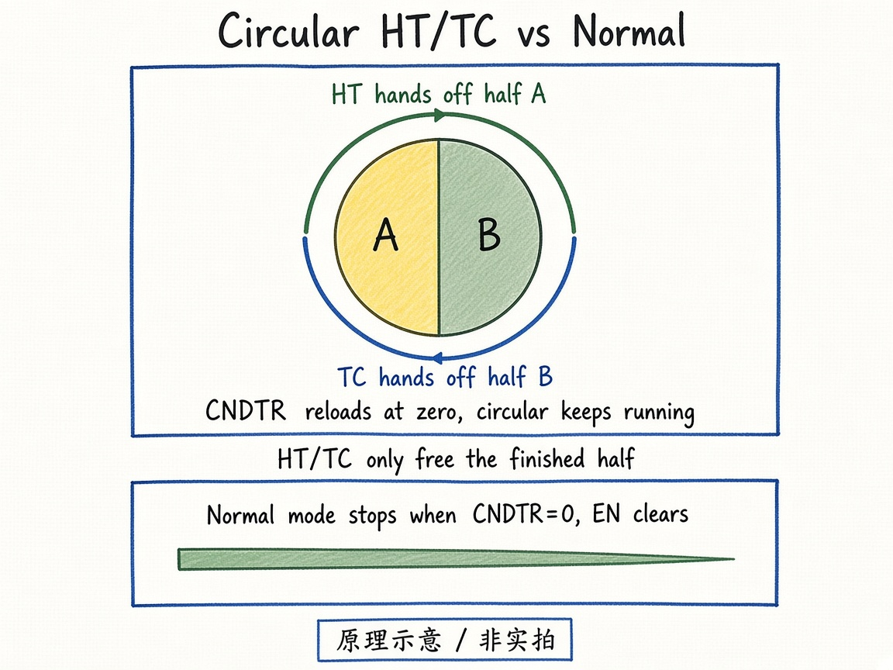
  <br><sub>▲ Knowledge track (Handraw · 原理示意 / not a photo). Circular HT/TC hand off halves; normal stops at CNDTR=0; not a photo.</sub>
</p>


Setting up DMA means answering a few questions. Peripheral to memory, or the other way? Stop after one round, or wrap to the start and keep going? After each item, should the source and destination addresses move on? How many bytes per item? A peripheral data register has only one address, so the peripheral side stays put while the memory side moves on. That is the most common combination.

| Mode / setting | Key bits | What it means |
| --- | --- | --- |
| Peripheral → memory | `DIR=0` (F4) / `CCR.DIR` | ADC or UART_RX into an array |
| Memory → peripheral | `DIR=1` | An array out to UART_TX or the DAC |
| Memory → memory | `MEM2MEM=1` | A fast memcpy (F1 supports this too) |
| Normal mode | `CIRC=0` | Stop after N items (raises the TC interrupt) |
| Circular mode | `CIRC=1` | Wrap automatically and keep refreshing |
| Pointer increment | `PINC` / `MINC` | Memory usually increments; a peripheral register does not |
| Data width | `PSIZE` / `MSIZE` | Source and destination can differ; DMA packs the data |
| Priority | `PL` | Low / medium / high / very high |
| FIFO / burst | `FCR` (F4) | Accumulate, then take the bus, so you occupy it less often |
| Double buffer | `DBM` (F4) | Two memory regions alternate, so processing and moving overlap |

### 4. Interrupts

DMA calls out when it has finished, and that is the TC interrupt. It also calls out halfway, and that is the HT interrupt. The halfway call lets you and the porter take turns on one array. While it fills the back half, you work on the front half. When it wraps round to the front half, you work on the back half. The two of you stay half a lap apart and never collide.

| Interrupt | When it fires | Use |
| --- | --- | --- |
| TC (transfer complete) | All N items have moved | The data is ready to process |
| HT (half transfer) | N/2 items have moved | The "first half is full" side of a double buffer |
| TE (transfer error) | A bus error | Hunt down a bad configuration |
| DME / FE (F4) | Direct-mode error / FIFO error | Deeper debugging |

"Half-transfer plus circular mode" is the classic pair. While DMA fills the first half, the CPU processes the second half, and the other way around. The stream never has a gap.

<p align="center">
  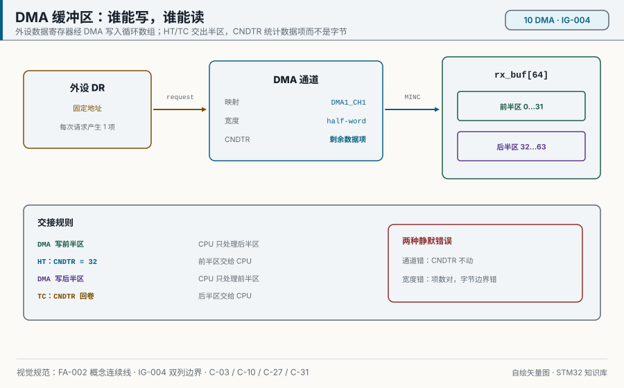
  <br><sub>▲ Ownership boundary: the CPU must not treat the half currently written by DMA as stable data. HT and TC hand off only their corresponding halves. CNDTR counts items of the configured width, not bytes directly (FA-002 · IG-004 · C-03/C-10/C-27/C-31).</sub>
</p>

### 5. Bus contention and cache coherency

DMA and the CPU share the same bus, so the busier DMA is, the longer the CPU waits to fetch instructions and data. Chips with a cache have one more problem. The CPU looks at its own cached copy while DMA changes the original in memory, and the two drift apart. You either clean or invalidate the cache around each DMA transfer, or put the DMA buffer in a region that bypasses the cache.

- **Bus contention**: DMA and the CPU share the bus matrix. While DMA is moving data it periodically occupies the bus, and in the extreme it slows the CPU. The F4 FIFO and burst mode can merge many small transfers and occupy the bus less often.
- **Cache coherency (H7 / F7)**: if D-Cache is on, a DMA write into memory can bypass the cache, so the CPU reads a stale value. A CPU write can also still be sitting in the cache and not in RAM, so DMA reads a stale value. The fix: put the DMA buffer in a **non-cacheable region (MPU set to Non-Cacheable)**, or call `SCB_CleanDCache_by_Addr` / `SCB_InvalidateDCache_by_Addr` around the transfer. **F1 and F4 have no D-Cache, so this problem does not exist there.**
- **FIFO threshold**: Occasional bad data on F4 means the FIFO is not configured, or the burst does not match. Set the FIFO threshold and the burst size.
- **Local-variable buffer**: The UART sends half the buffer and then stalls because the buffer is a local variable and dies when the function returns. Use a `static` or global buffer.

## Hardware and wiring

DMA is entirely on-chip. It needs no extra wires. Its value shows up in how it drives a peripheral. The pins below are the typical cases:

| Board | Use | Peripheral / pin | Notes |
| --- | --- | --- | --- |
| BluePill (F103) | UART DMA transmit | USART1_TX = PA9 → DMA1_CH4 | Connect a USB-TTL adapter |
| BluePill | Multi-channel ADC | PA0 / PA1 / PA4 → DMA1_CH1 | See [Chapter 09](09-adc-dac.md) |
| Nucleo-F411RE | UART DMA | USART2_TX = PA2 → DMA1 Stream6 Channel 4 | ST-Link virtual COM port |
| Any | Memory-to-memory copy | No pin | For measuring throughput |

## Code

**① UART DMA transmit (memory → peripheral, normal mode)**

```c
#include "stm32f1xx_hal.h"

UART_HandleTypeDef huart1;
DMA_HandleTypeDef  hdma_usart1_tx;

static void MX_DMA_Init(void)
{
    __HAL_RCC_DMA1_CLK_ENABLE();
    HAL_NVIC_SetPriority(DMA1_Channel4_IRQn, 0, 0);   /* USART1_TX = DMA1_CH4 */
    HAL_NVIC_EnableIRQ(DMA1_Channel4_IRQn);
}

static void MX_USART1_DMA_Init(void)
{
    /* USART1 basic init omitted (PA9=TX, PA10=RX, 115200-8-N-1) */
    hdma_usart1_tx.Instance                 = DMA1_Channel4;
    hdma_usart1_tx.Init.Direction           = DMA_MEMORY_TO_PERIPH;
    hdma_usart1_tx.Init.PeriphInc           = DMA_PINC_DISABLE;  /* peripheral address does not increment */
    hdma_usart1_tx.Init.MemInc              = DMA_MINC_ENABLE;   /* memory address increments */
    hdma_usart1_tx.Init.PeriphDataAlignment = DMA_PDATAALIGN_BYTE;
    hdma_usart1_tx.Init.MemDataAlignment    = DMA_MDATAALIGN_BYTE;
    hdma_usart1_tx.Init.Mode                = DMA_NORMAL;
    hdma_usart1_tx.Init.Priority            = DMA_PRIORITY_LOW;
    HAL_DMA_Init(&hdma_usart1_tx);
    __HAL_LINKDMA(&huart1, hdmatx, hdma_usart1_tx);
}

void Uart_Dma_Send(const uint8_t *buf, uint16_t len)
{
    HAL_UART_Transmit_DMA(&huart1, (uint8_t *)buf, len);   /* returns immediately; the copy runs in the background */
}
```

**② Memory-to-memory copy (MEM2MEM)**

```c
static void DMA_MemCopy(const uint8_t *src, uint8_t *dst, uint16_t len)
{
    DMA_HandleTypeDef hdma = {0};
    hdma.Instance                 = DMA1_Channel1;
    hdma.Init.Direction           = DMA_MEMORY_TO_MEMORY;
    hdma.Init.PeriphInc           = DMA_PINC_ENABLE;
    hdma.Init.MemInc              = DMA_MINC_ENABLE;
    hdma.Init.PeriphDataAlignment = DMA_PDATAALIGN_BYTE;
    hdma.Init.MemDataAlignment    = DMA_MDATAALIGN_BYTE;
    hdma.Init.Mode                = DMA_NORMAL;
    hdma.Init.Priority            = DMA_PRIORITY_HIGH;
    HAL_DMA_Init(&hdma);
    HAL_DMA_Start(&hdma, (uint32_t)src, (uint32_t)dst, len);
    HAL_DMA_PollForTransfer(&hdma, HAL_DMA_FULL_TRANSFER, 100);
    HAL_DMA_DeInit(&hdma);
}
```

This example takes DMA1 channel 1 and contends with ADC1's request. It is not the USART1_TX normal path.

**③ Half-transfer plus circular (the double-buffer idea, on F1)**

```c
#define BUF_LEN  64
uint8_t rx_buf[BUF_LEN];

/* DMA circular mode plus HT/TC interrupts; process the matching half in the callback */
void HAL_UART_RxHalfCpltCallback(UART_HandleTypeDef *huart)  /* first half full */
{
    ProcessData(&rx_buf[0], BUF_LEN / 2);
}
void HAL_UART_RxCpltCallback(UART_HandleTypeDef *huart)      /* second half full */
{
    ProcessData(&rx_buf[BUF_LEN / 2], BUF_LEN / 2);
}
```

<p align="center">
  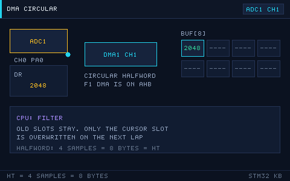
  <br><sub>▲ DMA advances the write position and the CPU processes only the half that has been handed off. The animation cannot prove request mapping or data width; read CNDTR and inspect the array as well.</sub>
</p>

> F4 can also use hardware **double-buffer mode** (`DBM`). The two memory pointers `M0AR` and `M1AR` switch automatically, and the `CT` bit tells you which block is in use.

## Hands-on labs

1. **Request and wire result:** Send a 4096-byte incrementing pattern through USART1_TX on DMA1_CH4 while the main loop increments a counter. The host checks length and CRC; the MCU records TC/TE and the main-loop count.
2. **Memory result:** Move a known 4 KB pattern with `DMA_MemCopy`, compare every destination byte, and record TC/TE. A 4 KB test fits the F103C8's 20 KB SRAM; the old 64 KB lab did not fit this part.
3. **Circular boundary:** Reuse chapter 09's 64-half-word ADC buffer. Record CNDTR = 32 at HT, the wrap at TC, and the first and last sample in each half. Convert items to bytes by multiplying by two.
4. **(Further) Double-buffer ping-pong**: on F4, turn on `DBM`. Two buffers alternate, and the `CT` bit indicates the current block, so the stream is processed with no extra copy.

### 6. How much is left: read NDTR


<p align="center">
  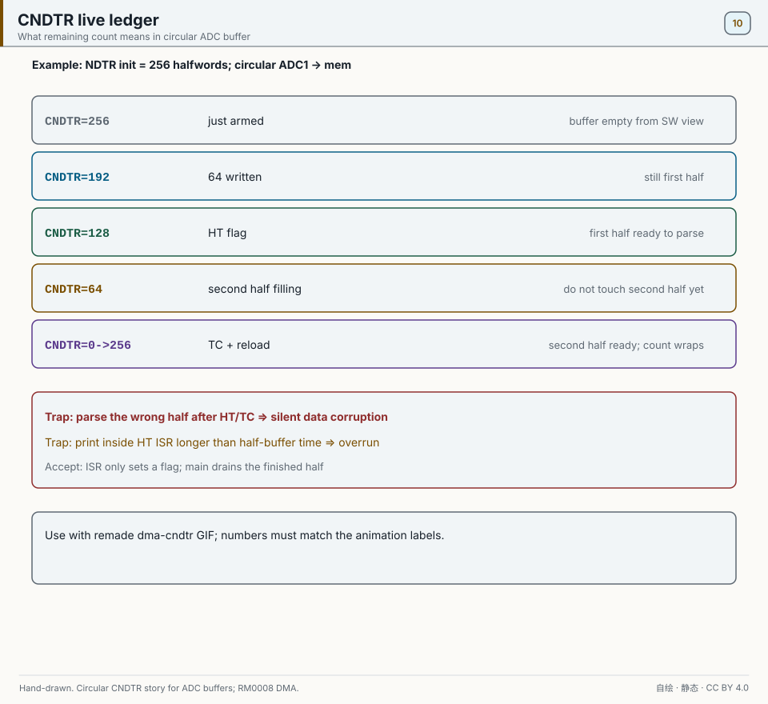
  <br><sub>▲ Drawn for this book. HT/TC half ownership; ISR only sets a flag.</sub>
</p>

<p align="center">
  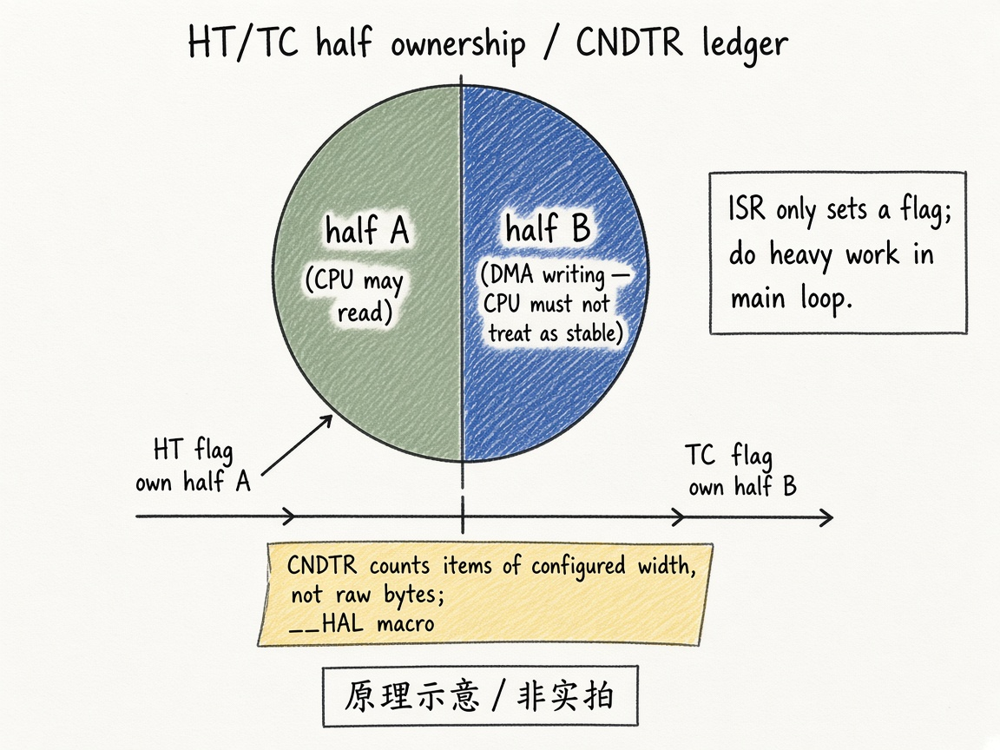
  <br><sub>▲ Knowledge track (Handraw · 原理示意 / not a photo). HT/TC half ownership; ISR only sets a flag; CNDTR counts configured-width items; not a photo.</sub>
</p>


In circular mode, do not guess "which index are we on." On F1 the remaining count is in `CNDTR`. HAL writes it as `__HAL_DMA_GET_COUNTER`.

```c
/* half-word buffer: number of samples already written, not a byte count */
uint16_t left = __HAL_DMA_GET_COUNTER(&hdma_adc1);
uint16_t got  = ADC_BUF_SIZE - left;
```

On a half-word transfer, the half-full interrupt happens at 4 samples, which is 8 bytes. If you handle it as "an interrupt every 4 bytes," you will treat the second half as new data.

Before leaving this chapter, keep one verified UART long frame, one byte-for-byte 4 KB memory comparison, and one HT/TC/CNDTR record.

Self-test:

1. The buffer length is 8, the width is a half-word, and `CNDTR` reads back 3. How many samples have already been written?
2. Why should you not process only 4 bytes in the HT interrupt?
3. Is the F1 DMA on AHB or on APB?

## Related resources

- RM0008, *STM32F10xxx Reference Manual*, Chapter 13, DMA controller (including request-map tables 78 and 79).
- RM0090, *STM32F4 Reference Manual*, Chapter 9, DMA controller (stream / channel, FIFO, double buffer).
- Application note AN4031, *Using the STM32F2/F4 DMA controller*.
- Related chapters in this repo: [Chapter 09](09-adc-dac.md) ADC + DMA, and [Chapter 17](17-debug.md) DWT timing.
- Figures: `../../assets/animations/dma-circular.svg`, `../../assets/gif/dma-ring.gif` (both drawn by the author or program-generated).
