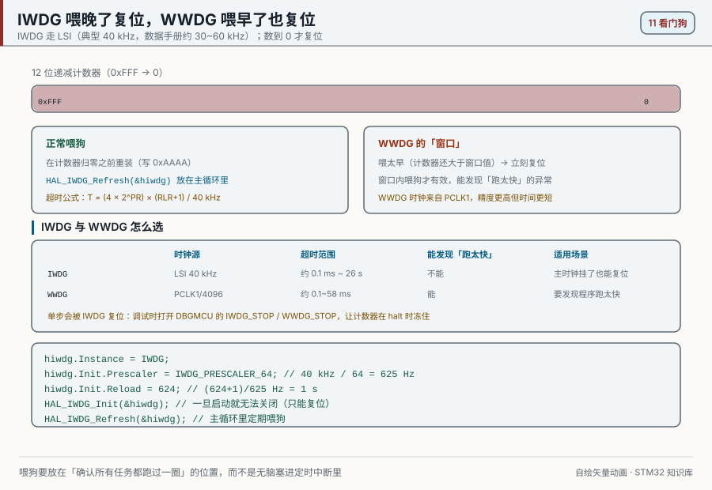
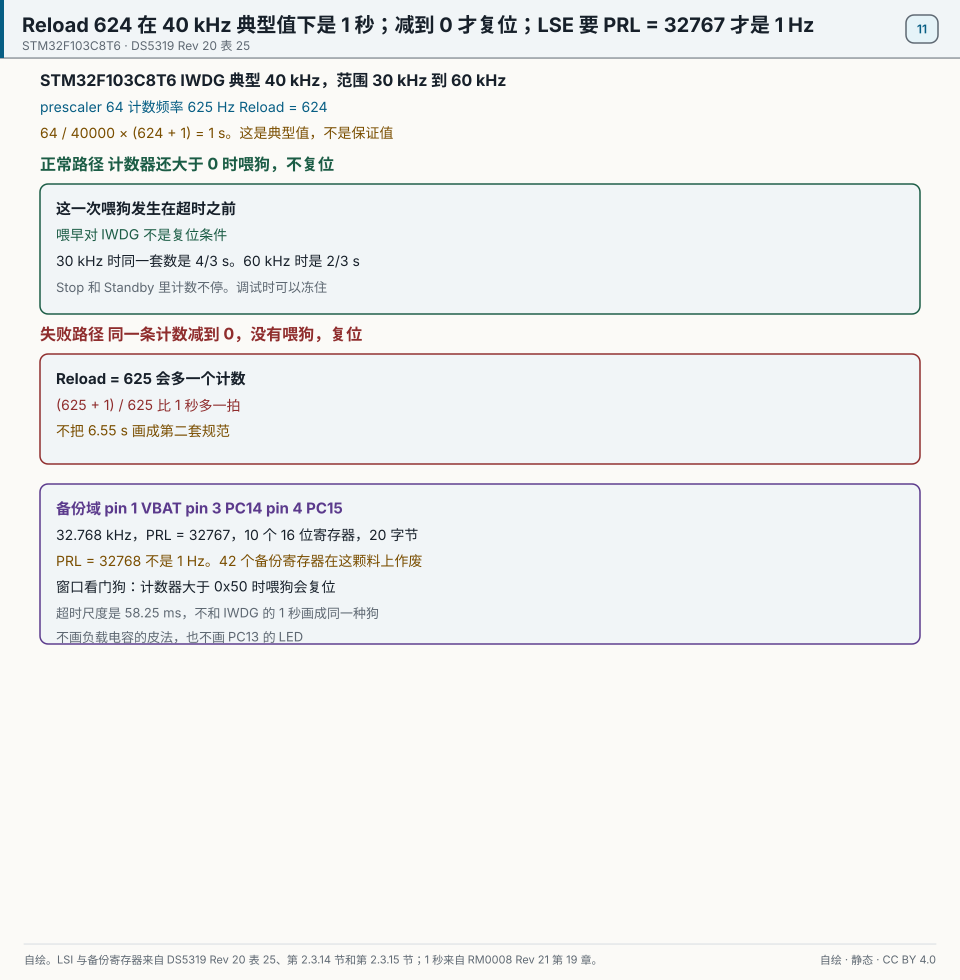
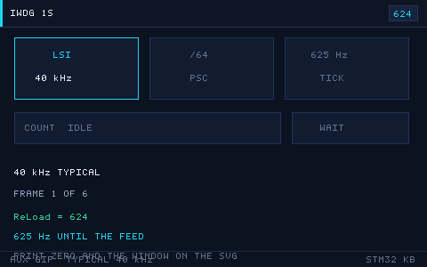

# 11 RTC and the Watchdogs
> 中文：[11 RTC 与看门狗](../11-RTC与看门狗.md)

> The RTC is a calendar clock that keeps running after the main supply drops. The independent watchdog and the window watchdog reset the chip when the program runs away. Together they are two foundations of a reliable product.

<p align="center">
  
  <br><sub>▲ Side figure. The independent watchdog only punishes a late feed. An early feed that also resets is the window watchdog. Without playing this figure, the 1 second and the reset-at-zero are both on the static figure. (vector animation drawn by the author, not a live recording)</sub>
</p>

<!-- video:ch11 -->
<p align="center">
  <video width="640" controls poster="../../assets/video/ch11-rtc.png">
    <source src="../../assets/video/ch11-rtc.mp4" type="video/mp4">
  </video>
  <br><sub>▲ Chapter video with Chinese voice-over (2.6 min). <a href="../../assets/video/ch11-rtc.mp4">MP4</a> · <a href="../../assets/video/ch11-rtc.srt">subtitles</a></sub>
</p>

<details>
<summary>Narration script (Chinese, same text as the subtitles)</summary>

1. RTC 住在备份域。主电源掉了，只要备用电池和低速晶振还在，日历就能继续走。时钟源优先选外部 32.768 千赫，它比内部低速时钟准。
2. 备份域默认不让你随便写。要先允许访问，再选时钟、设分频。写不进去的时候，多半不是晶振坏了，而是域还锁着，或者写保护没解。
3. 独立看门狗的时钟独立，喂晚了就复位，用来兜底。窗口看门狗喂早喂晚都会复位，用来发现程序走得太快或太慢。两只可以同时在岗。
4. 这一帧是仓库画的看门狗窗口。太早喂，说明程序没有走到该到的地方；太晚喂，说明它卡住了。窗口看门狗把这两种都当成故障。独立看门狗只惩罚迟到。
5. 32.768 千赫晶振起振慢，初始化超时给得太短，会误判失败。真的不起振，再查负载电容和焊接。调试阶段可以暂时改用内部低速时钟，先把日历逻辑跑通。
6. 把喂狗放在一个和业务无关的定时中断里，主循环死锁时狗仍然吃得饱，等于没养。喂狗要放在你确认「这一圈真的走完了」的地方，并且落在窗口里面。
7. 芯片为什么重启，复位标志里有记录。独立看门狗、窗口看门狗、上电，是不同的旗。读完记得清掉，不然下一次你分不清是新的复位还是旧旗。
8. 口诀：独立看门狗只怕喂晚；窗口看门狗喂早喂晚都会复位。RTC 走在备份域，主电掉了还靠备用电池和低速钟。
9. 实验先故意不喂狗，确认它真的会复位，并且复位旗对得上。然后再把喂狗放到主循环里正确的位置。从没被咬过的狗，你不知道它在不在岗。
10. 合上书，三问。主电源掉了，RTC 还靠什么继续走？哪只看门狗喂早了也会复位？为什么不要把喂狗只放在一个无关的定时中断里？

</details>
<!-- /video:ch11 -->

## Learning goals

Before this chapter: you should know what binary, hexadecimal and `volatile` mean (if not, read "Zero-background primer" in chapter 00 first), be able to light the PC13 LED the way chapter 03 does, know which clocks LSI, LSE, HSE and PCLK1 are from chapter 02, and know what an interrupt service routine is from chapter 04.

- [ ] Name the three RTC clock sources, and explain why only the LSE keeps time on VBAT after the main supply drops
- [ ] Work out that PRL must be 32767 for 1 Hz at 32.768 kHz, and that the reset value 0x8000 runs about 2.64 s per day slow
- [ ] Keep a "time already set" marker and today's date in the backup registers, so the date does not fall back to 2000-01-01 after the reset button
- [ ] Set an alarm for 08:30 every day, and re-arm it for tomorrow each time it fires
- [ ] Compute the independent watchdog timeout with T = prescaler ÷ f_LSI × (Reload + 1), and leave margin for an LSI anywhere in 30–60 kHz
- [ ] With PCLK1 = 36 MHz, prescaler 8, counter 0x7F and window 0x50, work out when the window watchdog may be fed
- [ ] Read the reset flags in RCC_CSR to tell why the chip restarted, and freeze both watchdogs while debugging

## Core ideas

**In one sentence: on the STM32F103 the RTC (Real-Time Clock) is a battery-backed seconds counter, and a 32.768 kHz LSE with PRL = 32767 adds exactly 1 each second; a watchdog is a countdown that must be "fed" on time, and when it runs out it resets the chip. The independent watchdog (IWDG) only fears a late feed; the window watchdog (WWDG) resets on an early feed and on a late one.**

### An analogy first

The RTC is like a wall clock with a coin cell. When the power goes out at home the clock keeps going, and the time is still right when the power comes back. That holds only while the cell has charge and the movement (the crystal) keeps swinging.

A watchdog is like a night guard's punch clock. The guard must punch in every so often; miss the deadline and the control room sends someone to replace him. The independent watchdog only cares about "don't be late"; punching in early is fine. The window watchdog is stricter: two punches must be at least some time apart, and an early punch also counts as a fault, because a guard who really walked the round could not be back that fast.

The analogy stops here. The F1 RTC hardware only counts seconds; software turns them into a date, and there is no "clock face" inside the chip. The watchdog's "replacement" is a reset of the whole chip, and the program starts over. "Punching in" is writing an agreed value into a register.

### 1. RTC and the backup domain: a stopwatch that keeps running without main power

**Conclusion: the RTC lives in the backup domain. When the main supply VDD drops, the battery on pin 1 VBAT keeps powering the RTC, the LSE oscillator and the backup registers; timekeeping after VDD is gone is guaranteed only when the LSE clocks the RTC.**

A few terms first:

- **Backup domain**: a small separately powered part of the chip that holds the RTC, the LSE oscillator and the backup registers. It runs from VDD while VDD is present and switches to VBAT by itself when VDD drops (RM0008 Rev 21 section 5.1.2).
- **VBAT**: pin 1 of the LQFP48, where the backup battery goes. DS5319 Rev 20 section 2.3.9 gives 1.8–3.6 V as its operating range, and a 3 V CR2032 coin cell sits inside it.
- **LSE** (Low-Speed External oscillator): the 32.768 kHz crystal on pin 3 PC14-OSC32_IN and pin 4 PC15-OSC32_OUT.
- **LSI** (Low-Speed Internal oscillator): an on-chip RC oscillator. It needs no external parts, but its frequency is not accurate.

The RTC clock is one of these three:

| Clock source | Frequency | Does the RTC keep running after VDD drops? | Cost |
| --- | --- | --- | --- |
| LSE | 32.768 kHz, as accurate as the crystal | Yes. The LSE is in the backup domain and runs on VBAT | Takes pins 3 and 4; starts slowly: DS5319 Rev 20 Table 23 gives 2.5 s typical at 25 °C, slower when colder |
| LSI | 30 kHz min, 40 kHz typical, 60 kHz max (DS5319 Rev 20 Table 25) | Not guaranteed. The LSI is not in the backup domain | No pins; the frequency moves with the chip, temperature and voltage |
| HSE/128 | 62.5 kHz with an 8 MHz crystal | Not guaranteed. The HSE is not in the backup domain | The main crystal must stay on |

Read the table like this: if the clock must keep time through a power cut, only the first row qualifies; LSI and HSE/128 suit only a design where VDD is always there and you just want a one-second tick. The basis is RM0008 Rev 21 section 7.2.8: the LSE is in the backup domain, the HSE and the LSI are not, and with HSE/128 the RTC state is not guaranteed once VDD is off.

The choice sits in the two RTCSEL bits of RCC_BDCR: 00 no clock, 01 LSE, 10 LSI, 11 HSE/128. Once they hold a non-zero value they cannot be changed; only a reset of the whole backup domain allows a new choice (RM0008 Rev 21 section 7.3.9). A backup-domain reset also clears the backup registers, so pick the clock source once.

> [!TIP]
> The backup domain is write-protected after power-up. Before touching it, do two things: enable the PWR and BKP peripheral clocks, then set the DBP bit in PWR_CR (RM0008 Rev 21 section 6.1). When a write does not stick, the crystal is rarely the problem; this step was skipped.

### 2. Where 1 Hz comes from: PRL and (PRL + 1)

**Conclusion: the RTC first divides RTCCLK into a seconds tick with a 20-bit prescaler, and the division ratio is (PRL + 1). A 32.768 kHz LSE needs PRL = 32767: 32768 ÷ (32767 + 1) = 1 Hz.**

Two counters sit in series inside the RTC:

- **Prescaler**: counts down by 1 on every RTCCLK pulse, gives one tick each time it runs out, and reloads from PRL. PRL (prescaler reload value) is 20 bits wide.
- **Seconds counter CNT**: 32 bits, adds 1 on every tick.

The formula is in RM0008 Rev 21 section 18.4.3:

```text
f_TR_CLK = f_RTCCLK / (PRL + 1)
```

The "+1" is there because the prescaler counts from PRL down to 0, which is PRL + 1 pulses. The table below lists the PRL for each clock source; the second row is the most common mistake:

| Clock source | f_RTCCLK | PRL | Tick | Note |
| --- | --- | --- | --- | --- |
| LSE | 32768 Hz | 32767 (0x7FFF) | 1 Hz | Correct |
| LSE | 32768 Hz | 32768 (0x8000, reset value) | One tick every 32769 ÷ 32768 s | 86400 ÷ 32769 ≈ 2.64 s slow per day |
| LSI | Taken as the typical 40000 Hz | 39999 | 1 Hz only when the LSI is exactly 40 kHz | About 1.33 s per tick at 30 kHz, about 0.67 s at 60 kHz |
| HSE/128 | 8 MHz ÷ 128 = 62500 Hz | 62499 | 1 Hz | Not guaranteed after VDD drops |

Read the table like this: PRL is always "frequency minus 1". The reset value of RTC_PRLL is 0x8000 (RM0008 Rev 21 page 490), and the note on the same page says to write 7FFFh for 1 second at 32.768 kHz. If you enable the RTC and forget PRL, the clock still runs, only a little over two seconds slow each day.

The crystal itself is not perfect either. Crystal error is given in ppm (parts per million); 1 ppm is 86400 × 10⁻⁶ = 0.0864 s per day, and the mistake in the second row above works out to about 30.5 ppm. How far a given 32.768 kHz crystal drifts per day is in its own datasheet. The F1 can slow the RTC by 0–121 ppm with CAL[6:0] in the BKP_RTCCR register (RM0008 Rev 21 section 6.3.2; the method is in ST application note AN2604). It can only slow the clock, not speed it up.

PRL, CNT and the alarm register ALR cannot be written like ordinary registers. RM0008 Rev 21 section 18.3.4 gives five steps: wait for RTOFF = 1, set CNF to enter configuration mode, write the register, clear CNF, and wait for RTOFF = 1 again; one write takes at least 3 RTCCLK cycles. After a reset or a wake-up from Stop or Standby, also wait for RSF to be set before reading RTC registers (section 18.3.3). The HAL wraps these steps in functions; the register version is at the end of "Code".

### 3. Backup registers: a 20-byte notebook that survives power loss

**Conclusion: the STM32F103C8T6 has ten 16-bit backup data registers, BKP_DR1–BKP_DR10, 20 bytes in all. Like the RTC they are kept alive by VBAT, and a system reset, a power reset or a wake-up from Standby does not clear them (RM0008 Rev 21 section 6.1).**

| Device | Backup registers | Size | Source |
| --- | --- | --- | --- |
| STM32F103C8T6 (medium density) | BKP_DR1–BKP_DR10, 16-bit | 20 bytes | DS5319 Rev 20 section 2.3.14; RM0008 Rev 21 section 6.2 |
| F1 high-density, XL-density and connectivity line | BKP_DR1–BKP_DR42, 16-bit | 84 bytes | RM0008 Rev 21 section 6.2 |
| STM32F4 | RTC_BKP0R–RTC_BKP19R, 32-bit | 80 bytes | RM0090 Rev 22 chapter 26 |

The table says two things: 20 bytes is very little, enough for a few flags and one date; and when you change family the register names and widths change too, so the code cannot be copied across.

The usual pattern is a "magic value": at power-up read BKP_DR1. If it holds the agreed value (this chapter's example uses 0xA5A5), the time was set and the backup domain never lost power, so carry on. Any other value means a first power-up or a flat battery: set the time again, and write the magic value last. Writing it last means that if power fails halfway through setting the time, the next power-up will not find it and will start over.

Only a few events clear the backup registers: a backup-domain reset, which is software setting BDRST in RCC_BDCR, or power returning after both VDD and VBAT were off (RM0008 Rev 21 section 7.1.3); and, with tamper detection enabled, a tamper event on the TAMPER pin (PC13) clears all backup data registers (section 6.3.1).

### 4. The F1 calendar and alarm: the hardware only counts seconds

**Conclusion: the F1 RTC has no year, month or day registers, only a 32-bit seconds counter CNT and a 32-bit alarm register ALR. When CNT finishes the second equal to ALR, the alarm flag ALRF is set and can raise an interrupt; years, months, days, weekdays and leap years are all software.**

| Feature | STM32F103 (RM0008 Rev 21 chapter 18) | STM32F4 (RM0090 Rev 22 chapter 26) |
| --- | --- | --- |
| Calendar | None. A 32-bit seconds counter; software works out the date | Hardware BCD calendar (RTC_TR, RTC_DR) with weekday and leap year |
| Alarm | One, compared with the seconds counter | Two, each maskable by seconds, minutes, hours, date or weekday |
| Periodic wake-up | No dedicated timer; use the second interrupt or the alarm | Periodic wake-up timer |
| Timestamp | None | Yes |

Read the table like this: many RTC tutorials are written for the F4, and names such as `RTC_TR` or `AlarmMask` have no match on the F1.

How the HAL builds a calendar on the F1: the points below are the behaviour of the STM32CubeF1 HAL source, not the manual.

- Time of day: `HAL_RTC_SetTime` turns hours, minutes and seconds into seconds and writes them to CNT; `HAL_RTC_GetTime` reads CNT and turns it back.
- Date: kept in the handle as `hrtc.DateToUpdate`, which is in RAM, not in the RTC. When `HAL_RTC_GetTime` finds CNT past 24 hours, it adds the whole days to the date and subtracts them from CNT, leaving the seconds of today.
- After a reset: `HAL_RTC_Init` resets the date to 2000-01-01. The seconds counter survived in the backup domain but the date did not, so store the date in the backup registers yourself and put it back after a reset.
- Alarm: `RTC_AlarmTypeDef` has only two members, `AlarmTime` and `Alarm`, and `Alarm` can only be `RTC_ALARM_A`. The alarm compares seconds, so it fires once and is then in the past; for a daily alarm, set it again each time it fires. If the time you set has already passed today, `HAL_RTC_SetAlarm_IT` adds 24 hours by itself.

### 5. What a watchdog is: a countdown you must keep refilling

**Conclusion: a watchdog is a counter that counts down by itself. Every so often the program writes an agreed value into its register, called "feeding the dog", and the count starts again; if the program runs away or hangs, nobody feeds it, the count runs out, and the chip resets.**

Why you need one: a program can hang in a loop nobody expected, or wait forever for a flag that never comes. A device in the field has nobody to press reset, so the watchdog makes sure it restarts by itself. It only restarts; it does not repair. After the restart the same condition may come back, which section 8 deals with.

The STM32F103 has two watchdogs: the independent watchdog IWDG (RM0008 Rev 21 chapter 19) and the window watchdog WWDG (chapter 20). The differences first:

| Item | Independent watchdog IWDG | Window watchdog WWDG |
| --- | --- | --- |
| Clock | LSI (40 kHz typical, 30–60 kHz range) | PCLK1 ÷ 4096 ÷ prescaler (PCLK1 = 36 MHz in this book) |
| Counter | 12 bits, counting down | 7 bits T[6:0], counting down |
| When it resets | At 0 | When the counter goes from 0x40 to 0x3F (T6 clears), or on a feed while the counter is above the window value |
| Early feed | No reset | Reset |
| Timeout range | 0.1 ms to 26214.4 ms at 40 kHz (RM0008 Rev 21 Table 96) | 113 µs to 58.25 ms at 36 MHz (Table 98) |
| Main clock fails | Keeps counting (section 19.1) | Its clock comes from APB1 and follows the main clock |
| Can it be stopped once started? | No; only a reset stops it (section 5.3.4) | No; once WDGA is set only a reset clears it (section 20.6.1) |

Read the table like this: the IWDG's strength is its independent clock, so it can pull the chip back even when the main clock fails; the WWDG's strength is its window, which catches a program that runs too fast. You can use both at once.

### 6. The independent watchdog (IWDG): only a late feed resets it

**Conclusion: the IWDG counts on the LSI. With prescaler 64 and the LSI taken as the typical 40 kHz, the count runs at 625 Hz; Reload 624 counts from 624 down to 0 in exactly 625 ticks, which is 1 second. A feed at any time before 0 is fine; an early feed does not reset it.**

Its structure is simple (RM0008 Rev 21 section 19.3, Figure 182): the LSI goes into an 8-bit prescaler, then into a 12-bit down-counter. The program talks to it only by writing three values into the key register IWDG_KR:

| Value written to IWDG_KR | Effect |
| --- | --- |
| 0xCCCC | Start. The LSI is forced on (RM0008 Rev 21 section 7.2.9) and the counter counts down from 0xFFF |
| 0x5555 | Unlock the prescaler register IWDG_PR and the reload register IWDG_RLR so they can be changed |
| 0xAAAA | Feed: load the value in RLR back into the counter |

This table is every IWDG operation there is. The HAL's `HAL_IWDG_Init` does "start, unlock, write PR and RLR, wait for the writes, feed once" in that order, and `HAL_IWDG_Refresh` is the write of 0xAAAA.

The timeout works out like this:

```text
T = prescaler ÷ f_LSI × (Reload + 1)
  = 64 ÷ 40000 × (624 + 1) = 1 s          (LSI taken as the typical 40 kHz)
```

Why Reload + 1: counting from 624 down to 0 passes through 625 states. RM0008 Rev 21 Table 96 confirms it: in the divide-by-64 row the shortest timeout, at Reload = 0, is 1.6 ms, exactly one tick of 64 ÷ 40000; the longest, at Reload = 0xFFF, is 6553.6 ms, exactly 4096 ticks.

| Prescaler | PR value | Shortest timeout (Reload = 0) | Longest timeout (Reload = 0xFFF) |
| --- | --- | --- | --- |
| 4 | 0 | 0.1 ms | 409.6 ms |
| 8 | 1 | 0.2 ms | 819.2 ms |
| 16 | 2 | 0.4 ms | 1638.4 ms |
| 32 | 3 | 0.8 ms | 3276.8 ms |
| 64 | 4 | 1.6 ms | 6553.6 ms |
| 128 | 5 | 3.2 ms | 13107.2 ms |
| 256 | 6 or 7 | 6.4 ms | 26214.4 ms |

These are the numbers of RM0008 Rev 21 Table 96, and its note says they are computed at 40 kHz. To use it, find a row whose longest timeout is larger than the one you need, then work out Reload from the formula.

The LSI is not exactly 40 kHz: DS5319 Rev 20 Table 25 gives 30 kHz minimum and 60 kHz maximum. With the same 64 and 624:

- LSI = 60 kHz: 64 ÷ 60000 × 625 ≈ 0.667 s, the earliest the dog can bite.
- LSI = 30 kHz: 64 ÷ 30000 × 625 ≈ 1.333 s, the latest the dog can bite.

So the feed interval has to fit the earliest case, 0.667 s, with margin for the program's jitter; this chapter's example feeds every 200 ms (example setting). The other side: after the program hangs, the reset may take up to 1.333 s, and the system has to accept that delay.

The IWDG can also start without software: write WDG_SW in the option bytes as 0 and it starts counting at power-up, which is called the "hardware watchdog" (RM0008 Rev 21 section 19.3.1). What that means for the start-up code is worked out in "Principle and scope".

### 7. The window watchdog (WWDG): early and late feeds both reset it

**Conclusion: the WWDG's 7-bit counter counts down from the value written to it and resets the chip when it reaches 0x3F (T6 clears); a feed while the counter is still above the window value also resets it. A feed must land where the counter is below the window value and above 0x3F.**

First, how long one tick is (RM0008 Rev 21 section 20.4):

```text
tick    = 4096 × 2^WDGTB ÷ f_PCLK1
        = 4096 × 8 ÷ 36 MHz ≈ 0.910 ms         (WDGTB = 3, prescaler 8)
t_WWDG  = tick × (T[5:0] + 1)
        = 0.910 ms × 64 = 58.25 ms              (counter 0x7F, T[5:0] = 63)
```

This chapter's settings: PCLK1 = 36 MHz, prescaler 8, every feed writes back 0x7F, window value 0x50. Counting from the last feed, the timeline is:

| Time since the last feed | Counter | A feed now |
| --- | --- | --- |
| 0 to about 43.7 ms | 0x7F down to 0x50 | Too early, reset |
| About 43.7 ms to about 57.3 ms | 0x4F to 0x40 | Right; the counter goes back to 0x7F |
| About 57.3 ms | Reaches 0x40 | With EWI enabled, one early wakeup interrupt |
| About 58.25 ms | 0x40 down to 0x3F | Reset |

The numbers come from this: 0x7F down to 0x4F is 48 ticks, 48 × 0.910 ≈ 43.7 ms; down to 0x40 is 63 ticks, about 57.3 ms; down to 0x3F is 64 ticks, 58.25 ms. Nobody knows where the prescaler stands when CR is written, so each point can come up to one tick, 0.91 ms, early (RM0008 Rev 21 section 20.3). Table 98 gives 910 µs to 58.25 ms at 36 MHz with prescaler 8; the two ends are exactly 1 tick and 64 ticks.

So the feed period is 50 ms (example setting): at that point the counter is 0x49 or 0x48, inside the window, with more than 6 ms to go before EWI.

EWI (Early Wakeup Interrupt) fires once when the counter reaches 0x40, one tick before the reset. This is the place to write the state of the fault into the backup registers so you can read it after the reset.

### 8. Choosing a watchdog and where to feed it

**Conclusion: with only one, choose the IWDG, because its clock is independent; add the WWDG to catch a program that runs too fast. Where you feed matters more than which dog you keep: feed only at a point that proves "this pass really finished".**

Ways to feed, compared (rules of thumb, not text from the manual):

- **Feed at the end of the main loop**: the most common. If any step of the main loop hangs, the dog bites. If one step is slow by nature, the timeout has to be widened.
- **Feed only in a timer interrupt**: do not. When the main loop hangs, the timer interrupt still runs, the dog stays well fed, and you might as well not have one.
- **Main loop checks in, timer interrupt checks**: the main loop sets a flag at the end of each pass; the timer interrupt feeds only when it sees the flag, then clears it. The effect is the same as feeding from the main loop, but the feed times are regular, which suits the WWDG's window.
- **Each task checks in under an RTOS**: every important task sets its own flag, and a monitor task feeds only when all flags are present. If any task hangs, the dog bites.

After a watchdog reset the program starts over, and if the condition that caused the hang is still there, the device keeps restarting. So read the reset cause at start-up (section 9); after several watchdog resets in a row, enter a safe mode with the fewest features instead of running normally again.

### 9. Freezing the counters while debugging, and finding the reset cause

**Conclusion: when you single-step, the core stops but the watchdogs keep counting, and soon reset the chip. Before debugging, use `__HAL_DBGMCU_FREEZE_IWDG()` and `__HAL_DBGMCU_FREEZE_WWDG()` so they stop with the core. To learn why the chip restarted, read the reset flags in RCC_CSR, then clear them with RMVF.**

Freezing: RM0008 Rev 21 sections 19.3.3 and 20.5 say that whether the two watchdogs keep counting or stop when the core halts is set by two configuration bits, DBG_IWDG_STOP and DBG_WWDG_STOP. They are in the DBGMCU_CR register (section 31.16.3), not in the option bytes.

Reset flags: the RCC_CSR register (RM0008 Rev 21 section 7.3.10) records in six bits what caused the last reset.

| Flag | Bit | What caused the reset |
| --- | --- | --- |
| LPWRRSTF | 31 | Low-power management reset: the nRST_STOP or nRST_STDBY option bit turns "enter Stop / Standby" into a reset |
| WWDGRSTF | 30 | Window watchdog |
| IWDGRSTF | 29 | Independent watchdog |
| SFTRSTF | 28 | Software reset, for example a call to `NVIC_SystemReset()` |
| PORRSTF | 27 | Power-on or power-down reset |
| PINRSTF | 26 | The NRST pin (pin 7) pulled low |

Read the table like this: read these bits first at start-up, then write RMVF (bit 24) to clear them all. The flags are cleared only by a power reset, not by other resets; if you do not clear them, old flags are still there at the next reset and you cannot tell old from new. The reset value of RCC_CSR is 0x0C00 0000, which means PORRSTF and PINRSTF are both 1 after a power-on reset; section 7.1.2 also says that every reset source drives the NRST pin low for at least 20 µs. So check PINRSTF last: rule out the watchdogs, software and power-on first, and only then conclude that someone pressed the reset button.

Motto: **the LSE needs 32767 for one second; the independent watchdog fears only a late feed, the window watchdog fears both; feed where a pass has really finished.**

## Hardware and wiring

| Board | Peripheral | Pin | Notes |
| --- | --- | --- | --- |
| BluePill (STM32F103C8T6) | LSE 32.768 kHz crystal | Pin 3 PC14-OSC32_IN, pin 4 PC15-OSC32_OUT | First check whether the board has a 32.768 kHz crystal next to these pins; if not, fit one. Once used for the LSE, these pins are no longer GPIO |
| BluePill | Backup battery | Pin 1 VBAT | A CR2032 (3 V, inside the 1.8–3.6 V of DS5319 Rev 20 section 2.3.9). With no battery, RM0008 Rev 21 section 5.1.2 recommends tying VBAT to VDD with a 100 nF ceramic capacitor |
| BluePill | Heartbeat LED | Pin 2 PC13 | The on-board LED, on when written 0 (chapter 03). As outputs, PC13–PC15 run at no more than 2 MHz and must not source current (RM0008 Rev 21 section 5.1.2) |
| BluePill | Reset pin | Pin 7 NRST | Lab 3 watches the reset pulse with a logic analyzer |
| Any | IWDG, WWDG | None | Entirely on-chip, no pins |

```text
STM32F103C8T6 (LQFP48)

pin 1 VBAT ────────────── CR2032 positive (negative to GND)
pin 2 PC13 ── LED ── resistor ── 3.3 V     on-board heartbeat LED, on when written 0

pin 3 PC14-OSC32_IN ──┬──[ 32.768 kHz crystal ]──┬── pin 4 PC15-OSC32_OUT
                      CL1                        CL2
                      │                           │
                     GND                         GND

pin 7 NRST ────────────── logic analyzer (Lab 3)
IWDG, WWDG: no pins
```

> [!WARNING]
> Choose a crystal with a load capacitance CL ≤ 7 pF, not 12.5 pF: DS5319 Rev 20 section 5.3.6 gives this advice so that the external capacitors CL1 and CL2 stay within their 15 pF maximum, and with too large a CL the LSE may not start. The coin cell must not be charged. RM0008 Rev 21 section 5.1.2 warns that if, during start-up, VDD is established within tRSTTEMPO (the power-on reset delay, see the datasheet for its value) and is more than 0.6 V above VBAT, current may flow through an internal diode into VBAT; if the battery cannot take that, put a low-drop diode between the battery and VBAT.

## Code

Below is a complete program: the LSE keeps time, the date is kept in the backup registers, an alarm at 08:30 every day toggles the PC13 LED once, and the independent watchdog times out in about 1 second while the main loop feeds it every 200 ms. It uses the STM32CubeF1 HAL.

```c
/* rtc_wdg.c - LSE calendar + daily 08:30 alarm + about 1 s independent watchdog (HAL, STM32F103C8T6) */
#include "stm32f1xx_hal.h"

#define LED_PORT        GPIOC
#define LED_PIN         GPIO_PIN_13        /* BluePill on-board LED, on when written 0 */

#define LSE_TRIES       3U                 /* each HAL call waits up to LSE_STARTUP_TIMEOUT, 5000 ms by default */

#define RTC_BKP_MAGIC   0xA5A5U            /* marker: "time has been set" */
#define BKP_REG_MAGIC   RTC_BKP_DR1
#define BKP_REG_YEAR    RTC_BKP_DR2
#define BKP_REG_MONTH   RTC_BKP_DR3
#define BKP_REG_DAY     RTC_BKP_DR4

#define START_YEAR      26U                /* example setting: 2026-01-07 12:00:00 */
#define START_MONTH     RTC_MONTH_JANUARY
#define START_DAY       7U
#define START_HOURS     12U
#define START_MINUTES   0U
#define START_SECONDS   0U

#define ALARM_HOURS     8U                 /* example setting: 08:30:00 every day */
#define ALARM_MINUTES   30U
#define ALARM_SECONDS   0U

#define IWDG_RELOAD     624U               /* 64 / 40 kHz x (624 + 1) = 1 s at the typical LSI */
#define LOOP_PERIOD_MS  200U               /* example setting: below the 0.667 s of a 60 kHz LSI */

RTC_HandleTypeDef  hrtc;
IWDG_HandleTypeDef hiwdg;

typedef enum {
    RESET_OTHER = 0,
    RESET_POWER_ON,
    RESET_PIN,
    RESET_SOFTWARE,
    RESET_IWDG,
    RESET_WWDG,
    RESET_LOW_POWER
} reset_cause_t;

volatile reset_cause_t g_reset_cause;      /* watch in the debugger: why this reset happened */
volatile uint32_t      g_alarm_count;      /* how many times the alarm has fired */
volatile uint8_t       g_alarm_pending;    /* set in the interrupt, handled in the main loop */
RTC_TimeTypeDef        g_time;             /* watch in the debugger: hours, minutes, seconds */
RTC_DateTypeDef        g_date;             /* watch in the debugger: year, month, day */

static void SystemClock_Config(void);
static reset_cause_t read_reset_cause(void);
static void led_init(void);
static void rtc_clock_init(void);
static void rtc_init(void);
static void clock_update(void);
static void save_date(const RTC_DateTypeDef *d);
static void alarm_arm_daily(void);
static void iwdg_init(void);
static void error_handler(void);

int main(void)
{
    HAL_Init();
    SystemClock_Config();

    g_reset_cause = read_reset_cause();    /* read the reset cause before clearing the flags */
    __HAL_DBGMCU_FREEZE_IWDG();            /* the IWDG stops when the core halts at a breakpoint */

    led_init();
    rtc_clock_init();
    rtc_init();
    clock_update();
    alarm_arm_daily();
    HAL_NVIC_SetPriority(RTC_Alarm_IRQn, 1, 0);
    HAL_NVIC_EnableIRQ(RTC_Alarm_IRQn);

    iwdg_init();                           /* last: waiting for the LSE can take seconds */

    while (1) {
        clock_update();
        if (g_alarm_pending != 0U) {
            g_alarm_pending = 0U;
            g_alarm_count++;
            HAL_GPIO_TogglePin(LED_PORT, LED_PIN);
            alarm_arm_daily();             /* the F1 alarm fires once; set it again for tomorrow */
        }
        HAL_IWDG_Refresh(&hiwdg);          /* feed only after a pass really finished */
        HAL_Delay(LOOP_PERIOD_MS);
    }
}

static reset_cause_t read_reset_cause(void)
{
    reset_cause_t cause = RESET_OTHER;

    if (__HAL_RCC_GET_FLAG(RCC_FLAG_IWDGRST) != 0U) {
        cause = RESET_IWDG;
    } else if (__HAL_RCC_GET_FLAG(RCC_FLAG_WWDGRST) != 0U) {
        cause = RESET_WWDG;
    } else if (__HAL_RCC_GET_FLAG(RCC_FLAG_LPWRRST) != 0U) {
        cause = RESET_LOW_POWER;
    } else if (__HAL_RCC_GET_FLAG(RCC_FLAG_SFTRST) != 0U) {
        cause = RESET_SOFTWARE;
    } else if (__HAL_RCC_GET_FLAG(RCC_FLAG_PORRST) != 0U) {
        cause = RESET_POWER_ON;
    } else if (__HAL_RCC_GET_FLAG(RCC_FLAG_PINRST) != 0U) {
        cause = RESET_PIN;                 /* no other flag: the reset button was pressed */
    }
    __HAL_RCC_CLEAR_RESET_FLAGS();         /* write RMVF: clears all six flags */
    return cause;
}

static void led_init(void)
{
    GPIO_InitTypeDef io = {0};

    __HAL_RCC_GPIOC_CLK_ENABLE();
    HAL_GPIO_WritePin(LED_PORT, LED_PIN, GPIO_PIN_SET);   /* write 1 first: LED off */
    io.Pin   = LED_PIN;
    io.Mode  = GPIO_MODE_OUTPUT_PP;
    io.Pull  = GPIO_NOPULL;
    io.Speed = GPIO_SPEED_FREQ_LOW;        /* PC13 no faster than 2 MHz */
    HAL_GPIO_Init(LED_PORT, &io);
}

static void rtc_clock_init(void)
{
    RCC_OscInitTypeDef       osc  = {0};
    RCC_PeriphCLKInitTypeDef pclk = {0};
    HAL_StatusTypeDef        st   = HAL_ERROR;
    uint32_t                 tries;

    __HAL_RCC_PWR_CLK_ENABLE();
    __HAL_RCC_BKP_CLK_ENABLE();
    HAL_PWR_EnableBkUpAccess();            /* set DBP in PWR_CR so the backup domain can be written */

    osc.OscillatorType = RCC_OSCILLATORTYPE_LSE;
    osc.LSEState       = RCC_LSE_ON;
    osc.PLL.PLLState   = RCC_PLL_NONE;     /* leave the PLL that is already set up alone */
    for (tries = 0U; (tries < LSE_TRIES) && (st != HAL_OK); tries++) {
        st = HAL_RCC_OscConfig(&osc);      /* returns at once if the LSE is already running */
    }
    if (st != HAL_OK) {
        error_handler();
    }

    pclk.PeriphClockSelection = RCC_PERIPHCLK_RTC;
    pclk.RTCClockSelection    = RCC_RTCCLKSOURCE_LSE;
    if (HAL_RCCEx_PeriphCLKConfig(&pclk) != HAL_OK) {
        error_handler();
    }
    __HAL_RCC_RTC_ENABLE();                /* RTCEN in RCC_BDCR */
}

static void rtc_init(void)
{
    RTC_TimeTypeDef t = {0};
    RTC_DateTypeDef d = {0};

    hrtc.Instance          = RTC;
    hrtc.Init.AsynchPrediv = RTC_AUTO_1_SECOND;    /* the HAL writes PRL = 32768 - 1 from the LSE frequency */
    hrtc.Init.OutPut       = RTC_OUTPUTSOURCE_NONE;
    if (HAL_RTC_Init(&hrtc) != HAL_OK) {
        error_handler();
    }

    if (HAL_RTCEx_BKUPRead(&hrtc, BKP_REG_MAGIC) != RTC_BKP_MAGIC) {
        /* first power-up, or the backup domain lost power: set the start time */
        t.Hours   = START_HOURS;
        t.Minutes = START_MINUTES;
        t.Seconds = START_SECONDS;
        d.Year    = START_YEAR;
        d.Month   = START_MONTH;
        d.Date    = START_DAY;
        if ((HAL_RTC_SetTime(&hrtc, &t, RTC_FORMAT_BIN) != HAL_OK) ||
            (HAL_RTC_SetDate(&hrtc, &d, RTC_FORMAT_BIN) != HAL_OK)) {
            error_handler();
        }
        save_date(&d);
        HAL_RTCEx_BKUPWrite(&hrtc, BKP_REG_MAGIC, RTC_BKP_MAGIC);   /* write the marker last */
    } else {
        /* after a reset: the seconds counter kept running; take the date back from the backup registers */
        hrtc.DateToUpdate.Year  = (uint8_t)HAL_RTCEx_BKUPRead(&hrtc, BKP_REG_YEAR);
        hrtc.DateToUpdate.Month = (uint8_t)HAL_RTCEx_BKUPRead(&hrtc, BKP_REG_MONTH);
        hrtc.DateToUpdate.Date  = (uint8_t)HAL_RTCEx_BKUPRead(&hrtc, BKP_REG_DAY);
    }
}

static void clock_update(void)
{
    RTC_DateTypeDef d;

    if (HAL_RTC_GetTime(&hrtc, &g_time, RTC_FORMAT_BIN) != HAL_OK) {
        error_handler();
    }
    if (HAL_RTC_GetDate(&hrtc, &d, RTC_FORMAT_BIN) != HAL_OK) {
        error_handler();
    }
    if ((d.Year != g_date.Year) || (d.Month != g_date.Month) || (d.Date != g_date.Date)) {
        g_date = d;
        save_date(&d);                     /* the date changed: write it back to the backup registers */
    }
}

static void save_date(const RTC_DateTypeDef *d)
{
    HAL_RTCEx_BKUPWrite(&hrtc, BKP_REG_YEAR,  d->Year);
    HAL_RTCEx_BKUPWrite(&hrtc, BKP_REG_MONTH, d->Month);
    HAL_RTCEx_BKUPWrite(&hrtc, BKP_REG_DAY,   d->Date);
}

static void alarm_arm_daily(void)
{
    RTC_AlarmTypeDef a = {0};

    a.Alarm             = RTC_ALARM_A;     /* the F1 has only this one alarm */
    a.AlarmTime.Hours   = ALARM_HOURS;
    a.AlarmTime.Minutes = ALARM_MINUTES;
    a.AlarmTime.Seconds = ALARM_SECONDS;
    if (HAL_RTC_SetAlarm_IT(&hrtc, &a, RTC_FORMAT_BIN) != HAL_OK) {   /* already past today: set for tomorrow */
        error_handler();
    }
}

void RTC_Alarm_IRQHandler(void)
{
    HAL_RTC_AlarmIRQHandler(&hrtc);
}

void HAL_RTC_AlarmAEventCallback(RTC_HandleTypeDef *h)
{
    (void)h;
    g_alarm_pending = 1U;                  /* only set a flag in the interrupt */
}

static void iwdg_init(void)
{
    hiwdg.Instance       = IWDG;
    hiwdg.Init.Prescaler = IWDG_PRESCALER_64;      /* 40 kHz / 64 = 625 Hz (typical) */
    hiwdg.Init.Reload    = IWDG_RELOAD;
    if (HAL_IWDG_Init(&hiwdg) != HAL_OK) {         /* this line lets the dog out; it cannot be stopped */
        error_handler();
    }
}

static void SystemClock_Config(void)
{
    RCC_OscInitTypeDef osc = {0};
    RCC_ClkInitTypeDef clk = {0};

    osc.OscillatorType = RCC_OSCILLATORTYPE_HSE;
    osc.HSEState       = RCC_HSE_ON;
    osc.HSEPredivValue = RCC_HSE_PREDIV_DIV1;
    osc.PLL.PLLState   = RCC_PLL_ON;
    osc.PLL.PLLSource  = RCC_PLLSOURCE_HSE;
    osc.PLL.PLLMUL     = RCC_PLL_MUL9;              /* 8 MHz x 9 = 72 MHz */
    if (HAL_RCC_OscConfig(&osc) != HAL_OK) {
        error_handler();
    }
    clk.ClockType      = RCC_CLOCKTYPE_HCLK | RCC_CLOCKTYPE_SYSCLK |
                         RCC_CLOCKTYPE_PCLK1 | RCC_CLOCKTYPE_PCLK2;
    clk.SYSCLKSource   = RCC_SYSCLKSOURCE_PLLCLK;
    clk.AHBCLKDivider  = RCC_SYSCLK_DIV1;
    clk.APB1CLKDivider = RCC_HCLK_DIV2;             /* PCLK1 = 36 MHz, used by the WWDG */
    clk.APB2CLKDivider = RCC_HCLK_DIV1;
    if (HAL_RCC_ClockConfig(&clk, FLASH_LATENCY_2) != HAL_OK) {
        error_handler();
    }
}

static void error_handler(void)
{
    __disable_irq();
    while (1) { }          /* with the IWDG running, a reset comes in about 1 s; before that, it stops here */
}
```

Piece by piece:

- `read_reset_cause()` comes first: the reset flags have to be read before they are cleared. PINRSTF is checked last, for the reason in section 9.
- `__HAL_DBGMCU_FREEZE_IWDG()`: when the debugger halts the core, the IWDG halts with it, so single-stepping does not cause a reset. Without a debugger it has no effect.
- `rtc_clock_init()`: enable the PWR and BKP clocks and set DBP first, or the backup domain cannot be written. `HAL_RCC_OscConfig` sets up only the LSE; `PLL.PLLState = RCC_PLL_NONE` means the PLL is left alone. The HAL waits at most 5000 ms per call and this tries up to three times, 15 s in all (example setting). DS5319 Rev 20 Table 23 gives a typical LSE start-up of 2.5 s at 25 °C and 10 s at −10 °C, so on a cold day it takes longer.
- `HAL_RCCEx_PeriphCLKConfig` writes RTCSEL; it does not enable the RTC, hence the `__HAL_RCC_RTC_ENABLE()` after it. If RTCSEL already holds a different non-zero value, this function first resets the backup domain so it can change the choice, and the backup registers are cleared with it (HAL source behaviour, matching the RTCSEL lock in section 1).
- `RTC_AUTO_1_SECOND`: the HAL reads the LSE frequency, 32768, subtracts 1 and writes it to PRL, giving 32767.
- The magic-value branch: a first power-up takes the upper branch, which sets the time, saves the date and writes the marker last; after a reset the lower branch runs, the seconds counter is untouched, and only the year, month and day go back into `hrtc.DateToUpdate`. `HAL_RTC_SetDate` is not used here: it throws away the whole days that have built up in the counter, so a device that was off for several days would lose them from its date.
- `clock_update()`: `HAL_RTC_GetTime` folds the whole days into the date when the counter passes 24 hours, so every date change is written back to the backup registers. A power cut between the fold and the write-back loses that day's carry; the example does not handle this narrow window.
- `alarm_arm_daily()` runs once at start-up and again each time the alarm fires. A system reset clears the alarm interrupt enable, because RM0008 Rev 21 section 18.3.2 says only four RTC registers, PRL, ALR, CNT and DIV, need a backup-domain reset to clear; the rest are cleared by a system reset.
- The alarm callback only sets a flag; toggling the LED and re-arming the alarm happen in the main loop, so no locking HAL function is called from the interrupt.
- `iwdg_init()` comes last: the first power-up may wait several seconds for the LSE, and an IWDG started earlier would bite the chip back within 1 second. In the current STM32CubeF1 HAL, `HAL_IWDG_Init` itself starts the IWDG; there is no separate Start function.
- `HAL_Delay` and all the HAL timeouts count on SysTick; `SysTick_Handler` calls `HAL_IncTick()`, and CubeMX generates it in `stm32f1xx_it.c`. If the RTC alarm interrupt is also ticked in CubeMX, `stm32f1xx_it.c` gets a second `RTC_Alarm_IRQHandler`; keep only one of the two. `stm32f1xx_hal_conf.h` must enable `HAL_RTC_MODULE_ENABLED` and `HAL_IWDG_MODULE_ENABLED`, plus `HAL_WWDG_MODULE_ENABLED` when you use the window watchdog.

The window watchdog is not in the program above. To add it, put the code below in the same file, before `main()`; call `wwdg_init()` in `main()` after `iwdg_init()`, call `task_50ms()` at the very end of the main loop, after `HAL_Delay`, and change `LOOP_PERIOD_MS` to 50.

```c
/* Fragment: window watchdog. PCLK1 = 36 MHz, one tick = 4096 x 8 / 36 MHz = about 0.91 ms */
#define WWDG_WINDOW    0x50U               /* feeding is allowed only below 0x50 */
#define WWDG_COUNTER   0x7FU               /* the value written back on every feed */

WWDG_HandleTypeDef hwwdg;

static void wwdg_init(void)
{
    __HAL_DBGMCU_FREEZE_WWDG();                    /* the WWDG stops when the core halts at a breakpoint */
    hwwdg.Instance       = WWDG;
    hwwdg.Init.Prescaler = WWDG_PRESCALER_8;
    hwwdg.Init.Window    = WWDG_WINDOW;
    hwwdg.Init.Counter   = WWDG_COUNTER;
    hwwdg.Init.EWIMode   = WWDG_EWI_ENABLE;        /* one interrupt when the counter reaches 0x40 */
    if (HAL_WWDG_Init(&hwwdg) != HAL_OK) {         /* sets WDGA; from now on only a reset turns it off */
        error_handler();
    }
}

void HAL_WWDG_MspInit(WWDG_HandleTypeDef *h)
{
    (void)h;
    __HAL_RCC_WWDG_CLK_ENABLE();
    HAL_NVIC_SetPriority(WWDG_IRQn, 0, 0);
    HAL_NVIC_EnableIRQ(WWDG_IRQn);
}

void WWDG_IRQHandler(void)
{
    HAL_WWDG_IRQHandler(&hwwdg);
}

void HAL_WWDG_EarlyWakeupCallback(WWDG_HandleTypeDef *h)
{
    (void)h;
    /* one tick, about 0.91 ms, before the reset: record the state, do not feed here */
}

void task_50ms(void)                        /* example setting: called about every 50 ms */
{
    /* ... this pass's work ... */
    HAL_WWDG_Refresh(&hwwdg);               /* lands between 43.7 ms and 57.3 ms */
}
```

Piece by piece:

- `HAL_WWDG_Init` first calls `HAL_WWDG_MspInit` to enable the clock and the interrupt, then writes CR with WDGA set, and the dog starts counting at that moment. The first feed must also land 43.7–57.3 ms after initialisation, which is why `task_50ms()` goes after `HAL_Delay` and not at the top of the loop.
- `HAL_Delay(50)` plus the other steps of the main loop puts the feeds 50 to 52 ms apart, still inside 43.7–57.3 ms.
- `HAL_WWDG_Refresh` writes the `Counter` value 0x7F back into CR.
- The early wakeup callback does not feed, so the reset still happens. RM0008 Rev 21 section 20.3 also allows feeding in this interrupt to degrade gracefully; that gives up this reset, and you then have to make sure something else still catches the fault.

The register version of `iwdg_init()`; compare each step with RM0008 Rev 21 section 19.3:

```c
/* Register version: IWDG prescaler 64, Reload 624 */
IWDG->KR  = 0xCCCCU;                   /* start: the LSI is forced on, the counter counts down from 0xFFF */
IWDG->KR  = 0x5555U;                   /* unlock PR and RLR */
IWDG->PR  = 4U;                        /* PR = 4: divide by 64 */
IWDG->RLR = 624U;                      /* reload value */
while (IWDG->SR != 0U) { }             /* the writes are done only when PVU and RVU are both 0 */
IWDG->KR  = 0xAAAAU;                   /* feed once: load 624 into the counter */
```

The five steps for writing the RTC PRL; compare with RM0008 Rev 21 sections 18.3.3 and 18.3.4:

```c
/* Register version: write PRL as 32767 */
RCC->APB1ENR |= RCC_APB1ENR_PWREN | RCC_APB1ENR_BKPEN;
PWR->CR      |= PWR_CR_DBP;                    /* unlock the backup domain */
RTC->CRL     &= ~RTC_CRL_RSF;
while ((RTC->CRL & RTC_CRL_RSF) == 0U) { }     /* wait for APB1 and the RTC to synchronise */
while ((RTC->CRL & RTC_CRL_RTOFF) == 0U) { }   /* the previous write has finished */
RTC->CRL     |= RTC_CRL_CNF;                   /* enter configuration mode */
RTC->PRLH     = 0U;
RTC->PRLL     = 0x7FFFU;                       /* 32767: 32768 Hz / (32767 + 1) = 1 Hz */
RTC->CRL     &= ~RTC_CRL_CNF;                  /* leave configuration mode; the write starts now */
while ((RTC->CRL & RTC_CRL_RTOFF) == 0U) { }   /* at least 3 RTCCLK cycles */
```

The full project is in [`examples/rtc-alarm/`](../../examples/rtc-alarm/). The `alarm.AlarmMask` in that example is a member of the F4 HAL; the STM32CubeF1 `RTC_AlarmTypeDef` does not have it. The alarm interrupt names must also be written as above, `RTC_Alarm_IRQn` and `RTC_Alarm_IRQHandler`.

## Hands-on labs

1. **Lab 1: pull the power and the time keeps going.** Fit the CR2032, run the program and watch `g_time` and `g_date` in the debugger. Then remove all power (USB and the debugger's 3.3 V), wait a minute, reconnect, and attach the debugger without a reset (Keil and STM32CubeIDE both offer this) to look again.
   - Expected: `g_time` has moved on by about that minute, `g_date` is still the date from before the power cut, not 2000-01-01, and `g_reset_cause` is `RESET_POWER_ON`.
   - How to check: note the phone's time and `g_time` before and after the power cut; the two differences should match. Then repeat with the battery removed: the backup domain lost power, the magic value is gone, and the time goes back to the 12:00:00 start.
   - If it fails, check first: is there 3 V on VBAT; are the seconds in `g_time` moving (if not, the LSE most likely did not start); is RTCSEL set to the LSE.
2. **Lab 2: an alarm at 08:30 every day.** Change `START_HOURS`, `START_MINUTES` and `START_SECONDS` to 8, 29 and 50, temporarily change `RTC_BKP_MAGIC` to another value so the program sets the time again, then build and flash.
   - Expected: about 10 s later the PC13 LED toggles once and `g_alarm_count` becomes 1. RM0008 Rev 21 section 18.3.5 says the alarm flag is set as the counter goes from 08:30:00 to 08:30:01, so the LED toggles when 08:30:01 appears. After that the LED stays still until 08:30 the next day.
   - How to check: put a breakpoint in `HAL_RTC_AlarmAEventCallback`, then step back into the main loop after it stops; `g_time` reads 08:30:01. To check that it "fires again tomorrow", set the start to 23:59:50 and the alarm to 00:00:05: after midnight `g_date` has gone up by one day and the alarm still fires.
   - If it fails, check first: is `RTC_Alarm_IRQn` enabled in the NVIC; is the handler named `RTC_Alarm_IRQHandler` (any other name builds without an error and is simply never entered); is `alarm_arm_daily()` called again after each alarm.
3. **Lab 3: let each watchdog bite once.** First comment out `HAL_IWDG_Refresh(&hiwdg);` in the main loop. After restoring it, add the window watchdog fragment as described above, but set `LOOP_PERIOD_MS` to 30 first.
   - Expected: without IWDG feeds the chip resets about every 1 s, anywhere in 0.667–1.333 s depending on the LSI, and `g_reset_cause` is `RESET_IWDG`. With the WWDG fed about every 30 ms, the first feed resets the chip and `g_reset_cause` is `RESET_WWDG`; with `LOOP_PERIOD_MS` back at 50 there are no more resets.
   - How to check: put a logic analyzer on pin 7 NRST; every reset shows a low pulse of at least 20 µs (RM0008 Rev 21 section 7.1.2). Measure the interval T between two pulses and you can work out this chip's LSI: f_LSI ≈ 64 × 625 ÷ T, for example about 36.4 kHz when T = 1.10 s. For the WWDG half, at the feed the counter has dropped only thirty-odd ticks and is still at 0x5C or above, higher than the window value 0x50, and that is why it resets.
   - If it fails, check first: if the IWDG does not bite, look for another `HAL_IWDG_Refresh` elsewhere in the loop, and check whether the debugger is halted at a breakpoint (a frozen counter does not count); if the WWDG does not bite, check that PCLK1 is 36 MHz and that `HAL_WWDG_MspInit` enables the WWDG clock.

## Self-test

1. The LSI runs at exactly 60 kHz. How long does an independent watchdog with prescaler 64 and Reload 624 take to reset? How should the feed interval be chosen?
2. PRL was never written, and the RTC runs on a 32.768 kHz LSE with the reset value 0x8000. How far off is it after a day? Fast or slow?
3. With this chapter's window watchdog settings (36 MHz, prescaler 8, counter 0x7F, window 0x50), what happens if a task feeds it every 30 ms? Every 50 ms?
4. With this chapter's example, after pressing reset the date reads 2000-01-01 but the time is right. Which step is missing?
5. A device in the field restarted, and both IWDGRSTF and PINRSTF are 1 in RCC_CSR. What caused the reset? What must you do after reading them?

Answers:

1. T = 64 ÷ 60000 × (624 + 1) ≈ 0.667 s. The feed interval must be well below 0.667 s with room for the program's jitter; this chapter uses 200 ms.
2. The ratio becomes 32768 + 1 = 32769, so each tick lasts 32769 ÷ 32768 s, longer than 1 s, and the clock runs slow. A day of 86400 s gives only 86400 × 32768 ÷ 32769 ≈ 86397.36 ticks, about 2.64 s slow, or about 30.5 ppm.
3. One tick = 4096 × 8 ÷ 36 MHz ≈ 0.910 ms. 30 ms is 32 to 33 ticks, leaving the counter at 0x5F or 0x5E, above 0x50, so the feed resets the chip. 50 ms is 54 to 55 ticks, leaving 0x49 or 0x48, between 0x4F and 0x40, which is fine, with more than 6 ms to go before the EWI at 0x40.
4. The F1 HAL keeps the date in `hrtc.DateToUpdate` in RAM, and `HAL_RTC_Init` resets it to 2000-01-01 every time; the seconds counter survived in the backup domain, which is why the time is right. After a reset, read the year, month and day back from the backup registers and put them straight into `hrtc.DateToUpdate`, and write the date back to the backup registers whenever it changes. Do not use `HAL_RTC_SetDate` for this: it throws away the whole days built up in the counter.
5. The independent watchdog. Every reset drives a low pulse on the NRST pin, so PINRSTF is often set along with the real cause, which is why it is checked last. After reading, write RMVF to clear all the flags, or at the next reset you cannot tell old flags from new.

## Principle and scope

> [!NOTE]
> From this section to "Pitfalls and sources" is the deep part. It pins the conclusions above to one part number, one manual section, and numbers you can recompute. On a first read you can skip it and come back after the labs.

**Part number and clocks.** The watchdog and RTC conclusions of this chapter are pinned to order code STM32F103C8T6, LQFP48, medium density. The 1 second is copied whole from Appendix D: prescaler 64, Reload = 624, and the LSI taken as a typical 40 kHz gives 625 Hz. The LSI range is the 30 / 40 / 60 kHz of [DS5319 Rev 20 Table 25](#source-ds5319-rtc); 40 kHz is not written as a guarantee. The window watchdog's PCLK1 = 36 MHz comes from the clock tree in chapter 02: the 72 MHz HCLK divided by 2 on APB1.

**How one second is computed.** `T = 64 / 40000 × (624 + 1) = 1` s. Reload written as 625 makes `(625 + 1) / 625` one extra count. With the same prescaler and reload: at LSI = 30 kHz, `64 / 30000 × 625 = 4/3` s; at LSI = 60 kHz, `64 / 60000 × 625 = 2/3` s, exactly half of the 30 kHz case. Appendix D says "about half" because 30 kHz and 60 kHz are the two ends of the manual's range, not measurements of every part. The "about 26 s" longest step stays with Appendix D; RM0008 Rev 21 Table 96 prints 26214.4 ms at 40 kHz, and with the LSI at 30 kHz the same step is `256 × 4096 / 30000 ≈ 34.95` s, so that is not a guaranteed maximum either. The independent watchdog resets only when the counter reaches 0. An early feed does not reset it. See [RM0008 Rev 21 chapter 19](#source-rm0008-wdg).

**An IWDG that runs from power-up.** With `WDG_SW = 0` the hardware watchdog takes over at power-up and software cannot turn it off; with 1 it is the software watchdog, which starts only when 0xCCCC is written. That bit is in [PM0075](#source-pm0075-rdp). When the hardware watchdog starts, IWDG_PR and IWDG_RLR still hold their reset values 0 and 0xFFF, so by the first row of Table 96 it resets after 409.6 ms at 40 kHz, or about 273 ms at 60 kHz. This chapter's example waits for the LSE at start-up, which can take several seconds; with the hardware watchdog those seconds of HAL waiting would be cut short, so first change PR and RLR to 4 and 624, then write your own loop that waits for LSERDY and feeds the dog inside it.

**The window watchdog.** The window watchdog resets on an early feed and on a late feed. PCLK1 = 36 MHz, prescaler 8, counter `0x7F`: the timeout is `(1/36e6) × 4096 × 8 × 64 = 58.25` ms. With window `0x50`, a feed while the counter is still above `0x50` resets at once; the counter going from 0x40 to 0x3F also resets (RM0008 Rev 21 section 20.3). The window opens after 48 ticks, about 43.7 ms; EWI comes at tick 63, about 57.3 ms. Each point can be up to one tick, 0.91 ms, early, because the prescaler phase is unknown when CR is written; Table 98 gives 910 µs to 58.25 ms at 36 MHz with prescaler 8. See [RM0008 Rev 21 chapter 20](#source-rm0008-wdg).

**The 4095 row.** With Reload written as the maximum 4095, the timeout is `(4095 + 1) / 625 = 6.5536` s, exactly the 6553.6 ms maximum of the divide-by-64 row in Table 96. This row is a comparison only and does not replace Reload 624; the key figure draws only the 624 second.

**LSE and PRL.** The LSE is 32.768 kHz and comes in on pin 3 PC14-OSC32_IN and pin 4 PC15-OSC32_OUT. PRL = 32767 makes `(32767 + 1)` divide 32768 Hz into 1 Hz. PRL = 32768 is not 1 Hz; that is the RTC failure path. The reset value of RTC_PRLL is 0x8000, so staying at the reset value is that row, about 2.64 s slow per day. DS5319 Rev 20 section 2.3.14 says the prescaler "by default" makes a 1 second time base from 32.768 kHz, which does not agree with the reset value on RM0008 Rev 21 page 490; follow the register reset value and the note on that page (write 7FFFh). A typical 40 kHz LSI has no integer PRL that stays 1 Hz across 30–60 kHz. The backup domain is kept by pin 1 VBAT after the main supply disappears. Before a write, enable the PWR and BKP clocks and set DBP in `PWR_CR`. See [RM0008 Rev 21 chapter 18](#source-rm0008-rtc).

**The HAL date.** The STM32CubeF1 HAL keeps the date in `hrtc.DateToUpdate` in RAM, and when `HAL_RTC_GetTime` finds the counter past 24 hours it folds the whole days into the date and rewrites CNT. RM0008 Rev 21 section 18.4.4 says the prescaler counter DIV is reloaded whenever PRL or CNT changes, so the fraction of the current second already counted is lost; each fold, and each PRL rewrite by `HAL_RTC_Init`, can make the clock lose less than 1 s. A product that needs less than 1 s of error per day should read and write the 32-bit counter directly and work out the date itself.

**Backup registers.** This medium-density part has ten 16-bit backup data registers, 20 bytes. Forty-two is the high-density figure and is void on the C8. The F4's twenty 32-bit backup registers and the BCD `TR`/`DR` are void on this part. Software works out the calendar from the 32-bit seconds count, and the basis for that is that this part has only one 32-bit counter and ten 16-bit registers.

**Debug and freezing.** The IWDG keeps counting in Stop and Standby: the note on RM0008 Rev 21 Figure 182 says its voltage domain is still working in those two modes, and DS5319 Rev 20 section 2.3.15 says the same. While debugging the counter can be frozen with the chapter's `__HAL_DBGMCU_FREEZE_IWDG()`. The configuration bit name printed in RM0008 §19.3.3 is `DBG_IWDG_STOP`; that section gives no bit number. DBGMCU_CR, which holds the bit, is cleared only by a power-on reset (section 31.16.3), so the freeze setting survives a watchdog reset.

**Pin reuse.** While the LSE uses pin 3 and pin 4, those pins are not GPIO. If PC13 is still the heartbeat LED, keep chapter 03's rule: it can only sink current, and writing 0 turns it on. That LED figure is not redrawn here.

## Key figures

<p align="center">
  
  <br><sub>▲ Drawn for this book. STM32F103C8T6. LSI is typically 40 kHz and spans 30–60 kHz. Prescaler 64, a 625 Hz count, and Reload = 624 are a 1 second ledger at the typical value, not a guarantee, when the dog is fed before zero. The failure is reaching 0, or writing Reload as 625. The backup strip is pin 1 VBAT, pin 3 PC14, pin 4 PC15, 32.768 kHz, PRL = 32767, and ten 16-bit registers. PRL = 32768 is not 1 Hz. The window watchdog resets if fed while the counter is above 0x50, on a 58.25 ms scale. Sources: [DS5319 Rev 20 Table 25 and sections 2.3.14 and 2.3.15](#source-ds5319-rtc) and [RM0008 Rev 21 chapter 19](#source-rm0008-wdg).</sub>
</p>

<p align="center">
  
  <br><sub>▲ Auxiliary figure for the web and the article channel. It only plays the normal path: a 625 Hz count is fed before zero, marked with Reload = 624 and a typical 40 kHz. Print uses the static figure. Reaching zero, Reload = 625, and an early window-watchdog feed are not on this GIF.</sub>
</p>

Read the figure from top to bottom. The upper half is the independent watchdog's ledger: the same 625 Hz counter has two paths. Fed before 0, the counter goes back to 624 and nothing happens; never fed, it reaches 0 and the chip resets. The middle strip is the backup domain: pin 1 goes to the battery, pins 3 and 4 to the 32.768 kHz crystal, and PRL must be 32767 for 1 Hz. The last line covers the window watchdog on its own: a feed while the counter is above 0x50 also resets, on a 58.25 ms scale, and it is not the same dog as the 1 second above.

The chapter-opening `iwdg-window.svg` draws a feed timeline with a window, which is how the window watchdog behaves. An early feed does not reset the independent watchdog; this static figure is the reference.

## Timing and state

The table below collects the numbers of this chapter that you can recompute; every row works back through the formulas above. The watchdog rows come from [RM0008 Rev 21 chapters 19 and 20](#source-rm0008-wdg), the RTC rows from [RM0008 Rev 21 chapter 18](#source-rm0008-rtc), and the LSI range and the backup registers from [DS5319 Rev 20](#source-ds5319-rtc).

| Prescaler or item | Clock | Reload or setting | Count | Time | Result |
| --- | --- | --- | --- | --- | --- |
| 64 | 40 kHz | 624 | 625 | 1 s | Resets only at 0. An early feed does not reset |
| 64 | 40 kHz | 625 | 626 | One extra count | Not exactly 1 second |
| 64 | 30 kHz | 624 | 625 | 4/3 s | Not a guarantee |
| 64 | 60 kHz | 624 | 625 | 2/3 s | About half of the 30 kHz case |
| 4 (reset value) | 40 kHz | 0xFFF (reset value) | 4096 | 409.6 ms | Hardware-watchdog timeout after power-up |
| RTC | 32768 Hz | PRL = 32767 | 32768 | 1 Hz | The divider is (PRL + 1) |
| RTC failure | 32768 Hz | PRL = 32768 | 32769 | Not 1 Hz | About 2.64 s slow per day; change it to 32767 |
| Backup registers | — | Ten 16-bit | 20 bytes | Pin 1 VBAT keeps them | 42 is void on the C8 |
| WWDG | PCLK1 = 36 MHz | Prescaler 8, counter `0x7F` | 64 ticks | 58.25 ms | A feed while the counter is above `0x50` resets |
| WWDG window | PCLK1 = 36 MHz | Window `0x50` | 48 ticks | About 43.7 ms | From here until 0x40, a feed does not reset |
| 64 (comparison) | 40 kHz | 4095 | 4096 | 6.5536 s | Does not replace Reload 624 |

**IWDG states.** Not started; writing 0xCCCC (or power-up with `WDG_SW = 0`) moves it to counting. While counting, writing 0xAAAA puts the counter back at Reload; reaching 0 resets. There is no "stopped" state; only a reset takes it back to not started (RM0008 Rev 21 section 5.3.4).

**WWDG states.** Not started; setting WDGA moves it to counting. A feed while the counter is above the window value resets; a feed below the window value and above 0x3F goes back to 0x7F; at 0x40 the EWI fires (if enabled); at 0x3F it resets.

**Writing an RTC register.** Wait for RTOFF = 1, set CNF to enter configuration mode, write PRL, CNT or ALR, clear CNF, and wait for RTOFF = 1 again. The last step takes at least 3 RTCCLK cycles, about 92 µs at 32.768 kHz (RM0008 Rev 21 section 18.3.4).

## Pitfalls and sources

| Symptom | Cause | What to do | Source | What the source supports |
| --- | --- | --- | --- | --- |
| A 1 second computed at 40 kHz runs short or long on the board | 40 kHz is only typical | Use Reload 624 and leave margin for 30–60 kHz | [DS5319](#source-ds5319-rtc) | Table 25 prints fLSI as 30 / 40 / 60 kHz. 40 kHz is typical. That second is not a guarantee |
| Reload written as 625 times out one count past 1 second | Forgetting that the count is (Reload + 1) | Change it to 624 | [RM0008](#source-rm0008-wdg) | Prescaler 64 at 40 kHz counts at 625 Hz. Time uses `(Reload + 1)`. 625 is one extra count |
| You think you are feeding the independent watchdog, but every feed resets | It is really the window watchdog, fed too early | An early feed is fine for the IWDG; with the WWDG, put the feed inside the window, 43.7–57.3 ms with this chapter's settings | [RM0008](#source-rm0008-wdg) | The IWDG resets only at 0. The WWDG also resets when fed while the counter is above the window value. At 36 MHz, `0x7F` and prescaler 8 time out in 58.25 ms |
| The calendar returns to zero when the main supply drops | The backup domain was not kept powered | Connect pin 1 VBAT, and clock the RTC from the LSE on pins 3 and 4 | [DS5319](#source-ds5319-rtc) | Pin 1 VBAT, pin 3 PC14-OSC32_IN, pin 4 PC15-OSC32_OUT. Ten 16-bit backup registers, 20 bytes. 42 is void on this part |
| PRL written as 32768, or never written and left at the reset value, makes the second tick slow | The divider is (PRL + 1) | Change it to 32767 | [RM0008](#source-rm0008-rtc) | The divider is `(PRL + 1)`. 32768 Hz gives 1 Hz only when written as 32767. Set DBP before writing the backup domain |
| The part resets by itself after a breakpoint | The counter kept running in debug | Freeze the IWDG while debugging | [RM0008](#source-rm0008-wdg) | §19.3.3 prints the configuration bit name `DBG_IWDG_STOP`. The independent watchdog can be frozen while debugging. No bit number is given |
| Option bytes make the watchdog run from power-up and software cannot stop it | `WDG_SW` is 0 | `WDG_SW` at 0 is the hardware watchdog; only 1 is the software watchdog | [PM0075](#source-pm0075-rdp) | That bit in the USER byte: 0 means the hardware watchdog and 1 means the software watchdog |
| The first power-up hangs in RTC initialisation, longer in winter | The LSE starts slowly | Allow enough start-up wait, and start the watchdog last | [DS5319](#source-ds5319) | Table 23 typical LSE start-up time: 2.5 s at 25 °C, 10 s at −10 °C |
| The LSE never starts | The crystal's load capacitance is too large | Use a crystal with CL ≤ 7 pF, not 12.5 pF | [DS5319](#source-ds5319) | Section 5.3.6: external capacitors 15 pF maximum, CL ≤ 7 pF strongly recommended, never 12.5 pF |
| The reset cause always shows several flags | The last reset's flags were not cleared, or the NRST flag was set along with it | Write RMVF after reading; check PINRSTF last | [RM0008](#source-rm0008) | Section 7.3.10: the reset flags are cleared only by a power reset and are cleared by writing RMVF; RCC_CSR reset value 0x0C00 0000 |

The three points below come from the STM32CubeF1 HAL source, not from the manual, and the manifest has no source card for them, so they stay out of the table: the F1 HAL keeps the date in `hrtc.DateToUpdate` in RAM, `HAL_RTC_Init` resets it to 2000-01-01, and after a reset the date has to be put back from the backup registers; `RTC_AlarmTypeDef` has no `AlarmMask`, which is a member of the F4 HAL; the alarm interrupt's vector name in the startup file is `RTC_Alarm_IRQHandler`, and the NVIC uses `RTC_Alarm_IRQn`.

## Related resources

- RM0008, *STM32F10xxx Reference Manual*, Chapter 18 RTC, Chapter 19 IWDG, Chapter 20 WWDG, Chapter 5 PWR, Chapter 6 BKP, and Chapter 7 RCC (LSE / LSI configuration).
- RM0090, *STM32F4 Reference Manual*, Chapter 26 RTC, and the matching IWDG / WWDG chapters.
- Datasheet DS: LSE startup conditions, the LSI frequency range, and the VBAT operating voltage.
- Application note AN4759, *Using the hardware real-time clock (RTC) in STM32*.
- Figure: `../../assets/animations/iwdg-window.svg` (vector drawing by the author).
