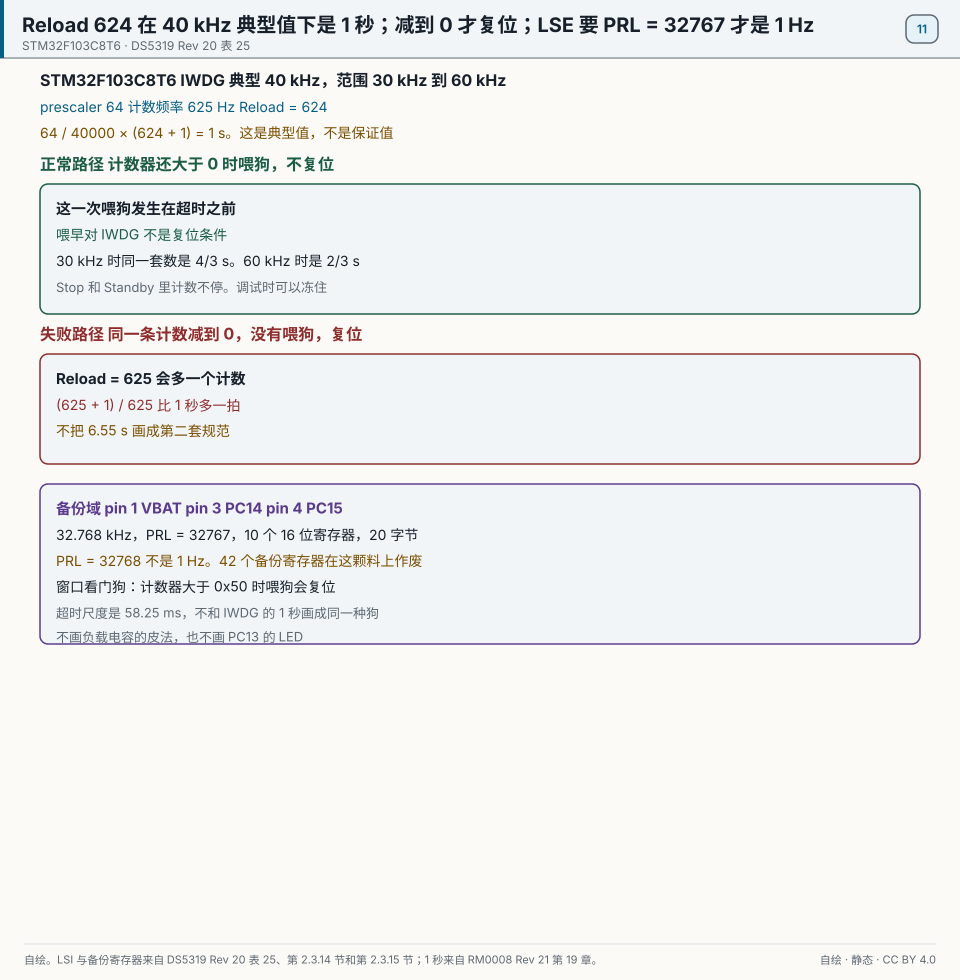
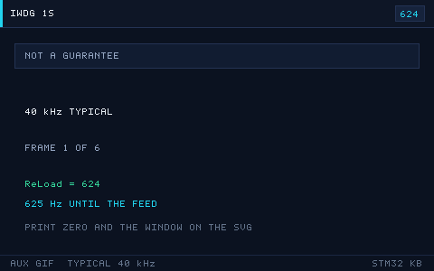

# 11 RTC and the Watchdogs
> 中文：[11 RTC 与看门狗](../11-RTC与看门狗.md)

> The RTC is a calendar clock that keeps running after the main supply drops. The independent watchdog and the window watchdog reset the chip when the program runs away. Together they are two foundations of a reliable product.

<p align="center">
  
  <br><sub>▲ Side figure. The independent watchdog only punishes a late feed. An early feed that also resets is the window watchdog. Without playing this figure, the 1 second and the reset-at-zero are both on the static figure. (vector animation drawn by the author, not a live recording)</sub>
</p>

<!-- video:ch11 -->
<p align="center">
  <video width="640" controls poster="../../assets/video/ch11-rtc.png">
    <source src="../../assets/video/ch11-rtc.mp4" type="video/mp4">
  </video>
  <br><sub>▲ Chinese voice-over, 2.6 min. Voice: Microsoft Edge neural voice zh-CN-XiaoxiaoNeural via edge-tts (library mostly LGPLv3; the voice model is an online Microsoft service, not an open model). Pictures are generated from this repo's SVGs, not photographs. Video: <a href="../../assets/video/ch11-rtc.mp4">MP4</a> · subtitles: <a href="../../assets/video/ch11-rtc.srt">SRT</a>. Rebuild with <code>python3 tools/gen_narrated.py --speak</code>.</sub>
</p>

**Narration script (Chinese, same text as the subtitles)**

1. RTC 住在备份域。主电源掉了，只要备用电池和低速晶振还在，日历就能继续走。时钟源优先选外部 32.768 千赫，它比内部低速时钟准。
2. 备份域默认不让你随便写。要先允许访问，再选时钟、设分频。写不进去的时候，多半不是晶振坏了，而是域还锁着，或者写保护没解。
3. 独立看门狗的时钟独立，喂晚了就复位，用来兜底。窗口看门狗喂早喂晚都会复位，用来发现程序走得太快或太慢。两只可以同时在岗。
4. 这一帧是仓库画的看门狗窗口。太早喂，说明程序没有走到该到的地方；太晚喂，说明它卡住了。窗口看门狗把这两种都当成故障。独立看门狗只惩罚迟到。
5. 32.768 千赫晶振起振慢，初始化超时给得太短，会误判失败。真的不起振，再查负载电容和焊接。调试阶段可以暂时改用内部低速时钟，先把日历逻辑跑通。
6. 把喂狗放在一个和业务无关的定时中断里，主循环死锁时狗仍然吃得饱，等于没养。喂狗要放在你确认「这一圈真的走完了」的地方，并且落在窗口里面。
7. 芯片为什么重启，复位标志里有记录。独立看门狗、窗口看门狗、上电，是不同的旗。读完记得清掉，不然下一次你分不清是新的复位还是旧旗。
8. 口诀：独立看门狗只怕喂晚；窗口看门狗喂早喂晚都会复位。RTC 走在备份域，主电掉了还靠备用电池和低速钟。
9. 实验先故意不喂狗，确认它真的会复位，并且复位旗对得上。然后再把喂狗放到主循环里正确的位置。从没被咬过的狗，你不知道它在不在岗。
10. 合上书，三问。主电源掉了，RTC 还靠什么继续走？哪只看门狗喂早了也会复位？为什么不要把喂狗只放在一个无关的定时中断里？
<!-- /video:ch11 -->

## Principle and boundary

The watchdog and RTC conclusion in this chapter is pinned to order code STM32F103C8T6. The 1 second is copied whole from Appendix D: prescaler 64, Reload = 624, and LSI taken as a typical 40 kHz gives 625 Hz. The LSI range is Table 25's 30 / 40 / 60 kHz. Do not call 40 kHz a guarantee.

`T = 64 / 40000 × (624 + 1) = 1` s. Reload written as 625 makes `(625 + 1) / 625` one extra count. The same prescaler and reload: at LSI = 30 kHz, `64 / 30000 × 625 = 4/3` s; at LSI = 60 kHz, `64 / 60000 × 625 = 2/3` s, half of the 30 kHz case. Appendix D says "about half" because 30 kHz and 60 kHz are the ends of the manual range, not a measurement of every part. The "about 26 s" longest step stays with Appendix D. Do not invent a guaranteed maximum. The independent watchdog resets only when the counter reaches 0. An early feed does not reset it. See [RM0008 Rev 21 chapter 17](#source-rm0008-wdg) and [DS5319 Rev 20 Table 25](#source-ds5319-rtc).

The window watchdog resets on both an early feed and a late feed. PCLK1 = 36 MHz, prescaler 8, counter `0x7F`: the timeout is `(1/36e6) × 4096 × 8 × 64 = 58.25` ms. With window `0x50`, feeding while the counter is still above `0x50` resets immediately. That is a margin note, not the IWDG waveform.

If a fragment keeps Reload = 4095, write the timeout as `(4095 + 1) / 625 = 6.5536` s. The hands-on "about 6.5 s" may stay. It does not enter the four blocks' main ledger. The key figure draws only the 624 second.

LSE is 32.768 kHz, entering on pin 3 PC14-OSC32_IN and pin 4 PC15-OSC32_OUT. PRL = 32767 makes `(32767 + 1)` divide 32768 Hz into 1 Hz. PRL = 32768 is not 1 Hz. That is the RTC failure path. A typical 40 kHz LSI has no integer PRL that stays 1 Hz across 30–60 kHz. The backup domain is kept by pin 1 VBAT after the main supply disappears. Before a write, enable the PWR and BKP clocks and set DBP in `PWR_CR`. See [RM0008 Rev 21 chapter 16](#source-rm0008-rtc).

This medium-density part has ten 16-bit backup data registers, 20 bytes. Forty-two is the high-density sentence and is void on the C8. F4's twenty 32-bit backup registers and the BCD `TR`/`DR` are void on this part. Software turns the 32-bit second counter into a calendar. That sentence is supported by "this part is a 32-bit counter and ten 16-bit registers". Do not open an F4 RTC id.

The IWDG keeps counting in Stop and Standby. It can be frozen while debugging, using the chapter's `__HAL_DBGMCU_FREEZE_IWDG()`. A bit name is written into the claim only when RM0008 prints it. Otherwise write only "it can be frozen while debugging" and do not invent a bit number. `WDG_SW = 0` means the hardware watchdog takes over at power-up and software cannot turn it off. `WDG_SW = 1` is the software watchdog. That sentence links [PM0075](#source-pm0075-rdp) and is not expanded in chapter 01.

While LSE uses pin 3 and pin 4, those pins are not GPIO. If PC13 is still the heartbeat LED, keep chapter 03's rule: it can only sink, and writing 0 turns it on. Do not redraw that LED figure.

## Key figures

<p align="center">
  
  <br><sub>▲ Drawn for this book. STM32F103C8T6. LSI is typically 40 kHz and spans 30–60 kHz. Prescaler 64, a 625 Hz count, and Reload = 624 are a 1 second ledger at the typical value, not a guarantee, when the dog is fed before zero. The failure is reaching 0, or writing Reload as 625. The backup strip is pin 1 VBAT, pin 3 PC14, pin 4 PC15, 32.768 kHz, PRL = 32767, and ten 16-bit registers. PRL = 32768 is not 1 Hz. The window watchdog resets if fed while the counter is above 0x50, on a 58.25 ms scale. Sources: [DS5319 Rev 20 Table 25 and sections 2.3.14 and 2.3.15](#source-ds5319-rtc) and [RM0008 Rev 21 chapter 17](#source-rm0008-wdg).</sub>
</p>

<p align="center">
  
  <br><sub>▲ Auxiliary figure for the web and the article channel. It only plays the normal path: a 625 Hz count is fed before zero, marked with Reload = 624 and a typical 40 kHz. Print uses the static figure. Reaching zero, Reload = 625, and an early window-watchdog feed are not on this GIF.</sub>
</p>

`iwdg-window.svg` stays a side figure. Do not play it for the IWDG claim. The early-feed reset belongs to the window watchdog. That sentence is in the opening caption. It does not pretend to be the IWDG on this static figure.

## Timing or state

| Prescaler | f_LSI | Reload | (Reload + 1) | Time | Reset? |
| --- | --- | --- | --- | --- | --- |
| 64 | 40 kHz | 624 | 625 | 1 s | Resets only at 0. An early feed does not reset |
| 64 | 40 kHz | 625 | 626 | one extra count | Not exactly 1 second |
| 64 | 30 kHz | 624 | 625 | 4/3 s | Not a guarantee |
| 64 | 60 kHz | 624 | 625 | 2/3 s | About half of the 30 kHz case |
| RTC | 32768 Hz | PRL = 32767 | 32768 | 1 Hz | The divider is (PRL + 1) |
| RTC failure | 32768 Hz | PRL = 32768 | 32769 | not 1 Hz | Change it to 32767 |
| Backup registers | — | ten 16-bit | 20 bytes | Pin 1 VBAT keeps them | 42 is void on the C8 |
| WWDG | PCLK1 = 36 MHz | prescaler 8, counter `0x7F` | — | 58.25 ms | Feeding above `0x50` resets |
| Comparison | 64 | 4095 | 4096 | 6.5536 s | Does not replace Reload 624 |

## Pitfalls and source cards

| What you see | Why | What to do | Source | Claim this source may support |
| --- | --- | --- | --- | --- |
| A 1 second computed at 40 kHz runs short or long on the board | 40 kHz is only typical | Use Reload 624 and leave margin for 30–60 kHz | [DS5319](#source-ds5319-rtc) | Table 25 prints fLSI as 30 / 40 / 60 kHz. 40 kHz is typical. That second is not a guarantee |
| Reload written as 625 times out one count past 1 second | The +1 was applied to the wrong side | Change it to 624 | [RM0008](#source-rm0008-wdg) | Prescaler 64 at 40 kHz counts at 625 Hz. Time uses `(Reload + 1)`. 625 is one extra count |
| The independent watchdog resets as soon as it is fed, as if it had a window | It was treated as the window watchdog | An early feed is allowed for the IWDG. Use the WWDG for a window | [RM0008](#source-rm0008-wdg) | The IWDG resets only at 0. The WWDG also resets when fed while the counter is above the window. At 36 MHz, `0x7F` and prescaler 8 time out in 58.25 ms |
| The calendar returns to zero when the main supply drops | The backup domain was not kept, or PRL is wrong | Connect pin 1 VBAT, use pins 3 and 4 for LSE, and write PRL 32767 | [DS5319](#source-ds5319-rtc) | Ten 16-bit backup registers are kept by VBAT. The default 1 second comes from 32.768 kHz. 42 is void on this part |
| A prescaler of 32768 makes the second pulse slow | The divider is (PRL + 1) | Change it to 32767 | [RM0008](#source-rm0008-rtc) | The divider is `(PRL + 1)`. 32768 Hz is 1 Hz only when written as 32767 |
| The part resets by itself after a breakpoint | The counter kept running in debug | Freeze the IWDG while debugging | [DS5319](#source-ds5319-rtc) | Section 2.3.15: the independent watchdog counter can be frozen while debugging. The bit name is not in this claim unless the `rm0008-wdg` snapshot already records the printed name |
| Option bytes make the watchdog run from power-up and software cannot stop it | `WDG_SW` is 0 | 0 is the hardware watchdog and 1 is the software watchdog | [PM0075](#source-pm0075-rdp) | That bit in the USER byte: 0 means the hardware watchdog and 1 means the software watchdog |

## 📌 Learning goals

- [ ] Know the trade-offs among the four RTC clock sources (LSE / LSI / HSE/128), and understand the backup domain and VBAT.
- [ ] Save a flag in a BKP backup register and use it to tell whether this is the first power-up.
- [ ] Configure the calendar, the alarm, periodic wake-up, and the timestamp.
- [ ] Explain the difference between IWDG and WWDG, and give a correct feed strategy.
- [ ] Track down "the RTC is not running," "the LSE will not start," and "the watchdog resets by mistake."

## 🧠 Core ideas

### 1. The RTC and the backup domain

**Conclusion**: The RTC sits in the **backup domain** and is powered by `VBAT`. It keeps time after the main supply drops. Prefer the **LSE at 32.768 kHz** as the clock source. It is the most accurate of the four.

| Clock source | Frequency | Accuracy | Pins used | Fits |
| --- | --- | --- | --- | --- |
| LSE (external 32.768 kHz crystal) | 32.768 kHz | Set by the crystal. ±20 ppm stays out of the four blocks | PC14 / PC15 | When the time has to be right |
| LSI (internal RC) | 30 kHz minimum, 40 kHz typical, 60 kHz maximum | Table 25's range, not ±50% | None | Saving pins, or wake-up only |
| HSE/128 (main crystal divided) | 8 MHz / 128 | Depends on the HSE | Uses the HSE | You already have a precise main crystal |
| RTC prescaler | — | Set by `PRL` | — | Divides the source down to 1 Hz |

- On F1 the RTC is a **32-bit seconds counter**. The calendar (year, month, day, hour, minute, second) is software that converts the second count. F4 and later have a **BCD hardware calendar** (`TR` / `DR`), with the weekday and leap years handled in hardware.
- To touch the backup domain, first enable the `PWR` and `BKP` clocks, then unlock the backup domain (`PWR_CR.DBP`; see RM0008 Chapter 5 PWR and Chapter 6 BKP).

### 2. BKP backup registers

**Conclusion**: `BKP_DRx` is powered by `VBAT`. It survives a loss of the main supply. It is the usual place for flags such as "is this the first power-up" and for calibration constants.

| Family | Backup registers | Width |
| --- | --- | --- |
| STM32F103C8T6 | `BKP_DR1` through `BKP_DR10`, ten 16-bit registers, 20 bytes. Forty-two is high-density and is void on the C8 | 16-bit |
| STM32F4 | `RTC_BKP_DR0` through `DR19` | 32-bit |

The usual pattern: on power-up, read a "magic value" (for example `0xA5A5`). If it matches, the calendar was already initialized, so just read the time. If it does not match, write the magic value and initialize the calendar.

### 3. Calendar, alarm, wake-up, and timestamp

| Feature | What it does | Key registers |
| --- | --- | --- |
| Calendar | Second / minute / hour / day / month / year (F1 converts in software; F4 is hardware BCD) | `RTC_TR` / `RTC_DR` (F4) |
| Alarm | Compared with the counter; at the match it raises an interrupt or an event | `RTC_ALR` (F1) / `RTC_ALRMxR` (F4) |
| Periodic wake-up | Wakes on a fixed period; pairs with STOP to save power | `RTC_WUTR` (F4) |
| Timestamp | A rising edge on a pin records the current time | `RTC_TSTR` / `RTC_TSDR` (F4) |

> On F1 the alarm compares the **seconds counter**. On F4 you can mask-match second, minute, hour, day, month, or weekday, which is more flexible.

### 4. IWDG vs WWDG

**Conclusion**: The IWDG has its own clock and can catch a dead hang. It is the **safety floor**. The WWDG is more accurate and has a feed window, so it can **catch a program whose timing has gone wrong**. You can use both at once.

| Item | IWDG (independent watchdog) | WWDG (window watchdog) |
| --- | --- | --- |
| Clock | LSI (independent of the main clock) | PCLK1 (APB1) |
| Counter | 12-bit down-counter plus an 8-bit prescaler | 7-bit down-counter (`T[6:0]`) |
| Reset condition | Not refreshed before the counter reaches 0 | **Too early (above `W[6:0]`) or too late (below `0x40`) both reset** |
| Window | None (you may feed at any time) | Yes (`WWDG_CFR.W[6:0]` sets it) |
| Accuracy | Poor (the LSI drifts with temperature) | Good (it follows PCLK1) |
| Timeout range | About 0.1 ms to 26 s | About 0.1 ms to 60 ms |
| Typical use | A backstop for a hang; low power | Checking that a periodic task runs on time |
| F1 chapter | RM0008 Chapter 17 | RM0008 Chapter 18 |

An early feed does not reset the IWDG. An early feed that resets is the window watchdog.

**How to feed it**:

- **Feed from the main loop.** Simplest, but a dead loop inside one function defeats it.
- **Feed from a timer or an interrupt.** Fine for the IWDG, but a stuck interrupt will also reset you by mistake.
- **Each task feeds once.** In an RTOS, every critical task feeds. If any one of them stalls, the chip resets.
- **The WWDG window.** You are forced to feed inside a window that is not too early and not too late. That catches "running too fast" (a clock gone wrong) and "running too slow."

## 🛠️ Hardware and wiring

| Board | Peripheral | Pin | Notes |
| --- | --- | --- | --- |
| BluePill (F103) | LSE crystal | PC14 = OSC32_IN, PC15 = OSC32_OUT | Solder a 32.768 kHz crystal. Choose the load capacitors from the crystal manual. |
| BluePill | VBAT | VBAT pin | A 3 V coin cell (CR2032) keeps the clock running |
| BluePill | Spare LED | PC13 | Often used as a heartbeat |
| Nucleo-F411RE | LSE | PC14 / PC15 | A 32.768 kHz crystal is already on the board |
| Any | Watchdog | No pin | Entirely on-chip |

> ⚠️ Choose the load capacitors from the crystal manual. The four blocks do not write a picofarad. Too much capacitance can keep the LSE from starting.

## 💻 Code

**① RTC init and reading the time (F1, LSE source)**

```c
#include "stm32f1xx_hal.h"

RTC_HandleTypeDef hrtc;

static void MX_RTC_Init(void)
{
    __HAL_RCC_PWR_CLK_ENABLE();
    __HAL_RCC_BKP_CLK_ENABLE();

    hrtc.Instance          = RTC;
    hrtc.Init.AsynchPrediv = RTC_AUTO_1_SECOND;   /* F1 prescaler down to 1 Hz */
    hrtc.Init.OutPut       = RTC_OUTPUTSOURCE_NONE;
    HAL_RTC_Init(&hrtc);

    /* Set the time only on first power-up (no magic value in BKP) */
    if (HAL_RTCEx_BKUPRead(&hrtc, RTC_BKP_DR1) != 0xA5A5) {
        RTC_TimeTypeDef t = { .Hours = 12, .Minutes = 0, .Seconds = 0 };
        RTC_DateTypeDef d = { .Year = 26, .Month = RTC_MONTH_JANUARY,
                              .Date = 7, .WeekDay = RTC_WEEKDAY_WEDNESDAY };
        HAL_RTC_SetTime(&hrtc, &t, RTC_FORMAT_BIN);
        HAL_RTC_SetDate(&hrtc, &d, RTC_FORMAT_BIN);
        HAL_RTCEx_BKUPWrite(&hrtc, RTC_BKP_DR1, 0xA5A5);   /* store the magic value */
    }
}

void RTC_PrintTime(void)
{
    RTC_TimeTypeDef t; RTC_DateTypeDef d;
    HAL_RTC_GetTime(&hrtc, &t, RTC_FORMAT_BIN);
    HAL_RTC_GetDate(&hrtc, &d, RTC_FORMAT_BIN);   /* reading the date latches the time registers */
    printf("20%02d-%02d-%02d %02d:%02d:%02d\r\n",
           d.Year, d.Month, d.Date, t.Hours, t.Minutes, t.Seconds);
}
```

**② Alarm interrupt**

```c
void MX_RTC_Alarm_Init(void)
{
    RTC_AlarmTypeDef alarm = {0};
    alarm.AlarmTime.Hours   = 8;
    alarm.AlarmTime.Minutes = 30;
    alarm.AlarmTime.Seconds = 0;
    alarm.AlarmMask         = RTC_ALARMMASK_DATEWEEKDAY;  /* fire every day */
    HAL_RTC_SetAlarm_IT(&hrtc, &alarm, RTC_FORMAT_BIN);
}

void HAL_RTC_AlarmAEventCallback(RTC_HandleTypeDef *hrtc)
{
    /* Callback at the alarm; you can set a flag to wake the main loop */
}
```

**③ Independent watchdog, IWDG**

```c
IWDG_HandleTypeDef hiwdg;

static void MX_IWDG_Init(void)
{
    hiwdg.Instance       = IWDG;
    hiwdg.Init.Prescaler = IWDG_PRESCALER_64;   /* LSI ≈ 40 kHz / 64 = 625 Hz */
    hiwdg.Init.Reload    = 4095;                /* timeout (4095 + 1) / 625 = 6.5536 s. The four blocks' main ledger is still the 1 second at Reload 624 */
    HAL_IWDG_Init(&hiwdg);
}

/* Refresh periodically in the main loop (not from an interrupt — if the ISR is stuck, it cannot save you) */
HAL_IWDG_Refresh(&hiwdg);
```

**④ Window watchdog, WWDG**

```c
WWDG_HandleTypeDef hwwdg;

static void MX_WWDG_Init(void)
{
    hwwdg.Instance       = WWDG;
    hwwdg.Init.Prescaler = WWDG_PRESCALER_8;    /* PCLK1/4096/8 */
    hwwdg.Init.Window    = 0x50;                /* upper edge of the window */
    hwwdg.Init.Counter   = 0x7F;                /* initial value, timeout ≈ 58.25 ms at 36 MHz */
    hwwdg.Init.EWIMode   = WWDG_EWI_ENABLE;     /* enable the early-wakeup interrupt */
    HAL_WWDG_Init(&hwwdg);
}

/* Must refresh inside the [0x40, 0x50] window */
HAL_WWDG_Refresh(&hwwdg);
```

## 🧪 Hands-on labs

1. **Timekeeping across power loss**: solder the LSE crystal and a VBAT coin cell. Print the time on the UART once a second, then remove power and bring it back. Expected: the time continues. It does not return to zero.
2. **A daily alarm**: set an alarm for 08:30 every day, and light an LED in the callback. Expected: it fires once at that time and does nothing the rest of the day.
3. **Watchdog stress test**: set the IWDG timeout to 6.5 s, then deliberately enter `while(1)` and never feed it. Expected: the chip resets by itself after about 6.5 s.
4. **(Further) Window watchdog timing check**: use the WWDG window to watch a periodic task. Stretch the task delay past the timeout and watch the reset. Then make the task too fast (feed too early). That resets as well.

### How to compute the timeout, and how to freeze it while debugging

**Conclusion**: `T = prescaler ÷ f_LSI × (Reload + 1)`. With `IWDG_PRESCALER_64` and a typical 40 kHz LSI, that is 625 Hz. For a 1 second timeout, write Reload as **624**. Writing 625 adds one extra count.

The datasheet range for the LSI is about 30 to 60 kHz. 40 kHz is only the typical value. Leave margin on the timeout. Do not sit exactly on the nominal number.

| Watchdog | When it resets | Time scale |
| --- | --- | --- |
| IWDG | Only when you feed too late (it counts down to 0) | About 0.1 ms to 26 s |
| WWDG | An early feed and a late feed both reset | On an F103 at 36 MHz, about 0.1 to 58 ms |

Single-stepping will be reset by the IWDG. Freeze it in the option settings or in the debug registers:

```c
__HAL_DBGMCU_FREEZE_IWDG();   /* F1 uses DBGMCU->CR, F4 uses APB1FZ; the macro picks the right register */
__HAL_DBGMCU_FREEZE_WWDG();
```

Once `HAL_IWDG_Init` succeeds, the IWDG cannot be stopped. Only a reset turns it off. If you write `WDG_SW` to 0 in the option bytes, the hardware watchdog takes over at power-up, and software cannot turn it off either.

Motto: **one second is 624, not 625. The IWDG fears a late feed; the WWDG fears both early and late. Freeze the counter before you debug.**

Self-test:

1. Prescaler 64, Reload 624, LSI taken as 40 kHz. Is the timeout exactly 1 second? Which "+1" is the difference?
2. What happens if you feed the window watchdog while the counter is still greater than the window value?
3. Why does the board reset by itself when a breakpoint stops inside `HAL_Delay`?

## 🔗 Related resources

- RM0008, *STM32F10xxx Reference Manual*, Chapter 16 RTC, Chapter 17 IWDG, Chapter 18 WWDG, Chapter 5 PWR, Chapter 6 BKP, and Chapter 7 RCC (LSE / LSI configuration).
- RM0090, *STM32F4 Reference Manual*, Chapter 26 RTC, and the matching IWDG / WWDG chapters.
- Datasheet DS: LSE startup conditions, the LSI frequency range, and the VBAT operating voltage.
- Application note AN4759, *Using the hardware real-time clock (RTC) in STM32*.
- Figure: `../../assets/animations/iwdg-window.svg` (vector drawing by the author).
