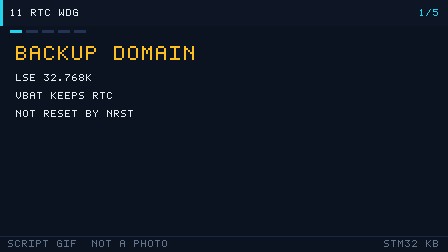

# 11 RTC and the Watchdogs
> 中文：[11 RTC 与看门狗](../11-RTC与看门狗.md)

> The RTC is a calendar clock that keeps running after the main supply drops. The independent watchdog and the window watchdog reset the chip when the program runs away. Together they are two foundations of a reliable product.

<p align="center">
  
  <br><sub>▲ Animation: the independent watchdog counter and the feed window (too early and too late both reset the chip) (vector animation drawn by the author, not a live recording)</sub>
</p>

<!-- video:ch11 -->
<p align="center">
  
  <br><sub>▲ Lecture slides for this chapter: a generated GIF (tools/gen_videos.py, reproducible, not a live recording). The narration lines up with the five frames, one to one.</sub>
</p>

**Narration (read along with the frames, about one minute)**

1. The RTC lives in the backup domain. When the main supply is gone, VBAT and the LSE can still keep it counting.
2. Do not write 625 for one second. The prescaler counts down to 0 and then takes one more tick. The asynchronous and synchronous dividers have to line up.
3. The IWDG only fears a late feed. The WWDG resets on an early feed and on a late feed. Both edges of the window are cliffs.
4. While debugging, freeze the watchdog first. Otherwise one single-step resets the chip, and it looks like the program blew itself up.
5. Motto: one second is 624, not 625. Self-test: can you feed the WWDG early?
<!-- /video:ch11 -->


## 📌 Learning goals

- [ ] Know the trade-offs among the four RTC clock sources (LSE / LSI / HSE/128), and understand the backup domain and VBAT.
- [ ] Save a flag in a BKP backup register and use it to tell whether this is the first power-up.
- [ ] Configure the calendar, the alarm, periodic wake-up, and the timestamp.
- [ ] Explain the difference between IWDG and WWDG, and give a correct feed strategy.
- [ ] Track down "the RTC is not running," "the LSE will not start," and "the watchdog resets by mistake."

## 🧠 Core ideas

### 1. The RTC and the backup domain

**Conclusion**: The RTC sits in the **backup domain** and is powered by `VBAT`. It keeps time after the main supply drops. Prefer the **LSE at 32.768 kHz** as the clock source. It is the most accurate of the four.

| Clock source | Frequency | Accuracy | Pins used | Fits |
| --- | --- | --- | --- | --- |
| LSE (external 32.768 kHz crystal) | 32.768 kHz | High (±20 ppm) | PC14 / PC15 | When the time has to be right |
| LSI (internal RC) | ≈ 32 to 40 kHz | Low (±50% startup error, large temperature drift) | None | Saving pins, or wake-up only |
| HSE/128 (main crystal divided) | 8 MHz / 128 | Depends on the HSE | Uses the HSE | You already have a precise main crystal |
| RTC prescaler | — | Set by `PRL` | — | Divides the source down to 1 Hz |

- On F1 the RTC is a **32-bit seconds counter**. The calendar (year, month, day, hour, minute, second) is software that converts the second count. F4 and later have a **BCD hardware calendar** (`TR` / `DR`), with the weekday and leap years handled in hardware.
- To touch the backup domain, first enable the `PWR` and `BKP` clocks, then unlock the backup domain (`PWR_CR.DBP`; see RM0008 Chapter 5 PWR and Chapter 6 BKP).

### 2. BKP backup registers

**Conclusion**: `BKP_DRx` is powered by `VBAT`. It survives a loss of the main supply. It is the usual place for flags such as "is this the first power-up" and for calibration constants.

| Family | Backup registers | Width |
| --- | --- | --- |
| STM32F1 | `BKP_DR1` through `BKP_DR10` (42 on high-density) | 16-bit |
| STM32F4 | `RTC_BKP_DR0` through `DR19` | 32-bit |

The usual pattern: on power-up, read a "magic value" (for example `0xA5A5`). If it matches, the calendar was already initialized, so just read the time. If it does not match, write the magic value and initialize the calendar.

### 3. Calendar, alarm, wake-up, and timestamp

| Feature | What it does | Key registers |
| --- | --- | --- |
| Calendar | Second / minute / hour / day / month / year (F1 converts in software; F4 is hardware BCD) | `RTC_TR` / `RTC_DR` (F4) |
| Alarm | Compared with the counter; at the match it raises an interrupt or an event | `RTC_ALR` (F1) / `RTC_ALRMxR` (F4) |
| Periodic wake-up | Wakes on a fixed period; pairs with STOP to save power | `RTC_WUTR` (F4) |
| Timestamp | A rising edge on a pin records the current time | `RTC_TSTR` / `RTC_TSDR` (F4) |

> On F1 the alarm compares the **seconds counter**. On F4 you can mask-match second, minute, hour, day, month, or weekday, which is more flexible.

### 4. IWDG vs WWDG

**Conclusion**: The IWDG has its own clock and can catch a dead hang. It is the **safety floor**. The WWDG is more accurate and has a feed window, so it can **catch a program whose timing has gone wrong**. You can use both at once.

| Item | IWDG (independent watchdog) | WWDG (window watchdog) |
| --- | --- | --- |
| Clock | LSI (independent of the main clock) | PCLK1 (APB1) |
| Counter | 12-bit down-counter plus an 8-bit prescaler | 7-bit down-counter (`T[6:0]`) |
| Reset condition | Not refreshed before the counter reaches 0 | **Too early (above `W[6:0]`) or too late (below `0x40`) both reset** |
| Window | None (you may feed at any time) | Yes (`WWDG_CFR.W[6:0]` sets it) |
| Accuracy | Poor (the LSI drifts with temperature) | Good (it follows PCLK1) |
| Timeout range | About 0.1 ms to 26 s | About 0.1 ms to 60 ms |
| Typical use | A backstop for a hang; low power | Checking that a periodic task runs on time |
| F1 chapter | RM0008 Chapter 17 | RM0008 Chapter 18 |

**How to feed it**:

- **Feed from the main loop.** Simplest, but a dead loop inside one function defeats it.
- **Feed from a timer or an interrupt.** Fine for the IWDG, but a stuck interrupt will also reset you by mistake.
- **Each task feeds once.** In an RTOS, every critical task feeds. If any one of them stalls, the chip resets.
- **The WWDG window.** You are forced to feed inside a window that is not too early and not too late. That catches "running too fast" (a clock gone wrong) and "running too slow."

## 🛠️ Hardware and wiring

| Board | Peripheral | Pin | Notes |
| --- | --- | --- | --- |
| BluePill (F103) | LSE crystal | PC14 = OSC32_IN, PC15 = OSC32_OUT | Solder a 32.768 kHz crystal plus two load capacitors (~6 pF) |
| BluePill | VBAT | VBAT pin | A 3 V coin cell (CR2032) keeps the clock running |
| BluePill | Spare LED | PC13 | Often used as a heartbeat |
| Nucleo-F411RE | LSE | PC14 / PC15 | A 32.768 kHz crystal is already on the board |
| Any | Watchdog | No pin | Entirely on-chip |

> ⚠️ Pick the load capacitors from the crystal's datasheet (6 pF and 12.5 pF are common). **Too much capacitance and the LSE never starts.** That is the number-one cause of "the RTC is not running."

## 💻 Code

**① RTC init and reading the time (F1, LSE source)**

```c
#include "stm32f1xx_hal.h"

RTC_HandleTypeDef hrtc;

static void MX_RTC_Init(void)
{
    __HAL_RCC_PWR_CLK_ENABLE();
    __HAL_RCC_BKP_CLK_ENABLE();

    hrtc.Instance          = RTC;
    hrtc.Init.AsynchPrediv = RTC_AUTO_1_SECOND;   /* F1 prescaler down to 1 Hz */
    hrtc.Init.OutPut       = RTC_OUTPUTSOURCE_NONE;
    HAL_RTC_Init(&hrtc);

    /* Set the time only on first power-up (no magic value in BKP) */
    if (HAL_RTCEx_BKUPRead(&hrtc, RTC_BKP_DR1) != 0xA5A5) {
        RTC_TimeTypeDef t = { .Hours = 12, .Minutes = 0, .Seconds = 0 };
        RTC_DateTypeDef d = { .Year = 26, .Month = RTC_MONTH_JANUARY,
                              .Date = 7, .WeekDay = RTC_WEEKDAY_WEDNESDAY };
        HAL_RTC_SetTime(&hrtc, &t, RTC_FORMAT_BIN);
        HAL_RTC_SetDate(&hrtc, &d, RTC_FORMAT_BIN);
        HAL_RTCEx_BKUPWrite(&hrtc, RTC_BKP_DR1, 0xA5A5);   /* store the magic value */
    }
}

void RTC_PrintTime(void)
{
    RTC_TimeTypeDef t; RTC_DateTypeDef d;
    HAL_RTC_GetTime(&hrtc, &t, RTC_FORMAT_BIN);
    HAL_RTC_GetDate(&hrtc, &d, RTC_FORMAT_BIN);   /* reading the date latches the time registers */
    printf("20%02d-%02d-%02d %02d:%02d:%02d\r\n",
           d.Year, d.Month, d.Date, t.Hours, t.Minutes, t.Seconds);
}
```

**② Alarm interrupt**

```c
void MX_RTC_Alarm_Init(void)
{
    RTC_AlarmTypeDef alarm = {0};
    alarm.AlarmTime.Hours   = 8;
    alarm.AlarmTime.Minutes = 30;
    alarm.AlarmTime.Seconds = 0;
    alarm.AlarmMask         = RTC_ALARMMASK_DATEWEEKDAY;  /* fire every day */
    HAL_RTC_SetAlarm_IT(&hrtc, &alarm, RTC_FORMAT_BIN);
}

void HAL_RTC_AlarmAEventCallback(RTC_HandleTypeDef *hrtc)
{
    /* Callback at the alarm; you can set a flag to wake the main loop */
}
```

**③ Independent watchdog, IWDG**

```c
IWDG_HandleTypeDef hiwdg;

static void MX_IWDG_Init(void)
{
    hiwdg.Instance       = IWDG;
    hiwdg.Init.Prescaler = IWDG_PRESCALER_64;   /* LSI ≈ 40 kHz / 64 = 625 Hz */
    hiwdg.Init.Reload    = 4095;                /* timeout ≈ 4095/625 ≈ 6.55 s */
    HAL_IWDG_Init(&hiwdg);
}

/* Refresh periodically in the main loop (not from an interrupt — if the ISR is stuck, it cannot save you) */
HAL_IWDG_Refresh(&hiwdg);
```

**④ Window watchdog, WWDG**

```c
WWDG_HandleTypeDef hwwdg;

static void MX_WWDG_Init(void)
{
    hwwdg.Instance       = WWDG;
    hwwdg.Init.Prescaler = WWDG_PRESCALER_8;    /* PCLK1/4096/8 */
    hwwdg.Init.Window    = 0x50;                /* upper edge of the window */
    hwwdg.Init.Counter   = 0x7F;                /* initial value, timeout ≈ 58.25 ms at 36 MHz */
    hwwdg.Init.EWIMode   = WWDG_EWI_ENABLE;     /* enable the early-wakeup interrupt */
    HAL_WWDG_Init(&hwwdg);
}

/* Must refresh inside the [0x40, 0x50] window */
HAL_WWDG_Refresh(&hwwdg);
```

## ⚠️ Pitfalls and troubleshooting

| What you see | Cause | Fix |
| --- | --- | --- |
| The RTC does not run, or it returns to zero at power-up | The LSE never started, or VBAT is not connected | Check the crystal load capacitors; connect a battery to VBAT |
| The LSE fails to start | Load capacitance is too large, or the crystal is poor | Switch to 6 pF capacitors and keep the traces short |
| Year or month is scrambled | On F1 the calendar is a software conversion, and the formula is wrong | Use a standard library that converts a 32-bit second count to a calendar |
| The date changes after you read the time | Reading `TR` latches the registers, and you did not read `DR` in time | Read the time first, then the date |
| The watchdog resets over and over | The feed interval is longer than the timeout | Work out the timeout; feed on a regular cadence in the loop |
| The WWDG resets as soon as you enable it | The initial value is below the window, or you feed too early | Make `Counter > Window`, and feed only inside the window |
| The watchdog resets by mistake in low power | In STOP mode the LSI is still counting | Call `HAL_IWDG_Refresh` before you stop, and plan the wake |

## 🧪 Hands-on labs

1. **Timekeeping across power loss**: solder the LSE crystal and a VBAT coin cell. Print the time on the UART once a second, then remove power and bring it back. Expected: the time continues. It does not return to zero.
2. **A daily alarm**: set an alarm for 08:30 every day, and light an LED in the callback. Expected: it fires once at that time and does nothing the rest of the day.
3. **Watchdog stress test**: set the IWDG timeout to 6.5 s, then deliberately enter `while(1)` and never feed it. Expected: the chip resets by itself after about 6.5 s.
4. **(Further) Window watchdog timing check**: use the WWDG window to watch a periodic task. Stretch the task delay past the timeout and watch the reset. Then make the task too fast (feed too early). That resets as well.

### How to compute the timeout, and how to freeze it while debugging

**Conclusion**: `T = prescaler ÷ f_LSI × (Reload + 1)`. With `IWDG_PRESCALER_64` and a typical 40 kHz LSI, that is 625 Hz. For a 1 second timeout, write Reload as **624**. Writing 625 adds one extra count.

The datasheet range for the LSI is about 30 to 60 kHz. 40 kHz is only the typical value. Leave margin on the timeout. Do not sit exactly on the nominal number.

| Watchdog | When it resets | Time scale |
| --- | --- | --- |
| IWDG | Only when you feed too late (it counts down to 0) | About 0.1 ms to 26 s |
| WWDG | An early feed and a late feed both reset | On an F103 at 36 MHz, about 0.1 to 58 ms |

Single-stepping will be reset by the IWDG. Freeze it in the option settings or in the debug registers:

```c
__HAL_DBGMCU_FREEZE_IWDG();   /* F1 uses DBGMCU->CR, F4 uses APB1FZ; the macro picks the right register */
__HAL_DBGMCU_FREEZE_WWDG();
```

Once `HAL_IWDG_Init` succeeds, the IWDG cannot be stopped. Only a reset turns it off. If you write `WDG_SW` to 0 in the option bytes, the hardware watchdog takes over at power-up, and software cannot turn it off either.

Motto: **one second is 624, not 625. The IWDG fears a late feed; the WWDG fears both early and late. Freeze the counter before you debug.**

Self-test:

1. Prescaler 64, Reload 624, LSI taken as 40 kHz. Is the timeout exactly 1 second? Which "+1" is the difference?
2. What happens if you feed the window watchdog while the counter is still greater than the window value?
3. Why does the board reset by itself when a breakpoint stops inside `HAL_Delay`?

## 🔗 Related resources

- RM0008, *STM32F10xxx Reference Manual*, Chapter 16 RTC, Chapter 17 IWDG, Chapter 18 WWDG, Chapter 5 PWR, Chapter 6 BKP, and Chapter 7 RCC (LSE / LSI configuration).
- RM0090, *STM32F4 Reference Manual*, Chapter 26 RTC, and the matching IWDG / WWDG chapters.
- Datasheet DS: LSE startup conditions, the LSI frequency range, and the VBAT operating voltage.
- Application note AN4759, *Using the hardware real-time clock (RTC) in STM32*.
- Figure: `../../assets/animations/iwdg-window.svg` (vector drawing by the author).
