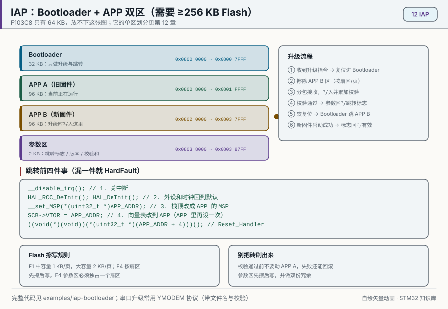
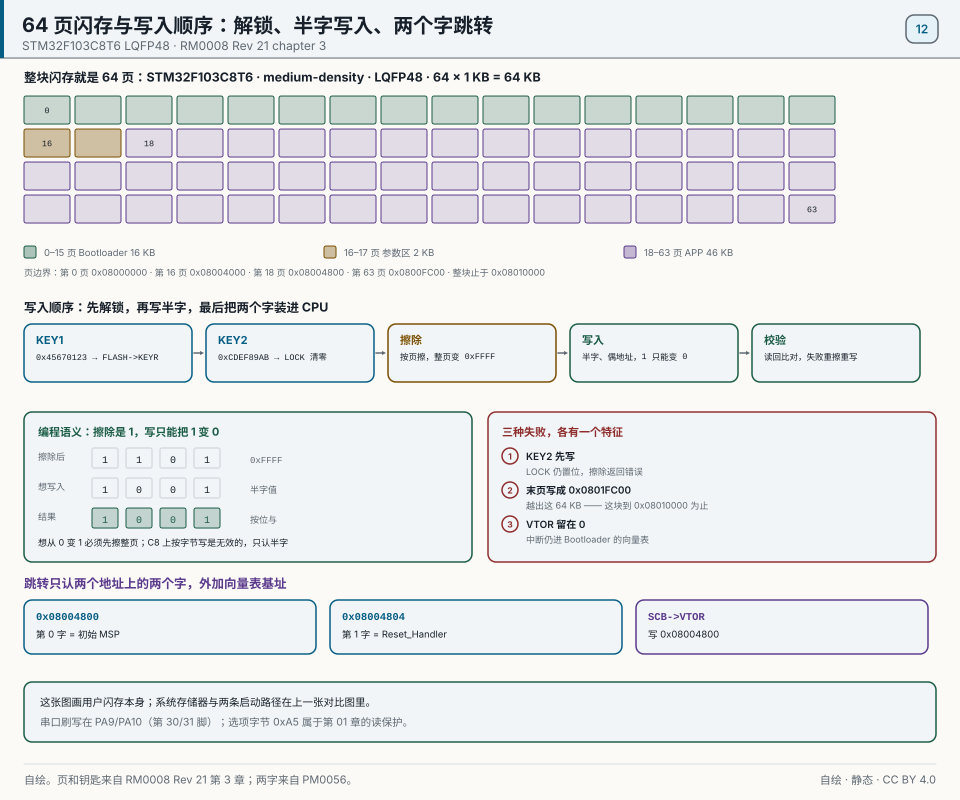
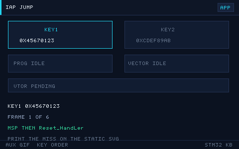

# 12 Flash and IAP Updates
> 中文：[12 Flash 与 IAP 升级](../12-Flash与IAP升级.md)

> Internal Flash holds the program and can be erased and written while the part is running. IAP (in-application programming) lets the device update its own firmware over UART or CAN, with no need to open the case and attach a programmer.

<p align="center">
  
  <br><sub>▲ Animation: an IAP update, with the bootloader and the app in two regions and a jump between them (vector animation drawn by the author, not a live recording)</sub>
</p>

<!-- video:ch12 -->
<p align="center">
  <video width="640" controls poster="../../assets/video/ch12-iap.png">
    <source src="../../assets/video/ch12-iap.mp4" type="video/mp4">
  </video>
  <br><sub>▲ Chapter video with Chinese voice-over (2.6 min). <a href="../../assets/video/ch12-iap.mp4">MP4</a> · <a href="../../assets/video/ch12-iap.srt">subtitles</a></sub>
</p>

<details>
<summary>Narration script (Chinese, same text as the subtitles)</summary>

1. 闪存不能当内存随便改一个字节。通常要先擦，再写。擦写之前必须解锁。写到一半掉电，这一页可能是半新半旧，启动时要能认出来。
2. F103 的读保护里，选项字节 0xA5 表示不保护。改成别的值之前，先想清楚你还能不能再读出来。改保护之前，先把现有程序备份下来。
3. 到了 F4，0xCC 这一档是不可逆的读保护。手滑写进去，这颗芯片的调试口就回不来了。实验这种操作，不要放在你唯一的那块板子上。
4. 这一帧是仓库画的升级路径。正在执行的程序不要擦掉自己的脚下。新固件写到另一块区域，校验通过，再跳过去。校验失败就留在旧程序里，设备还活着。
5. 程序如果不是从默认的闪存起始跑，中断向量表的偏移也要改。只改链接脚本、不改向量表偏移，平时能跑，一进中断就飞到旧地址。
6. 跳转之前至少核对长度和校验。有条件再看版本号。没有校验就跳，等于允许任意一包噪声变成你的新程序。失败了要留在还能通信的旧程序里。
7. 擦除不是调用一下就结束。要等忙标志落下，再去读。写保护如果开着，解锁只解了闪存控制器还不够。手册里的顺序不要跳步。
8. 口诀：0xA5 是 F1 的开门钥匙，0xCC 是 F4 的单程票；改保护先备份。擦之前为什么必须解锁？因为锁着的闪存会拒绝你，或者你以为写进去了其实没有。
9. 实验选一页确定不会踩到当前程序的闪存，擦掉、写几个字、再读回来。和程序区叠在一起的实验，做完这章你就没有调试器可以后悔了。
10. 合上书，三问。擦除之前为什么必须解锁？F103 的 0xA5 表示保护还是不保护？F4 写进 0xCC 之后还能不能恢复调试？

</details>
<!-- /video:ch12 -->

## Learning goals

Before this chapter: be able to flash a program as in chapter 01, send and receive bytes over a serial port as in chapter 06, and know what an interrupt is from chapter 04. You also need hex, pointers, and `volatile` (if not, read "Zero-background primer" in chapter 00 first).

- [ ] Explain why Flash must be erased before it is written, and why an erased half-word reads `0xFFFF`
- [ ] Compute the start address of any page of the STM32F103C8T6 with one formula, for example page 16 at `0x08004000`
- [ ] Walk once through "unlock → erase a page → write a half-word → read back → lock" in the manual's order, and say what a reversed key does
- [ ] Draw this book's IAP map (Bootloader 16 KB, parameters 2 KB, application 46 KB) and set the application's linker script and `VTOR`
- [ ] Write a jump function that does not crash: check the stack top, then disable interrupts, reset peripherals, stop SysTick, and switch the vector table and MSP
- [ ] Say how F1 and F4 readout protection differ, which step mass-erases the Flash, and which step cannot be undone

## Core ideas

**In one sentence: on-chip Flash is program memory that keeps its contents without power; it can only be erased a whole page at a time and written back 16 bits at a time. IAP (In-Application Programming) means a resident boot program, the Bootloader, uses this erase-and-write sequence to put new firmware into another region, checks it, and then jumps to it.**

### An analogy first

Think of Flash as a notebook written in pencil, except that the eraser only erases whole pages.

- After a page is erased, every cell is blank. Blank in Flash is 1, so an erased area reads back as all `0xFF`.
- Writing can only darken a blank cell, that is, turn a 1 into a 0. A dark cell cannot be erased back to blank on its own; to change one word, you erase the whole page and copy it out again.
- The notebook is locked in a drawer. Two keys, used in a fixed order, open it, and you lock it again when you are done.
- IAP is like the first few pages of the notebook holding instructions on how to replace the main text: the Bootloader. You read the instructions first, and they decide whether to go straight to the main text or to erase it and copy in a new one.

The analogy stops here. Real Flash writes 16 bits at a time, not a word; erasing a page takes 20–40 ms, and during that time the CPU waits if it wants to fetch instructions from Flash; and each page survives only a limited number of erase cycles. The numbers are in section 3.

### 1. How Flash is organized: erase before write, 16 bits at a time

The STM32F103C8T6 keeps its program in 64 KB of on-chip Flash memory starting at address `0x08000000`. You read it like RAM, with a pointer. You cannot write it that way: an assignment such as `*(uint16_t *)addr = x;` does not store the value.

The manuals call writing to Flash "programming". F1 programming follows three rules, from ST's Flash programming manual PM0075 Rev 2 section 2.3.3 and RM0008 Rev 21 section 3.3.3:

- **Erase by page.** Erasing sets a whole page to all ones, so every half-word reads `0xFFFF`. The F103C8 is a medium-density device: 1 KB per page, 64 pages.
- **Program by half-word.** A half-word is 16 bits, 2 bytes, at an even address; a 32-bit value takes two writes. If a write is not half-word wide, the FPEC (Flash Program and Erase Controller) returns a bus error.
- **Write only where it is erased.** If the target half-word is not `0xFFFF`, the hardware skips the write and sets the PGERR (programming error) flag in the status register; the one exception is writing `0x0000`. So on the F1, even to turn a few 1s into 0s, you must erase the whole page first.

One formula gives the start address of any page:

```text
start address of page n = 0x08000000 + n × 0x400        (0x400 = 1024 bytes = 1 KB)
```

| Page | Start address | How |
| --- | --- | --- |
| 0 | `0x08000000` | 0 × 0x400 = 0 |
| 16 | `0x08004000` | 16 × 0x400 = 0x4000 |
| 18 | `0x08004800` | 18 × 0x400 = 0x4800 |
| 63 | `0x0800FC00` | 63 × 0x400 = 0xFC00, the last page |

You can recompute every row with the formula. An address that falls between two rows belongs to the page that starts on the upper row; for example, `0x08004321` is in page 16.

### 2. Unlock and the programming sequence: the steps to erase and write a page

**Conclusion: unlock → wait until not busy → erase the page → write half-words → read back and compare → lock. HAL wraps this in four functions; the register version is at the end of "Code".**

These steps use four registers of the Flash interface: `FLASH_KEYR` (the key register), `FLASH_CR` (the control register, with the LOCK, PER, PG, and STRT bits), `FLASH_AR` (the address register), and `FLASH_SR` (the status register). In the status register, BSY = 1 means "erasing or writing in progress", PGERR and WRPRTERR (write-protection error) are the two error flags, and EOP means an operation has finished. The order in the table comes from PM0075 Rev 2 sections 2.3.2 to 2.3.4:

| Step | What happens in the registers | HAL function |
| --- | --- | --- |
| 1 Unlock | Write `0x45670123`, then `0xCDEF89AB`, to `FLASH_KEYR`; the LOCK bit in `FLASH_CR` clears | `HAL_FLASH_Unlock()` |
| 2 Erase a page | Wait for BSY = 0; set PER; write any address inside the page to `FLASH_AR`; set STRT; wait for BSY = 0 again | `HAL_FLASHEx_Erase()` |
| 3 Write a half-word | Set PG; write a 16-bit value to the target address; wait for BSY = 0 | `HAL_FLASH_Program(FLASH_TYPEPROGRAM_HALFWORD, …)` |
| 4 Check | Check PGERR and WRPRTERR; read the address back and compare | HAL checks only the flags; the read-back is yours to write |
| 5 Lock | Set LOCK | `HAL_FLASH_Lock()` |

Follow the table top to bottom; the HAL column names the ready-made function for the same step. Three details cause most of the trouble:

- **A wrong key gives you no second try.** If the order is reversed or a value is wrong, the FPEC returns a bus error and keeps the FPEC and `FLASH_CR` locked until the next reset (PM0075 Rev 2 section 2.3.2).
- **The CPU stalls during erase and write.** While BSY = 1, any CPU read from Flash, including an instruction fetch, waits (PM0075 section 2.3.3). The program and the interrupt handlers live in Flash, so during the 20–40 ms of a page erase even the UART interrupt cannot run. Section 7 depends on this.
- **Keep HSI on.** The on-chip 8 MHz RC oscillator, HSI, must be on during erase and write (RM0008 Rev 21 section 3.3.3). HSI is on after reset; watch out if your program turns it off to save power.

With HAL, four lines make one complete erase and write:

```c
HAL_FLASH_Unlock();                                          /* unlock */
HAL_FLASHEx_Erase(&erase, &page_err);                        /* erase (F1 by page, F4 by sector) */
HAL_FLASH_Program(FLASH_TYPEPROGRAM_HALFWORD, addr, data);   /* the F1 writes one half-word */
HAL_FLASH_Lock();                                            /* lock */
```

The F4 flow is much the same, with two differences: erase selects a sector number with the SER bit and the SNB field of `FLASH_CR`, and the write width comes from the PSIZE field, which HAL exposes as `FLASH_TYPEPROGRAM_BYTE`, `FLASH_TYPEPROGRAM_WORD`, `FLASH_TYPEPROGRAM_DOUBLEWORD`, and so on.

### 3. How F1 and F4 Flash differ

**Conclusion: the F1 erases 1 KB pages and writes only half-words; the F4 erases 16–128 KB sectors, and how wide it writes depends on the supply voltage. Do not mix the two columns below.**

| Item | STM32F103C8T6 (F1) | STM32F407VG (F4) |
| --- | --- | --- |
| Erase unit | Page, 1 KB, 64 pages (medium-density). High-density F1 parts use 2 KB pages | Sector: S0–S3 16 KB each, S4 64 KB, S5–S11 128 KB each, 1 MB in total |
| Write width | Half-word (16 bits) only | 8, 16, 32, or 64 bits, chosen by PSIZE |
| Erase/write voltage | The chip's own VDD; erase and write work from 2 to 3.6 V | 32-bit writes need 2.7–3.6 V; 64-bit writes need 8–9 V applied to the VPP pin |
| Erasing one unit | Page erase 20–40 ms | Erasing ×32: 16 KB sector typ 250 ms, max 500 ms; 128 KB sector typ 1 s, max 2 s |
| One write | Half-word 40–70 µs, typ 52.5 µs | Typ 16 µs, max 100 µs |
| Endurance | At least 10,000 cycles per page | Same |
| Data retention | 30 years at 85 °C after 1,000 cycles; 20 years at 55 °C after 10,000 cycles | Same |

The F1 column comes from RM0008 Rev 21 Table 5, PM0075 Rev 2 section 2.3.3, and DS5319 Rev 20 Tables 28 and 29; the F4 column from RM0090 Rev 22 Table 5 and section 3.6.2 Table 13, and DS8626 Rev 12 Tables 40 and 42. Read the table with two things in mind. First, "byte writes", "sectors", and "PSIZE" are F4 terms; they do not hold on the F103. Second, plan with the maximum times. Endurance and retention are figures the vendor evaluated: the footnote to DS5319 Table 29 says "evaluated by characterization, not tested in production", so they are not measured on every chip.

> [!WARNING]
> Flash can only be erased a whole page (or sector) at a time. Changing one byte means reading out the page, erasing it, and writing the whole page back. 10,000 cycles sounds like a lot, yet a program that saves one page every second wears that page through 10,000 cycles in under 3 hours. For data you save often, either collect it and write less often, or rotate the writes across several pages; that is called wear leveling.

### 4. How IAP works, and how you split the memory: Bootloader, parameters, application

**Conclusion: IAP splits Flash into three blocks. At power-up the Bootloader at the front runs first and decides whether to receive new firmware or to jump to the application behind it. All three boundaries must sit on page boundaries.**

This book and `examples/iap-bootloader` use the map below. It is an example setting, not a manual requirement:

| Region | Start | Size | Pages | Contents |
| --- | --- | --- | --- | --- |
| Bootloader | `0x0800 0000` | 16 KB | 0–15 | Boot, UART update, jump |
| Parameters | `0x0800 4000` | 2 KB | 16–17 | "Application valid" flag, length, checksum |
| Application | `0x0800 4800` | 46 KB (`0xB800`) | 18–63 | User program; its linker script starts at `0x08004800` |

The three add up to exactly 64 KB. Read the table row by row: start plus size gives the start of the next row. Boundaries must sit on pages because erase works by page; if the parameters shared a page with the Bootloader, erasing the parameters would erase Bootloader code with them. The 16 KB for the Bootloader is also an example setting. If your Bootloader is bigger or smaller, move the whole map, as long as every boundary stays on a page.

The F4 needs the same kind of split, by sectors. Per RM0090 Rev 22 Table 5, the 1 MB STM32F407VG can be split like this:

| Region | Start | Size | Sectors |
| --- | --- | --- | --- |
| Bootloader | `0x0800 0000` | 32 KB | S0–S1 |
| Parameters | `0x0800 8000` | 16 KB | S2, a sector of its own |
| Spare | `0x0800 C000` | 16 KB | S3, can hold a second copy of the parameters |
| Application | `0x0801 0000` | 960 KB | S4–S11 |

On the F4, even 2 KB of parameters must have a 16 KB sector to themselves, or erasing them would erase the Bootloader in the same sector. The parameters go in the 16 KB S2 rather than the 64 KB S4 also because small sectors erase faster: erasing ×32, a 16 KB sector takes at most 500 ms and a 64 KB sector at most 1.1 s (DS8626 Rev 12 Table 40).

The chip also holds a Bootloader that ST programs at the factory, in system memory: with BOOT0 high and BOOT1 low at reset, you can download a program over USART1 (PA9/PA10) (AN2606 Rev 70 chapter 21). IAP differs in three ways: you do not touch the BOOT0 jumper, you define the protocol and the checks yourself, and you can use CAN, USB, or any other interface.

### 5. Two words and one register for jumping to the application

**Conclusion: the application area starts with its own vector table; word 0 is the stack top and word 1 is the reset entry. The jump reads these two words, tidies up the CPU, tells it where the new vector table is, and starts executing at the reset entry.**

Three terms first:

- **Vector table**: an address table at the start of a program. Entry 0 is the initial value of the main stack pointer MSP, entry 1 is the address of `Reset_Handler`, which runs after reset, and each later entry is the address of an interrupt handler (PM0056 Rev 7 section 2.3.4).
- **MSP** (Main Stack Pointer): where the stack, which holds local variables and return addresses, begins. The F103C8 has 20 KB of SRAM (DS5319 Rev 20 Table 2), from `0x20000000` up to just below `0x20005000`. The stack grows from high addresses down, so the initial MSP is usually exactly `0x20005000`; a valid initial value is above `0x20000000` and no higher than `0x20005000`.
- **VTOR** (Vector Table Offset Register): tells the CPU where the vector table is. It is 0 after reset; when booting from Flash, address 0 maps to `0x08000000`, so by default the Bootloader's vector table is in use.

Jump in this order; each step has a reason:

1. **Check that the application is there.** Read word 0 and check that it falls between `0x20000000` and `0x20005000`. An empty application area reads `0xFFFFFFFF`; do not jump then.
2. **Disable interrupts, reset the clocks and peripherals.** First `__disable_irq()`, then `HAL_RCC_DeInit()` and `HAL_DeInit()`, which put what the Bootloader used back into its reset state.
3. **Stop SysTick and clear its pending bit.** This must come after step 2: HAL's `HAL_RCC_DeInit()` ends by calling `HAL_InitTick()`, which turns SysTick and its interrupt back on (see `stm32f1xx_hal_rcc.c` in STM32CubeF1).
4. **Disable and clear all peripheral interrupts.** Write the NVIC's ICER and ICPR registers, so a UART interrupt the Bootloader left behind cannot arrive before the application has initialized.
5. **Write the application's start address to `SCB->VTOR`.** The low 9 bits of VTOR must be 0, so the start must be aligned to `0x200` (PM0056 Rev 7 section 4.4.4). `0x4800 ÷ 0x200 = 36`, so it divides evenly.
6. **Load the MSP, enable interrupts, and jump to the reset entry.**

The application needs two changes, and missing either one breaks it:

- **Linker script**: set the Flash origin to `0x08004800` and the length to 46 KB (`0xB800`). Without this, every function address in the application is computed from `0x08000000`, and the jump runs into garbage.
- **Vector table**: write `SCB->VTOR = 0x08004800UL;` as the first line of the application's `main()`. Then the vector table is right whether the application was entered from the Bootloader or started at its origin directly by a debugger.

### 6. Option bytes: readout protection, write protection, and the hardware watchdog

**Conclusion: option bytes are a small separate block of Flash; on the F103 they live at `0x1FFF F800` (RM0008 Rev 21 Table 5). They control readout protection, write protection, and a few power-up settings. Changing them needs another lock (`FLASH_OPTKEYR`, with the same key values as `FLASH_KEYR`). Back up the program before you change them.**

| Item | F103 (PM0075 Rev 2) | F407 (RM0090 Rev 22 section 3.7) |
| --- | --- | --- |
| RDP readout-protection byte | `0xA5` means unprotected; any other value means protected, including `0xFF` after an erase; this is the only level | `0xAA` is Level 0, unprotected; `0xCC` is Level 2; any other value is Level 1 |
| Turning protection on | The program is not erased; a debugger cannot read Flash; pages 0–3 become write-protected automatically; takes effect after a system reset, or a power-on reset with a debugger attached | Raising the level does not erase |
| Turning protection off | Writing `0xA5` back first mass-erases the main Flash; takes effect after a power-on reset | Going from Level 1 back to Level 0 mass-erases; Level 2 is permanent, the debug port is closed, and the level can never be lowered |
| USER byte | `WDG_SW` = 0 means hardware watchdog, running from power-up, and software cannot stop it; also `nRST_STOP` and `nRST_STDBY` | The same three bits |
| WRP write protection | Medium-density: each bit covers 4 pages; a bit at 0 means protected | Each bit covers one sector |

Read each row across: the same function takes different values and has different consequences in the two families. The F103 has only one unprotected value, `0xA5`; the F4's `0xAA` and `0xCC` mean nothing on the STM32F103C8T6. Two moves are the most dangerous: writing `0xA5` back on the F103 loses the whole program, and writing `0xCC` on the F4 locks the debugger out for good.

Reading the current settings is safe and needs no unlock:

```c
FLASH_OBProgramInitTypeDef ob = {0};
HAL_FLASHEx_OBGetConfig(&ob);   /* read only */
/* ob.RDPLevel == OB_RDP_LEVEL_0 means no readout protection (0xA5);
   ob.WRPPage is the raw FLASH_WRPR value; a bit at 0 means its 4 pages are write-protected */
```

The code that writes RDP is left out on purpose: pasted into a test project, it can easily lock your only board.

A rule to remember: **0xA5 is the F1's door key, 0xCC is the F4's one-way ticket; back up before you change protection.**

### 7. The update protocol: why every chunk needs an acknowledgment

**Conclusion: the UART can hold only 1 byte, while erasing a page takes 20–40 ms and writing a half-word 40–70 µs, and during those times the program cannot read the UART. So the update protocol must work as "the device says ready, then the host sends the next chunk".**

At 115200 baud with 8 data bits and 1 stop bit, each byte takes 10 bits on the line:

| Event | Time | Basis |
| --- | --- | --- |
| Receive one byte | 10 ÷ 115200 ≈ 86.8 µs | Chapter 06 |
| Erase 46 pages (the whole application area) | 46 × (20–40 ms) = 0.92–1.84 s | DS5319 Rev 20 Table 28 |
| Write 512 bytes = 256 half-words | 256 × (40–70 µs) ≈ 10.2–17.9 ms | DS5319 Rev 20 Table 28 |
| Bytes that arrive while 512 bytes are written | 10.2 ms ÷ 86.8 µs ≈ 118, up to 17.9 ms ÷ 86.8 µs ≈ 206 | The two rows above, divided |

Look at the last row: if the host keeps sending, one or two hundred bytes arrive while one chunk is written. The USART has a single receive data register; if the next byte finishes arriving before the previous one has been read, the hardware sets ORE (Overrun Error) and the new byte is lost (RM0008 Rev 21 section 27.6.1).

This chapter's protocol adds acknowledgments to the frame format of `examples/iap-bootloader`. ACK (acknowledge) is one byte, `0x06`, and NAK is `0x15`; "little-endian" means the low byte of the 4 comes first:

```text
Host                                       Bootloader
'U' 'U' 'U' … (one every 50 ms)    ──▶  gets a 'U' within 500 ms of power-up
                                   ◀──  0x06 (ACK)
0x5A + length (4 bytes, LE)        ──▶  erases the parameter page and the application area (up to about 1.88 s)
                                   ◀──  0x06
Chunk 1 (512 bytes)                ──▶  writes 256 half-words, reads each one back
                                   ◀──  0x06
… last chunk (may be shorter than 512 bytes) …
Sum (4 bytes, LE)                  ──▶  recomputes the sum from Flash and compares
                                   ◀──  0x06: writes the "application valid" flag / 0x15: failed
```

The "application valid" flag is the first half-word of the parameter area; this example sets it to `0x5AA5`. An update erases it first and writes it last, after the check passes. If power fails midway, the flag is still `0xFFFF`, so on the next power-up the Bootloader does not jump into half an application; it stays and waits for the next update.

One more thing to be clear about: in this single-slot scheme, the old application is gone the moment it is erased. The device survives a failed update because the Bootloader is still there and can receive again, not because the old program is. If you want "fall back to the old version on failure", use the A/B slots of lab 3.

The mature choice is the YMODEM protocol: 128- or 1024-byte packets with CRC16 and a per-packet acknowledgment, which terminal programs such as SecureCRT and Tera Term can send. This chapter's frame is simpler and comes with a Python script of about 20 lines, given in "Code".

## Hardware and wiring

| Board | Peripheral | Pin | Notes |
| --- | --- | --- | --- |
| BluePill (STM32F103C8T6) | USART1 | PA9 = TX (pin 30), PA10 = RX (pin 31) | Connects to a USB-TTL adapter to receive the update; 115200-8-N-1 (example setting) |
| BluePill | SWD | PA13 = SWDIO, PA14 = SWCLK | An ST-Link flashes the Bootloader and reads back Flash |
| BluePill | On-board LED | PC13 | On when low; lab 2's application blinks it to show that it runs |
| USB-TTL adapter | Serial | TXD, RXD, GND | Choose a 3.3 V adapter |

```text
PC ── USB ── USB-TTL adapter                   BluePill (STM32F103C8T6)
                 TXD ────────────────────▶ PA10  USART1_RX (pin 31)
                 RXD ◀──────────────────── PA9   USART1_TX (pin 30)
                 GND ───────────────────── GND
PC ── USB ── ST-Link
                 SWDIO ─────────────────── PA13
                 SWCLK ─────────────────── PA14
                 GND ───────────────────── GND
```

Watch two things: cross the serial lines, adapter TXD to PA10 and RXD to PA9, and always share ground between the adapter and the board, or everything you receive is garbage. IAP itself needs no other hardware.

## Code

The three parts below go into one `main.c` and make a minimal Bootloader that compiles: ① macros and Flash erase/write, ② receiving firmware with the protocol of section 7, ③ the jump plus `main()`. In CubeMX configure only the clock (HSE, 72 MHz, see chapter 02) and SWD. Leave USART1 unticked, because `uart1_init()` below sets it up. Replace the generated `main()` with these three parts and keep the generated `SystemClock_Config()`. Compared with [`examples/iap-bootloader/`](../../examples/iap-bootloader/), the map and the frame header are the same; this version adds per-chunk acknowledgments, the "application valid" flag, and the SysTick handling before the jump.

**① Macros and Flash erase/write**

```c
/* main.c - minimal UART Bootloader (STM32F103C8T6, HAL) */
#include "stm32f1xx_hal.h"

#define FLASH_PAGE   1024U          /* F103C8 medium-density, 1 KB per page */
#define PARAM_ADDR   0x08004000UL   /* first page of the parameter area (example setting) */
#define APP_ADDR     0x08004800UL   /* application start (example setting) */
#define APP_MAX      0xB800UL       /* application area, 46 KB */
#define APP_VALID    0x5AA5U        /* "application valid" flag (example setting) */
#define SRAM_START   0x20000000UL
#define SRAM_END     0x20005000UL   /* the 20 KB of SRAM end here */
#define FRAME_HEAD   0x5AU
#define ACK          0x06U
#define NAK          0x15U
#define CHUNK        512U           /* bytes per chunk, must be even */
#define WAIT_U_MS    500U

typedef void (*pFunction)(void);

UART_HandleTypeDef huart1;
void SystemClock_Config(void);      /* generated by CubeMX, 72 MHz */

static uint16_t rx_buf[CHUNK / 2];  /* declared as half-words so it is 2-byte aligned */

/* Erase the pages that cover [addr, addr+len) */
int Flash_EraseRange(uint32_t addr, uint32_t len)
{
    FLASH_EraseInitTypeDef er = {0};
    uint32_t page_err = 0;

    HAL_FLASH_Unlock();
    er.TypeErase   = FLASH_TYPEERASE_PAGES;
    er.PageAddress = addr;
    er.NbPages     = (len + FLASH_PAGE - 1) / FLASH_PAGE;
    if (HAL_FLASHEx_Erase(&er, &page_err) != HAL_OK) {
        HAL_FLASH_Lock();
        return -1;
    }
    HAL_FLASH_Lock();
    return 0;
}

/* Write a buffer as half-words and read each one back */
int Flash_WriteBuf(uint32_t addr, const uint16_t *data, uint32_t halfwords)
{
    HAL_FLASH_Unlock();
    for (uint32_t i = 0; i < halfwords; i++) {
        uint32_t a = addr + i * 2;
        if (HAL_FLASH_Program(FLASH_TYPEPROGRAM_HALFWORD, a, data[i]) != HAL_OK ||
            *(volatile uint16_t *)a != data[i]) {
            HAL_FLASH_Lock();
            return -1;
        }
    }
    HAL_FLASH_Lock();
    return 0;
}
```

**② Receiving the firmware**

```c
static void send_byte(uint8_t b)
{
    HAL_UART_Transmit(&huart1, &b, 1, 100);
}

static uint32_t le32(const uint8_t *p)            /* assemble 4 little-endian bytes */
{
    return (uint32_t)p[0] | ((uint32_t)p[1] << 8) |
           ((uint32_t)p[2] << 16) | ((uint32_t)p[3] << 24);
}

/* After power-up wait WAIT_U_MS; on 'U' send ACK and return 1 */
static int Boot_WaitForU(void)
{
    uint8_t ch;
    uint32_t t0 = HAL_GetTick();

    while (HAL_GetTick() - t0 < WAIT_U_MS) {
        if (HAL_UART_Receive(&huart1, &ch, 1, 10) == HAL_OK && ch == 'U') {
            send_byte(ACK);
            return 1;
        }
    }
    return 0;
}

/* Receive one frame: 0x5A | length | data (one ACK per chunk) | sum. Returns 0 on success */
static int Boot_Receive(void)
{
    uint8_t  ch = 0, len_le[4], sum_le[4];
    uint8_t *bytes = (uint8_t *)rx_buf;
    uint32_t len, done = 0, sum = 0, t0 = HAL_GetTick();
    uint16_t flag = APP_VALID;

    while (ch != FRAME_HEAD) {                          /* skip extra 'U's, wait for the header */
        if (HAL_GetTick() - t0 > 5000U) return -1;
        if (HAL_UART_Receive(&huart1, &ch, 1, 10) != HAL_OK) ch = 0;
    }
    if (HAL_UART_Receive(&huart1, len_le, 4, 100) != HAL_OK) return -1;
    len = le32(len_le);
    if (len == 0U || len > APP_MAX) return -1;

    if (Flash_EraseRange(PARAM_ADDR, FLASH_PAGE) != 0) return -1;   /* void the flag first */
    if (Flash_EraseRange(APP_ADDR, len) != 0) return -1;
    send_byte(ACK);                                     /* erased; send the first chunk */

    while (done < len) {
        uint32_t n = (len - done > CHUNK) ? CHUNK : (len - done);
        if (HAL_UART_Receive(&huart1, bytes, (uint16_t)n, 2000) != HAL_OK) return -1;
        if (n & 1U) bytes[n] = 0xFF;                    /* odd length: pad with one 0xFF */
        if (Flash_WriteBuf(APP_ADDR + done, rx_buf, (n + 1U) / 2U) != 0) return -1;
        done += n;
        send_byte(ACK);                                 /* chunk written; send the next one */
    }

    if (HAL_UART_Receive(&huart1, sum_le, 4, 1000) != HAL_OK) return -1;
    for (uint32_t i = 0; i < len; i++) {
        sum += *(volatile uint8_t *)(APP_ADDR + i);     /* sum what is in Flash */
    }
    if (sum != le32(sum_le)) return -1;
    return Flash_WriteBuf(PARAM_ADDR, &flag, 1);        /* "application valid" goes in last */
}
```

**③ The jump and main()**

```c
static void JumpToApp(uint32_t app_addr)
{
    static pFunction s_entry;                           /* static, so it survives the MSP change */
    uint32_t sp = *(volatile uint32_t *)app_addr;       /* word 0: stack top */

    if (sp <= SRAM_START || sp > SRAM_END) return;      /* empty Flash reads 0xFFFFFFFF */
    s_entry = (pFunction)(*(volatile uint32_t *)(app_addr + 4U));   /* word 1: reset entry */

    __disable_irq();
    HAL_RCC_DeInit();                                   /* clock back to HSI; turns SysTick back on */
    HAL_DeInit();                                       /* reset all peripherals */
    SysTick->CTRL = 0;                                  /* so SysTick is stopped after that */
    SysTick->LOAD = 0;
    SysTick->VAL  = 0;
    SCB->ICSR = SCB_ICSR_PENDSTCLR_Msk;                 /* clear a SysTick that is already pending */
    for (uint32_t i = 0; i < 8U; i++) {                 /* disable and clear all peripheral interrupts */
        NVIC->ICER[i] = 0xFFFFFFFFUL;
        NVIC->ICPR[i] = 0xFFFFFFFFUL;
    }
    SCB->VTOR = app_addr;                               /* from now on, interrupts use the app's table */
    __DSB();
    __ISB();
    __set_MSP(sp);
    __enable_irq();
    s_entry();
}

static void uart1_init(void)
{
    GPIO_InitTypeDef io = {0};

    __HAL_RCC_GPIOA_CLK_ENABLE();
    __HAL_RCC_USART1_CLK_ENABLE();
    io.Pin   = GPIO_PIN_9;                              /* PA9 = USART1_TX */
    io.Mode  = GPIO_MODE_AF_PP;
    io.Speed = GPIO_SPEED_FREQ_HIGH;
    HAL_GPIO_Init(GPIOA, &io);
    io.Pin  = GPIO_PIN_10;                              /* PA10 = USART1_RX */
    io.Mode = GPIO_MODE_INPUT;
    io.Pull = GPIO_PULLUP;
    HAL_GPIO_Init(GPIOA, &io);

    huart1.Instance          = USART1;
    huart1.Init.BaudRate     = 115200;
    huart1.Init.WordLength   = UART_WORDLENGTH_8B;
    huart1.Init.StopBits     = UART_STOPBITS_1;
    huart1.Init.Parity       = UART_PARITY_NONE;
    huart1.Init.Mode         = UART_MODE_TX_RX;
    huart1.Init.HwFlowCtl    = UART_HWCONTROL_NONE;
    huart1.Init.OverSampling = UART_OVERSAMPLING_16;
    HAL_UART_Init(&huart1);
}

int main(void)
{
    HAL_Init();
    SystemClock_Config();
    uart1_init();

    for (;;) {
        if (Boot_WaitForU()) {
            send_byte(Boot_Receive() == 0 ? ACK : NAK);
        }
        if (*(volatile uint16_t *)PARAM_ADDR == APP_VALID) {
            JumpToApp(APP_ADDR);                        /* does not return if the jump succeeds */
        }
        /* no valid application: back to the top, wait for 'U' again */
    }
}
```

Piece by piece:

- `FLASH_PAGE` is 1024 because the F103C8 is medium-density, 1 KB per page. `NbPages` rounds up, so writing only 100 bytes still erases a whole page.
- `HAL_FLASHEx_Erase()` performs step 2 of the table in section 2. Any address inside the page works for `PageAddress`; PM0075 asks only for "an address within the page".
- `Flash_WriteBuf()` reads back every half-word it writes. `HAL_FLASH_Program()` checks only the error flags such as PGERR and WRPRTERR and does not read back; the read-back is the last step of the manual's sequence.
- The parameter page is erased first, the application area next, and "application valid" is written last. If power fails at any step, the flag is still `0xFFFF` and `main()` will not jump into half an application. If the update fails during the handshake, before anything is erased, the flag is untouched and `main()` jumps to the old application as before.
- The ACK goes out only after each chunk is written, and the host sends the next chunk only after it sees the ACK. No bytes are on the line during erase and write, so the overrun of section 7 cannot happen.
- The checksum is computed from what is read back out of Flash, not from the buffer, so a badly written half-word is caught too. A plain sum guards only against transmission errors, not against someone tampering with the firmware; a product uses CRC32 plus a signature check.
- `JumpToApp()` first checks that word 0 falls inside SRAM, which catches an empty application area: empty Flash reads `0xFFFFFFFF`.
- SysTick is stopped after `HAL_RCC_DeInit()`, and its PENDST pending bit is cleared. `examples/iap-bootloader` stops SysTick first and calls `HAL_RCC_DeInit()` afterwards, which turns SysTick back on; the example also enables interrupts before the jump, so the SysTick interrupt arrives while the application's startup code is still running. A HAL-only application usually survives that; an application that uses an RTOS may not.
- `__DSB(); __ISB();` make sure the VTOR write has taken effect before the following instructions run.
- `s_entry` is `static` because `__set_MSP()` switches stacks; if the compiler fetched a local variable relative to SP, it would read from the application's stack.
- `__enable_irq()` comes before the jump because an application generated by CubeMX never enables global interrupts itself; with PRIMASK left at 1, `HAL_Delay()` in the application would wait forever.
- If you flash the application straight to `0x08004800` with an ST-Link, the parameter area has no flag and this Bootloader will not jump to it. Lab 2 goes through one serial update.

The host script uses the pyserial library to send in the frame format of section 7 and waits for an ACK after every chunk:

```python
# send_fw.py - send app.bin to the Bootloader in this chapter's frame format
# Usage: python send_fw.py COM5 app.bin        (pip install pyserial first)
import struct
import sys
import time

import serial

ACK = b"\x06"
port, path = sys.argv[1], sys.argv[2]
data = open(path, "rb").read()
link = serial.Serial(port, 115200, timeout=0.05)

print("Press the reset button on the board")
while link.read(1) != ACK:          # send a 'U' every 50 ms until the Bootloader answers
    link.write(b"U")
time.sleep(0.05)
link.reset_input_buffer()

link.timeout = 3                    # erasing 47 pages takes up to about 1.88 s
link.write(b"\x5a" + struct.pack("<I", len(data)))
if link.read(1) != ACK:
    sys.exit("No answer to the erase: the bin is larger than 0xB800 bytes, or the update never started")
for i in range(0, len(data), 512):
    link.write(data[i:i + 512])
    if link.read(1) != ACK:
        sys.exit(f"No answer to chunk {i // 512}")
link.write(struct.pack("<I", sum(data) & 0xFFFFFFFF))
print("Done" if link.read(1) == ACK else "Checksum failed; the Bootloader will wait for another update")
```

The application project needs two changes. In a GCC project, edit the FLASH line of the linker script (for example `STM32F103C8Tx_FLASH.ld`); in Keil, set IROM1 under Options for Target → Target to start `0x08004800`, size `0xB800`:

```text
MEMORY
{
  RAM   (xrw) : ORIGIN = 0x20000000, LENGTH = 20K
  FLASH (rx)  : ORIGIN = 0x08004800, LENGTH = 46K
}
```

The application for lab 2 only blinks PC13:

```c
/* app/main.c - the application for lab 2: PC13 blinks at 1 Hz */
#include "stm32f1xx_hal.h"

void SystemClock_Config(void);          /* generated by CubeMX */

int main(void)
{
    GPIO_InitTypeDef io = {0};

    SCB->VTOR = 0x08004800UL;           /* matches the Bootloader's APP_ADDR */
    HAL_Init();
    SystemClock_Config();

    __HAL_RCC_GPIOC_CLK_ENABLE();
    io.Pin   = GPIO_PIN_13;
    io.Mode  = GPIO_MODE_OUTPUT_PP;
    io.Speed = GPIO_SPEED_FREQ_LOW;
    HAL_GPIO_Init(GPIOC, &io);

    for (;;) {
        HAL_GPIO_TogglePin(GPIOC, GPIO_PIN_13);
        HAL_Delay(500);                 /* timed by the SysTick interrupt */
    }
}
```

`HAL_Delay()` counts SysTick interrupts. If VTOR is wrong, the SysTick interrupt goes to the Bootloader's handler, the application's own count never grows, and the program usually stops on this line with the LED not blinking.

The same page erase and half-word write with registers look like this; each line matches a step of the table in section 2:

```c
/* Register version: erase one page, then write one half-word (PM0075 Rev 2 sections 2.3.2-2.3.4) */
#include "stm32f1xx_hal.h"

#define FPEC_KEY1  0x45670123UL
#define FPEC_KEY2  0xCDEF89ABUL

static void flash_wait(void)
{
    while (FLASH->SR & FLASH_SR_BSY) { }            /* wait for the busy flag to drop */
}

int Flash_PageWrite16_Reg(uint32_t addr, uint16_t value)
{
    int ret = 0;

    if (FLASH->CR & FLASH_CR_LOCK) {                /* unlock: KEY1 first, then KEY2 */
        FLASH->KEYR = FPEC_KEY1;
        FLASH->KEYR = FPEC_KEY2;
    }
    flash_wait();
    FLASH->SR = FLASH_SR_EOP | FLASH_SR_PGERR | FLASH_SR_WRPRTERR;   /* write 1 to clear old flags */

    FLASH->CR |= FLASH_CR_PER;                      /* page erase */
    FLASH->AR  = addr;                              /* any address inside the page */
    FLASH->CR |= FLASH_CR_STRT;
    flash_wait();
    FLASH->CR &= ~FLASH_CR_PER;

    FLASH->CR |= FLASH_CR_PG;                       /* half-word write */
    *(volatile uint16_t *)addr = value;             /* addr must be even */
    flash_wait();
    FLASH->CR &= ~FLASH_CR_PG;

    if ((FLASH->SR & (FLASH_SR_PGERR | FLASH_SR_WRPRTERR)) != 0U ||
        *(volatile uint16_t *)addr != value) {
        ret = -1;
    }
    FLASH->CR |= FLASH_CR_LOCK;                     /* lock */
    return ret;
}
```

## Hands-on labs

1. **Lab 1: store a value in the parameter page and read it back after power-off.** In a separate test program, erase page 16 (`0x08004000`) and write the 32-bit value `0x12345678` as two half-words: `0x5678` at `0x08004000`, then `0x1234` at `0x08004002`. Power off, power on, read it back, and print it over the serial port.
   - Expected: every power-up prints `0x12345678`; erase without writing, and it prints `0xFFFFFFFF`.
   - How to check: connect STM32CubeProgrammer over SWD and read the 8 bytes from `0x08004000`; they should be `78 56 34 12 FF FF FF FF` (low byte first).
   - If it fails, check first: that the test program is smaller than 16 KB (text plus data in the build output), or page 16 sits on top of your own code; that the keys are in the right order, since after a reversed key you must reset before trying again; that you did not write without erasing.
2. **Lab 2: a minimal IAP that replaces the application over the serial port.** Flash the Bootloader from "Code" with an ST-Link. Change the application project's linker script and VTOR as shown above, build it, and make a bin file with `arm-none-eabi-objcopy -O binary app.elf app.bin`. Run `python send_fw.py COM5 app.bin`, then press the reset button.
   - Expected: the script prints "Done" and the PC13 LED blinks at 1 Hz; after every later reset, the LED starts blinking only after about 0.5 s, which is the Bootloader waiting for 'U'.
   - How to check: read `0x08004000` with CubeProgrammer; the first two bytes are `A5 5A`. Read the first 8 bytes at `0x08004800`: word 0 falls between `0x20000000` and `0x20005000`, and word 1 is odd. The lowest bit of a vector must be 1, meaning Thumb code (PM0056 Rev 7 section 2.3.4).
   - If it fails, check first: if the script sits at "Press the reset button", TX and RX are probably swapped or ground is not shared; on "No answer to the erase", check whether the bin is larger than 46 KB; if the LED does not blink or stays on, check that both the application's linker origin and VTOR are `0x08004800`.
3. **Lab 3 (advanced): A/B slots, so a failed update falls back to the old version.** Split the application area in half: slot A from `0x08004800`, 23 KB, and slot B from `0x0800A400`, 23 KB. The application always runs from slot A. New firmware goes into slot B first; once it passes the check, record "B valid, length, checksum" in the parameter area. After the reset, the Bootloader copies B to A, checks A, and only then clears that record.
   - Expected: pull the USB-TTL cable halfway through a transfer and the board still runs the old version after reset; cut power during the copy and the next power-up starts the copy again.
   - How to check: let the application show its version with its blink rate (for example, v1 blinks at 1 Hz and v2 at 2 Hz) and compare the rate before and after an interrupted update.
   - If it fails, check first: the application must not exceed 23 KB (`0x5C00` bytes); erase slot A before copying; clear the record in the parameter area only after slot A passes its check.

## Self-test

1. Where does page 40 of the STM32F103C8T6 start? Which page holds the address `0x08009F00`?
2. A half-word already holds `0x1234`, and you want `0x1230`. That only turns two 1s into 0s. Can you write it again without erasing the page?
3. A 46 KB application arrives over a 115200-baud serial link with this chapter's protocol. Roughly how long does it take at best and at worst? (Ignore the round-trip delay of the USB-serial adapter.)
4. On the F103C8, why does any application that starts on a page boundary automatically meet the `VTOR` alignment rule?
5. After the F103's RDP goes from `0xA5` to `0x00`, is the program in Flash still there? What happens when you remove the protection?

Answers:

1. `0x08000000 + 40 × 0x400 = 0x08000000 + 0xA000 = 0x0800A000`. `0x9F00 ÷ 0x400 = 39.75`; take the integer part: page 39.
2. No. PM0075 says that if the target half-word is not `0xFFFF`, the write is skipped and PGERR is set; only writing `0x0000` is exempt. Read out the whole page, erase it, and write the whole page back.
3. Transfer: 46 × 1024 = 47104 bytes, × 10 bits ÷ 115200 ≈ 4.09 s. Erase: 46 × (20–40 ms) = 0.92–1.84 s. Programming: 23552 half-words × (40–70 µs) ≈ 0.94–1.65 s. The three do not overlap, so add them: at best about 4.09 + 0.92 + 0.94 ≈ 5.95 s, at worst about 4.09 + 1.84 + 1.65 ≈ 7.58 s.
4. VTOR requires the start to be aligned to `0x200`, that is, its low 9 bits must be 0. A page is `0x400`, twice `0x200`, so every page boundary is a multiple of `0x200`.
5. The program is still there and runs as usual when booting from Flash, but a debugger cannot read Flash, and pages 0–3 are write-protected automatically. To remove the protection, write RDP back to `0xA5`; the hardware first mass-erases the main Flash, and the protection is lifted after a power-on reset (PM0075 Rev 2 section 2.4.1).

## Principle and scope

> [!NOTE]
> From this section to "Pitfalls and sources" is the deep part. It pins the conclusions above to one part number, one manual section, and numbers you can recompute. On a first read you can skip it and come back after the labs.

**Part number and pages.** The pages, half-words, and jump in this chapter are pinned to one part number, STM32F103C8T6. It is medium-density, with 64 KB of Flash from `0x08000000` up to but not including `0x08010000`, in 1 KB pages: 64 pages, numbered 0 to 63, with page 63 at `0x0800FC00`. In the same table, [RM0008 Rev 21 section 3.3.3 Table 5](#source-rm0008-flash) puts page 127 at `0x0801FC00`; that is the last page of a 128 KB part and lies outside the C8's 64 KB. [DS5319](#source-ds5319-swd) states that STM32F103x8 Flash is 64 KB. The high-density 2 KB page is void on this part.

**Half-words and the erased state.** Program addresses are aligned to 2 bytes, each write stores 16 bits, and an erased half-word reads back `0xFFFF`. A bit already written to 0 does not return to 1 without erasing the page. Byte programming is an F4 sentence and is void on the C8; a 32-bit value takes two half-word writes, see [RM0008](#source-rm0008-flash). PM0075 Rev 2 section 2.3.3 adds two rules: if the target is not `0xFFFF`, the write is skipped and PGERR is set (writing `0x0000` is the exception); a write that is not half-word wide returns a bus error.

**The two keys.** Write `0x45670123`, then `0xCDEF89AB`, to `FLASH_KEYR`; only then does the LOCK bit of `FLASH_CR` clear, and you lock again after the write, see [RM0008](#source-rm0008-flash). The wrong order costs more than "an error": PM0075 Rev 2 section 2.3.2 says it returns a bus error and locks the FPEC and `FLASH_CR` until the next reset.

**The map.** This map is the one the book and `examples/iap-bootloader` already use; it is not the only split the manual allows, see [examples in this repo](#source-project-examples). Bootloader: `0x08000000`, 16 KB, 16 pages, ending before `0x08004000`. Parameters: `0x08004000`, 2 KB, 2 pages, ending before `0x08004800`. Application: `0x08004800`, 46 KB, 46 pages, length `0xB800`, ending before `0x08010000`. The three add up to 64 KB. The example uses this map and the header byte `0x5A`, but it does not use the parameter area and has no per-chunk acknowledgment.

**The two words of the jump.** Word 0 of the application area is the initial MSP; word 1, at `0x08004804`, is the address of `Reset_Handler`, see [PM0056](#source-pm0056-vector). The linker origin and `SCB->VTOR` must both be `0x08004800`; change only one, or leave `VTOR` at 0, and interrupts still go to the Bootloader's vector table. The low 9 bits of `VTOR` are always 0, see [PM0056 Rev 7 section 4.4.4](#source-pm0056); `0x4800` is exactly 36 times `0x200`.

**Readout protection.** This part's unprotected value is `0xA5`, and writing it back first mass-erases the main Flash; the `0xFF` you get by erasing the option bytes also counts as protected, see [PM0075](#source-pm0075-rdp). That turning protection on write-protects pages 0–3 automatically and keeps the debugger from reading Flash comes from PM0075 Rev 2 section 2.4.1, outside the scope of that card.

**What kind of numbers these are.** Page erase 20–40 ms, half-word 40–70 µs, and the 2–3.6 V erase/write voltage come from [DS5319 Rev 20 Table 28](#source-ds5319), whose footnote says "guaranteed by design, not tested in production"; the 10,000-cycle endurance and 30-year retention come from Table 29 of the same datasheet and are characterization values.

**When the family changes.** The F4 erases by sector, its write width depends on PSIZE and the supply voltage, and its readout protection adds an irreversible Level 2, see [RM0090](#source-rm0090). On an F4, recheck every page number, address, and half-word rule of this chapter against RM0090. The UART stays on pin 30 PA9 and pin 31 PA10 from chapter 06; that is only a side note here.

## Key figures

<p align="center">
  
  <br><sub>▲ Drawn for this book. STM32F103C8T6, medium-density, 64 KB, 1 KB pages. The normal path writes 0x45670123, then 0xCDEF89AB, programs a half-word into the application, loads the MSP from 0x08004800 and the reset entry from 0x08004804, and sets VTOR to 0x08004800. The failure path is a reversed key, a last page at 0x0801FC00, or VTOR left at 0. Sources: [RM0008 Rev 21 chapter 3](#source-rm0008-flash) and [PM0056](#source-pm0056-vector).</sub>
</p>

<p align="center">
  
  <br><sub>▲ Auxiliary figure for the web and for posts. It plays only the normal path: 0x45670123, then 0xCDEF89AB, one half-word into the application, then the MSP and the reset entry. Print from the static figure. The reversed key and 0x0801FC00 are not on this GIF.</sub>
</p>

The figure has three groups: the normal path, with the two keys, one half-word, the two words of the jump, and VTOR; the failure path, with the reversed key, the out-of-range last page, and VTOR left at 0; and a side note that byte programming is void on this part. The figure says a reversed key "leaves LOCK set and the erase returns an error", which is only half the story: per PM0075 Rev 2 section 2.3.2, a wrong key also returns a bus error and locks the FPEC until the next reset, so after the mistake you reset before you try again.

`flash-iap.svg` stays as an auxiliary figure and is not played. The page boundaries, the two keys, and the two words of the jump are all on the static figure.

## Timing and state

The table below puts the map, the keys, the half-word, and the jump together; you can recompute every row with the formula of section 1:

| Item | Start | Length | Pages | Ends at, or result |
| --- | --- | --- | --- | --- |
| Bootloader | `0x08000000` | 16 KB | 0–15 | before `0x08004000` |
| Parameters | `0x08004000` | 2 KB | 16–17 | before `0x08004800` |
| Application | `0x08004800` | 46 KB, `0xB800` | 18–63 | before `0x08010000` |
| Last page | `0x0800FC00` | 1 KB | 63 | inside the application |
| Failure address | `0x0801FC00` | — | — | not in this 64 KB |
| Keys | `0x45670123` first | `0xCDEF89AB` second | — | reversed: bus error, locked until the next reset |
| Half-word | even address | 16 bits | — | erased state `0xFFFF`; byte programming is void on the C8 |
| Jump | the word at `0x08004800` is the MSP | the word at `0x08004804` is the reset entry | — | `VTOR = 0x08004800`; left at 0, interrupts still enter the Bootloader |

This chapter's Bootloader moves through the states below. The times use the maximum values of [DS5319 Rev 20 Table 28](#source-ds5319) and 115200 baud; the wait times are example settings:

| State | What it does | Longest time | On success | On failure |
| --- | --- | --- | --- | --- |
| Wait for 'U' | Polls the UART every 10 ms | 500 ms | Sends ACK, goes to "wait for header" | Check the flag |
| Wait for header | Skips extra 'U's, receives `0x5A` and the length | 5 s | Erase | Sends NAK, checks the flag |
| Erase | Erases the parameter page, then the application area | 47 pages × 40 ms = 1.88 s | Sends ACK, receives chunks | Sends NAK, checks the flag |
| Receive and write a chunk | Receives 512 bytes, writes 256 half-words, reads them back | 512 × 86.8 µs ≈ 44.4 ms, plus 256 × 70 µs ≈ 17.9 ms | Sends ACK, receives the next chunk or the sum | Sends NAK, checks the flag |
| Check | Sums the bytes in Flash and compares | — | Writes the flag, sends ACK | Sends NAK, checks the flag |
| Check the flag | Reads the half-word at `0x08004000` | — | Jumps if it is `0x5AA5` | Back to "wait for 'U'" |

## Pitfalls and sources

| Symptom | Cause | What to do | Source | What the source supports |
| --- | --- | --- | --- | --- |
| The comment says low density, but the page size is right | The density name is wrong | Call this part medium-density; the page stays 1 KB, 64 pages | [RM0008](#source-rm0008-flash) | Medium-density parts erase 1 KB pages; the high-density 2 KB page is void on the C8 |
| A bus error at the unlock step, and every later erase or write fails | The two keys are reversed or wrong | Write `0x45670123`, then `0xCDEF89AB`; after a mistake, reset first | [RM0008](#source-rm0008-flash) | The order is `0x45670123` then `0xCDEF89AB`. The bus error and the lock until reset come from PM0075 Rev 2 section 2.3.2, not from this card |
| A half-word write reports an error, or reads back something else | The target was not erased, not `0xFFFF`; or the address is odd | Erase the whole page first, then write half-words at even addresses | [RM0008](#source-rm0008-flash) | Programming granularity is 16 bits, the erased state is `0xFFFF`, and byte programming is void on this part. That writing without erasing is skipped and sets PGERR comes from PM0075 Rev 2 section 2.3.3 |
| The jump dies, or interrupts return to the Bootloader | The two words were not loaded, or VTOR is still 0 | Load the MSP and the reset entry from `0x08004800`, and write `VTOR` | [PM0056](#source-pm0056-vector) | Word 0 is the initial stack and word 1 is reset. The alignment rule is not on this card |
| The SysTick interrupt arrives before the application's startup code has finished | SysTick is stopped first and `HAL_RCC_DeInit()` called afterwards, which turns SysTick back on through `HAL_InitTick()` | Stop SysTick after `HAL_RCC_DeInit()` and `HAL_DeInit()`, and clear PENDST | [examples in this repo](#source-project-examples) | Only that `examples/iap-bootloader` stops SysTick first and resets afterwards; that `HAL_RCC_DeInit()` calls `HAL_InitTick()` comes from the STM32CubeF1 source |
| The update fails halfway and the checksum does not match | During erase and write the program cannot read the UART, which holds only 1 byte, while the host keeps sending | Send an ACK after each chunk is written, and have the host wait for it before the next chunk | [examples in this repo](#source-project-examples) | Only that the example's frame is `0x5A`, a 4-byte length, the data, and a 4-byte sum, with no per-chunk acknowledgment |
| The application length does not match the linker script | The length is not 46 KB | Origin `0x08004800`, length `0xB800` | [examples in this repo](#source-project-examples) | `examples/iap-bootloader` sizes the application area at 46 KB, which is `0xB800` |
| The experiment writes `0x0801FC00` | That is the last page of a 128 KB part | The last page on this C8 is `0x0800FC00` | [DS5319](#source-ds5319-swd) | STM32F103x8 Flash is 64 KB; the 128 KB last page is void on this part |
| Readout protection is cleared with another family's unprotected value | This part accepts only one unprotected value | The unprotected value is `0xA5`, and writing it back mass-erases | [PM0075](#source-pm0075-rdp) | RDP `0xA5` allows readout; programming `0xA5` back mass-erases the main Flash first |

The F4's sector erase times, VPP, and Level 2 are left out of this table: they come from RM0090 and DS8626, not from this C8.

## Related resources

- RM0008, *STM32F10xxx Reference Manual*, Chapter 3, Embedded Flash memory (page layout, KEY, programming sequence).
- RM0090, *STM32F4 Reference Manual*, Chapter 3, FLASH (sector layout, SER / SNB, programming width).
- Datasheet DS: endurance, data retention, and program / erase times.
- Application note AN2557, *STM32F10xxx in-application programming using the USART*.
- The Definitive Guide to the ARM Cortex-M3 and Cortex-M4: the vector table, `SCB->VTOR`, and the exception model.
- Figure: `../../assets/animations/flash-iap.svg` (vector drawing by the author).
