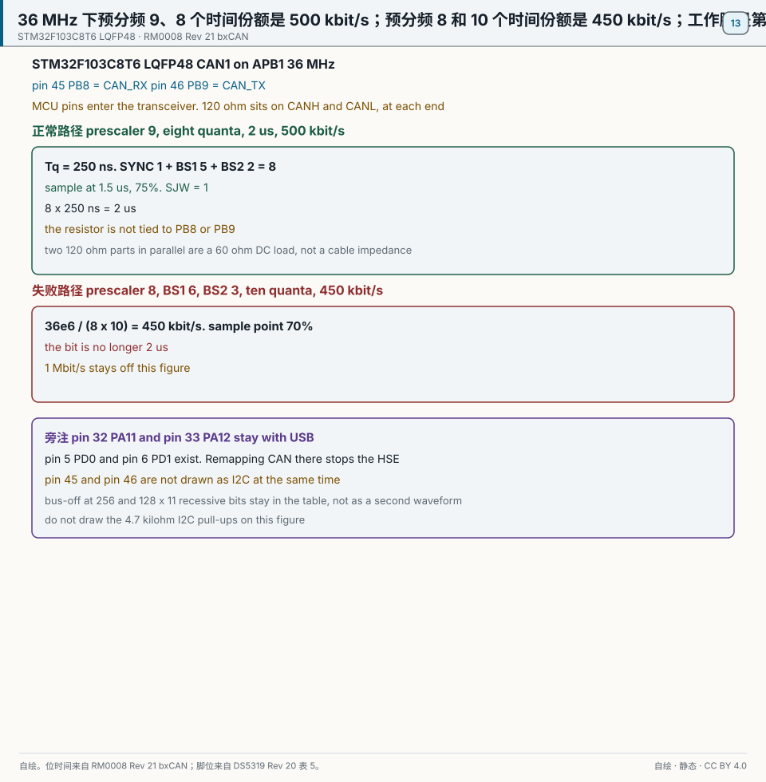
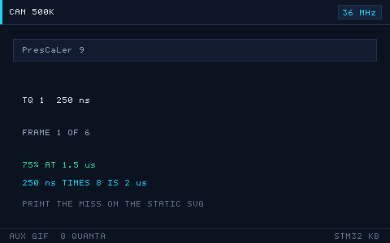

# 13 CAN bus

> 中文：[CAN 总线](../13-CAN总线.md)

> CAN uses a differential pair and non-destructive arbitration so many nodes can share one reliable bus. It is the classic network in cars and industrial control.

<p align="center">
  
  <br><sub>▲ Animation: CAN arbitration and bit stuffing (vector drawing, not a photograph)</sub>
</p>

<!-- video:ch13 -->
<p align="center">
  <video width="640" controls poster="../../assets/video/ch13-can.png">
    <source src="../../assets/video/ch13-can.mp4" type="video/mp4">
  </video>
  <br><sub>▲ Chinese voice-over, 2.8 min. Voice: Microsoft Edge neural voice zh-CN-XiaoxiaoNeural via edge-tts (library mostly LGPLv3; the voice model is an online Microsoft service, not an open model). Pictures are generated from this repo's SVGs, not photographs. Video: <a href="../../assets/video/ch13-can.mp4">MP4</a> · subtitles: <a href="../../assets/video/ch13-can.srt">SRT</a>. Rebuild with <code>python3 tools/gen_narrated.py --speak</code>.</sub>
</p>

**Narration script (Chinese, same text as the subtitles)**

1. CAN 发出去要有人应答。只有一个节点、又不是回环时，错误计数会一直涨。发送错误计数到 256，节点进入总线关闭，它就闭嘴了。这不是收发器坏了。
2. 先把控制器配成回环，自己发给自己。能收到，说明波特率和过滤器大体对了。再接到真正的总线。示例工程默认就是这条回环路。
3. F103 的 APB1 若是 36 兆，500 千比特要用预分频 9、位段 1 是 5、位段 2 是 2。一共 8 个时间份额，采样点在 75%。原先那组除不尽，实际只有 450 千比特。
4. 这一帧是仓库画的仲裁。线上是线与，显性位能盖过隐性位。标识更小的那一帧会留下来，输的那一方安静地改去接收。所以标识不是随便填的装饰。
5. 过滤器决定哪些标识能进接收邮箱。掩码模式里，掩码为 1 的位必须相同。标准标识在 32 位过滤器里要左移到正确的位置。放错一位，总线上有帧，你的邮箱仍是空的。
6. CAN1 默认在 PA11 和 PA12，和 USB 撞车。BluePill 上改到 PB8 接收、PB9 发送，用的是 CAN1 的第一种重映射。不要配成去 PD0、PD1 的那一种，C8 没有那两只脚。
7. 自动总线恢复可以让控制器自己试着回来。关掉它，就要在错误回调里停掉再重新启动。不管哪一种，总线上的接线、终端电阻和波特率得先改对，不然它还会再闭嘴。
8. 两块板子练习时，关掉回环，两边标识对调，总线两端各放 120 欧。收发器的电平要和模块匹配。单看回环全绿，不代表两块板子已经能对话。
9. 口诀：发送错误计数到 256 就闭嘴。单节点不要用正常模式考验自己。500 千比特在 36 兆上，记预分频 9 和一共 8 个时间份额。
10. 合上书，三问。为什么只有一个节点、又不是回环时会进总线关闭？36 兆下 500 千比特的预分频是多少？PB8 和 PB9 哪只是接收？
<!-- /video:ch13 -->

## Principle and boundary

Bit time and the working pins are fixed on STM32F103C8T6. The CAN1 kernel clock is the 36 MHz APB1 clock, the same account as chapter file 02. The working point is copied from the compass: prescaler 9, BS1 = 5, BS2 = 2, SJW = 1. See [RM0008 Rev 21 bxCAN](#source-rm0008-can).

One time quantum is `Tq = 9 / 36e6 = 250` ns. One synchronization quantum, plus BS1 of 5, plus BS2 of 2, is 8. The bit lasts `8 × 250 ns = 2` µs, which is 500 kbit/s. The sample point is `(1 + 5) / 8 = 75%`, at 1.5 µs. That is the normal path.

Ten quanta at a 70% sample point (BS1 = 6, BS2 = 3) wants a prescaler of 7.2, which is not an integer. Writing 8 gives `36e6 / (8 × 10) = 450` kbit/s. That is the failure path. The 1 Mbit/s row stays in the core ideas and is not this section's working point.

On a BluePill the first remap is the working pair: pin 45 PB8 = CAN_RX, pin 46 PB9 = CAN_TX. The reset default is pin 32 PA11 = CAN_RX and pin 33 PA12 = CAN_TX. That pair is the normal path of the USB chapter. See [DS5319 Rev 20 Table 5](#source-ds5319-usbcan).

Pin 5 PD0 and pin 6 PD1 exist on LQFP48. They are the HSE pins. Remapping CAN onto them stops the 8 MHz crystal. See [DS5319](#source-ds5319-clock). RM0008 section 9.3.3 says the port D remap is not available on 36-pin, 48-pin, and 64-pin packages. Pin 45 and pin 46 are also the I2C1 remap from chapter file 07. This figure does not draw CAN and I2C active together. See [DS5319](#source-ds5319-i2c).

Each end of the bus has one 120 Ω resistor between CANH and CANL. PB8 and PB9 enter the transceiver RXD and TXD. Only the transceiver drives CANH and CANL. Two 120 Ω resistors in parallel are a 60 Ω DC load. 60 Ω is not the cable impedance.

A single node that is not in loopback gets no acknowledge. The transmit error counter reaches 256 and the node stops driving the bus. Recovery is 128 times 11 consecutive recessive bits. In a 32-bit mask, a standard ID written to `FilterIdHigh` is shifted left by 5. Without that shift the bus can carry frames while the mailbox stays empty. Fourteen filter banks and two FIFOs stay in the boundary. See [examples in this repo](#source-project-examples).

The medium-density table prints `USB_LP_CAN_RX0` for the same vector as chapter file 14. The connectivity table prints `USB_LP_CAN1_RX0`. Do not link the two examples into one project. See [RM0008](#source-rm0008-usb).

## Key figures

<p align="center">
  
  <br><sub>▲ Drawn for this book. STM32F103C8T6. The normal path is eight 250 ns quanta, a 75% sample point, 2 µs, 500 kbit/s, prescaler 9, SJW = 1. The 120 Ω resistors sit on CANH and CANL. The failure path is prescaler 8, ten quanta, 450 kbit/s, and a 70% sample point. The working pins are pin 45 PB8 and pin 46 PB9. Sources: [RM0008 Rev 21 bxCAN](#source-rm0008-can) and [DS5319 Rev 20 Table 5](#source-ds5319-usbcan).</sub>
</p>

<p align="center">
  
  <br><sub>▲ Auxiliary figure for the web and for posts. It plays only the normal path: eight 250 ns quanta, a 75% sample point, and 500 kbit/s. Print from the static figure. 450 kbit/s and the crystal pins are not on this GIF.</sub>
</p>

`can-arbitration.svg` stays as an auxiliary figure. Arbitration and bit stuffing are not on this static figure.

## Timing or state

| Prescaler | BS1 | BS2 | Quanta | Bit time | Rate | Sample point |
| --- | --- | --- | --- | --- | --- | --- |
| 9 | 5 | 2 | 8 | 2 µs | 500 kbit/s | 75%. Quantum 250 ns. Normal |
| 8 | 6 | 3 | 10 | not 2 µs | 450 kbit/s | 70%. Failure |
| Pins | PB8 receives | PB9 transmits | pin 45 and pin 46 | — | — | PA11/PA12 conflict with USB |
| Errors | count reaches 256 | bus-off | 128 times | 11 recessive bits each time | — | only then may the node drive again |
| Filter | `FilterIdHigh` | shift left by 5 | — | — | — | without the shift the mailbox stays empty |

## Pitfalls and source cards

| What you see | Why | What to do | Source | Claim this source may support |
| --- | --- | --- | --- | --- |
| The scope or analyzer shows 450 kbit/s | The prescaler and the segment counts used the row that does not divide | Use prescaler 9, BS1 5, and BS2 2 | [RM0008](#source-rm0008-can) | Eight quanta and prescaler 9 is 500 kbit/s at 36 MHz. Ten quanta with prescaler 8 is 450 kbit/s |
| One node in normal mode goes silent after a few frames | There is no acknowledge, so the transmit error counter fills | Start in loopback. On a real bus, provide a node that acknowledges | [RM0008](#source-rm0008-can) | A transmit error counter of 256 enters bus-off. Recovery takes 128 times 11 recessive bits |
| Frames are on the bus and the mailbox is empty | The standard ID was not shifted | Shift left by 5 when writing `FilterIdHigh` | [examples in this repo](#source-project-examples) | `examples/can-bxcan` fills `FilterIdHigh` with `PEER_ID << 5`. The prescaler macro is 9 |
| Both ends report errors | The bit timing differs, or the terminators are not at the two ends | Use one bit timing, and put 120 Ω between CANH and CANL at each end | [examples in this repo](#source-project-examples) | The example asks for one 120 Ω resistor at each end. This row does not set a cable impedance and does not set the transceiver supply at 5 V or 3.3 V |
| The waveform is on PA11/PA12 and USB also fails | The pins are still the reset default | Remap to pin 45 and pin 46 | [DS5319](#source-ds5319-usbcan) | Reset-default CAN is on PA11/PA12. PB8/PB9 is the remap. PA11/PA12 are also USB |
| The clock stops after a remap onto the crystal pins | Those pins carry HSE | Do not put CAN on pin 5 and pin 6 | [DS5319](#source-ds5319-clock) | LQFP48 pin 5 is PD0-OSC_IN and pin 6 is PD1-OSC_OUT. Both pins exist |
| I2C remap wants the same pair | PB8/PB9 is also the I2C1 remap | Choose either CAN or I2C on that pair | [DS5319](#source-ds5319-i2c) | Pin 45 PB8 and pin 46 PB9 are the I2C1 remap. Do not redraw the chapter 07 figure |

## 📌 Goals

- [ ] Explain differential levels, dominant/recessive, bit stuffing, CRC, and ACK.
- [ ] Tell apart data, remote, error, and overload frames, and 11-bit versus 29-bit IDs.
- [ ] Explain non-destructive arbitration and why a smaller ID wins.
- [ ] Compute baud and sample point (BS1/BS2/SJW) and program `CAN_BTR`.
- [ ] Configure filters and the two receive FIFOs on F1.

## 🧠 Core idea

### 1. Physical layer: differential, dominant, recessive

**Takeaway:** CAN rides on `CAN_H` / `CAN_L`. **Dominant means logic 0, recessive means logic 1.** Dominant overwrites recessive (wired-AND). That is the whole of arbitration.

| Logic | Bus state | CAN_H − CAN_L | Note |
| --- | --- | --- | --- |
| 0 | Dominant | about +2 V | Any node can force it. **Higher priority** |
| 1 | Recessive | about 0 V | Recessive only if every node sends recessive |

- Put one **120 Ω** resistor at each end of the bus, between CANH and CANL, not on the MCU pins. Two 120 Ω resistors in parallel are a 60 Ω DC load. 60 Ω is not the cable impedance.
- A transceiver (TJA1050, SN65HVD230, …) turns the MCU's TTL `CAN_TX` / `CAN_RX` into the differential pair. **The MCU has only the controller. You must add a transceiver.**
- Rule of thumb for length: about 40 m at 1 Mbps, about 500 m at 125 kbps. Faster means shorter.

### 2. Stuffing, CRC, ACK

| Mechanism | Job | Rule |
| --- | --- | --- |
| Bit stuffing | Enough edges for resync | After five identical levels, insert one opposite bit (the fixed stuff before the CRC delimiter is the exception) |
| CRC | Detect errors | 15-bit CRC plus a delimiter. Sender computes, receiver checks, error frame on mismatch |
| ACK | Confirm delivery | Sender puts recessive in the ACK slot. **Any node that received the frame correctly drives dominant** |
| Error counters | Isolate a bad node | TEC/REC. Past the thresholds the node becomes error-passive, then bus-off |

### 3. Frame types and IDs

| Frame | Use |
| --- | --- |
| Data | Carries 0–8 data bytes |
| Remote | Asks another node to send a given ID |
| Error | Sent when a node sees an error |
| Overload | Receiver needs to delay the next frame |

**Data frame:** `SOF(1)` + arbitration (11/29-bit ID + RTR) + control (IDE/r0/DLC) + data (0–8 bytes) + CRC + ACK + EOF (7 recessive) + IFS.

- **Standard frame:** 11-bit ID (`IDE=0`). Smaller overhead.
- **Extended frame:** 29-bit ID (`IDE=1`), 11-bit base plus 18-bit extension.

### 4. Non-destructive arbitration

**Takeaway:** When several nodes start together, they arbitrate **bit by bit**. A node that sent recessive but sees dominant drops out and listens. The winner's frame is **not corrupted**. **A numerically smaller ID has higher priority.**

| Standard ID | Priority | Typical use |
| --- | --- | --- |
| `0x000` | Highest | Emergency / control |
| `0x100` | High | Real-time control |
| `0x500` | Middle | Status |
| `0x7FF` | Lowest | Logs |

> Arbitration happens in the arbitration field. A loser becomes a receiver and retries when the bus is idle. **That retry is not an error frame and does not burn the error counters.**

### 5. Baud rate and sample point

**Takeaway:** One bit is `SYNC_SEG (1 Tq)` + `BS1` + `BS2`. The sample point is usually **75% to 87.5%**.

```
BaudRate = f_APB1 / (Prescaler × (1 + BS1 + BS2))
sample point = (1 + BS1) / (1 + BS1 + BS2) × 100%
Tq = Prescaler / f_APB1
```

On **F1, APB1 = 36 MHz**:

| Target | Prescaler | BS1 | BS2 | Sample | Note |
| --- | --- | --- | --- | --- | --- |
| 1 Mbps | 4 | 5 Tq | 3 Tq | 66.7% | 36 MHz / (4×9) = 1 MHz, short cable |
| 500 kbps | 9 | 5 Tq | 2 Tq | 75% | 36 MHz / (9×8) = 500 kHz |
| 250 kbps | 18 | 5 Tq | 2 Tq | 75% | Double the prescaler |
| 125 kbps | 36 | 5 Tq | 2 Tq | 75% | Long cable |
| 100 kbps | 45 | 5 Tq | 2 Tq | 75% | 36 MHz / (45×8) = 100 kHz |

> A 70% sample point (BS1=6, BS2=3, 10 TQ) wants a prescaler of 7.2 for 500 kbit/s. That is not an integer. The table uses 8 TQ and a 75% sample point, which divides evenly. [`examples/can-bxcan`](../../examples/can-bxcan/) uses the 500 kbit/s row. The 1 Mbps row samples at 66.7%. The sentence "sample around 75% to 87.5%" does not cover that row. The four sections use only the 500 kbit/s working point.

> **SJW** absorbs clock error between nodes, usually 1–2 Tq. Different sample points are the first cause of flaky multi-node links. Every node must match.

### 6. Filters and two FIFOs (F1)

**Takeaway:** F1 bxCAN has **14 filter banks** and **2 receive FIFOs**. A filter routes a matching ID to FIFO0 or FIFO1. You then poll or take an interrupt.

| Mode | Meaning | Registers |
| --- | --- | --- |
| Mask | ID plus mask. A mask bit of 1 must match; 0 is don't-care | `CAN_FiR1` / `CAN_FiR2` |
| List | Exact IDs | `CAN_FiR1` / `CAN_FiR2` |
| Scale | 32-bit (standard + extended) or 16-bit (two standard IDs) | `CAN_FS1R` |
| FIFO | Each bank assigns FIFO0 or FIFO1 | `CAN_FFA1R` |

> F4 bxCAN is the same shape (14 banks + 2 FIFOs, RM0090 chapter 32). Register names mostly match.

## 🛠️ Wiring

| Board | Peripheral | Pins | Note |
| --- | --- | --- | --- |
| BluePill (F103) | CAN1 | PB8 = CAN_RX, PB9 = CAN_TX | First remap. Pin 45 receives and pin 46 transmits. PA11/PA12 are the reset default and conflict with USB, so they are not this normal path. External TJA1050 / SN65HVD230 |
| BluePill | Transceiver | CANH / CANL | 120 Ω at each end |
| Nucleo-F411RE | CAN1 | PD0 = CAN_RX, PD1 = CAN_TX | External transceiver |
| Any | Debug | USART1 | Print what you send and receive |

Wire `CAN_TX` to the transceiver TXD and `CAN_RX` to RXD. CANH/CANL are the bus. **Mind the transceiver supply:** SN65HVD230 is 3.3 V, TJA1050 is 5 V.

## 💻 Code

**① Init (F1, 500 kbps)**

```c
#include "stm32f1xx_hal.h"

CAN_HandleTypeDef hcan;

static void MX_CAN_Init(void)
{
    hcan.Instance                  = CAN1;
    hcan.Init.Prescaler            = 9;                 /* 36MHz/(9×(1+5+2))=500k */
    hcan.Init.Mode                 = CAN_MODE_NORMAL;
    hcan.Init.SyncJumpWidth        = CAN_SJW_1TQ;
    hcan.Init.TimeSeg1             = CAN_BS1_5TQ;
    hcan.Init.TimeSeg2             = CAN_BS2_2TQ;
    hcan.Init.TimeTriggeredMode    = DISABLE;
    hcan.Init.AutoBusOff           = ENABLE;
    hcan.Init.AutoWakeUp           = DISABLE;
    hcan.Init.AutoRetransmission   = ENABLE;
    hcan.Init.ReceiveFifoLocked    = DISABLE;
    hcan.Init.TransmitFifoPriority = DISABLE;
    HAL_CAN_Init(&hcan);
}
```

**② Filter: accept only 0x123 (mask mode)**

```c
static void CAN_Filter_Init(void)
{
    CAN_FilterTypeDef f = {0};
    f.FilterBank           = 0;
    f.FilterMode           = CAN_FILTERMODE_IDMASK;
    f.FilterScale          = CAN_FILTERSCALE_32BIT;
    f.FilterIdHigh         = 0x123 << 5;   /* standard ID, shift left by 5 */
    f.FilterIdLow          = 0x0000;
    f.FilterMaskIdHigh     = 0x7FF << 5;   /* all 11 bits must match */
    f.FilterMaskIdLow      = 0x0000;
    f.FilterFIFOAssignment = CAN_RX_FIFO0;
    f.FilterActivation     = ENABLE;
    HAL_CAN_ConfigFilter(&hcan, &f);
    HAL_CAN_Start(&hcan);
    HAL_CAN_ActivateNotification(&hcan, CAN_IT_RX_FIFO0_MSG_PENDING);
}
```

**③ Send and receive**

```c
void CAN_Send(uint16_t std_id, uint8_t *data, uint8_t len)
{
    CAN_TxHeaderTypeDef tx = {0};
    uint32_t mailbox;
    tx.StdId = std_id;
    tx.IDE   = CAN_ID_STD;
    tx.RTR   = CAN_RTR_DATA;
    tx.DLC   = len;
    HAL_CAN_AddTxMessage(&hcan, &tx, data, &mailbox);
}

void HAL_CAN_RxFifo0MsgPendingCallback(CAN_HandleTypeDef *hcan)
{
    CAN_RxHeaderTypeDef rx;
    uint8_t data[8];
    HAL_CAN_GetRxMessage(hcan, CAN_RX_FIFO0, &rx, data);
    /* handle rx.StdId / data */
}
```

## 🧪 Try it

1. **Loopback:** `CAN_MODE_LOOPBACK`, print the ID and data you receive. You should see your own frame with no transceiver.
2. **Two nodes:** two BluePills plus transceivers, 120 Ω at each end. B's log matches what A sent.
3. **Filter:** accept only 0x123. The peer sends 0x123 and 0x456. Only 0x123 is printed.
4. **Priority (optional):** two nodes transmit different IDs together. A logic analyzer shows the smaller ID winning.

### 7. Coming back from bus-off

**Takeaway:** When TEC reaches 256 the node is bus-off and stops driving the bus. Recovery needs **128 sequences of 11 recessive bits**. Hardware can count that for you. That bit is ABOM.

```c
hcan.Init.AutoBusOff = ENABLE;   /* ABOM: return to error-active after 128×11 recessive bits */
```

With nobody else to ACK, the sender errors its way into bus-off. Debug a single board in loopback before you blame the transceiver.

Motto: **TEC 256 means shut up. 128 runs of 11 recessive bits, then you may talk again.**

Self-test:

1. Why does the only node on a bus enter bus-off after a few frames?
2. With `AutoBusOff` enabled, do you still call Start again in software?
3. When standard IDs 0x100 and 0x200 arbitrate, which bit is compared first?

## 🔗 Further reading

- RM0008, STM32F10xxx reference manual, chapter 21, Controller area network (bxCAN): `CAN_BTR`, filters, two FIFOs.
- RM0090, STM32F4 reference manual, chapter 32, bxCAN.
- ISO 11898-1 (data link) and ISO 11898-2 (physical layer).
- Transceiver datasheets: TJA1050, SN65HVD230.
- Figure: `../../assets/animations/can-arbitration.svg` (vector drawing).
- Example: [examples/can-bxcan](../../examples/can-bxcan/) (loopback, two nodes, filter, ABOM and a software restart). On a BluePill, remap to PB8/PB9 so you do not fight the on-board USB pull-up on PA11/PA12.
