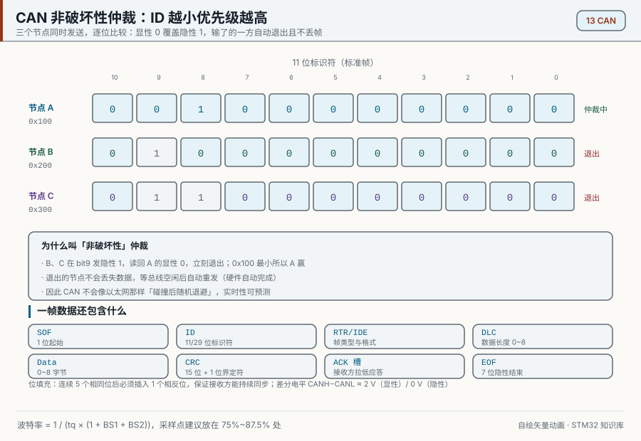
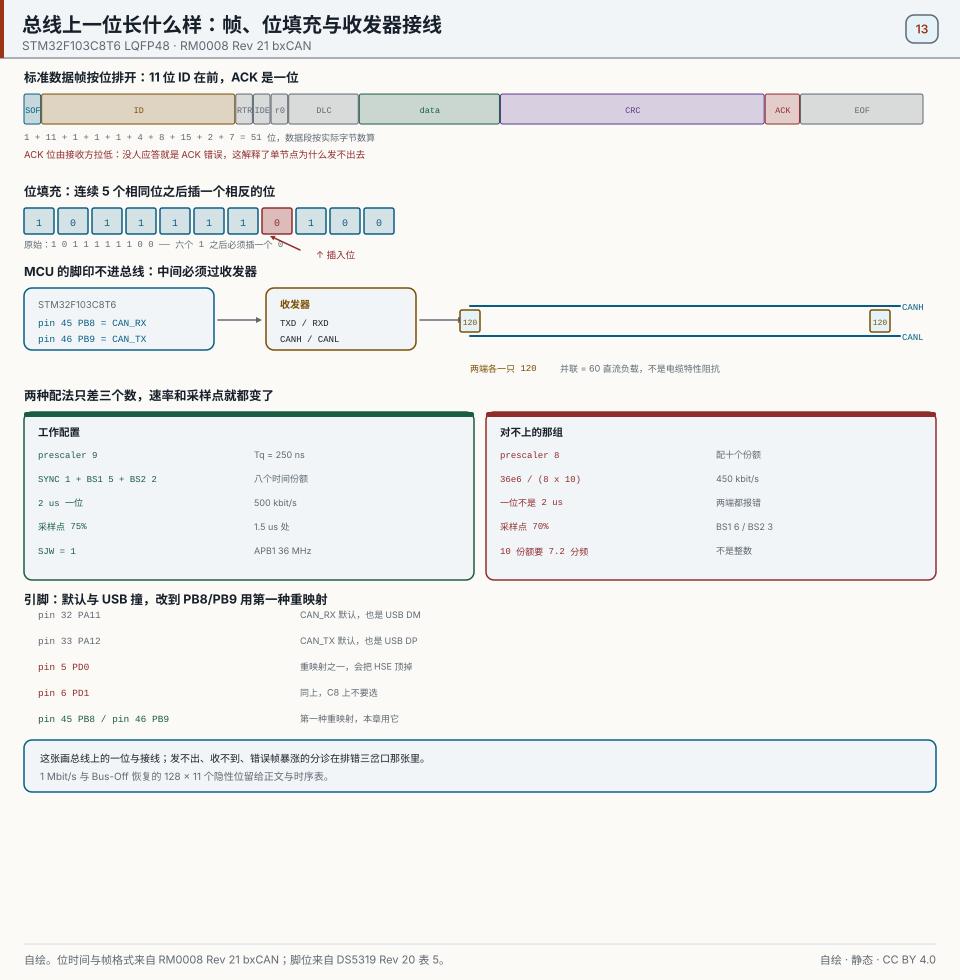
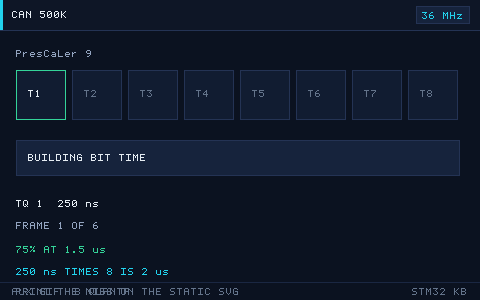

# 13 CAN bus

> 中文：[CAN 总线](../13-CAN总线.md)

> CAN uses a differential pair and non-destructive arbitration so many nodes can share one reliable bus. It is the classic network in cars and industrial control.

<p align="center">
  
  <br><sub>▲ Animation: CAN arbitration and bit stuffing (vector drawing, not a photograph)</sub>
</p>

<!-- video:ch13 -->
<p align="center">
  <video width="640" controls poster="../../assets/video/ch13-can.png">
    <source src="../../assets/video/ch13-can.mp4" type="video/mp4">
  </video>
  <br><sub>▲ Chapter video with Chinese voice-over (2.8 min). <a href="../../assets/video/ch13-can.mp4">MP4</a> · <a href="../../assets/video/ch13-can.srt">subtitles</a></sub>
</p>

<details>
<summary>Narration script (Chinese, same text as the subtitles)</summary>

1. CAN 发出去要有人应答。只有一个节点、又不是回环时，错误计数会一直涨。发送错误计数到 256，节点进入总线关闭，它就闭嘴了。这不是收发器坏了。
2. 先把控制器配成回环，自己发给自己。能收到，说明波特率和过滤器大体对了。再接到真正的总线。示例工程默认就是这条回环路。
3. F103 的 APB1 若是 36 兆，500 千比特要用预分频 9、位段 1 是 5、位段 2 是 2。一共 8 个时间份额，采样点在 75%。原先那组除不尽，实际只有 450 千比特。
4. 这一帧是仓库画的仲裁。线上是线与，显性位能盖过隐性位。标识更小的那一帧会留下来，输的那一方安静地改去接收。所以标识不是随便填的装饰。
5. 过滤器决定哪些标识能进接收邮箱。掩码模式里，掩码为 1 的位必须相同。标准标识在 32 位过滤器里要左移到正确的位置。放错一位，总线上有帧，你的邮箱仍是空的。
6. CAN1 默认在 PA11 和 PA12，和 USB 撞车。BluePill 上改到 PB8 接收、PB9 发送，用的是 CAN1 的第一种重映射。不要配成去 PD0、PD1 的那一种，C8 没有那两只脚。
7. 自动总线恢复可以让控制器自己试着回来。关掉它，就要在错误回调里停掉再重新启动。不管哪一种，总线上的接线、终端电阻和波特率得先改对，不然它还会再闭嘴。
8. 两块板子练习时，关掉回环，两边标识对调，总线两端各放 120 欧。收发器的电平要和模块匹配。单看回环全绿，不代表两块板子已经能对话。
9. 口诀：发送错误计数到 256 就闭嘴。单节点不要用正常模式考验自己。500 千比特在 36 兆上，记预分频 9 和一共 8 个时间份额。
10. 合上书，三问。为什么只有一个节点、又不是回环时会进总线关闭？36 兆下 500 千比特的预分频是多少？PB8 和 PB9 哪只是接收？

</details>
<!-- /video:ch13 -->

## Learning goals

Before this chapter: be able to set the core clock to 72 MHz as in chapter 02, and know that APB1 then runs at 36 MHz; know interrupts and the NVIC from chapter 04; be able to drive the PC13 LED as in chapter 03. You also need binary, hex, and left shifts (if not, read "Zero-background primer" in chapter 00 first).

- [ ] Explain what dominant and recessive mean, why a smaller identifier (ID) has higher priority, and why losing arbitration is not an error
- [ ] Count the bits in an 8-byte standard data frame and work out how long it takes at 500 kbit/s
- [ ] From a 36 MHz APB1, work out the prescaler, BS1, BS2, and sample point for 500 kbit/s, and write `CAN_BTR = 0x00140008`
- [ ] Remap CAN1 to PB8/PB9 on the BluePill and set up a filter that accepts only standard data frames with ID `0x123`
- [ ] Get sending and receiving working on one board in loopback mode first, then add transceivers and a second board to form a real bus
- [ ] Read `CAN_ESR`, and explain why a lone node's TEC stops at 128 and when a node really goes bus-off

## Core ideas

**In one sentence: CAN (Controller Area Network) is a broadcast bus on which several nodes share one differential pair; any node may send, when several send at once they compare identifiers bit by bit and the smaller number stays on, every frame must be acknowledged by some other node, and a node that makes many errors withdraws from the bus step by step according to its counters; the STM32F103 has only the CAN controller, bxCAN, on chip, so it needs an external transceiver to reach the bus.**

### An analogy first

Think of the CAN bus as a meeting room with no chairperson.

- Listen before you speak: you may start only when the room is quiet (the bus is idle). Anyone may start, and everyone hears what is said.
- If two people start at once, they compare word by word. The rule is that "speaking" beats "staying silent": if anyone speaks at a given moment, the whole room hears speech. Someone who meant to stay silent but hears speech knows they have lost, stops at once, and listens, then tries again after the sentence ends. Everyone starts by stating a number, and a smaller number speaks up earlier in its first digits, so it always wins.
- After each sentence, at least one listener must say "mm-hm" on the spot. If nobody does, the speaker marks one error against themselves.
- With enough marks, the speaker is first allowed only to speak softly (error passive); with more, they are asked to leave the room (bus-off), and may come back only after the room has been quiet for a good while.

The analogy stops here. Real "speaking" is a dominant bit, the "number" is an 11-bit identifier, the "mm-hm" is another node driving the fixed ACK bit dominant, and "quiet for a good while" is 128 runs of 11 consecutive recessive bits. One more place differs from the analogy: a speaker whom nobody answers stops at "speak softly" once the marks reach a certain level, and is not asked to leave; section 7 explains.

### 1. Physical layer: differential signal, dominant and recessive

**Conclusion: CAN carries one differential signal on two wires, CANH and CANL. About 2 V between the wires is dominant and stands for 0; the two wires at almost the same level is recessive and stands for 1. If any one node sends dominant, the whole bus is dominant. This is called wired-AND, and both arbitration and acknowledgment rely on it.**

| Logic value | Name | CANH − CANL (typical) | Who decides |
| --- | --- | --- | --- |
| 0 | Dominant | about 2 V | if any node sends 0, the bus is 0 |
| 1 | Recessive | about 0 V | the bus is 1 only if every node sends 1 |

The voltages in the table are the high-speed CAN typical values set by ISO 11898-2; every transceiver datasheet lists them. ST's reference manual does not cover this layer.

A transceiver sits between the microcontroller and the bus:

- The STM32F103 has only the CAN controller, bxCAN, on chip, and brings out two ordinary logic-level pins, CAN_TX and CAN_RX. The transceiver turns the 0/1 on CAN_TX into dominant/recessive on CANH/CANL, and sends the bus state back to CAN_RX. So every bit the controller sends is read back on CAN_RX, and that is how it knows whether it lost arbitration and whether anyone acknowledged.
- Common transceivers are the SN65HVD230 (3.3 V supply) and the TJA1050 (5 V supply).
- Each end of the bus gets one 120 Ω resistor across CANH and CANL, which absorbs the reflection when a signal reaches the end of the cable. Nodes in the middle get none.
- The higher the bit rate, the shorter the cable. As a rule of thumb, about 40 m at 1 Mbit/s and about 500 m at 125 kbit/s: a signal has to make a round trip from the farthest node before the sample point, or arbitration and acknowledgment cannot keep up.

### 2. One frame: identifier, bit stuffing, CRC, ACK

**Conclusion: a standard data frame is built from a fixed set of fields; with N data bytes it is 44 + 8N bits, not counting stuff bits. The CRC checks for errors, the ACK bit must be turned dominant by another node, and bit stuffing keeps the line from going a long time without an edge.**

The table lists a standard data frame from top to bottom in the order it appears on the wire. The bit counts and rules come from the Bosch CAN 2.0 specification (the forerunner of ISO 11898-1):

| Field | Bits | Purpose |
| --- | --- | --- |
| Start of frame SOF | 1 | one dominant bit; every node aligns to it |
| Identifier ID | 11 | what data the frame carries, and the priority compared during arbitration |
| RTR | 1 | dominant for a data frame, recessive for a remote frame |
| IDE, r0 | 2 | IDE dominant means a standard frame with an 11-bit identifier; recessive means an extended frame with 29 bits |
| DLC | 4 | number of data bytes, 0 to 8 |
| Data | 8N | N bytes |
| CRC | 15 + 1 | a 15-bit check code plus one recessive delimiter bit |
| ACK | 1 + 1 | the sender sends recessive in the ACK slot, and any node that received the frame correctly turns it dominant; one delimiter bit follows |
| End of frame EOF | 7 | seven recessive bits |

Add up the bits: 1 + 11 + 1 + 2 + 4 + 16 + 2 + 7 = 44, plus 8N for the data. With 8 bytes that is 108 bits; at 500 kbit/s one bit is 2 µs, so one frame takes 216 µs. Two frames must also be separated by 3 recessive bits.

The other three frame types: the remote frame (RTR recessive, no data field, used to ask another node to send the data for an identifier), the error frame (sent by a node that finds an error; it cancels the current frame), and the overload frame (a receiver asks for the next frame to be delayed; rarely used). The extended frame lengthens the identifier to 29 bits; this chapter uses only standard frames.

Three things make a frame trustworthy:

- **Bit stuffing.** From the start of frame through the CRC, each time the sender has sent 5 bits of the same value, it automatically inserts one bit of the opposite value, and the receivers remove it again. That puts an edge on the line at least every 6 bits, so receivers can correct their clocks against the edges. The CRC delimiter, ACK, and end of frame have a fixed form and are not stuffed. Stuffing makes a frame longer: an 8-byte frame gains up to 24 bits in the worst case; the arithmetic is in self-test question 3.
- **CRC.** The sender computes a 15-bit check code from the frame's contents and puts it in the frame; every receiver computes it again, and on a mismatch it sends an error frame, the frame is cancelled, and the sender sends it again.
- **ACK.** If even one node receives correctly, the ACK slot is dominant. If the sender reads back recessive in the ACK slot, it knows that no node received the frame correctly, and counts one ACK error against itself. With only one node on the bus, every frame ends this way; section 7 uses this.

### 3. Non-destructive arbitration: a smaller identifier wins

**Conclusion: when several nodes start sending at once, they compare identifiers bit by bit from the most significant bit. A node that sends recessive but reads back dominant stops sending at once and switches to receiving; the frame that stays on has not lost a single bit, which is why this is called non-destructive arbitration. The smaller the identifier, the earlier a dominant 0 appears, and the higher its priority.**

Take `0x100` and `0x200` sent at the same time. The 11-bit identifier runs from bit 10 (the most significant) down to bit 0:

```text
bit      10  9  8  7  6  5  4  3  2  1  0
0x100     0  0  1  0  0  0  0  0  0  0  0
0x200     0  1  0  0  0  0  0  0  0  0  0
bus       0  0
             ^ bit 9: 0x200 sends recessive 1, reads back dominant 0, drops out
```

At bit 10 both send 0, a tie; at bit 9 `0x100` sends dominant 0 while `0x200` sends recessive 1 but reads back 0, so `0x200` drops out, switches to receiving, and sends again once the bus is idle. The `0x100` frame finishes normally, and every node (including `0x200`) receives the complete frame.

Two questions come up often:

- Losing arbitration is not an error: no error frame is sent and the error counters do not change.
- When a data frame and a remote frame with the same identifier collide, the data frame wins, because its RTR bit is dominant. If two nodes send different data with the same identifier, arbitration cannot pick a winner and they collide in the data field as a bit error, so each identifier is sent by one node only.

### 4. Baud rate and sample point: cutting one bit into time quanta

**Conclusion: bxCAN cuts one bit into a number of time quanta (written tq): 1 sync segment at the start, followed by bit segment 1 (BS1) and bit segment 2 (BS2), and it samples at the moment BS1 ends. Bit rate = APB1 clock ÷ (prescaler × number of quanta).**

The formulas come from RM0008 Rev 21 section 24.7.7:

```text
tq           = prescaler ÷ f_APB1                 the register holds BRP = prescaler − 1
one bit      = (1 + BS1 + BS2) × tq
bit rate     = f_APB1 ÷ (prescaler × (1 + BS1 + BS2))
sample point = (1 + BS1) ÷ (1 + BS1 + BS2)
```

With APB1 = 36 MHz, the common settings are below. Every row can be checked with the formulas above; the 500 kbit/s row is the working point this chapter's example sets:

| Bit rate | Prescaler | BS1 | BS2 | Quanta | Sample point | Check |
| --- | --- | --- | --- | --- | --- | --- |
| 1 Mbit/s | 3 | 8 | 3 | 12 | 75% | 36 MHz ÷ (3 × 12) = 1 MHz |
| 500 kbit/s | 9 | 5 | 2 | 8 | 75% | 36 MHz ÷ (9 × 8) = 500 kHz |
| 250 kbit/s | 18 | 5 | 2 | 8 | 75% | 36 MHz ÷ (18 × 8) = 250 kHz |
| 125 kbit/s | 36 | 5 | 2 | 8 | 75% | 36 MHz ÷ (36 × 8) = 125 kHz |
| 100 kbit/s | 45 | 5 | 2 | 8 | 75% | 36 MHz ÷ (45 × 8) = 100 kHz |

Three things to watch when you pick the values:

- **The prescaler must be an integer.** If you want 10 quanta and a 70% sample point (BS1 = 6, BS2 = 3), 500 kbit/s needs a prescaler of 36 MHz ÷ (500 kHz × 10) = 7.2, which does not fit in the register. Write 8 and the rate becomes 36 MHz ÷ (8 × 10) = 450 kbit/s, which no longer matches the other nodes.
- **Each segment has a range.** In `CAN_BTR`, BS1 can be 1–16 quanta, BS2 1–8, SJW 1–4, and the prescaler 1–1024, as the field widths in RM0008 Rev 21 section 24.9.2 decide.
- **Sample points should be close across nodes.** As a rule of thumb, put it between 75% and 87.5%. SJW (resynchronization jump width) is the most quanta a node may lengthen or shorten a bit segment by at each edge, to keep up with the other nodes' clocks; the example setting is 1. Every node's clock should come from a crystal; do not run CAN from the on-chip RC oscillator (rule of thumb).

### 5. Filters and the two receive FIFOs

**Conclusion: every frame bxCAN receives goes through the filters first; it enters a receive FIFO only if some filter bank lets it through, and is dropped if none does. The STM32F103 has 14 filter banks and 2 receive FIFOs, each holding 3 frames (RM0008 Rev 21 section 24.2); after reset no filter is active (`CAN_FA1R` resets to 0), so without a filter not a single frame is received.**

Each filter bank needs three choices:

| Setting | Option | Meaning |
| --- | --- | --- |
| Mode | Mask mode (IDMASK) | one identifier plus one mask: bits where the mask is 1 must equal the identifier, bits where it is 0 are ignored |
| Mode | List mode (IDLIST) | both registers hold identifiers, and the frame's identifier must equal one of them |
| Scale | 32-bit | one bank holds one pair of 32-bit identifier and mask, and can compare both standard and extended frames |
| Scale | 16-bit | one bank splits into two 16-bit pairs; suitable only for standard frames |
| Assignment | FIFO0 or FIFO1 | which FIFO the frames passed by this bank go to |

In 32-bit mask mode, which register bit lines up with which bit of the frame is shown in Figure 230 of RM0008 Rev 21 section 24.7.4:

```text
bit      31 ...... 21 | 20 ........ 3 |  2  |  1  |  0
content  STID[10:0]   | EXID[17:0]    | IDE | RTR |  0
HAL      FilterIdHigh = bits 31-16      FilterIdLow = bits 15-0
```

The 11-bit standard identifier sits in bits 31–21, which lands on bits 15–5 of the upper 16 bits, `FilterIdHigh`, so shift it left by 5 before writing it. This chapter's filter is filled in like this:

| Field | Value | Meaning |
| --- | --- | --- |
| `FilterIdHigh` | `0x123 << 5 = 0x2460` | the expected identifier |
| `FilterIdLow` | `0x0000` | expects IDE = 0 (standard frame) and RTR = 0 (data frame) |
| `FilterMaskIdHigh` | `0x7FF << 5 = 0xFFE0` | every one of the 11 identifier bits must match |
| `FilterMaskIdLow` | `0x0006` | the IDE and RTR bits must match too |

This accepts only standard data frames with ID `0x123`; an extended frame whose top 11 bits are also `0x123`, and a remote frame with ID `0x123`, both stay out. If the low 16 bits of the mask are 0, both of those get through too.

### 6. Operating modes: loopback first, then the bus

**Conclusion: bxCAN comes out of reset in sleep mode; configuration happens in initialization mode, and it sends and receives only after switching to normal mode. While debugging, use loopback mode first: the controller connects transmit to receive internally, ignores the CAN_RX pin, and needs no acknowledgment, so one board without a transceiver can send to itself and receive.**

How to enter each mode in the table comes from RM0008 Rev 21 sections 24.4 and 24.5:

| Mode | How to enter | Send and receive | Use |
| --- | --- | --- | --- |
| Sleep | default after reset | neither | saves power |
| Initialization | set INRQ in `CAN_MCR` | neither | write the bit timing and pick the mode; `CAN_BTR` can be written only here |
| Normal | clear INRQ, then wait for 11 consecutive recessive bits on CAN_RX | both | a real bus |
| Loopback | set LBKM in `CAN_BTR` | receives the frames it sends; the waveform still appears on the CAN_TX pin | single-board self-test |
| Silent | set SILM in `CAN_BTR` | receives only, sends nothing, not even ACK | listening in on someone else's bus |

`HAL_CAN_Start()` is exactly the step "clear INRQ, then wait for the hardware to confirm". In normal mode, if CAN_RX stays dominant, for example because the transceiver has no power or RX is on the wrong pin, it never sees those 11 recessive bits and returns a timeout error.

The recommended order is loopback first, then the bus. Receiving in loopback shows that the bit timing, the filter, and the interrupt are right; what it cannot show is the transceiver, the wiring, the termination, and the other node's bit timing, which only become clear when two boards talk.

### 7. Error states: coming back from bus-off

**Conclusion: every node has a transmit error counter TEC and a receive error counter REC. If either goes above 127, the node becomes error passive; if TEC goes above 255, it goes bus-off and stops sending and receiving; to get back on the bus it must first count 128 runs of 11 consecutive recessive bits on CAN_RX.**

The thresholds of the three states come from Figure 233 in RM0008 Rev 21 section 24.7.6; what is sent on an error comes from the CAN 2.0 specification:

| State | Condition | On an error | Can send and receive |
| --- | --- | --- | --- |
| Error active | TEC and REC both at most 127 | sends an active error flag of 6 dominant bits, cancelling the frame on the spot | yes |
| Error passive | TEC or REC above 127 | sends only a passive error flag of 6 recessive bits, which cannot destroy a frame another node is sending | yes |
| Bus-off | TEC above 255 | sends nothing | no |

The counting rules come from section 8 of the CAN 2.0 specification. In short: a sender adds 8 to TEC for each error and subtracts 1 for each frame sent successfully; a receiver usually adds 1 to REC for an error and subtracts 1 for each frame received successfully.

With only one node on the bus and not in loopback mode, the outcome depends on whether there is a transceiver:

- **Transceiver connected, but no other node.** No frame is acknowledged, TEC gains 8 each time and reaches 128 on the 16th try, and the node becomes error passive. Section 8 of the CAN 2.0 specification has an exception for this case: an ACK error that an error-passive sender makes because nobody acknowledged no longer adds to TEC. So TEC stops at 128, the controller keeps resending, and it never goes bus-off.
- **No transceiver.** The dominant bits PB9 sends never come back to PB8, which reads recessive through its pull-up alone, so every frame has a bit error on its first bit. Bit errors have no such exception, TEC climbs past 255, and the node goes bus-off.

There are two ways back from bus-off:

- **ABOM = 1** (in HAL, `AutoBusOff = ENABLE`): as soon as the controller goes bus-off, it starts counting the 128 runs of 11 recessive bits by itself, and returns to error active when the count is done.
- **ABOM = 0**: software has to take the controller into and out of initialization mode once, which in HAL is `HAL_CAN_Stop()` followed by `HAL_CAN_Start()`. In initialization mode the controller does not watch CAN_RX, so after leaving initialization mode it still has to count those 128 runs in normal mode (RM0008 Rev 21 section 24.7.6).

Either way takes at least 128 × 11 = 1408 bit times, which at 500 kbit/s is 1408 × 2 µs ≈ 2.8 ms. If the wiring, the termination, or the bit timing is not fixed, the node will shut down again after it comes back.

Mnemonic: **TEC past 255 means silence; 128 runs of 11 recessive bits before it may speak again; with nobody acknowledging, it only stops at 128.**

## Hardware and wiring

| Board | Peripheral | Pin | Notes |
| --- | --- | --- | --- |
| BluePill (STM32F103C8T6) | CAN1 | PB8 = CAN_RX, PB9 = CAN_TX | pins 45 and 46. Needs the remap `CAN_REMAP = 10`; the HAL macro is `__HAL_AFIO_REMAP_CAN1_2()` |
| Transceiver module | SN65HVD230 or TJA1050 | TXD, RXD, CANH, CANL | SN65HVD230 on 3.3 V, TJA1050 on 5 V. PB8 and PB9 are FT pins in DS5319 Rev 20 Table 5 and tolerate 5 V |
| Bus | twisted pair | CANH, CANL | one 120 Ω at each end. Many modules already carry one on the board; check the module's schematic first |
| BluePill | on-board LED | PC13 | lit when low; toggles once per received frame |
| BluePill | SWD | PA13, PA14 | flashing, and watching the counters in the debugger |

Lab 1 needs only one BluePill and no transceiver. For labs 2 and 3, wire two sets as below:

```text
BluePill A              Transceiver A                               Transceiver B    BluePill B
PB9 CAN_TX ───────────▶ TXD                                         TXD ◀─────────── CAN_TX PB9
PB8 CAN_RX ◀─────────── RXD                                         RXD ───────────▶ CAN_RX PB8
3V3 ─────────────────── VCC                                         VCC ─────────────────── 3V3
GND ─────────────────── GND ─────────────────────────────────────── GND ─────────────────── GND
                        CANH ──┬───────────────────────────────┬── CANH
                               │                               │
                             120 Ω                           120 Ω
                               │                               │
                        CANL ──┴───────────────────────────────┴── CANL
With an SN65HVD230, VCC goes to 3V3; with a TJA1050, move it to the BluePill 5V pin.
```

The wiring differs from the UART in chapter 06 in one place only: CAN connects like to like, PB9 (CAN_TX) to the transceiver's TXD and PB8 (CAN_RX) to RXD, with no crossover; the two boards also need a common ground, which the sketch draws through the GND of the two transceivers.

> [!WARNING]
> On the STM32F103, CAN and USB cannot be used at the same time: they share one 512-byte SRAM (RM0008 Rev 21 section 24.2), and the reset-default CAN pins PA11/PA12 are also USB D− and D+. The BluePill's USB connector is wired to PA11/PA12, so this chapter moves CAN to PB8/PB9. PB8/PB9 are also the I2C1 remap pins, and this pair can serve only one of the two at a time.

## Code

Below is one complete `main.c`: the clock, CAN initialization, pins and interrupt, filter, sending, and the receive callback are all in it.

CubeMX does only three things here: set RCC HSE to the crystal, set SYS Debug to Serial Wire, and tick CAN under Connectivity (so the project gets `stm32f1xx_hal_can.c` and `HAL_CAN_MODULE_ENABLED` is turned on). Leave the CAN parameters alone, and do not tick the CAN interrupts under NVIC. After generating the code, replace `Core/Src/main.c` with the file below, then delete the generated `HAL_CAN_MspInit()` and `HAL_CAN_MspDeInit()` in `stm32f1xx_hal_msp.c` so they are not defined twice. The repository's [`examples/can-bxcan/`](../../examples/can-bxcan/) adds serial printing and a switch for software recovery, but one line of its remap needs changing; see "Piece by piece".

```c
/* main.c - bxCAN on the BluePill: 500 kbit/s, loopback self-test or two boards talking (STM32F103C8T6, HAL) */
#include "stm32f1xx_hal.h"

#define USE_LOOPBACK    1U        /* 1 = loopback, single-board self-test; 0 = normal mode, on a bus through a transceiver */
#define CAN_PRESCALER   9U        /* 36 MHz / (9 × 8) = 500 kbit/s (example setting) */
#define TX_ID           0x123U    /* standard identifier this board sends */
#define RX_ID           0x123U    /* the filter passes only this identifier; with two boards, set it to the other board's TX_ID */
#define SEND_PERIOD_MS  500U
#define LED_PORT        GPIOC
#define LED_PIN         GPIO_PIN_13

CAN_HandleTypeDef hcan;
volatile uint32_t g_rx_count;     /* frames received; watch it in the debugger */
volatile uint8_t  g_rx_data[8];   /* data of the latest frame */
volatile uint32_t g_esr;          /* snapshot of CAN_ESR, used in lab 3 */

void SystemClock_Config(void);
void Error_Handler(void);
static void LED_Init(void);
static void MX_CAN_Init(void);
static void CAN_Filter_Init(void);
static void CAN_Send(uint32_t std_id, const uint8_t *data, uint8_t len);

int main(void)
{
    uint8_t payload[8] = {0, 0x11, 0x22, 0x33, 0x44, 0x55, 0x66, 0x77};

    HAL_Init();
    SystemClock_Config();
    LED_Init();
    MX_CAN_Init();
    CAN_Filter_Init();
    if (HAL_CAN_Start(&hcan) != HAL_OK) {                 /* leave initialization mode */
        Error_Handler();
    }
    if (HAL_CAN_ActivateNotification(&hcan, CAN_IT_RX_FIFO0_MSG_PENDING) != HAL_OK) {
        Error_Handler();
    }

    for (;;) {
        payload[0]++;                                     /* byte 0 is a sequence number */
        CAN_Send(TX_ID, payload, 8U);
        g_esr = hcan.Instance->ESR;                       /* read the error counters and status bits */
        HAL_Delay(SEND_PERIOD_MS);
    }
}

static void MX_CAN_Init(void)
{
    hcan.Instance                  = CAN1;
    hcan.Init.Prescaler            = CAN_PRESCALER;
    hcan.Init.Mode                 = USE_LOOPBACK ? CAN_MODE_LOOPBACK : CAN_MODE_NORMAL;
    hcan.Init.SyncJumpWidth        = CAN_SJW_1TQ;
    hcan.Init.TimeSeg1             = CAN_BS1_5TQ;
    hcan.Init.TimeSeg2             = CAN_BS2_2TQ;
    hcan.Init.TimeTriggeredMode    = DISABLE;
    hcan.Init.AutoBusOff           = ENABLE;          /* ABOM: the hardware recovers from bus-off by itself */
    hcan.Init.AutoWakeUp           = DISABLE;
    hcan.Init.AutoRetransmission   = ENABLE;          /* resend automatically when a frame fails */
    hcan.Init.ReceiveFifoLocked    = DISABLE;
    hcan.Init.TransmitFifoPriority = DISABLE;
    if (HAL_CAN_Init(&hcan) != HAL_OK) {              /* calls HAL_CAN_MspInit() inside */
        Error_Handler();
    }
}

void HAL_CAN_MspInit(CAN_HandleTypeDef *h)
{
    GPIO_InitTypeDef io = {0};

    if (h->Instance != CAN1) {
        return;
    }
    __HAL_RCC_CAN1_CLK_ENABLE();
    __HAL_RCC_GPIOB_CLK_ENABLE();
    __HAL_RCC_AFIO_CLK_ENABLE();
    __HAL_AFIO_REMAP_CAN1_2();                        /* CAN_REMAP = 10: PB8 receives, PB9 sends */

    io.Pin  = GPIO_PIN_8;                             /* PB8 = CAN_RX */
    io.Mode = GPIO_MODE_INPUT;
    io.Pull = GPIO_PULLUP;                            /* reads recessive when nothing is connected */
    HAL_GPIO_Init(GPIOB, &io);

    io.Pin   = GPIO_PIN_9;                            /* PB9 = CAN_TX */
    io.Mode  = GPIO_MODE_AF_PP;
    io.Pull  = GPIO_NOPULL;
    io.Speed = GPIO_SPEED_FREQ_HIGH;
    HAL_GPIO_Init(GPIOB, &io);

    HAL_NVIC_SetPriority(USB_LP_CAN1_RX0_IRQn, 5, 0);
    HAL_NVIC_EnableIRQ(USB_LP_CAN1_RX0_IRQn);
}

static void CAN_Filter_Init(void)
{
    CAN_FilterTypeDef f = {0};

    f.FilterBank           = 0;
    f.FilterMode           = CAN_FILTERMODE_IDMASK;
    f.FilterScale          = CAN_FILTERSCALE_32BIT;
    f.FilterIdHigh         = RX_ID << 5;              /* the standard identifier sits in bits 31–21 */
    f.FilterIdLow          = 0x0000U;                 /* IDE = 0 standard frame, RTR = 0 data frame */
    f.FilterMaskIdHigh     = 0x7FFU << 5;             /* all 11 identifier bits must match */
    f.FilterMaskIdLow      = 0x0006U;                 /* IDE and RTR must match too */
    f.FilterFIFOAssignment = CAN_FILTER_FIFO0;
    f.FilterActivation     = ENABLE;
    f.SlaveStartFilterBank = 14;                      /* used only on parts that have CAN2 */
    if (HAL_CAN_ConfigFilter(&hcan, &f) != HAL_OK) {
        Error_Handler();
    }
}

static void CAN_Send(uint32_t std_id, const uint8_t *data, uint8_t len)
{
    CAN_TxHeaderTypeDef tx = {0};
    uint32_t mailbox;

    if (HAL_CAN_GetTxMailboxesFreeLevel(&hcan) == 0U) {
        return;                                       /* all 3 transmit mailboxes are queued: skip this frame */
    }
    tx.StdId              = std_id;
    tx.IDE                = CAN_ID_STD;
    tx.RTR                = CAN_RTR_DATA;
    tx.DLC                = len;
    tx.TransmitGlobalTime = DISABLE;
    (void)HAL_CAN_AddTxMessage(&hcan, &tx, (uint8_t *)data, &mailbox);
}

void USB_LP_CAN1_RX0_IRQHandler(void)                 /* this one entry is shared with the USB low-priority interrupt */
{
    HAL_CAN_IRQHandler(&hcan);
}

void HAL_CAN_RxFifo0MsgPendingCallback(CAN_HandleTypeDef *h)
{
    CAN_RxHeaderTypeDef rx;
    uint8_t data[8];

    if (HAL_CAN_GetRxMessage(h, CAN_RX_FIFO0, &rx, data) != HAL_OK) {
        return;
    }
    for (uint32_t i = 0; i < rx.DLC && i < 8U; i++) {
        g_rx_data[i] = data[i];
    }
    g_rx_count++;
    HAL_GPIO_TogglePin(LED_PORT, LED_PIN);
}

static void LED_Init(void)
{
    GPIO_InitTypeDef io = {0};

    __HAL_RCC_GPIOC_CLK_ENABLE();
    HAL_GPIO_WritePin(LED_PORT, LED_PIN, GPIO_PIN_SET);   /* start with the LED off */
    io.Pin   = LED_PIN;
    io.Mode  = GPIO_MODE_OUTPUT_PP;
    io.Speed = GPIO_SPEED_FREQ_LOW;
    HAL_GPIO_Init(LED_PORT, &io);
}

void SystemClock_Config(void)
{
    RCC_OscInitTypeDef osc = {0};
    RCC_ClkInitTypeDef clk = {0};

    osc.OscillatorType = RCC_OSCILLATORTYPE_HSE;
    osc.HSEState       = RCC_HSE_ON;                  /* 8 MHz crystal */
    osc.HSEPredivValue = RCC_HSE_PREDIV_DIV1;
    osc.PLL.PLLState   = RCC_PLL_ON;
    osc.PLL.PLLSource  = RCC_PLLSOURCE_HSE;
    osc.PLL.PLLMUL     = RCC_PLL_MUL9;                /* 8 MHz × 9 = 72 MHz */
    if (HAL_RCC_OscConfig(&osc) != HAL_OK) {
        Error_Handler();
    }
    clk.ClockType      = RCC_CLOCKTYPE_HCLK | RCC_CLOCKTYPE_SYSCLK |
                         RCC_CLOCKTYPE_PCLK1 | RCC_CLOCKTYPE_PCLK2;
    clk.SYSCLKSource   = RCC_SYSCLKSOURCE_PLLCLK;
    clk.AHBCLKDivider  = RCC_SYSCLK_DIV1;
    clk.APB1CLKDivider = RCC_HCLK_DIV2;               /* APB1 = 36 MHz, which clocks bxCAN */
    clk.APB2CLKDivider = RCC_HCLK_DIV1;
    if (HAL_RCC_ClockConfig(&clk, FLASH_LATENCY_2) != HAL_OK) {
        Error_Handler();
    }
}

void Error_Handler(void)
{
    __disable_irq();
    for (;;) {
    }
}
```

Piece by piece:

- `CAN_PRESCALER` of 9 together with `CAN_BS1_5TQ` and `CAN_BS2_2TQ` is the 500 kbit/s row of the table in section 4: one quantum is 250 ns, one bit is 8 quanta or 2 µs, and the sample point is 75%. Both boards must use the same set.
- When `USE_LOOPBACK` is 1, HAL sets the LBKM bit in `CAN_BTR`. In loopback mode the controller ignores ACK errors and does not look at the CAN_RX pin (RM0008 Rev 21 section 24.5.2), so in lab 1 it receives its own frames with no transceiver.
- `AutoBusOff = ENABLE` is ABOM = 1 from section 7. `AutoRetransmission = ENABLE` means a failed frame is resent again and again: with a lone node the same frame keeps being resent and the 3 transmit mailboxes soon fill up. `CAN_Send()` first checks for a free mailbox and skips the frame if there is none, so `HAL_CAN_AddTxMessage()` does not report an error.
- `__HAL_AFIO_REMAP_CAN1_2()` writes `10` into CAN_REMAP in `AFIO_MAPR`, and only then does CAN use PB8/PB9 (RM0008 Rev 21 section 9.4.2). HAL numbers its three macros in order: `_1` is the reset-default PA11/PA12, `_2` is PB8/PB9, and `_3` is PD0/PD1, which the 48-pin C8 cannot use. The numbering is easy to get backwards: `_1` is not "the first remap", it is no remap at all.
- PB8 is set as an input with pull-up: it reads recessive when nothing is connected, so in normal mode `HAL_CAN_Start()` can see its 11 consecutive recessive bits. PB9 is set as an alternate-function push-pull output.
- The filter is the table from section 5: the identifier shifted left by 5, and `0x0006` in the low 16 bits of the mask brings IDE and RTR into the comparison. `SlaveStartFilterBank` matters only on parts with CAN2; on the F103 HAL ignores it.
- The interrupt entry name must match the startup file exactly: `USB_LP_CAN1_RX0_IRQHandler`. If the name is wrong, the linker does not complain; when the first frame arrives, the CPU jumps to the default handler in the startup file and loops there forever. If you tick the CAN interrupt in CubeMX, `stm32f1xx_it.c` gets a second function with the same name and the link fails with a duplicate definition.
- `g_esr` reads `CAN_ESR` every 500 ms; lab 3 takes it apart bit by bit.

The same bit timing and modes in registers look like this. It replaces only `MX_CAN_Init()`; the pins, remap, and interrupt still come from `HAL_CAN_MspInit()` above:

```c
/* Register version: write the bit timing in initialization mode, then go back to normal mode (RM0008 Rev 21 sections 24.4 and 24.9.2) */
#include "stm32f1xx_hal.h"

#define BTR_SJW(n)    ((uint32_t)((n) - 1U) << 24)    /* SJW[1:0], bits 25:24 */
#define BTR_TS2(n)    ((uint32_t)((n) - 1U) << 20)    /* TS2[2:0], bits 22:20 */
#define BTR_TS1(n)    ((uint32_t)((n) - 1U) << 16)    /* TS1[3:0], bits 19:16 */
#define BTR_BRP(n)    ((uint32_t)((n) - 1U))          /* BRP[9:0], bits 9:0 */
#define CAN_BTR_500K  (BTR_SJW(1U) | BTR_TS2(2U) | BTR_TS1(5U) | BTR_BRP(9U))   /* 0x00140008 */
#define WAIT_LIMIT    1000000UL

int CAN1_Init_Reg(int loopback)
{
    uint32_t t;

    __HAL_RCC_CAN1_CLK_ENABLE();
    CAN1->MCR &= ~CAN_MCR_SLEEP;                          /* sleep mode after reset: leave it first */
    CAN1->MCR |= CAN_MCR_INRQ;                            /* request initialization mode */
    for (t = 0; (CAN1->MSR & CAN_MSR_INAK) == 0U; t++) {
        if (t > WAIT_LIMIT) return -1;
    }
    CAN1->MCR |= CAN_MCR_ABOM;                            /* same as AutoBusOff = ENABLE */
    CAN1->MCR &= ~CAN_MCR_NART;                           /* same as AutoRetransmission = ENABLE */
    CAN1->BTR = CAN_BTR_500K | (loopback ? CAN_BTR_LBKM : 0U);   /* 0x40140008 in loopback */
    CAN1->MCR &= ~CAN_MCR_INRQ;                           /* request to leave initialization mode */
    for (t = 0; (CAN1->MSR & CAN_MSR_INAK) != 0U; t++) {
        if (t > WAIT_LIMIT) return -1;                    /* CAN_RX never shows 11 recessive bits */
    }
    return 0;
}
```

`CAN_BTR` can be written only in initialization mode (RM0008 Rev 21 section 24.9.2), so writing the bit timing always sits between setting INRQ and clearing it. Each segment goes into the register minus 1: prescaler 9 becomes BRP = 8, BS1 of 5 becomes TS1 = 4, BS2 of 2 becomes TS2 = 1, and SJW of 1 becomes 0, which together give `0x00140008`.

## Hands-on labs

1. **Lab 1: loopback on one board, sending to itself.** Keep `USE_LOOPBACK` at 1 and both `TX_ID` and `RX_ID` at `0x123`; use one BluePill and no transceiver.
   - Expected: the PC13 LED toggles every 500 ms, that is, it blinks at 1 Hz.
   - How to check: in the debugger, `g_rx_count` goes up by 2 every second and `g_rx_data[0]` follows the sent sequence number; a logic analyzer on PB9 shows frame after frame, with the narrowest pulse 2 µs wide.
   - If it fails, check first: if the build says `CAN_HandleTypeDef` is undefined, CAN was not ticked in CubeMX; whether `TX_ID` and `RX_ID` are the same; whether the interrupt function name matches exactly; if the link reports a duplicate definition, CubeMX also generated `HAL_CAN_MspInit()` or a CAN interrupt function; if the program stops in `Error_Handler()`, look at the call stack in the debugger to see which step returned the error.
2. **Lab 2: two boards with transceivers, forming a real bus.** Set `USE_LOOPBACK` to 0 on both boards; board A uses `TX_ID = 0x123` and `RX_ID = 0x124`, board B uses `TX_ID = 0x124` and `RX_ID = 0x123`. Wire them as in the sketch in "Hardware and wiring", with one 120 Ω at each end of the bus.
   - Expected: both LEDs blink at 1 Hz, and each board receives the other board's frames. Disconnect CANH and CANL of one board, and the other board's LED stops blinking.
   - How to check: with power off, measure between CANH and CANL with a multimeter; two 120 Ω in parallel should read about 60 Ω. With power on, look at `g_esr` in the debugger: TEC and REC are both 0.
   - If it fails, check first: whether TXD and RXD connect like to like; whether each board's `RX_ID` is the other board's `TX_ID`; whether the transceivers have the right supply; if you are using `examples/can-bxcan`, whether its remap macro has been changed to `_2`; if a 5 V TJA1050 does not work, try a 3.3 V SN65HVD230 first to rule out a level problem.
3. **Lab 3: watching the error counters rise.** Starting from lab 2, unplug board B's CANH and CANL from the bus so only board A is left, and look at `g_esr`; then also unplug the two wires from board A's PB8 and PB9 to its transceiver, and look again.
   - Expected: with only board A and its transceiver, `g_esr` stays at `0x00800033`: TEC is 128, the node is error passive, and it does not go bus-off. With the transceiver unplugged as well, read `g_esr` a few times and you will see bit 2, BOFF, set to 1. Plug board B back in, and TEC on board A drops by 1 for each frame it sends successfully, slowly returning to 0.
   - How to check: take `g_esr` apart using `CAN_ESR` in RM0008 Rev 21 section 24.9.2: bits 31–24 are REC, bits 23–16 are TEC, bits 6–4 are LEC (`011` is an ACK error, `100` and `101` are bit errors), bit 2 is BOFF, bit 1 is EPVF (error passive), and bit 0 is EWGF (either counter at 96). `0x00800033` is REC = 0, TEC = 0x80, LEC = 011, EPVF = 1, EWGF = 1.
   - If it fails, check first: whether `AutoRetransmission` is `ENABLE`, since without retransmission there is only one error; whether `USE_LOOPBACK` has been changed to 0; once the node is bus-off, the TEC field is only the low 8 bits of a 9-bit counter and its reading means nothing, so look at the BOFF bit.

## Self-test

1. APB1 is 36 MHz, the prescaler is 9, BS1 = 5, BS2 = 2: how long is one time quantum? How long is one bit? How long after the start of a bit is it sampled?
2. Standard identifiers `0x100` and `0x200` start sending at the same time. At which bit is the winner decided? Does the loser count an error against itself?
3. How many bits is an 8-byte standard data frame, not counting stuffing? How long does it take at 500 kbit/s? How many more stuff bits can there be in the worst case?
4. There is only one board on the bus, with a transceiver, sending in normal mode. Where does TEC end up? Does the node go bus-off? What if the transceiver is unplugged too?
5. A node goes bus-off at 500 kbit/s. With ABOM on, what is the shortest time before it is back on the bus? With ABOM off, what must software do?

Answers:

1. tq = 9 ÷ 36 MHz = 250 ns; one bit = (1 + 5 + 2) × 250 ns = 2 µs, which is 500 kbit/s; the sample point is at (1 + 5) × 250 ns = 1.5 µs, and 1.5 ÷ 2 = 75%.
2. `0x100` is `001 0000 0000` and `0x200` is `010 0000 0000`. At bit 10 both are 0, a tie; at bit 9 `0x100` is dominant 0 and `0x200` is recessive 1, so `0x200` reads back 0 and drops out at this bit. Losing arbitration is not an error, so it counts nothing and sends again once the bus is idle.
3. 44 + 8 × 8 = 108 bits; 108 × 2 µs = 216 µs. Stuffing happens only in the 34 + 64 = 98 bits from the start of frame through the CRC. The worst case inserts a bit after the first run of 5 and then one every 4 bits, ⌊(98 − 1) ÷ 4⌋ = 24 bits in all, so the longest frame is 132 bits, or 264 µs.
4. Each unacknowledged frame adds 8 to TEC, and 16 × 8 = 128, so after the 16th the node is error passive; from then on, by the exception in section 8 of the CAN 2.0 specification, an error-passive sender's ACK errors add nothing, so TEC stops at 128 and the node does not go bus-off. With the transceiver unplugged, the dominant bits from PB9 never come back to PB8, every frame is a bit error with no exception, TEC climbs past 255, and the node goes bus-off.
5. 128 × 11 = 1408 bit times, and 1408 × 2 µs = 2.816 ms. With ABOM off, software has to take the controller into and out of initialization mode once (`HAL_CAN_Stop()` followed by `HAL_CAN_Start()`), and after that it still has to wait in normal mode for those 1408 recessive bits.

## Principle and scope

> [!NOTE]
> From this section to "Pitfalls and sources" is the deep part. It pins the conclusions above to one part number, one manual section, and numbers you can recompute. On a first read you can skip it and come back after the labs.

**Part number and clock.** The bit timing, working pins, and error states in this chapter are pinned to one part number only: STM32F103C8T6 (LQFP48, medium-density). bxCAN is clocked from APB1, which this book sets to 36 MHz as in chapter 02. Prescaler 9, BS1 = 5, BS2 = 2, and SJW = 1 are the working point the example sets; see [RM0008 Rev 21 bxCAN](#source-rm0008-can).

**Bit time.** `tq = 9 / 36 MHz = 250 ns`. The sync segment of 1, plus 5 for BS1 and 2 for BS2, makes 8 time quanta, and one bit is `8 × 250 ns = 2 µs`, which is 500 kbit/s. The sample point is `(1 + 5) / 8 = 75%`, at 1.5 µs. What goes into `CAN_BTR` is each segment minus 1: BRP = 8, TS1 = 4, TS2 = 1, SJW = 0, which together are `0x00140008`; loopback adds LBKM in bit 30, giving `0x40140008`. The formulas and bit fields come from RM0008 Rev 21 sections 24.7.7 and 24.9.2.

**The setting that fails.** If you want 10 time quanta and a 70% sample point (BS1 = 6, BS2 = 3), 500 kbit/s needs a prescaler of `36e6 / (500e3 × 10) = 7.2`, which is not an integer. Write 8 and you get `36e6 / (8 × 10) = 450 kbit/s`; one bit is 2.22 µs, 10% slower than 500 kbit/s, and it no longer matches the other nodes. 450 kbit/s is not a working point.

**Working pins.** The BluePill uses `CAN_REMAP = 10`: pin 45 PB8 = CAN_RX and pin 46 PB9 = CAN_TX; see [DS5319 Rev 20 Table 5](#source-ds5319-usbcan). The reset-default `00` is pin 32 PA11 = CAN_RX and pin 33 PA12 = CAN_TX, and this pair is also USB D− and D+. The encoding comes from bits 14:13 of `AFIO_MAPR` in RM0008 Rev 21 section 9.4.2, and the [RM0008 bxCAN card](#source-rm0008-can) records both `10` and `11` as well. HAL numbers its macros in order: `__HAL_AFIO_REMAP_CAN1_1()` is `00`, `_2()` is `10`, and `_3()` is `11`, from `stm32f1xx_hal_gpio_ex.h` in STM32CubeF1.

**Crystal pins.** On the LQFP48, pin 5 is PD0-OSC_IN and pin 6 is PD1-OSC_OUT, and both pins exist; see [DS5319](#source-ds5319-clock). They normally carry the 8 MHz crystal, and only when HSE is not used can PD01_REMAP in `AFIO_MAPR` turn them into PD0 and PD1 (RM0008 Rev 21 section 9.4.2). The CAN `11` encoding cannot be used on this part: [RM0008 section 9.3.3](#source-rm0008-can) states that 36-, 48-, and 64-pin packages cannot remap CAN to port D, and the footnote to Table 34 says this option exists only on 100-pin and 144-pin packages. Item 6 of the narration script says the chip lacks those two pins; the accurate statement is that both pins are there, but CAN cannot go to them.

**Shared with I2C.** Pins 45 and 46 are also the I2C1 remap (SCL, SDA); see [DS5319](#source-ds5319-i2c). At any one time this pair serves either CAN or I2C1; I2C1 in chapter 07 uses the default PB6/PB7, so there is no conflict.

**Termination.** The two 120 Ω resistors sit one at each end of the bus, across CANH and CANL, not on PB8 or PB9; PB8/PB9 go into the transceiver's RXD/TXD, and only the transceiver drives CANH/CANL. The two 120 Ω resistors are in parallel, so with power off you measure 60 Ω between CANH and CANL. 60 Ω is a DC load, not the cable's characteristic impedance.

**Error states.** TEC above 255, that is, at 256, means bus-off; recovery needs 128 runs of 11 consecutive recessive bits on CANRX, which at 500 kbit/s is at least `128 × 11 × 2 µs = 2.816 ms`; see [RM0008](#source-rm0008-can). With ABOM at 1, the hardware starts recovery by itself; at 0, software has to go into and out of initialization mode once, and since the controller does not watch CANRX in initialization mode, recovery can only finish counting in normal mode (RM0008 Rev 21 section 24.7.6). Whether a lone node ever reaches 256 depends on the transceiver: connected to a transceiver, with only nobody acknowledging, TEC stops once it reaches 128 and the node is error passive, because section 8 of the CAN 2.0 specification says that this kind of ACK error by an error-passive sender adds nothing; with no transceiver, the dominant bits from PB9 never come back to PB8, which is a bit error with no such exception, and only then does TEC reach 256. Also, the TEC field of `CAN_ESR` is only the low 8 bits of a 9-bit counter (RM0008 Rev 21 section 24.9.2), so for 256 look at the BOFF bit.

**Filters.** This part has 14 filter banks and 2 receive FIFOs; see [RM0008](#source-rm0008-can). In a 32-bit mask, a standard identifier written into `FilterIdHigh` must be shifted left by 5, `0x123 << 5 = 0x2460`; without the shift, there are frames on the bus and the mailbox is still empty. `examples/can-bxcan` uses exactly `PEER_ID << 5`; see [this repository's examples](#source-project-examples). This chapter also sets `FilterMaskIdLow` to `0x0006` so that IDE and RTR take part in the comparison and only standard data frames get in; the example writes `0x0000`, so extended frames and remote frames with the same top 11 bits get in too.

**Where the example differs.** The README of `examples/can-bxcan` says a lone node goes bus-off; by the paragraph above, with a transceiver it stays error passive. See [this repository's examples](#source-project-examples).

**Shared interrupt and memory.** The medium-density vector table (RM0008 Rev 21 Table 63) prints `USB_LP_CAN_RX0` at position 20, one entry shared by CAN FIFO0 receive and the USB low-priority interrupt; see [RM0008](#source-rm0008-usb). In the CMSIS header and startup file it is called `USB_LP_CAN1_RX0_IRQn` and `USB_LP_CAN1_RX0_IRQHandler`; the connectivity-line Table 61 prints `CAN1_RX0` at the same position. USB and CAN also share one 512-byte SRAM, and only one of them can use it at a time (RM0008 Rev 21 section 24.2). Do not build the examples from chapters 13 and 14 into one project.

**When you change families.** The STM32F405/F407 have two controllers, CAN1 and CAN2, sharing 28 filter banks (RM0090 Rev 22 section 32.2), and only there does HAL's `SlaveStartFilterBank` take effect; the STM32F401 and F411 have no bxCAN. On another family, look up the pins, clock, and vector names again in that part's manuals.

## Key figures

<p align="center">
  
  <br><sub>▲ Drawn for this book. STM32F103C8T6. The normal path is eight 250 ns quanta, a 75% sample point, 2 µs, 500 kbit/s, prescaler 9, SJW = 1. The 120 Ω resistors sit on CANH and CANL. The failure path is prescaler 8, ten quanta, 450 kbit/s, and a 70% sample point. The working pins are pin 45 PB8 and pin 46 PB9. Sources: [RM0008 Rev 21 bxCAN](#source-rm0008-can) and [DS5319 Rev 20 Table 5](#source-ds5319-usbcan).</sub>
</p>

<p align="center">
  
  <br><sub>▲ Auxiliary figure for the web and for posts. It plays only the normal path: eight 250 ns quanta, a 75% sample point, and 500 kbit/s. Print from the static figure. 450 kbit/s and the crystal pins are not on this GIF.</sub>
</p>

The figure has three parts. The normal path shows eight 250 ns quanta, the sample point at 1.5 µs, and pins 45 and 46, and notes that the 120 Ω resistors sit across CANH and CANL, not on PB8 or PB9. The failure path shows prescaler 8 and ten quanta, 450 kbit/s. The side notes say PA11/PA12 stay with USB, pins 45 and 46 are not drawn as I2C at the same time, and bus-off at 256 and 128 × 11 go only into the table. One side note needs correcting: the figure says "remapping CAN to pin 5 and pin 6 stops the HSE", but that path does not exist at all on a 48-pin package, since RM0008 Rev 21 section 9.3.3 says such packages cannot map CAN to port D. The real limit on pins 5 and 6 is that they can serve as PD0 and PD1 only when HSE is not used.

`can-arbitration.svg` stays as an auxiliary figure. Arbitration and bit stuffing are not on this static figure. Both are covered in sections 2 and 3 of Core ideas.

## Timing and state

The table puts bit time, frame length, and recovery time together; every row can be recomputed with the formulas of section 4 or the bit counts of section 2. Frame length is counted by the frame format in the CAN 2.0 specification:

| Item | Quanta or bits | One bit or one stretch | Result |
| --- | --- | --- | --- |
| Prescaler 9, BS1 5, BS2 2 | 1 + 5 + 2 = 8 quanta | 8 × 250 ns = 2 µs | 500 kbit/s, sample point 75%, at 1.5 µs. Working point |
| Prescaler 8, BS1 6, BS2 3 | 1 + 6 + 3 = 10 quanta | 10 × 222 ns ≈ 2.22 µs | 450 kbit/s, sample point 70%. Fails |
| 8-byte standard data frame | 44 + 64 = 108 bits | 108 × 2 µs | 216 µs, not counting stuffing |
| Worst-case stuffing | ⌊(98 − 1) / 4⌋ = 24 bits | 24 × 2 µs | 48 µs; the longest frame is 264 µs |
| Recovery after bus-off | 128 × 11 = 1408 bits | 1408 × 2 µs | at least 2.816 ms |

The error-state transitions are below. The thresholds come from Figure 233 in [RM0008 Rev 21 section 24.7.6](#source-rm0008-can); the lone-node rows follow from the counting rules in section 8 of the CAN 2.0 specification:

| State | Entered when | Sends on an error | Goes to |
| --- | --- | --- | --- |
| Error active | after reset; or when TEC and REC are both back below 128 | 6 dominant bits | error passive when TEC or REC goes above 127 |
| Error passive | TEC or REC above 127 | 6 recessive bits | back to error active when both are below 128; bus-off when TEC goes above 255 |
| Bus-off | TEC above 255, that is, 256 | nothing | error active after 128 runs of 11 recessive bits (automatic with ABOM = 1; with 0, software goes into and out of initialization mode) |
| Lone node, with transceiver | one ACK error per frame, TEC + 8 | 6 recessive bits once error passive | stays error passive, TEC = 128, `CAN_ESR = 0x00800033` |
| Lone node, no transceiver | a bit error on the first bit of every frame | — | TEC climbs past 255, goes bus-off |

## Pitfalls and sources

| Symptom | Cause | What to do | Source | What the source supports |
| --- | --- | --- | --- | --- |
| The scope or analyzer shows 450 kbit/s | prescaler 8 with 10 time quanta | prescaler 9, BS1 5, BS2 2 | [RM0008](#source-rm0008-can) | at 36 MHz, prescaler 9 with 8 time quanta is 500 kbit/s; prescaler 8 with 10 time quanta is 450 kbit/s |
| Loopback receives, but on the bus the other board gets nothing and PB9 shows no waveform | the remap macro is `__HAL_AFIO_REMAP_CAN1_1()`, which is PA11/PA12 | change it to `__HAL_AFIO_REMAP_CAN1_2()` | [RM0008](#source-rm0008-can) | `AFIO_MAPR` encoding 10 puts CAN on PB8/PB9. The HAL macro numbering comes from the STM32CubeF1 source, not this card |
| A lone node in normal mode stops at TEC 128 and never goes bus-off | nobody acknowledges; an error-passive sender's ACK errors add nothing | add a second node, or use loopback first | [RM0008](#source-rm0008-can) | bus-off only at TEC 256, and recovery takes 128 runs of 11 recessive bits. Stopping at 128 comes from section 8 of the CAN 2.0 specification, not this card |
| Frames on the bus, empty mailbox | the standard identifier was not shifted left by 5 | `FilterIdHigh = RX_ID << 5` | [this repository's examples](#source-project-examples) | `examples/can-bxcan` fills `FilterIdHigh` with `PEER_ID << 5`, and its prescaler is 9 |
| `HAL_CAN_Start()` returns a timeout error | CANRX never shows 11 consecutive recessive bits: RX on the wrong pin, or the transceiver has no power | check the wire from PB8 to the transceiver's RXD and the transceiver's supply; rule things out with loopback first | [RM0008](#source-rm0008) | RM0008 Rev 21 section 24.4.2: entering normal mode first requires 11 consecutive recessive bits |
| Both boards report errors | bit timing differs, or the termination is not at both ends of the bus | the same bit timing on both sides; one 120 Ω at each end, and about 60 Ω between CANH and CANL with power off | [this repository's examples](#source-project-examples) | the example asks for one 120 Ω at each end. This row sets neither the cable's characteristic impedance nor whether the transceiver is 5 V or 3.3 V |
| The waveform is on PA11/PA12, and USB stops working too | CAN is still on its reset-default pins | remap to pins 45 and 46 | [DS5319](#source-ds5319-usbcan) | the alternate functions of PA11/PA12 include both CAN and USB; pin 45 PB8 and pin 46 PB9 are the CAN remap |
| You want CAN on pins 5 and 6 | those are the crystal pins, and a 48-pin package cannot map CAN to port D | use PB8/PB9 | [DS5319](#source-ds5319-clock) | on the LQFP48, pin 5 is PD0-OSC_IN and pin 6 is PD1-OSC_OUT, and both exist. That port D cannot be remapped comes from RM0008 section 9.3.3 |
| The I2C1 remap and CAN fight over the same pins | PB8/PB9 are also the I2C1 remap | pick only CAN or I2C1 for this pair | [DS5319](#source-ds5319-i2c) | pin 45 PB8 and pin 46 PB9 are the I2C1 remap. It does not redraw the chapter 07 figure |
| It hangs on the first frame, or both sides misbehave when built together with a USB example | the interrupt entry name is wrong; or CAN and USB share one vector | name the entry `USB_LP_CAN1_RX0_IRQHandler`; keep CAN and USB in separate projects | [RM0008](#source-rm0008-usb) | the medium-density vector table prints `USB_LP_CAN_RX0`, shared by CAN receive and USB. The CMSIS name comes from the startup file, and the shared SRAM from RM0008 section 24.2 |

The 28 filter banks of the F4, the ISO 11898-2 levels, and the detailed counting rules of the CAN 2.0 specification have no rows of their own: they are not manual numbers for this C8.

## Related resources

- RM0008, STM32F10xxx reference manual, chapter 21, Controller area network (bxCAN): `CAN_BTR`, filters, two FIFOs.
- RM0090, STM32F4 reference manual, chapter 32, bxCAN.
- ISO 11898-1 (data link) and ISO 11898-2 (physical layer).
- Transceiver datasheets: TJA1050, SN65HVD230.
- Figure: `../../assets/animations/can-arbitration.svg` (vector drawing).
- Example: [examples/can-bxcan](../../examples/can-bxcan/) (loopback, two nodes, filter, ABOM and a software restart). On a BluePill, remap to PB8/PB9 so you do not fight the on-board USB pull-up on PA11/PA12.
