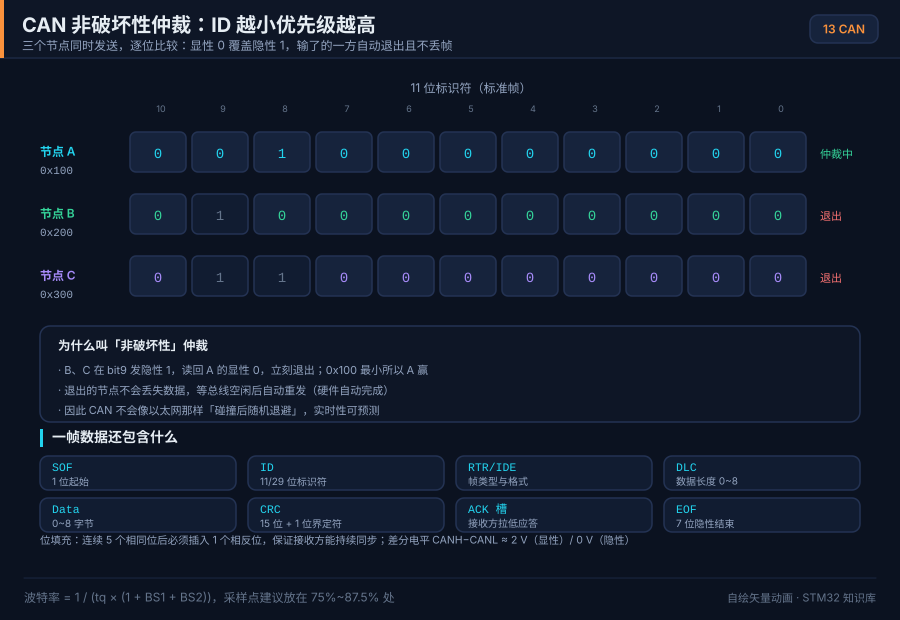
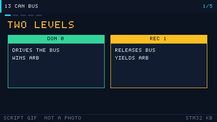

# 13 CAN bus

> 中文：[CAN 总线](../13-CAN总线.md)

> CAN uses a differential pair and non-destructive arbitration so many nodes can share one reliable bus. It is the classic network in cars and industrial control.

<p align="center">
  
  <br><sub>▲ Animation: CAN arbitration and bit stuffing (vector drawing, not a photograph)</sub>
</p>

<!-- video:ch13 -->
<p align="center">
  
  <br><sub>▲ Slideshow generated by tools/gen_videos.py. Reproducible, not a photograph. The narration matches the five frames.</sub>
</p>

**Narration (read along with the frames, about a minute)**

1. CAN is a differential pair. Dominant is logic 0 and it wins over recessive, so a smaller ID has higher priority.
2. Arbitration does not destroy the winning frame. The loser switches to listen immediately.
3. After five identical levels, a stuffing bit of the opposite level is inserted so the receiver can stay in sync.
4. The MCU only has the controller. You wire the transceiver and the 120 ohm resistors at both ends.
5. Motto: at TEC 256 the node goes quiet. Self-test: why does a single node enter bus-off?
<!-- /video:ch13 -->

## 📌 Goals

- [ ] Explain differential levels, dominant/recessive, bit stuffing, CRC, and ACK.
- [ ] Tell apart data, remote, error, and overload frames, and 11-bit versus 29-bit IDs.
- [ ] Explain non-destructive arbitration and why a smaller ID wins.
- [ ] Compute baud and sample point (BS1/BS2/SJW) and program `CAN_BTR`.
- [ ] Configure filters and the two receive FIFOs on F1.

## 🧠 Core idea

### 1. Physical layer: differential, dominant, recessive

**Takeaway:** CAN rides on `CAN_H` / `CAN_L`. **Dominant means logic 0, recessive means logic 1.** Dominant overwrites recessive (wired-AND). That is the whole of arbitration.

| Logic | Bus state | CAN_H − CAN_L | Note |
| --- | --- | --- | --- |
| 0 | Dominant | about +2 V | Any node can force it. **Higher priority** |
| 1 | Recessive | about 0 V | Recessive only if every node sends recessive |

- Put a **120 Ω** terminator at each end of the bus. That kills reflections and sets the differential impedance near 60 Ω.
- A transceiver (TJA1050, SN65HVD230, …) turns the MCU's TTL `CAN_TX` / `CAN_RX` into the differential pair. **The MCU has only the controller. You must add a transceiver.**
- Rule of thumb for length: about 40 m at 1 Mbps, about 500 m at 125 kbps. Faster means shorter.

### 2. Stuffing, CRC, ACK

| Mechanism | Job | Rule |
| --- | --- | --- |
| Bit stuffing | Enough edges for resync | After five identical levels, insert one opposite bit (the fixed stuff before the CRC delimiter is the exception) |
| CRC | Detect errors | 15-bit CRC plus a delimiter. Sender computes, receiver checks, error frame on mismatch |
| ACK | Confirm delivery | Sender puts recessive in the ACK slot. **Any node that received the frame correctly drives dominant** |
| Error counters | Isolate a bad node | TEC/REC. Past the thresholds the node becomes error-passive, then bus-off |

### 3. Frame types and IDs

| Frame | Use |
| --- | --- |
| Data | Carries 0–8 data bytes |
| Remote | Asks another node to send a given ID |
| Error | Sent when a node sees an error |
| Overload | Receiver needs to delay the next frame |

**Data frame:** `SOF(1)` + arbitration (11/29-bit ID + RTR) + control (IDE/r0/DLC) + data (0–8 bytes) + CRC + ACK + EOF (7 recessive) + IFS.

- **Standard frame:** 11-bit ID (`IDE=0`). Smaller overhead.
- **Extended frame:** 29-bit ID (`IDE=1`), 11-bit base plus 18-bit extension.

### 4. Non-destructive arbitration

**Takeaway:** When several nodes start together, they arbitrate **bit by bit**. A node that sent recessive but sees dominant drops out and listens. The winner's frame is **not corrupted**. **A numerically smaller ID has higher priority.**

| Standard ID | Priority | Typical use |
| --- | --- | --- |
| `0x000` | Highest | Emergency / control |
| `0x100` | High | Real-time control |
| `0x500` | Middle | Status |
| `0x7FF` | Lowest | Logs |

> Arbitration happens in the arbitration field. A loser becomes a receiver and retries when the bus is idle. **That retry is not an error frame and does not burn the error counters.**

### 5. Baud rate and sample point

**Takeaway:** One bit is `SYNC_SEG (1 Tq)` + `BS1` + `BS2`. The sample point is usually **75% to 87.5%**.

```
BaudRate = f_APB1 / (Prescaler × (1 + BS1 + BS2))
sample point = (1 + BS1) / (1 + BS1 + BS2) × 100%
Tq = Prescaler / f_APB1
```

On **F1, APB1 = 36 MHz**:

| Target | Prescaler | BS1 | BS2 | Sample | Note |
| --- | --- | --- | --- | --- | --- |
| 1 Mbps | 4 | 5 Tq | 3 Tq | 66.7% | 36 MHz / (4×9) = 1 MHz, short cable |
| 500 kbps | 9 | 5 Tq | 2 Tq | 75% | 36 MHz / (9×8) = 500 kHz |
| 250 kbps | 18 | 5 Tq | 2 Tq | 75% | Double the prescaler |
| 125 kbps | 36 | 5 Tq | 2 Tq | 75% | Long cable |
| 100 kbps | 45 | 5 Tq | 2 Tq | 75% | 36 MHz / (45×8) = 100 kHz |

> A 70% sample point (BS1=6, BS2=3, 10 TQ) wants a prescaler of 7.2 for 500 kbit/s. That is not an integer. The table uses 8 TQ and a 75% sample point, which divides evenly. [`examples/can-bxcan`](../../examples/can-bxcan/) uses the 500 kbit/s row.

> **SJW** absorbs clock error between nodes, usually 1–2 Tq. Different sample points are the first cause of flaky multi-node links. Every node must match.

### 6. Filters and two FIFOs (F1)

**Takeaway:** F1 bxCAN has **14 filter banks** and **2 receive FIFOs**. A filter routes a matching ID to FIFO0 or FIFO1. You then poll or take an interrupt.

| Mode | Meaning | Registers |
| --- | --- | --- |
| Mask | ID plus mask. A mask bit of 1 must match; 0 is don't-care | `CAN_FiR1` / `CAN_FiR2` |
| List | Exact IDs | `CAN_FiR1` / `CAN_FiR2` |
| Scale | 32-bit (standard + extended) or 16-bit (two standard IDs) | `CAN_FS1R` |
| FIFO | Each bank assigns FIFO0 or FIFO1 | `CAN_FFA1R` |

> F4 bxCAN is the same shape (14 banks + 2 FIFOs, RM0090 chapter 32). Register names mostly match.

## 🛠️ Wiring

| Board | Peripheral | Pins | Note |
| --- | --- | --- | --- |
| BluePill (F103) | CAN1 | PA11 = CAN_RX, PA12 = CAN_TX | External TJA1050 / SN65HVD230 |
| BluePill | Transceiver | CANH / CANL | 120 Ω at each end |
| Nucleo-F411RE | CAN1 | PD0 = CAN_RX, PD1 = CAN_TX | External transceiver |
| Any | Debug | USART1 | Print what you send and receive |

Wire `CAN_TX` to the transceiver TXD and `CAN_RX` to RXD. CANH/CANL are the bus. **Mind the transceiver supply:** SN65HVD230 is 3.3 V, TJA1050 is 5 V.

## 💻 Code

**① Init (F1, 500 kbps)**

```c
#include "stm32f1xx_hal.h"

CAN_HandleTypeDef hcan;

static void MX_CAN_Init(void)
{
    hcan.Instance                  = CAN1;
    hcan.Init.Prescaler            = 9;                 /* 36MHz/(9×(1+5+2))=500k */
    hcan.Init.Mode                 = CAN_MODE_NORMAL;
    hcan.Init.SyncJumpWidth        = CAN_SJW_1TQ;
    hcan.Init.TimeSeg1             = CAN_BS1_5TQ;
    hcan.Init.TimeSeg2             = CAN_BS2_2TQ;
    hcan.Init.TimeTriggeredMode    = DISABLE;
    hcan.Init.AutoBusOff           = ENABLE;
    hcan.Init.AutoWakeUp           = DISABLE;
    hcan.Init.AutoRetransmission   = ENABLE;
    hcan.Init.ReceiveFifoLocked    = DISABLE;
    hcan.Init.TransmitFifoPriority = DISABLE;
    HAL_CAN_Init(&hcan);
}
```

**② Filter: accept only 0x123 (mask mode)**

```c
static void CAN_Filter_Init(void)
{
    CAN_FilterTypeDef f = {0};
    f.FilterBank           = 0;
    f.FilterMode           = CAN_FILTERMODE_IDMASK;
    f.FilterScale          = CAN_FILTERSCALE_32BIT;
    f.FilterIdHigh         = 0x123 << 5;   /* standard ID, shift left by 5 */
    f.FilterIdLow          = 0x0000;
    f.FilterMaskIdHigh     = 0x7FF << 5;   /* all 11 bits must match */
    f.FilterMaskIdLow      = 0x0000;
    f.FilterFIFOAssignment = CAN_RX_FIFO0;
    f.FilterActivation     = ENABLE;
    HAL_CAN_ConfigFilter(&hcan, &f);
    HAL_CAN_Start(&hcan);
    HAL_CAN_ActivateNotification(&hcan, CAN_IT_RX_FIFO0_MSG_PENDING);
}
```

**③ Send and receive**

```c
void CAN_Send(uint16_t std_id, uint8_t *data, uint8_t len)
{
    CAN_TxHeaderTypeDef tx = {0};
    uint32_t mailbox;
    tx.StdId = std_id;
    tx.IDE   = CAN_ID_STD;
    tx.RTR   = CAN_RTR_DATA;
    tx.DLC   = len;
    HAL_CAN_AddTxMessage(&hcan, &tx, data, &mailbox);
}

void HAL_CAN_RxFifo0MsgPendingCallback(CAN_HandleTypeDef *hcan)
{
    CAN_RxHeaderTypeDef rx;
    uint8_t data[8];
    HAL_CAN_GetRxMessage(hcan, CAN_RX_FIFO0, &rx, data);
    /* handle rx.StdId / data */
}
```

## ⚠️ Pitfalls

| What you see | Why | Fix |
| --- | --- | --- |
| Nothing on the bus | No transceiver, or the wrong supply | Check TXD/RXD and 3.3 V vs 5 V |
| Random errors, lots of retries | Sample points differ, or no terminators | Same BS1/BS2; 120 Ω at both ends |
| The ID you want never arrives | Filter ID was not shifted | Shift a standard ID left by 5 |
| Transmit works, receive does not | RXD swapped, or the filter is off | Check the pin and `FilterActivation` |
| Bus-off | Short, or nobody ACKs | Check the bus; `AutoBusOff` recovers |
| Drops on a long cable | Baud too high | Slow down (about 500 m at 125 kbps or below) |
| Extended ID is wrong | Base and extension mixed up | `IDE=CAN_ID_EXT` and fill `ExtId` |

## 🧪 Try it

1. **Loopback:** `CAN_MODE_LOOPBACK`, print the ID and data you receive. You should see your own frame with no transceiver.
2. **Two nodes:** two BluePills plus transceivers, 120 Ω at each end. B's log matches what A sent.
3. **Filter:** accept only 0x123. The peer sends 0x123 and 0x456. Only 0x123 is printed.
4. **Priority (optional):** two nodes transmit different IDs together. A logic analyzer shows the smaller ID winning.

### 7. Coming back from bus-off

**Takeaway:** When TEC reaches 256 the node is bus-off and stops driving the bus. Recovery needs **128 sequences of 11 recessive bits**. Hardware can count that for you. That bit is ABOM.

```c
hcan.Init.AutoBusOff = ENABLE;   /* ABOM: return to error-active after 128×11 recessive bits */
```

With nobody else to ACK, the sender errors its way into bus-off. Debug a single board in loopback before you blame the transceiver.

Motto: **TEC 256 means shut up. 128 runs of 11 recessive bits, then you may talk again.**

Self-test:

1. Why does the only node on a bus enter bus-off after a few frames?
2. With `AutoBusOff` enabled, do you still call Start again in software?
3. When standard IDs 0x100 and 0x200 arbitrate, which bit is compared first?

## 🔗 Further reading

- RM0008, STM32F10xxx reference manual, chapter 21, Controller area network (bxCAN): `CAN_BTR`, filters, two FIFOs.
- RM0090, STM32F4 reference manual, chapter 32, bxCAN.
- ISO 11898-1 (data link) and ISO 11898-2 (physical layer).
- Transceiver datasheets: TJA1050, SN65HVD230.
- Figure: `../../assets/animations/can-arbitration.svg` (vector drawing).
- Example: [examples/can-bxcan](../../examples/can-bxcan/) (loopback, two nodes, filter, ABOM and a software restart). On a BluePill, remap to PB8/PB9 so you do not fight the on-board USB pull-up on PA11/PA12.
