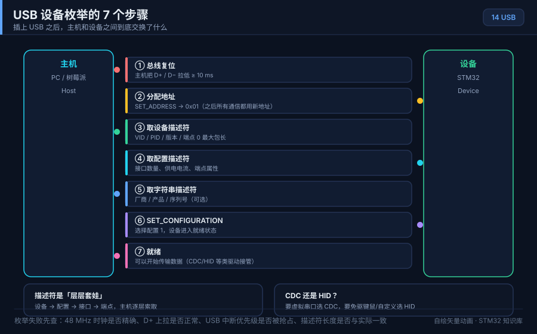
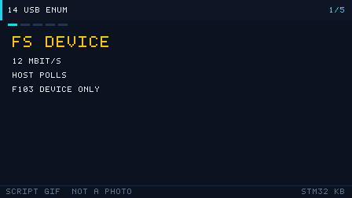

# 14 USB

> 中文：[USB](../14-USB.md)

> One USB cable can power the board and carry data. After enumeration the same chip can look like a virtual COM port (CDC), a keyboard (HID), or a disk (MSC).

<p align="center">
  
  <br><sub>▲ Animation: USB enumeration (vector drawing, not a photograph)</sub>
</p>

<!-- video:ch14 -->
<p align="center">
  
  <br><sub>▲ Slideshow generated by tools/gen_videos.py. Reproducible, not a photograph. The narration matches the five frames.</sub>
</p>

**Narration (read along with the frames, about a minute)**

1. The host is in charge. The device only answers. An F103 is a full-speed device, not a host.
2. Enumeration is reset, read descriptors, set address, read the configuration, set the configuration.
3. If it dies on the descriptor, the length field or the 48 MHz clock is usually wrong.
4. CDC is a virtual COM port on bulk endpoints. HID is the keyboard/mouse family on interrupt endpoints, and it is usually driver-free.
5. Self-test: which two pins are DP and DM on an F103? Which of CDC and HID needs a driver more often?
<!-- /video:ch14 -->

## 📌 Goals

- [ ] Separate USB 2.0 low-speed (1.5 Mbps), full-speed (12 Mbps), and high-speed (480 Mbps), and know which STM32 parts do which.
- [ ] Compare control, bulk, interrupt, and isochronous transfers.
- [ ] Read the descriptor tree: device, configuration, interface, endpoint.
- [ ] Recite the seven enumeration steps and guess where "unknown device" got stuck.
- [ ] Contrast CDC and HID, and know where CubeMX attaches the middleware.
- [ ] Use the ST USB Device library for a CDC echo and a custom HID — or the HAL PCD examples in this repo, which do not ship that middleware.

## 🧠 Core idea

### 1. Speeds and which STM32 block you actually have

**Takeaway:** The host starts every transfer. The device is polled. The common STM32 case is a **full-speed device**. Only parts with `OTG_HS` can do high-speed.

| Speed | Spec | Bit rate | On STM32 |
| --- | --- | --- | --- |
| Low | USB 1.1 | 1.5 Mbps | Device side (a HID mouse). STM32 usually does not do this |
| Full | USB 1.1/2.0 | 12 Mbps | **USB peripheral on F0/F1/F3/L4, OTG_FS on F4/F7/H7** |
| High | USB 2.0 | 480 Mbps | **OTG_HS only** (external ULPI PHY, or a part with an on-chip HS PHY) |

| Family | Block | Note | Manual |
| --- | --- | --- | --- |
| STM32F1 | USB Device FS | Device only, 12 Mbps, no OTG host | RM0008 chapter 23 |
| STM32F4 | OTG_FS + OTG_HS | FS PHY on chip; HS needs an external ULPI PHY | RM0090 chapter 30 / 31 |
| STM32F7/H7 | OTG_FS + OTG_HS | Some parts have an on-chip HS PHY | OTG chapter of that RM |

> **An F103 USB block is device-only. It cannot be a host.** On an F411, `OTG_FS` is **PA11 (DM) / PA12 (DP)** and those pins are also CAN1, so you pick one. F1 USB uses the same PA11/PA12 pair.

### 2. Four transfer types

**Takeaway:** Trade latency against reliability. **Control** is for enumeration. **Bulk** moves bytes and retries. **Interrupt** is small and bounded. **Isochronous** keeps a time slot and is allowed to drop data.

| Type | Trait | Typical use | Bandwidth reserved |
| --- | --- | --- | --- |
| Control | Endpoint 0, reliable, reserved each frame | Enumeration, class requests | Yes |
| Bulk | Reliable, no reserved bandwidth, retries | CDC, disks, printers | No |
| Interrupt | Reliable, polling interval, bounded latency | HID keyboard/mouse, small reports | Yes, small |
| Isochronous | Reserved bandwidth, **no retry, drops allowed** | Audio, cameras | Yes |

### 3. Endpoints

**Takeaway:** An endpoint is a logical pipe. Except for endpoint 0, **each endpoint is one direction** (IN or OUT).

| Endpoint | Direction | Use |
| --- | --- | --- |
| EP0 | IN and OUT | Control, enumeration, standard requests |
| EPn IN | Device to host | Device transmits (CDC TX) |
| EPn OUT | Host to device | Device receives (CDC RX) |

An F1 full-speed device has up to **8 bidirectional endpoints (EP0–EP7)**. They share a **512-byte** packet memory (PMA). You assign that memory yourself (RM0008 chapter 23, `USB_EPnR`, `BTABLE`).

### 4. Descriptor tree

**Takeaway:** The host learns the device by reading descriptors: device, then configuration, then interface, then endpoint. The interface is the function. One configuration can hold several interfaces.

```text
Device Descriptor                         (VID / PID / how many configurations)
 └─ Configuration Descriptor              (power / max current / interface count)
     ├─ Interface Descriptor              (class / subclass / protocol, CDC or HID)
     │   ├─ Endpoint Descriptor           (address / direction / type / packet / interval)
     │   └─ Endpoint Descriptor
     └─ Interface Descriptor
         └─ Endpoint Descriptor
```

| Descriptor | Field | Meaning |
| --- | --- | --- |
| Device | `idVendor` / `idProduct` | VID/PID. ST's own examples often use 0x0483/0x5740 |
| Device | `bNumConfigurations` | Usually 1 |
| Configuration | `bMaxPower` | Unit is 2 mA (0x32 = 100 mA) |
| Interface | `bInterfaceClass` | 0x02 CDC, 0x03 HID, 0x08 MSC, 0xFF vendor |
| Endpoint | `bmAttributes` | 0 control, 1 isochronous, 2 bulk, 3 interrupt |
| Endpoint | `wMaxPacketSize` | 64 bytes max at full speed (isochronous/interrupt can be 1023) |

### 5. Seven enumeration steps

**Takeaway:** Reset, read descriptors, assign an address, read the configuration, select it. **Any failed step shows up as "unknown device" or "device descriptor request failed".**

| Step | Action | Note |
| --- | --- | --- |
| 1 | Host sees the device (pull-up on D+) | Full speed pulls D+ up with 1.5 kΩ. That is how the host picks the speed |
| 2 | Bus reset | D+ and D− low for at least 10 ms |
| 3 | At address 0, read the first 8 bytes of the device descriptor | Host learns `bMaxPacketSize0` |
| 4 | Reset again, read the full 18-byte device descriptor | VID/PID |
| 5 | Set Address | Device gets an address from 1 to 127 |
| 6 | Read 9 bytes of configuration, then the whole configuration set | Interfaces and endpoints |
| 7 | Set Configuration | The function is live |

> Motto: **stuck on step 3 or 4** usually means a bad length field or a bad clock. **Stuck on step 6** usually means `wTotalLength` is wrong. **Stuck on step 7** usually means the endpoint buffer was not armed.

### 6. CDC versus HID

**Takeaway:** CDC is "I am a serial port" (high bandwidth, byte stream). HID is "I am a keyboard, mouse, or custom gadget" (native support, fixed reports).

| | CDC | HID |
| --- | --- | --- |
| Job | Virtual COM, arbitrary bytes | Keyboard, mouse, custom report |
| Driver | Built in on Windows 10+. Older Windows wants an .inf | Driver-free on the usual desktops |
| Endpoints | Typically bulk IN, bulk OUT, and one interrupt IN | One interrupt IN (optional OUT) |
| Bandwidth | High, can fill full speed | Low, a few dozen bytes per frame, limited by `bInterval` |
| Unit | Byte stream | A fixed report |
| Typical | Debug log, data logger | Custom pad, macro keyboard, scanner |

### 7. CubeMX middleware

| Item | Where | Value |
| --- | --- | --- |
| USB block | Connectivity → USB / USB_OTG_FS | Device (FS). On F4 pick `Device_Only` or `OTG` |
| Class | Middleware → USB_DEVICE → Class | CDC or HID |
| Identity | `USBD_DEVICE` | VID/PID, strings |
| CDC buffers | CDC page | Default `APP_TX/RX_DATA_SIZE` is 2048 |
| VBUS | VBUS sensing | A self-powered board must see VBUS, or you turn sensing off |
| IRQ | NVIC → USB_LP / OTG_FS | Keep it fairly high |
| Clock | RCC | Full speed wants a **48 MHz** USB clock (F1 divides the PLL; F4 uses PLL48CLK) |

> **48 MHz is not optional.** On F1, `USBCLK = 48 MHz`. With a 72 MHz PLL that is a divide by 1.5 (`USBPRE`). A wrong clock fails enumeration or drops the link at random.

## 🛠️ Wiring

| Board | Peripheral | Pins | Note |
| --- | --- | --- | --- |
| BluePill (F103) | USB device | PA11 = DM, PA12 = DP | On-board micro-USB, D+ already has 1.5 kΩ |
| BluePill | Debug | SWD PA13/PA14 | Leave them alone |
| Nucleo-F411RE | OTG_FS | PA11 = DM, PA12 = DP | The ST-Link mini-USB is a virtual COM, **not** the OTG connector |
| F4-Discovery | OTG_FS | PA11/PA12 | On-board micro-AB |
| BlackPill (F411) | USB | PA11/PA12 | On-board Type-C wired to the MCU |

- Keep the pair short, matched, and near 90 Ω differential. Dupont wires often fail even at full speed.
- On a bare board, **D+ needs 1.5 kΩ to 3.3 V** so the host sees a full-speed device. Many dev boards already have it.
- The USB connector can feed 5 V into the on-board LDO. Before the device is configured, stay within 100 mA.

## 💻 Code

If CubeMX generated a CDC project, the file you actually edit is **`USB_DEVICE/App/usbd_cdc_if.c`**. The snippets below are that style.

**① Bring-up (`main.c`, generated)**

```c
#include "stm32f1xx_hal.h"
#include "usb_device.h"        /* CubeMX: declares MX_USB_DEVICE_Init */
#include "usbd_cdc_if.h"       /* CDC API */

int main(void)
{
    HAL_Init();
    SystemClock_Config();      /* USB clock must be 48 MHz */
    MX_GPIO_Init();
    MX_USB_DEVICE_Init();

    uint8_t msg[] = "STM32 CDC ready\r\n";

    while (1)
    {
        /* Non-blocking. USBD_OK means the stack accepted the buffer */
        CDC_Transmit_FS(msg, sizeof(msg) - 1);
        HAL_Delay(1000);
    }
}
```

**② Receive callback (`usbd_cdc_if.c`)**

```c
#include "usbd_cdc_if.h"

static int8_t CDC_Receive_FS(uint8_t *Buf, uint32_t *Len)
{
    /* Buf is the internal buffer, *Len is this packet */
    /* Echo. Do not block for long inside the USB interrupt */
    CDC_Transmit_FS(Buf, *Len);

    /* Arm the next OUT, or you only ever receive one packet */
    USBD_CDC_SetRxBuffer(&hUsbDeviceFS, &Buf[0]);
    USBD_CDC_ReceivePacket(&hUsbDeviceFS);
    return (USBD_OK);
}
```

**③ Transmit prototype (provided by the ST library)**

```c
/* Exported by ST's usbd_cdc_if.c */
uint8_t CDC_Transmit_FS(uint8_t *Buf, uint16_t Len);
```

> Transmit is **asynchronous**. `CDC_Transmit_FS` hands the buffer to the stack and returns. The USB interrupt finishes the packet. Calling it again too soon returns `USBD_BUSY`.

**④ A custom HID report (a small mouse)**

```c
/* 4-byte input report: 3 buttons plus relative X/Y */
__ALIGN_BEGIN static uint8_t HID_ReportDesc[] __ALIGN_END =
{
    0x05, 0x01,        /* Usage Page (Generic Desktop) */
    0x09, 0x02,        /* Usage (Mouse)                  */
    0xA1, 0x01,        /* Collection (Application)       */
    0x09, 0x01,        /*   Usage (Pointer)              */
    0xA1, 0x00,        /*   Collection (Physical)        */
    0x05, 0x09,        /*     Usage Page (Button)        */
    0x19, 0x01,        /*     Usage Minimum (1)          */
    0x29, 0x03,        /*     Usage Maximum (3)          */
    0x15, 0x00, 0x25, 0x01,   /* Logical Min/Max 0..1     */
    0x95, 0x03, 0x75, 0x01,   /* three 1-bit buttons      */
    0x81, 0x02,        /*     Input (Data,Var,Abs)       */
    0x95, 0x01, 0x75, 0x05,   /* pad to a byte            */
    0x81, 0x03,        /*     Input (Const)              */
    0x05, 0x01, 0x09, 0x30, 0x09, 0x31,  /* X, Y               */
    0x15, 0x81, 0x25, 0x7F,   /* Logical Min/Max -127..127 */
    0x75, 0x08, 0x95, 0x02,   /* two 8-bit fields         */
    0x81, 0x06,        /*     Input (Data,Var,Rel)       */
    0xC0, 0xC0         /* End Collection ×2              */
};
```

**⑤ Send a HID report**

```c
/* 4-byte report on the interrupt IN endpoint */
USBD_HID_SendReport(&hUsbDeviceFS, report, sizeof(report));
```

## ⚠️ Pitfalls

| What you see | Why | Fix |
| --- | --- | --- |
| Unknown USB device (device descriptor request failed) | 48 MHz is off, or the descriptor is wrong | Check the USB clock and the length fields |
| The host sees nothing | No D+ pull-up, D+/D− swapped, or a charge-only cable | 1.5 kΩ on D+; do not swap DM/DP |
| Code 43 | Enumeration died, often in the configuration descriptor | Check `wTotalLength` against the real interface and endpoint count |
| Old Windows ignores CDC | No .inf | Use Windows 10+, or switch to HID |
| Only the first packet arrives | Receive was not armed again | `USBD_CDC_ReceivePacket` in the callback |
| Transmit returns BUSY | Previous packet still in flight | Retry, or wait for the complete callback |
| Drops after a while | USB IRQ too low, or you blocked inside it | Keep the USB interrupt short and high priority |
| USB and CAN fight on F4 | Both want PA11/PA12 | Pick one, or move CAN |
| VBUS sensing error | Self-powered, VBUS not wired | Turn sensing off in CubeMX |
| DFU or a custom device never enters | BOOT pins or the descriptor | Start from the official DFU descriptor template |

## 🧪 Try it

1. **CDC echo:** a CubeMX F103 CDC project, open the new COM port, type. You should get the same bytes back.
2. **CDC once a second:** send the ADC voltage from chapter 09 with `CDC_Transmit_FS`.
3. **Custom HID:** one button updates a report. Windows game-controller properties should move.
4. **Trace (optional):** Wireshark plus USBPcap, or a hardware analyzer. Match GET_DESCRIPTOR, SET_ADDRESS, and SET_CONFIGURATION to the seven steps.

This repo's two examples do not ship the ST USB middleware. They enumerate with HAL PCD:

- [examples/usb-cdc](../../examples/usb-cdc/): virtual COM, echo, and a `cdc tick` line once a second while DTR is set.
- [examples/usb-hid](../../examples/usb-hid/): a boot keyboard. PA0 to ground types the letter `a`.

Both run the PLL at 72 MHz and select USB = PLL/1.5. On F103, `USB_LP_CAN1_RX0` is the same IRQ as bxCAN receive. Do not link the CAN example into the same project.

## 🔗 Further reading

- RM0008 chapter 23, USB device (`USB_EPnR`, PMA, `BTABLE`).
- RM0090 chapter 30, USB OTG_FS, and chapter 31, USB OTG_HS.
- USB 2.0 specification, chapter 9 (descriptors, enumeration, standard requests).
- AN4879, USB hardware and PCB guidelines using STM32 MCUs.
- The part datasheet for USB electrical limits and the PA11/PA12 alternate functions.
- Figure: `../../assets/animations/usb-enumeration.svg` (vector drawing).
