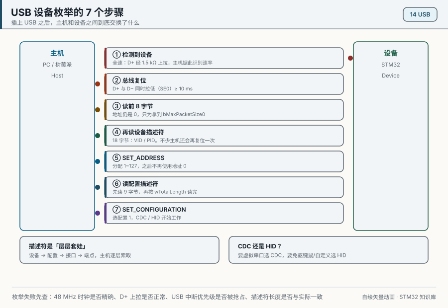
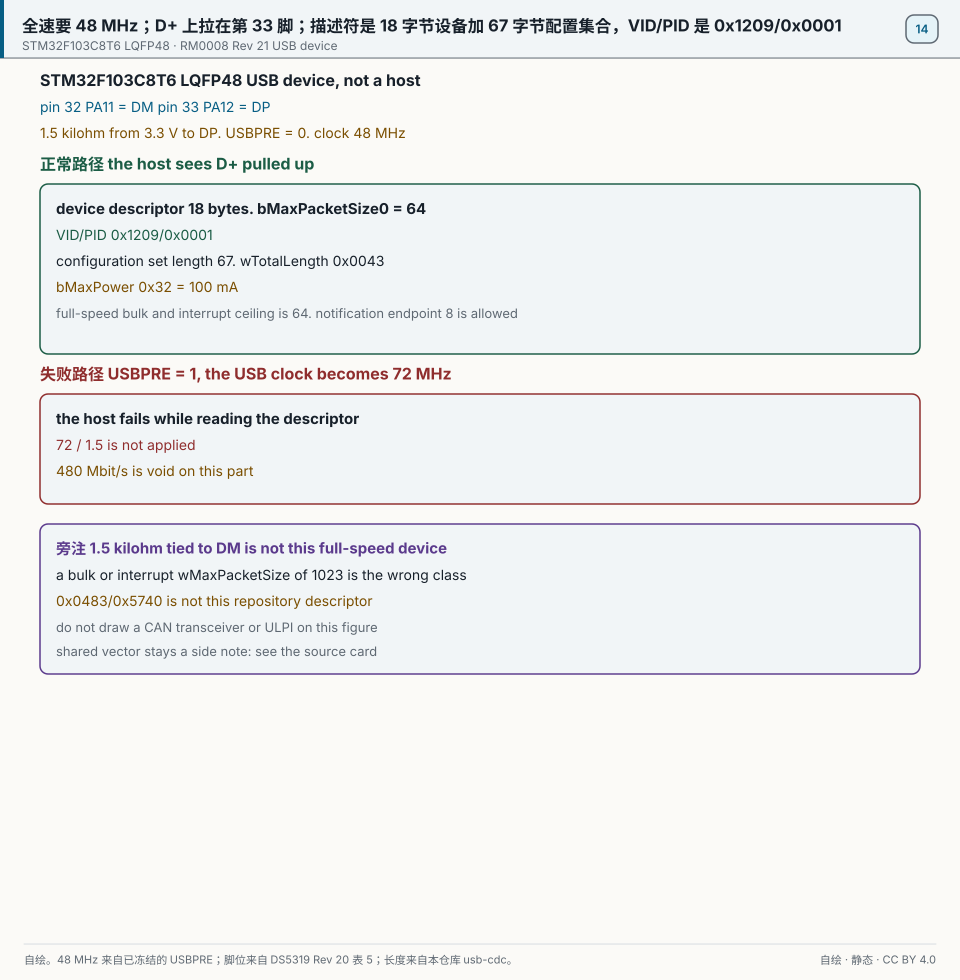
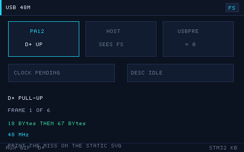

# 14 USB

> 中文：[USB](../14-USB.md)

> One USB cable can power the board and carry data. After enumeration the same chip can look like a virtual COM port (CDC), a keyboard (HID), or a disk (MSC).

<p align="center">
  
  <br><sub>▲ Animation: USB enumeration (vector drawing, not a photograph)</sub>
</p>

<!-- video:ch14 -->
<p align="center">
  <video width="640" controls poster="../../assets/video/ch14-usb.png">
    <source src="../../assets/video/ch14-usb.mp4" type="video/mp4">
  </video>
  <br><sub>▲ Chapter video with Chinese voice-over (2.6 min). <a href="../../assets/video/ch14-usb.mp4">MP4</a> · <a href="../../assets/video/ch14-usb.srt">subtitles</a></sub>
</p>

<details>
<summary>Narration script (Chinese, same text as the subtitles)</summary>

1. F103 的 USB 全速要 48 兆时钟。常见做法是 PLL 先到 72 兆，再除以 1.5。时钟差一点，主机会在读描述符时失败，设备管理器里就是未知设备。
2. 全速设备用 D+ 上的 1.5 千欧上拉告诉主机：我是全速。BluePill 上这颗电阻常常已经在了。没有上拉，主机根本不知道你插上来了。
3. 枚举是主机在提问。它先在地址 0 要设备描述符的前 8 个字节，再给你分配地址，再要整份配置，最后选择配置。卡在哪一步，口诀在这一章的正文里。
4. 这一帧是仓库画的枚举过程，不是分析仪抓的真实波形。对照它看你的描述符长度。配置描述符的总长度算错，常常卡在选择配置之前。
5. CDC 插上像一个串口，适合传字节流。HID 插上像键盘或鼠标，系统自带驱动，但每次只能按报告格式送很少的字节。数据采集走 CDC，按键走 HID。
6. 在 F103 上，USB 的低优先级中断和 CAN 接收邮箱 0 共用一个入口。两套一起开的时候，服务函数里要分清是谁在叫。只复制一个空的中断函数，另一边就会丢。
7. 示例里 CDC 的配置描述符是 67 个字节。HID 的报告描述符也要自己数，别让总长度字段和真实字节数打架。设置地址要等这一次状态传输走完再生效。
8. 示例用的厂商号是 0x1209，产品号只是实验占位，并没有在 pid.codes 注册。可以在自己的电脑上认设备，不要把这组号印到准备送人的产品上。
9. 口诀：卡在读描述符，多半是时钟或描述符字段；卡在读配置，多半是总长度；卡在最后一步，多半是端点还没准备好。
10. 合上书，三问。F103 的 D+ 和 D- 在哪两只脚？48 兆时钟从 72 兆怎样得到？CDC 和 HID，谁更像一个串口？

</details>
<!-- /video:ch14 -->

## Learning goals

Before this chapter: you need the clock tree from chapter 02 (how the PLL multiplies up to 72 MHz), alternate functions from chapter 03, and the NVIC from chapter 04; UART transmit and receive from chapter 06 and DMA from chapter 10 come up again where they are used. If binary, hexadecimal, and "bytes" are unfamiliar, read the "zero-background primer" in chapter 00 first.

- [ ] Name the three USB speeds, which one the STM32F103C8T6's USB peripheral runs at, and whether it can be a host
- [ ] Say what kind of data each of the four transfer types suits, and that bulk and interrupt endpoints top out at 64 bytes per packet at full speed
- [ ] Draw the device, configuration, interface, and endpoint descriptors as a tree, and work out the 67-byte total of the example's configuration set
- [ ] List the seven enumeration steps in order, and tell which step failed when you see "device descriptor request failed"
- [ ] Get a 48 MHz USB clock from a 72 MHz PLL, and explain the difference between writing 0 and 1 to `USBPRE`
- [ ] Build a CDC virtual COM port with CubeMX's USB_DEVICE middleware, and check for `USBD_BUSY` when echoing

## Core ideas

**In one sentence: every USB transfer is started by the host, and the device only answers. Once plugged in, the host first reads what the device is through a fixed series of questions (enumeration), and only then moves data through the endpoints the descriptors list; on the F103 all of this depends on an accurate 48 MHz USB clock and a pull-up resistor on D+.**

### An analogy first

Think of the USB host as a hotel front desk and the device as a guest who has just walked in. The guest cannot go looking for a room; it can only wait for the desk to ask:

- The guest steps up and rings the bell (the D+ pull-up); only then does the desk know someone is there.
- The desk hands over a temporary number, 0, and asks the most urgent question first: "how many things can you take at once?" (the first 8 bytes of the device descriptor).
- Then it issues a real room number (set address) and asks for the whole registration form: who you are, how many rooms you need, and what each room is for (the device descriptor, the configuration descriptor, and the interfaces and endpoints under it).
- When registration is done, the desk says "check in" (set configuration), and only then can the guest use the rooms.

That is as far as the analogy goes. A real front desk never forgets what it asked, and neither does a USB host; but if one length on the guest's form is wrong, the desk stops at that step, and all that is left in Device Manager is an "unknown device". The host asks quickly and every step has a timeout, so the device's clock has to be accurate.

### 1. USB speeds and the STM32 peripherals

USB 2.0 has three speeds. A device puts a pull-up resistor on D+ or D−, and the host tells low speed from full speed by which line is pulled high; a high-speed device connects at full speed first and then negotiates up with the host ([USB 2.0 specification](#source-usb20) chapter 7).

| Speed | Bit rate | On STM32 |
| --- | --- | --- |
| Low Speed | 1.5 Mbit/s | used by older mice and keyboards; the STM32 peripherals in this book do not run at it |
| Full Speed | 12 Mbit/s | the USB device peripheral of F0/F1/F3/L4, and OTG_FS on F4/F7/H7 |
| High Speed | 480 Mbit/s | only OTG_HS, with an external PHY on the ULPI interface, or on parts with a built-in high-speed PHY |

| Series | USB peripheral | What it can do | Manual |
| --- | --- | --- | --- |
| STM32F103 | USB full-speed device interface | device only, never a host; 1 to 8 configurable endpoints | RM0008 Rev 21 chapter 23 |
| STM32F405/F407 | OTG_FS and OTG_HS | device, host, and OTG; OTG_FS has a built-in full-speed PHY, OTG_HS needs an external ULPI PHY for high speed | RM0090 Rev 22 chapters 34 and 35 |

> [!WARNING]
> On the F103, USB and CAN share one 512-byte SRAM, so only one of them can be in use at a time (RM0008 Rev 21 section 23.2). The BluePill's on-board USB connector is on PA11/PA12, and CAN's reset-default pins are those same two; chapter 13 has already moved CAN to PB8/PB9.

### 2. Four transfer types

USB splits transfers into four types by the nature of the data. The last column is the most bytes one packet can carry at full speed ([USB 2.0 specification](#source-usb20) chapter 5):

| Type | Behavior | Typical use | Full-speed packet limit |
| --- | --- | --- | --- |
| Control | every device has it, on endpoint 0; retried on error | enumeration, configuration, class requests | 8, 16, 32, or 64 bytes |
| Bulk | retried on error, no bandwidth guarantee, sends more when the bus is idle | CDC virtual COM ports, flash drives, printers | 64 bytes |
| Interrupt | retried on error, the host polls at a fixed interval, latency has an upper bound | keyboards, mice, small status reports | 64 bytes |
| Isochronous | guaranteed bandwidth, not retried on error: what is lost is lost | audio, cameras | 1023 bytes |

An "interrupt transfer" is not an MCU interrupt: the host still does the asking, only it asks on a schedule set by `bInterval` in the descriptor, at most once per 1 ms. So one interrupt endpoint at full speed carries at most 64 × 1000 = 64,000 bytes per second. Bulk has no interval limit: at full speed one frame (1 ms) holds at most 19 packets of 64 bytes, so the specification's ceiling is about 1.2 MB/s; what you actually get depends on the host and the firmware.

### 3. Endpoints

An endpoint is a transmit or receive buffer inside the device, which the host finds by "address + endpoint number + direction". Endpoint 0 is the bidirectional control endpoint every device must have; every other endpoint goes in one direction only. Directions are named from the host's side: IN is device to host, OUT is host to device.

| Endpoint | Direction | Use |
| --- | --- | --- |
| EP0 | IN and OUT | control endpoint, enumeration and standard requests |
| EPn IN | device → host | sending data up, such as CDC transmit |
| EPn OUT | host → device | receiving data, such as CDC receive |

The F103's USB peripheral can have 1 to 8 endpoints, and the buffers of all of them live in one 512-byte packet buffer memory (PMA), laid out by the buffer descriptor table `BTABLE` (RM0008 Rev 21 sections 23.2 and 23.3). A CubeMX project lays it out for you; when you add endpoints yourself, check that they fit together.

### 4. Descriptors: a tree

The host learns about a device by reading its descriptors. A descriptor is a string of bytes whose first two bytes are always "this descriptor's length" and "its type". They form a tree:

```text
Device descriptor          VID, PID, endpoint 0 packet size, number of configurations
 └─ Configuration descr.   power source, maximum current, number of interfaces, total length of the set
     ├─ Interface descr.   class, subclass, protocol, such as CDC or HID
     │   ├─ Endpoint descr.   address, direction, type, packet size, interval
     │   └─ Endpoint descr.
     └─ Interface descr.
         └─ Endpoint descr.
```

When the host asks for the configuration descriptor, the device sends it joined to all the interface and endpoint descriptors under it, in one string called the configuration set. `wTotalLength` in the configuration descriptor is the length of that string. The table lists the fields you look up most ([USB 2.0 specification](#source-usb20) section 9.6):

| Descriptor | Field | Meaning |
| --- | --- | --- |
| Device | `bLength` | a device descriptor is always 18 bytes, `0x12` |
| Device | `idVendor` / `idProduct` | vendor and product IDs. ST's own examples often use `0x0483/0x5740`; this repository's `examples/usb-cdc` uses `0x1209/0x0001` |
| Device | `bMaxPacketSize0` | endpoint 0 packet size; 8, 16, 32, or 64 at full speed |
| Configuration | `wTotalLength` | bytes in the whole configuration set; 67 in the example, `0x0043` |
| Configuration | `bMaxPower` | maximum current in units of 2 mA: `0x32` is 100 mA |
| Interface | `bInterfaceClass` | `0x02` is the CDC communication interface, `0x0A` the CDC data interface, `0x03` HID, `0x08` mass storage, `0xFF` vendor-specific |
| Endpoint | `bmAttributes` | the low 2 bits are the transfer type: 0 control, 1 isochronous, 2 bulk, 3 interrupt |
| Endpoint | `wMaxPacketSize` | at most 64 for full-speed bulk and interrupt; 1023 belongs to full-speed isochronous only |

`0x1209` is the vendor ID pid.codes provides for open-source projects; `0x0001` is only this repository's lab placeholder and is not registered with pid.codes. Fine for experiments on your own computer; do not print it on a product you plan to give anyone.

### 5. Seven enumeration steps

Once the device is plugged in, the host asks in this order ([USB 2.0 specification](#source-usb20) section 9.1). If the device answers any step wrongly, Device Manager shows "unknown device" or "device descriptor request failed":

| Step | What the host does | What the device must answer |
| --- | --- | --- |
| 1 | sees D+ pulled high and knows a full-speed device has arrived | the 1.5 kΩ pull-up on D+ |
| 2 | resets the bus: D+ and D− both held low for at least 10 ms | back to the default state after reset, address 0 |
| 3 | asks for the device descriptor at address 0, reading only the first 8 bytes | `bMaxPacketSize0` |
| 4 | sets the address | switch to the new address only after this transfer's status stage completes |
| 5 | reads the full 18-byte device descriptor at the new address | VID, PID, number of configurations |
| 6 | reads the first 9 bytes of the configuration descriptor to get the total length, then reads the whole configuration set by that length | `wTotalLength` and the interface and endpoint descriptors after it |
| 7 | sets the configuration | opens the endpoints in the descriptors and enters the "configured" state |

Some hosts reset once more after step 3; the order after that is unchanged.

Step 4 has one detail: after receiving "set address", the device must wait until the status stage of that control transfer completes before it really changes address. Changing at once means the host's handshake packet no longer matches the address, and enumeration stops there. CubeMX's middleware and the HAL already handle it in this order.

The rule of thumb: **stuck at step 3, check the clock and the device descriptor; stuck at step 6, check `wTotalLength`; stuck at step 7, check the endpoints and buffers.**

### 6. CDC versus HID

| Comparison | CDC (Communications Device Class) | HID (Human Interface Device) |
| --- | --- | --- |
| Looks like | a serial port | a keyboard, a mouse, or a custom device |
| Driver | built in from Windows 10; older Windows needs an `.inf` | built in on every platform |
| Endpoints | one interrupt IN for notifications, one bulk IN/OUT pair for data | one interrupt IN, optionally one interrupt OUT |
| Bandwidth | bulk, ceiling about 1.2 MB/s at full speed | interrupt, at most 64,000 bytes per second per endpoint at full speed |
| Shape of the data | any byte stream | "reports" in the format the report descriptor defines |
| Suits | debug printing, data acquisition | buttons, barcode scanners, a few control values |

Choose CDC to move data; choose HID when the system should treat the board as a keyboard or mouse the moment it is plugged in, with nothing for the user to install.

### 7. USB settings in CubeMX

| Setting | Where | What to enter |
| --- | --- | --- |
| USB peripheral | Connectivity → USB | tick Device (FS); on F4 it is USB_OTG_FS, set to Device_Only |
| Device class | Middleware → USB_DEVICE → Class For FS IP | Communication Device Class (CDC) or Human Interface Device Class (HID) |
| Device parameters | USB_DEVICE → Device Descriptor | VID, PID, manufacturer and product strings |
| Buffers | USB_DEVICE → Parameter Settings | CDC's `APP_RX_DATA_SIZE` and `APP_TX_DATA_SIZE` |
| Clock | Clock Configuration | the USB clock must be 48 MHz |
| Interrupt | NVIC | on F1 it is `USB_LP_CAN1_RX0`; enable it |

Where the F1's 48 MHz comes from: the PLL first multiplies up to 72 MHz, then the divider chosen by the `USBPRE` bit feeds USB. `USBPRE = 0` divides by 1.5, so `72 / 1.5 = 48` MHz; `USBPRE = 1` does not divide, USB gets 72 MHz, and the host fails while reading descriptors (RM0008 Rev 21 section 7.3.2). In the HAL this is written `RCC_USBCLKSOURCE_PLL_DIV1_5`. It is set correctly only when the USB box on CubeMX's clock page shows 48 MHz.

The F4's OTG_FS has a setting the F1 lacks: VBUS sensing. It watches PA9 to see whether the host supplies power. If the board does not wire VBUS to PA9, turn VBUS sensing off in CubeMX, or the device keeps thinking it is unplugged.

## Hardware and wiring

| Board | Peripheral | Pins | Notes |
| --- | --- | --- | --- |
| BluePill (F103C8T6) | USB full-speed device | pin 32 PA11 = USB_DM, pin 33 PA12 = USB_DP | the on-board micro-USB is already wired; the D+ pull-up resistor is on the board |
| BluePill | debug | PA13 / PA14 | SWD; keep it for debugging while you work |
| NUCLEO-F411RE | OTG_FS | PA11 = DM, PA12 = DP | the board's USB connector belongs to the ST-LINK, not the F411's OTG; to use OTG_FS, bring PA11/PA12 out from the headers yourself |
| STM32F4-Discovery | OTG_FS | PA11 / PA12 | the board has a micro-AB USB connector wired to the F407 |
| BlackPill (F411CE) | OTG_FS | PA11 / PA12 | the on-board Type-C goes straight to the MCU |

Three things to watch when wiring:

- **The pull-up resistor.** A full-speed device needs 1.5 kΩ between D+ and 3.3 V ([USB 2.0 specification](#source-usb20) section 7.1.5), and the F103 has no such resistor inside. The BluePill has one soldered on, but on quite a few boards its value is not 1.5 kΩ (experience). Most computers recognize the board anyway; if one computer does not and another does, measure the resistance from PA12 to 3.3 V. On a board you design, fit 1.5 kΩ.
- **The differential pair.** D+ and D− are a differential pair, and the USB 2.0 specification calls for 90 Ω differential impedance. Use the board's connector; do not run jumper wires, or even full speed may fail to enumerate.
- **Current.** Before it is configured, a device may draw no more than 100 mA from USB; after configuration it may draw what `bMaxPower` declares ([USB 2.0 specification](#source-usb20) section 7.2.1). The example declares 100 mA.

## Code

After CubeMX generates a CDC project with the USB_DEVICE middleware, there are only two places you write yourself: the main loop in `main.c`, and the receive callback in `USB_DEVICE/App/usbd_cdc_if.c`. The code below echoes: whatever the computer sends comes straight back.

```c
/* USB_DEVICE/App/usbd_cdc_if.c. CubeMX has already generated an empty CDC_Receive_FS;
   replace its body with the one below, and put the other lines in the USER CODE area at the top */
#include <string.h>

#define ECHO_BUF_SIZE 256U

static uint8_t           s_echo[ECHO_BUF_SIZE];   /* bytes received but not yet sent back */
static volatile uint32_t s_echo_len = 0;          /* non-zero means data is waiting to go */

static int8_t CDC_Receive_FS(uint8_t *Buf, uint32_t *Len)
{
    /* this callback runs in the USB interrupt: copy only, do not send */
    if (s_echo_len == 0U) {
        uint32_t n = (*Len < ECHO_BUF_SIZE) ? *Len : ECHO_BUF_SIZE;
        memcpy(s_echo, Buf, n);
        s_echo_len = n;
    }
    /* if the last packet has not gone out yet, this one is dropped. Without re-arming, only one packet is ever received */
    USBD_CDC_SetRxBuffer(&hUsbDeviceFS, &Buf[0]);
    USBD_CDC_ReceivePacket(&hUsbDeviceFS);
    return USBD_OK;
}

/* called from the main loop: send if there is data; returns 0 while USB is still sending the last packet, try again next time */
uint8_t CDC_EchoPoll(void)
{
    if (s_echo_len == 0U) {
        return 1U;
    }
    if (hUsbDeviceFS.dev_state != USBD_STATE_CONFIGURED) {
        return 0U;
    }
    if (CDC_Transmit_FS(s_echo, (uint16_t)s_echo_len) != USBD_OK) {
        return 0U;                                /* USBD_BUSY: the last packet is still on its way */
    }
    s_echo_len = 0U;
    return 1U;
}
```

```c
/* main.c */
#include "main.h"
#include "usb_device.h"
#include "usbd_cdc_if.h"

uint8_t CDC_EchoPoll(void);   /* defined in usbd_cdc_if.c; you can also declare it in usbd_cdc_if.h */

int main(void)
{
    HAL_Init();
    SystemClock_Config();      /* PLL 72 MHz, USB clock RCC_USBCLKSOURCE_PLL_DIV1_5 = 48 MHz */
    MX_GPIO_Init();
    MX_USB_DEVICE_Init();      /* initialize the USB device stack and connect to the bus */

    while (1)
    {
        (void)CDC_EchoPoll();
    }
}
```

Piece by piece:

- `CDC_Receive_FS()` is called in the USB interrupt; `Buf` points to the middleware's own receive buffer, and `*Len` is the length of this packet, at most 64 bytes for full-speed bulk. The callback only copies the data into `s_echo` and does not send here: the previous send may not have finished yet, `CDC_Transmit_FS()` would return `USBD_BUSY`, and the data would be lost.
- `USBD_CDC_SetRxBuffer()` plus `USBD_CDC_ReceivePacket()` re-arm reception. Without these two lines the device receives only the first packet, and nothing the computer sends afterwards gets a response.
- `s_echo_len` serves as the "data waiting" flag. It is written in the interrupt and cleared in the main loop, hence `volatile`. This is the simplest single-buffer form: if the main loop has not sent the last packet yet, a new packet is dropped. To drop nothing, switch to a ring buffer like the one in chapter 06.
- `CDC_EchoPoll()` first checks that the device has been configured: before enumeration reaches step 7, the CDC class data does not exist yet and nothing can be sent. `CDC_Transmit_FS()` is asynchronous; `USBD_OK` means only that the data was handed to the USB stack, and the USB interrupt does the actual sending. So `s_echo` must not change until the send is done; this code writes nothing into it until `s_echo_len` is cleared, which satisfies that.
- `SystemClock_Config()` is generated by CubeMX. Open it and check one line: `PeriphClkInit.UsbClockSelection = RCC_USBCLKSOURCE_PLL_DIV1_5`.

Now HID. When you choose the HID class in CubeMX, the middleware brings its own mouse report descriptor, and the report is 4 bytes: buttons, X, Y, wheel. This moves the mouse a little to the right:

```c
#include "usbd_hid.h"

extern USBD_HandleTypeDef hUsbDeviceFS;

void Mouse_NudgeRight(void)
{
    uint8_t report[4] = { 0x00, 10, 0, 0 };   /* all buttons released, X plus 10, Y and wheel unchanged */
    if (hUsbDeviceFS.dev_state == USBD_STATE_CONFIGURED) {
        (void)USBD_HID_SendReport(&hUsbDeviceFS, report, sizeof(report));
    }
}
```

- The four bytes of the report are defined by the report descriptor, and their order and meaning must match it. If you change the report descriptor, change `HID_MOUSE_REPORT_DESC_SIZE` and the report length with it, or the host parses shifted values.
- X and Y are relative values from −127 to 127. Each mouse report moves the pointer once; unlike a keyboard, there is no "release" report to send afterwards.
- `USBD_HID_SendReport()` is asynchronous too, and returns `USBD_BUSY` while the previous report has not been collected by the host. The host collects on its `bInterval` schedule, and calls faster than that all get `USBD_BUSY`.

The repository also has two examples that do not link ST's middleware; they enumerate directly on the HAL's PCD layer with the descriptors in their own source files, which suits reading them byte by byte against sections 4 and 5:

- [examples/usb-cdc](../../examples/usb-cdc/): a virtual COM port with echo; once the computer opens the port (DTR asserted) it sends a `cdc tick` line every second.
- [examples/usb-hid](../../examples/usb-hid/): a boot keyboard that sends the letter `a` when PA0 is pressed.

Both set the PLL to 72 MHz and select PLL/1.5 for the USB clock. On the F103, USB's low-priority interrupt shares the one `USB_LP_CAN1_RX0` vector with CAN receive, so do not build them into the same project as the CAN example.

## Hands-on labs

1. **CDC echo.** Generate an F103 CDC project in CubeMX, change `usbd_cdc_if.c` and `main.c` as above, and plug in the on-board USB.
   - What you should see: a new serial port on the computer (in Windows Device Manager it is under "Ports"). Open it in a serial terminal with any baud rate; whatever you send comes back.
   - How to confirm: unplug and replug, and the port disappears and reappears. Send characters slowly one at a time, and each comes back unchanged. Paste a few hundred bytes at once and fewer may come back: the single buffer drops packets while the main loop has not finished sending, which is the code's trade-off, not a fault.
   - If it fails, check first: if Device Manager shows "unknown device", work through the rule of thumb in section 5: first that `UsbClockSelection` is `RCC_USBCLKSOURCE_PLL_DIV1_5` and that HSE is an 8 MHz crystal; if the port appears but only the first packet echoes, check that the callback re-arms reception; if nothing appears at all, measure whether there is a pull-up between PA12 and 3.3 V.
2. **Change one descriptor field and see where enumeration stops.** In the lab 1 project, deliberately make the configuration descriptor's `wTotalLength` 1 smaller and download again. It is in the middleware's `usbd_cdc.c`, bytes 3 and 4 of the configuration descriptor array, written `LOBYTE(USB_CDC_CONFIG_DESC_SIZ)` and `HIBYTE(...)`; change those two bytes, not the `USB_CDC_CONFIG_DESC_SIZ` macro itself, which also sets the array length and would stop the build.
   - What you should see: the serial port no longer appears, or a device with an exclamation mark appears instead; changing it back restores it.
   - How to confirm: with USBPcap and Wireshark on Windows, or `dmesg` on Linux, see that the length the host gets at the configuration-set step does not match the bytes the device sends.
   - If it fails, check first: if the change has no effect, make sure you changed the full-speed copy: some middleware versions have separate full-speed and high-speed configuration descriptors, and the F103 uses the full-speed one.
3. **HID mouse.** Start a new project, choose the HID class under USB_DEVICE, add `Mouse_NudgeRight()`, and wire a button to PA0, configured with the internal pull-up and pressed to ground (as in `examples/usb-hid`); call it once per press.
   - What you should see: once plugged in, with no driver installed, the computer recognizes a mouse; each press moves the pointer a little to the right.
   - How to confirm: holding the button should not keep the pointer moving, because the code sends a report only on the press itself; if it keeps moving, the button is not edge-detected or not debounced.
   - If it fails, check first: if it is recognized as a mouse but the pointer does not move, look at the return value of `USBD_HID_SendReport()`; `USBD_BUSY` means you are sending too fast. If the report length does not match the descriptor, the pointer jumps around or moves the wrong way.
4. **(Advanced) Capture one enumeration.** Install USBPcap and Wireshark on Windows (or use a hardware USB analyzer), unplug and replug the lab 1 board, and capture the enumeration.
   - What you should see: the requests from the table in section 5, in order: `GET_DESCRIPTOR` (device, 8 bytes), `SET_ADDRESS`, `GET_DESCRIPTOR` (device, 18 bytes), `GET_DESCRIPTOR` (configuration, 9 bytes, then again by the total length), `SET_CONFIGURATION`.
   - How to confirm: bytes 9 and 10 of the captured device descriptor (`idVendor`, low byte first) match the VID you entered in CubeMX.
   - If it fails, check first: USBPcap must be set to the root hub the board is on; if the first few steps are missing, the device was already plugged in before capture started, so start capturing first and then plug in.

## Self-test

1. The F103's PLL runs at 72 MHz. What is the USB clock when `USBPRE` is 0, and when it is 1? Which one enumerates?
2. A full-speed interrupt endpoint has `bInterval` 1. How many bytes per second can it carry at most? To go faster, which transfer type should it become?
3. The example's configuration set is 67 bytes and its device descriptor 18 bytes. At step 6 of enumeration, how many bytes does the host read first, and why?
4. The computer shows "device descriptor request failed". By section 5, which step is it most likely stuck at, and which two things do you check first?
5. A CDC echo that calls `CDC_Transmit_FS()` directly inside the receive callback loses characters when you paste a long text. Why?

Answers:

1. `USBPRE = 0` divides by 1.5, 72 / 1.5 = 48 MHz, and enumerates; `USBPRE = 1` does not divide, USB gets 72 MHz, and the host fails while reading descriptors. Full-speed USB needs 48 MHz (RM0008 Rev 21 section 7.3.2).
2. A full-speed interrupt endpoint carries at most 64 bytes per packet, and `bInterval = 1` means one poll every 1 ms, so at most 64 × 1000 = 64,000 bytes per second. To go faster, switch to bulk: at full speed one frame holds at most 19 packets of 64 bytes, a specification ceiling of about 1.2 MB/s.
3. 9 bytes first, exactly the configuration descriptor itself. At that point the host does not yet know how long the whole configuration set is, so it first reads `wTotalLength` (67 here) from those 9 bytes, then reads the configuration descriptor together with the interface and endpoint descriptors in one go at that length.
4. Step 3: the host asked for the device descriptor at address 0 and did not get a correct answer. First check that the USB clock is 48 MHz (`RCC_USBCLKSOURCE_PLL_DIV1_5`, and that HSE is 8 MHz), then the device descriptor's length and `bMaxPacketSize0`.
5. The callback runs in the USB interrupt. While the previous packet is still being sent, `CDC_Transmit_FS()` returns `USBD_BUSY` and this packet is not handed over; the callback does not check the return value, so the data is lost. The right way is to copy and re-arm in the callback, send from the main loop, and check the return value.

## Principle and scope

> [!NOTE]
> From this section to "Pitfalls and sources" is the deep part. It pins the conclusions above to one part number, one manual section, and numbers you can recompute. On a first read you can skip it and come back after the labs.

The clock and the descriptor are fixed on STM32F103C8T6. The USB clock is copied from chapter file 02 and from the compass. The PLL is 72 MHz. `USBPRE = 0` divides by 1.5, so the USB clock is 48 MHz. `USBPRE = 1` does not divide, so the USB clock is 72 MHz and the host fails while reading the descriptor. See [RM0008](#source-rm0008-rcc). Do not redraw the clock tree.

Pin 32 PA11 = USB_DM. Pin 33 PA12 = USB_DP. The full-speed 1.5 kΩ pull-up sits between D+ and 3.3 V, on the pin 33 side. Tied to pin 32, the host does not see this full-speed device. See [DS5319 Rev 20 Table 5](#source-ds5319-usbcan). Table 45 note 2 prints that 1.5 kΩ pull-up on D+. RM0008 mentions an external pull-up and does not print the ohms. The 1.5 kΩ on the figure is the same number as that note and the compass.

USB on this part is a full-speed device, not a host. 12 Mbit/s is its full-speed rate. 1.5 Mbit/s low speed is not its working mode. See [RM0008](#source-rm0008-usb).

The device descriptor length is `0x12`, 18 bytes. `bMaxPacketSize0` is 64. VID is `0x1209` and PID is `0x0001`. That pair is this repository's experiment id. `0x0483/0x5740` is not this descriptor. The configuration set `wTotalLength` is `0x0043`, which is 67, not 18. `bMaxPower = 0x32` is in units of 2 mA, so it is 100 mA. See [examples in this repo](#source-project-examples).

The full-speed bulk and interrupt ceiling is 64 bytes. 1023 belongs only to full-speed isochronous. The example notification endpoint is 8 bytes and the bulk endpoints are 64. 8 does not exceed the ceiling of 64.

Chapter file 13 already moved the default CAN function off PA11/PA12. This figure draws only USB. The medium-density table prints `USB_LP_CAN_RX0` for the same interrupt as CAN receive. The connectivity table prints `USB_LP_CAN1_RX0`. Do not build the two examples together.

## Key figures

<p align="center">
  
  <br><sub>▲ Drawn for this book. STM32F103C8T6. The normal path is USBPRE = 0, 48 MHz, 1.5 kΩ on D+ at pin 33, 18 bytes, and 67 bytes. The failure path is USBPRE = 1, and the clock becomes 72 MHz. 0x0483/0x5740 is not this descriptor. Sources: [RM0008](#source-rm0008-rcc), [DS5319](#source-ds5319-usbcan), and [usb-cdc](#source-project-examples).</sub>
</p>

<p align="center">
  
  <br><sub>▲ Auxiliary figure for the web and for posts. It plays only the normal path: the D+ pull-up, 48 MHz, 18 bytes, and 67 bytes. Print from the static figure. 72 MHz and the pull-up on the wrong pin are not on this GIF.</sub>
</p>

`usb-enumeration.svg` stays as an auxiliary figure.

## Timing and state

| Item | Value | Right or wrong |
| --- | --- | --- |
| `USBPRE = 0` | 48 MHz | Normal. 72 / 1.5 = 48 |
| `USBPRE = 1` | 72 MHz | Failure |
| Device descriptor | length 18, `bMaxPacketSize0` 64 | VID `0x1209`, PID `0x0001` |
| Configuration set | `wTotalLength` 67, which is `0x0043` | `bMaxPower` `0x32` = 100 mA |
| Packet length | bulk and interrupt ceiling 64 | 1023 is isochronous only. A notification endpoint of 8 is allowed |
| Pins | pin 32 is DM, pin 33 is DP | The pull-up is on DP. On DM it is not this normal path |

## Pitfalls and sources

| Symptom | Cause | What to do | Source | What the source supports |
| --- | --- | --- | --- | --- |
| Device Manager fails the descriptor request | The USB clock is not 48 MHz | Keep `USBPRE` at 0 | [RM0008](#source-rm0008-rcc) | `USBPRE=0` makes 72 MHz ÷ 1.5 = 48 MHz. `USBPRE=1` yields 72 MHz |
| The host does not see the device at all | The pull-up is not on D+ | Tie the pull-up to D+ on pin 33, not to DM. The resistance is 1.5 kΩ | [DS5319](#source-ds5319-usbcan) | Pin 32 PA11 includes USB_DM. Pin 33 PA12 includes USB_DP. Table 45 note 2 prints 1.5 kΩ on D+. Tied to DM, this is not the normal path |
| Enumeration shows someone else's VID | The ST example pair was copied | Use this repository's `0x1209/0x0001`. `0x0483/0x5740` is not this descriptor | [examples in this repo](#source-project-examples) | `examples/usb-cdc` has an 18-byte device descriptor. VID/PID is `0x1209/0x0001`. The PID is only a placeholder for the experiment board |
| The configuration length does not match the bytes | 18 was written as the total length | Write `wTotalLength` as 67 | [examples in this repo](#source-project-examples) | The total length in the configuration descriptor is `0x0043`. `bMaxPower` `0x32` is 100 mA |
| An interrupt or bulk endpoint is set to 1023 | That ceiling belongs to isochronous | The ceiling for those two classes at full speed is 64. 1023 is isochronous only | [examples in this repo](#source-project-examples) | The example bulk endpoint is 64 bytes and the notification endpoint is 8 bytes |
| Linked with the CAN example, the receive interrupt is shared | The two examples use one vector | Keep the examples apart. Do not leave CAN on PA11/PA12 | [RM0008](#source-rm0008-usb) | The printed medium-density name is `USB_LP_CAN_RX0`. The connectivity table prints `USB_LP_CAN1_RX0`. USB on this part is a device, not a host |

## Related resources

- RM0008 chapter 23, USB device (`USB_EPnR`, PMA, `BTABLE`).
- RM0090 chapter 30, USB OTG_FS, and chapter 31, USB OTG_HS.
- USB 2.0 specification, chapter 9 (descriptors, enumeration, standard requests).
- AN4879, USB hardware and PCB guidelines using STM32 MCUs.
- The part datasheet for USB electrical limits and the PA11/PA12 alternate functions.
- Figure: `../../assets/animations/usb-enumeration.svg` (vector drawing).
