# 15 Getting Started with FreeRTOS
> 中文：[15 FreeRTOS 入门](../15-FreeRTOS入门.md)

> When a key event arrives, can its task respond in time? Follow one interrupt as it wakes a task, then measure periods, waiting times, and stack margin.

<p align="center">
  
  <br><sub>▲ L runs while H waits on a queue. At 1.5 ms the ISR sends an event and requests a switch, allowing H to run before the next tick. At 2.5 ms H blocks again and L resumes. Times are teaching values; ISR and switching time are omitted. Author-drawn vector animation, not a measured trace.</sub>
</p>

<!-- video:ch15 -->
<p align="center">
  <video width="640" controls poster="../../assets/video/ch15-rtos.png">
    <source src="../../assets/video/ch15-rtos.mp4" type="video/mp4">
  </video>
  <br><sub>▲ Chapter video with Chinese voice-over (2.6 min). <a href="../../assets/video/ch15-rtos.mp4">MP4</a> · <a href="../../assets/video/ch15-rtos.srt">subtitles</a></sub>
</p>

<details>
<summary>Narration script (Chinese, same text as the subtitles)</summary>

1. 单核上没有真正的同时。FreeRTOS 让每件要长期做的事变成一个任务，各自有栈。调度器决定这一毫秒谁占用 CPU。你要为每个任务留够栈。
2. 两个任务优先级相同，时间片用完就换另一个。更高优先级的任务一旦就绪，可以抢过来。所以不是谁先创建谁就永远占着。
3. 普通延时是从现在起再睡一会儿，执行时间会累进误差。周期任务要用「下次几点醒」，把已经花掉的时间扣掉。节拍因此才稳。
4. 这一帧是仓库画的调度。任务在就绪、运行和阻塞之间转。阻塞往往是因为在等队列、信号量或延时。一直就绪又永远轮不到，先看有没有人优先级更高还不让出 CPU。
5. 信号量告诉你事情发生了。队列把数据搬过去。互斥量表示这会儿归我用。事件组用来等好几面旗一起到齐。够用时，任务通知可以少建一个对象。
6. 软件定时器的回调里不准睡觉，也不准等队列。它跑在定时器任务的上下文里，你一阻塞，别的定时器也停。需要等待的活，通知一个普通任务去做。
7. HAL 的延时默认也用 SysTick。FreeRTOS 也要这个节拍。两个都当主人，延时会卡住。用 Cube 时把 HAL 的时基改到别的定时器，这件事要在创建任务之前做完。
8. 两种延时要分清：相对延时是再等一会儿，会累积漂移；绝对延时是下次几点醒，周期任务用它。软件定时器回调里不准睡觉。
9. 实验做两个任务，两颗灯用不同的周期闪。如果一创建任务就进故障，先把栈调大，再看优先级。不要一开始就上五个队列。
10. 任务一创建就进故障，先查栈给够没有，再看优先级配得对不对，队列和信号量放在最后加。底座立稳了，IPC 才有意义。

</details>
<!-- /video:ch15 -->
## Principle and scope

Start with the repository's `examples/freertos-task`: the LED blinks periodically, and pressing PA0 prints `KEY pressed` on the UART. To observe scheduling, toggle one spare GPIO in the EXTI callback and another after KEY receives the queued data. Compare the edges with a logic analyzer. KEY has a higher priority than LED; after the event is queued and a switch requested, KEY can take over on ISR exit without waiting for another tick. If response is delayed, check the queue-send result, EXTI priority, and `portYIELD_FROM_ISR`, then whether KEY is waiting for the UART mutex. These are experiment instructions; no board measurements are supplied here.

Every number in this chapter is for the STM32F103C8T6 and the repository example `examples/freertos-task`. The interrupt priority grouping is the same as in chapter 04: `NVIC_PRIORITYGROUP_4`, all 4 bits for preemption and 0 bits of subpriority.

The example sets `configTICK_RATE_HZ = 1000`, giving a 1 ms tick. Delays and timeouts count ticks, but events can wake tasks between ticks; 1 ms is not a lower bound on every response. The example assigns SysTick to the kernel and TIM4 to HAL so their timebase handlers do not overwrite each other. Sharing SysTick requires deliberate integration of the handlers and counters; a faulty configuration can leave `HAL_Delay` stuck. See [examples in this repo](#source-project-examples).

For tasks, a larger priority number runs first, the opposite of the NVIC. In the example KEY is 2 and LED and UART are 1, so when all three are ready KEY runs first. The NVIC still treats a smaller number as more urgent, so keep the two rules apart. The idle task is priority 0.

In this configuration, an interrupt that calls a `...FromISR` function needs a preemption priority number of 5 or a larger number. The 5 comes from `configMAX_SYSCALL_INTERRUPT_PRIORITY = 0x50`: the chip only uses the top 4 bits, and `5 << (8 − 4) = 0x50`. More urgent interrupts (0 to 4) remain unmasked by the kernel's BASEPRI critical sections. They must not call FreeRTOS APIs, which could interrupt a kernel data update. With an effective `configASSERT`, API paths that validate interrupt priority can help catch this error. The example sets `EXTI0` to 5. See [FreeRTOS Kernel V11.3.2](#source-freertos-syscall).

In this example, `xTaskCreate` measures stack depth in words of 4 bytes. LED uses 128 words = 512 bytes, KEY 192 words = 768 bytes, and UART 256 words = 1024 bytes. Mistaking a requirement of 128 words for 128 bytes and allocating only 32 words leaves a quarter of the intended capacity. If a `printf` call is followed by a HardFault, check the stack watermark and overflow hook; printing alone does not establish stack overflow as the cause.

`vTaskDelay(10)` means "wait 10 more ticks from now". A task that works for 3 ms and then calls it has a period near 13 ms, also affected by tick phase and scheduling. For a 10 ms target period, `vTaskDelayUntil` calculates the next wake time from the previous planned wake time; actual execution can still jitter or overrun. Prefer a mutex when tasks share a UART: it provides priority inheritance, which a binary semaphore lacks. heap_4 merges adjacent free blocks, but allocation can still fail.

## Key figures


<p align="center">
  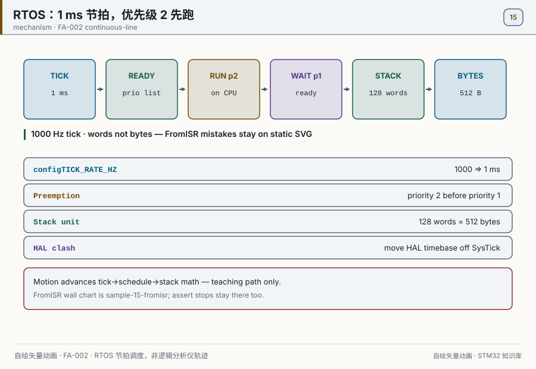
  <br><sub>▲ Hand-drawn CSS animation (FA-002). Tick→ready→prio2→128 words.</sub>
</p>


<p align="center">
  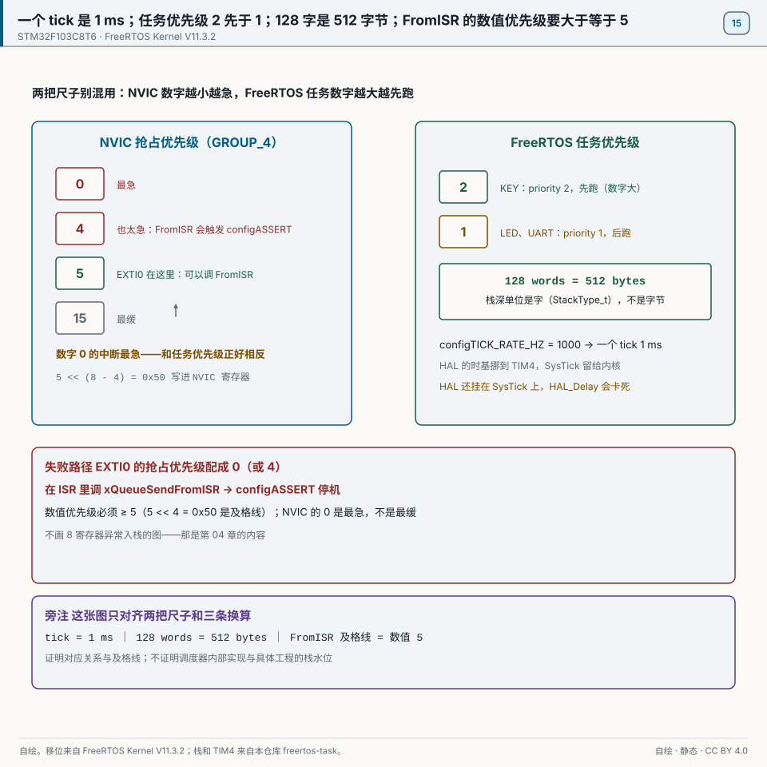
  <br><sub>▲ Drawn for this book. STM32F103C8T6. The upper half is the example running normally: SysTick in 1 ms steps, the HAL time base on TIM4, priority 2 running and priority 1 waiting, an LED stack of 128 words = 512 bytes, and EXTI0 at preemption priority 5. The lower half sets the EXTI0 preemption priority to 0: the first FromISR call inside the interrupt stops in configASSERT. Sources: [FreeRTOS Kernel V11.3.2](#source-freertos-syscall) and [freertos-task](#source-project-examples).</sub>
</p>

<p align="center">
  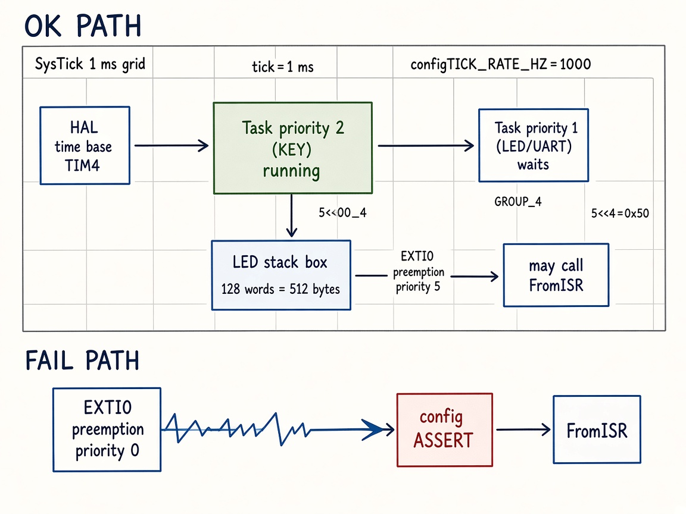
  <br><sub>▲ Knowledge track (Handraw · 原理示意 / not a photo). tick=1 ms; prio2 before prio1; 128 words=512 bytes; FromISR needs preempt priority ≥5; priority 0 hits configASSERT; not a photo.</sub>
</p>

<p align="center">
  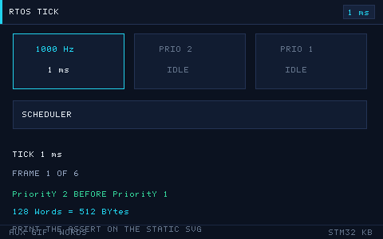
  <br><sub>▲ Animated version, showing only normal running: 1 ms steps, priority 2 running, priority 1 waiting, 128 words = 512 bytes. The printed book has only the static figure above.</sub>
</p>

## Timing and state

| Object | Value | Who goes first |
| --- | --- | --- |
| tick | 1000 Hz | 1 ms |
| Tasks | priority 2 and priority 1 | 2 before 1. The direction is the opposite of the NVIC |
| Stacks | 128 words = 512 bytes | KEY 192 words = 768 bytes. UART 256 words = 1024 bytes |
| Interrupt | number 5 may call FromISR | number 0 stops in `configASSERT`. `0x50 = 5 << 4` |
| Time base | the kernel uses SysTick | HAL uses TIM4 |
| Delay | 3 ms of work, then `vTaskDelay(10)` | The period is near 13 ms. `vTaskDelayUntil` advances planned wakes by 10 ms; actual execution can jitter |

## Pitfalls and sources

| What you see | Why | What to do | Source | What the source shows |
| --- | --- | --- | --- | --- |
| `HAL_Delay` sticks, or the scheduler does not start | HAL and the kernel both want SysTick | Move the HAL time base to TIM4 | [examples in this repo](#source-project-examples) | The `examples/freertos-task` README names TIM4 as the time base |
| The interrupt stops in `configASSERT` | The preemption number is smaller than 5 | Write `EXTI0` as 5 or a larger number | [FreeRTOS](#source-freertos-syscall) | With 4 priority bits, 5 shifted left by 4 is `0x50`. A numerically smaller interrupt must not call FromISR |
| A priority 1 task runs over a priority 2 task | Task priority was treated like the NVIC | A numerically larger task priority runs first | [FreeRTOS](#source-freertos-syscall) | A numerically larger task priority runs first |
| KEY does not run ahead of LED in the example | Both tasks were given the same priority | Write KEY as 2, and LED and UART as 1 | [examples in this repo](#source-project-examples) | In `examples/freertos-task`, KEY's task priority is 2 and LED and UART are 1 |
| HardFault after printing | Stack margin may be low, or a pointer or another fault may be involved | Check word/byte units, the stack watermark, and fault registers | [examples in this repo](#source-project-examples) | LED 128 words = 512 bytes, KEY 192 words = 768 bytes, UART 256 words = 1024 bytes |
| The key interrupt asserts as soon as it is entered | The EXTI preemption priority is too urgent | Write the `EXTI0` preemption priority as 5 | [examples in this repo](#source-project-examples) | The example sets the `EXTI0` preemption priority to 5 |
| Two tasks interleave on the UART | Protection does not cover the complete send, or a path bypasses it | Check every send entry; hold a mutex for the full transaction | [FreeRTOS](#source-freertos-syscall) | A binary semaphore can serialize access, but lacks mutex ownership and priority inheritance |
| The period grows | `vTaskDelay(10)` does not include the time already spent before the call | Use `vTaskDelayUntil` for a fixed period | [FreeRTOS](#source-freertos-syscall) | When one tick is 1 ms, time already spent before the call is not inside `vTaskDelay` |

## Learning goals

- [ ] Explain the difference between "bare-metal foreground/background" and "an RTOS with several tasks," and decide whether a project should use an RTOS.
- [ ] Know the five task states (ready / running / blocked / suspended / deleted) and what moves a task between them.
- [ ] Understand the SysTick tick and preemptive scheduling, and the conflict with the HAL timebase and how to fix it.
- [ ] Choose an IPC object: compare queues, semaphores, mutexes, event groups, and task notifications.
- [ ] Estimate a task's stack, and understand priority inversion and priority inheritance.
- [ ] Tell heap_1 through heap_5 apart, and remember that an interrupt may only call FromISR APIs.

## Core ideas

FreeRTOS provides scheduling and synchronization; it does not guarantee deadlines by itself. Task priority, blocking, and worst-case execution time must be measured together, and average CPU use cannot replace worst-case response.

### 1. Bare-metal foreground/background vs an RTOS

Bare metal is "a main loop plus interrupts" (foreground/background). The more tasks you have, and the tighter the timing, the harder it is to maintain. An RTOS makes concurrency explicit with **tasks plus a scheduler**. The cost is a little RAM and a little CPU.

| Dimension | Bare-metal foreground/background | FreeRTOS, several tasks |
| --- | --- | --- |
| Shape | A `while(1)` main loop plus interrupts | Several independent tasks, each written on its own |
| Concurrency | You split it by hand with a state machine and flags | The scheduler switches for you |
| Blocking | Only a busy wait or a delay, which occupies the CPU | `vTaskDelay` or a blocking wait on a queue, which does not occupy the CPU |
| Real time | Interrupt priority; a long task slows the response | A higher-priority task can preempt |
| RAM cost | Tiny | A stack and a TCB per task, plus the kernel, starting at a few KB |
| Fits | One job, and the part is tight on resources | Several peripherals at once, a protocol stack, complicated logic |

> The test: **when the main loop contains several things that each want to run on their own rhythm, it is time to consider an RTOS.** Blinking an LED and reading a UART is still fine on bare metal.

### 2. Task state transitions


<p align="center">
  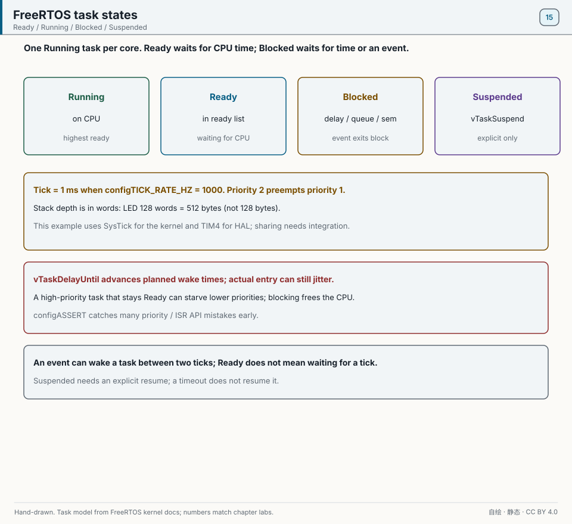
  <br><sub>▲ Author-drawn task states. Ready waits for the CPU; Blocked waits for an event or timeout; Suspended needs an explicit resume. An event wake need not wait for a tick.</sub>
</p>

<p align="center">
  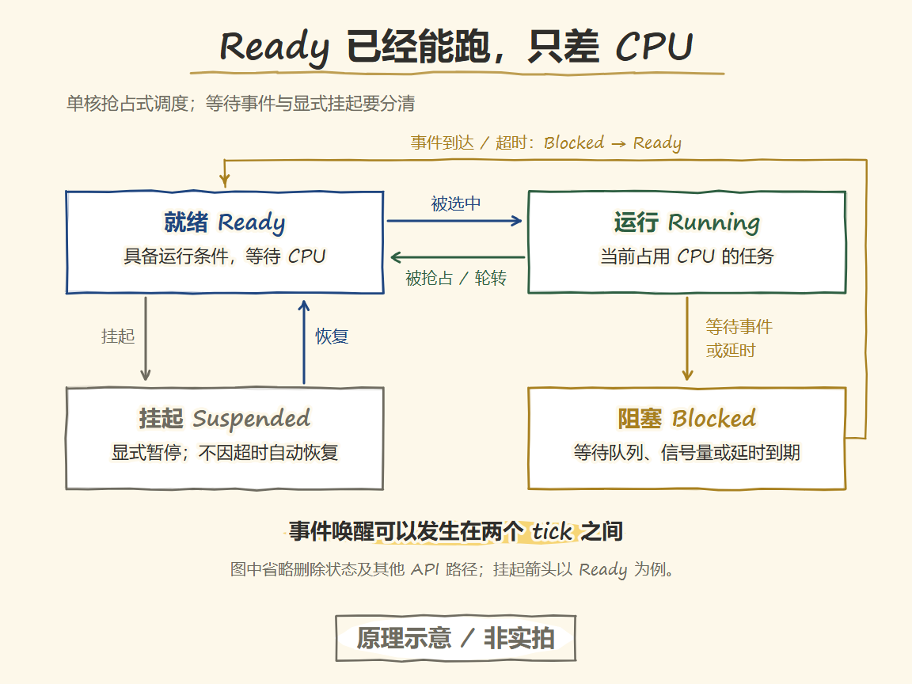
  <br><sub>▲ One task runs at a time on this single core. Ready has everything it needs except CPU time; Blocked waits for time or an event; Suspended waits for an explicit resume. Hand-drawn explanation, not a measured trace.</sub>
</p>


A task moves among running, ready, blocked, suspended, and deleted. **A higher-priority task becoming ready can preempt a lower-priority task. Equal-priority tasks rotate when time slicing is enabled, and `taskYIELD` can yield voluntarily.** Blocking waits without occupying the CPU and gives lower-priority tasks a chance to run. A task that stays ready can starve lower-priority tasks; with time slicing disabled, it can also starve equal-priority tasks.

| State | Meaning | How you enter | How you leave |
| --- | --- | --- | --- |
| Running | It owns the CPU | The scheduler selects it | Preempted, blocked, or suspended |
| Ready | It can run, and it is waiting for the CPU | Created, a delay expires, or an event arrives | The scheduler selects it |
| Blocked | Waiting for time or for an event | `vTaskDelay`, `xQueueReceive`, and similar | Timeout, or the event arrives |
| Suspended | Paused on purpose | `vTaskSuspend` | `vTaskResume` |
| Deleted | Removed | `vTaskDelete` | — |

```text
                    vTaskResume
   ┌──────────────► Ready ◄─────────────────┐
   │                  │ scheduler selects    │ event arrives / timeout
   │  vTaskSuspend    │                      │
   ▼                  ▼                      │
Suspended          Running ──────────────► Blocked
                      │ block (delay / wait  │
                      │ on a queue)          │
                      └──────────────────────┘
```

### 3. SysTick and the scheduler (the fight with HAL over the timebase)

The ARM_CM3 port normally uses **SysTick** for the kernel tick, configured here as 1 ms. HAL also defaults to SysTick; this example moves HAL to TIM4, giving each counter its own handler and making faults easier to isolate. To share SysTick, check the handler, frequency, and behavior before and after scheduler startup.

| Conflict | What you see | Fix |
| --- | --- | --- |
| FreeRTOS and HAL both want SysTick | `HAL_Delay` hangs, and the tick misbehaves | In CubeMX: SYS → Timebase Source, change it to **TIM4** |
| Tick rate | This example sets `configTICK_RATE_HZ` to 1000 (1 ms) | A higher rate gives finer tick timing and more interrupt overhead; frequency alone does not guarantee real-time response |
| Time slicing | Tasks at the same priority share the CPU | `configUSE_TIME_SLICING=1` (on by default) |

### 4. Priority and preemption

In FreeRTOS, **a larger number is a higher priority** (the opposite of a Cortex-M interrupt). With `configUSE_PREEMPTION=1`, a higher-priority task that becomes ready preempts the current task immediately.

STM32F103C8T6 is a Cortex-M3 and has no FPU. Pick the `ARM_CM3` port layer. The `ARM_CM4F` port still builds, but the scheduler lands in HardFault as soon as it starts, because an M3 does not know the floating-point instructions.

| Item | Rule |
| --- | --- |
| Priority range | `0` through `configMAX_PRIORITIES-1`. 0 is the lowest (the idle task) |
| Preemption | A higher-priority task becomes ready → switch immediately (preemptive) |
| Time slice | Tasks at the same priority rotate on the tick |
| Idle task | Priority 0, created by the system, and you can hook it |
| Versus interrupt priority | On an interrupt, a smaller number is higher priority (Cortex-M). That is the opposite direction from task priority |

### 5. Critical sections and interrupt priority

<p align="center">
  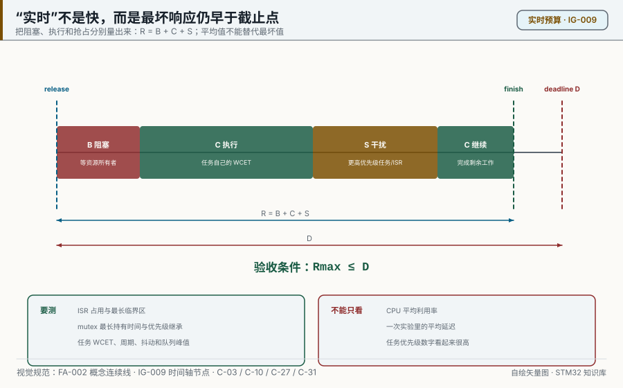
  <br><sub>▲ Real-time budget: `R = B + C + S`; acceptance asks whether worst-case `Rmax` finishes before the deadline. The figure does not replace measurement. Record ISR time, mutex hold time, task execution, and queue peak (FA-002 · IG-009 · C-03/C-10/C-27/C-31).</sub>
</p>

<p align="center">
  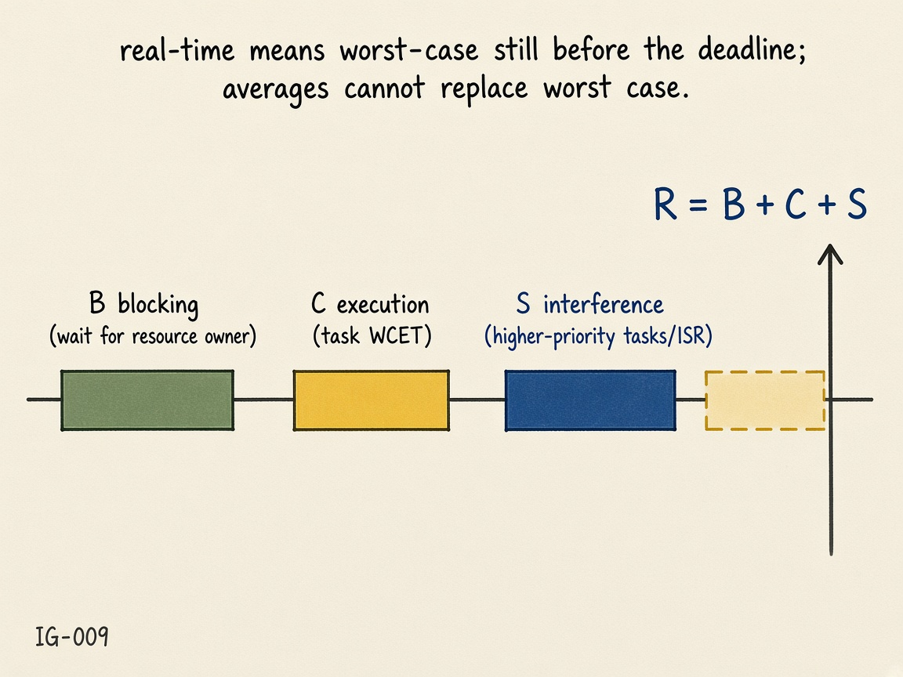
  <br><sub>▲ Knowledge track (Handraw · 原理示意 / not a photo). R=B+C+S; blocking + execution + higher-priority interference; worst case must finish before the deadline; averages cannot replace worst case; not a photo.</sub>
</p>

In the ARM_CM3 port, `taskENTER_CRITICAL()` / `taskEXIT_CRITICAL()` use BASEPRI to mask some interrupts. This configuration masks configurable priorities 5–15, leaving 0–4 able to interrupt; those interrupts must not call FreeRTOS APIs. The unshifted priority 5 passed to NVIC interfaces corresponds to `0x50` in the register. Compare priorities in the same representation; do not compare 5 directly with the shifted `configMAX_SYSCALL_INTERRUPT_PRIORITY` value `0x50`.

| Macro | What it does |
| --- | --- |
| `taskENTER_CRITICAL()` / `taskEXIT_CRITICAL()` | A task-level critical section. It can nest |
| `taskENTER_CRITICAL_FROM_ISR()` | Saves the previous mask; restore it with the matching exit API |
| `configMAX_SYSCALL_INTERRUPT_PRIORITY` | Shifted BASEPRI threshold; here `0x50` corresponds to NVIC priority 5 |
| `configKERNEL_INTERRUPT_PRIORITY` | The priority of the kernel's own interrupts (PendSV / SysTick) |

> [!WARNING]
> If execution stops in an interrupt-priority `configASSERT`, check the active IRQ's priority and priority grouping. With 4 priority bits and a threshold of `5 << (8-4) = 0x50`, an IRQ calling FromISR needs a numeric priority ≥ 5. With assertions disabled, or without a validation path, the same mistake may instead corrupt data.

### 6. Comparing the IPC options

A **queue** carries data. A **semaphore** synchronizes or counts. A **mutex** protects a shared resource. An **event group** waits on several conditions. A **task notification** is the lightweight point-to-point option. Pick the wrong one and you will write a bug that is hard to find.

<p align="center">
  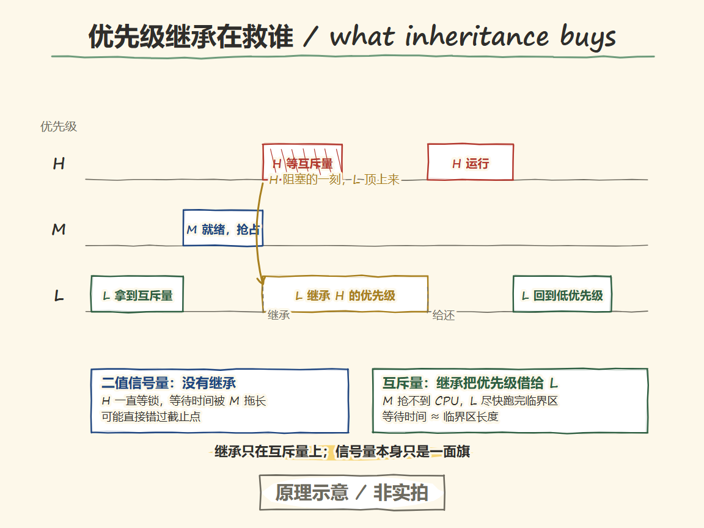
  <br><sub>▲ M preempts L while L holds the mutex. When H requests that mutex and blocks, L inherits H's priority and runs ahead of M. L releases, H takes the mutex, and L's priority drops back. Dashed frames show waiting; solid bars show execution, aligned to the same events. Inheritance removes M's interference; ISRs and higher-priority tasks can still extend the wait. A hand-drawn, single-core example with three tasks and one mutex, not a measured trace. Mutexes have no FromISR interface. See [FreeRTOS kernel docs](#source-freertos-syscall).</sub>
</p>

| Mechanism | Use | Can it carry data? | Cost | Interrupt-safe API |
| --- | --- | --- | --- | --- |
| Queue | Pass data between tasks or from an interrupt | Yes, any length | Medium | `xQueueSendFromISR` |
| Binary semaphore | Synchronize on an event (ISR → task) | No | Small | `xSemaphoreGiveFromISR` |
| Counting semaphore | Count a resource, or accumulate events | No | Small | `xSemaphoreGiveFromISR` |
| Mutex | Protect a shared resource (includes priority inheritance) | No | Medium | Cannot be used from an ISR |
| Recursive mutex | The same task may take it more than once | No | Medium | Cannot be used from an ISR |
| Event group | Wait for several events (AND / OR) | Bit flags only | Small | `xEventGroupSetBitsFromISR` |
| Task notification | Lightweight point-to-point sync, or pass a value | Yes, a 32-bit value | **Smallest** | `xTaskNotifyFromISR` |

Choose the object by asking whether data moves, a resource needs ownership, or several conditions must be joined. Use a queue for data, a mutex for a resource, and a task notification for a simple point-to-point event.

### 7. Estimating task stack size

The stack argument to `xTaskCreate` is in **words (4 bytes)**, not bytes. A stack that is too small overflows into another task or into the heap, and it shows up as a random HardFault.

| How to estimate | What it means |
| --- | --- |
| Start from experience | 128 words for a simple task; 256 to 512 words if it uses printf or floating point |
| Measure the watermark | `uxTaskGetStackHighWaterMark()` reports the smallest number of free words ever seen |
| Large local arrays | A big array inside a function sits on the stack. Prefer `static` or global |
| Interrupts and switching | The first hardware exception frame uses the task's PSP; ISR functions and nested exceptions use MSP. Budget both stacks |
| Overflow detection | `configCHECK_FOR_STACK_OVERFLOW=2`, and implement `vApplicationStackOverflowHook` |

```c
/* Runtime view of remaining stack (unit: words); if it nears 0, make the stack bigger */
UBaseType_t free_words = uxTaskGetStackHighWaterMark(xTask);
```

<p align="center">
  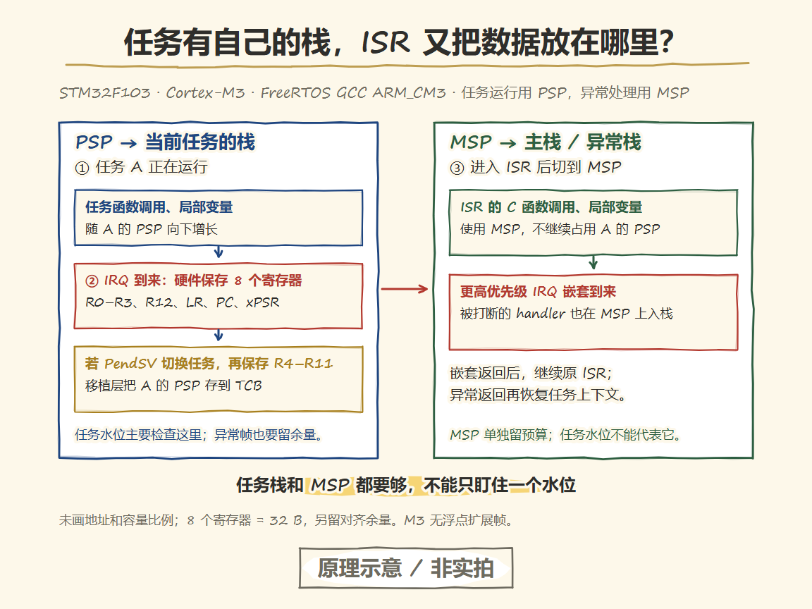
  <br><sub>▲ The left column follows task A's PSP; the right is the shared exception MSP. When an IRQ interrupts the task, hardware first saves R0–R3, R12, LR, PC, and xPSR on A's stack, then the ISR uses MSP. A PendSV switch also saves R4–R11 and writes PSP into the TCB. Eight registers take 32 B, with alignment margin also required. A task watermark does not measure MSP headroom. Hand-drawn explanation, not to address or capacity scale; based on [PM0056](#source-pm0056-nvic) and the [FreeRTOS ARM_CM3 port](#source-freertos-syscall).</sub>
</p>

### 8. Priority inversion and priority inheritance

In the figure, high-priority H waits for a mutex held by low-priority L, while medium-priority M preempts L. This is priority inversion. The mutex lets L inherit H's priority temporarily, keeping M from delaying L further. It neither guarantees a short wait nor resolves deadlock automatically.

| Idea | What you see | What to do |
| --- | --- | --- |
| Priority inversion | A high task waits for a resource a low task holds, and a medium task runs ahead of both | Use a **mutex**, not a binary semaphore |
| Priority inheritance | The low task temporarily inherits the high task's priority, so it can release sooner | A FreeRTOS mutex does this automatically |
| Deadlock | Two tasks each hold one lock and wait for the other | Always lock in the same order, and use a timeout: `xSemaphoreTake(..., timeout)` |

> A binary semaphore can signal events or serialize access, but has neither ownership nor priority inheritance. For a resource shared by tasks, normally choose `xSemaphoreCreateMutex()` and hold it for the entire protected operation.

<p align="center">
  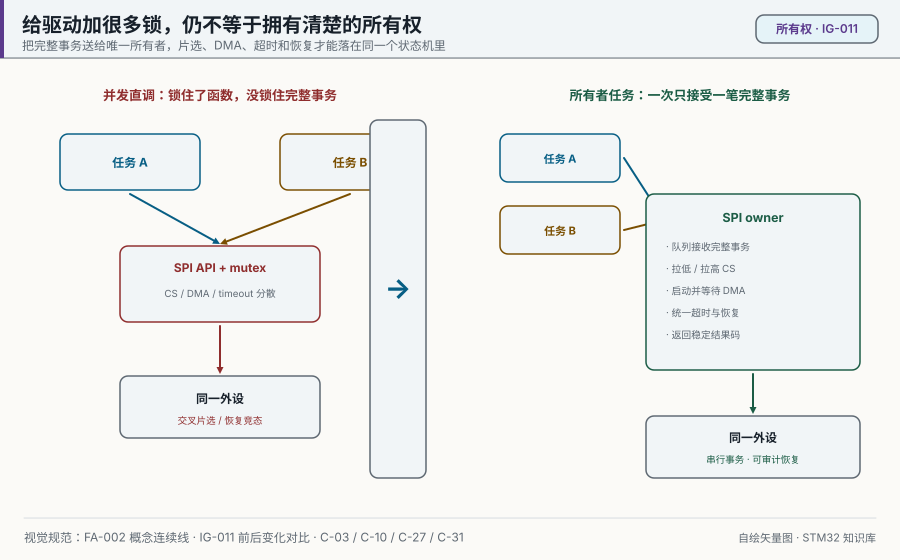
  <br><sub>▲ A mutex can span several function calls. For asynchronous DMA, protection must last until transfer completion or recovery finishes. Alternatively, one owner task can accept queued requests and manage chip select, DMA, timeout, and recovery together. Measure queue peak and longest response (FA-002 · IG-011 · C-03/C-10/C-27/C-31).</sub>
</p>

<p align="center">
  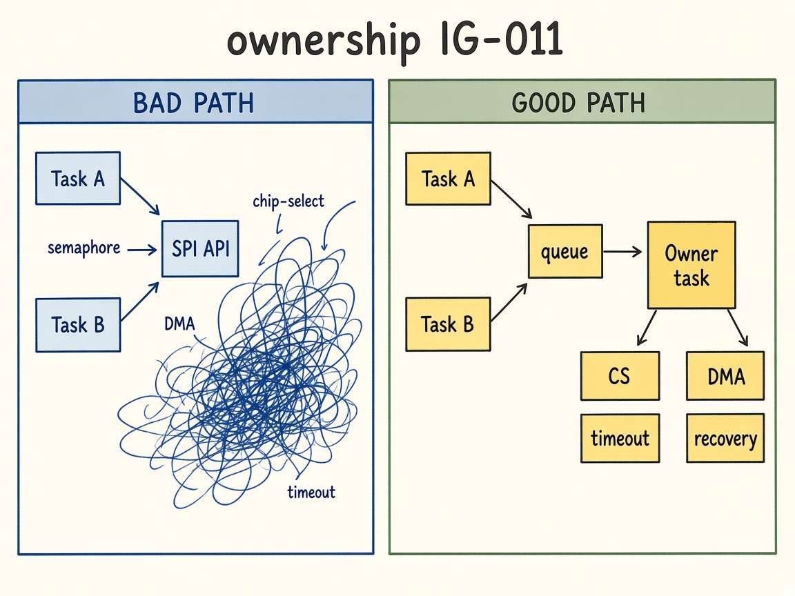
  <br><sub>▲ Knowledge track (Handraw · 原理示意 / not a photo). Tasks queue complete transactions to one owner; chip-select, DMA, timeout, and recovery stay in one state machine; not a photo.</sub>
</p>

### 9. heap_1 through heap_5

FreeRTOS ships five heap implementations. Which one you use depends on `configTOTAL_HEAP_SIZE` and on whether you need to free. **heap_4 is the one beginners use most.**

| Implementation | Supports free | Fragmentation | Notes |
| --- | --- | --- | --- |
| heap_1 | No | None | Simplest. Allocate only, never free. Fine when the set of tasks never changes |
| heap_2 | Yes | Severe | Can free, but does not coalesce. No longer recommended |
| heap_3 | Yes | Depends on malloc | A wrapper around the C library `malloc` / `free`. Needs to be thread-safe |
| heap_4 | Yes | Good (adjacent blocks coalesce) | **The usual choice.** Can free, and merges free blocks |
| heap_5 | Yes | Good | Same as heap_4, and it supports **several non-contiguous memory regions** |

```c
/* Change the heap size in CubeMX: FreeRTOS → TOTAL_HEAP_SIZE (bytes) */
#define configTOTAL_HEAP_SIZE   ( ( size_t ) ( 10240 ) )
```

### 10. In an interrupt you may only call FromISR APIs


<p align="center">
  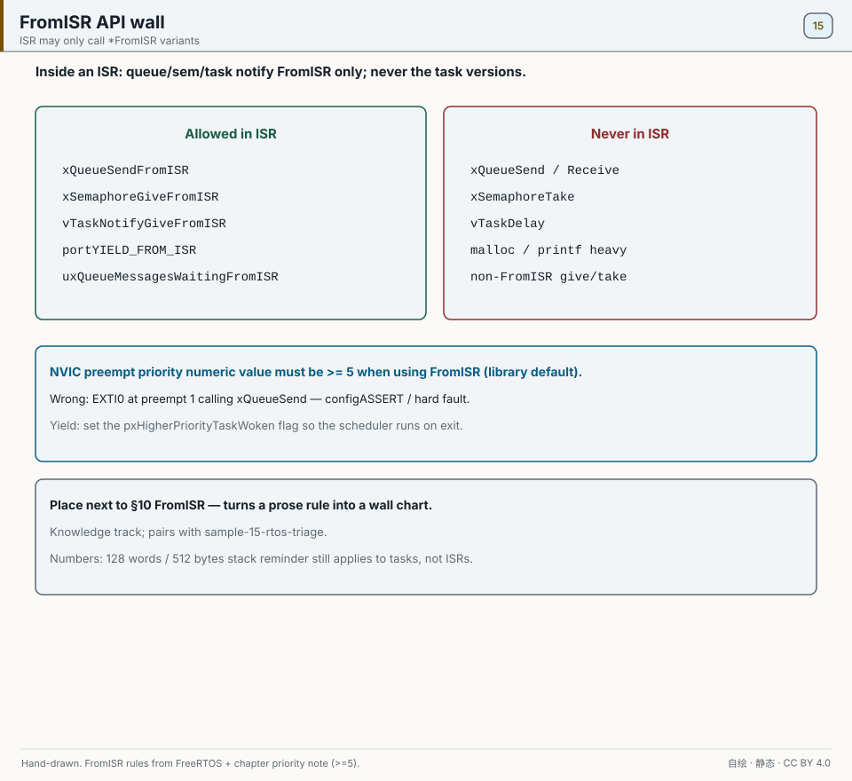
  <br><sub>▲ Drawn for this book. Task-context queue/sem APIs are banned inside ISRs.</sub>
</p>

<p align="center">
  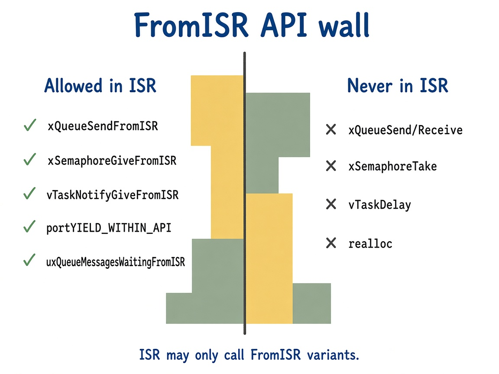
  <br><sub>▲ Knowledge track (Handraw · 原理示意 / not a photo). ISR may only call *FromISR; never xQueueSend/vTaskDelay/malloc; preempt priority numeric ≥5; not a photo.</sub>
</p>


**An interrupt service routine must never call an ordinary API that can block** (for example `xQueueSend`). Use the `xxxFromISR` version, and use `portYIELD_FROM_ISR` to decide whether to switch immediately.

| Ordinary API (from a task) | Interrupt API (from an ISR) |
| --- | --- |
| `xQueueSend` | `xQueueSendFromISR` |
| `xQueueReceive` | `xQueueReceiveFromISR` |
| `xSemaphoreGive` | `xSemaphoreGiveFromISR` |
| `xEventGroupSetBits` | `xEventGroupSetBitsFromISR` |
| `xTaskNotify` | `xTaskNotifyFromISR` |

```c
void HAL_GPIO_EXTI_Callback(uint16_t pin)
{
    BaseType_t woken = pdFALSE;
    uint8_t evt = 1;
    xQueueSendFromISR(g_key_queue, &evt, &woken);  /* interrupt-safe */
    portYIELD_FROM_ISR(woken);                     /* switch immediately if needed */
}
```


<p align="center">
  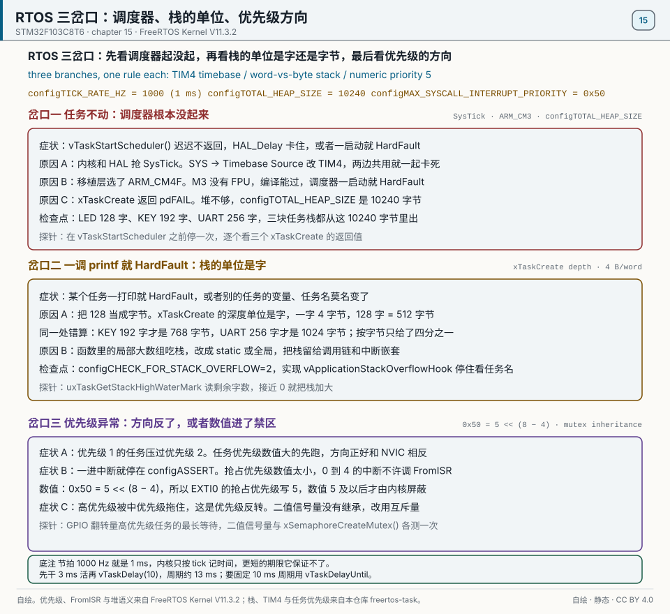
  <br><sub>▲ Choose a column by the symptom. A task never runs: check creation results and timebases. HardFault after printing: check stack units and the watermark. An assertion inside an interrupt: check the FromISR priority boundary. Each central cell is 4 B; the 32 dark cells provide only a quarter of the intended 128 cells. The numeric priority threshold ≥5 applies to this configuration. The heap budget below has yet to deduct TCBs, queues, kernel allocations and other overhead. The timing comparison shows about 13 ms with relative delay versus a 10 ms target with absolute delay, omitting tick phase and scheduling jitter. Drawn diagram, based on [FreeRTOS Kernel V11.3.2](#source-freertos-syscall) and [freertos-task](#source-project-examples).</sub>
</p>

## Hardware and wiring

| Board | Peripheral | Pin | Notes |
| --- | --- | --- | --- |
| BluePill (F103) | LED | PC13 | Already on the board, active low |
| BluePill | Key | PA0 | One side to PA0, the other to GND, falling-edge interrupt |
| BluePill | USB-TTL | PA9 / PA10 | Cross the TX/RX wires and share ground, 115200 |
| Nucleo-F411RE | On-board | PA5 (LD2), PC13 (B1) | Nothing to wire |

> The full example in this repo is [`examples/freertos-task/`](../../examples/freertos-task/) (three tasks, a queue, a mutex, and FromISR). Its `README.md` has the CubeMX settings, item by item.

## Code

Below is a minimal working skeleton: an LED blink, a key interrupt into a queue into a key task, and a UART task protected by a mutex. The full project is [`examples/freertos-task/main.c`](../../examples/freertos-task/main.c).

**① Create the objects and the tasks, then start the scheduler**

```c
#include "stm32f1xx_hal.h"
#include "FreeRTOS.h"
#include "task.h"
#include "queue.h"
#include "semphr.h"

static QueueHandle_t     g_key_queue  = NULL;   /* carries key events */
static SemaphoreHandle_t g_uart_mutex = NULL;   /* protects the UART */

int main(void)
{
    HAL_Init();
    SystemClock_Config();
    bsp_init();

    g_key_queue  = xQueueCreate(8, sizeof(uint8_t));       /* queue depth 8 */
    g_uart_mutex = xSemaphoreCreateMutex();                /* mutex */
    if (!g_key_queue || !g_uart_mutex) { error_handler(); } /* heap too small */

    xTaskCreate(vLedTask,  "LED",  128, NULL, 1, NULL);
    xTaskCreate(vKeyTask,  "KEY",  192, NULL, 2, NULL);    /* higher priority */
    xTaskCreate(vUartTask, "UART", 256, NULL, 1, NULL);

    vTaskStartScheduler();          /* does not return after this */
    for (;;) { }
}
```

**② Send the event from the interrupt with FromISR**

```c
void HAL_GPIO_EXTI_Callback(uint16_t GPIO_Pin)
{
    if (GPIO_Pin == KEY_PIN)
    {
        uint8_t key_id = 1;
        BaseType_t woken = pdFALSE;
        xQueueSendFromISR(g_key_queue, &key_id, &woken);
        portYIELD_FROM_ISR(woken);
    }
}
```

**③ The task blocks on the queue (and does not occupy the CPU)**

```c
static void vKeyTask(void *argument)
{
    uint8_t key_id;
    (void)argument;
    for (;;)
    {
        /* When the queue is empty the task is blocked; it wakes when an event arrives */
        if (xQueueReceive(g_key_queue, &key_id, portMAX_DELAY) == pdTRUE)
        {
            uart_print("KEY pressed\r\n");
        }
    }
}
```

**④ A mutex protects the shared UART**

```c
static void uart_print(const char *s)
{
    if (xSemaphoreTake(g_uart_mutex, pdMS_TO_TICKS(100)) == pdTRUE)
    {
        HAL_UART_Transmit(&huart1, (uint8_t *)s, strlen(s), 100);
        xSemaphoreGive(g_uart_mutex);   /* you must give it back when you are done */
    }
}
```

**⑤ The stack-overflow hook (a great way to catch the bug)**

```c
void vApplicationStackOverflowHook(TaskHandle_t xTask, char *pcTaskName)
{
    (void)xTask; (void)pcTaskName;
    __disable_irq();
    for (;;) { }                        /* stop the breakpoint here and see which task overflowed */
}
```

> **CubeMX settings for this example**: change `SYS → Timebase Source` from **SysTick to TIM4**. Keeping SysTick requires integrating the HAL and kernel timebases; replacing just one handler is insufficient.

## Hands-on labs

1. **Period evidence:** Run two tasks at 500 ms and 200 ms with `vTaskDelayUntil`, toggling a GPIO at entry. Capture 100 periods and record minimum, maximum, and average intervals.
2. **Queue and FromISR:** Send incrementing sequence numbers from the button ISR and check continuity in the task. Drive the queue full and record peak depth, drops, and immediate switches caused by `woken`.
3. **Mutex and inversion:** Use three tasks to create priority inversion. Compare a binary semaphore with a mutex and measure the high-priority task's longest wait on GPIO traces.
4. **Stack evidence:** Reduce one task's stack in steps, record `uxTaskGetStackHighWaterMark`, and finally trigger the overflow hook in a controlled build while preserving the task name.

<p align="center">
  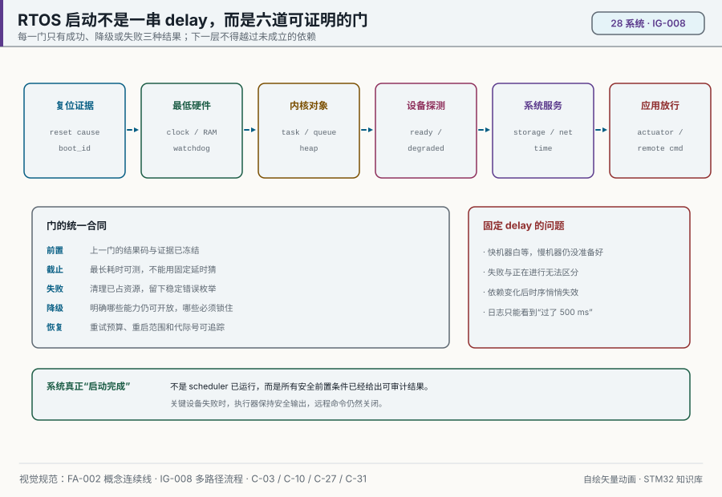
  <br><sub>▲ A scheduler that started does not mean the system is ready. Each gate returns success, degraded operation, or failure; actuators and remote commands remain disabled while critical devices are unavailable (FA-002 · IG-008 · C-03/C-10/C-27/C-31).</sub>
</p>

### 11. Relative delay, absolute period, and software timers

`vTaskDelay(n)` waits n ticks from **this call**, so the task's work adds to the period. `vTaskDelayUntil` advances the previous planned wake time instead. With the 10 ms target below, actual entry still depends on interrupts, scheduling, and whether the work overruns.

```c
TickType_t last = xTaskGetTickCount();
for (;;)
{
    do_work();                                   /* time spent here is not added on as period error */
    vTaskDelayUntil(&last, pdMS_TO_TICKS(10));   /* wake every 10 ms */
}
```

Create a software timer with `xTimerCreate`. The callback runs in the timer service task. Inside it you must not call `vTaskDelay` again, and you must not take a mutex that someone else might already hold. A larger priority number runs first, which is the opposite of NVIC, where a smaller number is more urgent. At any moment only one task owns the CPU.

Before leaving this chapter, keep 100-period jitter data, queue peak and drop counts, longest waits before and after the mutex, and every task's stack high-water mark.

Self-test:

1. A task works for 3 ms and then calls `vTaskDelay(10)`. Is the real period closer to 10 ms or to 13 ms?
2. If a software-timer callback calls `vTaskDelay`, who gets stuck?
3. A priority-3 task and a priority-1 task are both ready. Which one does FreeRTOS run first?

## Related resources

- The official FreeRTOS documentation, and *Mastering the FreeRTOS Real Time Kernel* (the chapters on tasks, queues, semaphores, and scheduling).
- RM0008, *STM32F10xxx Reference Manual*: SysTick (the Cortex-M3 system timebase), NVIC and EXTI (Chapter 9), and USART (Chapter 27).
- Example in this repo: [`examples/freertos-task/`](../../examples/freertos-task/) (CubeMX settings and the full `main.c`).
- Related chapters: [Chapter 04](04-interrupts-nvic.md), Interrupts and NVIC, and [Chapter 17](17-debug.md), Debugging and performance (DWT timing).
- Figure: `../../assets/animations/freertos-scheduler.svg` (vector drawing by the author).
