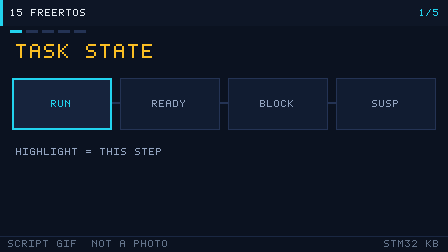

# 15 Getting Started with FreeRTOS
> 中文：[15 FreeRTOS 入门](../15-FreeRTOS入门.md)

> FreeRTOS splits "one big loop" into several tasks that run concurrently. Queues and semaphores carry data between them, so timing and logic in a complex project stop stepping on each other.

<p align="center">
  
  <br><sub>▲ Animation: FreeRTOS task-state transitions and preemptive scheduling (vector animation drawn by the author, not a live recording)</sub>
</p>

<!-- video:ch15 -->
<p align="center">
  
  <br><sub>▲ Lecture slides for this chapter: a generated GIF (tools/gen_videos.py, reproducible, not a live recording). The narration lines up with the five frames, one to one.</sub>
</p>

**Narration (read along with the frames, about one minute)**

1. A task has only a few states: running, ready, blocked, and suspended. The scheduler picks the highest-priority task that is ready.
2. A semaphore is a notification. A queue moves data. A mutex means "I am holding this, do not touch it." Do not pick the wrong object.
3. Delay means "wait a bit longer." DelayUntil means "wake at this next time." A periodic task uses the second one.
4. A timer callback must not sleep, and it must not wait on a queue. That time belongs to the other tasks.
5. Self-test: two tasks share a priority. What happens when the time slice runs out?
<!-- /video:ch15 -->


## 📌 Learning goals

- [ ] Explain the difference between "bare-metal foreground/background" and "an RTOS with several tasks," and decide whether a project should use an RTOS.
- [ ] Know the five task states (ready / running / blocked / suspended / deleted) and what moves a task between them.
- [ ] Understand the SysTick tick and preemptive scheduling, and the conflict with the HAL timebase and how to fix it.
- [ ] Choose an IPC object: compare queues, semaphores, mutexes, event groups, and task notifications.
- [ ] Estimate a task's stack, and understand priority inversion and priority inheritance.
- [ ] Tell heap_1 through heap_5 apart, and remember that an interrupt may only call FromISR APIs.

## 🧠 Core ideas

### 1. Bare-metal foreground/background vs an RTOS

**Conclusion**: Bare metal is "a main loop plus interrupts" (foreground/background). The more tasks you have, and the tighter the timing, the harder it is to maintain. An RTOS makes concurrency explicit with **tasks plus a scheduler**. The cost is a little RAM and a little CPU.

| Dimension | Bare-metal foreground/background | FreeRTOS, several tasks |
| --- | --- | --- |
| Shape | A `while(1)` main loop plus interrupts | Several independent tasks, each written on its own |
| Concurrency | You split it by hand with a state machine and flags | The scheduler switches for you |
| Blocking | Only a busy wait or a delay, which occupies the CPU | `vTaskDelay` or a blocking wait on a queue, which does not occupy the CPU |
| Real time | Interrupt priority; a long task slows the response | A higher-priority task can preempt |
| RAM cost | Tiny | A stack and a TCB per task, plus the kernel, starting at a few KB |
| Fits | One job, and the part is tight on resources | Several peripherals at once, a protocol stack, complicated logic |

> The test: **when the main loop contains several things that each want to run on their own rhythm, it is time to consider an RTOS.** Blinking an LED and reading a UART is still fine on bare metal.

### 2. Task state transitions

**Conclusion**: A task moves among running, ready, blocked, suspended, and deleted. **The CPU is given to someone else only when a task is blocked or suspended**, so every task needs a blocking point.

| State | Meaning | How you enter | How you leave |
| --- | --- | --- | --- |
| Running | It owns the CPU | The scheduler selects it | Preempted, blocked, or suspended |
| Ready | It can run, and it is waiting for the CPU | Created, a delay expires, or an event arrives | The scheduler selects it |
| Blocked | Waiting for time or for an event | `vTaskDelay`, `xQueueReceive`, and similar | Timeout, or the event arrives |
| Suspended | Paused on purpose | `vTaskSuspend` | `vTaskResume` |
| Deleted | Removed | `vTaskDelete` | — |

```text
                    vTaskResume
   ┌──────────────► Ready ◄─────────────────┐
   │                  │ scheduler selects    │ event arrives / timeout
   │  vTaskSuspend    │                      │
   ▼                  ▼                      │
Suspended          Running ──────────────► Blocked
                      │ block (delay / wait  │
                      │ on a queue)          │
                      └──────────────────────┘
```

### 3. SysTick and the scheduler (the fight with HAL over the timebase)

**Conclusion**: FreeRTOS uses **SysTick** by default to produce a 1 ms tick (`configTICK_RATE_HZ`). HAL also uses SysTick for `HAL_Delay`. **They cannot share it.** When you bring up the RTOS, move the HAL timebase to another timer.

| Conflict | What you see | Fix |
| --- | --- | --- |
| FreeRTOS and HAL both want SysTick | `HAL_Delay` hangs, and the tick misbehaves | In CubeMX: SYS → Timebase Source, change it to **TIMx** |
| Tick rate | `configTICK_RATE_HZ` defaults to 1000 (1 ms) | A shorter slice is more responsive and costs more |
| Time slicing | Tasks at the same priority share the CPU | `configUSE_TIME_SLICING=1` (on by default) |

### 4. Priority and preemption

**Conclusion**: In FreeRTOS, **a larger number is a higher priority** (the opposite of a Cortex-M interrupt). With `configUSE_PREEMPTION=1`, a higher-priority task that becomes ready preempts the current task immediately.

| Item | Rule |
| --- | --- |
| Priority range | `0` through `configMAX_PRIORITIES-1`. 0 is the lowest (the idle task) |
| Preemption | A higher-priority task becomes ready → switch immediately (preemptive) |
| Time slice | Tasks at the same priority rotate on the tick |
| Idle task | Priority 0, created by the system, and you can hook it |
| Versus interrupt priority | On an interrupt, a smaller number is higher priority (Cortex-M). That is the opposite direction from task priority |

### 5. Critical sections and interrupt priority

**Conclusion**: A critical section uses `taskENTER_CRITICAL()` / `taskEXIT_CRITICAL()` to mask interrupts and protect shared data. **Any interrupt that calls an `xxxFromISR` API must have a priority number ≥ `configMAX_SYSCALL_INTERRUPT_PRIORITY`.**

| Macro | What it does |
| --- | --- |
| `taskENTER_CRITICAL()` / `taskEXIT_CRITICAL()` | A task-level critical section. It can nest |
| `taskENTER_CRITICAL_FROM_ISR()` | An interrupt-level critical section |
| `configMAX_SYSCALL_INTERRUPT_PRIORITY` | The lowest priority number that is still allowed to call a FreeRTOS API (a larger number is a lower priority) |
| `configKERNEL_INTERRUPT_PRIORITY` | The priority of the kernel's own interrupts (PendSV / SysTick) |

> ⚠️ The common `configASSERT` dead loop means **the interrupt priority number was set too small (the priority was too high)** and it crossed the range `configMAX_SYSCALL_INTERRUPT_PRIORITY` allows. On STM32, with 4 priority bits, that macro is often `5 << (8-4) = 0x50`, which means the interrupt priority number must be ≥ 5.

### 6. Comparing the IPC options

**Conclusion**: A **queue** carries data. A **semaphore** synchronizes or counts. A **mutex** protects a shared resource. An **event group** waits on several conditions. A **task notification** is the lightweight point-to-point option. Pick the wrong one and you will write a bug that is hard to find.

| Mechanism | Use | Can it carry data? | Cost | Interrupt-safe API |
| --- | --- | --- | --- | --- |
| Queue | Pass data between tasks or from an interrupt | ✅ any length | Medium | `xQueueSendFromISR` |
| Binary semaphore | Synchronize on an event (ISR → task) | ❌ | Small | `xSemaphoreGiveFromISR` |
| Counting semaphore | Count a resource, or accumulate events | ❌ | Small | `xSemaphoreGiveFromISR` |
| Mutex | Protect a shared resource (includes priority inheritance) | ❌ | Medium | ⚠️ cannot be used from an ISR |
| Recursive mutex | The same task may take it more than once | ❌ | Medium | ⚠️ cannot be used from an ISR |
| Event group | Wait for several events (AND / OR) | ❌ (bit flags) | Small | `xEventGroupSetBitsFromISR` |
| Task notification | Lightweight point-to-point sync, or pass a value | ✅ (a 32-bit value) | **Smallest** | `xTaskNotifyFromISR` |

**Motto: a semaphore says "it happened," a queue says "carry this over," a mutex says "I am holding it, do not touch it," an event group says "wait until they are all here," and a task notification says "if this is enough, do not create an object."**

### 7. Estimating task stack size

**Conclusion**: The stack argument to `xTaskCreate` is in **words (4 bytes)**, not bytes. A stack that is too small overflows into another task or into the heap, and it shows up as a random HardFault.

| How to estimate | What it means |
| --- | --- |
| Start from experience | 128 words for a simple task; 256 to 512 words if it uses printf or floating point |
| Measure the watermark | `uxTaskGetStackHighWaterMark()` reports the smallest number of free words ever seen |
| Large local arrays | A big array inside a function sits on the stack. Prefer `static` or global |
| Nested interrupts | An ISR uses the current task's stack, so leave room for the interrupt |
| Overflow detection | `configCHECK_FOR_STACK_OVERFLOW=2`, and implement `vApplicationStackOverflowHook` |

```c
/* Runtime view of remaining stack (unit: words); if it nears 0, make the stack bigger */
UBaseType_t free_words = uxTaskGetStackHighWaterMark(xTask);
```

### 8. Priority inversion and priority inheritance

**Conclusion**: **Priority inversion** is a high-priority task being held up, indirectly, by a low-priority task. A FreeRTOS **mutex** has **priority inheritance** built in, which squeezes that window down to a very short time.

| Idea | What you see | What to do |
| --- | --- | --- |
| Priority inversion | A high task waits for a resource a low task holds, and a medium task runs ahead of both | Use a **mutex**, not a binary semaphore |
| Priority inheritance | The low task temporarily inherits the high task's priority, so it can release sooner | A FreeRTOS mutex does this automatically |
| Deadlock | Two tasks each hold one lock and wait for the other | Always lock in the same order, and use a timeout: `xSemaphoreTake(..., timeout)` |

> A binary semaphore does **not** have priority inheritance. It is only for "an event happened." To protect a resource, use `xSemaphoreCreateMutex()`.

### 9. heap_1 through heap_5

**Conclusion**: FreeRTOS ships five heap implementations. Which one you use depends on `configTOTAL_HEAP_SIZE` and on whether you need to free. **heap_4 is the one beginners use most.**

| Implementation | Supports free | Fragmentation | Notes |
| --- | --- | --- | --- |
| heap_1 | ❌ | None | Simplest. Allocate only, never free. Fine when the set of tasks never changes |
| heap_2 | ✅ | Severe | Can free, but does not coalesce. No longer recommended |
| heap_3 | ✅ | Depends on malloc | A wrapper around the C library `malloc` / `free`. Needs to be thread-safe |
| heap_4 | ✅ | Good (adjacent blocks coalesce) | **The usual choice.** Can free, and merges free blocks |
| heap_5 | ✅ | Good | Same as heap_4, and it supports **several non-contiguous memory regions** |

```c
/* Change the heap size in CubeMX: FreeRTOS → TOTAL_HEAP_SIZE (bytes) */
#define configTOTAL_HEAP_SIZE   ( ( size_t ) ( 10240 ) )
```

### 10. In an interrupt you may only call FromISR APIs

**Conclusion**: **An interrupt service routine must never call an ordinary API that can block** (for example `xQueueSend`). Use the `xxxFromISR` version, and use `portYIELD_FROM_ISR` to decide whether to switch immediately.

| Ordinary API (from a task) | Interrupt API (from an ISR) |
| --- | --- |
| `xQueueSend` | `xQueueSendFromISR` |
| `xQueueReceive` | `xQueueReceiveFromISR` |
| `xSemaphoreGive` | `xSemaphoreGiveFromISR` |
| `xEventGroupSetBits` | `xEventGroupSetBitsFromISR` |
| `xTaskNotify` | `xTaskNotifyFromISR` |

```c
void HAL_GPIO_EXTI_Callback(uint16_t pin)
{
    BaseType_t woken = pdFALSE;
    uint8_t evt = 1;
    xQueueSendFromISR(g_key_queue, &evt, &woken);  /* interrupt-safe */
    portYIELD_FROM_ISR(woken);                     /* switch immediately if needed */
}
```

## 🛠️ Hardware and wiring

| Board | Peripheral | Pin | Notes |
| --- | --- | --- | --- |
| BluePill (F103) | LED | PC13 | Already on the board, active low |
| BluePill | Key | PA0 | One side to PA0, the other to GND, falling-edge interrupt |
| BluePill | USB-TTL | PA9 / PA10 | Cross the TX/RX wires and share ground, 115200 |
| Nucleo-F411RE | On-board | PA5 (LD2), PC13 (B1) | Nothing to wire |

> The full example in this repo is [`examples/freertos-task/`](../../examples/freertos-task/) (three tasks, a queue, a mutex, and FromISR). Its `README.md` has the CubeMX settings, item by item.

## 💻 Code

Below is a minimal working skeleton: an LED blink, a key interrupt into a queue into a key task, and a UART task protected by a mutex. The full project is [`examples/freertos-task/main.c`](../../examples/freertos-task/main.c).

**① Create the objects and the tasks, then start the scheduler**

```c
#include "stm32f1xx_hal.h"
#include "FreeRTOS.h"
#include "task.h"
#include "queue.h"
#include "semphr.h"

static QueueHandle_t     g_key_queue  = NULL;   /* carries key events */
static SemaphoreHandle_t g_uart_mutex = NULL;   /* protects the UART */

int main(void)
{
    HAL_Init();
    SystemClock_Config();
    bsp_init();

    g_key_queue  = xQueueCreate(8, sizeof(uint8_t));       /* queue depth 8 */
    g_uart_mutex = xSemaphoreCreateMutex();                /* mutex */
    if (!g_key_queue || !g_uart_mutex) { error_handler(); } /* heap too small */

    xTaskCreate(vLedTask,  "LED",  128, NULL, 1, NULL);
    xTaskCreate(vKeyTask,  "KEY",  192, NULL, 2, NULL);    /* higher priority */
    xTaskCreate(vUartTask, "UART", 256, NULL, 1, NULL);

    vTaskStartScheduler();          /* does not return after this */
    for (;;) { }
}
```

**② Send the event from the interrupt with FromISR**

```c
void HAL_GPIO_EXTI_Callback(uint16_t GPIO_Pin)
{
    if (GPIO_Pin == KEY_PIN)
    {
        uint8_t key_id = 1;
        BaseType_t woken = pdFALSE;
        xQueueSendFromISR(g_key_queue, &key_id, &woken);
        portYIELD_FROM_ISR(woken);
    }
}
```

**③ The task blocks on the queue (and does not occupy the CPU)**

```c
static void vKeyTask(void *argument)
{
    uint8_t key_id;
    (void)argument;
    for (;;)
    {
        /* When the queue is empty the task is blocked; it wakes when an event arrives */
        if (xQueueReceive(g_key_queue, &key_id, portMAX_DELAY) == pdTRUE)
        {
            uart_print("KEY pressed\r\n");
        }
    }
}
```

**④ A mutex protects the shared UART**

```c
static void uart_print(const char *s)
{
    if (xSemaphoreTake(g_uart_mutex, pdMS_TO_TICKS(100)) == pdTRUE)
    {
        HAL_UART_Transmit(&huart1, (uint8_t *)s, strlen(s), 100);
        xSemaphoreGive(g_uart_mutex);   /* you must give it back when you are done */
    }
}
```

**⑤ The stack-overflow hook (a great way to catch the bug)**

```c
void vApplicationStackOverflowHook(TaskHandle_t xTask, char *pcTaskName)
{
    (void)xTask; (void)pcTaskName;
    __disable_irq();
    for (;;) { }                        /* stop the breakpoint here and see which task overflowed */
}
```

> **The single most important CubeMX step**: change `SYS → Timebase Source` from **SysTick to TIMx**. Otherwise HAL and FreeRTOS fight over SysTick, and `HAL_Delay` hangs.

## ⚠️ Pitfalls and troubleshooting

| What you see | Cause | Fix |
| --- | --- | --- |
| It stalls before `vTaskStartScheduler` | The HAL timebase and the RTOS both want SysTick | Change Timebase Source to TIMx |
| `configASSERT` dead loop | The interrupt priority number is too small (priority too high) | Interrupt priority ≥ `configMAX_SYSCALL_INTERRUPT_PRIORITY` |
| Task creation fails | The heap is too small | Increase `configTOTAL_HEAP_SIZE` |
| UART output is interleaved | Several tasks write the UART at once | Protect it with a mutex |
| A random HardFault | A task stack overflowed | Enlarge the stack and watch `uxTaskGetStackHighWaterMark` |
| A crash inside an interrupt | A non-FromISR API was used | Inside an interrupt, only `xxxFromISR` |
| One task never runs | Its priority is so low it starves, or it has no blocking point | Check the priority, and make sure the task has a blocking call |
| Key events are lost | The queue filled and new items were dropped | Deepen the queue, or use a task notification |
| `HAL_Delay` hangs | The timebase is still SysTick | Move the timebase to TIMx |
| A floating-point task computes the wrong result | FPU context save is not enabled | Use the port that includes the FPU |

## 🧪 Hands-on labs

1. **Two tasks, two blink rates (start here)**: create two tasks that toggle two LEDs at 500 ms and 200 ms. Expected: each LED blinks on its own rhythm, and they do not disturb each other.
2. **A queue carries a key press (next step)**: the key EXTI sends an event with `xQueueSendFromISR`. The task blocks in `xQueueReceive` and prints. Expected: while the queue is empty the task does not occupy the CPU, and a key press prints immediately.
3. **With and without a mutex**: two tasks both print a long string on the UART. First with no mutex (the output interleaves), then with a mutex (the output is whole). Expected: you can see the protection directly.
4. **(Further) Reproduce a stack overflow**: give a task a 64-word stack and put a 200-byte local array in a function, so `vApplicationStackOverflowHook` runs. Expected: the hook is called, and you learn how to size a stack.
5. **(Further) Priority inversion**: protect a resource with a binary semaphore and create an inversion, then switch to a mutex and compare the wait. Expected: the mutex inheritance shortens the high task's wait by a lot.

### 11. Relative delay, absolute period, and software timers

**Conclusion**: `vTaskDelay(n)` waits n ticks from **this call**. Time the task spends doing its own work stretches the period further and further. For a fixed period, use `vTaskDelayUntil`.

```c
TickType_t last = xTaskGetTickCount();
for (;;)
{
    do_work();                                   /* time spent here is not added on as period error */
    vTaskDelayUntil(&last, pdMS_TO_TICKS(10));   /* wake every 10 ms */
}
```

Create a software timer with `xTimerCreate`. The callback runs in the timer service task. Inside it you must not call `vTaskDelay` again, and you must not take a mutex that someone else might already hold. A larger priority number runs first, which is the opposite of NVIC, where a smaller number is more urgent. At any moment only one task owns the CPU.

Motto: **Delay means "wait a bit longer." DelayUntil means "wake at this next time." A timer callback must not go to sleep.**

Self-test:

1. A task works for 3 ms and then calls `vTaskDelay(10)`. Is the real period closer to 10 ms or to 13 ms?
2. If a software-timer callback calls `vTaskDelay`, who gets stuck?
3. A priority-3 task and a priority-1 task are both ready. Which one does FreeRTOS run first?

## 🔗 Related resources

- The official FreeRTOS documentation, and *Mastering the FreeRTOS Real Time Kernel* (the chapters on tasks, queues, semaphores, and scheduling).
- RM0008, *STM32F10xxx Reference Manual*: SysTick (the Cortex-M3 system timebase), NVIC and EXTI (Chapter 9), and USART (Chapter 27).
- Example in this repo: [`examples/freertos-task/`](../../examples/freertos-task/) (CubeMX settings and the full `main.c`).
- Related chapters: [Chapter 04](04-interrupts-nvic.md), Interrupts and NVIC, and [Chapter 17](17-debug.md), Debugging and performance (DWT timing).
- Figure: `../../assets/animations/freertos-scheduler.svg` (vector drawing by the author).
