# 16 Low-Power Design
> 中文：[16 低功耗设计](../16-低功耗设计.md)

> A datasheet value of 14 µA does not mean a BluePill will measure 14 µA. Board leakage, the debugger, wake peaks, and active time belong in one current waveform and average-current account.

<p align="center">
  
  <br><sub>▲ Three wake paths. Moving dots show execution order, not elapsed time. Stop's normal return and Standby's reset startup follow separate paths. Drawn vector animation, not a measurement.</sub>
</p>

<!-- video:ch16 -->
<p align="center">
  <video width="640" controls poster="../../assets/video/ch16-lp.png">
    <source src="../../assets/video/ch16-lp.mp4" type="video/mp4">
  </video>
  <br><sub>▲ Chapter video with Chinese voice-over (2.8 min). <a href="../../assets/video/ch16-lp.mp4">MP4</a> · <a href="../../assets/video/ch16-lp.srt">subtitles</a></sub>
</p>

<details>
<summary>Narration script (Chinese, same text as the subtitles)</summary>

1. Sleep 只是 CPU 停了，不少外设还在耗电。Stop 会停掉大部分时钟，才算真的睡。Standby 更接近掉电，醒来像复位。先分清你要的是哪一种。
2. 从 Stop 醒来，PLL 通常已经停了，系统时钟回到默认。第一件事是把时钟按你的配置再装回去。不装就去用串口和定时器，波特率和节拍全是错的。
3. 可编程电压检测是掉电通知，不是备用电池。电压跌到门槛时，你还有很短的时间把关键数据写进备份域或闪存。不要等它真的掉下去再保存。
4. 这一帧是仓库画的唤醒路径。引脚或 RTC 可以把你叫起来。叫起来不等于世界还是睡前那样。时钟、引脚的复用，该恢复的要在进业务之前恢复。
5. 调试器接着的时候，芯片往往睡不深，电流也不诚实。测睡眠电流要拔掉调试器，卸掉亮着的灯。手册封面上的微安是芯片的典型值，不是你这块板子的读数。
6. 进低功耗之前，不用的外设时钟关掉，不用的脚不要浮空。浮空的脚会在中间电平上来回，漏电比你省下来的还多。模拟输入常常是睡眠前比较安静的一种模式。
7. 唤醒源要在睡着之前武装好。用按键就配置好边沿和中断，用 RTC 就设好闹钟。醒来把标志清掉，不然你刚睡下又会被同一面旗叫起来。
8. 三档深浅要分清：掉电检测只是一条通知；Sleep 还在让外设耗电；Stop 才真的睡。Stop 醒来第一件事，是把时钟装回去。
9. 实验在进 Stop 之前用串口打一句，按键唤醒后再打一句。第二句的波特率如果乱了，就是时钟没装回去。不要先用万用表追求微安。
10. 手册封面的微安是芯片典型值：板上的 LDO、LED 会抬高整板电流，串口和调试器也会吃掉你的睡眠。数字要对上条件再比。

</details>
<!-- /video:ch16 -->
## Principle and scope

Start with an experiment that needs no microamp meter: wake from Stop and send one correctly timed UART frame.

In this book's 72 MHz project, configure PA0 for falling-edge EXTI wake. Toggle one spare GPIO at the wake ISR entry, toggle another after `SystemClock_Config()` completes, then send `0x55` through USART1. Connect a logic analyzer to PA0, both markers, and TX. At 115200 bit/s, one bit should last about 8.68 µs. If BRR remains `0x271` while the clock stays on the 8 MHz HSI, the bit lasts 78.125 µs: 12800 bit/s.

The interval from the PA0 edge to the first GPIO marker includes interrupt entry and software delay. It is not the datasheet's 5.4 µs measurement. The second marker separates the clock-restoration stage. Once the order and bit width are right, connect the current instrument and capture a full sleep, wake, and sampling period.

The working point is Stop on STM32F103C8T6 with the regulator in low-power mode, which is `PWR_LOWPOWERREGULATOR_ON`. Every current below is a DS5319 Rev 20 Table 16 typical at 3.3 V and 25°C. Each number belongs to one cell of that table, and cells with different conditions do not mix. See [DS5319 Table 16](#source-ds5319-pwr).

Low-power regulator, oscillators off, independent watchdog off: 14 µA. Main regulator still on, same other conditions: 24 µA. 20 µA is not a Table 16 cell. The 85°C values 200 µA and 180 µA are maximums, not typicals. 1.4 µA is `IDD_VBAT` for the backup domain with LSE and the RTC on. It is not the whole-chip Standby current.

Standby has three cells. 2 µA belongs only to the cell with LSI, IWDG, LSE, and RTC all off. LSI on is 3.2 µA. LSI and IWDG both on is 3.4 µA. Once started, the IWDG cannot be stopped and keeps counting in Stop and Standby (chapter 11). The 14 µA cell assumes the independent watchdog is off, so you cannot quote 14 µA with the IWDG running. Table 16 gives no Stop-plus-IWDG figure; measure it with a current meter if you need it. See [RM0008 watchdog](#source-rm0008-wdg).

Sleep at 72 MHz is 14.4 mA typical with every peripheral on, and 5.5 mA typical with every peripheral off, still at 25°C and 3.3 V.

After Stop exits, the system clock is the 8 MHz HSI, not 16 MHz and not 72 MHz. See [RM0008 clocks](#source-rm0008-rcc). Table 26's 5.4 µs is the low-power-regulator cell, from the wake event to the first user instruction, still on that 8 MHz clock. The main-regulator cell is 3.6 µs. Sleep is 1.8 µs and keeps the clock from before the sleep. Standby goes through reset startup, reaching the first instruction after 50 µs. The PLL lock maximum is 200 µs. Do not add it to 5.4 µs and call the sum the wake-up time.

PPRE2 is not divided on this book's clock tree. Before `SystemClock_Config()`, the USART1 kernel clock is 8 MHz. If BRR is still `0x271`, its raw integer value is 625. With 16-times oversampling, it decodes to `USARTDIV = 39.0625`, so `8e6 / (16 × 39.0625) = 12800`. A host that is still at 115200 is off by a factor of 9. The fix is to restore the PLL to 72 MHz after waking and before the next byte; the line is then 115200 again. See [RM0008 USART](#source-rm0008-usart). The frame format is the one from chapter 06.

Sleep keeps the clock from before the sleep. The tick in `examples/freertos-task` is 1000 Hz, which is 1 ms. Left at that rate, Sleep wakes every 1 ms. SysTick does not tick during Stop. See [examples in this repo](#source-project-examples).

Standby (`SLEEPDEEP=1`, `PDDS=1`) loses ordinary SRAM and registers and restarts through the reset vector. `PWR_CSR.SBF` identifies a previous Standby entry. Exit sources include WKUP, the RTC alarm, NRST, and an IWDG reset. WKUP is a rising edge on pin 10 PA0. A falling EXTI can wake Stop; it is not Standby's WKUP. See [DS5319 pin 10](#source-ds5319-adc). Chapter 03 connects a 270 Ω LED load to this pin and chapter 09 uses it as ADC12_IN0. For this chapter's lab, connect only the wake-up key.

<p align="center">
  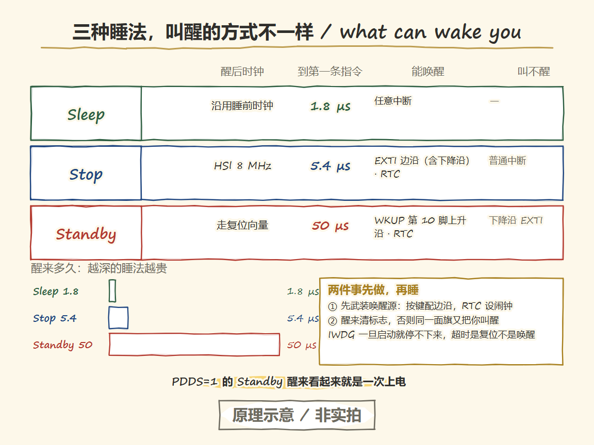
  <br><sub>▲ Sleep keeps its clock, Stop resumes on HSI 8 MHz, and Standby restarts from the reset vector. An IWDG timeout is a reset, not a normal return from Stop. Hand-drawn mechanism, not a measurement. Times: [DS5319 Rev 20 Table 26](#source-ds5319-pwr); RTC routing: [RM0008 Rev 21](#source-rm0008-rtc).</sub>
</p>

The F103 has no F4-style periodic wake-up timer. For a timed wake, use the chapter 11 RTC alarm: LSE at 32.768 kHz, PRL = 32767, a 1 Hz second counter. See [RM0008 RTC](#source-rm0008-rtc).

## Key figures


<p align="center">
  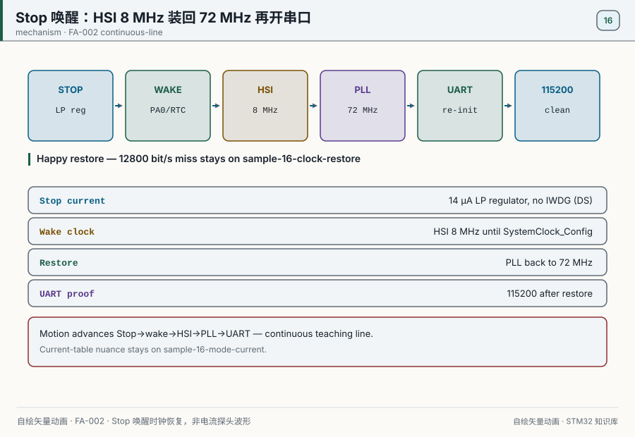
  <br><sub>▲ Hand-drawn CSS animation (FA-002). Stop→wake→HSI→PLL→115200.</sub>
</p>


<p align="center">
  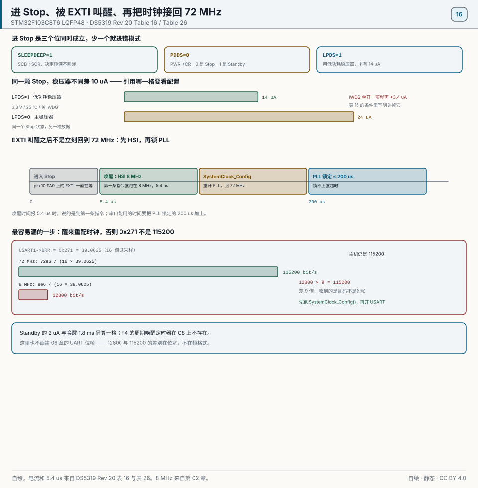
  <br><sub>▲ Drawn for this book. SLEEPDEEP and PDDS select the mode; LPDS selects the regulator. The typical 5.4 µs interval ends at the first instruction. Restoring 72 MHz also requires HSE startup, PLL lock, and software configuration. The bottom compares 115200 and 12800 bit/s with the same BRR, `0x271`. Conditions: [DS5319 Rev 20 Tables 16 and 26](#source-ds5319-pwr).</sub>
</p>

<p align="center">
  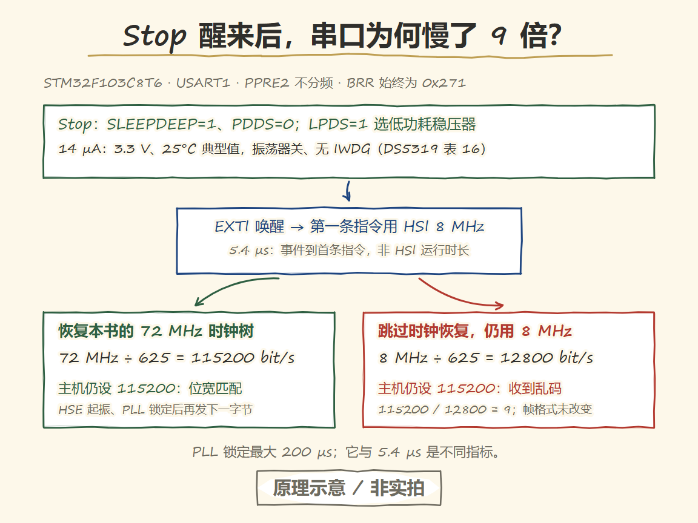
  <br><sub>▲ Two branches after wake: restoring 72 MHz gives 115200 with the original BRR; staying on HSI 8 MHz gives only 12800 bit/s. The 14 µA value also requires the low-power regulator, 3.3 V, 25°C, no IWDG, and the other stated conditions. Hand-drawn mechanism, not a measurement.</sub>
</p>

<p align="center">
  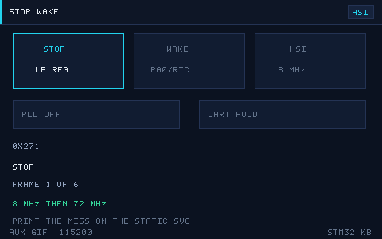
  <br><sub>▲ Animated version. It shows only the correct sequence: wake from Stop, go from 8 MHz back to 72 MHz, and mark 115200. The printed book has only the static figure above.</sub>
</p>

The opening `lowpower-wakeup.svg` animation shows the wake order of the modes. Take the numbers from the static figure above.

## Timing and state

| Step | Clock or current | Right or wrong |
| --- | --- | --- |
| Enter Stop, low-power regulator, no IWDG | 14 µA at 3.3 V and 25°C | right |
| Same mode with the main regulator on | 24 µA | not the 14 µA cell |
| Wake, low-power regulator | first instruction after 5.4 µs, HSI 8 MHz | right |
| Main-regulator wake | 3.6 µs | not 5.4 µs |
| Sleep | 1.8 µs, on the clock that was already running | right |
| Restore | USART1 is 115200 after the PLL is back at 72 MHz | right |
| No restore, `0x271` still loaded | 12800 at 8 MHz | wrong |
| Sleep, 72 MHz, peripherals on | 14.4 mA | right |
| Sleep, peripherals off | 5.5 mA | right |
| SysTick at 1000 Hz | wakes every 1 ms | true in Sleep, not during Stop |
| Standby, `PDDS=1` | restart from the reset vector; 50 µs to the first instruction | right |
| Standby current | 2 µA only with LSI, IWDG, LSE, and RTC off; LSI on is 3.2 µA; IWDG on as well is 3.4 µA | do not write 2 to 3 µA |
| Backup domain | 1.4 µA with LSE and the RTC on | not whole-chip Standby |
| Pin 10 PA0 | This chapter uses falling-edge EXTI for Stop; Standby uses rising-edge WKUP | No LED or ADC input on it meanwhile |

## Pitfalls and sources

| What you see | Why | What to do | Source | What the source shows |
| --- | --- | --- | --- | --- |
| The manual folds the two Stop cells into one range | Two cells were folded into one range | Write 14 µA for the low-power regulator and 24 µA for the main regulator | [DS5319](#source-ds5319-pwr) | Both cells are typicals at 3.3 V and 25°C, with the independent watchdog off. 20 µA is not a Table 16 cell |
| Standby is quoted as 2 to 3 µA | Three cells were folded into one range | Write 2 µA, 3.2 µA, or 3.4 µA according to LSI and IWDG | [DS5319](#source-ds5319-pwr) | The 2 µA cell requires LSI, IWDG, LSE, and RTC all off. 1.4 µA is the backup domain, not the whole chip |
| The first UART frame after wake is garbage | The clock is still HSI while BRR was computed for 72 MHz | Call `SystemClock_Config()` before the next byte | [RM0008 USART](#source-rm0008-usart) | With the HSI at 8 MHz and BRR still `0x271`, the baud rate is 12800. 115200 is the 72 MHz cell |
| A comment gives the HSI two frequencies | Another family's 16 MHz was written onto the F103 | Write 8 MHz on the F103 | [RM0008 clocks](#source-rm0008-rcc) | The F1 power-up HSI is 8 MHz. 16 MHz is the HSI of the F4 and others |
| Sleep current will not fall, and the comment says once per second | The tick was left at 1000 Hz | A wake can occur every 1 ms; bare-metal code can suspend the HAL tick, while an RTOS should use tickless idle | [examples in this repo](#source-project-examples) | `examples/freertos-task` uses a 1000 Hz tick. SysTick stops during Stop; check which source drives the HAL timebase and the scheduler |
| The F4 periodic wake API was called | The F103 does not have that timer | Use the chapter 11 RTC alarm | [RM0008 RTC](#source-rm0008-rtc) | Timed wake on the F103 is not that F4 API. PRL = 32767 is 1 Hz |
| 14 µA is quoted while the IWDG is on | That cell excludes the independent watchdog | Do not cover a running IWDG with 14 µA | [RM0008 watchdog](#source-rm0008-wdg) | The IWDG keeps counting in Stop and Standby. Table 16 has no Stop-plus-IWDG figure |
| A falling edge woke Stop, but Standby stays asleep | Standby's WKUP is a rising edge | Use a rising edge on pin 10 PA0 | [DS5319](#source-ds5319-adc) | Pin 10 is PA0-WKUP |

## Learning goals

- [ ] Use one table to state, for Sleep / Stop / Standby, the current, the wake sources, the wake time, and what state is kept.
- [ ] Know the difference between `WFI` and `WFE`, and what wakes each of them.
- [ ] Decide whether the post-Stop HSI meets the application needs, and restore this book's 72 MHz clock tree before reusing its peripheral settings.
- [ ] Turn off peripherals and clocks you are not using, and put GPIO into a state that does not draw current.
- [ ] Know the selection points for a battery supply, and how to measure the power.

## Core ideas

Low-power acceptance records the static floor, wake peak, active duration, period, and wake cause. One steady current number cannot predict runtime or reveal a UART left on the wrong clock after wake.


<p align="center">
  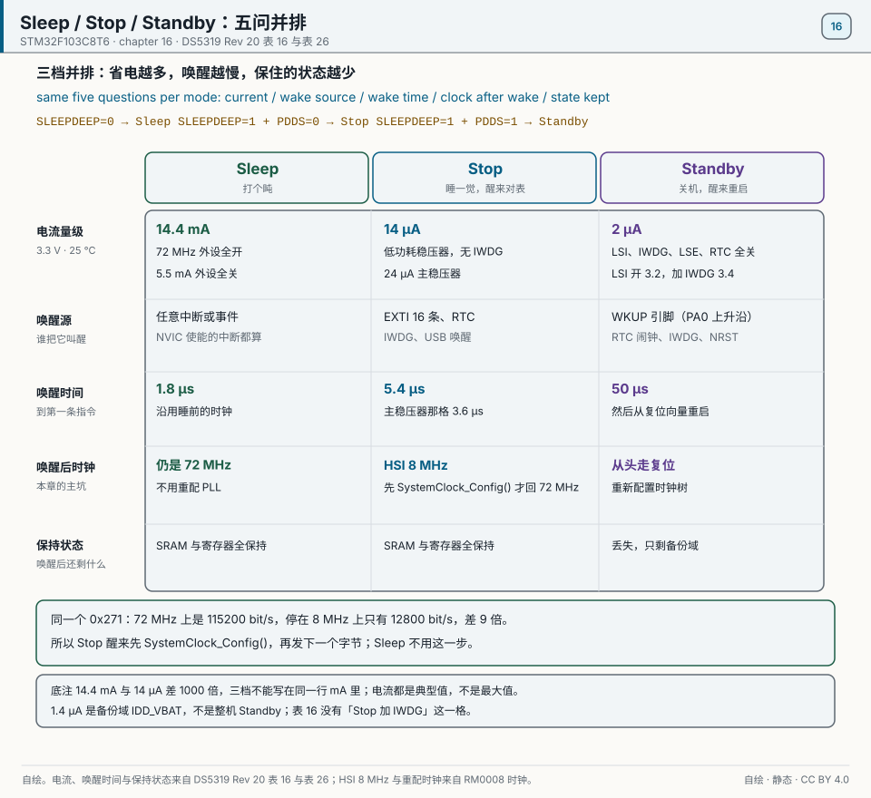
  <br><sub>▲ Drawn comparison table. The current row includes conditions: Sleep at 72 MHz with peripherals on or off, Stop with either regulator, and Standby with the stated LSI/IWDG settings. Wake sources and execution paths have separate rows, distinguishing IWDG reset from interrupt return. Sources: [DS5319 Rev 20 Tables 16 and 26](#source-ds5319-pwr) and [RM0008 clocks](#source-rm0008-rcc).</sub>
</p>

<p align="center">
  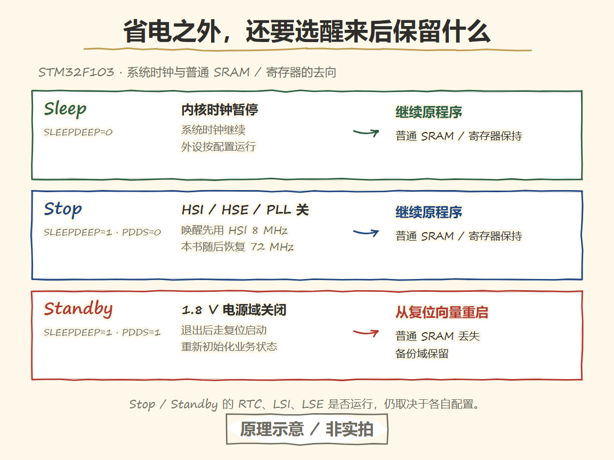
  <br><sub>▲ Choose a mode by the state the program needs to retain. Sleep keeps the clock; Stop keeps SRAM but resumes on HSI; Standby restarts. RTC, LSI, and LSE operation still depends on configuration. Hand-drawn mechanism, not a measurement.</sub>
</p>

### 1. The three low-power modes compared


<p align="center">
  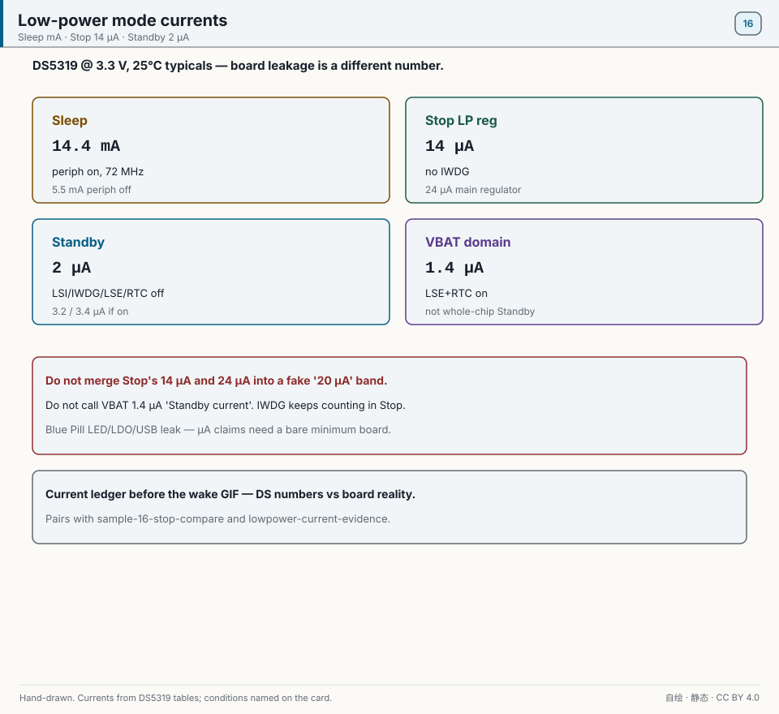
  <br><sub>▲ Drawn for this book. Do not merge 14/24 µA into 20; 1.4 µA is VBAT domain only.</sub>
</p>

<p align="center">
  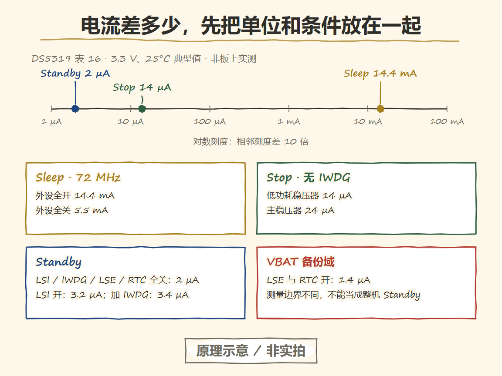
  <br><sub>▲ Knowledge track (Handraw · 原理示意 / not a photo). DS5319 @ 3.3 V, 25°C typicals; board leakage is a different number; not a photo.</sub>
</p>


Wake time increases across this chapter's three operating points. **Sleep and Stop retain ordinary SRAM and registers. Standby powers down the main domain, retaining mainly the backup domain and Standby circuitry.** Current values still need their clock and regulator conditions.

| Item | Sleep | Stop | Standby |
| --- | --- | --- | --- |
| Core | Stopped (clock off) | Stopped | Powered off |
| Typical current (F1 at 3.3 V, 25°C) | Peripherals on: 14.4 mA. Peripherals off: 5.5 mA | Low-power regulator: 14 µA. Main regulator: 24 µA. Both cells require the independent watchdog off | 2 µA only when LSI, IWDG, LSE, and RTC are all off. LSI on is 3.2 µA. LSI and IWDG on is 3.4 µA. 1.4 µA is the backup domain |
| Clocks | The system clock is still running | HSI / HSE / PLL off; only LSI / LSE | All off; only LSI / LSE |
| SRAM / registers | All kept | All kept | **Lost** (except the backup domain) |
| Wake or exit sources | WFI: interrupts meeting NVIC and priority conditions; WFE: events | EXTI interrupts or events; RTC alarm through EXTI17, USB wake through EXTI18. IWDG timeout and NRST take the reset path | WKUP rising edge, RTC alarm, IWDG reset, NRST; all restart through reset |
| Wake time | 1.8 µs, on the clock that was already running | Low-power regulator 5.4 µs, main regulator 3.6 µs, on the 8 MHz HSI. This does not include restoring the PLL to 72 MHz | Reset startup, reaching the first instruction after 50 µs |
| After wake | Usually handles the IRQ, then continues; a WFE event need not enter an ISR | Usually handles the IRQ, then continues; restore the clock as needed before application work | **Restarts from the reset vector** |
| Registers | `SLEEPDEEP=0` | `SLEEPDEEP=1`, `PDDS=0` | `SLEEPDEEP=1`, `PDDS=1` |

> Follow where execution goes: Sleep keeps the clock; Stop keeps state but resumes on HSI; Standby restarts. Some power domains still run in each mode, so Standby is not the same as removing board power.

### 2. WFI and WFE

The F103 here has one core. `WFI` (Wait For Interrupt) waits for a qualifying interrupt. `WFE` (Wait For Event) can also receive an event without entering an ISR. Both need a configured wake path; swapping the instruction alone is not enough.

| Instruction | Wake condition | Notes |
| --- | --- | --- |
| `__WFI()` | An NVIC-enabled interrupt meeting the current priority conditions, among other causes | Common path: wake, handle ISR, return and continue. PRIMASK can defer the ISR without necessarily preventing wake |
| `__WFE()` | The event register is set; if already 1, clear it and return immediately | F103 supports EXTI events; `SEVONPEND` can produce an event when an interrupt becomes pending |
| `__SEV()` | — | Software sends an event, paired with WFE |

In Stop, WFI requires an EXTI interrupt and its NVIC channel enabled; WFE requires EXTI event configuration. Before sleeping, handle stale flags according to the peripheral rules and recheck the condition, or sleep may end immediately. The event register records that an event occurred; it is not a counting queue. Arm wake rules also involve exception masks and current priority. Leaving the wait state does not always mean immediately running an interrupt handler.

```c
/* Enter Sleep: wait for any interrupt to wake */
__WFI();
```

### 3. Restoring the clock after STOP wakes


<p align="center">
  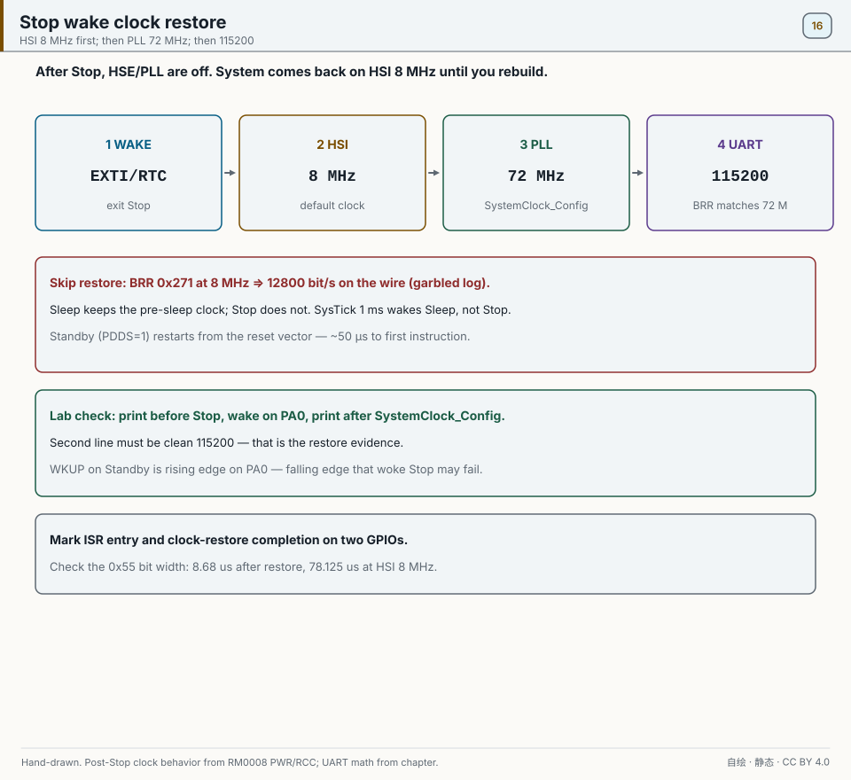
  <br><sub>▲ Drawn for this book. Without restore, BRR 0x271 at 8 MHz is 12800 bit/s.</sub>
</p>

<p align="center">
  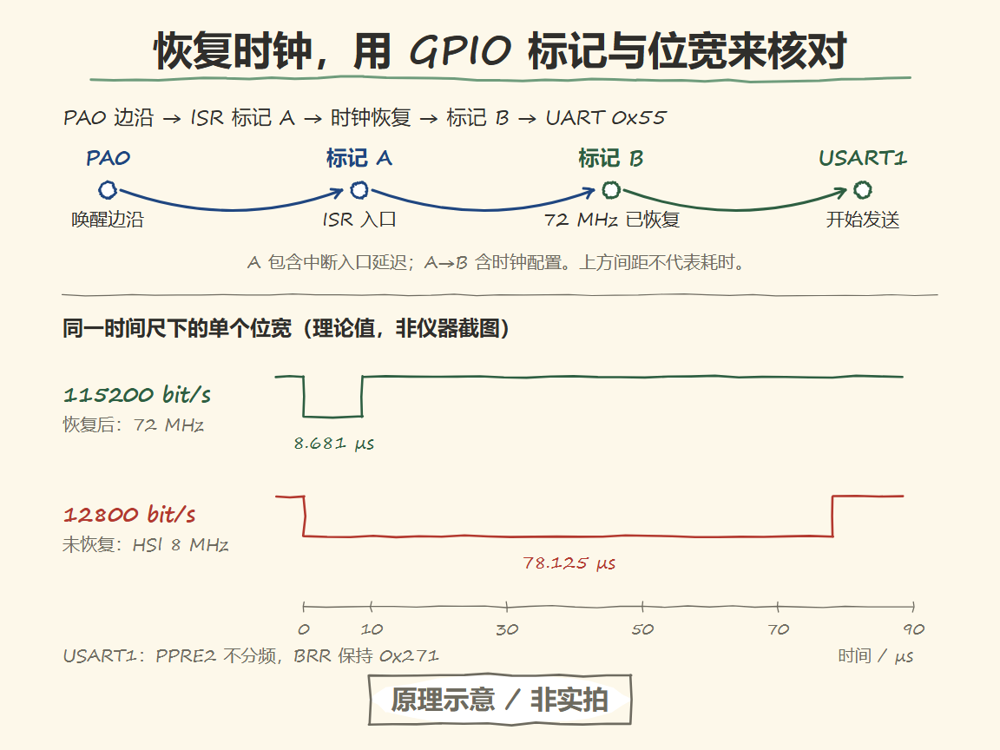
  <br><sub>▲ The two GPIO markers separate ISR entry from clock restoration. Below, 8.681 µs and 78.125 µs bit widths use the same time scale. Sending `0x55` makes alternating edges easy to see. Drawn theoretical timing, not an instrument capture.</sub>
</p>


Entering Stop turns HSE and the PLL off. **After wake, the system clock is the 8 MHz HSI**, not 16 MHz. This book calls `SystemClock_Config()` to restore 72 MHz before reusing the original UART and timer settings. An application designed for HSI may keep it, provided its peripheral dividers and software timebase match. With BRR still `0x271`, the line is 12800 bit/s, not 115200.

```c
/* After wake you must reconfigure the clock */
HAL_PWR_EnterSTOPMode(PWR_LOWPOWERREGULATOR_ON, PWR_STOPENTRY_WFI);
SystemClock_Config();          /* ← bring the PLL back up and restore 72 MHz */
```

| What you see after wake | Cause | Fix |
| --- | --- | --- |
| UART garbage | The clock is now HSI, so the baud rate is wrong | Call `SystemClock_Config()` after wake |
| The timer runs slow | SYSCLK is lower | Same fix: rebuild the clock tree |
| A peripheral does not work | Its clock was not restored | Enable the peripheral clocks you need again |

### 4. Turning peripherals off and configuring GPIO

Saving power is not only about entering the mode. It is also about **turning off clocks of peripherals you do not need, and putting GPIO into a state that does not draw current.** A floating input pin leaks because the input buffer toggles.

| What to handle | What to do | Why |
| --- | --- | --- |
| Peripheral clocks | `__HAL_RCC_xxx_CLK_DISABLE()` | A clock on an unused peripheral is wasted current |
| Floating input pins | Set them to analog input, `GPIO_MODE_ANALOG` | Turns off the Schmitt trigger and stops the toggle leakage |
| Output pins | Choose the sleep level for the external circuit | Avoid load current, bus contention, and back-powering an unpowered peripheral |
| Pull-up / pull-down | Keep only bias and wake resistors that are needed | A path to the opposite rail draws continuous current |
| Debug port | Check DBGMCU low-power debug retention bits and disconnect the probe for measurement | Retained debug clocks and probe back-power can change the result; SWD need not always be disabled |
| LEDs and divider resistors | Disconnect them with a MOSFET switch | Quiet killers of standby current |

### 5. Battery-powered design

Runtime is battery capacity divided by average current. Multiply each interval's current by its duration, add the results, then divide by the period. A wake peak also has a duration; the Stop floor alone cannot predict runtime.

| Point | What it means |
| --- | --- |
| Two-state average current | `I_avg = [I_active×t_active + I_sleep×(T−t_active)] / T` |
| Small-duty-cycle approximation | When `t_active ≪ T`, `I_avg ≈ I_active×t_active/T + I_sleep` |
| Runtime estimate | `runtime (h) = battery capacity (mAh) / I_avg (mA)` |
| LDO quiescent current | Pick a low-Iq LDO (for example under 1 µA), or the LDO eats the standby budget |
| Pull-up / pull-down | A 10 kΩ resistor draws about 0.33 mA with 3.3 V across it; do not charge that current to a pulled-up input held high |
| Divider sampling | The divider resistors leak all the time. Connect them with a MOSFET only while you sample |
| Watchdog | The IWDG still runs from the LSI in Stop. Plan the feed and the wake |

> Example: both currents below are assumptions, not Table 16 or Table 18 cells. A node wakes for 100 ms every 60 s to sample (assume 20 mA while active) and spends the rest at an assumed 20 µA:
> `I_avg ≈ 20 mA × (0.1/60) + 0.02 mA ≈ 0.053 mA`. On a 1000 mAh battery the theoretical runtime is about **780 days**.

This estimate excludes battery self-discharge, changes in usable capacity, regulator losses, and extra wakes. For a waveform with more intervals, use `I_avg = Σ(I_k×t_k)/T`, or integrate the entire current period.

### 6. How to measure power

| Method | Tool | Fits |
| --- | --- | --- |
| Meter in series | A digital multimeter on the µA range | Quiescent current (watch the burden voltage of the range) |
| A dedicated power profiler | Nordic PPK2 / Joulescope | Dynamic waveforms, and average current in one step |
| Sense resistor plus a scope | A 0.1 Ω sense resistor plus a differential probe | The current spike at the moment of wake |
| Measure in pieces | Unplug peripherals one at a time | Find the part that draws the most |

> A measuring tip: the µA range of a multimeter has a large internal resistance. Measuring a dynamic current "drags the voltage down" and you misread it. For dynamic current, use a sense resistor plus a scope, or a dedicated power profiler.

<p align="center">
  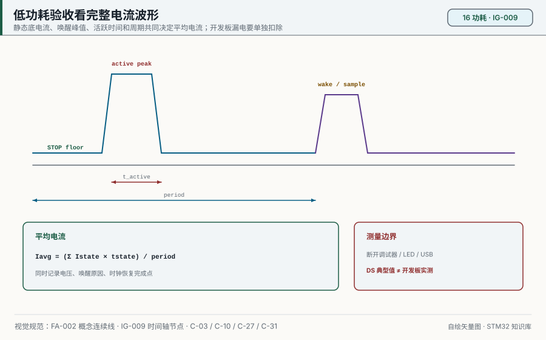
  <br><sub>▲ Current account: floor and peak matter only with their durations. Datasheet typical, development-board measurement, and bare-chip measurement are different boundaries. With the LED, USB, or debugger attached, the result cannot be used as the MCU's microamp figure (FA-002 · IG-009 · C-03/C-10/C-27/C-31).</sub>
</p>

### 7. Low-power design checklist

Once sleep and wake work, check the circuit items below to reduce the current floor.

| Check | What to do | Typical leak / waste |
| --- | --- | --- |
| Clocks | Turn off HSE, PLL, and peripheral clocks you are not using | An unused peripheral clock is wasted current |
| GPIO | Unused pins as analog inputs; output pins at a fixed level | A floating input toggles and leaks |
| Pull-up / pull-down | Keep the bias and wake resistors you need | About 0.33 mA with 3.3 V across 10 kΩ |
| LEDs and indicators | Switch them with a MOSFET. Do not leave them on | One 2 mA LED is already fatal |
| Peripheral supply | Cut VCC to a sensor with a MOSFET when you are not using it | Sensor quiescent current is easy to forget |
| Debug port | Disable unneeded low-power debug retention and remeasure with the probe removed | Check DBGMCU retention bits and back-power paths |
| LDO | Pick a low-Iq part (under 1 µA) | The LDO itself eats the standby current |
| Wake sources | Keep only the interrupts and the RTC you need | Extra interrupts cause extra wakes |
| Watchdog | Plan the feed and the wake while you are in Stop | The IWDG still runs from the LSI in Stop |

Keep the circuits required for power and wake, measure a baseline, then reconnect loads one at a time. Changing one item per measurement gives each current difference a clear cause.

## Hardware and wiring

| Board | Peripheral | Pin | Notes |
| --- | --- | --- | --- |
| BluePill (F103) | Wake key | PA0 | Falling-edge EXTI. It can wake the chip from Stop |
| BluePill | RTC periodic wake | PC14 / PC15 (LSE) | Solder a 32.768 kHz crystal so you can wake on a schedule |
| BluePill | On-board LED | PC13 | Indicate after wake. Turn it off before you enter, to save power |
| Nucleo-F411RE | On-board key | PC13 (B1) | Can wake the chip from Stop |
| Any | Current measurement | A sense resistor in series with 3V3 | Watch it with a power profiler or a scope |

> [!WARNING]
> BluePill board input current includes the LED, LDO quiescent current, and connected USB, serial, sensor, or other loads. The F103 USB peripheral is inside the MCU; check the actual board schematic for external pull-ups and power wiring. To measure microamps in the MCU supply branch, isolate those loads and check for back-power through the probe or signal lines.

## Code

Read these Sleep/Stop snippets as bare-metal HAL code with a SysTick-driven HAL timebase. An RTOS should enter low power through its tickless-idle and time-compensation mechanisms; do not directly suspend its scheduler tick. Stop returns on HSI. This example resumes the HAL tick before clock configuration so its timeout waits can run; verify that the timebase matches again after the clock is restored. The wake ISR should record the cause and handle flags, leaving UART logs with the original settings until restoration completes.

**① Sleep mode (wait for any interrupt)**

```c
#include "stm32f1xx_hal.h"

void Enter_Sleep(void)
{
    HAL_SuspendTick();                    /* In Sleep a 1000 Hz tick wakes the core every 1 ms, not once per second */
    HAL_PWR_EnterSLEEPMode(PWR_MAINREGULATOR_ON, PWR_SLEEPENTRY_WFI);
    HAL_ResumeTick();                     /* restore the tick after wake */
}
```

**② Stop mode, and restoring the clock after wake (the one you use most)**

```c
void Enter_Stop(void)
{
    /* Wake source: EXTI key. Configure NVIC and EXTI beforehand */
    HAL_SuspendTick();
    HAL_PWR_EnterSTOPMode(PWR_LOWPOWERREGULATOR_ON, PWR_STOPENTRY_WFI);
    HAL_ResumeTick();

    /* Critical: after wake the clock falls back to HSI; you must configure it again */
    SystemClock_Config();                 /* restore HSE+PLL = 72 MHz */
}
```

**③ Standby mode (lowest power; wake equals reset)**

```c
void Enter_Standby(void)
{
    /* Clear the WKUP flag and allow the WKUP pin to wake the chip */
    __HAL_PWR_CLEAR_FLAG(PWR_FLAG_WU);
    HAL_PWR_EnableWakeUpPin(PWR_WAKEUP_PIN1);

    HAL_PWR_EnterSTANDBYMode();           /* does not return; wake restarts from the reset vector */
}
```

**④ Timed wake**

STM32F103C8T6 does not have the F4 periodic wake-up timer. Do not call that API. Timed wake is chapter 11: 32.768 kHz, PRL = 32767.

**⑤ Cut GPIO leakage**

First build a mask of pins that are actually unused, then replace `GPIO_PIN_All` below. PA0 is this chapter's wake source, PA13/PA14 are SWD, and other pins may connect to sensors or external pull-ups. Do not convert these to analog inputs as part of a whole-port change.

```c
/* Before low power, set floating pins to analog input so the input buffer stops toggling and leaking */
GPIO_InitTypeDef io = {0};
io.Pin  = GPIO_PIN_All;
io.Mode = GPIO_MODE_ANALOG;
io.Pull = GPIO_NOPULL;
HAL_GPIO_Init(GPIOA, &io);   /* do this for each unused port */
```

**⑥ Turn off clocks you are not using**

```c
__HAL_RCC_ADC1_CLK_DISABLE();
__HAL_RCC_SPI1_CLK_DISABLE();
__HAL_RCC_USART2_CLK_DISABLE();
/* Keep only the clocks RTC, PWR, and the wake source need */
```


<p align="center">
  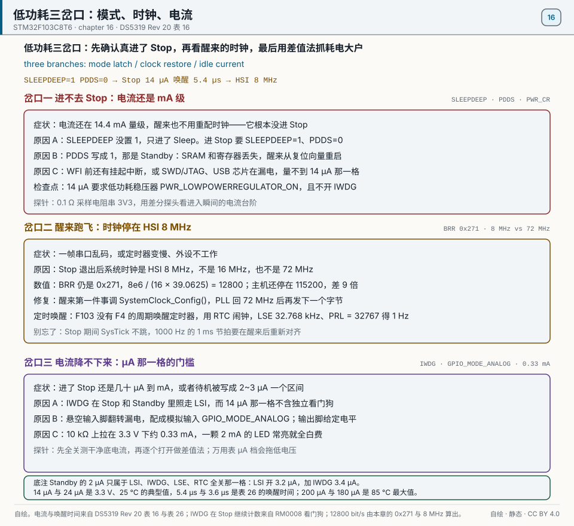
  <br><sub>▲ Drawn troubleshooting chart. Check bits and flags for a mode-entry problem, clocks for a post-wake UART problem, then regulator, enabled clocks, and board loads for excess current. SLEEPDEEP=1 with PDDS=0 selects Stop; it does not guarantee 14 µA. Conditions: [DS5319 Rev 20 Table 16](#source-ds5319-pwr) and [RM0008 clocks](#source-rm0008-rcc).</sub>
</p>

<p align="center">
  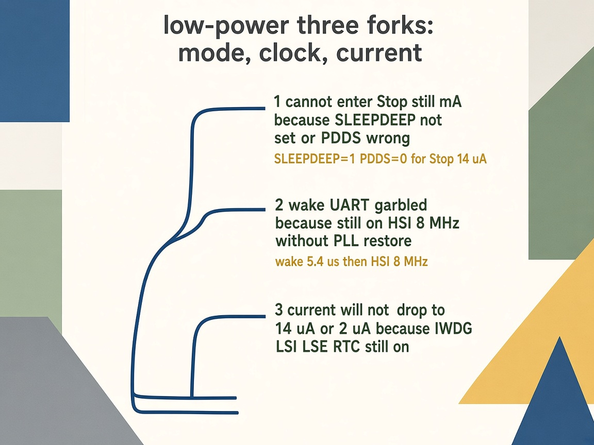
  <br><sub>▲ Knowledge track (Handraw · 原理示意 / not a photo). Cannot enter Stop, garbled UART, current stuck: check SLEEPDEEP/PDDS, then PLL restore, then IWDG/LSI/LSE/RTC; not a photo.</sub>
</p>

## Hands-on labs

1. **Mode baseline:** Measure Run, Sleep, Stop, and Standby on the same hardware. Record supply voltage, board loads, static current, and wake source; do not report a board result as the MCU specification.
2. **Stop recovery evidence:** Capture the PA0 edge, ISR-entry GPIO marker, and marker after `SystemClock_Config()` to separate wake response from clock restoration. Then send `0x55` and confirm 115200 timing. GPIO markers include software delay and do not directly measure the datasheet's first-instruction interval.
3. **Periodic average current:** Wake every 5 s from RTC, sample the ADC, send one frame, and sleep again. Save the full current waveform, integrate Iavg, and compare it with the state-times-duration formula.
4. **Leakage isolation:** Disconnect debugger, LED, USB, and sensors one at a time and record each floor-current delta. Compare the final result only with the matching mode and temperature in the target datasheet.

### 8. The last word before the rail falls: PVD

PVD watches VDD. With EXTI16 and NVIC configured, crossing the selected threshold can trigger an interrupt to record a supply failure early. The snippet below configures the detector and omits the handler. Completing a backup-register or Flash write before reset depends on supply hold-up, write time, and minimum operating voltage; PVD promises no fixed number of milliseconds. Check the reference manual for thresholds and hysteresis.

```c
PWR_PVDTypeDef pvd = {0};
pvd.PVDLevel = PWR_PVDLEVEL_6;          /* see the RM for the actual voltage; do not memorize the level as a millivolt number */
pvd.Mode     = PWR_PVD_MODE_IT_RISING_FALLING;
HAL_PWR_ConfigPVD(&pvd);
HAL_PWR_EnablePVD();
```

<p align="center">
  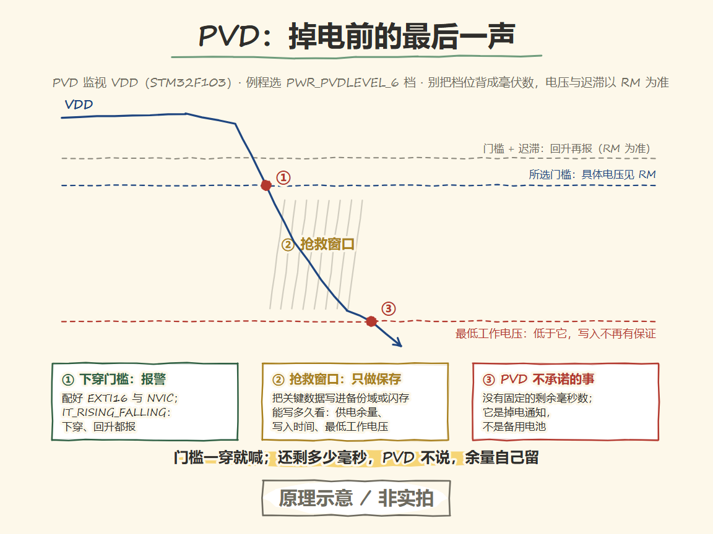
  <br><sub>▲ Knowledge track (Handraw · 原理示意 / not a photo). PVD watches VDD; with EXTI16 and NVIC configured, falling through the selected threshold raises an interrupt that writes key data into the backup domain or Flash. How long the write can last depends on supply hold-up, write time, and the minimum operating voltage; PVD gives no fixed number of milliseconds. Thresholds in the drawing are relative positions, not millivolt values; not a photo.</sub>
</p>

Sleep current is not a fixed 1 mA either. The core is stopped, but the peripheral clocks are still on, and the current is usually still in the milliamp range. Stop is the mode that reaches the microamp range. The numbers in the comparison table above are the order of magnitude from the datasheet. They are not a measurement from a board in this repo. If you are writing them into a paper or a battery budget, open the datasheet for that exact part and copy the column that matches the clocks you turned off.

Before leaving this chapter, keep four mode baselines, Stop wake plus restored 115200 evidence, one integrated periodic-current trace, and a delta table from removing each external load.

Self-test:

1. Why must you not write the Sleep current down as "about 1 mA at 72 MHz"?
2. What is one thing that belongs in the PVD interrupt, and one thing that does not?
3. After Standby wakes, does the program continue at the line after `WFI`, or does it start again from the reset vector?

## Related resources

- RM0008, *STM32F10xxx Reference Manual*, Chapter 5, Power control (PWR) (`LPDS` / `PDDS` / `CWUF` in `PWR_CR`, and WFI / WFE).
- RM0090, *STM32F4 Reference Manual*, Chapter 5 PWR, and Chapter 26 RTC (periodic wake).
- Datasheet DS: typical and maximum current in each mode, wake time, and VBAT parameters.
- Arm, *Cortex-M3 Devices Generic User Guide* (ARM DUI 0552A), §2.5 Power management, WFI/WFE instructions, and SCR; distinguishes wake conditions from interrupt handling.
- Related chapters: [Chapter 11](11-rtc-watchdog.md), RTC and the watchdogs, and [Chapter 09](09-adc-dac.md), ADC.
- Figure: `../../assets/animations/lowpower-wakeup.svg` (vector drawing by the author).
