# 17 Debugging and Performance
> 中文：[17 调试与性能优化](../17-调试与性能优化.md)

> After HardFault, freeze the stack frame and CFSR/HFSR, check whether BFAR/MMFAR are valid, and use the same ELF with addr2line. Changing optimization or commenting code first destroys the scene.

<p align="center">
  
  <br><sub>▲ Animation: SWD debug plus SWO/ITM print tracing (vector animation drawn by the author, not a live recording)</sub>
</p>

<!-- video:ch17 -->
<p align="center">
  <video width="640" controls poster="../../assets/video/ch17-debug.png">
    <source src="../../assets/video/ch17-debug.mp4" type="video/mp4">
  </video>
  <br><sub>▲ Chapter video with Chinese voice-over (3.0 min). <a href="../../assets/video/ch17-debug.mp4">MP4</a> · <a href="../../assets/video/ch17-debug.srt">subtitles</a></sub>
</p>

<details>
<summary>Narration script (Chinese, same text as the subtitles)</summary>

1. 会调试的人先收集证据：断点停在哪、关键寄存器是多少、线上到底有没有边沿。不会调试的人靠改一行试试。这一章把证据的三件套配齐。
2. SWD 两根线就能断点。再加 SWO，可以把打印从 ITM 送出来，不必占串口。F103 上 SWO 在 PB3，还要看调试脚的重映射。把这些脚改成普通输出，探针就哑了。
3. 进了硬故障，先读可配置故障状态 CFSR，再读硬故障状态 HFSR，需要时再看总线故障地址 BFAR。然后从栈里把当时的 PC 捞出来，用 addr2line 对回源码行。
4. 这一帧是仓库画的 SWD 加 SWO，不是逻辑分析仪的截图。它提醒你：日志不一定要占 USART。但是调试器要支持 SWO，时钟也要配成它能听懂的频率。
5. 觉得慢，先用 DWT 的周期计数把那段量出来，跑多次取个数。没有数字就去展开汇编，很容易优化了一个根本不占时间的循环。量完再决定要不要交给 DMA。
6. 实验可以故意写一个非法地址，让它进硬故障。如果你能把 CFSR 和栈里的 PC 对回那一行，这套流程才算你的。只在文章里看过，真故障来时还会慌。
7. 功能还不对时，不要先把优化开到最高。优化会把你以为按顺序发生的读写重排。和硬件时序有关的变量要老实标记，优化之后再跑一遍原来的测试。
8. 硬故障的第一站是 CFSR，再看 HFSR 和栈里的 PC。F103 的 SWO 占 PB3。没有证据就不要改第二处。
9. 调试时一次只改一处，改完立刻复现刚才的现象。同时改三处，好了也不知道是谁的功劳，坏了更不知道是谁的错。版本管理就是为了能回到上一版。
10. 优化之前先有周期计数：DWT 的 CYCCNT 给出最坏值，再看分布。凭感觉说“应该快了”，不是证据。

</details>
<!-- /video:ch17 -->
## Principle and scope

This chapter uses the STM32F103C8T6, a Cortex-M3 with no FPU. The fault register addresses below belong to the Cortex-M3 System Control Block, so they are the same on every M3. See [PM0056](#source-pm0056).

Start with a comparison using `Measure()` below: let both calls to `DWT_Cycles()` finish before halting, and inspect `dt`. Then replace the measured loop with an empty interval and compare. That interval still includes the cost of reading the counter. Let the core run continuously through the measurement; the results should distinguish the loop from the empty interval. If both are 0, first check whether the counter advances. No cycle count for the loop is assumed here.

After HardFault, preserve the state before interpreting `CFSR` (`0xE000ED28`) and `HFSR` (`0xE000ED2C`). `HFSR.FORCED` is bit 30, value `0x40000000`: a configurable fault escalated to HardFault, so continue with `CFSR`. The address registers are `MMFAR` (`0xE000ED34`) and `BFAR` (`0xE000ED38`). Save the addresses before reading their valid flags. A higher-priority exception can update these registers, so separate reads might not describe the same fault.

`BFARVALID` is `CFSR` bit 15. When it is 1, the saved `BFAR` is a valid bus-fault address; when it is 0, do not use that address to locate the fault, since it might be stale. `MMFAR` has `MMARVALID` (bit 7). `IMPRECISERR` itself does not update `BFAR`. If precise and imprecise fault flags appear together, a valid address cannot simply be assigned to the earliest bad write.

After exception stacking completes normally, the basic frame contains R0, R1, R2, R3, R12, LR, PC, xPSR. Counting R0 as word 0, PC is `stack[6]`, or SP + 0x18 from the start of that frame. For `PRECISERR`, PC points to the faulting instruction; with `IMPRECISERR`, it may have advanced past the original write. `STKERR` or `MSTKERR` means the frame might be incomplete: check its address and contents before dereferencing it.

Before measuring, set `DEMCR` (`0xE000EDFC`) bit 24 (`TRCENA`), clear `DWT_CYCCNT` (`0xE0001004`), and set `CYCCNTENA`. At 72 MHz, 72 counts are 1 µs. Either missing enable can stop the counter. For a zero delta, also check for single-stepping, repeated inspection of a stale variable, and measured code removed by the compiler. See [PM0056 DWT](#source-pm0056-dwt).

This M3 has 6 hardware breakpoints. Setting a 7th in flash makes the debugger refuse or fail to stop. The Cortex-M7 in an STM32F7 or H7 has 8, so do not copy that number from an H7 tutorial.

<p align="center">
  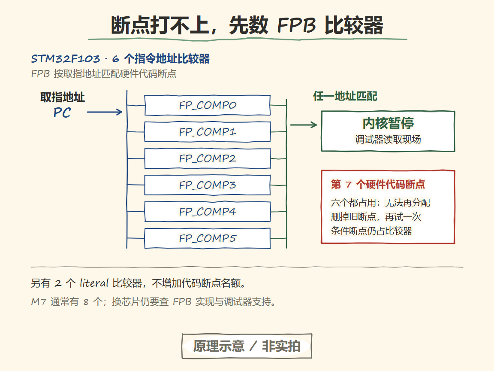
  <br><sub>▲ Knowledge track (Handraw · 原理示意 / not a photo). Once the F103's 6 code comparators are occupied, release an old breakpoint or choose another observation method. A conditional hardware breakpoint still uses a comparator; the M7's 8 do not apply here. See [PM0056 DWT](#source-pm0056-dwt).</sub>
</p>

In the LQFP48 package, pin 34 PA13 is SWDIO, pin 37 PA14 is SWCLK, and pin 39 PB3 is JTDO after reset. Asynchronous TRACESWO requires the probe to use Serial Wire mode and configure trace output. You may disable JTAG while keeping SWD, but that does not replace trace setup. Connecting PB3 alone does not start a log stream. See [DS5319](#source-ds5319-swd).

## Key figures


<p align="center">
  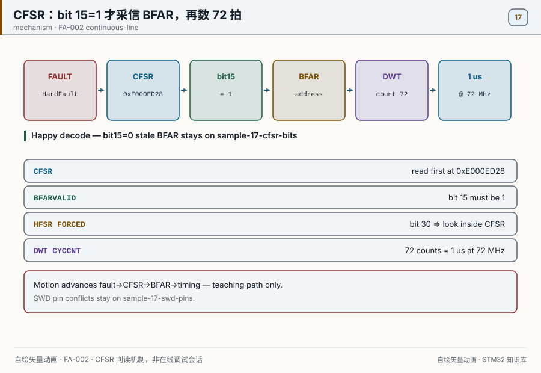
  <br><sub>▲ Drawn for this book. Save the snapshot, then check BFARVALID and interpret the address. DWT cycle counting is a separate check.</sub>
</p>


<p align="center">
  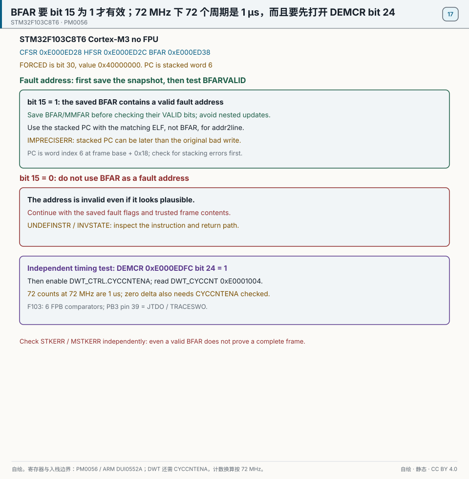
  <br><sub>▲ Drawn for this book. BFARVALID determines whether the saved BFAR is usable. DWT needs both TRCENA and CYCCNTENA. A count of 72 equals 1 µs only at 72 MHz; interpret fault addresses and elapsed time separately. See [PM0056](#source-pm0056) and [PM0056 DWT](#source-pm0056-dwt).</sub>
</p>

<p align="center">
  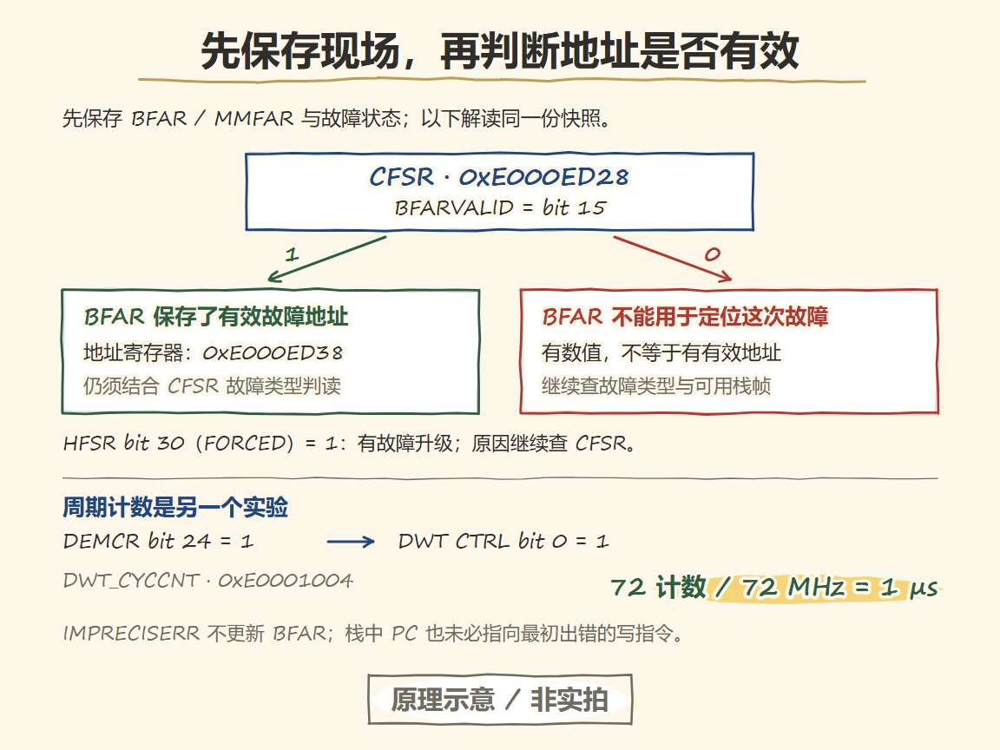
  <br><sub>▲ Knowledge track (Handraw · 原理示意 / not a photo). The upper half checks whether a fault address is valid; the lower half checks whether cycle counting is enabled. At 72 MHz, 72 counts = 1 µs. These are independent checks.</sub>
</p>

<p align="center">
  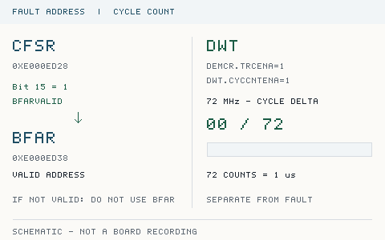
  <br><sub>▲ The address-validity condition stays visible on the left while the right independently demonstrates cycle conversion at 72 MHz. Playback speed does not represent elapsed hardware time. For print, use the static figure above.</sub>
</p>

SWO and ITM printing are in the opening `debug-swo.svg` animation. The static figure above covers only the fault registers and the cycle counter.

## Timing and state

| Register or count | Address or bit | When it is valid |
| --- | --- | --- |
| `CFSR` | `0xE000ED28` | decode after saving the snapshot |
| `HFSR` bit 30 | `0x40000000` | `FORCED` |
| `MMFAR` | `0xE000ED34` | when its own valid flag is 1 |
| `BFAR` | `0xE000ED38` | only when bit 15 is 1 |
| Invalid address | bit 15 is 0 | BFAR cannot locate the fault; it might be stale |
| DWT | Set `0xE000EDFC` bit 24 and `CYCCNTENA`, then read `0xE0001004` | At 72 MHz, 72 counts are 1 µs |
| Counter stopped | bit 24 or `CYCCNTENA` is 0 | No increase even while running continuously |
| Hardware breakpoints | 6 | Cortex-M3. An M7 has 8 |
| Pins | pin 34 PA13, pin 37 PA14 | SWD. Pin 39 PB3 is JTDO by default |

## Pitfalls and sources

| What you see | Why | What to do | Source | What the source shows |
| --- | --- | --- | --- | --- |
| `BFAR` does not match the access being investigated | The address is invalid, or several fault types are recorded | Check `CFSR` bit 15 and the fault class in the snapshot | [PM0056](#source-pm0056) | With bit 15 clear, do not use `BFAR`; `IMPRECISERR` itself records no address |
| HardFault is answered by only a reset | The fault registers were not kept | Keep `CFSR` and the stacked PC | [PM0056](#source-pm0056) | `CFSR` is at `0xE000ED28`. `FORCED` is `HFSR` bit 30, value `0x40000000` |
| A DWT measurement reads 0 | Counting is disabled, or the measurement did not execute as intended | Check `DEMCR` bit 24 and `CYCCNTENA`; inspect raw counts after continuous execution | [PM0056 DWT](#source-pm0056-dwt) | Both enables are required. At 72 MHz, 72 counts are 1 µs |
| The 7th breakpoint does not stop | The comparators are used up | This M3 has 6 hardware breakpoints | [PM0056 DWT](#source-pm0056-dwt) | A Cortex-M3 has 6; a Cortex-M7 has 8 |
| SWO has no waveform, and PB3 was treated as already open | After reset it is not SWO | Pin 39 is JTDO | [DS5319](#source-ds5319-swd) | TRACESWO is in the remap column. It is not PA13 and not PA14 |
| The assert still fires after optimization, but the timing changed | There is no cycle count under the same conditions | Keep bit 24 and `CYCCNT` before changing the optimization level | [PM0056 DWT](#source-pm0056-dwt) | Measure cycles before and after changing the optimization level to know how much faster it is |
## Learning goals

- [ ] Tell SWD and JTAG apart by their pins and their trade-offs, and understand why SWD is the mainstream choice.
- [ ] Use SWO / ITM for a `printf` trace that does not occupy a UART.
- [ ] Know how many hardware breakpoints and software breakpoints you get, and how they differ.
- [ ] Use the three-piece HardFault kit: `CFSR` / `HFSR` / `BFAR`, plus the stack unwind, plus `addr2line`.
- [ ] Measure a signal with a logic analyzer or a scope, and measure code time with the DWT.
- [ ] Remember the usual optimizations — `-O2` / `-Os`, DMA, cache — and the things to watch.

## Core ideas

Debug evidence has an order: preserve the scene, classify the fault, locate the source, and then build a minimal reproduction. Performance work follows the same rule: measure cycles, bus use, and waveforms before choosing an algorithm, DMA, compiler, or hardware change.

### 1. SWD vs JTAG


<p align="center">
  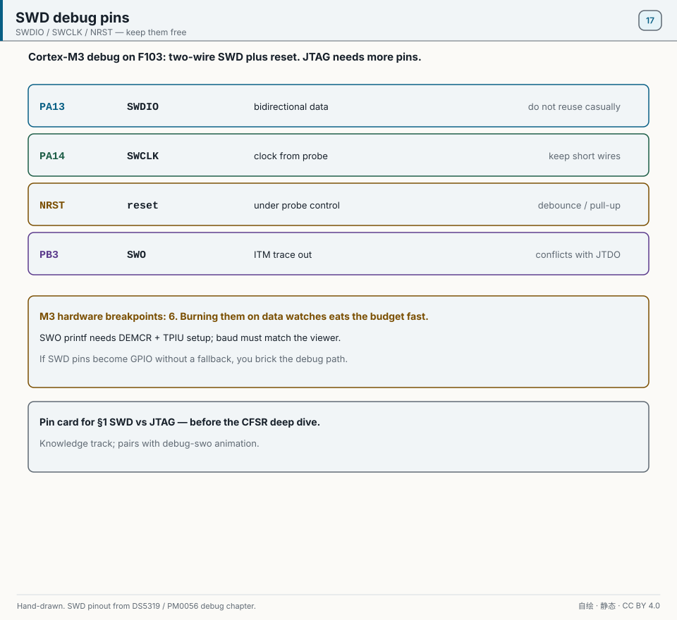
  <br><sub>▲ Drawn for this book. PA13/PA14 carry SWD; PB3 can output SWO. If the application reassigns the SWD pins, recovery usually requires connecting under reset.</sub>
</p>

<p align="center">
  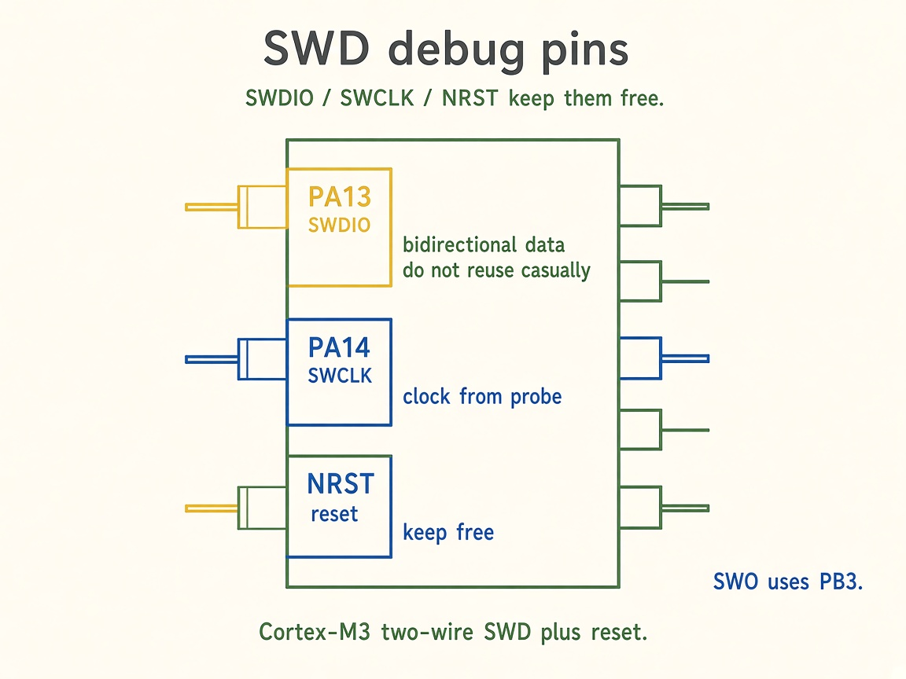
  <br><sub>▲ Knowledge track (Handraw · 原理示意 / not a photo). SWDIO is bidirectional; the probe drives SWCLK. SWO returns through PB3. Share GND, use VTref to sense target voltage, and connect NRST for access under reset.</sub>
</p>


**SWD uses only 2 signal wires (SWDIO + SWCLK) plus GND.** It uses fewer pins than JTAG, and it is the debug interface of choice on Cortex-M. JTAG is mainly for a daisy chain of several devices, or for older tools.

| Item | SWD | JTAG |
| --- | --- | --- |
| Signal wires | SWCLK, SWDIO (2 wires) | TCK, TMS, TDI, TDO (4 wires, plus optional TRST) |
| Pins used | Few (PA13 / PA14) | Many (PB3 / PB4 / PA15, plus PA13 / PA14) |
| Speed | Fast; the ceiling depends on the probe and the wiring | Fast |
| Several devices | No daisy chain | Supported |
| Typical tools | ST-Link, J-Link, DAPLink | J-Link, older JTAG probes |
| STM32 support | Supported, recommended | Supported, but rarely used |

> [!WARNING]
> After reset, STM32 keeps **PA13 (SWDIO) and PA14 (SWCLK)** for the debug port. An application that disables SWD or reassigns these pins can prevent normal connection. Keep SWD enabled and expose NRST on the debug connector for connect under reset.

ST's manuals do not give a top speed for SWD. The usual 4 MHz or 10 MHz figures are the probe vendors' own ratings. Turn it down when the jumper wires get long.


<p align="center">
  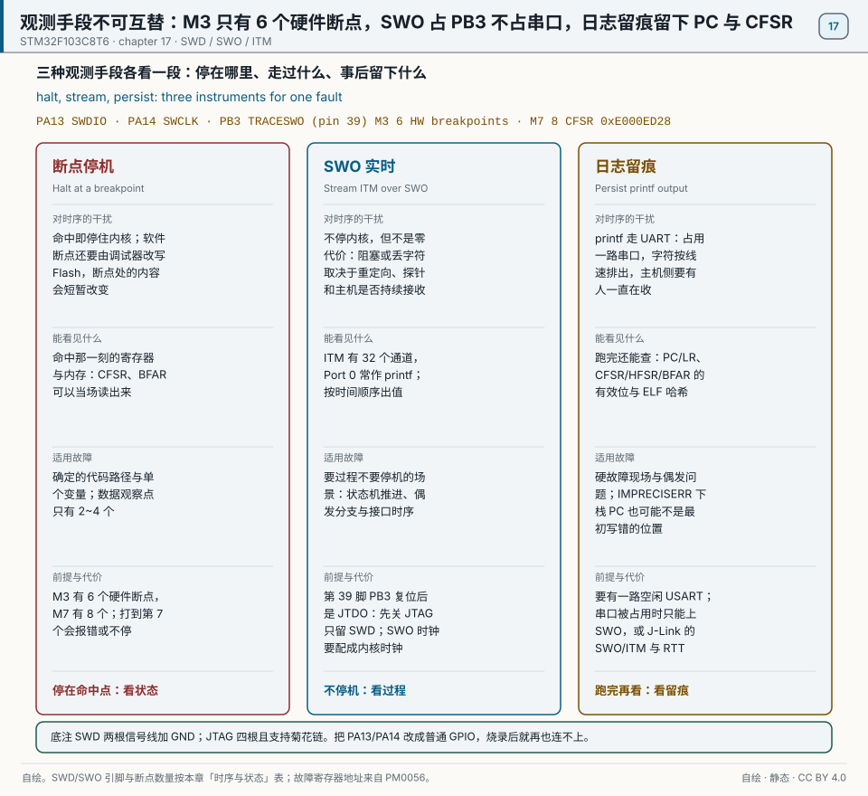
  <br><sub>▲ Drawn for this book. Breakpoints halt the core; SWO sends trace data while it runs; fault records preserve PC and CFSR for later analysis. A conditional hardware breakpoint still uses a comparator. Record retention depends on storage and reset behavior. See [PM0056 debug](#source-pm0056) and [DS5319 SWD](#source-ds5319-swd).</sub>
</p>

<p align="center">
  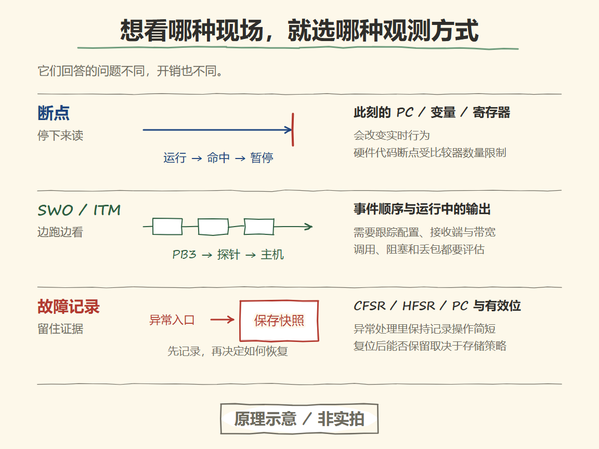
  <br><sub>▲ Knowledge track (Handraw · 原理示意 / not a photo). Inspecting halted variables, tracing a running system, and retaining a fault record answer different questions. Also consider timing disturbance and whether the record is complete.</sub>
</p>

### 2. SWO / ITM / printf tracing

**SWO (Serial Wire Output)** lets the MCU send debug information through the **ITM** without occupying a UART. Whether it blocks or drops characters depends on the retarget code, probe, and host reader, so it is not a zero-cost log path.

| Mechanism | What it is |
| --- | --- |
| ITM (Instrumentation Trace Macrocell) | A trace unit inside the core. It can drive 32 channels (port 0 is the usual printf port) |
| SWO (Serial Wire Output) | One more wire on top of the two SWD wires, PB3 on the F103, that carries the ITM data out |
| `ITM_SendChar` | The low-level function you redirect `printf` to |
| What you need first | A debugger that supports SWO (ST-Link V2-1 or J-Link), and the SWO clock configured in the IDE |

On the F103, also set `DBGMCU_CR.TRACE_IOEN` and select asynchronous trace with `TRACE_MODE=00`. Configure the ITM, TPIU protocol, and prescaler. The IDE's core-clock setting must match the actual HCLK, and the probe's receive rate must match the TPIU output. Debug tools may perform these steps, but disabling JTAG alone does not initialize trace.

```c
/* Redirect printf to the ITM; no UART needed */
int __io_putchar(int ch)
{
    ITM_SendChar(ch);
    return ch;
}
```

### 3. Breakpoint types and how many you get

The FPB implements hardware execution breakpoints by comparing instruction addresses. This F103 has **6 code comparators**. Common M3/M4 implementations have 6 and M7 implementations have 8; check the target when migrating. A software breakpoint replaces an instruction with `BKPT`. Flash support and the number available depend on the debugger and memory conditions.

| Type | How it works | How many | Limit |
| --- | --- | --- | --- |
| Hardware breakpoint | The FPB compares an instruction address | Commonly 6 (M3 / M4) or 8 (M7) | Limited comparators; use DWT to watch data accesses |
| Software breakpoint | Replace the instruction with `BKPT` | Depends on tools and memory | RAM must be writable; Flash needs debugger support for rewriting |
| Data watchpoint | The DWT compares a data address | The F103 DWT has 4 comparators | Separate from FPB; watch data accesses or support other DWT trace tasks |

> When you reach the limit, delete old breakpoints and check whether the tool supports software breakpoints at the required address. A conditional hardware breakpoint still occupies a comparator. Some conditions require a halt for host-side evaluation, which disturbs timing.

### 4. The three-piece HardFault kit


<p align="center">
  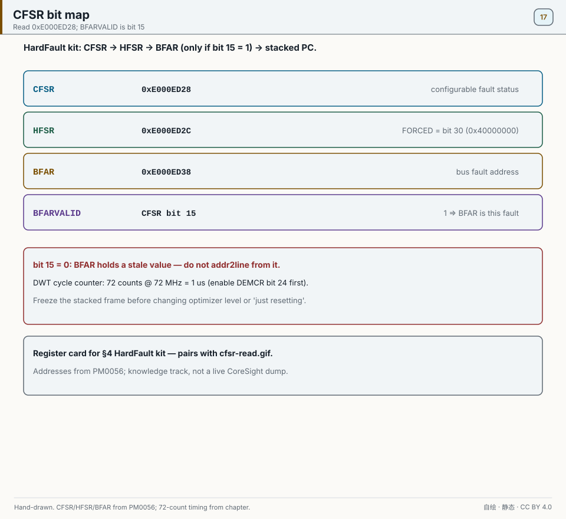
  <br><sub>▲ Drawn for this book. Separate the fault class from the address-valid flags in CFSR. Convert cycle counts using the actual core clock.</sub>
</p>

<p align="center">
  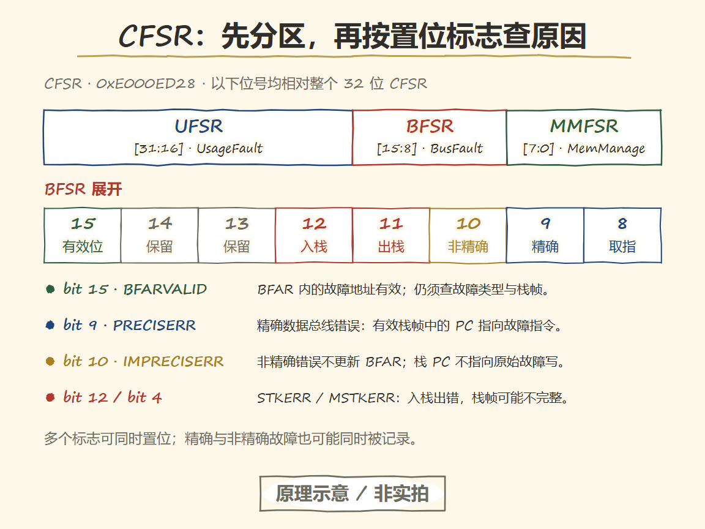
  <br><sub>▲ Knowledge track (Handraw · 原理示意 / not a photo). CFSR has separate regions for memory-management, bus, and usage faults. Distinguish precise, imprecise, and stacking errors before using an address or stacked PC.</sub>
</p>


After HardFault, preserve the fault registers, the exception-entry LR, and the stack pointer. Interpret `CFSR` to classify the fault and `HFSR` to check escalation, then use the valid flags to interpret the saved `BFAR`/`MMFAR`. Once the frame is known to be usable, take its PC and run `addr2line` against the same ELF that was running when the fault occurred. Rebuilding can change the address layout.

| Register | Full name | Key bits | Meaning |
| --- | --- | --- | --- |
| `SCB->CFSR` | Configurable Fault Status | `MMARVALID` / `BFARVALID` | Whether the faulting address was recorded |
| `SCB->CFSR` | Same | `IMPRECISERR` and others | Precise or imprecise bus error |
| `SCB->HFSR` | HardFault Status | `FORCED` | Whether a fault was escalated and forced in here |
| `SCB->BFAR` | BusFault Address | The address | A valid bus-fault address (if `BFARVALID=1`) |
| `SCB->MMFAR` | MemManage Address | The address | A memory-management fault address (if `MMARVALID=1`) |

**Reading the frame**: after normal exception stacking, the core has saved `R0–R3, R12, LR, PC, xPSR`. PC identifies the faulting instruction only when the fault type supports that interpretation and the frame is complete. `IMPRECISERR` offers no such guarantee; `STKERR`/`MSTKERR` requires checking the stack first.

The following shows the GCC logic for choosing MSP or PSP. Entry assembly must run before the compiler changes SP or LR. An ordinary C function can generate a prologue, so a real project needs a toolchain-supported naked entry or separate assembly, checked in the disassembly. This fragment omits the entry attribute and stack-address validation. The C handler below assumes a complete, readable basic frame.

```c
/* Recover the faulting PC from MSP or PSP */
void HardFault_Handler(void)
{
    __asm volatile (
        "TST LR, #4        \n"   /* which stack: MSP or PSP */
        "ITE EQ            \n"
        "MRSEQ R0, MSP     \n"
        "MRSNE R0, PSP     \n"
        "B hard_fault_handler_c \n"
    );
}
```

```c
void hard_fault_handler_c(uint32_t *stack)
{
    volatile uint32_t r0  = stack[0];
    volatile uint32_t r1  = stack[1];
    volatile uint32_t r2  = stack[2];
    volatile uint32_t r3  = stack[3];
    volatile uint32_t r12 = stack[4];
    volatile uint32_t lr  = stack[5];
    volatile uint32_t pc  = stack[6];    /* ← address of the faulting instruction */
    volatile uint32_t psr = stack[7];
    volatile uint32_t cfsr = SCB->CFSR;
    volatile uint32_t hfsr = SCB->HFSR;
    volatile uint32_t bfar = SCB->BFAR;

    (void)r0;(void)r1;(void)r2;(void)r3;(void)r12;(void)lr;(void)psr;
    (void)cfsr;(void)hfsr;(void)bfar;
    for (;;) { }                         /* breakpoint here and inspect the variables above */
}
```

**Turn the PC into a source line with addr2line** (GCC toolchain):

```bash
arm-none-eabi-addr2line -e build/app.elf -f -C 0x08001a3c
# output: function name + file:line
```

> With Keil, look up the faulting PC in the symbol ranges of the `.map` file, or use the IDE's Call Stack window.

<p align="center">
  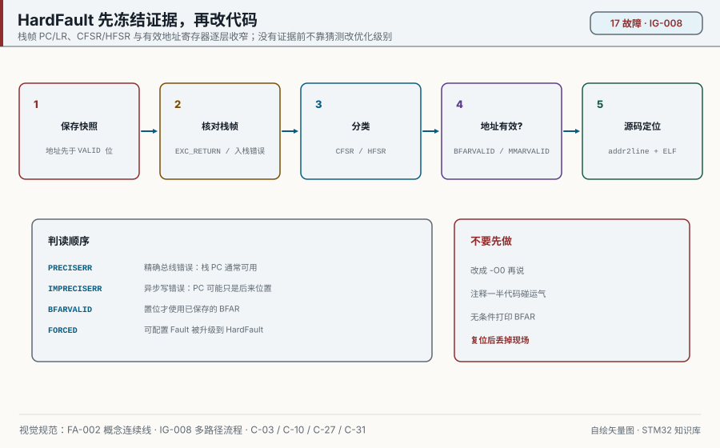
  <br><sub>▲ Fault ladder. BFARVALID/MMARVALID determine whether an address is usable. With `IMPRECISERR`, stacked PC may have advanced past the original write. Verify the frame and fault type before locating the source in the same ELF.</sub>
</p>

### 5. Logic analyzer / oscilloscope

| Tool | What it shows | Typical use |
| --- | --- | --- |
| Logic analyzer (8 channels, 24 MHz and up) | Digital timing | Capture I2C / SPI / UART / CAN timing and decode the protocol |
| Oscilloscope | Analog waveform | PWM rising edge, supply ripple, signal integrity |
| Mixed-signal scope (MSO) | Digital plus analog | Timing and the analog waveform together |
| Current probe / power profiler | Current waveform | Checking low power (see [Chapter 16](16-low-power.md)) |

> A logic analyzer is good at "is the protocol right." A scope is good at "is the signal healthy." An intermittent bus error needs both.

### 6. Ways to speed the code up

Use DWT to locate the slow section before choosing a change. Compare DMA for data movement, or algorithms and compiler options for computation. The payoff depends on data size, bus contention, and setup cost; there is no universal ranking.

| Move | What to do | Watch out |
| --- | --- | --- |
| Compiler optimization | Compare speed and size with `-O2` and `-Os` | `-O0` helps investigation; `volatile` constrains the accesses involved but provides neither atomicity nor thread synchronization |
| DMA | Hand UART / ADC / SPI data movement to DMA | See [Chapter 10](10-dma.md). Watch cache coherency |
| Bit-band / bit operations | Choose bit access or arithmetic according to the operation | Unsigned division by a power of two can use a shift; compilers normally optimize it. Check the target assembly for cost |
| Fixed point instead of floating point | Use Q-format fixed point | Especially visible on an M3 with no FPU |
| FPU | Compile for the actual FPU on M4F / M7 | `-mfpu=fpv4-sp-d16 -mfloat-abi=hard` fits the corresponding single-precision implementation, not every M7 |
| Cache / ART | The F4 ART accelerator, and I-Cache / D-Cache on H7 | H7 DMA has to maintain the cache |
| Inline / macros | `static inline` on a hot function | Too much inlining grows the image |
| Lookup tables | A LUT instead of computing it live | You spend Flash to buy speed |

**DWT timing (accurate to a CPU cycle)**:

```c
/* Time a stretch of code with the DWT CYCCNT counter (F1 and F4 both support it) */
static void DWT_Init(void)
{
    CoreDebug->DEMCR |= CoreDebug_DEMCR_TRCENA_Msk;  /* enable trace */
    DWT->CYCCNT = 0;
    DWT->CTRL  |= DWT_CTRL_CYCCNTENA_Msk;            /* enable the cycle counter */
}

static uint32_t DWT_Cycles(void) { return DWT->CYCCNT; }

void Measure(void)
{
    DWT_Init();
    uint32_t t0 = DWT_Cycles();
    /* code under test */
    for (volatile int i = 0; i < 1000; i++) { }
    uint32_t dt = DWT_Cycles() - t0;                 /* cycle count */
    float us = (float)dt / (SystemCoreClock / 1000000.0f);
    (void)us;                                        /* convert to microseconds */
}
```

### 7. Common HardFault causes

| What you see / which fault bit | Usual cause | Fix |
| --- | --- | --- |
| `IMPRECISERR` | An earlier core write reports an error asynchronously | Inspect earlier writes; this flag itself records no BFAR, and stacked PC does not identify the original write |
| `PRECISERR` | A precise data bus access error | Inspect the address using valid BFAR and stacked PC; an ordinary array overrun need not trigger a bus error |
| `UNDEFINSTR` | A jump to an illegal address (a bad function pointer, or a smashed stack) | Check function pointers and the stack size |
| `INVSTATE` | The jump target is not a Thumb instruction (bit0 = 0) | Bit 0 of the entry address must be 1 |
| `INVPC` | LR is illegal on exception return | The interrupt corrupted LR, or the stack is scrambled |
| `FORCED` and `CFSR=0` | An incomplete snapshot, cleared status, or another capture issue | Check capture and flag-clearing code; vector-read errors have the separate `HFSR.VECTTBL` flag |
| Divide by zero (silent unless DIV_0_TRP is on) | Divide-by-zero trapping is not enabled | `SCB->CCR \|= SCB_CCR_DIV_0_TRP_Msk` |
| Stack overflow | A large local array, or recursion that is too deep | Enlarge the stack, and turn on stack-overflow detection |

## Hardware and wiring

| Board | Interface | Pin | Notes |
| --- | --- | --- | --- |
| BluePill (F103) | SWD | PA13 = SWDIO, PA14 = SWCLK, GND, 3V3 | Four wires are enough to program and debug |
| BluePill | SWO | PB3 (optional; needs `SWJ_CFG` in `AFIO_MAPR`) | Only J-Link and ST-Link V2-1 support it |
| Nucleo-F411RE | SWD plus SWO | On-board ST-Link, SB jumpers | SWO works directly |
| J-Link | SWD | Same as above | Supports SWO / ITM and RTT |
| Any | Logic analyzer | Clip onto SCL / SDA / MOSI and similar | Capture timing and decode |
| Any | Oscilloscope | Probe on the signal under test | Look at waveform quality |

The probe's 3V3 connection is usually target-voltage reference VTref; check the specific probe before using it as a power source. Do not connect two power outputs together. SWO support is not limited to the two models in the table: check the actual hardware, firmware, and wiring. On a Nucleo, verify the SWO route against the board revision and solder bridges.

> [!WARNING]
> **GND must be common**, and the probe needs the correct target-voltage reference. Also connect NRST for connect under reset. If the application disables debug, try connecting under reset. Another option is to use the chip's boot configuration to enter system memory, keeping the application from running while you reprogram it.


<p align="center">
  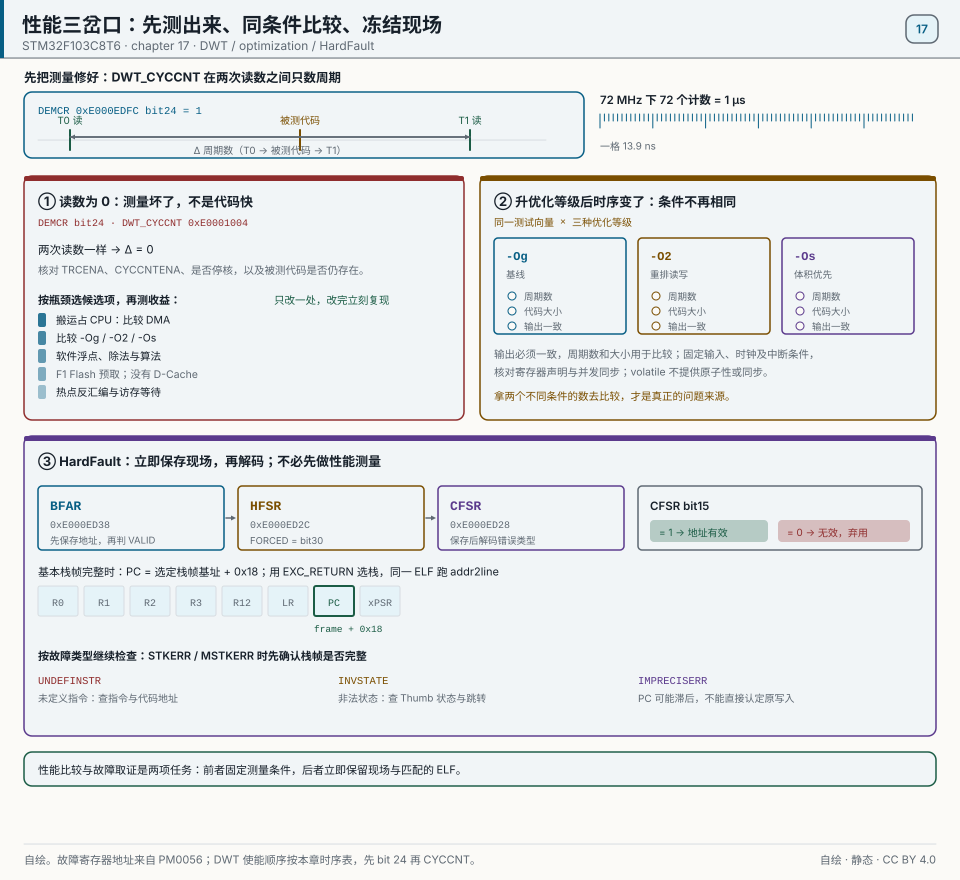
  <br><sub>▲ Drawn for this book. Two DWT reads bracket the measured interval. When comparing -Og/-O2/-Os, record cycles, code size, and output agreement. Fault interpretation and performance measurement are separate checks; BFAR still needs bit 15 validation. See [PM0056 DWT](#source-pm0056-dwt) and [PM0056](#source-pm0056).</sub>
</p>

<p align="center">
  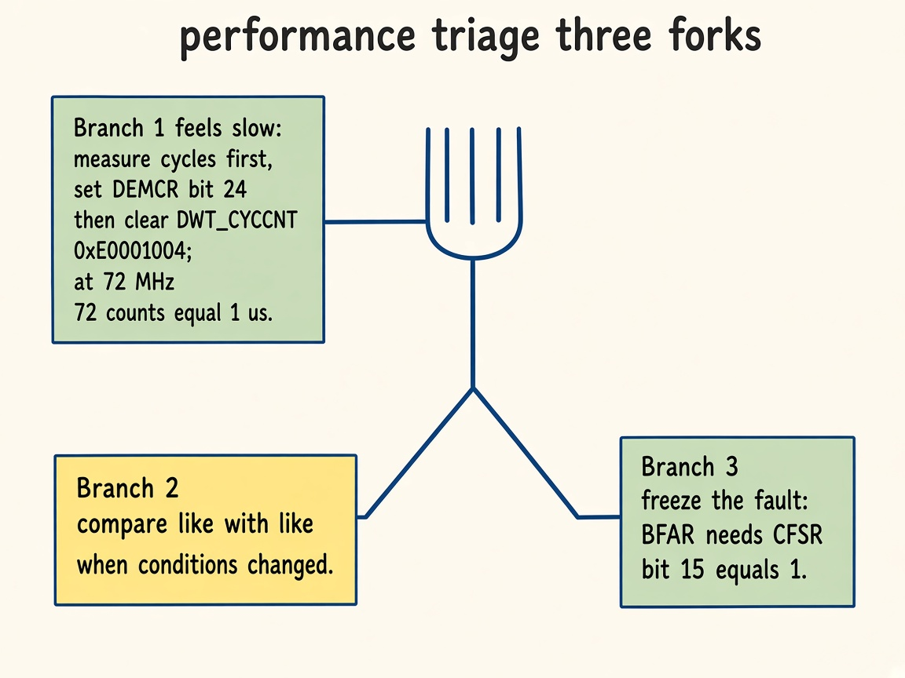
  <br><sub>▲ Knowledge track (Handraw · 原理示意 / not a photo). t0 and t1 bracket the code. For a zero delta, check TRCENA, CYCCNTENA, and how the core was run. A count of 72 equals 1 µs when the core runs at 72 MHz.</sub>
</p>

## Code

**① Redirect printf to SWO / ITM**

This code only retargets character output; it does not configure trace hardware. The comment in `Log_Init()` simplifies initialization. The DBGMCU, ITM, TPIU, and probe setup described earlier is still required. The IDE's core-clock setting and SWO line rate are separate parameters.

```c
#include "stm32f1xx_hal.h"
#include <stdio.h>

/* Redirect the low-level character output to ITM port 0 (SWO) */
int __io_putchar(int ch)
{
    ITM_SendChar((uint32_t)ch);
    return ch;
}

void Log_Init(void)
{
    /* No extra init. Enable SWD in CubeMX.
       In the IDE, set the SWO clock equal to the core clock, and you will see printf */
}

void Log_Demo(void)
{
    printf("sysclk = %lu Hz\r\n", (unsigned long)SystemCoreClock);
}
```

**② Keep the SWD pins (so a bad remap does not lock you out)**

```c
/* If you must reuse PA13/PA14, at least keep SWD; otherwise you may not be able to connect after programming */
__HAL_RCC_AFIO_CLK_ENABLE();
__HAL_AFIO_REMAP_SWJ_NOJTAG();   /* turn off JTAG only and keep SWD (PA13/PA14 still debug) */
```

**③ Enable divide-by-zero and configurable-fault traps**

Once enabled, qualifying faults first enter their UsageFault, BusFault, or MemManage handlers. They can escalate to HardFault when disabled, blocked by priority, or subject to other escalation conditions. The project must supply these handler entries.

```c
void Fault_Enable(void)
{
    SCB->CCR |= SCB_CCR_DIV_0_TRP_Msk;   /* divide-by-zero raises UsageFault */
    SCB->SHCSR |= SCB_SHCSR_USGFAULTENA_Msk
               |  SCB_SHCSR_BUSFAULTENA_Msk
               |  SCB_SHCSR_MEMFAULTENA_Msk;  /* enable the three fault types separately */
}
```

**④ HardFault handler (pair it with the stack unwind in section 4, and print the registers directly)**

Use this version in controlled debugging after checking the frame and log channel. A fault-time `printf` can block, fault again, or use an already damaged stack. A deployed fault recorder should first save a fixed amount of data, then output it in a safe context.

```c
void hard_fault_handler_c(uint32_t *stack)
{
    printf("HardFault! PC=0x%08lX LR=0x%08lX\r\n",
           (unsigned long)stack[6], (unsigned long)stack[5]);
    printf("CFSR=0x%08lX HFSR=0x%08lX BFAR=0x%08lX\r\n",
           (unsigned long)SCB->CFSR,
           (unsigned long)SCB->HFSR,
           (unsigned long)SCB->BFAR);
    for (;;) { }
}
```

**⑤ DWT timing (compare memcpy with DMA, and similar)**

```c
static inline void DWT_DelayInit(void)
{
    CoreDebug->DEMCR |= CoreDebug_DEMCR_TRCENA_Msk;
    DWT->CYCCNT = 0;
    DWT->CTRL  |= DWT_CTRL_CYCCNTENA_Msk;
}

/* Usage:
   DWT_DelayInit();
   uint32_t t0 = DWT->CYCCNT;  ...code under test...  uint32_t dt = DWT->CYCCNT - t0;
   time (us) = dt / (SystemCoreClock / 1000000)  */
```

> Choose between `-O2` and `-Os` using this project's speed and size measurements; `-Og` usually helps debugging. If a variable disappears, inspect the assembly and lower optimization locally if needed. Adding `volatile` to an ordinary variable changes the measured program and cannot replace synchronization or a memory barrier.


## Hands-on labs

1. **HardFault evidence pack:** In a controlled Debug build, access an illegal address. Save stacked PC/LR, CFSR, HFSR, BFAR/MMFAR valid bits, and the ELF hash, then locate the line with addr2line.
2. **Precise and imprecise errors:** At a controlled address where the target bus actually reports errors, compare a synchronous data access with an error from a buffered core write. Record `PRECISERR`, `IMPRECISERR`, and stacked PC. DMA is a separate bus master: check DMA status for its transfer errors rather than assuming it sets the core's `IMPRECISERR`. Leave any unreproduced case unfilled.
3. **DWT baseline:** For the same 4 KB, record `memcpy` CPU cycles, DMA-start CPU cycles, and DMA completion wall time. A fast start does not mean the copy has completed.
4. **Tool boundary:** Capture one I2C transfer with both protocol decode and SCL/SDA scope traces. One proves bytes; the other proves rise time and electrical margin.
5. **Optimization regression:** Run the same test vectors at `-Og`, `-O2`, and `-Os`, recording cycles, code size, and identical outputs. Accept an optimization only when results still match.

Before leaving this chapter, keep the full HardFault evidence pack, precise/imprecise comparison, both DMA and memcpy time measures, and one protocol/electrical trace pair.

## Related resources

- The Debug support (DBGMCU) chapter of RM0008 and RM0090 (debug-port configuration, and debugging in low power).
- *The Definitive Guide to ARM Cortex-M3 and Cortex-M4 Processors*: fault exceptions, `CFSR` / `HFSR` / `BFAR`, and the stack frame.
- ARMv7-M Architecture Reference Manual (ARM DDI 0403): the exception model, FPB, and DWT.
- Tool docs: SWO / ITM setup for ST-Link and J-Link, and `arm-none-eabi-addr2line`.
- Related chapters: [Chapter 10](10-dma.md) DMA, [Chapter 16](16-low-power.md) low power (measuring power), and [Chapter 04](04-interrupts-nvic.md) interrupts and NVIC.
- Figure: `../../assets/animations/debug-swo.svg` (vector drawing by the author).
