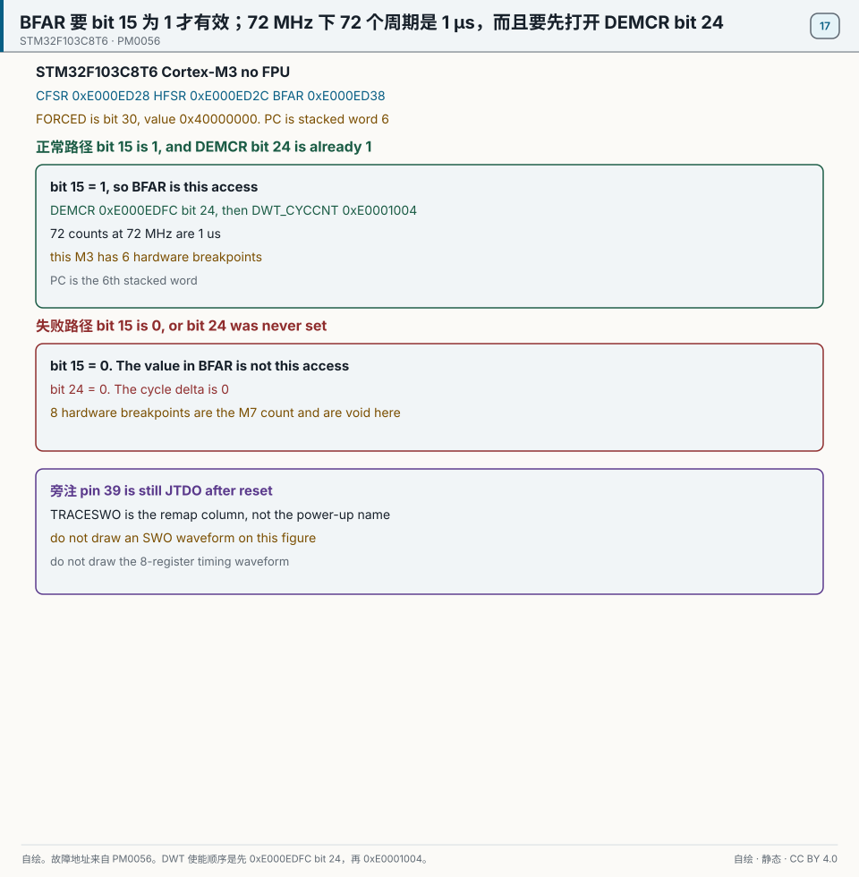
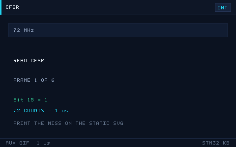

# 17 Debugging and Performance
> 中文：[17 调试与性能优化](../17-调试与性能优化.md)

> Someone who can debug uses three tools together — an SWD breakpoint, an SWO print, and the HardFault registers — and finds in a few minutes a bug that would cost someone else a day. Someone who can optimize uses the DWT timer and DMA and squeezes the cycles dry.

<p align="center">
  
  <br><sub>▲ Animation: SWD debug plus SWO/ITM print tracing (vector animation drawn by the author, not a live recording)</sub>
</p>

<!-- video:ch17 -->
<p align="center">
  <video width="640" controls poster="../../assets/video/ch17-debug.png">
    <source src="../../assets/video/ch17-debug.mp4" type="video/mp4">
  </video>
  <br><sub>▲ Chinese voice-over, 2.7 min. Voice: Microsoft Edge neural voice zh-CN-XiaoxiaoNeural via edge-tts (library mostly LGPLv3; the voice model is an online Microsoft service, not an open model). Pictures are generated from this repo's SVGs, not photographs. Video: <a href="../../assets/video/ch17-debug.mp4">MP4</a> · subtitles: <a href="../../assets/video/ch17-debug.srt">SRT</a>. Rebuild with <code>python3 tools/gen_narrated.py --speak</code>.</sub>
</p>

**Narration script (Chinese, same text as the subtitles)**

1. 会调试的人先收集证据：断点停在哪、关键寄存器是多少、线上到底有没有边沿。不会调试的人靠改一行试试。这一章把证据的三件套配齐。
2. SWD 两根线就能断点。再加 SWO，可以把打印从 ITM 送出来，不必占串口。F103 上 SWO 在 PB3，还要看调试脚的重映射。把这些脚改成普通输出，探针就哑了。
3. 进了硬故障，先读可配置故障状态 CFSR，再读硬故障状态 HFSR，需要时再看总线故障地址 BFAR。然后从栈里把当时的 PC 捞出来，用 addr2line 对回源码行。
4. 这一帧是仓库画的 SWD 加 SWO，不是逻辑分析仪的截图。它提醒你：日志不一定要占 USART。但是调试器要支持 SWO，时钟也要配成它能听懂的频率。
5. 觉得慢，先用 DWT 的周期计数把那段量出来，跑多次取个数。没有数字就去展开汇编，很容易优化了一个根本不占时间的循环。量完再决定要不要交给 DMA。
6. 实验可以故意写一个非法地址，让它进硬故障。如果你能把 CFSR 和栈里的 PC 对回那一行，这套流程才算你的。只在文章里看过，真故障来时还会慌。
7. 功能还不对时，不要先把优化开到最高。优化会把你以为按顺序发生的读写重排。和硬件时序有关的变量要老实标记，优化之后再跑一遍原来的测试。
8. 口诀：硬故障先看 CFSR，再看 HFSR 和栈里的 PC。F103 上 SWO 占 PB3。没有证据就不要改第二处。
9. 调试时一次只改一处，改完立刻复现刚才的现象。同时改三处，好了也不知道是谁的功劳，坏了更不知道是谁的错。版本管理就是为了能回到上一版。
10. 合上书，三问。F103 的 SWO 占用哪只脚？进硬故障最先看哪个寄存器？为什么优化之前要先有周期计数？
<!-- /video:ch17 -->
## Principle and boundary

This chapter is fixed on STM32F103C8T6. It is a Cortex-M3 and it has no FPU. The fault addresses are the compass cells. See [PM0056](#source-pm0056).

Read `CFSR` first. It is at `0xE000ED28`. `HFSR` is at `0xE000ED2C`. `FORCED` is bit 30, value `0x40000000`: this hard fault was escalated, and the reason is in `CFSR`. `MMFAR` is at `0xE000ED34`. `BFAR` is at `0xE000ED38`.

`BFARVALID` is `CFSR` bit 15. When that bit is 0, the number in `BFAR` is not this access. Treating it as this access is the failure path. `MMFAR` waits for its own valid flag. Until that bit number is printed into a snapshot, the four sections freeze bit 15 only for `BFAR`.

The hardware stack is R0, R1, R2, R3, R12, LR, PC, xPSR. PC is the 6th word. That is the same entry as chapter file 04. The four sections do not write the chapter 04 entry time and do not redraw that figure.

Set bit 24 of `DEMCR` at `0xE000EDFC` before clearing `DWT_CYCCNT` at `0xE0001004` and enabling the cycle counter. At 72 MHz, 72 counts are 1 µs. If bit 24 is clear, the delta of two reads is 0. See [PM0056 DWT](#source-pm0056-dwt).

This M3 has 6 hardware breakpoints. The M7 count of 8 is void on the C8. A data-watchpoint count does not enter this section.

Pin 34 PA13 is SWDIO. Pin 37 PA14 is SWCLK. Pin 39 PB3 is JTDO after reset. TRACESWO is in the remap column after JTAG is turned off and SWD is kept. Calling PB3 SWO from power-up is the failure note. See [DS5319](#source-ds5319-swd).

## Key figures

<p align="center">
  
  <br><sub>▲ Drawn for this book. The normal path is CFSR at 0xE000ED28 with bit 15 set, BFAR at 0xE000ED38 for this access, DEMCR at 0xE000EDFC with bit 24 set, and 72 counts as 1 µs. The failure path reads BFAR while bit 15 is 0, or leaves bit 24 clear and reads a cycle delta of 0. HFSR bit 30 is 0x40000000. Pin 39 stays labeled JTDO. Sources: [PM0056](#source-pm0056) and [PM0056 DWT](#source-pm0056-dwt).</sub>
</p>

<p align="center">
  
  <br><sub>▲ Auxiliary figure for the web and for posts. It plays only the normal path: read CFSR, bit 15 is 1, then 72 counts finish 1 µs. Print from the static figure. A clear bit 15 and a cycle delta of 0 are not on this GIF.</sub>
</p>

`debug-swo.svg` stays as an auxiliary figure. SWO and ITM are not on this static figure.

## Timing or state

| Register or count | Address or bit | When it is valid |
| --- | --- | --- |
| `CFSR` | `0xE000ED28` | read this first |
| `HFSR` bit 30 | `0x40000000` | `FORCED` |
| `MMFAR` | `0xE000ED34` | wait for its own valid flag. Do not invent the bit number |
| `BFAR` | `0xE000ED38` | only when bit 15 is 1 |
| Failure | bit 15 is 0 | the address is void |
| DWT | `0xE000EDFC` bit 24, then `0xE0001004` | 72 counts are 1 µs |
| Failure | bit 24 is 0 | the delta is 0 |
| Hardware breakpoints | 6 | this M3. The M7 count of 8 is void |
| Pins | pin 34 PA13, pin 37 PA14 | SWD. Pin 39 PB3 is JTDO by default |

## Pitfalls and source cards

| What you see | Why | What to do | Source | Claim this source may support |
| --- | --- | --- | --- | --- |
| `BFAR` holds a number that is not this access | bit 15 is 0 | Read `CFSR` bit 15 first | [PM0056](#source-pm0056) | When bit 15 is 0, `BFAR` is not this access. `BFAR` is at `0xE000ED38` |
| HardFault is answered by only a reset | The fault registers were not kept | Keep `CFSR` and the stacked PC | [PM0056](#source-pm0056) | `CFSR` is at `0xE000ED28`. `FORCED` is `HFSR` bit 30, value `0x40000000` |
| A DWT measurement reads 0 | Trace was not enabled | Set `DEMCR` bit 24, then enable `CYCCNT` | [PM0056 DWT](#source-pm0056-dwt) | With bit 24 clear the cycle counter does not run. At 72 MHz, 72 counts are 1 µs |
| The 7th breakpoint does not stop | The comparators are used up | This M3 has 6 hardware breakpoints | [PM0056 DWT](#source-pm0056-dwt) | The default is 6. The M7 count of 8 is void on the C8. This row does not set a data-watchpoint count |
| SWO has no waveform, and PB3 was treated as already open | After reset it is not SWO | Pin 39 is JTDO | [DS5319](#source-ds5319-swd) | TRACESWO is in the remap column. It is not PA13 and not PA14 |
| The assert still fires after optimization, but the timing changed | There is no cycle count under the same conditions | Keep bit 24 and `CYCCNT` before changing the optimization level | [PM0056 DWT](#source-pm0056-dwt) | A speedup without that pair is not evidence. This row adds no new compiler switch |
## 📌 Learning goals

- [ ] Tell SWD and JTAG apart by their pins and their trade-offs, and understand why SWD is the mainstream choice.
- [ ] Use SWO / ITM for a `printf` trace that does not occupy a UART.
- [ ] Know how many hardware breakpoints and software breakpoints you get, and how they differ.
- [ ] Use the three-piece HardFault kit: `CFSR` / `HFSR` / `BFAR`, plus the stack unwind, plus `addr2line`.
- [ ] Measure a signal with a logic analyzer or a scope, and measure code time with the DWT.
- [ ] Remember the usual optimizations — `-O2` / `-Os`, DMA, cache — and the things to watch.

## 🧠 Core ideas

### 1. SWD vs JTAG

**Conclusion**: **SWD uses only 2 signal wires (SWDIO + SWCLK) plus GND.** It uses fewer pins than JTAG, and it is the debug interface of choice on Cortex-M. JTAG is mainly for a daisy chain of several devices, or for older tools.

| Item | SWD | JTAG |
| --- | --- | --- |
| Signal wires | SWCLK, SWDIO (2 wires) | TCK, TMS, TDI, TDO (4 wires, plus optional TRST) |
| Pins used | Few (PA13 / PA14) | Many (PB3 / PB4 / PA15, plus PA13 / PA14) |
| Speed | Fast (can reach 10+ MHz) | Fast |
| Several devices | No daisy chain | Supported |
| Typical tools | ST-Link, J-Link, DAPLink | J-Link, older JTAG probes |
| STM32 support | ✅ (recommended) | Supported, but rarely used |

> ⚠️ After reset, STM32 keeps **PA13 (SWDIO) and PA14 (SWCLK)** for the debug port by default. If you configure them as ordinary GPIO and turn debug off, you get "I programmed it and now I cannot connect." Leave `SWD` enabled, or keep a fallback through `HAL_DBGMCU`.

"Up to 10+ MHz" is not a rate that DS5319 or PM0056 has taken into a source card. The four sections do not write that number. The "2 to 4" data watchpoints stay out of the four sections too.

### 2. SWO / ITM / printf tracing

**Conclusion**: **SWO (Serial Wire Output)** lets the MCU send debug information out of the SWO pin through the **ITM**. It **does not occupy a UART**, and it does not block. It is the most elegant way to log.

| Mechanism | What it is |
| --- | --- |
| ITM (Instrumentation Trace Macrocell) | A trace unit inside the core. It can drive 32 channels (port 0 is the usual printf port) |
| SWO (Serial Wire Output) | Reuses the SWD physical connection and adds an ITM output (you need 3-wire SWD plus SWO) |
| `ITM_SendChar` | The low-level function you redirect `printf` to |
| What you need first | A debugger that supports SWO (ST-Link V2-1 or J-Link), and the SWO clock configured in the IDE |

```c
/* Redirect printf to the ITM; no UART needed */
int __io_putchar(int ch)
{
    ITM_SendChar(ch);
    return ch;
}
```

### 3. Breakpoint types and how many you get

**Conclusion**: The number of hardware breakpoints is **very small** (usually **6** on Cortex-M3 / M4, usually **8** on M7), and the count is set by the chip's FPB unit. Software breakpoints are unlimited, but they **rewrite Flash**.

| Type | How it works | How many | Limit |
| --- | --- | --- | --- |
| Hardware breakpoint | The FPB compares the address | 6 (M3 / M4) / 8 (M7) | The count is fixed. You cannot set one on a data address in RAM |
| Software breakpoint | Replace the instruction with `BKPT` | Unlimited | Needs writable memory (Flash has to be rewritten by the debugger). The breakpoint site is briefly modified |
| Data watchpoint | The DWT compares a data address | 2 to 4 | Halt when a variable is read or written |

> If a breakpoint will not set, or you are over the limit, delete the old ones. The debugger will usually fill in with software breakpoints on its own.

### 4. The three-piece HardFault kit

**Conclusion**: Once you are in HardFault, read **`CFSR` (configurable fault status), then `HFSR` (HardFault status), then `BFAR` (bus-fault address)**. Then **recover the PC at the time of the fault from the stack**. Finally use **`addr2line` or the `.map` file** to land on the source line.

| Register | Full name | Key bits | Meaning |
| --- | --- | --- | --- |
| `SCB->CFSR` | Configurable Fault Status | `MMARVALID` / `BFARVALID` | Whether the faulting address was recorded |
| `SCB->CFSR` | Same | `IMPRECISERR` and others | Precise or imprecise bus error |
| `SCB->HFSR` | HardFault Status | `FORCED` | Whether a fault was escalated and forced in here |
| `SCB->BFAR` | BusFault Address | The address | The address of the illegal access (if `BFARVALID=1`) |
| `SCB->MMFAR` | MemManage Address | The address | The address of an MPU violation |

**Unwinding the stack**: on entry to the exception, the core pushes `R0–R3, R12, LR, PC, xPSR`. PC is the address of the faulting instruction.

```c
/* Recover the faulting PC from MSP or PSP */
void HardFault_Handler(void)
{
    __asm volatile (
        "TST LR, #4        \n"   /* which stack: MSP or PSP */
        "ITE EQ            \n"
        "MRSEQ R0, MSP     \n"
        "MRSNE R0, PSP     \n"
        "B hard_fault_handler_c \n"
    );
}
```

```c
void hard_fault_handler_c(uint32_t *stack)
{
    volatile uint32_t r0  = stack[0];
    volatile uint32_t r1  = stack[1];
    volatile uint32_t r2  = stack[2];
    volatile uint32_t r3  = stack[3];
    volatile uint32_t r12 = stack[4];
    volatile uint32_t lr  = stack[5];
    volatile uint32_t pc  = stack[6];    /* ← address of the faulting instruction */
    volatile uint32_t psr = stack[7];
    volatile uint32_t cfsr = SCB->CFSR;
    volatile uint32_t hfsr = SCB->HFSR;
    volatile uint32_t bfar = SCB->BFAR;

    (void)r0;(void)r1;(void)r2;(void)r3;(void)r12;(void)lr;(void)psr;
    (void)cfsr;(void)hfsr;(void)bfar;
    for (;;) { }                         /* breakpoint here and inspect the variables above */
}
```

**Turn the PC into a source line with addr2line** (GCC toolchain):

```bash
arm-none-eabi-addr2line -e build/app.elf -f -C 0x08001a3c
# output: function name + file:line
```

> With Keil, look up the faulting PC in the symbol ranges of the `.map` file, or use the IDE's Call Stack window.

### 5. Logic analyzer / oscilloscope

| Tool | What it shows | Typical use |
| --- | --- | --- |
| Logic analyzer (8 channels, 24 MHz and up) | Digital timing | Capture I2C / SPI / UART / CAN timing and decode the protocol |
| Oscilloscope | Analog waveform | PWM rising edge, supply ripple, signal integrity |
| Mixed-signal scope (MSO) | Digital plus analog | Timing and the analog waveform together |
| Current probe / power profiler | Current waveform | Checking low power (see [Chapter 16](16-low-power.md)) |

> A logic analyzer is good at "is the protocol right." A scope is good at "is the signal healthy." An intermittent bus error needs both.

### 6. Ways to speed the code up

**Conclusion**: **Measure first**, then optimize (time it with the DWT). The usual moves, in order of payoff: **hand the copies to DMA, then raise the compiler optimization, then cut floating point and division, then cache and prefetch, then assembly.**

| Move | What to do | Watch out |
| --- | --- | --- |
| Compiler optimization | `-O2` (speed) / `-Os` (size) | `-O0` is easy to single-step and slow. Use `volatile` so a value is not optimized away |
| DMA | Hand UART / ADC / SPI data movement to DMA | See [Chapter 10](10-dma.md). Watch cache coherency |
| Bit-band / bit operations | Replace division and modulo with bit operations | Division is more than ten times slower than a shift |
| Fixed point instead of floating point | Use Q-format fixed point | Especially visible on an M3 with no FPU |
| FPU | Turn on hardware floating point on M4F / M7 | Compile with `-mfpu=fpv4-sp-d16 -mfloat-abi=hard` |
| Cache / ART | The F4 ART accelerator, and I-Cache / D-Cache on H7 | H7 DMA has to maintain the cache |
| Inline / macros | `static inline` on a hot function | Too much inlining grows the image |
| Lookup tables | A LUT instead of computing it live | You spend Flash to buy speed |

**DWT timing (accurate to a CPU cycle)**:

```c
/* Time a stretch of code with the DWT CYCCNT counter (F1 and F4 both support it) */
static void DWT_Init(void)
{
    CoreDebug->DEMCR |= CoreDebug_DEMCR_TRCENA_Msk;  /* enable trace */
    DWT->CYCCNT = 0;
    DWT->CTRL  |= DWT_CTRL_CYCCNTENA_Msk;            /* enable the cycle counter */
}

static uint32_t DWT_Cycles(void) { return DWT->CYCCNT; }

void Measure(void)
{
    DWT_Init();
    uint32_t t0 = DWT_Cycles();
    /* code under test */
    for (volatile int i = 0; i < 1000; i++) { }
    uint32_t dt = DWT_Cycles() - t0;                 /* cycle count */
    float us = (float)dt / (SystemCoreClock / 1000000.0f);
    (void)us;                                        /* convert to microseconds */
}
```

### 7. Common HardFault causes

| What you see / which fault bit | Usual cause | Fix |
| --- | --- | --- |
| `IMPRECISERR` plus `BFARVALID` | Touching a peripheral whose clock is off, or a wild pointer | Call `__HAL_RCC_xxx_CLK_ENABLE` first, and read `BFAR` |
| `PRECISERR` | An illegal memory access (a null pointer, or past the end of an array) | Check the pointer and the array bounds |
| `UNDEFINSTR` | A jump to an illegal address (a bad function pointer, or a smashed stack) | Check function pointers and the stack size |
| `INVSTATE` | The jump target is not a Thumb instruction (bit0 = 0) | Bit 0 of the entry address must be 1 |
| `INVPC` | LR is illegal on exception return | The interrupt corrupted LR, or the stack is scrambled |
| `FORCED` and `CFSR=0` | An escalated fault, or a missing vector | Check the vector table `SCB->VTOR` and the linker script |
| Divide by zero (silent unless DIV_0_TRP is on) | Divide-by-zero trapping is not enabled | `SCB->CCR \|= SCB_CCR_DIV_0_TRP_Msk` |
| Stack overflow | A large local array, or recursion that is too deep | Enlarge the stack, and turn on stack-overflow detection |

## 🛠️ Hardware and wiring

| Board | Interface | Pin | Notes |
| --- | --- | --- | --- |
| BluePill (F103) | SWD | PA13 = SWDIO, PA14 = SWCLK, GND, 3V3 | Four wires are enough to program and debug |
| BluePill | SWO | PB3 (optional; needs `SWJ_CFG` in `AFIO_MAPR`) | Only J-Link and ST-Link V2-1 support it |
| Nucleo-F411RE | SWD plus SWO | On-board ST-Link, SB jumpers | SWO works directly |
| J-Link | SWD | Same as above | Supports SWO / ITM and RTT |
| Any | Logic analyzer | Clip onto SCL / SDA / MOSI and similar | Capture timing and decode |
| Any | Oscilloscope | Probe on the signal under test | Look at waveform quality |

> ⚠️ SWD needs only four wires: **SWCLK, SWDIO, GND, and 3V3**. **GND must be common**, or it will not connect. If the board was configured with debug turned off, recover it by holding reset at the moment of power-up and then connecting, or by pulling BOOT0 high and booting from system memory.

## 💻 Code

**① Redirect printf to SWO / ITM (ready to use)**

```c
#include "stm32f1xx_hal.h"
#include <stdio.h>

/* Redirect the low-level character output to ITM port 0 (SWO) */
int __io_putchar(int ch)
{
    ITM_SendChar((uint32_t)ch);
    return ch;
}

void Log_Init(void)
{
    /* No extra init. Enable SWD in CubeMX.
       In the IDE, set the SWO clock equal to the core clock, and you will see printf */
}

void Log_Demo(void)
{
    printf("sysclk = %lu Hz\r\n", (unsigned long)SystemCoreClock);
}
```

**② Keep the SWD pins (so a bad remap does not lock you out)**

```c
/* If you must reuse PA13/PA14, at least keep SWD; otherwise you may not be able to connect after programming */
__HAL_RCC_AFIO_CLK_ENABLE();
__HAL_AFIO_REMAP_SWJ_NOJTAG();   /* turn off JTAG only and keep SWD (PA13/PA14 still debug) */
```

**③ Trap divide-by-zero and illegal accesses (turn a hidden bug into a HardFault)**

```c
void Fault_Enable(void)
{
    SCB->CCR |= SCB_CCR_DIV_0_TRP_Msk;   /* divide-by-zero raises UsageFault */
    SCB->SHCSR |= SCB_SHCSR_USGFAULTENA_Msk
               |  SCB_SHCSR_BUSFAULTENA_Msk
               |  SCB_SHCSR_MEMFAULTENA_Msk;  /* enable the three fault types separately */
}
```

**④ HardFault handler (pair it with the stack unwind in section 4, and print the registers directly)**

```c
void hard_fault_handler_c(uint32_t *stack)
{
    printf("HardFault! PC=0x%08lX LR=0x%08lX\r\n",
           (unsigned long)stack[6], (unsigned long)stack[5]);
    printf("CFSR=0x%08lX HFSR=0x%08lX BFAR=0x%08lX\r\n",
           (unsigned long)SCB->CFSR,
           (unsigned long)SCB->HFSR,
           (unsigned long)SCB->BFAR);
    for (;;) { }
}
```

**⑤ DWT timing (compare memcpy with DMA, and similar)**

```c
static inline void DWT_DelayInit(void)
{
    CoreDebug->DEMCR |= CoreDebug_DEMCR_TRCENA_Msk;
    DWT->CYCCNT = 0;
    DWT->CTRL  |= DWT_CTRL_CYCCNTENA_Msk;
}

/* Usage:
   DWT_DelayInit();
   uint32_t t0 = DWT->CYCCNT;  ...code under test...  uint32_t dt = DWT->CYCCNT - t0;
   time (us) = dt / (SystemCoreClock / 1000000)  */
```

> Compiler optimization: use `-O2` (speed) or `-Os` (size) for Release, and `-Og` (you can still single-step) for debug. **After optimization you may not be able to see a variable.** Use `volatile`, or drop a local region to `-O0`, while you hunt the bug.


## 🧪 Hands-on labs

1. **Print over SWO**: redirect `printf` to the ITM and watch the output in the IDE's SWV / ITM window. Expected: you see the log with no UART connected.
2. **Cause a HardFault and find it**: write `*(volatile uint32_t*)0xDEADBEEF = 1;`. In the HardFault handler, print `CFSR`, `BFAR`, and `PC`, and locate the line with `addr2line`. Expected: it points back at that line.
3. **Compare times with the DWT**: time a software `memcpy` and a DMA copy of the same amount of data (see [Chapter 10](10-dma.md)). Expected: the CPU time of the DMA version is close to 0.
4. **(Further) Decode I2C with a logic analyzer**: capture one OLED write transaction ([Chapter 07](07-i2c.md)) and restore the address and the data with a decoder. Expected: you can see address 0x3C and the ACK.
5. **(Further) Compare optimization levels**: time the same floating-point-heavy code at `-O0` and at `-O2` with the DWT. Expected: `-O2` is several times faster.

## 🔗 Related resources

- The Debug support (DBGMCU) chapter of RM0008 and RM0090 (debug-port configuration, and debugging in low power).
- *The Definitive Guide to ARM Cortex-M3 and Cortex-M4 Processors*: fault exceptions, `CFSR` / `HFSR` / `BFAR`, and the stack frame.
- ARMv7-M Architecture Reference Manual (ARM DDI 0403): the exception model, FPB, and DWT.
- Tool docs: SWO / ITM setup for ST-Link and J-Link, and `arm-none-eabi-addr2line`.
- Related chapters: [Chapter 10](10-dma.md) DMA, [Chapter 16](16-low-power.md) low power (measuring power), and [Chapter 04](04-interrupts-nvic.md) interrupts and NVIC.
- Figure: `../../assets/animations/debug-swo.svg` (vector drawing by the author).
