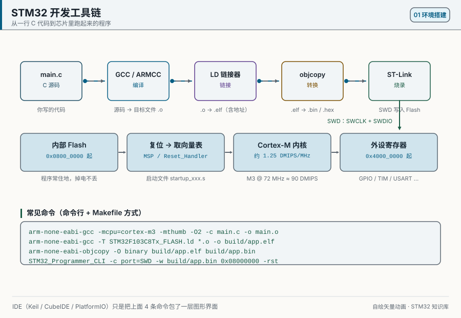
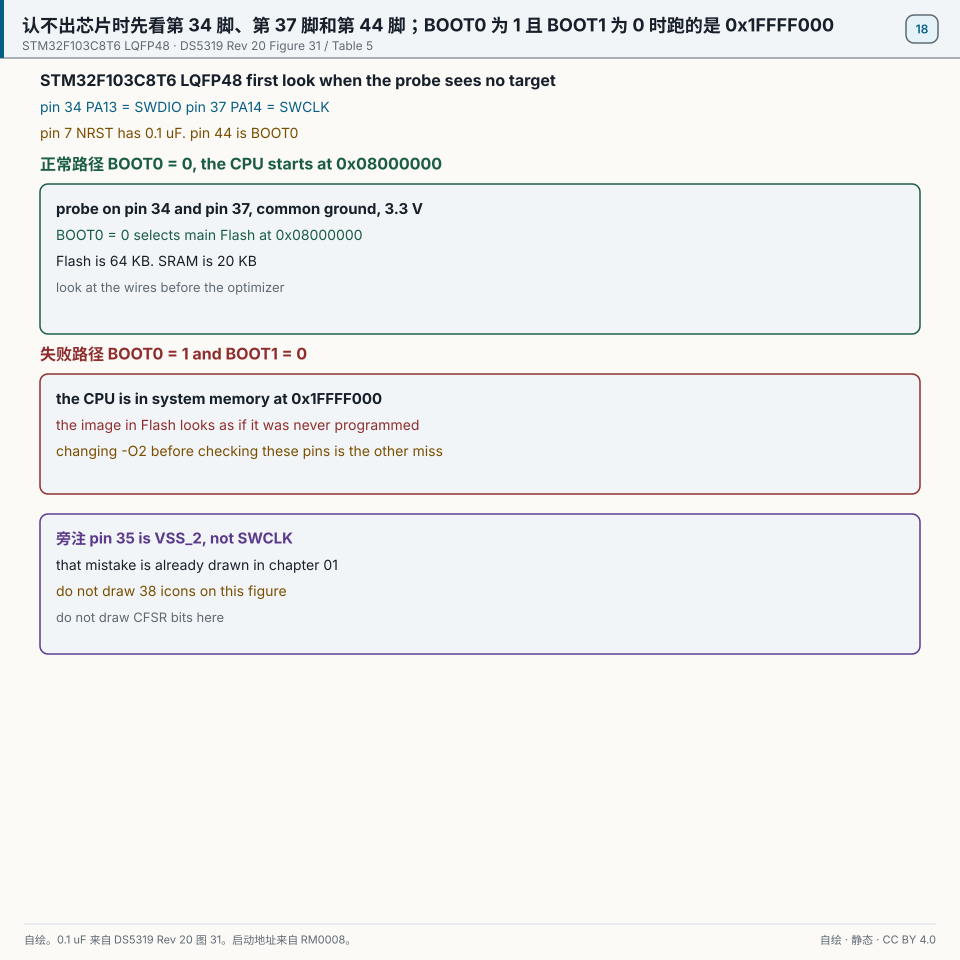
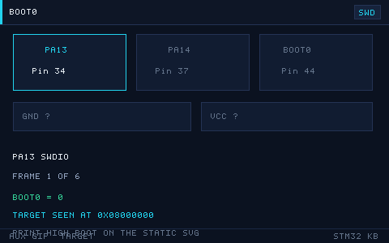
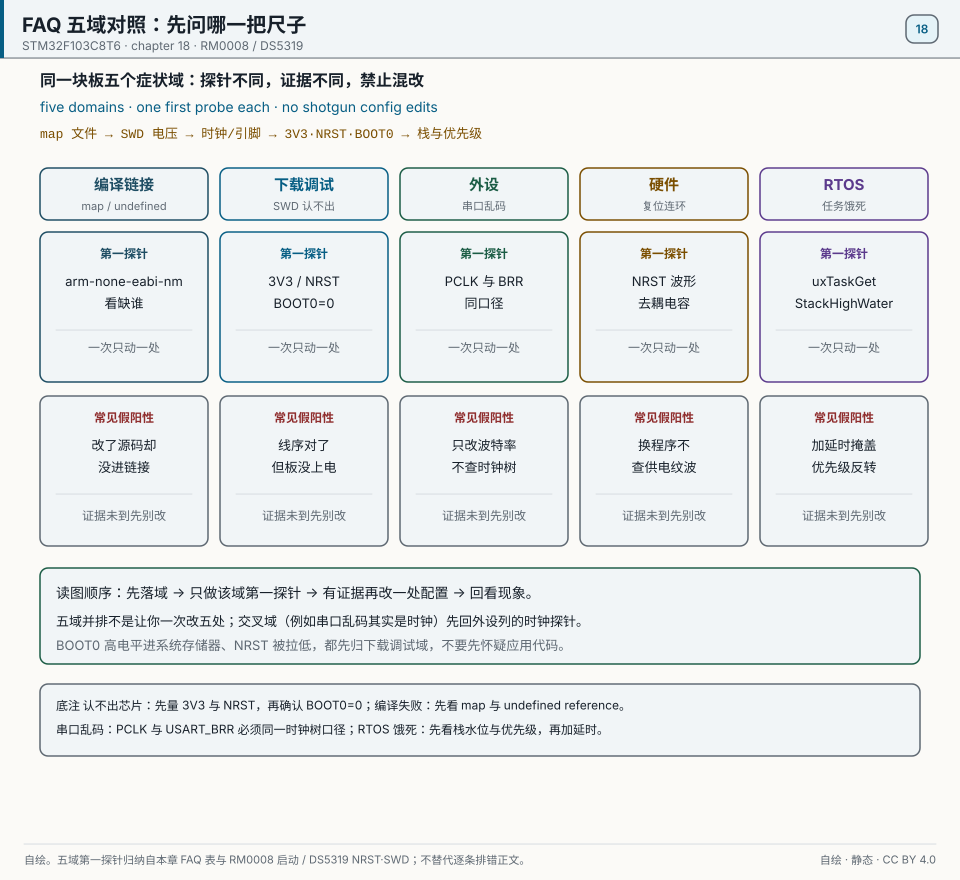

# 18 FAQ

> 中文：[18 常见问题 FAQ](../18-常见问题FAQ.md)

> Start from the first boundary you can verify: did an ELF exist, can the probe read the ID, is there a pin waveform, and what do the status registers say? The FAQ gives the next check, not permission to change five settings at once.

  
   ▲ Animation: the data flow from compile to link to flash to run (author-drawn vector, not a photograph)

<!-- video:ch18 -->

  <video width="640" controls poster="../../assets/video/ch18-faq.png">
    <source src="../../assets/video/ch18-faq.mp4" type="video/mp4">
  </video>
   ▲ Chapter video with Chinese voice-over (2.5 min). <a href="../../assets/video/ch18-faq.mp4">MP4</a> · <a href="../../assets/video/ch18-faq.srt">subtitles</a>

Narration script (Chinese, same text as the subtitles)

1. 排错不要从改代码开始。先让现象稳定复现，再退到只点灯或只回环的最小工程。最小工程是好的，问题就在你后来加的那一块里。
2. 这一章的五步是：复现，最小化，二分，看证据，对照手册。前两步能解决大多数问题。一上来就二分一大坨新代码，你会把时间花在来回编译上。
3. 编译报一长串时，先看第一处真正的错误。找不到头文件，多半是包含路径，不是语法突然坏了。链接报未定义的符号，再去看你有没有把对应的源文件加进工程。
4. 这一帧是仓库画的分层。现象在引脚上，就同时怀疑引脚模式和接线。现象在 HAL 返回值里，就打印那个状态码，再对照它碰过的寄存器。不要每一层同时盲改。
5. 下载失败时，先看供电、地、SWD 两根线和复位。芯片认不出，就不要查优化等级。BOOT0 被拉高时，它跑的是系统存储器，你的程序看起来像没烧进去。
6. 外设完全没反应，老三样：时钟开了没有，引脚复用对不对，该清的标志清了没有。这三样过完，再去看波特率、过滤器和采样时间。顺序反了，会在细节里耗掉一个晚上。
7. 三条铁律：能测就别猜，先共地再看信号，一次只改一处。猜测式修改会让两个错误叠在一起，最后谁也不认领。
8. 这一章建议你故意制造一次错误，比如删掉一个头文件路径，看编译器怎么说，再改回来。见过真实报错的人，下次不会从最后一行开始慌。
9. 口诀：先复现，再缩到最小。前两步走完还不知道范围，再去二分和看证据。能测就别猜。
10. 合上书，三问。排错五步的前两步是什么？调试器认不出芯片时，先查代码还是先查线和 BOOT？为什么一次只改一处？

<!-- /video:ch18 -->
## Principle and scope

This chapter is a troubleshooting index. Each row gives the symptom, the likely cause, and the chapter to read; the theory stays in those chapters. The part is still the STM32F103C8T6. There are 38 rows, numbered by category: C1 through C8 is 8, D1 through D7 is 7, P1 through P9 is 9, H1 through H7 is 7, and R1 through R7 is 7. `8 + 7 + 9 + 7 + 7 = 38`.

When the probe reports no target, look first at pin 34 PA13 = SWDIO, pin 37 PA14 = SWCLK, a shared ground, 3.3 V, and pin 7 NRST. Figure 31's external reset capacitor is 0.1 µF. Only after those check out, look at the code and the optimization level. With a wrong wire, changing `-O2` changes nothing and just adds another variable. See [DS5319 SWD](#source-ds5319-swd).

Pin 44 BOOT0 = 0 starts from main Flash at `0x08000000`. BOOT1 = 0 and BOOT0 = 1 enters system memory at `0x1FFFF000`. The `0x1FFFB000` often seen online belongs to the connectivity line (F105/F107), and the C8 is not one. The BOOT pins are latched on the 4th SYSCLK rising edge after reset (chapter 00). Pin 35 is VSS_2, not SWCLK; some old pinout drawings get it wrong, and chapter 01 has the comparison. See [RM0008 boot](#source-rm0008-boot).

The C8 has 64 KB of Flash and 20 KB of SRAM. When HSE fails to start, SYSCLK falls back to the 8 MHz HSI, and USART1 with `0x271` on that clock runs at 12800, not 115200, so the serial output is garbage. Waking from Stop in chapter 16 fails the same way. See [RM0008 USART](#source-rm0008-usart).

LSE stays 32.768 kHz, pins 3 and 4, pin 1 VBAT, and PRL = 32767. Choose the capacitors in the 5 pF to 15 pF range with the crystal. 6 pF is not required. See [DS5319 LSE](#source-ds5319-lse).

The repository example puts the HAL time base on TIM4, not a generic TIMx. Leave SysTick to the kernel. One tick is 1 ms. See [repository examples](#source-project-examples). A FromISR call needs a numeric priority of 5 or a larger number. `5 << 4 = 0x50`. The reason is in the chapter 15 priority figure. See [FreeRTOS](#source-freertos-syscall).

Wire the external lamp as in chapter 03: pin 10 PA0 through 270 Ω. Pin 2 PC13 sits behind the backup-domain power switch. Note 5 of the datasheet limits it to sinking at most 3 mA at up to 2 MHz, and forbids using it as a current source for an LED. The on-board LED is wired to sink. See [DS5319 GPIO](#source-ds5319-gpio).

## Key figures

  
   ▲ Drawn for this book. The top band shows the normal case: pin 44 BOOT0 = 0, start at 0x08000000, probe on pin 34 PA13 and pin 37 PA14, and 0.1 µF on pin 7 NRST as in Figure 31. The middle band shows two common mistakes: BOOT0 = 1 with BOOT1 = 0, so the CPU runs system memory at 0x1FFFF000; or changing the optimization level before checking those four pins. Pin 35 is VSS_2; see chapter 01. Sources: [DS5319](#source-ds5319-swd) Figure 31 and Table 5, and [RM0008 boot](#source-rm0008-boot).

  
   ▲ Animated version. It shows only the normal case: pin 44 is 0, the probe is on pins 34 and 37, and the debugger finds the chip. The printed book has only the static figure above.

The whole path from compile to download is in the opening `toolchain-flow.svg` animation.

## Timing and state

| Look at this first | Value | Next step |
| --- | --- | --- |
| Pins 34 and 37 | PA13 = SWDIO, PA14 = SWCLK, shared ground, 3.3 V | Do not edit code until these are connected |
| NRST | Pin 7, 0.1 µF | As in DS5319 Figure 31 |
| BOOT | BOOT0 = 0, main Flash `0x08000000` | Normal |
| Failure | BOOT0 = 1 and BOOT1 = 0, `0x1FFFF000` | The user program looks unprogrammed. `0x1FFFB000` is the connectivity-line address |
| Optimization | `-O2` before the wires are checked | Failure |
| Capacity | 64 KB Flash, 20 KB SRAM | Write the linker script with these |
| UART | HSI at 8 MHz and `0x271` still loaded | 12800 |
| Time base | TIM4, 1 ms | Not a generic TIMx |
| Priority | A number of 5 or larger | `5 << 4 = 0x50` |
| Crystal | 5 pF to 15 pF, chosen with the crystal | 6 pF is not required |

## Pitfalls and sources

| What you see | Why | What to do | Source | What the source shows |
| --- | --- | --- | --- | --- |
| The probe reports no target | The wires were not checked | Look at pins 34 and 37, ground, and 3.3 V first | [DS5319 SWD](#source-ds5319-swd) | Pin 34 PA13 is SWDIO. Pin 37 PA14 is SWCLK. Pin 35 is VSS_2 |
| The program looks unprogrammed | Pin 44 is pulled high | Put BOOT0 back to 0 | [RM0008 boot](#source-rm0008-boot) | BOOT1=0 and BOOT0=1 enters `0x1FFFF000`. The C8 is not a connectivity-line part |
| The reset pin is open and the board resets itself | The capacitor is not the Figure 31 cell | Add 0.1 µF as Figure 31 draws it | [DS5319 NRST](#source-ds5319-nrst) | Figure 31's external reset circuit is 0.1 µF |
| The link says Flash or RAM is too small | The estimate used a larger part | Use the C8 cells, 64 KB and 20 KB | [DS5319 SWD](#source-ds5319-swd) | 128 KB is the xB size (the CB, for example); the C8T6 has 64 KB |
| Serial data is garbage and the clock was not checked | The clock fell back to HSI | Confirm it is not sitting at 8 MHz | [RM0008 USART](#source-rm0008-usart) | `0x271` is 115200 at 72 MHz and 12800 at 8 MHz |
| Row P9 was built with 6 pF | One capacitor was treated as required | Choose the capacitors with the crystal, from 5 pF to 15 pF | [DS5319 LSE](#source-ds5319-lse) | 6 pF is not a required value printed in the LSE section. 32.768 kHz and PRL = 32767 are covered in chapter 11 |
| `HAL_Delay` does not return after FreeRTOS is added | The time base is still SysTick | Move the time base to TIM4 | [repository examples](#source-project-examples) | The time base in `examples/freertos-task` is TIM4 |
| An interrupt stops in `configASSERT` | The numeric priority is too urgent | Use 5 or a larger number | [FreeRTOS](#source-freertos-syscall) | `5 << 4 = 0x50`. A smaller number must not call FromISR |
| An external lamp stays dark while the resistor is guessed inside a range | The pin and the resistor were never fixed | Use pin 10 and 270 Ω from chapter 03 | [DS5319 GPIO](#source-ds5319-gpio) | Pin 2 PC13 cannot source the current |
## Learning goals

- [ ] Build the habit of searching by symptom, instead of editing code at random.
- [ ] Remember the **top cause** in each family, and check the frequent items first.
- [ ] Use a minimal check (blink an LED, loop a byte back) to isolate the problem quickly.
- [ ] Know which traps are configuration, which are hardware, and which are timing.

> How to use this page: 38 entries. The prefix `C*` is build and link, `D*` is download and debug, `P*` is peripherals, `H*` is hardware, and `R*` is RTOS and toolchain.

## 1. Build and link

**C1 Cannot find `stm32f1xx_hal.h`**
- **Symptom**: the build reports `fatal error: stm32f1xx_hal.h: No such file or directory`.
- **Cause**: the include path does not contain the HAL `Inc` directory.
- **Fix**: add `Drivers/STM32F1xx_HAL_Driver/Inc` and `Core/Inc` to the project's include path, or to `CMakeLists.txt`.

**C2 The link reports `undefined reference to HAL_GPIO_Init`**
- **Symptom**: compilation succeeds, then the link reports an undefined symbol.
- **Cause**: the matching HAL source file was not compiled (`stm32f1xx_hal_gpio.c`).
- **Fix**: add the HAL sources you actually use. In a CubeMX project, `HAL_MODULE_ENABLED` selects them.

**C3 `region FLASH overflowed by N bytes`**
- **Symptom**: the link reports that the ROM region overflowed.
- **Cause**: code and constants exceed the part's Flash (an F103C8 has only 64 KB).
- **Fix**: turn on `-Os`, drop floating-point `printf`, and remove unused libraries. Or move to a part with more Flash.

**C4 `region RAM overflowed`**
- **Symptom**: the link reports that RAM is short.
- **Cause**: a global array is too large, or the stack and heap reservations are too large (an F103C8 has only 20 KB of RAM).
- **Fix**: shrink the global buffers, or edit `_Min_Heap_Size` and `_Min_Stack_Size` in the linker script.

**C5 Redefinition: `multiple definition of 'xxx'`**
- **Symptom**: the link reports a symbol defined more than once.
- **Cause**: a variable was defined in a header without `static` or `extern`, and several `.c` files included it.
- **Fix**: the header holds only an `extern` declaration. The definition lives in a `.c` file.

**C6 `printf` prints garbage, or prints nothing**
- **Symptom**: the serial port receives garbage or blank lines.
- **Cause**: `printf` floating-point or semihosting setup, or `_write` / `__io_putchar` was never redirected.
- **Fix**: redirect `__io_putchar` to the UART. Add `-u _printf_float` if you need floating point.

**C7 The build reports `arm-none-eabi-gcc: not found`**
- **Symptom**: a command-line build fails.
- **Cause**: the toolchain is not installed, or it is not on `PATH`.
- **Fix**: install the GNU Arm Embedded Toolchain and set the environment variable, or use the toolchain that ships with CubeIDE.

**C8 The generated bin/hex is much larger than you expected**
- **Symptom**: the firmware image is far bigger than it should be.
- **Cause**: unused libraries, debug info, and full-format `printf` are still in the image.
- **Fix**: turn on `-Os`, add `-ffunction-sections -fdata-sections`, and pass `--gc-sections` so the linker drops dead code.

## 2. Download and debug

**D1 `No target connected` / the probe cannot see the target**
- **Symptom**: the programmer says it cannot find the target.
- **Cause**: SWD is wired backwards, ground is not shared, the board has no power, or the debug port was switched off.
- **Fix**: check SWDIO, SWCLK, GND, and 3V3. Power the board on its own. Hold reset, then connect.

**D2 After flashing, the board acts bricked and never connects again**
- **Symptom**: once the program is downloaded, SWD disappears.
- **Cause**: the program configured PA13/PA14 as plain GPIO and turned SWD off.
- **Fix**: hold NRST at the moment of power-up, then click download. Or pull BOOT0 high, boot from system memory, and mass-erase with STM32CubeProgrammer.

**D3 `Flash Download failed - Target DLL has been cancelled`**
- **Symptom**: the download fails partway through.
- **Cause**: the Flash algorithm or the clock does not match the part, or readout protection is on.
- **Fix**: match the Flash algorithm to the part number. Clear readout protection (`Option Bytes`, RDP).

**D4 Breakpoints do nothing while debugging**
- **Symptom**: a breakpoint is skipped, or the tool says you have too many.
- **Cause**: the hardware breakpoints are used up (M3/M4 have only 6), or the code sits in read-only Flash.
- **Fix**: delete extra breakpoints and use software breakpoints. For a debug build, turn optimization off (`-O0` or `-Og`).

**D5 Single-step "jumps around"**
- **Symptom**: the line number hops while you single-step.
- **Cause**: the compiler reordered instructions, or it inlined the function.
- **Fix**: set the debug configuration to `-O0` or `-Og`.

**D6 ST-Link says its firmware is too old**
- **Symptom**: connecting prompts you to upgrade the ST-Link firmware.
- **Cause**: the old firmware does not match the new tools.
- **Fix**: upgrade with the ST-Link Upgrade tool. Be careful with a clone ST-Link: an upgrade can brick it.

**D7 The program stops in `HardFault_Handler` as soon as you start debugging**
- **Symptom**: a debug session starts already in HardFault.
- **Cause**: clock or peripheral init walked off the end of a structure, the vector table is wrong, or the stack is too small.
- **Fix**: read `CFSR` first. `BFAR` is this access only when bit 15 is 1 (see [chapter 17](17-debug.md)). Check the linker script.

  
   ▲ Drawn for this book. Five FAQ domains, one first probe each. Sources: [RM0008 boot](#source-rm0008-boot) and [DS5319 NRST/SWD](#source-ds5319-nrst).

## 3. Peripherals

**P1 A GPIO write does nothing**
- **Symptom**: after `HAL_GPIO_WritePin` the pin does not change.
- **Cause**: the GPIO clock was never enabled.
- **Fix**: call `__HAL_RCC_GPIOx_CLK_ENABLE()`.

**P2 One key press enters the interrupt many times**
- **Symptom**: one press prints several lines.
- **Cause**: the mechanical contact bounced, and nothing debounced it.
- **Fix**: debounce in software with a short delay, or with an RC on the board. In the EXTI handler, reject events that are too close together.

**P3 Serial garbage**
- **Symptom**: everything you receive is garbage.
- **Cause**: the baud rates do not match, ground is not shared, or the clock is not the frequency you planned.
- **Fix**: use the same baud rate on both ends. Share ground. Confirm SYSCLK. If HSE fails to start, SYSCLK is the 8 MHz HSI, and USART1 with `0x271` is 12800 bit/s, not 115200.

**P4 I2C stalls inside `HAL_I2C_Master_Transmit`**
- **Symptom**: the program hangs, or the call times out.
- **Cause**: the pull-up resistors are missing, the address is wrong, or the bus is stuck low.
- **Fix**: put a 4.7 kΩ pull-up on SCL and on SDA. Check the 7-bit address. Recover the bus with 9 clock pulses.

**P5 An SPI Flash read comes back all FF**
- **Symptom**: the data you read is all 0xFF.
- **Cause**: CS was never pulled low, CPOL/CPHA is the wrong mode, or MISO is not connected.
- **Fix**: check the mode (a W25Q uses Mode 0), the chip-select timing, and the wiring.

**P6 ADC readings jump around**
- **Symptom**: the samples are unstable.
- **Cause**: the reference is noisy, the sample time is too short, or the source impedance is high.
- **Fix**: decouple VDDA, lengthen the sample time, and add a small capacitor on the input as a buffer.

**P7 Timer PWM has no output**
- **Symptom**: the oscilloscope shows no waveform.
- **Cause**: PWM was never started (`HAL_TIM_PWM_Start`), the pin alternate function is not set, or the channel is wrong.
- **Fix**: call `HAL_TIM_PWM_Start`, and check the alternate-function pin and the channel.

**P8 DMA moves data only once**
- **Symptom**: DMA transfers once, then stops.
- **Cause**: the channel is in normal mode, and you expected circular mode.
- **Fix**: switch it to `DMA_CIRCULAR`.

**P9 The RTC resets at power-up, or does not advance**
- **Symptom**: the time is gone after power is removed.
- **Cause**: LSE never started, VBAT has no battery, or the load capacitors are too large.
- **Fix**: fit a 32.768 kHz crystal and a battery on VBAT. Choose the load capacitors in the 5 pF to 15 pF range with the crystal. 6 pF is not required. Pins 3 and 4, and PRL = 32767, stay with chapter 11.

## 4. Hardware

**H1 The LED stays dark**
- **Symptom**: the LED does not react when you connect it.
- **Cause**: the polarity is reversed, the series resistor is too large, or the pin cannot source the current.
- **Fix**: check anode and cathode. The external lamp is pin 10 and 270 Ω, the same as chapter 3. Pin 2 PC13 cannot source the current. For a large current, drive the LED with a transistor or a MOSFET.

**H2 The chip gets very hot**
- **Symptom**: it is hot to the touch.
- **Cause**: a pin is shorted, 5 V was forced into a 3.3 V pin, or the supply is reversed.
- **Fix**: remove power immediately. Look for shorts and check the voltage. Check the supply polarity.

**H3 Nothing happens at power-up, and the current is 0**
- **Symptom**: the board draws no current at all.
- **Cause**: power is not connected, a fuse or diode is open, or the BOOT configuration is wrong.
- **Fix**: measure 3.3 V. Check that BOOT0 = 0 so the chip boots from Flash.

**H4 Reset keeps chattering**
- **Symptom**: the chip resets over and over.
- **Cause**: NRST is floating and picking up noise, or the watchdog is resetting the chip.
- **Fix**: follow Figure 31 and put 0.1 µF from pin 7 NRST to ground. The watchdog points at chapter 11. Do not recompute the 1 second here.

**H5 The external crystal does not start**
- **Symptom**: HSE or LSE times out, and the chip falls back to the internal clock.
- **Cause**: the load capacitors do not match, the crystal is a cold solder joint, or the traces are too long.
- **Fix**: choose the load capacitors from the crystal's datasheet. Shorten the traces. Use a crystal of decent quality.

**H6 A breadboard makes poor contact**
- **Symptom**: it works, then it doesn't, and a nudge resets the board.
- **Cause**: Dupont wires and the breadboard have a high contact resistance, and the wires are too long.
- **Fix**: replace the wires, shorten them, and solder the signals that must be reliable.

**H7 Serial and download problems that are really "share ground"**
- **Symptom**: without a common ground you get garbage, or the probe cannot connect.
- **Cause**: the two supplies sit at different ground potentials.
- **Fix**: connect the GND pins together. This one is not optional.

## 5. RTOS and the toolchain

**R1 After you add an RTOS, `HAL_Delay` hangs**
- **Symptom**: `HAL_Delay` never returns.
- **Cause**: FreeRTOS and HAL are both claiming SysTick.
- **Fix**: the repository example puts the HAL time base on TIM4, not a generic TIMx. Leave SysTick to the kernel. One tick is 1 ms.

**R2 `configASSERT` spins forever**
- **Symptom**: the program stops in an assertion.
- **Cause**: an interrupt priority number is too small (that priority is too high), or a null pointer was passed in.
- **Fix**: a FromISR call needs a numeric priority of 5 or a larger number. `5 << 4 = 0x50`. A smaller number must not call FromISR.

**R3 Task creation returns failure**
- **Symptom**: `xTaskCreate` fails.
- **Cause**: `configTOTAL_HEAP_SIZE` is too small.
- **Fix**: enlarge the heap, or use fewer tasks and smaller stacks.

**R4 Calling a normal API from an interrupt crashes**
- **Symptom**: `xQueueSend` inside an ISR causes a HardFault.
- **Cause**: an ISR may call only the `FromISR` form.
- **Fix**: use `xQueueSendFromISR` and `portYIELD_FROM_ISR`.

**R5 A mysterious HardFault once an RTOS is running**
- **Symptom**: HardFault shows up at random.
- **Cause**: a task stack overflowed.
- **Fix**: enlarge the stack, and turn on `configCHECK_FOR_STACK_OVERFLOW` so you can see which task did it.

**R6 The toolchain reports `cannot open linker script`**
- **Symptom**: the link cannot find the `.ld` script.
- **Cause**: the linker-script path or name is wrong, or a copied project never updated it.
- **Fix**: check the `.ld` path passed to `-T`. CubeIDE and Keil each manage the linker script in their own way.

**R7 CubeMX regeneration overwrote your edits**
- **Symptom**: after you regenerate, the code you wrote by hand is gone.
- **Cause**: that code sat outside a `USER CODE BEGIN/END` pair.
- **Fix**: put every custom edit between `/* USER CODE BEGIN xxx */` and `/* USER CODE END xxx */`.

## A method for debugging (do these 5 steps first)

When something breaks, do not reach for the editor yet. Shrink the problem in this order. Most of the time the first two steps already tell you where it is.

| Step | What you do | Why |
| --- | --- | --- |
| 1 | **Reproduce**: confirm the symptom is stable, and write down what triggers it | If you cannot reproduce it, suspect hardware or a bad contact first |
| 2 | **Minimize**: go back to a tiny project that only blinks, or only loops bytes | Separate a configuration problem from a logic problem |
| 3 | **Bisect**: comment out half the code, or enable peripherals one at a time | Find the module that introduced the bug |
| 4 | **Look at evidence**: a UART log, a logic-analyzer trace, `CFSR`/`BFAR` | Let data replace a guess |
| 5 | **Check the manual**: registers and timing in the RM or DS | Confirm that the part you were sure about is actually right |

> Three house rules: **if you can measure it, do not guess**, **share ground before you study the signal**, and **change one thing at a time**.

## Hands-on labs (practice at debugging)

1. **Build boundary:** On a temporary branch, remove one include path. Save the first complete error, compile command, and successful exit code after repair; do not capture only the final line.
2. **Bus boundary:** Power down, remove one I2C pull-up, and save idle level, NACK/timeout, and the recovered ACK trace after restoring it with power off.
3. **Debug boundary:** Power down, disconnect SWCLK, record `No target connected`, restore it, and confirm that Device ID is readable. Do not practice by flashing firmware that disables SWD.
4. **RTOS timebase boundary:** In a controlled build, keep the SysTick conflict and record the tick, HAL timebase, and blocked location. Move HAL to TIM4 and save the same test after recovery.
5. **Personal fault card:** Record symptom, first divergent boundary, minimum evidence, fix, and prevention check. Do not promote a guess into a cause.

Before leaving this chapter, keep four “failure evidence → one change → recovery evidence” records and explain why each experiment changed only one variable.

## Related resources

- The "common traps" section in each chapter of this repo: [chapter 03](03-gpio-and-led.md) through [chapter 17](17-debug.md), one peripheral at a time.
- RM0008 / RM0090 reference manuals: register bit definitions and timing. They are the last word when you are debugging.
- The datasheet (DS): electrical parameters (voltage, current, clock), so you can tell whether the hardware is outside its ratings.
- Official tools: STM32CubeProgrammer (readout protection and option bytes), STM32CubeMX (check the configuration).
- Related chapters: [chapter 01, dev environment](01-dev-environment.md), [chapter 17, debug and performance](17-debug.md), [chapter 20, resources and toolchain](20-resources.md).
- Figure: `../../assets/animations/toolchain-flow.svg` (author-drawn vector).
