# 19 A set of real projects

> 中文：[19 项目实战合集](../19-项目实战合集.md)

> Choose a project by whether its evidence loop can close: how inputs are measured, state is recorded, outputs are accepted, and failures recover. Feature count and estimated evenings are not deliverables.

<p align="center">
  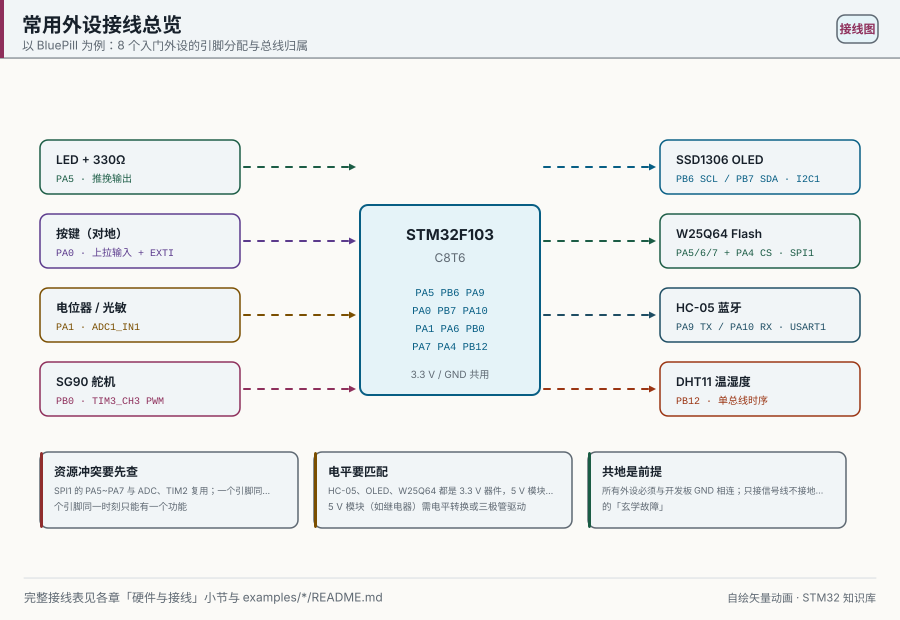
  <br><sub>▲ Figure: a wiring overview for the parts most projects start from (author-drawn vector, not a photograph)</sub>
</p>

<!-- video:ch19 -->
<p align="center">
  <video width="640" controls poster="../../assets/video/ch19-projects.png">
    <source src="../../assets/video/ch19-projects.mp4" type="video/mp4">
  </video>
  <br><sub>▲ Chapter video with Chinese voice-over (2.4 min). <a href="../../assets/video/ch19-projects.mp4">MP4</a> · <a href="../../assets/video/ch19-projects.srt">subtitles</a></sub>
</p>

<details>
<summary>Narration script (Chinese, same text as the subtitles)</summary>

1. 做项目最容易散的地方，是一个周末同时加上蓝牙、显示和存储。规矩只有一条：每一轮新增加的不确定，只允许有一个外设。坏了，你知道是谁。
2. 动手前用一句话写完完成标准。比如温度每分钟记一条，掉电不丢。没有这句话，你会一直调，不知道哪天算做完。失败怎样看出来，也要先写下来。
3. 不要从空白文件开始堆。先让仓库里对应的示例在你的板上跑起来，再加这一个项目需要的外设。示例和你的板子不一致时，先改时钟和引脚，别改算法。
4. 这一帧是仓库画的工程结构。应用、板级、驱动分开，后面你才敢换一颗芯片。所有代码堆在一个 main 里，项目做完你也不敢再打开它。
5. 温湿度记录仪先保证读数和时间是对的，掉电不丢，再去画曲线。曲线很好看，但是如果时间是错的，记录就没有意义。显示是最后一层糖。
6. 蓝牙小车先让两个轮子按你的命令转，再加遥控。自平衡是挑战题，不要当第一周的作业。底盘力学和编码器还没稳，算法只会放大抖动。
7. 多机 CAN 先做通两个节点，USB 采集先做通枚举和回显，再把采样挂上去。链路不通时叠协议，你无法判断是包错了还是采样错了。
8. 你的下一个项目，新增加的外设只有哪一个？说不出名字，就还没准备好开工。说得出，就先把别的欲望写进下一轮。
9. 做完不是指灯亮过一次。别人按你的说明能复现，你能说出还没做的部分。仓库里的十个题目，选一个做到这个程度，比十个都开了头有用。
10. 动手前核对三处：板上的晶振和示例假设一致吗，闪存容量对得上型号吗，调试器接口和丝印一致吗。三处都对上，再写第一行。

</details>
<!-- /video:ch19 -->
## Principle and scope

Choose one project and write down its input, one observable output, and a failure condition before checking the hardware table. The capacity examples below use the STM32F103C8T6's 64 KB Flash and 20 KB SRAM as a baseline. Individual projects also select larger devices; the fragments do not all belong on one BluePill. Keep addresses and conversions consistent with chapters 12 and 09.

One application. The bootloader starts at `0x08000000` for 16 KB, the parameter block starts at `0x08004000` for 2 KB, and the application starts at `0x08004800` for 46 KB, length `0xB800`, ending before `0x08010000`. `16 + 2 + 46 = 64`. That is the same map as in chapter 12 and in `examples/iap-bootloader`. See [repository examples](#source-project-examples).

A second `0xB800` image makes `16 + 2 + 46 + 46 = 110` KB. `0x08000000 + 0x1B800 = 0x0801B800`, beyond the C8's end boundary at `0x08010000`. Chapter 12 has one application slot. Dividing the remaining 46 KB into two 23 KB slots is only capacity arithmetic: vector alignment, image linking, metadata, and rollback states still need a separate design. See [DS5319](#source-ds5319-swd).

<p align="center">
  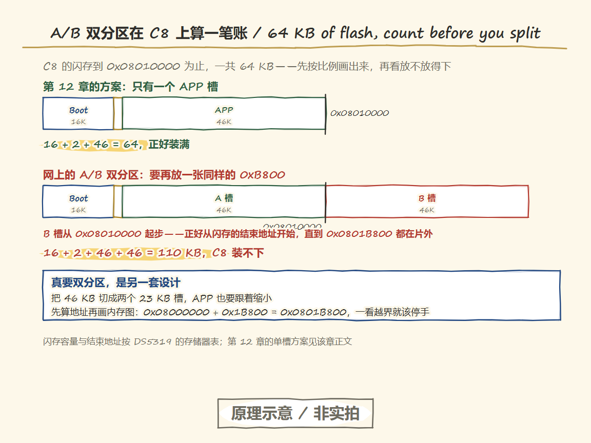
  <br><sub>▲ Knowledge track (Handraw · 原理示意 / not a photo). Both Flash bars use the same scale. The single-application layout fills 64 KB; another 46 KB image crosses 0x08010000. Fitting the image is the first step; validation and rollback need their own design. See [DS5319](#source-ds5319-swd).</sub>
</p>

`64 * 1024 = 65536`. SRAM on the C8 is 20 KB, which is 20480 bytes. 65536 is larger than 20480. So a 64 KB sample buffer in the logic-analyzer project does not link on the C8. Shrink it to a dozen KB or so, or move to a chip with more SRAM and check its datasheet.

The nominal LSB of a 12-bit ADC is Vref/4096. With that scale, code 2048 gives 1.65 V at a nominal 3.3 V. Full-endpoint scaling with 4095 changes the slope: the difference depends on the code and approaches one LSB near full scale, rather than being exactly one LSB everywhere. Actual voltage also depends on Vref, offset, and gain error. See [RM0008 ADC](#source-rm0008-adc).

The application frame is `4 + 128 + 1 = 133` bytes. The chapter 14 full-speed bulk packet limit is 64 bytes, so 133 bytes go out as three packets, 64 + 64 + 5. The endpoint descriptor's `wMaxPacketSize` stays 64, not 133. The 48 MHz USB clock and VID/PID `0x1209/0x0001` are in chapter 14.

<p align="center">
  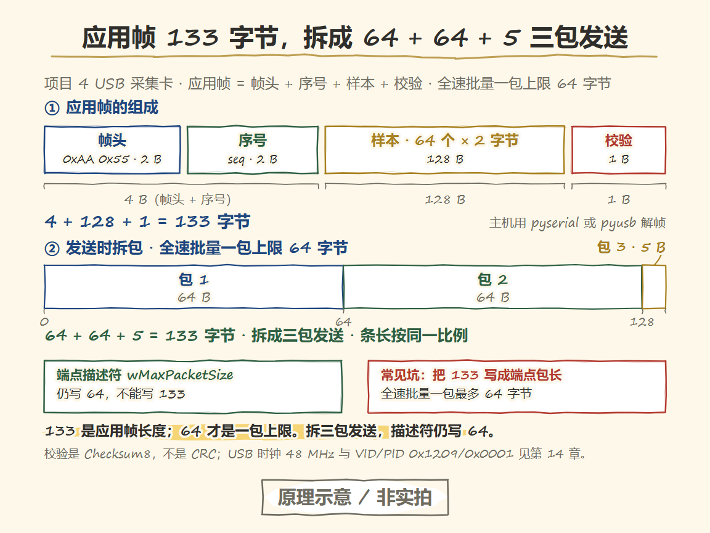
  <br><sub>▲ Knowledge track (Handraw · 原理示意 / not a photo). The application frame is 4 + 128 + 1 = 133 bytes; the full-speed bulk limit is 64 bytes per packet, so it goes out as three packets and the endpoint descriptor keeps `wMaxPacketSize` at 64; not a photo.</sub>
</p>

Project 8 uses 120 Ω at each end, pins PB8 and PB9, and 500 kbit/s, matching chapter 13. Pick a 5 V or 3.3 V transceiver from the bill of materials. See [repository examples](#source-project-examples).

This chapter reserves pin 10 PA0 for LED, ADC, or wake-up experiments. Choose another free GPIO for motor direction and update `MOTOR_DIR_PIN`. PA0-WKUP and ADC12_IN0 are alternative functions; PA0 can be an ordinary output when it is not already in use. See [DS5319 ADC](#source-ds5319-adc).

Add one new peripheral per pass and get it working before the next, so that when something breaks there is only one suspect. The WS2812 timing in project 6 comes from the LED vendor's datasheet, not from RM0008.

## Key figures


<p align="center">
  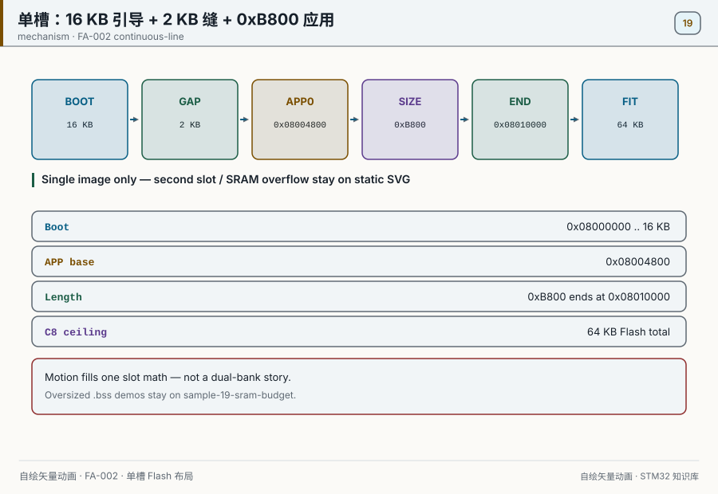
  <br><sub>▲ Hand-drawn CSS animation (FA-002). Single-image layout math.</sub>
</p>


<p align="center">
  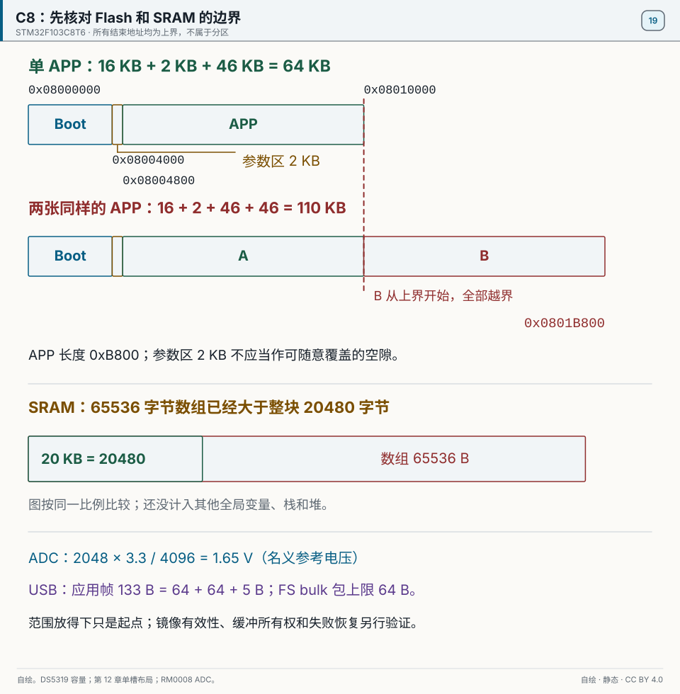
  <br><sub>▲ Drawn for this book. Budget Flash and SRAM, then check ADC scaling and USB packetization. The C8's 64 KB Flash cannot hold two 46 KB applications; its 20 KB SRAM cannot hold a 65536-byte buffer. See the chapter 12 layout and [DS5319](#source-ds5319-swd).</sub>
</p>

<p align="center">
  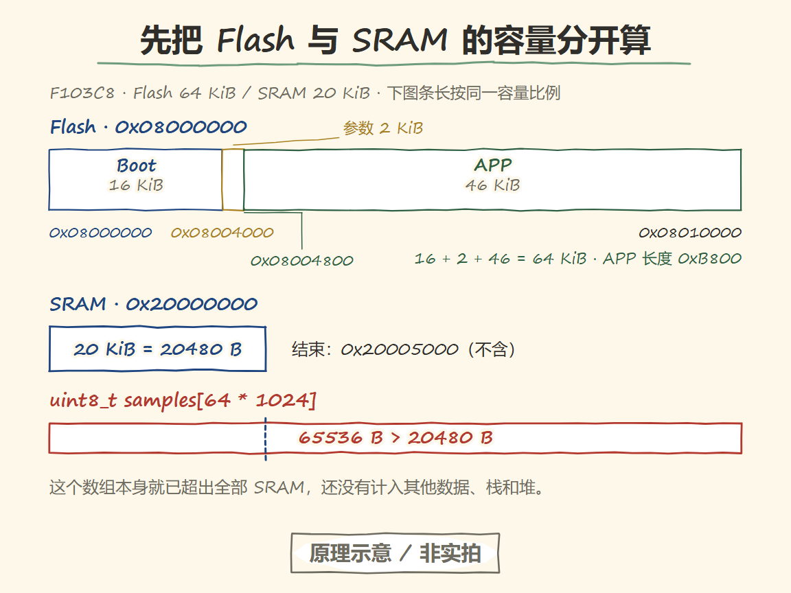
  <br><sub>▲ Knowledge track (Handraw · 原理示意 / not a photo). Flash holds one application of length 0xB800. SRAM buffers share space with stacks and globals, so comparing one array with total RAM is not enough.</sub>
</p>

<p align="center">
  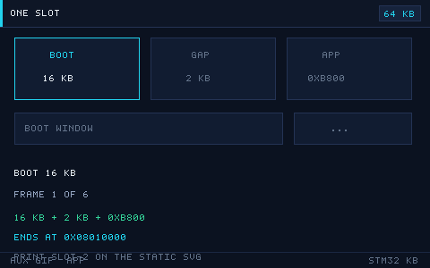
  <br><sub>▲ Animated version. It shows only the layout that fits: 16 KB, 2 KB, and one 0xB800 image fill up to 0x08010000. The printed book has only the static figure above.</sub>
</p>

The wiring overview for the projects is `peripheral-wiring.svg`. It covers wiring only; whether a design fits is this figure's job.

## Timing and state

| Object | Length | Ends at | Fits |
| --- | --- | --- | --- |
| Bootloader | 16 KB | `0x08004000` | fits |
| Parameter block | 2 KB | `0x08004800` | fits |
| One application | `0xB800` | `0x08010000` | fits |
| Two `0xB800` images | 110 KB | `0x0801B800` | does not fit. Chapter 12 has one application slot |
| SRAM | 20480 bytes | on chip | fits |
| A 65536-byte array | `64 * 1024` | past SRAM | does not fit on the C8 |
| ADC | nominal scale Vref/4096 | code 2048 is 1.65 V at Vref=3.3 V | Distinguish endpoint scaling and measured calibration |
| USB | application frame of 133 bytes | packet limit 64 bytes | 133 has to be split |

## Pitfalls and sources

| What you see | Why | What to do | Source | What the source shows |
| --- | --- | --- | --- | --- |
| The update plan says two applications and cites chapter 12 | A different design was written as this chapter's map | Bring up one `0xB800` application on the C8 first | [repository examples](#source-project-examples) | The application length in `examples/iap-bootloader` is `0xB800`. Chapter 12 has no second slot |
| The second image is linked past `0x08010000` | The 64 KB already ended | Stop at `0x08010000` | [DS5319](#source-ds5319-swd) | STM32F103x8 Flash is 64 KB. Two 46 KB images plus 16 KB and 2 KB are 110 KB |
| The logic-analyzer buffer does not link on the C8 | `64 * 1024` is larger than the C8's SRAM | Do not compile 65536 bytes into the C8 | [DS5319](#source-ds5319-swd) | SRAM is 20 KB, which is 20480 bytes. 65536 is larger |
| The scope voltage differs from nominal conversion | The scale, Vref, or calibration conditions differ | Check Vref/4096, then reference voltage and error | [RM0008 ADC](#source-rm0008-adc) | Code 2048 is 1.65 V at nominal 3.3 V; the 4095-versus-4096 difference varies with code |
| The acquisition card writes 133 bytes as the endpoint packet length | The application frame was treated as the packet limit | A full-speed bulk packet is at most 64 bytes | [repository examples](#source-project-examples) | 133 is `4 + 128 + 1`. It is not the chapter 14 packet limit |
| The car's direction pin is written on PA0 | It collides with the other uses of pin 10 | Move it off pin 10 | [DS5319 ADC](#source-ds5319-adc) | Pin 10 is PA0-WKUP and also ADC12_IN0 |
| Two CAN nodes do not agree on the rate | The two nodes use different bit-timing settings | Use 500 kbit/s and 120 Ω at each end | [repository examples](#source-project-examples) | The example prescaler is 9, and the pins are PB8 and PB9 |
## Learning goals


<p align="center">
  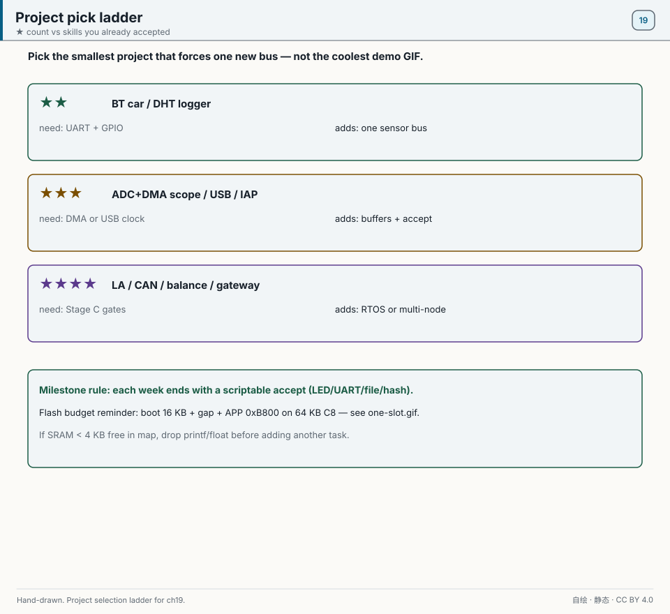
  <br><sub>▲ Drawn for this book. Pick the smallest project that forces one new bus.</sub>
</p>

<p align="center">
  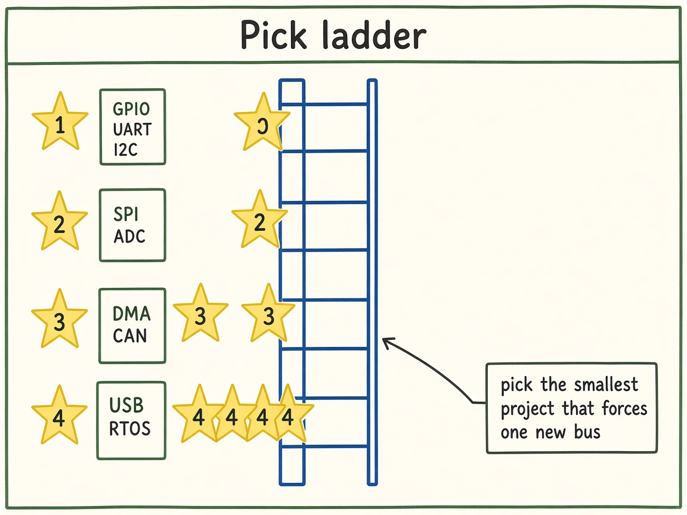
  <br><sub>▲ Knowledge track (Handraw · 原理示意 / not a photo). Choose from the sampling, communication, and buffer skills already demonstrated. Add one unverified capability per iteration.</sub>
</p>


- [ ] Turn "an idea" into the engineering path: requirements, then hardware, then approach, then modules, then tests.
- [ ] Through 10 projects that build on each other, use GPIO, UART, I2C, SPI, ADC, DMA, TIM, and an RTOS in one place.
- [ ] For each project, know the minimum version that actually runs. Get that working, then iterate.
- [ ] Know the difficulty, the time, and where each project can grow, so you can choose one.

> Difficulty and time are **one person who already knows C, looking things up in the manual as they go**. Use them to plan, not as a promise. Every project should start as a minimum usable version (an MVP).

## 1. Bluetooth car (★★ beginner)

**Requirements**: a phone drives the car forward, back, left, right, and stop over Bluetooth, and the speed is adjustable.

| Item | Contents |
| --- | --- |
| Bill of materials | BluePill + HC-05 Bluetooth module + L298N motor driver + 2 or 4 geared DC motors + 18650 battery + chassis |
| Key peripherals | USART1 (Bluetooth), TIM3/TIM4 (PWM speed), GPIO (direction) |
| Time | 2~4 days |
| Difficulty | ★★ |

**Approach**: receive `F/B/L/R/S` from the phone and set direction and PWM in a task or the main loop. Each `L298N` motor needs `IN1/IN2` and an enable input, `ENA`; the `SetMotor` below has only one DIR output per motor and does not implement that wiring. Complete forward, reverse, brake, and coast states from the driver's truth table. `S` only sets PWM to zero, which does not establish the stop mode. Declare the static `SetMotor` before `Car_HandleCmd` as well.

**Key code**:

```c
/* Parse a Bluetooth command and drive the motors (F103, TIM3 CH1/CH2 PWM) */
void Car_HandleCmd(char c)
{
    switch (c)
    {
    case 'F': SetMotor(1, 60); SetMotor(2, 60); break;   /* forward 60% */
    case 'B': SetMotor(1, -60); SetMotor(2, -60); break; /* reverse */
    case 'L': SetMotor(1, 0); SetMotor(2, 60); break;    /* turn left */
    case 'R': SetMotor(1, 60); SetMotor(2, 0); break;    /* turn right */
    case 'S': SetMotor(1, 0); SetMotor(2, 0); break;     /* stop */
    default: break;
    }
}

/* duty: -100~100, the sign is direction */
static void SetMotor(uint8_t id, int8_t duty)
{
    uint32_t pwm = (uint32_t)((duty < 0 ? -duty : duty) * 999 / 100); /* 0~999 */
    if (id == 1) {
        /* Do not put the direction pin on pin 10 PA0. It collides with the lamp, the ADC, and WKUP. This snippet does not name a replacement pin. */
        HAL_GPIO_WritePin(MOTOR_DIR_PORT, MOTOR_DIR_PIN, duty >= 0 ? GPIO_PIN_SET : GPIO_PIN_RESET);
        __HAL_TIM_SET_COMPARE(&htim3, TIM_CHANNEL_1, pwm);
    } else {
        HAL_GPIO_WritePin(GPIOA, GPIO_PIN_1, duty >= 0 ? GPIO_PIN_SET : GPIO_PIN_RESET);
        __HAL_TIM_SET_COMPARE(&htim3, TIM_CHANNEL_2, pwm);
    }
}
```

**Where it can grow**: ultrasonic obstacle avoidance, encoders for distance or a closed loop, an OLED that shows speed, or a PS2 / 2.4 GHz remote instead of Bluetooth.

## 2. Temperature and humidity logger (★★ beginner)

**Requirements**: sample temperature and humidity on a schedule, show them, store the history, and export it over the serial port.

| Item | Contents |
| --- | --- |
| Bill of materials | BluePill + DHT11/DHT22 or SHT30 + SSD1306 OLED + W25Q64 Flash + RTC crystal + coin cell |
| Key peripherals | 1-Wire or I2C (sensor), I2C (OLED), SPI (Flash), RTC |
| Time | 3~5 days |
| Difficulty | ★★ |

**Approach**: on each RTC interval (see [chapter 11](11-rtc-watchdog.md)), read the sensor, update the display, and append to W25Q64; export CSV over UART. The fragment only shows a record format and advancing address: `wr` returns to `LOG_BASE` after reset, and wrapping erases only the first sector. It does not manage erasure across the region or provide wear leveling. A usable log also needs sector pre-erasure, write-completion checks, a commit marker or checksum, and a startup scan to recover the write pointer. Test interrupted writes to establish which records survive power loss.

<p align="center">
  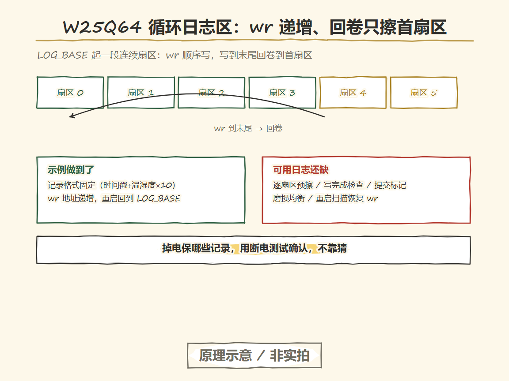
  <br><sub>▲ Knowledge track (Handraw · 原理示意 / not a photo). Where to look: the sector strip and wrap arrow — wr writes in order and wraps to the first sector at the end; the green card bottom left "the sample does" (fixed record format, advancing wr), the red card bottom right "a usable log still needs" (pre-erasure / write-completion check / commit marker / wear leveling), and the banner "which records survive power loss is confirmed by pull-the-plug tests, not guesses"; proves the sample code is a starting point, not a usable log; does not replace an actual power-cut test, nor a Flash measurement. See the project 2 approach in this chapter.</sub>
</p>

**Key code**:

```c
/* Log one record every 5 minutes: RTC timestamp + temperature + humidity, into a circular Flash region */
typedef struct __attribute__((packed)) {
    uint32_t ts;        /* Unix timestamp */
    int16_t  temp_x10;  /* temperature ×10, e.g. 253 = 25.3℃ */
    uint16_t humi_x10;  /* humidity ×10 */
} Record_t;

void Log_Append(const Record_t *r)
{
    static uint32_t wr = LOG_BASE;               /* current write pointer */
    if (wr + sizeof(Record_t) > LOG_END) {
        wr = LOG_BASE;                           /* wrap around (simple wear leveling) */
        Flash_EraseSector(LOG_BASE);
    }
    Flash_Write(wr, (const uint8_t *)r, sizeof(Record_t));
    wr += sizeof(Record_t);
}
```

**Where it can grow**: an SD card for more data, LoRa or NB-IoT up to a cloud, or a drop into Stop for low power ([chapter 16](16-low-power.md)).

## 3. DMA + ADC mini oscilloscope (★★★ intermediate)

**Requirements**: capture one channel from 0 to 3.3 V, draw a live waveform, and show peak-to-peak and frequency.

| Item | Contents |
| --- | --- |
| Bill of materials | Nucleo-F411RE or an F103 + OLED or SPI TFT + the signal you want to measure |
| Key peripherals | ADC + DMA (circular), TIM (trigger), SPI (display) |
| Time | 1~2 weeks |
| Difficulty | ★★★ |

**Approach**: TIM triggers the ADC while DMA fills a circular buffer. HT hands off the first half; TC hands off the second. The sample rate equals the timer trigger rate only when each trigger completes one single-channel conversion without missed triggers. Drawing inside the callbacks below demonstrates the half-buffer indices. In practice, notify a task or the main loop and finish reading or copying before DMA rewrites that half. A 512-point buffer allows `256 / sample_rate` seconds per half; record overruns rather than treating the refresh comment as a timing guarantee.

**Key code**:

```c
#define ADC_BUF_LEN 512
static uint16_t adc_buf[ADC_BUF_LEN];

/* DMA circular + half-transfer: draw the back half while the front half fills, for a seamless refresh */
void HAL_ADC_ConvHalfCpltCallback(ADC_HandleTypeDef *hadc)
{
    Scope_Draw(&adc_buf[0], ADC_BUF_LEN / 2);
}
void HAL_ADC_ConvCpltCallback(ADC_HandleTypeDef *hadc)
{
    Scope_Draw(&adc_buf[ADC_BUF_LEN / 2], ADC_BUF_LEN / 2);
}

/* Voltage conversion: V = code × Vref / 4096 (12-bit ADC). Code 2048 is 1.65 V at a nominal 3.3 V. A denominator of 4095 is off by one LSB. */
static float Code2Volt(uint16_t code)
{
    return (float)code * 3.3f / 4096.0f;
}
```

**Where it can grow**: a trigger level and edge, an FFT for the spectrum, two channels to compare, or a DWT cycle count of the refresh rate.

<p align="center">
  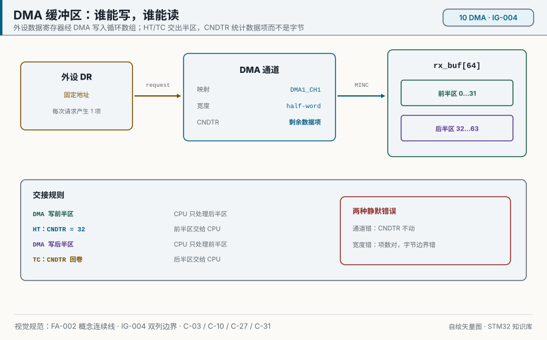
  <br><sub>▲ HT/TC hand off the half just completed. The CPU must finish before the next rewrite. Check sample rate and analog accuracy separately against the timer, ADC, and input voltage.</sub>
</p>

## 4. USB data-acquisition card (★★★ intermediate)

**Requirements**: stream multi-channel ADC data to a PC over USB (CDC, or a vendor bulk endpoint) and plot it on the host.

| Item | Contents |
| --- | --- |
| Bill of materials | F103 or F411 (with USB) + sensors or a signal source |
| Key peripherals | ADC + DMA + USB device (CDC, or a vendor-specific class) |
| Time | 1~2 weeks |
| Difficulty | ★★★ |

**Approach**: capture with ADC and DMA, then package a header, sequence number, and checksum for the host to parse with pyserial or pyusb. The code calls `Checksum8`, which is not a CRC. CDC already uses bulk data endpoints; any speed gain from a vendor class depends on the protocol, buffering, and host implementation.

`CDC_Transmit_FS` commonly retains the buffer for asynchronous transmission, so the local stack array `frame` can become invalid after this function returns. Ignoring BUSY can also lose frames. Keep each buffer alive until completion and handle BUSY, disconnects, and queue backpressure. The 133-byte application frame still uses 64 + 64 + 5 packets; one host read need not contain one frame.

**Key code**:

```c
/* One frame: header + sequence + N samples + checksum */
#define FRAME_N 64
static void Upload_Frame(uint16_t *samples, uint16_t seq)
{
    uint8_t frame[4 + FRAME_N * 2 + 1];
    frame[0] = 0xAA; frame[1] = 0x55;
    frame[2] = (uint8_t)(seq >> 8);
    frame[3] = (uint8_t)(seq & 0xFF);
    for (int i = 0; i < FRAME_N; i++) {
        frame[4 + i * 2]     = (uint8_t)(samples[i] & 0xFF);
        frame[4 + i * 2 + 1] = (uint8_t)(samples[i] >> 8);
    }
    frame[4 + FRAME_N * 2] = Checksum8(frame, 4 + FRAME_N * 2);
    CDC_Transmit_FS(frame, sizeof(frame));   /* 4 + 128 + 1 = 133. This is not the 64-byte full-speed bulk packet limit in chapter 14 */
}
```

**Where it can grow**: timestamps and a trigger, saving the stream to disk, synchronized extra channels, or a live FFT on the host.

## 5. Remote IAP update (★★★ intermediate)

**Requirements**: receive and validate new firmware over UART, CAN, or a network, and retain a recovery receive path after an interrupted update. Rolling back to an old version requires extra image storage and state management.

| Item | Contents |
| --- | --- |
| Bill of materials | BluePill (or any part with Flash) + a host or a gateway |
| Key peripherals | USART or CAN + internal Flash |
| Time | 1~2 weeks |
| Difficulty | ★★★ |

**Approach**: first implement chapter 12's single application: a 16 KB bootloader at `0x08000000`, a 2 KB parameter block at `0x08004000`, and a `0xB800` application at `0x08004800`, ending before `0x08010000`. A second image of the same length brings the total to 110 KB, ending at `0x0801B800`. After erasing a single slot, no old application remains for rollback; on failure, stay in the bootloader for retransmission. Two 23 KB slots are only the capacity starting point for another design.

The fragment sketches a dual-slot selection interface and cannot implement that single-slot layout. It does not range-check `pending` or `active`, so `p.app_crc[p.pending]` can read out of bounds; `Crc32(p.pending)` also leaves the image address, length, and algorithm unspecified. Add slot-boundary and vector checks and power-loss-safe metadata commits before using it. A `magic` value alone does not validate an image.

**Key code**:

```c
/* Parameter block: the slot that is valid now, and any upgrade request */
typedef struct {
    uint32_t magic;       /* 0x5A5A0001 means valid. This marker is made up for this project and has nothing to do with the chapter 12 Flash unlock keys. With the chapter 12 layout, the C8 has room for only one APP slot. */
    uint32_t active;      /* 0 = slot A, 1 = slot B */
    uint32_t pending;     /* the slot requested for the switch */
    uint32_t app_size[2];
    uint32_t app_crc[2];
} BootParam_t;

/* Bootloader picks the slot to jump to */
uint32_t Boot_SelectApp(void)
{
    BootParam_t p;
    Flash_Read(PARAM_ADDR, (uint8_t *)&p, sizeof(p));
    if (p.magic != 0x5A5A0001) return APP_A_ADDR;
    if (p.pending != 0xFFFFFFFF && Crc32(p.pending) == p.app_crc[p.pending]) {
        p.active = p.pending; p.pending = 0xFFFFFFFF;   /* the upgrade takes effect */
        Flash_EraseParam(); Flash_WriteParam(&p);
    }
    return (p.active == 0) ? APP_A_ADDR : APP_B_ADDR;
}
```

**Where it can grow**: YMODEM or your own packet format, a signature check, CAN for updating many nodes at once, or resume after a dropped transfer.

<p align="center">
  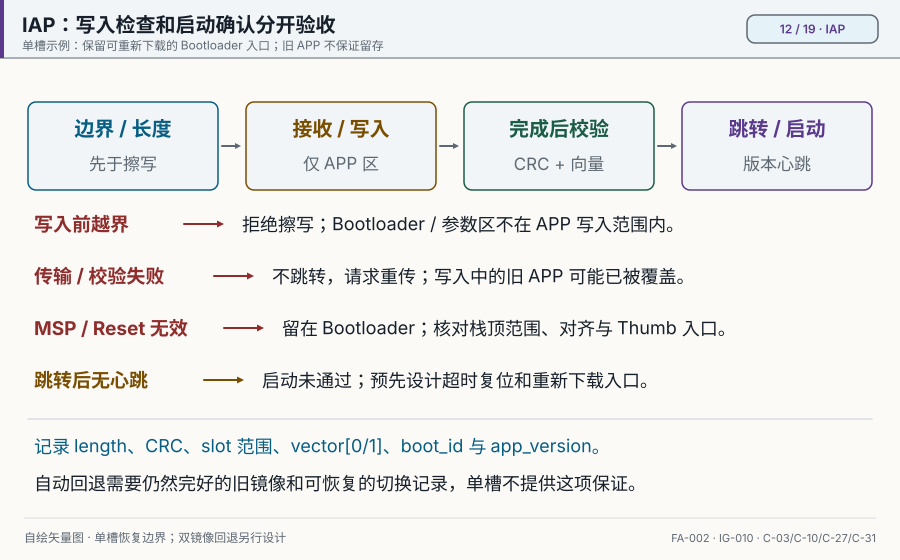
  <br><sub>▲ Check image range and integrity, then vectors, the jump, and the application heartbeat. A bad image needs a recovery path; receiving again in one slot and rolling back to a retained image are different capabilities.</sub>
</p>

<p align="center">
  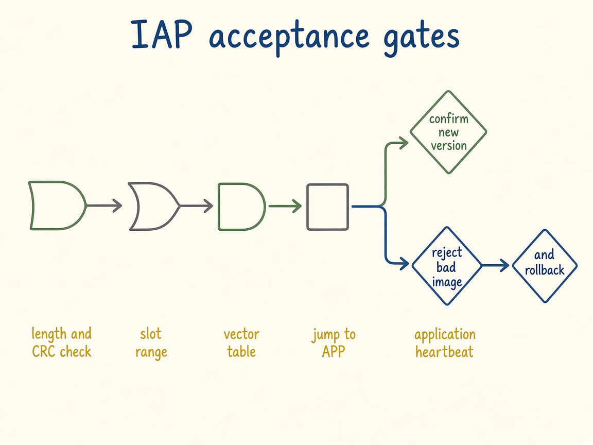
  <br><sub>▲ Knowledge track (Handraw · 原理示意 / not a photo). Each gate needs a rejection or recovery exit. Rollback depends on retaining the old image; a single application slot does not provide it.</sub>
</p>

## 6. WS2812 LED-strip controller (★★ intermediate)

**Requirements**: drive a WS2812/WS2812B strip with chase, breathe, and rainbow effects, and let brightness and length be adjusted.

| Item | Contents |
| --- | --- |
| Bill of materials | BluePill + WS2812 strip + a 5 V supply sized for the strip current |
| Key peripherals | TIM + DMA (precise 800 kHz timing), or SPI |
| Time | 3~5 days |
| Difficulty | ★★ |

**Approach**: encode GRB using the datasheet for the exact LED revision. The example values `T0H=0.4µs`, `T1H=0.8µs`, and period `1.25µs` do not cover every WS2812/WS2812B revision; check the reset-low interval separately. PWM plus DMA normally updates one CCR value per bit period. CCR sets the high time, and the remainder of that same period supplies the low time.

The fragment streams the high and low durations as two successive CCR values. In ordinary PWM mode, that produces two PWM periods, not one valid data bit. Correct this encoding sketch before flashing it: use one compare value per bit, check the DMA request timing, CCR preload, transfer width, `n <= LED_NUM`, and reset interval, then measure the waveform.

**Key code**:

```c
/* WS2812 timing from TIM2 CH1 PWM + DMA (simplified sketch) */
#define LED_NUM     60
#define RESET_SLOTS 50                      /* number of low slots for reset */

static uint16_t pwm_buf[LED_NUM * 24 * 2 + RESET_SLOTS];

/* Encode GRB into pwm_buf: 1 bit = a high compare value plus a low one */
void WS2812_Encode(const uint8_t *grb, uint16_t n)
{
    uint32_t idx = 0;
    for (uint16_t i = 0; i < n * 3; i++) {
        for (int b = 7; b >= 0; b--) {
            uint8_t bit = (grb[i] >> b) & 1;
            pwm_buf[idx++] = bit ? T1H : T0H;   /* high-time width */
            pwm_buf[idx++] = bit ? (PERIOD - T1H) : (PERIOD - T0H);
        }
    }
    for (int i = 0; i < RESET_SLOTS; i++) pwm_buf[idx++] = 0;  /* reset */
    HAL_TIM_PWM_Start_DMA(&htim2, TIM_CHANNEL_1, (uint32_t *)pwm_buf, idx);
}
```

**Where it can grow**: sound-reactive patterns, infrared or Bluetooth control, several strips in a chain, or SPI+DMA to use less RAM.

## 7. A simple logic analyzer (★★★★ a challenge)

**Requirements**: sample 4 to 8 digital lines, upload them over USB, and decode UART, I2C, and SPI on the host.

| Item | Contents |
| --- | --- |
| Bill of materials | F411 or F407 (high clock) + USB, with series protection resistors on the inputs |
| Key peripherals | TIM + DMA (sample GPIO on a timer), USB upload, a ring buffer |
| Time | 2~4 weeks |
| Difficulty | ★★★★ |

**Approach**: the fragment reads GPIOC's low eight bits in a TIM interrupt; it does not configure DMA. Interrupt latency, other interrupts, and the port-read cost all affect the sampling interval. Sampling GPIO through DMA is a separate implementation that requires checking the target's request mapping and bus path. Verify the sample period and input protection before adding triggers and host decoding.

The ring overwrites samples after `65536 / sample_rate` seconds. Once stopped, use `la_wr` to find the oldest sample and send data in time order. `LA_Upload()` neither waits for CDC completion nor handles BUSY, so it cannot guarantee delivery of every 512-byte block. Keep sampling stopped while USB uses the buffer. The TIM callback also needs an instance check to exclude other timers.

**Key code**:

```c
/* 64 * 1024 = 65536, which is larger than the C8 SRAM of 20480 bytes. This array does not fit on STM32F103C8T6; it needs a part with more SRAM. */
#define LA_DEPTH  (64 * 1024)
static uint8_t la_buf[LA_DEPTH];
static volatile uint32_t la_wr = 0;
static volatile uint8_t  la_run = 0;

/* TIM period interrupt: sample 8 lines at once (the whole port) */
void HAL_TIM_PeriodElapsedCallback(TIM_HandleTypeDef *htim)
{
    if (!la_run) return;
    la_buf[la_wr++ & (LA_DEPTH - 1)] = (uint8_t)(GPIOC->IDR & 0xFF);
}

/* After stop, upload in chunks over USB (see chapter 14) */
void LA_Upload(void)
{
    for (uint32_t off = 0; off < LA_DEPTH; off += 512)
        CDC_Transmit_FS(&la_buf[off], 512);
}
```

**Where it can grow**: an adjustable sample rate and trigger, an analog channel, protocol-decoder plugins, or double buffering for a higher rate.


## 8. A multi-node CAN network (★★★★ a challenge)

**Requirements**: three or more nodes on one CAN bus. The master polls. The slaves report sensor data. You need an ID plan and error handling.

| Item | Contents |
| --- | --- |
| Bill of materials | 3× BluePill + 3× TJA1050/SN65HVD230 + twisted pair + 2×120Ω termination resistors |
| Key peripherals | CAN1, USART (debug) |
| Time | 1~2 weeks |
| Difficulty | ★★★★ |

**Approach**: plan the ID space (for example `0x100~0x1FF` for slave reports and `0x200` for a master broadcast). Split traffic with filters (see [chapter 13](13-can.md)), and use the same sample point on every node. Add a heartbeat and a way to notice a node that has gone quiet.

**Key code**:

```c
/* ID plan: low 4 bits = node number, high 7 bits = function code */
#define ID_FUNC_STATUS 0x100u
#define ID_FUNC_CMD    0x200u

#define MAKE_ID(func, node)  ((uint16_t)(((func) & 0x7F0u) | ((node) & 0x0Fu)))
#define GET_NODE(id)         ((id) & 0x0Fu)

void Node_Report(uint8_t node, int16_t temp_x10, uint16_t humi_x10)
{
    uint8_t data[4];
    data[0] = (uint8_t)(temp_x10 >> 8);
    data[1] = (uint8_t)(temp_x10 & 0xFF);
    data[2] = (uint8_t)(humi_x10 >> 8);
    data[3] = (uint8_t)(humi_x10 & 0xFF);
    CAN_Send(MAKE_ID(ID_FUNC_STATUS, node), data, 4);   /* see chapter 13 */
}
```

**Where it can grow**: CANopen, a bootloader update over the bus, or a gateway to Ethernet or 4G.

<p align="center">
  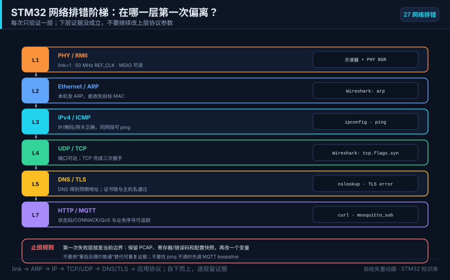
  <br><sub>▲ Multi-node projects follow the first failed boundary instead of jumping from an application log to “the bus is broken.” Each layer keeps reproducible evidence and a recovery action.</sub>
</p>

## 9. A self-balancing car (★★★★ a challenge)

**Requirements**: a two-wheel self-balancing car that stands up, recovers after a shove, and can drive and turn from a remote.

| Item | Contents |
| --- | --- |
| Bill of materials | F103 or F411 + MPU6050 (gyro and accelerometer) + TB6612 or L298N + motors with encoders + chassis + battery |
| Key peripherals | I2C (MPU6050), TIM (encoder and PWM), UART (remote), a control loop at a high rate |
| Time | 3~6 weeks |
| Difficulty | ★★★★ |

**Approach**: check the attitude estimate's axes, units, and motor polarity before tuning balance. The fragment contains angle P and gyro-feedback D, with no integral term, speed loop, or complete cascaded PID. The 5 ms period is a scheduling target; measure execution time and jitter. Move blocking IMU reads out of the ISR and verify the control task's deadline. Gains 25.0/0.8 are examples, not established values for your chassis.

**Key code**:

```c
/* Upright-loop PID (angle error to PWM), period 5ms */
static float g_kp = 25.0f, g_kd = 0.8f;
static float target_angle = 0.0f;      /* target tilt 0° */

float Balance_Update(float angle, float gyro)
{
    float err = target_angle - angle;
    /* PD: P corrects tilt, D uses the gyro to damp oscillation */
    float out = g_kp * err - g_kd * gyro;
    return out;                        /* clamp, then send to the motors */
}

/* Fixed-period control loop: call this from the TIM interrupt */
void Control_Loop_5ms(void)
{
    float angle = IMU_GetAngle();      /* tilt after the complementary filter */
    float gyro  = IMU_GetGyroY();
    float pwm   = Balance_Update(angle, gyro);
    Motor_SetBoth((int16_t)Clamp(pwm, -1000, 1000));
}
```

**Where it can grow**: a Bluetooth remote, an OLED for tuning the gains, line following with a camera, or a Kalman filter in place of the complementary filter.

## 10. A FreeRTOS smart gateway (★★★★ a challenge)

**Requirements**: a multi-protocol gateway. It samples local sensors, draws an OLED, forwards over UART or CAN, and manages low power. Several tasks cooperate.

| Item | Contents |
| --- | --- |
| Bill of materials | F411 or F407 + sensors + OLED + CAN transceiver + USB-TTL |
| Key peripherals | several peripherals + FreeRTOS (tasks, queues, event groups, semaphores) |
| Time | 3~6 weeks |
| Difficulty | ★★★★ |

**Approach**: give sampling, display, and communication their own tasks; pass data through queues and protect shared peripherals with a mutex. For CAN, use an F407 with bxCAN or add an external CAN controller to an F411; a transceiver alone cannot supply the controller. Enter Stop through the kernel's idle/tickless path after it confirms sleep is safe, with wake-up clock restoration and time compensation. A supervisor seeing an empty queue is not sufficient.

The fragment assumes successful queue and event-group creation, a queue item size of `sizeof(SensorData_t)`, and initialized fields in every item sent. `xQueueSend` copies an item. An event bit reports a condition; it neither passes `d` to the display task nor counts each sample. If display and communication need the same data, distribute it separately or use a protected snapshot. Two consumers receiving from one queue do not get broadcast copies.

**Key code**:

```c
/* Sample task to queue to comm task; the event group syncs "sample done" */
static QueueHandle_t      g_data_q;
static EventGroupHandle_t g_evt;

#define EVT_OLED_READY  (1 << 0)

static void vSampleTask(void *arg)
{
    SensorData_t d;
    for (;;) {
        d.temp = Sensor_ReadTemp();
        xQueueSend(g_data_q, &d, portMAX_DELAY);      /* hand off to the comm task */
        xEventGroupSetBits(g_evt, EVT_OLED_READY);    /* notify the display task */
        vTaskDelay(pdMS_TO_TICKS(1000));              /* block for 1 s and yield the CPU */
    }
}

static void vCommTask(void *arg)
{
    SensorData_t d;
    for (;;) {
        if (xQueueReceive(g_data_q, &d, portMAX_DELAY) == pdTRUE) {
            Comm_SendFrame(&d);                       /* forward over UART or CAN */
        }
    }
}
```

**Where it can grow**: an MQTT or Modbus stack, OTA updates, task runtime stats (`vTaskGetRunTimeStats`), or saving data across power loss.

<p align="center">
  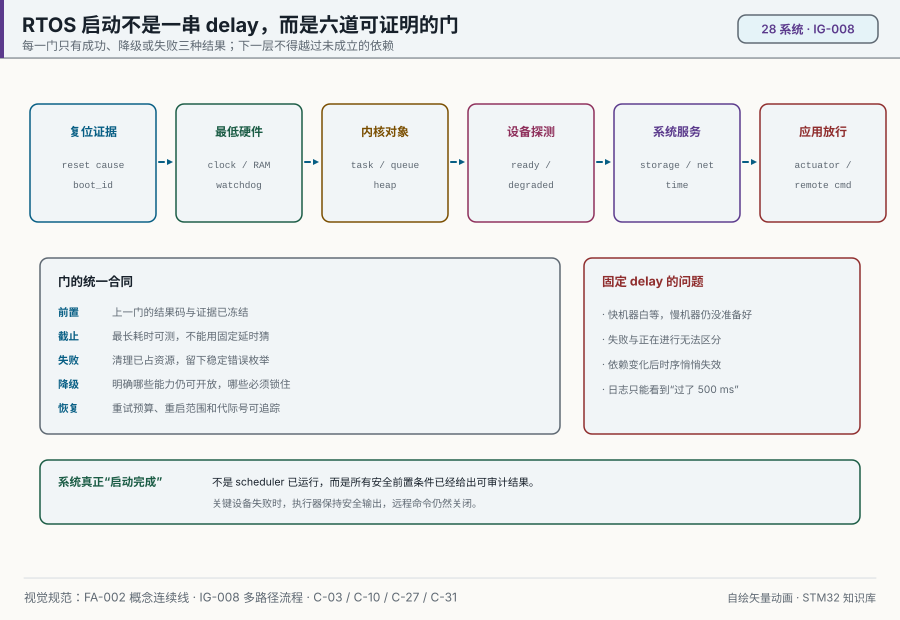
  <br><sub>▲ Gateway projects release application behavior only after critical devices, queues, storage, and communication return explicit results. A running scheduler does not mean the system is ready.</sub>
</p>


<p align="center">
  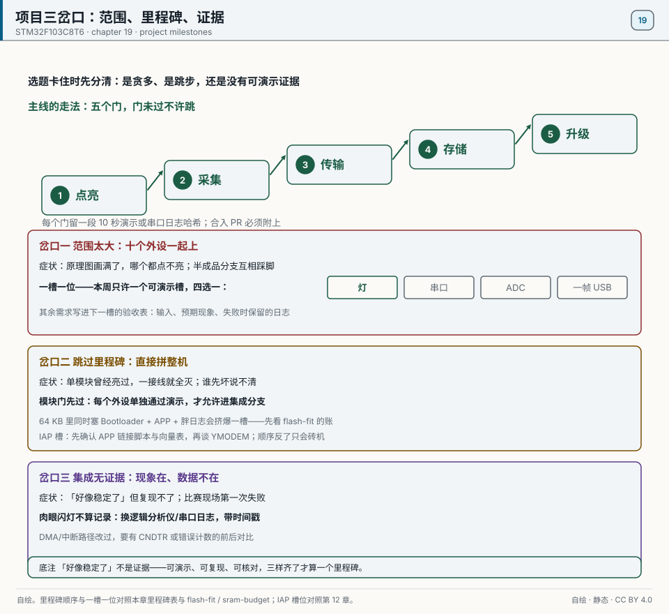
  <br><sub>▲ Drawn for this book. Three project branches: scope / skipped gate / no evidence. Sources: [project examples](#source-project-examples) and this chapter's acceptance gates.</sub>
</p>

<p align="center">
  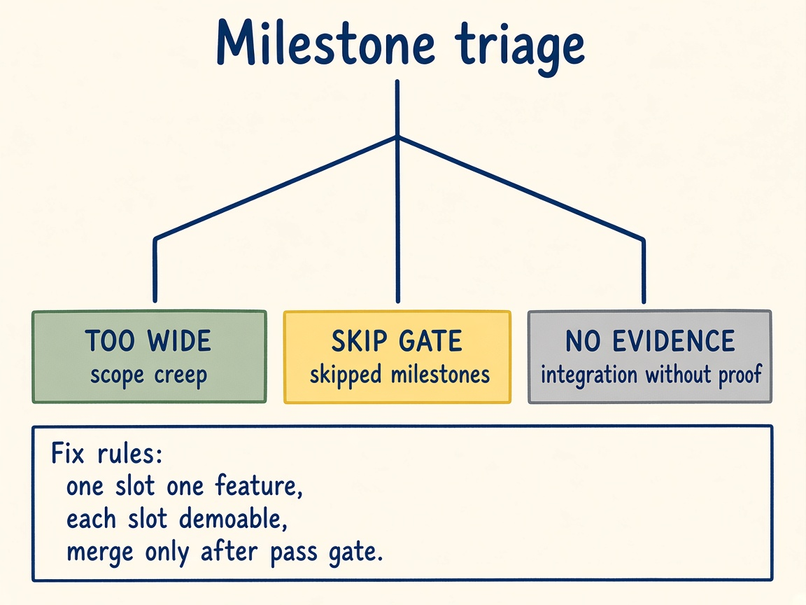
  <br><sub>▲ Knowledge track (Handraw · 原理示意 / not a photo). Add one capability per iteration and test it alone before integration. On failure, retain the input, state, and recovery result.</sub>
</p>

## Hands-on labs (picking a project and moving it forward)


<p align="center">
  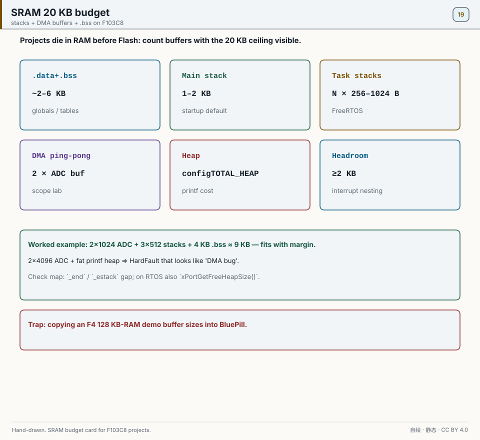
  <br><sub>▲ A hypothetical budget drawn for this book. heap_4's ucHeap is already part of static storage. Dynamic task stacks and kernel objects are allocated inside it and must not be added to the total again.</sub>
</p>

<p align="center">
  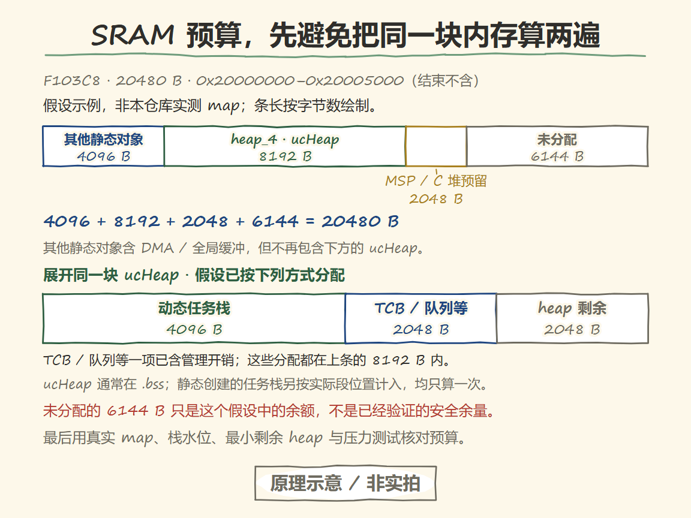
  <br><sub>▲ Knowledge track (Handraw · 原理示意 / not a photo). Budget the C8's 20480 bytes from 0x20000000 as one space shared by global buffers, heap, and task stacks.</sub>
</p>


1. **Freeze the delivery contract:** State input range, output format, timing and capacity budgets, failure states, and recovery path before writing business logic.
2. **Module evidence:** Each module keeps one runnable test, one injected failure, and one measurement or buffer record. Integrate only after it passes alone.
3. **System budget:** Add Flash/RAM, worst response, average current, bandwidth, and queue peaks. If one budget fails, reduce scope or change the target device first.
4. **Delivery package:** Rebuild from a clean environment and include ELF/map, configuration, wiring, acceptance records, known limits, and recovery steps so another person can reproduce it.

## Related resources

- The technical detail is in [chapters 03 through 17](03-gpio-and-led.md) (GPIO, UART, I2C, SPI, ADC, DMA, TIM, RTC, Flash, CAN, USB, RTOS, low power, and debug): [03](03-gpio-and-led.md), [04](04-interrupts-nvic.md), [05](05-timer-pwm.md), [06](06-uart.md), [07](07-i2c.md), [08](08-spi.md), [09](09-adc-dac.md), [10](10-dma.md), [11](11-rtc-watchdog.md), [12](12-flash-iap.md), [13](13-can.md), [14](14-usb.md), [15](15-freertos.md), [16](16-low-power.md), [17](17-debug.md).
- Example projects: [`examples/`](../../examples/) (gpio-blink, uart-dma-idle, i2c-oled, adc-dma, rtc-alarm, freertos-task, iap-bootloader).
- Reference manuals: RM0008 / RM0090 (peripheral registers and buses).
- Related chapters: [chapter 12, IAP](12-flash-iap.md), [chapter 13, CAN](13-can.md), [chapter 14, USB](14-usb.md), [chapter 15, FreeRTOS](15-freertos.md).
- Figure: `../../assets/boards/peripheral-wiring.svg` (author-drawn vector).
