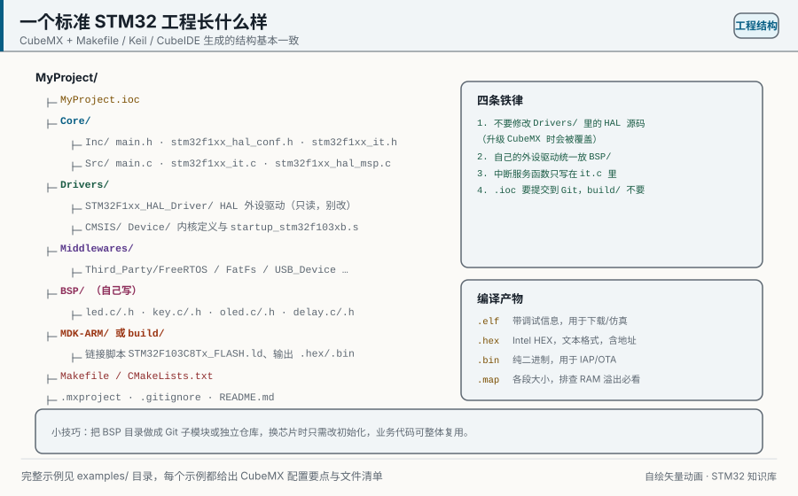
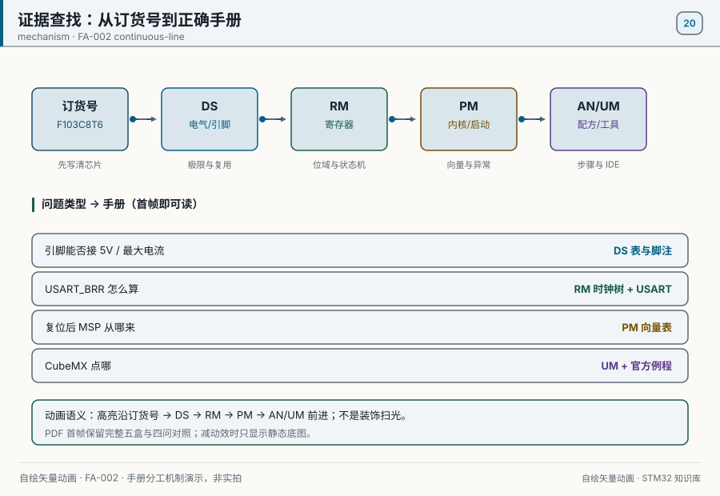
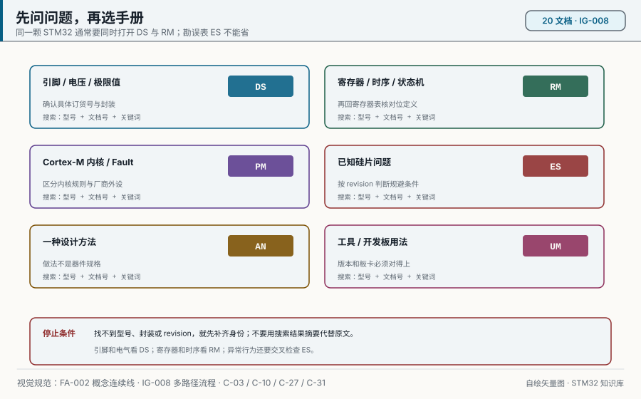
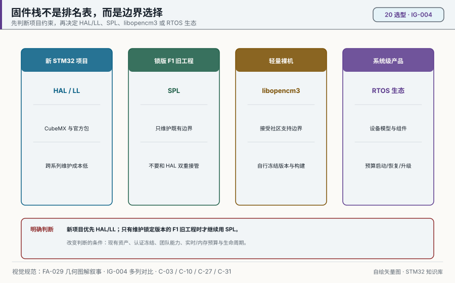
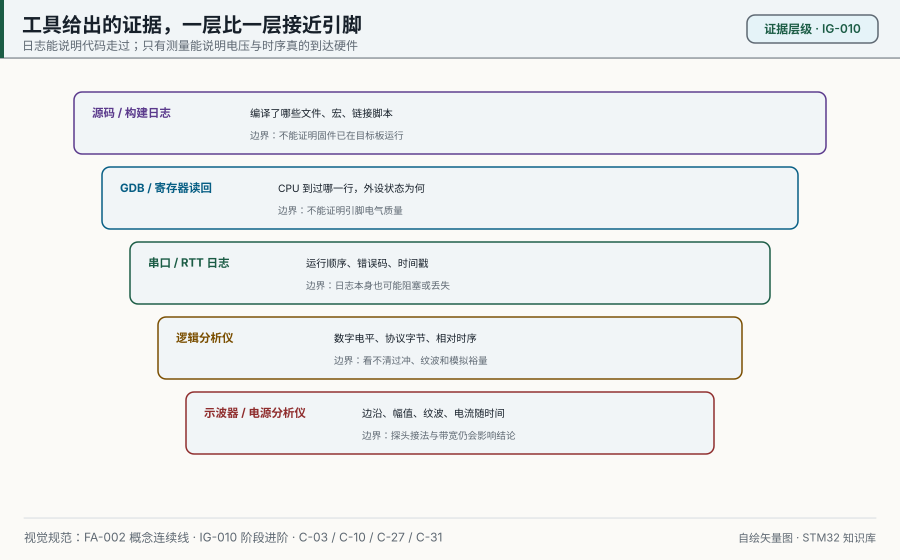
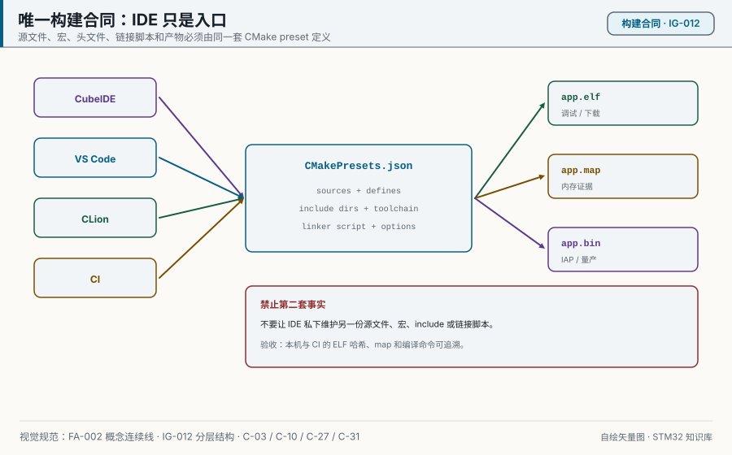
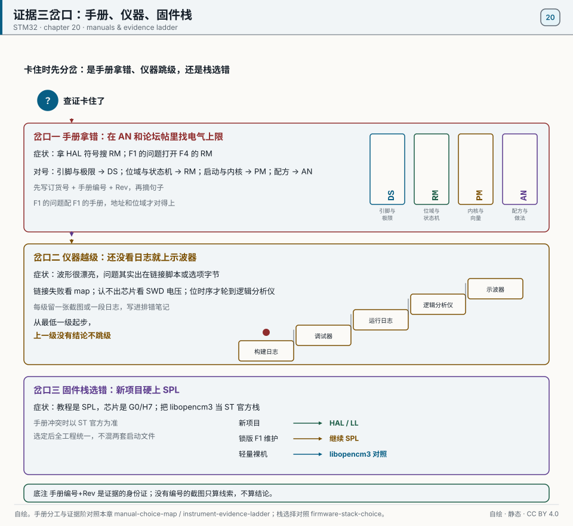

# 20 Learning resources and the toolchain

> 中文：[20 学习资源与工具链](../20-学习资源与工具链.md)

> One question may require the datasheet's electrical boundary, the reference manual's register, and the errata sheet's exception. State what must be proved before choosing a document or tool; search results and IDE hints are not evidence by themselves.

<p align="center">
  
  <br><sub>▲ Figure: the directory layout of a standard STM32 project (author-drawn vector, not a photograph)</sub>
</p>

<!-- video:ch20 -->
<p align="center">
  <video width="640" controls poster="../../assets/video/ch20-refs.png">
    <source src="../../assets/video/ch20-refs.mp4" type="video/mp4">
  </video>
  <br><sub>▲ Chapter video with Chinese voice-over (2.6 min). <a href="../../assets/video/ch20-refs.mp4">MP4</a> · <a href="../../assets/video/ch20-refs.srt">subtitles</a></sub>
</p>

<details>
<summary>Narration script (Chinese, same text as the subtitles)</summary>

1. 学习用的官方资料不用找网盘。从 ST 的网站下载数据手册和参考手册。配置用 CubeMX，编译调试用 CubeIDE，烧录和选项字节用 CubeProgrammer。
2. 查引脚和电气参数，翻数据手册。查寄存器每一位，翻参考手册。查内核指令和故障，翻编程手册。应用笔记讲一种做法，用户手册讲一种工具。
3. 想查 CAN 过滤器的位，打开参考手册，不是数据手册。数据手册会告诉你这颗芯片有没有 CAN、引脚叫什么。两本同时开着，比靠记忆力可靠。
4. 这一帧还是仓库的分层图。你读例程时，先找它停在哪一层。停在 HAL，就去看函数的返回值；停在寄存器，就去参考手册对那一位。不要拿应用笔记的图去代替参考手册的位定义。
5. 各系列的 HAL 包里有现成例程。先跑和你的外设最接近的那个，确认板子和工具链是通的，再把需要的文件剪进自己的工程。整包复制，你会分不清哪些文件真的在编译。
6. STM32、Nucleo 这些名字是厂商的商标。本仓库用来学习，和厂商没有隶属关系。这里的图都是程序画的，不是产品照片，不要拿去当官方宣传图。
7. 例程能跑、你的工程不能跑，经常是包的版本不同。把 Cube 版本、固件包版本和板子丝印写进笔记。问人的时候带上这三样，回答会具体很多。
8. 口诀：寄存器的位去参考手册，引脚和电气去数据手册，内核去编程手册。先选对书，再搜索关键词。
9. 今天就给你的芯片下载数据手册和参考手册，文件名要对上型号和修订号。以后章节里写的 DS 和 RM，指的就是这两本，不是搜索引擎的第一篇文章。
10. 合上书，三问。CAN 过滤器的位定义在数据手册还是参考手册？引脚电气在哪本？读写选项字节用 Cube 家族里的哪一个工具？

</details>
<!-- /video:ch20 -->
## Learning goals

- [ ] Recognize the official ST set: the website, CubeMX, CubeIDE, CubeProgrammer, and CubeMonitor.
- [ ] Tell RM, DS, PM, AN, and UM apart, and know what each name means.
- [ ] Know where to find community and Chinese-language material, and the tools people actually use (logic analyzer, J-Link, oscilloscope, serial terminal, PlatformIO, OpenOCD, KiCad).
- [ ] Know what the main open-source firmware libraries are for: libopencm3, ChibiOS, Zephyr, RT-Thread, and FreeRTOS.
- [ ] Use a three-step way to search a manual with a question in hand, and work the three examples below.

## Where to look for evidence


<p align="center">
  
  <br><sub>▲ Animation: orderable PN → DS → RM → PM → AN/UM (drawn for this book, not a photo). Sources: this chapter's manual map and [project credits](#source-project-credits).</sub>
</p>

### 1. Map of the official resources

ST's documents are free, and you start from **st.com**. For development, **CubeMX (configuration) + CubeIDE (build and debug) + CubeProgrammer (flash and option bytes)** covers most of what you will do.

| Resource | Site or name | What it is for |
| --- | --- | --- |
| ST website | st.com | Download datasheets, reference manuals, and application notes |
| STM32CubeMX | st.com/stm32cubemx | Draw the pinout, clocks, and peripherals, and generate the init code |
| STM32CubeIDE | st.com/stm32cubeide | An IDE on Eclipse and GCC (build and debug) |
| STM32CubeProgrammer | st.com/stm32cubeprogrammer | Flash hex and bin, read and write option bytes, clear readout protection |
| STM32CubeMonitor | st.com/stm32cubemonitor | Watch variables at run time, and measure power (with X-NUCLEO) |
| STM32Cube MCU Packages | GitHub, STMicroelectronics | HAL and LL drivers and examples for each family |
| ST Community | community.st.com | The official forum. Search results there are usually good |

### 2. How the manuals are named (this is the part to remember)

**An RM tells you the registers (how to write them), a DS tells you the parameters (what the part is), a PM tells you the package and the pins, an AN tells you how to do a job, and a UM tells you how to use a tool.** For a register bit, open the RM. For electrical limits or the pin definition, open the DS.

| Prefix | Full name | What is inside | A typical example |
| --- | --- | --- | --- |
| **RM** | Reference Manual | Memory map, peripheral register bits, functional description | RM0008 (F1), RM0090 (F4) |
| **DS** | Datasheet | Pin definitions, electrical characteristics, package, ordering, absolute maximum ratings | DS5319 (F103C8) |
| **PM** | Product/ Package Manual | Package and pin-mapping detail (some families publish this on its own) | Pinout manuals for each family |
| **AN** | Application Note | A solution and design guidance for one concrete problem | AN4031 (DMA), AN2557 (IAP) |
| **UM** | User Manual | How to use a tool, an evaluation board, or a library | The UM series (CubeMX / CubeIDE) |
| **ES** | Errata Sheet | Known silicon bugs, and how to work around them | The ES for each part |

Start with the question on the left of the next figure, then choose the first document to open. The routing narrows the search to the right kind of source; it does not identify the exact order code, package, or silicon revision for you. Those still have to agree with the DS and ES. The figure is generated by `tools/gen_diagrams.py`.

<p align="center">
  
  <br><sub>▲ Decision map: ask the question before choosing the manual (FA-002 · IG-008; author-drawn vector)</sub>
</p>

> Remember: **R is registers, D is data, A is applications, U is tools.** The RM is the dictionary, the DS is the checkup report, and the AN is the tutorial.

### 3. Community and Chinese-language resources

| Kind | Resource | Notes |
| --- | --- | --- |
| Official | community.st.com | ST's official forum |
| Official | GitHub: STMicroelectronics | Cube packs, HAL drivers, examples |
| Chinese | Punctual Atom (正点原子), Wildfire (野火), Hard Rock (硬石) | Courses and examples (they ship with large boards) |
| Chinese | Elecfans (电子发烧友), 21ic, CSDN, cnblogs (博客园) | Search for problems (check which library version the post used) |
| English | Stack Overflow, the EEVblog forum | Deeper questions |
| Video | ST's official YouTube channel, Bilibili | Demos and training |

> Search tip: when a Chinese search misses, **English keywords plus the manual number** (for example `RM0008 TIM PWM register`) hit much more often.

### 4. Open-source firmware libraries, side by side

**HAL and LL are the official mainstream.** If you want something small, or something that is not tied to one vendor, look at **libopencm3**. For a full RTOS ecosystem, look at **ChibiOS, Zephyr, or RT-Thread**. **FreeRTOS** is the most widely used real-time kernel.

| Library | Kind | Character | Fits |
| --- | --- | --- | --- |
| STM32 HAL/LL | Official drivers | Generated by CubeMX, the same style across families | Almost every project |
| STM32 SPL | Frozen legacy drivers | The old F1-era API; no longer the mainstream package | Maintenance of a version-locked F1 codebase |
| libopencm3 | A small driver library | Plain C, no IDE required, small and fast | Bare metal, when you want it lean |
| ChibiOS | RTOS plus HAL | Strong real-time behavior, its own HAL | High-performance real-time systems |
| Zephyr | RTOS plus an ecosystem | Many vendors, modular, the Linux Foundation | Large projects and IoT |
| RT-Thread | A Chinese RTOS | A rich set of components, an active Chinese-language community | IoT products in China |
| FreeRTOS | An RTOS kernel | The small general-purpose one, maintained by AWS | General real-time tasks |

The next figure does not rank firmware stacks. It puts four different constraints in their proper places. It supports a concrete rule: start new STM32 work with HAL/LL; keep SPL only when maintaining a version-locked F1 codebase. Certification freezes, existing assets, and team experience can change the choice, but they do not remove the need for one owner per peripheral. The figure is generated by `tools/gen_diagrams.py`.

<p align="center">
  
  <br><sub>▲ Comparison: choose a firmware stack by project boundary, not by a ranking of abstraction levels (FA-029 · IG-004; author-drawn vector)</sub>
</p>

### 5. How to look things up in a manual (three steps + 3 examples)

Three steps. **(1) Pick the manual, RM or DS. (2) Ctrl+F the register name or the bit name. (3) Read the functional-description chapter for the timing and the formula.**

| Step | What you do | The point |
| --- | --- | --- |
| 1 | Pick the manual | Registers and timing go to the RM. Pins and electrical limits go to the DS. A concrete problem goes to an AN |
| 2 | Search a keyword | Search the register name (for example `TIMx_CCR1`) or the bit name (for example `CEN`) |
| 3 | Read the context | Read the timing diagrams and formulas in the functional-description chapter, then go back to the register bits |

**Example 1: "How is the TIM1 PWM duty cycle calculated?"**
- Open **RM0008**, search `CCR1`, and land in chapter 15, Advanced-control timers.
- Read the "PWM mode" section: duty cycle = `CCR1 / (ARR+1)`, frequency = `fCK_CNT / (ARR+1)`.
- Go back to the register table and confirm that `CCMR1.OC1M` selects PWM mode and `CCER.CC1E` enables the output.

**Example 2: "Can PA11 on an F103C8T6 be USB?"**
- Open **DS5319** (the F103C8 datasheet), search `PA11`, and read the Alternate functions column of the pin table.
- Confirm PA11 = `USB_DM` (it can also be `CAN_RX`). The table is "Pinouts and pin description".
- If you need the remap conflict in detail, go back to **RM0008** chapter 9, AFIO, and read the remap section.

**Example 3: "Why does a DMA transfer fail once in a while?"**
- Start with **AN4031**, *Using the STM32F2/F4 DMA controller*, and read the recommended setup.
- Then go back to **RM0090** chapter 9, DMA, and search the `FIFO`, `BURST`, and `PL` bits. Check the FIFO threshold against the burst size.
- Read the "DMA and the bus matrix" chapter so the priority and the bus contention make sense.

## Hardware and wiring

The "hardware" in this chapter is **tools and instruments**. They decide how fast you can debug and how fast you can learn. The table is a starting set.

| Tool | A typical model | What it is for | Budget (¥) |
| --- | --- | --- | --- |
| Debugger | ST-Link V2 / J-Link EDU | Download and SWD debug (J-Link also does RTT and SWO) | 15~300 |
| Logic analyzer | 8 channels, 24 MHz (a Saleae clone) | Capture I2C, SPI, UART, and CAN, and decode them | 15~60 |
| Oscilloscope | An entry-level digital scope, or an MSO | Analog waveforms, PWM, ripple | 300~2000 |
| Serial terminal | Any USB-TTL adapter plus host software | Send and receive debug text | 8~20 |
| Multimeter | An entry-level digital meter | Voltage, continuity, current | 30~80 |
| Power profiler | Nordic PPK2 / Joulescope | Check low-power claims ([chapter 16](16-low-power.md)) | 300~1500 |
| Soldering | An iron and flux | Headers, crystals, surface-mount parts | 50~200 |

| Software | What it is for | Notes |
| --- | --- | --- |
| STM32CubeMX | Draw a configuration and generate code | Install this |
| STM32CubeIDE | Build and debug in one place | Based on GCC |
| Keil MDK / IAR | Commercial IDEs | A mature ecosystem |
| PlatformIO | Cross-platform command-line and IDE builds | GCC and Python |
| CLion | CMake projects, code navigation, OpenOCD debug | Shares a CMake preset with the command line; useful for larger C/C++ projects |
| VS Code | CMake Tools plus Cortex-Debug, or PlatformIO | The first route reuses CMake; the second lets PlatformIO own packages and frameworks |
| OpenOCD | An open-source debug server | Pair it with GDB or the command line |
| KiCad | Open-source EDA for schematics and PCBs | See [chapter 21](21-board-maps.md) |
| STM32CubeMonitor | Run-time variables and power, drawn for you | You do not have to write a host app |
| PulseView | Logic-analyzer UI and protocol decode | Pair it with an 8-channel analyzer |

Evidence gets closer to electrical reality as the tool moves toward the pin. Read both halves of every rung in the next figure: a debugger can read a register without proving the edge on the pin, while a clean oscilloscope trace cannot identify which source files produced the firmware. This is a generated concept figure, not an instrument capture or a measurement from this repository.

<p align="center">
  
  <br><sub>▲ Evidence ladder: each tool answers a different question (FA-002 · IG-010; author-drawn vector, not a measurement capture)</sub>
</p>

## Code

**① Flash from the OpenOCD command line (no IDE)**

```bash
# Flash an ELF with ST-Link (openocd.cfg names the interface and the target)
openocd -f interface/stlink.cfg -f target/stm32f1x.cfg \
        -c "program build/app.elf verify reset exit"
```

**② OpenOCD plus GDB**

```bash
# Terminal A: start the debug server
openocd -f interface/stlink.cfg -f target/stm32f1x.cfg

# Terminal B: attach with GDB and debug
arm-none-eabi-gdb build/app.elf
(gdb) target extended-remote localhost:3333
(gdb) monitor reset halt
(gdb) load
(gdb) break main
(gdb) continue
```

**③ A PlatformIO project (platformio.ini)**

```ini
; PlatformIO project for an F103C8T6
[env:bluepill_f103c8]
platform  = ststm32
board     = bluepill_f103c8
framework = stm32cube            ; STM32Cube (HAL) framework
upload_protocol = stlink         ; download with ST-Link
debug_tool = stlink

build_flags =
    -Os                          ; optimize for size
    -Wall
    -D HSE_VALUE=8000000UL       ; external crystal, 8MHz
```

```bash
pio run              # build
pio run -t upload    # build and download
pio device monitor   # open the serial monitor
pio debug            # start a debug session
```

**④ Make CLion and VS Code share one CMake build contract**

All four entry points in the figure must converge on one preset, then produce ELF, map, and bin files from that same definition. This proves build ownership, not firmware behavior; behavior still needs the debugger and instrument loop. The figure is generated by `tools/gen_diagrams.py`.

<p align="center">
  
  <br><sub>▲ Build contract: an IDE is an entry point; the preset is the single source of truth (FA-002 · IG-012; author-drawn vector)</sub>
</p>

```bash
# The IDEs invoke these commands; they do not keep another source/macro/include list
cmake --preset debug
cmake --build --preset debug

# Flash or debug only after the shared build has produced the ELF
openocd -f openocd/bluepill-stlink.cfg \
  -c "program build/debug/app.elf verify reset exit"
```

Use OpenOCD Download & Run from CLion and Cortex-Debug from VS Code. Both must point at the same ELF and OpenOCD configuration. The complete SPL hardware example, preset, toolchain file, task, and launch configuration live in [`examples/spl-f1-blink/`](../../examples/spl-f1-blink/).

**⑤ Clear readout protection with CubeProgrammer (unbrick)**

```bash
# Clear RDP readout protection from the command line (this mass-erases Flash)
STM32_Programmer_CLI -c port=SWD mode=UR -ob RDP=0xAA
```

**⑥ Add addr2line in the Makefile (use it with [chapter 17](17-debug.md))**

```makefile
# Turn the PC printed from HardFault into a source line
addr2line -e build/app.elf -f -C $(PC)
```

> A tip: **if the command line can do it, use the command line.** Continuous integration, flashing a batch, and a machine with no IDE all depend on it. A graphical window is for interactive debug.


<p align="center">
  
  <br><sub>▲ Drawn for this book. Evidence triage. Sources: [project credits](#source-project-credits) and [stlink tools](#source-stlink-tools).</sub>
</p>

## Common traps and how to check them

| Symptom | Cause | Fix |
| --- | --- | --- |
| You cannot find the manual for that exact part | You searched the part number instead of the family | Search the number: "RM0008", "DS5319", and so on |
| A register name in the manual does not match your search | You searched the HAL name, not the register name | HAL's `Instance` and fields correspond to names like `TIMx_CR1` |
| Code from a Chinese tutorial does not run | The tutorial's version or library does not match yours | Trust the official HAL and the RM |
| PlatformIO download fails | The upload protocol or port is unset | `upload_protocol=stlink`, or set `upload_port` |
| OpenOCD cannot connect | The cfg file names the wrong target | Use `stm32f1x.cfg` or `stm32f4x.cfg` for the target |
| CubeProgrammer reports RDP | The part is readout-protected | Clear RDP (this erases the part), then download again |
| KiCad fails to open the official symbol library | The library path is not set | Set the symbol and footprint library paths |
| Logic-analyzer decode is nonsense | The sample rate is too low, or the logic level does not match | Raise the sample rate, and confirm 3.3 V levels |
| A pirated J-Link gets locked | A clone J-Link was detected | Use an ST-Link, or a genuine J-Link |

## Hands-on labs

1. **Reproducible build:** Produce ELF, map, and bin from the command line and record compiler version, preset, and ELF hash. CLion, VS Code, and CI call the same build entry.
2. **Evidence lookup:** Write one question each for a pin, electrical limit, register bit, and erratum. Record DS, RM, and ES revision and page, plus what each source cannot prove.
3. **Tool boundary:** For one SPI Flash read, save build log, register readback, runtime log, protocol decode, and scope trace, then state what each evidence layer covers.
4. **Clean rebuild:** Remove only reconstructable build output, rebuild from pinned dependencies, and compare ELF and map. Trace every difference to toolchain, defines, sources, or linker script.

Before leaving this chapter, keep a build-environment inventory, four manual references with revision and page, one five-layer evidence set, and one clean-rebuild comparison.

## Related resources

- ST's website: st.com (the manual download center). The official forum is community.st.com.
- Tool sites: STM32CubeMX, STM32CubeIDE, STM32CubeProgrammer, and STM32CubeMonitor (all downloaded from st.com).
- Open-source libraries: libopencm3, ChibiOS, Zephyr, RT-Thread, and FreeRTOS (all on GitHub).
- Manual numbers: RM0008 / RM0090 (reference manuals), DS5319 (F103C8 datasheet), AN4031 / AN2557 (application notes).
- Related chapters: [chapter 01, dev environment](01-dev-environment.md), [chapter 17, debug and performance](17-debug.md), [chapter 21, schematics and board maps](21-board-maps.md).
- Figure: `../../assets/diagrams/project-structure.svg` (author-drawn vector).
