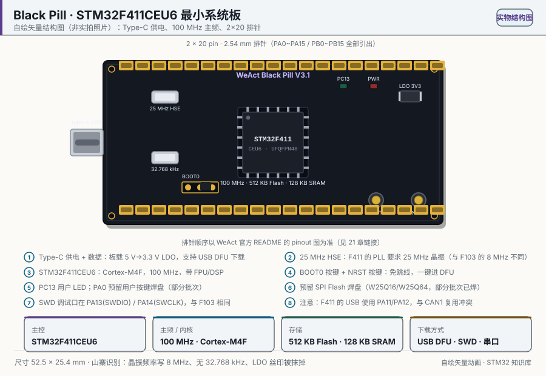
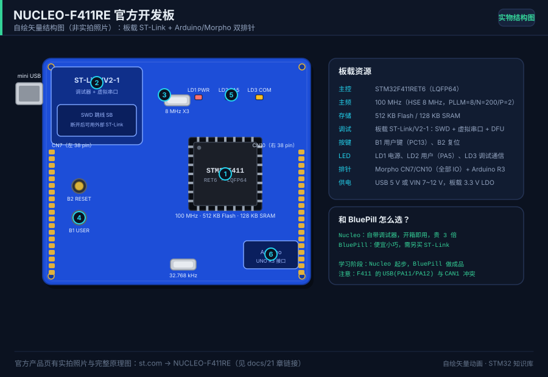
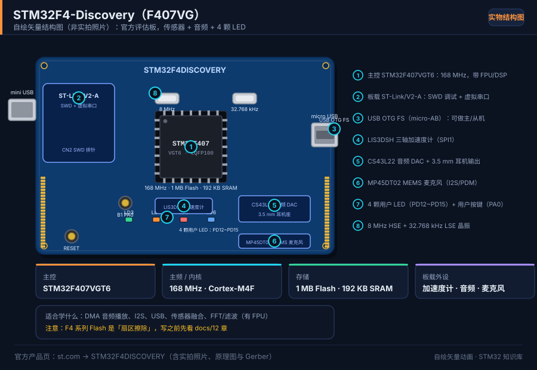
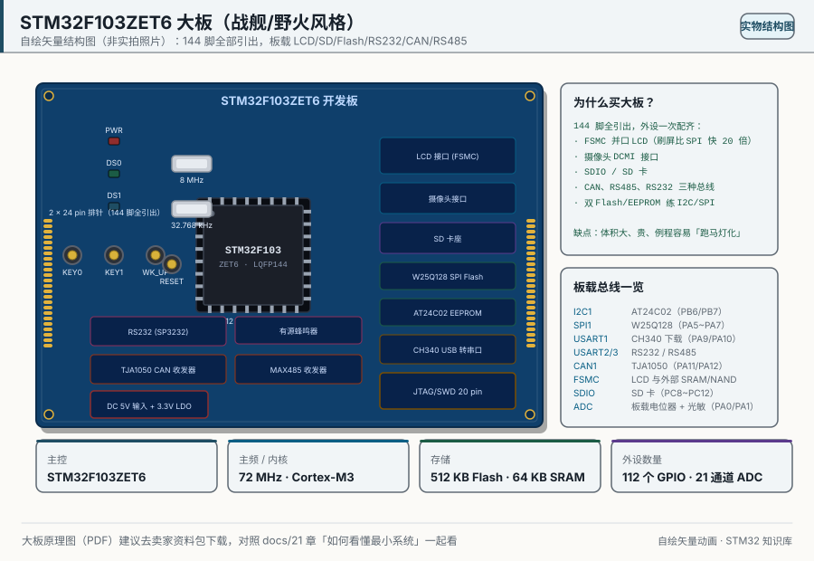
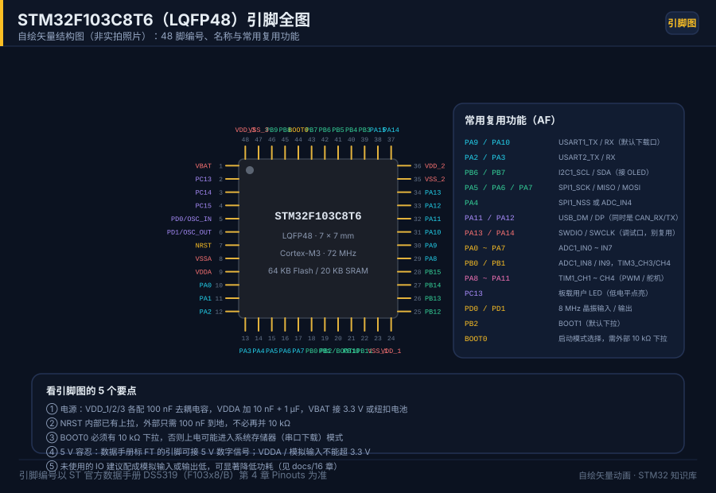

# 21 Schematics and board maps

> 中文：[21 原理图与实物图鉴](../21-原理图与实物图鉴.md)

> Seven structure drawings, plus how to read a minimum-system schematic, so you can name every part and every pin on the board in your hand.

<p align="center">
  
  <br><sub>▲ Drawing: BluePill STM32F103C8T6 minimum system (vector structure drawing, not a vendor photograph)</sub>
</p>

<!-- video:ch21 -->
<p align="center">
  <video width="640" controls poster="../../assets/video/ch21-boards.png">
    <source src="../../assets/video/ch21-boards.mp4" type="video/mp4">
  </video>
  <br><sub>▲ Chinese voice-over, 2.6 min. Voice: Microsoft Edge neural voice zh-CN-XiaoxiaoNeural via edge-tts (library mostly LGPLv3; the voice model is an online Microsoft service, not an open model). Pictures are generated from this repo's SVGs, not photographs. Subtitles: <a href="../../assets/video/ch21-boards.srt">SRT</a>. Rebuild with <code>python3 tools/gen_narrated.py --speak</code>.</sub>
</p>

**Narration script (Chinese, same text as the subtitles)**

1. 板子上的丝印会简写，也会印错。引脚以原理图和数据手册为准。上电之前，先在原理图上找到 3.3 伏、地和调试口，不要凭丝印把 5 伏送进 3.3 伏脚。
2. 最小系统不是一块华丽的板子。电源、去耦、复位、时钟、调试口，这几样在，芯片就能活。板子不工作的时候，先量这几样，再怀疑你的程序。
3. BOOT0 拉低，上电进主闪存，跑你的程序。拉高，进系统存储器，方便救砖。悬空时，它可能今天进程序、明天进系统存储器。原理图里这只脚不该飘着。
4. 这一帧是仓库画的 BluePill 引脚图，不是实物照片。板载灯在 PC13，低电平亮。PA13 和 PA14 留给 SWD。对照原理图时，先找这三只，再找你要接的外设。
5. 封装上每一对电源和地都要接上，不能因为「好像内部连着」就空着。去耦电容靠近电源脚。模拟部分的电源脚空着，ADC 会变成噪声发生器。
6. USB 口过来的常常是 5 伏，经过板上的稳压才变成 3.3 伏。模块如果是 5 伏逻辑，进芯片前要想电平。别把稳压器的输入和输出看反，那是最快的毁板方式。
7. 焊接或买板之后，读芯片表面的型号，对上数据手册里的订购信息。同系列不同容量，闪存页的大小和有没有某些外设会变。程序能编译，不代表这颗料有那个外设。
8. 口诀：BOOT0 不要悬空；每一对电源脚都要落地。丝印只是提示，原理图加上数据手册才是依据。
9. 拿你手里的板子，在原理图上圈出复位、调试口、晶振和板载灯。圈不出来，先别加模块。圈得出来，后面的接线才有参照。
10. 合上书，三问。BOOT0 悬空时上电可能进哪里？BluePill 板载灯怎样才会亮？丝印和数据手册冲突时听谁的？
<!-- /video:ch21 -->
> **Important:** every picture under [`../../assets/boards/`](../../assets/boards/) is a **vector structure drawing the author made from the official datasheet or schematic**. They label the chip, crystals, regulator, buttons, headers, and typical peripherals. **They are not vendor photographs.** For a real photo, use the official product page or datasheet linked under each board. Generator: [`../../tools/gen_boards.py`](../../tools/gen_boards.py).

## 📌 Goals

- [ ] Recognize all seven structure drawings and name each board's MCU, memory, clock, and on-board parts.
- [ ] Read "how it is powered and how you program it" for each board.
- [ ] Spot common clones: short Flash, missing crystal, a cheap regulator.
- [ ] Say which example chapters fit each board.
- [ ] Name the five pieces of a minimum-system schematic: crystal, reset, BOOT, decoupling, power.

## 🧠 The boards

| Drawing ([`../../assets/boards/`](../../assets/boards/)) | MCU | Clock / core | Flash / RAM | How you program it |
| --- | --- | --- | --- | --- |
| `bluepill-stm32f103c8t6.svg` | STM32F103C8T6 | 72 MHz · M3 | 64 KB / 20 KB | SWD + UART ISP |
| `blackpill-stm32f411ce.svg` | STM32F411CEU6 | 100 MHz · M4F | 512 KB / 128 KB | USB DFU + SWD + UART |
| `nucleo-f411re.svg` | STM32F411RET6 | 100 MHz · M4F | 512 KB / 128 KB | On-board ST-Link (SWD + virtual COM) |
| `f4-discovery.svg` | STM32F407VGT6 | 168 MHz · M4F | 1 MB / 192 KB | On-board ST-Link/V2-A |
| `f103zet6-dev.svg` | STM32F103ZET6 | 72 MHz · M3 | 512 KB / 64 KB | SWD + UART |
| `pinout-bluepill.svg` | STM32F103C8T6 (pinout) | — | — | — |
| `peripheral-wiring.svg` | — (wiring overview) | — | — | — |

### 1. BluePill · STM32F103C8T6


| Item | Content |
| --- | --- |
| MCU | STM32F103C8T6 (LQFP48, Cortex-M3) |
| Flash / RAM | 64 KB / 20 KB (datasheet DS5319) |
| Clock | 72 MHz (HSE 8 MHz → PLL×9) |
| On board | 8 MHz HSE, 32.768 kHz LSE pads, RT9193-33 LDO, micro-USB, PC13 LED, NRST button, BOOT0/BOOT1 jumpers, two 2×20 headers |
| Power | micro-USB 5 V → RT9193-33 → 3.3 V, or feed the 3V3 pin directly |
| Program | SWD (PA13/PA14) + UART ISP (BOOT0=1) |
| Examples | Almost everything under [`../../examples/`](../../examples/): gpio-blink, exti-key, timer-pwm, uart-dma-idle, i2c-oled, spi-flash, adc-dma, rtc-alarm, freertos-task, iap-bootloader |
| Clones | A board sold as STM32F103C8T6 is often a CS32F103, APM32, or similar. Some mark 128 KB and only have 64 KB. Some omit the LSE (RTC will not run from it). Some swap in a hot cheap LDO |
| Official photo | No official page (third-party board). The chip page and DS5319 are on ST's site |

### 2. BlackPill · STM32F411CEU6 (WeAct)



| Item | Content |
| --- | --- |
| MCU | STM32F411CEU6 (UFQFPN48, Cortex-M4F, with FPU/DSP) |
| Flash / RAM | 512 KB / 128 KB |
| Clock | 100 MHz (25 MHz HSE → PLL) |
| On board | 25 MHz HSE, 32.768 kHz LSE, 3.3 V LDO, Type-C USB, PC13 LED, power LED, NRST/BOOT0 buttons, two 2×20 headers |
| Power | Type-C 5 V → 3.3 V LDO |
| Program | USB DFU (hold BOOT0), SWD, UART |
| Examples | Work that wants an F4 or the FPU; F4 variants of [chapter 09](09-adc-dac.md), [chapter 10](10-dma.md), [chapter 14](14-usb.md), and [chapter 15](15-freertos.md) |
| Clones | Tell V2.0 / V3.0 / V3.1 apart. A clone may ship an F401 as an F411, or the wrong crystal |
| Photos and schematic | WeAct BlackPill repo: `https://github.com/WeActTC/WeAct-STM32F411CEU6` |

### 3. Nucleo-F411RE · official board



| Item | Content |
| --- | --- |
| MCU | STM32F411RET6 (LQFP64, Cortex-M4F) |
| Flash / RAM | 512 KB / 128 KB |
| Clock | 100 MHz (HSE 8 MHz, PLLM=8/N=200/P=2) |
| On board | ST-Link/V2-1 (SWD + virtual COM + DFU), 8 MHz crystal, 32.768 kHz, B1 user button (PC13), B2 reset, LD2 user LED (PA5), LD1 power LED, LD3 COM LED, Arduino UNO R3 headers, Morpho CN7/CN10 |
| Power | USB 5 V, or VIN 7~12 V, on-board 3.3 V LDO |
| Program | On-board ST-Link, ready out of the box |
| Examples | No external debugger. Fits F4 versions of uart-dma-idle, adc-dma, freertos-task |
| Notes | Official boards are rarely cloned. Watch the SB solder bridges if you want an external debugger. On F411, USB and CAN1 share pins |
| Product page | `https://www.st.com/en/evaluation-tools/nucleo-f411re.html` |

### 4. STM32F4-Discovery (F407VG)



| Item | Content |
| --- | --- |
| MCU | STM32F407VGT6 (LQFP100, Cortex-M4F) |
| Flash / RAM | 1 MB / 192 KB |
| Clock | 168 MHz |
| On board | ST-Link/V2-A (SWD + virtual COM), 8 MHz and 32.768 kHz crystals, four user LEDs (PD12~PD15), user button PA0, LIS3DSH accelerometer (SPI1), CS43L22 audio DAC and a 3.5 mm jack, MP45DT02 MEMS microphone, USB OTG FS (micro-AB) |
| Power | Mini-USB on the debug connector, or external 5 V |
| Program | On-board ST-Link/V2-A |
| Examples | High clock, DSP, audio, USB; the scope, acquisition card, and logic analyzer in [chapter 19](19-projects.md) |
| Notes | Mostly the official board. A "Discovery clone" often deletes parts |
| Product page | `https://www.st.com/en/evaluation-tools/stm32f4discovery.html` |

### 5. STM32F103ZET6 large board (Battleship 战舰 / Wildfire 野火 style)



| Item | Content |
| --- | --- |
| MCU | STM32F103ZET6 (LQFP144, Cortex-M3) |
| Flash / RAM | 512 KB / 64 KB |
| Clock | 72 MHz |
| On board | FSMC parallel LCD, DCMI camera connector, SD socket (SDIO), W25Q128 SPI Flash, AT24C02 EEPROM, CH340 USB-UART, TJA1050 CAN transceiver, MAX485, SP3232 RS232, active buzzer, 8 MHz and 32.768 kHz crystals, several LEDs and buttons, 20-pin JTAG/SWD, all 144 pins brought out |
| Power | 5 V DC in, plus a 3.3 V LDO |
| Program | SWD + UART ISP (CH340) |
| Examples | [Chapter 03](03-gpio-and-led.md), [chapter 07](07-i2c.md), [chapter 08](08-spi.md), and [chapter 13](13-can.md); later FSMC / SDIO / camera work |
| Clones | Common. Check the EEPROM and Flash part numbers, whether the CAN transceiver is actually fitted, and the LDO. Vendor demos often differ only in which LED they blink |
| Photo | Third-party board. The chip page and the matching DS are on ST's site |

### 6. BluePill full pinout



| Item | Content |
| --- | --- |
| What it is | All 48 LQFP pins, with the alternate functions you actually use |
| Key AF | PA9/PA10 = USART1, PB6/PB7 = I2C1, PA5~PA7 = SPI1, PA11/PA12 = USB, PA13/PA14 = SWD, PA0~PA7 = ADC1_IN0~7 |
| Use | Check a wire before you connect it. One pin, one function at a time |
| Examples | Wiring reference for every F103 example |

> Five things to look at on a pinout: **(1) power (VDD/VSS/VDDA/VSSA/VBAT), (2) clock (OSC_IN/OUT), (3) debug (do not reuse PA13/PA14), (4) alternate functions, (5) 5V tolerance (the FT mark).**

### 7. Peripheral wiring overview


| Peripheral | Pins | Bus / mode |
| --- | --- | --- |
| LED + 330Ω | PA5 | Push-pull output |
| Button to ground | PA0 | Pull-up input + EXTI |
| Potentiometer / light sensor | PA1 | ADC1_IN1 |
| SG90 servo | PB0 | TIM3_CH3 PWM |
| SSD1306 OLED | PB6/PB7 | I2C1 |
| W25Q64 Flash | PA5/PA6/PA7 + PA4 (CS) | SPI1 |
| HC-05 Bluetooth | PA9/PA10 | USART1 |
| DHT11 | PB12 | Single-wire timing |

> Two reminders: **check the conflict first** (SPI1's PA5~PA7 are also ADC and TIM2 alternates), and **match the voltage and share ground** (HC-05, OLED, and W25Q64 are 3.3 V parts).

## 🛠️ How to read a minimum-system schematic

A minimum system is six things: **MCU, power, crystal, reset, BOOT, decoupling.**

| Piece | Parts | Job | What to check |
| --- | --- | --- | --- |
| MCU | The chip | The core | Package and pinout match the part number |
| Power | LDO + capacitors | 5 V to 3.3 V | 3.3 V is steady; VDDA has its own filter |
| Decoupling | 100 nF ×N (one on every VDD) + 10 µF | Kill high-frequency noise | Missing caps mean random resets and a jumpy ADC |
| Main crystal | HSE 8 MHz + 2×20 pF | A precise clock | If it does not start, you fall back to HSI and the baud is wrong |
| RTC crystal | LSE 32.768 kHz + 2×6 pF | RTC / low power | Too much load capacitance and it never starts |
| Reset | NRST + 10 kΩ pull-up + 100 nF to ground + a button | Power-on and manual reset | A floating NRST resets at random |
| BOOT | BOOT0 (10 kΩ pulldown), BOOT1 | Pick the boot area | BOOT0=0 boots from Flash |
| SWD | PA13/PA14 + GND + 3V3 | Program and debug | Keep them. Do not reuse them |
| VBAT | A coin cell | Holds RTC and the backup domain | With no cell, time dies when power dies |

**Boot mode (BOOT0/BOOT1):**

| BOOT0 | BOOT1 | Boot area | Use |
| --- | --- | --- | --- |
| 0 | x | Main Flash | Normal run (the default) |
| 1 | 0 | System memory | UART / USB ISP |
| 1 | 1 | Embedded SRAM | Debug, or recovering a locked chip |

**How to read the decoupling:** every `VDD` / `VDDA` pin should have a 100 nF to ground nearby, and the board should have one 10 µF bulk capacitor. **VDDA/VSSA for the ADC need their own filter**, or the samples are noisy.

## 💻 Read the chip's identity

Once you know the board, code can print the device id, the Flash size, and the unique id. On F1 that is a practical way to spot a clone or a short-marked part.

```c
#include "stm32f1xx_hal.h"
#include <stdio.h>

/* F1 identity registers (RM0008 chapter 30, Device electronic signature) */
#define DBGMCU_IDCODE_ADDR   0xE0042000UL   /* device id */
#define FLASH_SIZE_ADDR      0x1FFFF7E0UL   /* Flash size in KB, low 16 bits */
#define UNIQUE_ID_ADDR       0x1FFFF7E8UL   /* 96-bit unique id */

void Chip_PrintIdentity(void)
{
    uint32_t dev_id  = *(volatile uint32_t *)DBGMCU_IDCODE_ADDR;
    uint16_t dev     = (uint16_t)(dev_id & 0x0FFF);         /* device id */
    uint16_t rev     = (uint16_t)((dev_id >> 16) & 0xFFFF); /* revision */
    uint16_t flash   = *(volatile uint16_t *)FLASH_SIZE_ADDR;

    uint32_t *uid = (uint32_t *)UNIQUE_ID_ADDR;             /* three words */

    printf("Device ID = 0x%03X, Rev = 0x%04X\r\n", dev, rev);
    printf("Flash Size = %u KB\r\n", flash);                /* 64 or 128, and so on */
    printf("UID = %08lX-%08lX-%08lX\r\n",
           (unsigned long)uid[0], (unsigned long)uid[1], (unsigned long)uid[2]);

    /* An F103C8 should report 0x410 (medium density) and 64 KB of Flash */
}
```

> Redirect `printf` first ([chapter 06](06-uart.md) and [chapter 17](17-debug.md)). If the **Flash size does not match the marking** (a C8 that reports 128 KB), you usually have a compatible chip or a remarked clone. **Device id `0x410` is a medium-density F103.** Any other value belongs in the Device ID table of RM0008.

## ⚠️ Pitfalls

| What you see | Why | Fix |
| --- | --- | --- |
| A "F103C8T6" will not run at 72 MHz | Compatible chip, or a clone with a lower clock | Read the id and the Flash size. Trust what the chip reports |
| RTC does not advance | No LSE fitted | Fit 32.768 kHz and the 6 pF capacitors |
| Random reset at power-up | Missing decoupling, or NRST floating | 100 nF on every VDD; 100 nF on NRST |
| ADC readings are noisy | VDDA/VSSA not filtered | Bead plus a capacitor on VDDA |
| Cannot attach after programming | PA13/PA14 were reused and SWD was turned off | Keep SWD, or pull BOOT0 high to recover |
| Silkscreen pin numbers do not match the drawing | The fab mislabeled a clone | Trust the datasheet pinout, not the ink |
| A 5 V part on a 3.3 V pin | Levels do not match | Level shift, or use an FT (5 V tolerant) pin |
| The board gets hot | A poor LDO, or a short | Measure current, replace the LDO, find the short |
| One function will not come out | That pin is already used | Check the pinout and the AF table, then move the function |

## 🧪 Try it

1. **Print the identity.** Run the snippet. An F103C8 should report id `0x410` and 64 KB.
2. **Draw a minimum system.** In KiCad, draw the BluePill minimum system (MCU, LDO, crystal, reset, BOOT, decoupling). You should be able to read your own sheet.
3. **Wire from the pinout.** Use `pinout-bluepill.svg` for an I2C OLED on PB6/PB7 and check the alternate function. It should light on the first try.
4. **Spot a clone (optional).** Compare id, Flash size, and UID on two "F103C8T6" boards from different sellers.
5. **Boot pins (optional).** Change BOOT0/BOOT1 and download once over UART ISP. You should be able to name the three boot areas.

## 🔗 Further reading

- Datasheets: DS5319 (STM32F103x8/xB), and the DS for F411CE, F407VG, and F103ZE (pin definitions and electrical limits).
- Reference manuals: RM0008 chapter 9 (AFIO), chapter 30 (device electronic signature), chapter 3 (boot configuration); the matching chapters of RM0090.
- Product pages (photographs): Nucleo-F411RE `https://www.st.com/en/evaluation-tools/nucleo-f411re.html`; STM32F4-Discovery `https://www.st.com/en/evaluation-tools/stm32f4discovery.html`.
- WeAct BlackPill (schematic and photos): `https://github.com/WeActTC/WeAct-STM32F411CEU6`.
- Related chapters: [02 Choosing a part](02-part-and-clock.md), [01 Environment](01-dev-environment.md), [20 Resources](20-resources.md).
- Drawings: seven **vector structure drawings** under `../../assets/boards/` (`bluepill-stm32f103c8t6.svg`, `blackpill-stm32f411ce.svg`, `nucleo-f411re.svg`, `f4-discovery.svg`, `f103zet6-dev.svg`, `pinout-bluepill.svg`, `peripheral-wiring.svg`). **None of them is a vendor photograph.**
