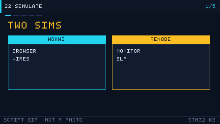

# 22 Simulation labs: Wokwi and Renode

> 中文：[22 仿真实验：Wokwi 与 Renode](../22-仿真实验Wokwi与Renode.md)

> You can light the LED and press the button with no board on the desk. Simulation is how you preview the lab. It does not replace soldering.

<p align="center">
  
  <br><sub>▲ Animation: firmware walking from compile to run (author-drawn vector animation, not a photograph)</sub>
</p>

<!-- video:ch22 -->
<p align="center">
  
  <br><sub>▲ Lecture strip for this chapter: a program-generated GIF (tools/gen_videos.py, reproducible, not a photograph). The narration matches the five frames one by one.</sub>
</p>

**Narration (read along with the frames, about one minute)**

1. Simulation comes in two flavors. Wokwi wires the circuit in the browser. Renode runs the same Cortex-M3 from the command line.
2. Every core example directory has a `diagram.json` and a `wokwi.toml`. Pin names follow the Wokwi board definition. `A0` is PA0.
3. The Renode script loads the official platform `platforms/cpus/stm32f103.repl`. USART1 is on PA9/PA10.
4. The current Wokwi BluePill model has no DMA. An idle-line UART frame and an ADC transfer belong on a real board, or you only look at the wiring.
5. Motto: simulation shows the behavior; the real board checks the timing. Self-test: in Wokwi, do you still need to wire an extra LED for the lamp on PC13?
<!-- /video:ch22 -->

## 📌 Learning goals

- [ ] Open this repo's BluePill diagram in Wokwi, and explain the pin aliases.
- [ ] Load `stm32f103.repl` and an ELF in Renode.
- [ ] Know which examples can run to the end in the simulator you have now, and which ones only show the wiring.

## 🧠 Which one to open first

**Conclusion**: if you want to see an LED, a button, PWM, or an OLED, use Wokwi. If you want to single-step in a terminal and watch the USART1 byte stream, use Renode. Both of them eat an ELF you compiled yourself. This repo does not ship prebuilt firmware.

| | Wokwi | Renode |
| --- | --- | --- |
| Where it runs | The browser, or the VS Code extension | The command line on your machine |
| Configuration | `diagram.json` and `wokwi.toml` in the example directory | `sim/renode/*.resc` |
| Board | `board-stm32-bluepill` (STM32F103C8) | `platforms/cpus/stm32f103.repl` |
| Good for | Wiring, GPIO, EXTI, timers, I2C | Loading an ELF, a USART1 terminal, a log of peripheral accesses |
| Official notes | [Blue Pill part page](https://docs.wokwi.com/parts/board-stm32-bluepill), [wokwi.toml](https://docs.wokwi.com/vscode/project-config) | `platforms/cpus/stm32f103.repl` in the Renode repository |

**Motto:** watch the LED in the browser, and watch the bytes on the command line.

## 🛠️ Wokwi: how to read the diagram

The pin name is not `PA0`. It is the key in the Wokwi board file. The source is
[`board.json` in wokwi-boards, under `boards/stm32-bluepill/`](https://github.com/wokwi/wokwi-boards/blob/main/boards/stm32-bluepill/board.json):

| Name on the diagram | Pin on the chip | Who in this repo uses it |
| --- | --- | --- |
| `C13` | PC13 (the on-board LED, already wired on the schematic, lit when low) | gpio-blink |
| `A0` | PA0 | the external LED in gpio-blink, the button in exti-key, ADC channel 0 |
| `A1` / `A4` | PA1 / PA4 | adc-dma |
| `A6` | PA6 = TIM3_CH1 | timer-pwm |
| `A9` / `A10` | PA9 / PA10 = USART1 | uart-dma-idle (the serial monitor) |
| `B6` / `B7` | PB6 / PB7 = I2C1 | i2c-oled |
| `GND.1` `3V3.1` | ground / 3.3 V | every external part |

The on-board LED is already soldered to PC13, so a blink lab can flash without drawing another LED. The `gpio-blink` diagram also draws the external LED on PA0, which is the second lamp in that example.

### Each core example has its own diagram

| Example | What the diagram contains | Can the current Wokwi model finish the lab? |
| --- | --- | --- |
| [gpio-blink](../../examples/gpio-blink/diagram.json) | The board, plus PA0 through 270Ω to a red LED | Yes. GPIO is on the supported list |
| [exti-key](../../examples/exti-key/diagram.json) | A button from PA0 to ground | Yes. EXTI is on the supported list |
| [timer-pwm](../../examples/timer-pwm/diagram.json) | PA6 through 270Ω to a green LED | Yes. TIM1–TIM4 are on the supported list |
| [i2c-oled](../../examples/i2c-oled/diagram.json) | `board-ssd1306`, address `0x3c`, 4.7 kΩ pull-ups on SCL and SDA | I2C is on the supported list. The panel waits until the firmware writes SSD1306 timing |
| [uart-dma-idle](../../examples/uart-dma-idle/diagram.json) | Only the board. Bytes go to the serial monitor | **DMA is not implemented**, so idle-line reception cannot run to the end |
| [adc-dma](../../examples/adc-dma/diagram.json) | Three potentiometers on A0, A1, and A4 | Basic ADC1 conversion exists. **DMA copies do not** |

What is supported follows the table in the Wokwi docs (GPIO, USART, I2C, SPI, TIM, and EXTI are in; DMA, RTC, and IWDG are out). That table changes. Trust the version you have open.

In `wokwi.toml` the firmware path is written as `build/firmware.elf`. Wokwi accepts `.elf`, `.hex`, and `.bin` for STM32. Build it in CubeIDE or PlatformIO first, then change the `firmware` and `elf` lines to your real path. Wokwi does not compile for you.

## 🛠️ Renode: two scripts

The scripts live in [`sim/renode/`](../../sim/renode/). They do four things: create a machine, load the official F103 platform description, load the ELF, and start.

| Script | What it does |
| --- | --- |
| [gpio-blink.resc](../../sim/renode/gpio-blink.resc) | Opens a USART1 analyzer, and logs accesses to `gpioPortC`. The on-board LED is PC13 |
| [uart-usart1.resc](../../sim/renode/uart-usart1.resc) | Connects `usart1` to local port 3456. Open another terminal with `telnet localhost 3456` |

```bash
# By default it looks for firmware.elf in the current directory. Use -e to point elsewhere
renode -e '$bin=@/path/to/firmware.elf' sim/renode/gpio-blink.resc
renode -e '$bin=@/path/to/firmware.elf' sim/renode/uart-usart1.resc
```

The name `usart1` and the address `0x40013800` are written in Renode's `stm32f103.repl`. That is USART1 from the reference manual, which is PA9/PA10. Do not call it USART2.

The UART example uses DMA. `stm32f103.repl` does attach a DMA node, but whether it can finish an idle-line plus ring-buffer transfer depends on the Renode version you installed. If it does not match, first confirm the bytes with the polling transmit and receive from [chapter 06](06-uart.md), then come back to DMA.

## ⚠️ What simulation will not do for you

| What you see | Why | What to do |
| --- | --- | --- |
| Wokwi says it cannot find the firmware | The path in `wokwi.toml` is a placeholder | Point it at the ELF you just built |
| The LED does not blink, and the diagram is right | The firmware clock or BOOT does not match the simulation model | Confirm it on a real board first, then check the model's support table |
| The serial port produces not even one byte | The example is waiting for a DMA idle interrupt | Switch to polling, or move to a real board |
| The OLED is a black rectangle | The address was written as 0x78, and the part defaults to 0x3c | `i2cAddress` on the diagram is the 7-bit address `0x3c`. That is the same slave as 0x78 after HAL shifts it left |
| Renode says the platform cannot be found | That version does not contain this repl | At the Renode prompt, `ls @platforms/cpus` and read the real filename |

## 🧪 Hands-on labs

1. **Watch only the on-board LED**: build an ELF from gpio-blink and drop it into Wokwi. You should see the PC13 lamp on the board blink at the code's rhythm, and the external lamp on PA0 blink much more slowly.
2. **Press once**: in the exti-key diagram, press the button (it ties A0 to GND). The on-board LED should toggle. The firmware configures the button as a pull-up input, so the diagram does not draw another pull-up resistor.
3. **Listen to USART1**: run `uart-usart1.resc` in Renode and telnet to 3456. If the firmware is still the DMA version and no bytes appear, write that conclusion down: it is a limit of the model, not a baud-rate arithmetic error.

Self-test:

1. Which pin on the chip is `A6` on a Wokwi diagram?
2. Why does the uart-dma-idle diagram contain only a board?
3. What is the platform file the Renode script loads?

## 🔗 Related resources

- Wokwi: [STM32 Blue Pill](https://docs.wokwi.com/parts/board-stm32-bluepill), [diagram.json](https://docs.wokwi.com/diagram-format), [wokwi.toml](https://docs.wokwi.com/vscode/project-config), [SSD1306 board](https://docs.wokwi.com/parts/board-ssd1306), [potentiometer](https://docs.wokwi.com/parts/wokwi-potentiometer)
- The board-pin definition, in the original: [wokwi-boards `board.json`](https://github.com/wokwi/wokwi-boards/blob/main/boards/stm32-bluepill/board.json)
- The Renode platform, in the original: `platforms/cpus/stm32f103.repl` (`usart1` at `0x40013800`, `gpioPortC` at `0x40011000`)
- Example index: [examples/README.md](../../examples/README.md)
- A limit to state plainly: there are no simulator screenshots here. The wiring is whatever the JSON says. The capability is whatever the support table in each project's docs says.
