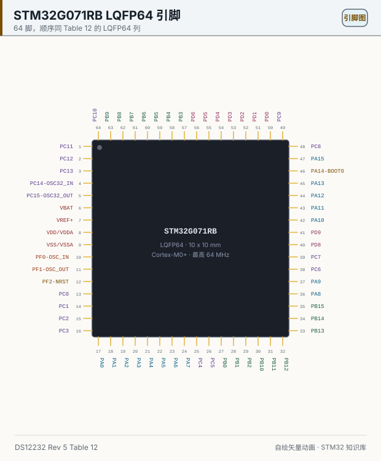
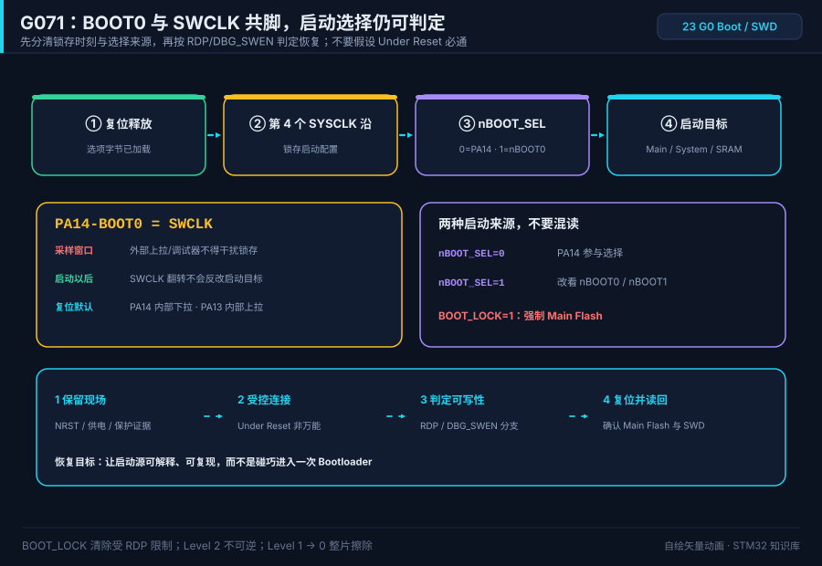

# 23 STM32G0 pins (G071RB)

> 中文：[23 STM32G0 引脚（G071RB）](../23-STM32G0引脚.md)

> On G0, BOOT0 and the debug clock share one pin. Learn the package before you talk about alternate functions.

  
   ▲ Pinout: the 64 names and their order come from the LQFP64 column of DS12232 Rev 5 Table 12 (the same package as Figure 9). Color is only a reading aid, not a datasheet marking. Generated by script, not a photograph.

<!-- video:ch23 -->

  <video width="640" controls poster="../../assets/video/ch23-g0-pins.png">
    <source src="../../assets/video/ch23-g0-pins.mp4" type="video/mp4">
  </video>
   ▲ Chinese voice-over, 2.6 min. Voice: Microsoft Edge neural voice zh-CN-XiaoxiaoNeural via edge-tts (library mostly LGPLv3; the voice model is an online Microsoft service, not an open model). Pictures are generated from this repo's SVGs, not photographs. Video: <a href="../../assets/video/ch23-g0-pins.mp4">MP4</a> · subtitles: <a href="../../assets/video/ch23-g0-pins.srt">SRT</a>. Rebuild with <code>python3 tools/gen_narrated.py --speak</code>.

**Narration script (Chinese, same text as the subtitles)**

1. 这一章对着 STM32G071RB 的 64 脚封装。订购信息里 R 是 64 只脚，B 是 128 KB 闪存。出处是 DS12232 第 5 版，不是凭封装外形猜的。
2. 图的左上角、第 1 脚是 PC11。F103 那种小封装第 1 脚常常是 VBAT，这里不是。数脚时从左边往下，不要从你习惯的那个角开始。
3. 封面的通信口有 I2C、USART、LPUART、SPI，还有 USB Type-C 的 UCPD。没有 CAN，也没有 F1 那种全速设备控制器。别在图上找 CAN 发送脚。
4. 这一帧是仓库按 DS12232 表 12 画的引脚图，不是芯片照片。请你自己核对左上角是不是 PC11。颜色只帮助阅读，不代表手册里的分类。
5. 复位功能在 PF2。BOOT 和 SWCLK 共用 PA14。手册注解说，复位之后 PA14 内部下拉。把它当成 F1 那种独立的 BOOT0 焊盘，下载方式会对不上。
6. 表 12 的注把 PC13 到 PC15 限制得很紧：开关电流大约 3 毫安，输出别超过 2 兆赫，负载电容别超过 30 皮法。不要拿这三只脚去点灯。
7. 除非另有说明，复位之后这些脚是模拟输入。这和 F1 上常见的浮空输入不同。没经过初始化的脚，不要假设它已经是推挽输出。
8. 口诀：G071 的 R 是 64 只脚，B 是 128 KB。没有 CAN，别在图上找 CAN 发送。USB 这里是 UCPD，不是设备全速。
9. G0 这一章故意不写待机多少微安。封面摘录里没有一条可以单独引用的典型电流，与其编一个，不如你去电气特性那一章自己查。
10. 合上书，三问。LQFP64 的第 1 脚叫什么？这颗 G071 有没有 CAN？它的 USB 能力叫 UCPD，还是 F1 那种全速设备？
<!-- /video:ch23 -->
## 📌 Goals

- [ ] Count from the top-left corner of the LQFP64 to pin 1 and recognize PC11, not VBAT.
- [ ] Point at the default USART, I2C, SPI, and SWD pins on this part.
- [ ] Name three differences from F1: no bxCAN, no USB full-speed device, BOOT0 shared with SWCLK.
- [ ] Determine Main Flash, System memory, or SRAM from `BOOT_LOCK`, `nBOOT1`, PA14, `nBOOT_SEL`, and `nBOOT0`.
- [ ] Determine connection and recovery reachability from RDP/`DBG_SWEN` when the application reassigns PA13/PA14 or startup is abnormal, then verify successful operations with readback.

## 🧠 Which part this is

The drawing is **STM32G071RB**, LQFP64. Every fact below is from **DS12232 Rev 5**:

| Fact | Source |
| --- | --- |
| Family up to 64 MHz, Cortex-M0+, supply 1.7 V to 3.6 V | Cover features |
| Flash up to 128 KB, SRAM 36 KB | Cover; Table 2 |
| STM32G071RB: R = 64 pins, B = 128 KB Flash | Ordering information, chapter 7 |
| Low-power modes: Sleep, Stop, Standby, Shutdown | Cover features |
| Communication: 2×I2C, 4×USART, 1×LPUART, 2×SPI, USB Type-C PD (UCPD) | Cover features. The feature list has no CAN and no USB full-speed device controller |

Motto: **On a G071, R is 64 pins and B is 128 KB. There is no CAN. Do not hunt for CAN_TX on the drawing.**

## 🛠️ What changes versus F1 / F4

| Point | F103 (LQFP48, see the BluePill drawing) | G071RB (this drawing) |
| --- | --- | --- |
| Pin 1 | VBAT | **PC11** (Table 12, first row of the LQFP64 column) |
| Reset | Dedicated NRST | **PF2-NRST**. RST structure when used as reset, FT when used as GPIO (Table 12 note 3) |
| BOOT | Dedicated BOOT0, needs an external pulldown | **PA14-BOOT0**, the same pin as SWCLK (Table 12 note 6: PA14 is pulled down after reset) |
| GPIO after reset | F1 is often floating input | Table 11: unless noted otherwise, I/O comes up as analog input |
| USB | PA11/PA12 are USB DM/DP | This part has **UCPD** (Type-C power negotiation), not the F1 device controller. PA8's additional function is UCPD1_CC1, PB15 is UCPD1_CC2 (Table 12) |
| CAN | bxCAN, default can be PA11/PA12 | **No CAN controller** |
| PC13–PC15 | Backup domain, weak drive | Table 12 note 1: the switch can sink only about 3 mA, keep the output under 2 MHz and the load under 30 pF, do not light an LED from here |

F4 alternate functions use AFR numbers. G0 does too, but the AF tables are **DS12232 Table 13 (port A) and Table 14 (port B)**. Do not copy AF numbers from an F407.

## 🧭 BOOT0 shares SWCLK: determine the boot source first

  
   ▲ Animation: boot configuration is latched on the fourth SYSCLK rising edge after reset; nBOOT_SEL selects the pin or option-bit path. Under Reset is only a controlled connection attempt; RDP and DBG_SWEN also constrain recovery. Generated illustration, not an oscilloscope capture.

**PA14 is the shared boot input and debug clock, not the boot result itself.** ST's boot FAQ states that boot configuration is latched on the fourth SYSCLK rising edge after reset release. Normal SWCLK activity after that point cannot retroactively change the selected target. The risk is an external pull-up, jumper, or debug probe holding PA14 at an unintended level inside the sampling window.

This is the G0x1 table from RM0444/AN5096. `X` means the value does not affect that row. Do not misread `nBOOT_SEL` as a “system bootloader enable”; it selects **the pin path or the option-bit path**.

| BOOT_LOCK | nBOOT1 | BOOT0 pin (PA14) | nBOOT_SEL | nBOOT0 | Selected boot area |
| ---: | ---: | ---: | ---: | ---: | --- |
| 1 | X | X | X | X | **Main Flash** |
| 0 | X | 0 | 0 | X | Main Flash |
| 0 | 1 | 1 | 0 | X | System memory |
| 0 | 0 | 1 | 0 | X | Embedded SRAM |
| 0 | X | X | 1 | 1 | Main Flash |
| 0 | 1 | X | 1 | 0 | System memory |
| 0 | 0 | X | 1 | 0 | Embedded SRAM |

Keep three boundaries attached to this table:

1. `BOOT_LOCK=1` forces Main Flash with priority; pulling PA14 cannot override it.
2. `nBOOT_SEL=0` selects PA14; `=1` selects the `nBOOT0/nBOOT1` path. Factory defaults do not replace field readback because a bootloader, old project, or production step may have changed them.
3. If Main Flash is selected while the empty-flash checker finds the user area empty, the device can enter the system bootloader instead. This additional DS12232/AN2606 path means “Main in the table” does not guarantee execution from 0x08000000 on an empty device.

### Shared-pin hardware: stable sampling and debug drive must coexist

- DS12232 Table 12 note 6: after reset, PA13 has its internal pull-up, PA14 its internal pull-down, and both enter the SWD alternate function. The internal pull-down does not cancel an arbitrary strong external pull-up.
- When PA14 selects boot, check pull resistors, series resistance, and jumpers against AN5096 and the probe's drive capability. Do not clamp SWCLK with a strong pull-up. If a product does not need a field boot pin, `nBOOT_SEL=1, nBOOT0=1` selects Main Flash without depending on PA14 at boot.
- The application can still break post-boot SWD by reassigning PA13/PA14 as GPIO, disabling debug, or entering low power. That is a different failure boundary from selecting the wrong boot area; diagnose them separately.

### SWD loss: controlled connection and protection branches

1. **Preserve the scene:** record the observed boot target, whether the system bootloader is reachable, and recent changes to PA13/PA14, low power, or option bytes. Connect SWDIO, SWCLK, NRST, GND, and the target supply reference.
2. **Try a controlled connection without assuming it must work:** select **Under Reset** in STM32CubeProgrammer, or the probe's equivalent, and connect while NRST holds reset. With `BOOT_LOCK=1` and RDP Level 1, RM0444 stops debug capability and makes `FLASH_ACR.DBG_SWEN` reset to 0. If the application does not set it after reset, the manual states there is no recovery from this situation. Do not repeatedly reconnect or treat Under Reset as guaranteed.
3. **Read before writing:** if connection is possible, read and save `BOOT_LOCK`, `nBOOT1`, `nBOOT_SEL`, `nBOOT0`, RDP, and related boot configuration. If not, record protection state and whether the application sets `DBG_SWEN` as unresolved evidence. The first divergence is “boot/protection inputs differ from intent,” not “the MCU must be defective.”
4. **Branch on RDP and protection state; do not promise an in-place repair:**
   - RDP Level 0: clear or retain `BOOT_LOCK` as required. For normal Main Flash startup, use `BOOT_LOCK=0, nBOOT_SEL=1, nBOOT0=1`. If PA14 legacy selection is required, use `BOOT_LOCK=0, nBOOT_SEL=0`, then set `nBOOT1` and the external level from the truth table.
   - RDP Level 1: `BOOT_LOCK=1` cannot simply be cleared in place. RM0444 permits clearing only when already at Level 0, or after **Level 1 → Level 0 with a full mass-erase**. The erase destroys user contents and requires explicit authorization, backup, and a maintenance procedure. Confirm that a path to request it actually exists; never present it as a default recovery button.
   - RDP Level 2: irreversible; no RDP-downgrade recovery path exists. With `BOOT_LOCK=1 + RDP Level 1` and no application-set `DBG_SWEN`, do not claim that Under Reset, a bootloader, or mass-erase is necessarily reachable.
5. **Read back after reset only if the operation actually succeeded:** perform the tool's option-byte launch or specified reset flow, read the option bytes again, then verify Main Flash startup and SWD hot attach. A successful write response does not prove the new values were active for the current boot. A failed write or connection remains a failed outcome, not a “recovered” result.

> **RDP and complement boundary:** never lower RDP blindly to “unlock” a board. Level 2 is irreversible, and Level 1 → Level 0 triggers a mass erase. `BOOT_LOCK` can always be set, but clearing it is restricted by the RDP conditions above. **An option-byte/complement mismatch forces `BOOT_LOCK=1`, and an RDP mismatch defaults to Level 1**. Readback must therefore check values and complements, not just one field. Preserve the scene and required data first; mass erase is not a default repair button.

## 🛠️ Alternate functions that Table 12 / 13 / 14 actually name

| Function | Pins | Source |
| --- | --- | --- |
| SWDIO / SWCLK | PA13 / PA14-BOOT0 | Table 12 note 6: after reset these are already the debug alternate functions |
| USART1_TX / RX | PA9 / PA10; also PC4 / PC5 | Table 13, Table 12 |
| USART2_TX / RX | PA2 / PA3 | Table 13 |
| I2C1_SCL / SDA | PB6 / PB7; also PB8 / PB9 | Table 14 |
| SPI1_SCK / MISO / MOSI | PA5 / PA6 / PA7 | Table 13 |
| SPI1_NSS | PA4 or PB0 | Table 13, Table 14 |
| LSE | PC14-OSC32_IN / PC15-OSC32_OUT | Pin names in Table 12 |
| HSE | PF0-OSC_IN / PF1-OSC_OUT | Pin names in Table 12 |
| Leave alone while debugging | PA13, PA14 | Moving PA14 also moves BOOT0 |

After reset, PA11 / PA12 are PA11 / PA12. Table 12 note 5: SYSCFG_CFGR1 can remap PA9/PA10 onto the PA11/PA12 positions. Until that register changes, do not call PA11 "PA9".

## ⚠️ Common ways an F1 port falls over

| What you see | Why | Fix |
| --- | --- | --- |
| The part boots into system memory and SWD looks wrong | PA14 is both SWCLK and BOOT0 | Read `BOOT_LOCK/nBOOT_SEL/nBOOT0/nBOOT1`; distinguish a boot-source error from an application reassigning debug pins before choosing recovery |
| No CANH anywhere on the drawing | A G071 has no CAN | Use a G0 sub-family that has FDCAN, or use a USART |
| A push-pull LED on PC13 is dim and the edges are soft | Note 1's current and speed limits | Move the LED to a normal GPIO |
| Pulling PA14 high still does not enter the bootloader | `BOOT_LOCK=1`, or `nBOOT_SEL=1` excludes the pin from selection | Read every truth-table input first instead of repeatedly changing the level |
| The old boot area remains after writing option bytes | The new values have not passed the required reset/load sequence, or only the write return value was checked | Run the specified option-byte launch/reset, then read back after reset and verify startup plus SWD |

## 🧪 Try it

1. Print the drawing. Count with a pencil from pin 1 to PF2-NRST and check that it is pin 12.
2. In datasheet Table 13, find the AF list for PA9 and circle USART1_TX.
3. Answer: if a schematic ties an LED to PC13, why is this part a bad fit?
4. Without writing anything, record `BOOT_LOCK/nBOOT1/nBOOT_SEL/nBOOT0` and the external PA14 level, then substitute every value into the truth table.
5. On a recoverable board you own, rehearse an Under Reset connection. Prove option-byte readback first; only then decide whether to modify anything. Record values before/after reset, Main Flash startup, and SWD hot attach.

Self-test:

1. What is pin 1 of a G071RB called?
2. Which debug wire shares a pin with BOOT0?
3. Is the USB peripheral on this part called UCPD or USB Device FS?
4. Which boot-selection paths do `nBOOT_SEL=0` and `=1` choose?
5. Where does `BOOT_LOCK=0, nBOOT_SEL=1, nBOOT0=1` boot? With `nBOOT0=0`, where do `nBOOT1=1` and `=0` boot?
6. Why does pulling PA14 high not necessarily enter System memory, why can a successful option-byte write still leave the next boot unchanged, and what happens on an option-byte/complement mismatch?
7. What are the first two recovery steps after an application breaks SWD through PA13/PA14, why are Under Reset and clearing `BOOT_LOCK` not unconditionally available, and why is lowering RDP not a default answer?

## 🔗 Further reading

- RM0444 Rev 5 section 2.5 and its FLASH_SECR/option-byte descriptions: boot truth table, `DBG_SWEN` restriction with `BOOT_LOCK + RDP Level 1`, clearing conditions, and complement-mismatch rules. AN5096 Table 3 cross-checks the boot table; AN2606 covers system bootloader activation patterns and additional empty-flash boundaries.

- DS12232 Rev 5: cover features, Table 1, Table 2, Tables 11–14, ordering information in chapter 7, Figure 9, PA14 reset pull-down, and the empty-flash boundary.
- RM0444 section 2.5 and AN5096 Table 3: the boot truth table; AN2606: system bootloader activation patterns and additional empty-flash boundaries.
- ST's official *FAQ STM32 boot process*: fourth-SYSCLK-edge boot latch, option-byte loading, and RDP boundaries. It supplements rather than replaces RM0444.
- Comparison drawing: [BluePill LQFP48](../../assets/boards/pinout-bluepill.svg).
- The cover names the low-power modes. We do not quote a current, because the cover does not give a typical microamp value for the G071. Guessing one would be worse.
