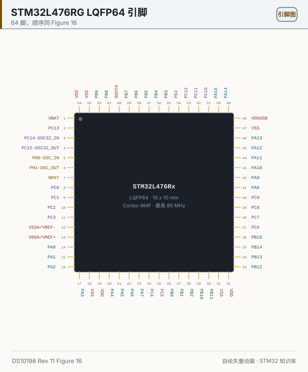
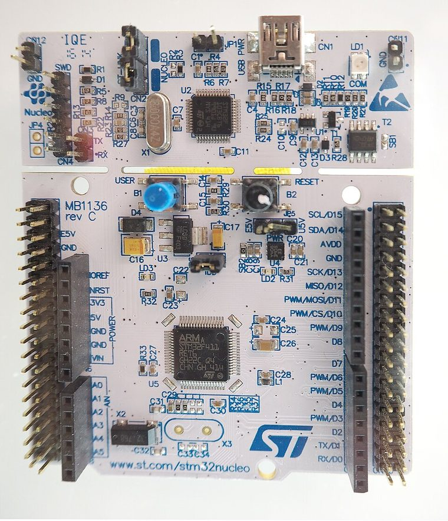
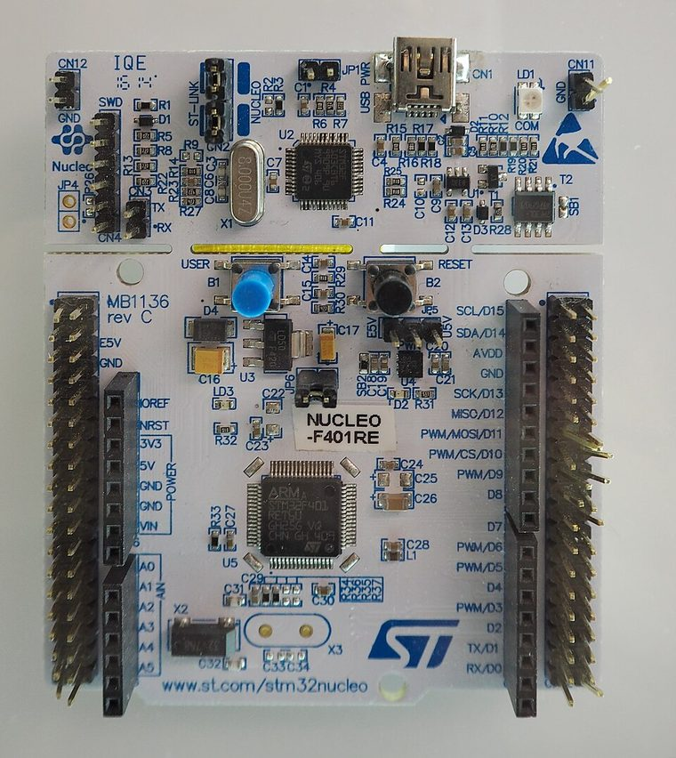
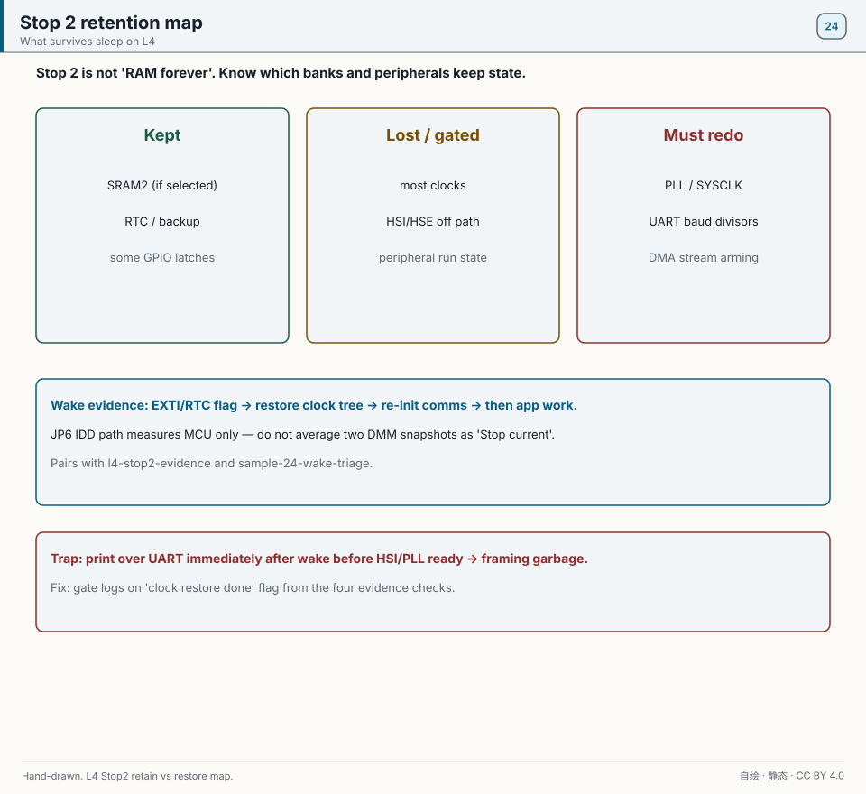
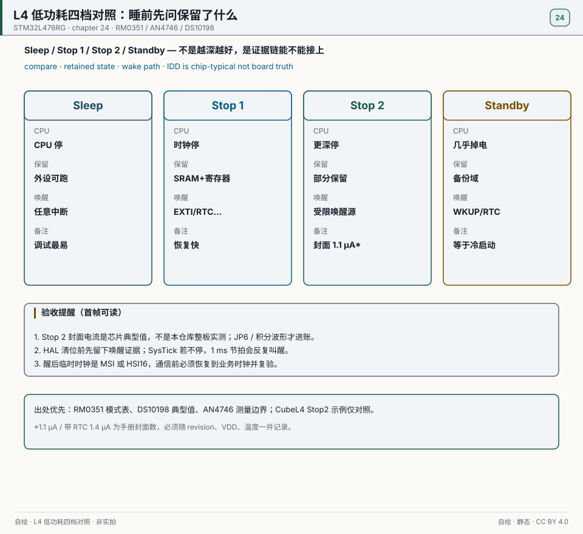
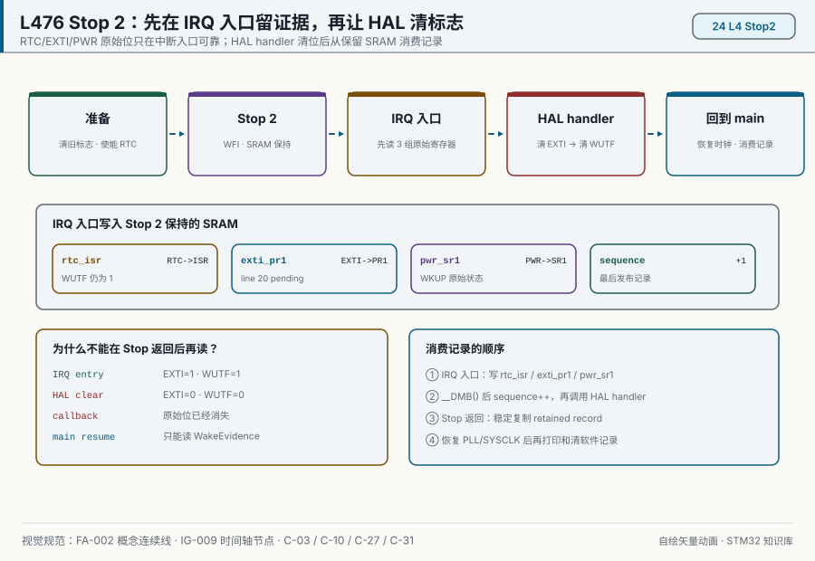
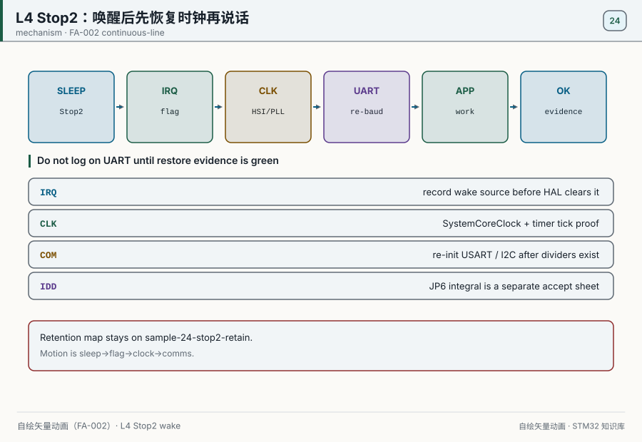
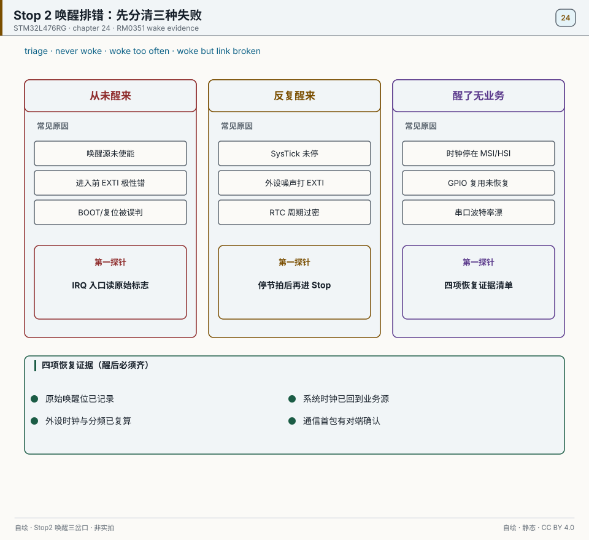
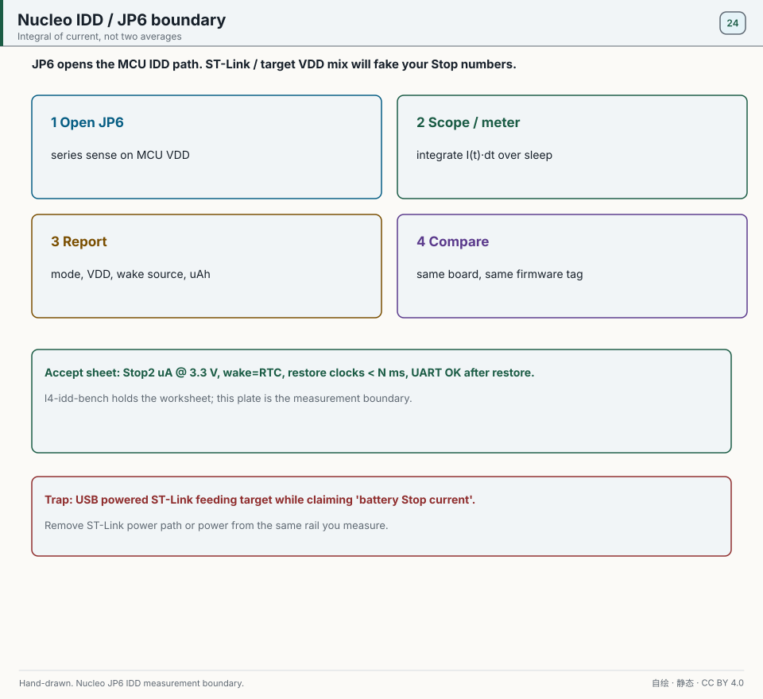
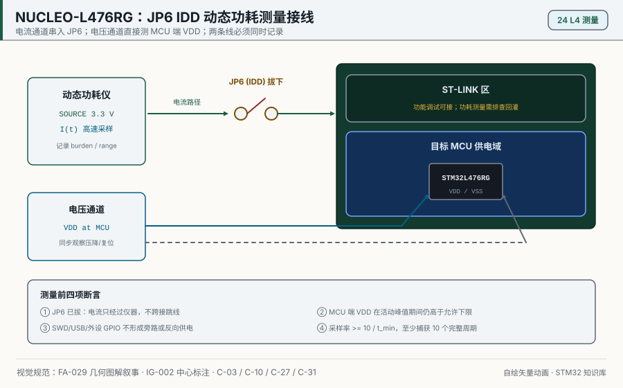

# 24 STM32L4 pins (L476RG)

> 中文：[24 STM32L4 引脚（L476RG）](../24-STM32L4引脚.md)

> L4 migration is more than a pin swap. After Stop 2, preserve wake evidence, restore clocks, and only then release UART or USB; current measurement also separates the Nucleo debugger from the target MCU supply.

<p align="center">
  
  <br><sub>▲ Pinout: the order is DS10198 Rev 11 Figure 16, checked pin by pin against the LQFP64 column of Table 16. Color is a reading aid. Generated by script, not a photograph.</sub>
</p>

<!-- video:ch24 -->
<p align="center">
  <video width="640" controls poster="../../assets/video/ch24-l4-pins.png">
    <source src="../../assets/video/ch24-l4-pins.mp4" type="video/mp4">
  </video>
  <br><sub>▲ Chapter video with Chinese voice-over (2.6 min). <a href="../../assets/video/ch24-l4-pins.mp4">MP4</a> · <a href="../../assets/video/ch24-l4-pins.srt">subtitles</a></sub>
</p>

<details>
<summary>Narration script (Chinese, same text as the subtitles)</summary>

1. 这一章的图是 STM32L476 的 64 脚封装，Nucleo-L476RG 用的就是这一类。脚序对照 DS10198 第 11 版的图 16，并和表 16 对过。
2. 第 1 脚是 VBAT，旁边第 2 脚才是 PC13。高速晶振换到了 PH0 和 PH1，不再是 F1 上的 PD0、PD1。抄原理图时这两只最容易接错。
3. F1 没有单独的 USB 电源脚。这里第 48 脚是 VDDUSB，第 47 脚是旁边的地。USB 电源空着，软件写得再对，枚举也不会老实。
4. 这一帧是仓库按手册画的引脚图，不是照片。请核对左上角第 1 脚是 VBAT。图上的颜色只是为了让电源脚好认，不增加手册里没有的含义。
5. PA11 和 PA12 既能做 CAN，也能做 USB 全速。两家不要同时占这一对。CAN 还可以改到 PB8 和 PB9。下板之前先决定这一对脚归谁。
6. BOOT0 是第 60 脚，不和 SWCLK 共用。SWD 的 PA13、PA14 在第 46 和 49 脚。这和 G0 把启动和调试时钟绑在一起的做法不同。
7. 手册封面写了 Stop 2 的典型电流，那是芯片的数字，不是本仓库测出来的，更不是整块板的电流。板上的稳压器和发光管会把读数抬高。不要拿封面去验收万用表。
8. 口诀：L4 第 1 脚是 VBAT，USB 另有供电脚。真睡在 Stop 2。封面的纳安是芯片，不是整块板。
9. 封面写的是带浮点的 Cortex-M4，最高 80 兆，供电大约 1.71 伏到 3.6 伏。不要把 F103 的 72 兆时钟树原样搬过来，等待周期和外设时钟都会错。
10. 合上书，三问。第 1 脚叫什么？PA11 同时被哪两类外设看上？封面上的纳安能不能当成你这块开发板的电流？

</details>
<!-- /video:ch24 -->
## Learning goals

- [ ] Point at VBAT, VDDUSB, BOOT0, and SWD on the LQFP64 and give each a pin number.
- [ ] List pins for USART1, I2C1, SPI1, CAN1, and OTG_FS, and know that PA11/PA12 are claimed twice.
- [ ] Use RM0351 to distinguish Sleep, Stop 0/1/2, Standby, and Shutdown by wake path and retained state.
- [ ] Build a complete Stop 2 path: prepare, enter, identify the wake source, restore clocks, restore peripherals, and verify the result.
- [ ] Integrate active, wake, and sleep current into `I_avg`, with voltage, temperature, instrument bandwidth, and board loads recorded.
- [ ] Remember that the DS10198 current figures are typical values, not guaranteed limits or measurements of this board; check ES0250 before production.

## Which part this is

The drawing is **STM32L476Rx LQFP64** (that is the package on a Nucleo-L476RG). Source: **DS10198 Rev 11**.

| Fact | Source |
| --- | --- |
| Cortex-M4F, up to 80 MHz, supply 1.71 V to 3.6 V | Cover |
| Flash up to 1 MB, SRAM 128 KB | Cover |
| USB OTG 2.0 full speed, with LPM and BCD | Cover |
| CAN (2.0B Active) | Cover |
| VBAT mode 300 nA; Shutdown 30 nA; Standby 120 nA; Standby with RTC 420 nA | Cover |
| Stop 2: 1.1 µA, 1.4 µA with RTC; wake from Stop in 4 µs | Cover |
| Run: 100 µA/MHz in LDO mode; 39 µA/MHz in 3.3 V SMPS mode | Cover |

Those currents are family typicals printed on the datasheet cover. This repo did not measure them. An on-board LDO and LED raise the whole-board current. Do not use the cover numbers to accept or reject your multimeter.

**Stop 2 is the usual deep-sleep level on L4; the nanoamp figures on the cover are chip typicals, not measurements of the whole board.**

## Recognizing the hardware: the Nucleo-64 family

<figure class="photo-spread">
  <div class="photo-pair">
    
    
  </div>
  <figcaption>▲ Left: Nucleo-F411RE. Right: Nucleo-F401RE. These CC0 photographs show the Nucleo-64 family layout: ST-LINK above, target MCU and headers below. <strong>Neither board is a NUCLEO-L476RG.</strong> Photos: Ordercrazy / Thomas Springer, Wikimedia Commons, CC0 1.0. Use the <a href="https://www.st.com/en/evaluation-tools/nucleo-l476rg.html">ST product page</a> and UM1724 for the exact L476RG hardware revision.</figcaption>
</figure>

The photographs give you a board-level map, not a schematic. Target MCU, solder bridges, jumpers, and supply options vary across Nucleo-64 models and MB revisions. The JP6 (IDD) instructions later in this chapter apply only to the MB1136 / NUCLEO-L476RG configurations documented by UM1724.

## Versus F1 / F4

| Point | F103 LQFP48 | L476RG LQFP64 (Figure 16) |
| --- | --- | --- |
| Pin 1 | VBAT | **VBAT** (next to pin 2, PC13) |
| High-speed crystal | PD0/PD1 | **PH0-OSC_IN / PH1-OSC_OUT** (pins 5 and 6) |
| USB supply | No separate VDDUSB | **Pin 48 is VDDUSB**, separate from the VSS beside it (pin 47) |
| BOOT | Dedicated BOOT0 | **Pin 60 is BOOT0**, not shared with SWCLK |
| SWD | PA13 / PA14 | **Pin 46 PA13, pin 49 PA14** |
| USB | Device FS, PA11/PA12 | **OTG_FS**. DM/DP are still PA11/PA12 (additional functions in Table 16) |
| CAN | bxCAN | **CAN 2.0B**. Both PA11/PA12 and PB8/PB9 can be CAN1 (Table 16) |
| Low power | Sleep / Stop / Standby | Adds **Shutdown** and **Stop 2** (cover) |

F4 also has OTG_FS and a dedicated USB supply pin, so on that point L4 looks more like F4 than like an F103. The core and the low-power ladder differ on both sides: L4 is an M4F, Stop 2 stops more clocks, and you reconfigure the system clock after wake-up. That is the same rule as [chapter 16](16-low-power.md).

## Low-power modes and retained state (RM0351)


<p align="center">
  
  <br><sub>▲ Drawn for this book. Stop2 is not forever-RAM; map retention first.</sub>
</p>


<p align="center">
  
  <br><sub>▲ Drawn for this book. Four L4 low-power modes. Sources: [RM0351](#source-rm0351), [DS10198](#source-ds10198), [AN4746](#source-an4746); OSS compare: [stm32cube-l4-stop2](#source-stm32cube-l4-stop2).</sub>
</p>


Start with the return path. Sleep and Stop resume after `WFI/WFE`; Standby and Shutdown wake through reset. Confusing the two classes leads to two common failures: code trusts RAM that no longer exists, or it uses a UART before the Stop 2 clock tree has been restored.

| Mode | CPU / main clocks | SRAM and registers | Wake path | Use it when |
| --- | --- | --- | --- | --- |
| Sleep | CPU stops; selected peripheral clocks can continue | Retained | Continue after the interrupt | The wait is short and a peripheral must keep running |
| Low-power run / sleep | Frequency and regulator operating point are limited | Retained | Continue execution | A continuous low-rate task fits the RM0351 frequency and voltage limits |
| Stop 0 | PLL, HSE, and related clocks stop; this Stop level retains the most capability | SRAM1/2 and most registers retained | Continue after `WFI/WFE` | Wake latency matters more than the lowest static current |
| Stop 1 | Deeper than Stop 0 | SRAM1/2 and most registers retained | Continue after `WFI/WFE` | You need a compromise between current and wake capability |
| Stop 2 | More of the VCORE domain is switched off; the PLL is off during Stop | SRAM1/2 and most registers retained | MSI or HSI16 takes over first, then execution continues | The usual deep-sleep choice on L476; restore the target clocks and any GPIO/peripheral state changed before entry |
| Standby | VCORE is off | Main SRAM and ordinary registers are lost; some parts can retain SRAM2 | Wake behaves like reset | Keep only minimal state in RTC/backup registers and inspect reset flags |
| Shutdown | Deeper than Standby | Main SRAM is lost; RTC/backup retention depends on supply and configuration | Wake behaves like reset | Lowest static current matters more than a full restart |

This table is a decision entry point, not a wake-source list. Whether RTC, WKUP, EXTI, IWDG, LPUART, LPTIM, or I2C works in a mode depends on the instance, its kernel clock, and the silicon revision. Check the PWR, RCC, and peripheral chapters of RM0351. SRAM2 retention in Standby also depends on the exact part and `RRS`; do not copy that setting from another L4.

<p align="center">
  
  <br><sub>▲ Animation: snapshot the raw RTC/EXTI/PWR bits into Stop 2-retained SRAM at IRQ entry. After the HAL handler clears those bits, main consumes the software record. The first frame is complete for print. This is a generated process diagram, not a logic-analyzer capture (FA-002 · IG-009 · C-03/C-10/C-27/C-31).</sub>
</p>

After Stop 0/1/2, RCC can use `STOPWUCK` to select MSI or HSI16 as the temporary system clock. **The CPU executing again does not mean the 80 MHz PLL is back.** The PLL is disabled in Stop, so Flash latency, SysTick, UART baud, timer periods, and USB clocks all need to be checked again.

## Alternate functions (LQFP64 rows of Table 16)

| Function | Pins | Pin numbers | Names you can match in Table 16 |
| --- | --- | --- | --- |
| USART2_TX / RX | PA2 / PA3 | 16 / 17 | USART2_TX, USART2_RX |
| USART1_TX / RX | PA9 / PA10 | 42 / 43 | USART1_TX, USART1_RX |
| SPI1 | PA5 SCK, PA6 MISO, PA7 MOSI, PA4 NSS | 21–23, 20 | SPI1_SCK / MISO / MOSI / NSS |
| I2C1_SCL / SDA | PB6 / PB7; also PB8 / PB9 | 58 / 59; 61 / 62 | I2C1_SCL, I2C1_SDA |
| CAN1_RX / TX | PA11 / PA12; also PB8 / PB9 | 44 / 45; 61 / 62 | CAN1_RX, CAN1_TX |
| OTG_FS_DM / DP | PA11 / PA12 | 44 / 45 | OTG_FS_DM, OTG_FS_DP |
| SWD | PA13, PA14 | 46, 49 | JTMS-SWDIO, JTCK-SWCLK |
| USB supply | VDDUSB | 48 | A supply pin, not a GPIO |

PA11/PA12 appear under both CAN1 and OTG_FS. Only one function at a time. Same class of trap as USB versus CAN on an F103. If you need both, move CAN to PB8/PB9.

## Stop 2: entry, wake evidence, and clock recovery


<p align="center">
  
  <br><sub>▲ Hand-drawn CSS animation (FA-002). flag → clocks → comms → app.</sub>
</p>


<p align="center">
  
  <br><sub>▲ Drawn for this book. Stop2 wake triage. Sources: [RM0351](#source-rm0351) and [stm32l4-hal-rtc](#source-stm32l4-hal-rtc) capture pattern.</sub>
</p>


### 1. Before entry: prove the system is ready to sleep

1. Wait for non-interruptible UART, DMA, and Flash writes to finish. Record who still owns each buffer.
2. Configure one expected wake source such as RTC, EXTI, WKUP, or LPTIM. Disable it, clear the peripheral flag, EXTI/NVIC pending state, and PWR wake flags, then enable it again. Stale flags otherwise cause an immediate wake.
3. Put unused GPIOs in analog mode with no pull, except the wake pins and buses that must retain state. External pulls, sensors, and VDDUSB can still draw board current.
4. Choose the Stop wake clock. ST's L476 Stop 2 example selects MSI explicitly with `__HAL_RCC_WAKEUPSTOP_CLK_CONFIG(RCC_STOP_WAKEUPCLOCK_MSI)`.
5. Suspend SysTick. Otherwise the 1 ms tick becomes the first interrupt and you measure a chip that wakes every millisecond.

### 2. At IRQ entry: capture evidence before HAL clears it

In the pinned STM32CubeL4 example, `RTC_WKUP_IRQHandler()` calls `HAL_RTCEx_WakeUpTimerIRQHandler()` directly. In the pinned HAL driver commit `71a58f9d...`, that handler clears the RTC wake-up EXTI line, clears `RTC_FLAG_WUTF`, and only then calls the callback. The HAL callback is already too late to read the original bits; reading them after `HAL_PWREx_EnterSTOP2Mode()` returns is later still.

The following is the minimum evidence path when RTC is the only expected wake source. Place `WakeEvidence` in ordinary SRAM that the linker script confirms is retained in Stop 2, not in an area lost in Standby or Shutdown. Replace the generated empty `RTC_WKUP_IRQHandler()` with this implementation; do not leave two handlers with the same name.

```c
/* app_wake_evidence.h: shared by main.c and stm32l4xx_it.c */
typedef struct {
    uint32_t rtc_isr;
    uint32_t exti_pr1;
    uint32_t pwr_sr1;
    uint32_t sequence;                 /* Publish last: marks a complete record. */
} WakeEvidence;

extern volatile WakeEvidence g_stop2_wake_evidence;

/* stm32l4xx_it.c */
extern RTC_HandleTypeDef hrtc;
volatile WakeEvidence g_stop2_wake_evidence;

void RTC_WKUP_IRQHandler(void)
{
    g_stop2_wake_evidence.rtc_isr = RTC->ISR;
    g_stop2_wake_evidence.exti_pr1 = EXTI->PR1;
    g_stop2_wake_evidence.pwr_sr1 = PWR->SR1;
    __DMB();
    g_stop2_wake_evidence.sequence++;  /* Publish the complete snapshot. */

    HAL_RTCEx_WakeUpTimerIRQHandler(&hrtc); /* HAL may clear hardware bits now. */
}
```

Main copies the record while `sequence` is stable. If another interrupt updates it during the copy, the sequence numbers differ and the loop tries again. Aligned 32-bit reads and writes are atomic on Cortex-M4; `__DMB()` fixes the publication order so the fields become visible before the sequence number.

```c
/* main.c */
static uint32_t s_consumed_sequence;

static bool ConsumeStop2WakeEvidence(WakeEvidence *out)
{
    uint32_t before;
    uint32_t after;

    do {
        before = g_stop2_wake_evidence.sequence;
        __DMB();
        out->rtc_isr = g_stop2_wake_evidence.rtc_isr;
        out->exti_pr1 = g_stop2_wake_evidence.exti_pr1;
        out->pwr_sr1 = g_stop2_wake_evidence.pwr_sr1;
        __DMB();
        after = g_stop2_wake_evidence.sequence;
    } while (before != after);

    if (after == s_consumed_sequence) {
        return false;                  /* No new record from the RTC handler. */
    }
    out->sequence = after;
    s_consumed_sequence = after;
    return true;
}
```

If the project permits wake sources other than RTC, each relevant IRQ must write the common software record before its HAL handler and add a `source` field. No RTC record then means "woken by something else," not "the MCU did not wake."

### 3. After wake: consume the record, restore clocks, then communicate

The next functions isolate the reusable RTC Stop 2 and clock boundary. `SystemClock_Config()` must be the project's already-tested 80 MHz configuration. If HAL timeouts depend on SysTick, follow ST's example and resume the tick before calling the clock recovery function.

```c
#include <stdbool.h>

#define EXPECTED_SYSCLK_HZ 80000000UL

static bool RestoreClockAfterStop2(void)
{
    SystemClock_Config();              /* MSI/PLL, bus dividers, Flash latency */
    SystemCoreClockUpdate();

    return (__HAL_RCC_GET_SYSCLK_SOURCE() ==
            RCC_SYSCLKSOURCE_STATUS_PLLCLK) &&
           (HAL_RCC_GetSysClockFreq() == EXPECTED_SYSCLK_HZ) &&
           (SystemCoreClock == EXPECTED_SYSCLK_HZ);
}

static void EnterStop2Once(WakeEvidence *wake)
{
    bool have_rtc_evidence;

    __HAL_RCC_WAKEUPSTOP_CLK_CONFIG(RCC_STOP_WAKEUPCLOCK_MSI);
    HAL_SuspendTick();
    HAL_PWREx_EnterSTOP2Mode(PWR_STOPENTRY_WFI);
    HAL_ResumeTick();

    /* Consume retained SRAM after Stop; do not pretend to reread raw flags. */
    have_rtc_evidence = ConsumeStop2WakeEvidence(wake);

    if (!RestoreClockAfterStop2()) {
        Error_Handler();               /* Do not communicate at the wrong baud. */
    }
    if (!have_rtc_evidence) {
        Error_Handler();               /* Unexpected source in this RTC-only lab. */
    }
}
```

ST's `PWR_STOP2` example does more than call `HAL_PWREx_EnterSTOP2Mode()`: it suspends and resumes SysTick, enables the PLL again, and selects the PLL as SYSCLK again. The RTC version also reinitializes GPIOs that were changed to analog mode before sleep. If your project uses a custom HAL time base, the recovery function cannot depend on a timer that is still stopped. Restore that time base first, or use an independent timeout source during recovery.

### 4. Four proofs that recovery is complete

| Boundary | Evidence | Do not do this on failure |
| --- | --- | --- |
| Wake source | At IRQ entry, snapshot RTC/EXTI/PWR before HAL clears them; after Stop, make a stable copy of the retained-SRAM record | Do not reread cleared hardware bits in a callback or main, and do not settle for printing "awake" |
| System clock | RCC `SWS=PLL`; `HAL_RCC_GetSysClockFreq()` and `SystemCoreClock` both equal the target | Do not start UART, USB, or precision timers |
| Peripheral kernel clocks | Check CCIPR selections and the actual input frequency of each peripheral | Do not assume retained registers imply a retained baud rate |
| Pin and peripheral state | Restore GPIOs changed to analog mode; re-establish DMA and IRQ ownership | Do not transmit while the pins are still high impedance |

A diagnostic build can expose the clock on MCO, toggle a timer output, or time a UART byte. **Do not enable MCO or serial logs in the current-measurement build:** the observation path changes the current. Keep the same low-power path in both builds; change only the evidence output.

## A current and battery-life calculation you can reproduce


<p align="center">
  
  <br><sub>▲ Drawn for this book. JP6 integral is the accept sheet — not a DMM guess.</sub>
</p>


### 1. Measurement boundary: JP6 isolates only MCU IDD

For the MB1136 NUCLEO-L476RG, UM1724 says to remove `JP6 (IDD)` and insert an ammeter across it to measure STM32 microcontroller current. This is not automatically the current at the board's input connector, and it does not eliminate back-power through ST-LINK, LEDs, or GPIO-connected modules.

| Condition | Record at least |
| --- | --- |
| Device and software | Full order code, package, silicon revision, firmware commit, compiler optimization, HAL/CubeL4 version |
| Supply and environment | VDD at the MCU pins, temperature, regulator mode, VDDUSB/VBAT supply state |
| Sleep configuration | Stop level, RTC/LSI/LSE, wake interval, retained RAM, IWDG, GPIO modes, external pulls |
| Debug and board loads | SWD connection, LEDs, sensors, USB, UART, external pull resistors, and any back-power path |
| Instrument | Model, range, shunt/current probe, zeroing, bandwidth, sample rate, and burden voltage |

A multimeter is useful for a steady sleep plateau, but autoranging and burden voltage can pull the MCU's real VDD down or reset it during a wake pulse. A dynamic power analyzer or low-value shunt is better when the same capture contains microamp sleep and milliamp wake current. Acquire roughly ten samples across the shortest active pulse: `f_s >= 10 / t_min`. Measure VDD at the MCU at the same time; the supply setting is not that voltage.

<p align="center">
  
  <br><sub>▲ Wiring: insert the current channel at JP6, probe VDD at the MCU, and check SWD, USB, and GPIO back-power paths. This generated measurement plan does not claim that the repository measured a current value (FA-029 · IG-002 · C-03/C-10/C-27/C-31).</sub>
</p>

### 2. Integrate the waveform; do not average two readings

Split one cycle into active, recovery, and sleep intervals:

```text
Q_active  ~= sum(I[k] * delta_t)             # Discrete integral over active time
Q_wakeup  ~= sum(I[k] * delta_t)             # Wake + clock/sensor recovery
Q_sleep    = I_stop * t_stop
I_avg      = (Q_active + Q_wakeup + Q_sleep) / T_cycle
E_cycle    = sum(V[k] * I[k] * delta_t)       # Use energy when voltage varies
```

Example: wake once per second, spend 8 ms active and recovering at an average of 5 mA, then spend 992 ms at 2 µA:

```text
Q_active+wakeup = 5 mA * 0.008 s     = 0.040000 mA·s
Q_sleep         = 0.002 mA * 0.992 s = 0.001984 mA·s
I_avg           = 0.041984 mA         = 41.984 µA
```

An idealized 1000 mAh cell gives `1000 / 0.041984 = 23818 h ≈ 2.72 years`. That is an energy budget, not a lifetime promise. Effective capacity changes with temperature, discharge rate, and cutoff voltage. Add self-discharge, regulator quiescent current, sensor leakage, and aging separately. An instrument that misses the 8 ms pulse reports about 2 µA instead of about 42 µA.

### 3. Acceptance format for comparable results

Capture at least ten complete cycles for each configuration. Report minimum, mean, and maximum sleep plateau, active peak, `Q_cycle`, and `I_avg`, and retain the raw waveform. Compare against DS10198 only when VDD, temperature, mode, RTC/retention options, and debug conditions match. A typical value is not a limit. Before production, check ES0250 for the full order code and silicon revision; errata override general descriptions in the reference manual and application notes.

## When copying an F1 project or debugging low power

| Symptom | First boundary that differs | What to do |
| --- | --- | --- |
| Crystal nets are named PD0/PD1 | L4 HSE is on PH0/PH1 | Rename the schematic nets |
| USB never enumerates | Pin 48, VDDUSB, is floating | Connect the specified supply and check decoupling and voltage limits in DS10198 |
| Stop 2 returns immediately | SysTick, a stale EXTI/RTC/PWR flag, or a floating wake pin is still active | Suspend the tick; for the one wake source, disable it, clear flags and pending state, then re-enable it |
| UART is corrupt or a timer runs slowly after wake | The CPU has resumed but PLL/SYSCLK or a peripheral kernel clock has not | Restore and verify clocks before communication |
| Stop 2 current is high | The debugger, GPIO pulls, LEDs, peripheral supplies, IWDG/RTC, or back-power is still present | Remove one load at a time and retain before/after waveforms and configurations |
| The board resets when the ammeter is inserted | Burden voltage or autoranging causes a VDD dip | Measure VDD at the MCU; use a low-value shunt or dynamic power analyzer |
| The sleep plateau is about 2 µA but battery life is poor | Only the sleep level was read; periodic wake charge was missed | Integrate the complete cycle and calculate `I_avg` |
| The cover's 1.1 µA is treated as an acceptance limit | It is a typical chip value under stated conditions | Set your own limit from measured conditions, DS10198, and ES0250 |

## Hands-on labs

**Lab A: functional loop, with evidence output**

1. Wake from Stop 2 with RTC every 5 s. Turn the LED off before sleep and keep one GPIO as an oscilloscope marker.
2. At `RTC_WKUP_IRQHandler()` entry, before the HAL handler, snapshot RTC/EXTI/PWR. After Stop returns, consume the retained-SRAM record, restore PLL/SYSCLK, and assert that `HAL_RCC_GetSysClockFreq()` and `SystemCoreClock` both equal 80 MHz.
3. Restore one timer output and the UART; measure the timer frequency and one known byte frame. Deliberately skip clock restoration once, record the first boundary that deviates, then restore the code.

**Lab B: measurement loop, with no logging**

1. Disable MCO, UART logging, LEDs, and unrelated sensors. Insert the instrument at JP6 as UM1724 specifies, and measure VDD at the MCU at the same time.
2. Record every condition in the table. Use `f_s >= 10 / t_min` and capture at least ten complete 5 s cycles.
3. Integrate the active/recovery interval and Stop 2 interval separately. Calculate `Q_cycle`, `I_avg`, and idealized lifetime; reconnect the debugger and repeat to quantify the difference.
4. Save the raw waveform and calculation script. Do not present MCO or UART traces from the functional build as evidence from the low-power build.

Self-test:

1. Does Stop 2 wake through reset, or continue after `WFI/WFE`?
2. Why can UART output be corrupt even though the CPU is executing code?
3. Why suspend SysTick before entering Stop 2?
4. Does JP6 measure MCU IDD or current at the whole board's input?
5. Why is `I_avg` not `(I_active + I_sleep) / 2`?
6. A lower current range has better resolution. Why can it still reset the board?
7. Which question is answered by DS10198, RM0351, AN4746, UM1724, and ES0250 respectively?
8. Why is reading WUTF in `HAL_RTCEx_WakeUpTimerEventCallback()` already too late?

## Related resources

- **DS10198 Rev 11:** L476 order codes, pins, electrical conditions, and typical low-power figures.
- **RM0351:** PWR, RCC, Stop/Standby/Shutdown, wake sources, and retention boundaries for L47/L48/L49/L4A.
- **AN4746:** power and performance optimization for STM32L4/L4+; useful for mode-transition design, but not a substitute for the target datasheet conditions.
- **UM1724:** the MB1136 Nucleo-64 board and the JP6 (IDD) measurement path.
- **STM32CubeL4:** pinned commit `485c092549f9495079fcb39f17f66cbaa0930118`, under `NUCLEO-L476RG/Examples/PWR/PWR_STOP2*`, for the Stop 2 entry and recovery sequence. Its pinned HAL driver is `71a58f9d417139d332e448a46c9e6ba5181181dc`; use `stm32l4xx_hal_rtc_ex.c` to verify the interrupt order: clear EXTI, clear WUTF, then call the callback.
- **ES0250:** errata for L471/L475/L476/L486. Check every item against the silicon revision before production.
- General low-power method: [16 Low-power design](16-low-power.md). Family comparisons: [G0 pins](23-stm32g0-pins.md) and [H7 pins](25-stm32h7-pins.md).
- Open-source compare: [companion examples/](https://github.com/zhuguang-ZFG/STM32/tree/main/examples) (MIT; see [#source-project-examples](#source-project-examples)) — structure, acceptance, and evidence format only. This repo has no L476 board example; do not copy F1 wiring or power nets onto L4.
