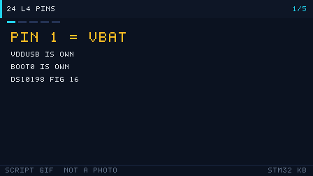

# 24 STM32L4 pins (L476RG)

> 中文：[24 STM32L4 引脚（L476RG）](../24-STM32L4引脚.md)

> Pin 1 on L4 is VBAT again, but there is a separate VDDUSB next to it. USB and CAN still both want PA11.

  
   ▲ Pinout: the order is DS10198 Rev 11 Figure 16, checked pin by pin against the LQFP64 column of Table 16. Color is a reading aid. Generated by script, not a photograph.

<!-- video:ch24 -->

  
   ▲ Slideshow generated by tools/gen_videos.py. Reproducible, not a photograph. The narration matches the five frames.

**Narration (read along with the frames, about a minute)**

1. Pin 1 of the L476 LQFP64 is VBAT again. VDDUSB is its own pin, and BOOT0 is no longer shared with SWCLK. The order is DS10198 Rev 11 Figure 16.
2. PA11 and PA12 are both CAN1 and OTG_FS. Keep one of them. Move the other to PB8 and PB9.
3. The high-speed crystal is on PH0 and PH1, not the PD0/PD1 pair from F1. Do not copy the F103 crystal position when you count pins.
4. The cover quotes Stop 2 around 1.1 µA and Shutdown at 30 nA. Those are family typicals, not the reading on your board's multimeter.
5. Motto: pin 1 on L4 is VBAT, and USB has its own supply pin. Self-test: which two peripherals both claim PA11?
<!-- /video:ch24 -->

## 📌 Goals

- [ ] Point at VBAT, VDDUSB, BOOT0, and SWD on the LQFP64 and give each a pin number.
- [ ] List pins for USART1, I2C1, SPI1, CAN1, and OTG_FS, and know that PA11/PA12 are claimed twice.
- [ ] Remember that the Stop 2 / Shutdown currents on the cover are family typicals, useful next to an F1, not a measurement of your board.

## 🧠 Which part this is

The drawing is **STM32L476Rx LQFP64** (that is the package on a Nucleo-L476RG). Source: **DS10198 Rev 11**.

| Fact | Source |
| --- | --- |
| Cortex-M4F, up to 80 MHz, supply 1.71 V to 3.6 V | Cover |
| Flash up to 1 MB, SRAM 128 KB | Cover |
| USB OTG 2.0 full speed, with LPM and BCD | Cover |
| CAN (2.0B Active) | Cover |
| VBAT mode 300 nA; Shutdown 30 nA; Standby 120 nA; Standby with RTC 420 nA | Cover |
| Stop 2: 1.1 µA, 1.4 µA with RTC; wake from Stop in 4 µs | Cover |
| Run: 100 µA/MHz in LDO mode; 39 µA/MHz in 3.3 V SMPS mode | Cover |

Those currents are family typicals printed on the datasheet cover. This repo did not measure them. An on-board LDO and LED raise the whole-board current. Do not use the cover numbers to accept or reject your multimeter.

Motto: **L4 really sleeps in Stop 2. The nanoamps on the cover are the chip, not the whole board.**

## 🛠️ Versus F1 / F4

| Point | F103 LQFP48 | L476RG LQFP64 (Figure 16) |
| --- | --- | --- |
| Pin 1 | VBAT | **VBAT** (next to pin 2, PC13) |
| High-speed crystal | PD0/PD1 | **PH0-OSC_IN / PH1-OSC_OUT** (pins 5 and 6) |
| USB supply | No separate VDDUSB | **Pin 48 is VDDUSB**, separate from the VSS beside it (pin 47) |
| BOOT | Dedicated BOOT0 | **Pin 60 is BOOT0**, not shared with SWCLK |
| SWD | PA13 / PA14 | **Pin 46 PA13, pin 49 PA14** |
| USB | Device FS, PA11/PA12 | **OTG_FS**. DM/DP are still PA11/PA12 (additional functions in Table 16) |
| CAN | bxCAN | **CAN 2.0B**. Both PA11/PA12 and PB8/PB9 can be CAN1 (Table 16) |
| Low power | Sleep / Stop / Standby | Adds **Shutdown** and **Stop 2** (cover) |

F4 also has OTG_FS and a dedicated USB supply pin, so on that point L4 looks more like F4 than like an F103. The core and the low-power ladder differ on both sides: L4 is an M4F, Stop 2 stops more clocks, and you reconfigure the system clock after wake-up. That is the same rule as [chapter 16](16-low-power.md).

## 🛠️ Alternate functions (LQFP64 rows of Table 16)

| Function | Pins | Pin numbers | Names you can match in Table 16 |
| --- | --- | --- | --- |
| USART2_TX / RX | PA2 / PA3 | 16 / 17 | USART2_TX, USART2_RX |
| USART1_TX / RX | PA9 / PA10 | 42 / 43 | USART1_TX, USART1_RX |
| SPI1 | PA5 SCK, PA6 MISO, PA7 MOSI, PA4 NSS | 21–23, 20 | SPI1_SCK / MISO / MOSI / NSS |
| I2C1_SCL / SDA | PB6 / PB7; also PB8 / PB9 | 58 / 59; 61 / 62 | I2C1_SCL, I2C1_SDA |
| CAN1_RX / TX | PA11 / PA12; also PB8 / PB9 | 44 / 45; 61 / 62 | CAN1_RX, CAN1_TX |
| OTG_FS_DM / DP | PA11 / PA12 | 44 / 45 | OTG_FS_DM, OTG_FS_DP |
| SWD | PA13, PA14 | 46, 49 | JTMS-SWDIO, JTCK-SWCLK |
| USB supply | VDDUSB | 48 | A supply pin, not a GPIO |

PA11/PA12 appear under both CAN1 and OTG_FS. Only one function at a time. Same class of trap as USB versus CAN on an F103. If you need both, move CAN to PB8/PB9.

## ⚠️ When you copy an F1 project

| What you see | Why | Fix |
| --- | --- | --- |
| Crystal nets named PD0/PD1 | L4 HSE is on PH0/PH1 | Rename the nets |
| USB never enumerates | Pin 48, VDDUSB, is floating | Tie it to 3.3 V and follow the datasheet's decoupling note |
| UART is garbage after Stop 2 | The system clock is back at the default | Reconfigure the clock, then enable the USART |
| You treat the cover's 1.1 µA as the whole board | That is the chip's Stop 2 typical | Count the LED, the debugger, and the LDO separately |

## 🧪 Try it

1. On the drawing, mark pins 44, 45, 48, and 60 and write the function next to each.
2. Open DS10198 Table 16 and confirm that the PB9 row lists both I2C1_SDA and CAN1_TX.
3. Answer: why can't PA11 be USB and CAN at the same time?

Self-test:

1. Which pin is BOOT0 on the L476 LQFP64? Is it the same pin as PA14?
2. Is the Stop 2 cover typical 1.1 µA or 1.1 mA?
3. Is VDDUSB a GPIO?

## 🔗 Further reading

- DS10198 Rev 11: electrical and low-power typicals on the cover, Figure 16, Table 16.
- Reconfigure the clock after a low-power wake: [16 Low-power design](16-low-power.md).
- Compare with [G0 pins](23-stm32g0-pins.md) and [H7 pins](25-stm32h7-pins.md).
