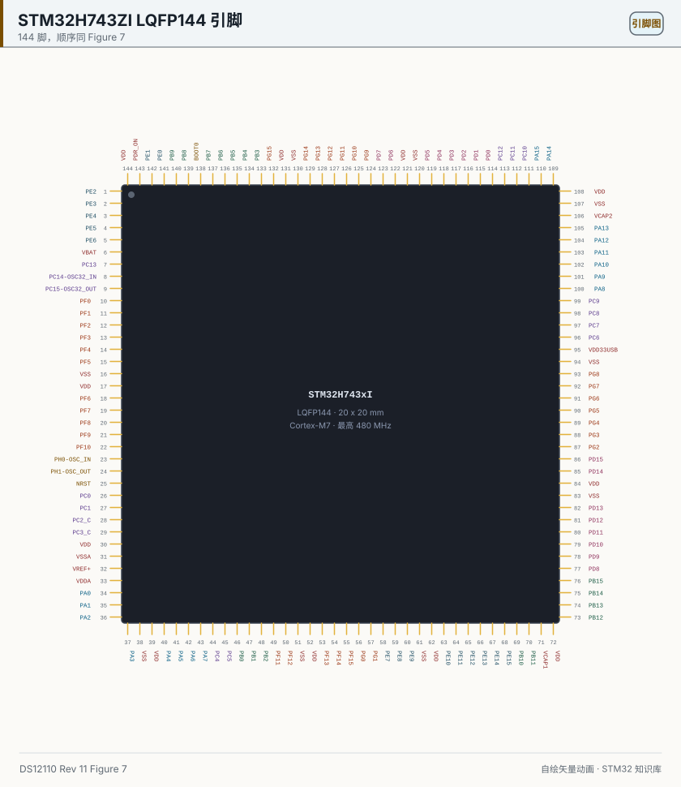

# 25 STM32H7 pins (H743ZI)

> 中文：[25 STM32H7 引脚（H743ZI）](../25-STM32H7引脚.md)

> An H7 LQFP144 has 144 pins, two VCAP pins, and a VDD33USB that exists only to feed USB. When you count, start at PE2 in the top-left corner.

<p align="center">
  
  <br><sub>▲ Pinout: the 144 names and their order come from DS12110 Rev 11 Figure 7 (figure id MSv41917V4). VCAP1 is pin 71 and VCAP2 is pin 106, as labeled on that figure. Color is a reading aid. Generated by script, not a photograph.</sub>
</p>

<!-- video:ch25 -->
<p align="center">
  <video width="640" controls poster="../../assets/video/ch25-h7-pins.png">
    <source src="../../assets/video/ch25-h7-pins.mp4" type="video/mp4">
  </video>
  <br><sub>▲ Chinese voice-over, 2.9 min. Voice: Microsoft Edge neural voice zh-CN-XiaoxiaoNeural via edge-tts (library mostly LGPLv3; the voice model is an online Microsoft service, not an open model). Pictures are generated from this repo's SVGs, not photographs. Video: <a href="../../assets/video/ch25-h7-pins.mp4">MP4</a> · subtitles: <a href="../../assets/video/ch25-h7-pins.srt">SRT</a>. Rebuild with <code>python3 tools/gen_narrated.py --speak</code>.</sub>
</p>

**Narration script (Chinese, same text as the subtitles)**

1. STM32H743 的 144 脚封装，第 1 脚是 PE2。订购字母 Z 表示 144 脚，I 表示 2 MB 闪存，所以 Nucleo 上常见的 H743ZI 就是这个组合。出处是 DS12110 第 11 版的图 7。
2. 内核供电有两只 VCAP。第 71 脚是第一只，第 106 脚是第二只。外接电容的取值去手册的电气章节，这张引脚图上不标电容值，避免把图注当成规格。
3. USB 有自己的电源脚，第 95 脚名叫 VDD33USB，不要写成普通的 VDD。BOOT0 在第 138 脚。掉电复位控制 PDR_ON 在第 143 脚。这三只在 F1 上没有对应的名字。
4. 这一帧是仓库按手册图 7 画的，不是照片。请核对左上角是 PE2。顶边的脚号从右往左增大，最左上是第 144 脚。数错方向，后面的复用会整圈错位。
5. H7 的 CAN 控制器叫 FDCAN，不是 F1 的 bxCAN。FDCAN1 可以在 PA11 和 PA12，也可以在 PD0 和 PD1，还可以在 PB8 和 PB9。名字抄错，Cube 里你会对不上外设。
6. 芯片分成 D1、D2、D3 三个电源域，可以分别关时钟或断电。这一章不写待机多少微安，因为封面摘录里没有一条可以单独引用的数字。要电流，去电气特性，不要估。
7. 内核最高 480 兆，还有 16 KB 指令和数据缓存。DMA 搬过的缓冲，CPU 可能还看着旧数据，调试器里的数组会和总线上的不一致。
8. SWD 仍是 PA13 和 PA14，脚号 105 和 109，和 BOOT0 分开。高速晶振在 PH0 和 PH1，脚号 23 和 24。
9. 口诀：144 脚从 PE2 数起；VCAP 有两只；USB 电源不叫 VDD。CAN 的名字是 FDCAN。电容值和待机电流，图上没有的就不编。
10. 合上书，三问。第 1 脚叫什么？第二只 VCAP 是第几脚？这里的 CAN 控制器叫 bxCAN 还是 FDCAN？
<!-- /video:ch25 -->
## 📌 Goals

- [ ] Count from pin 1, PE2, down the left side to NRST, without reversing the numbers along the top.
- [ ] Point at one pin pair each for FDCAN1, OTG_FS, USART1, I2C1, and SWD.
- [ ] State the structural differences from F1/F4: three power domains, FDCAN rather than bxCAN, and external capacitors on VCAP for the core.
- [ ] Identify the silicon revision against ES0392 before choosing the 400 MHz path for Rev Y/W or the 480 MHz path for Rev V.
- [ ] Recalculate HSE → PLL1P → SYSCLK → HCLK/PCLK, then cross-check it with MCO, HAL frequency readback, and a peripheral waveform.

## 🧠 Which part this is

The drawing is the **LQFP144 of STM32H743xI**. In the ordering information, Z = 144 pins and I = 2 MB of Flash, so the **STM32H743ZI** you see on a Nucleo is this package and this Flash bin. Source: **DS12110 Rev 11**.

| Fact | Source |
| --- | --- |
| Cortex-M7, up to 480 MHz, double-precision FPU, 16 KB I/D cache | Cover |
| Flash up to 2 MB; ordering letter I = 2 MB, Z = 144 pins | Cover; ordering information near page 346 |
| Supply 1.62 V to 3.6 V | Cover |
| Three power domains, D1 / D2 / D3, which can have clocks gated or power removed separately | Cover |
| Two CAN controllers with CAN FD; the table of contents names FDCAN1 and FDCAN2 | Cover features and contents |
| Two USB OTG blocks (one FS, one HS/FS) | Cover |
| A dedicated USB supply; an internal 3.3 V regulator feeds the PHY | Cover |

This chapter does not quote an H7 standby current. We do not quote a current, because the cover does not give one that can be cited on its own. Look up the electrical-characteristics chapter yourself instead of guessing.

Motto: **Count 144 pins from PE2. There are two VCAP pins. The USB supply is not called VDD.**

## 🛠️ Versus F1 / F4

| Point | F1 / F4 | H743 LQFP144 (Figure 7) |
| --- | --- | --- |
| Pin 1 | VBAT on an F103C8 | **PE2** |
| Core supply | Internal on F1, no VCAP pin | **Pin 71 VCAP1, pin 106 VCAP2**. The external capacitor value comes from the VCAP electrical section of DS12110. The figure does not print a capacitor value |
| USB supply | F1 has none; F4 has a VDDUSB-class pin | **Pin 95 is named VDD33USB** |
| Power-down reset control | No such pin | **Pin 143 PDR_ON** |
| BOOT | Dedicated on F1; merged with SWCLK on G0 | **Pin 138 BOOT0**, separate from PA13/PA14 |
| SWD | PA13 / PA14 | **Pin 105 PA13, pin 109 PA14** |
| CAN | bxCAN on F1/F4 | **FDCAN**. PA11/PA12, PD0/PD1, and PB8/PB9 can all be FDCAN1 (Table 9) |
| Watching variables | No cache | There is an L1 cache. DMA buffers need the coherence treatment from [chapter 10](10-dma.md), or the array in the debugger will not match the bus |

Pin numbers along the top increase from right to left: pin 109 is near the right, and the top-left corner is pin 144 (VDD). The left side is where pin 1 counts downward. G0 and L4 use the same counting rule.

## ⚡ Select the supply and voltage scale before 480 MHz

**“H743 up to 480 MHz” is a conditional ceiling, not a frequency available on every H743ZI after reset.** ES0392 states that revisions Y and W have no VOS0 and are limited to a 400 MHz CPU clock. Revision V supports the 480 MHz conditions in DS12110/RM0433 with VOS0. Check the device marking first; if needed, read `REV_ID` in `DBGMCU->IDCODE` and decode it against RM0433/ES0392. Do not infer the revision from the board's product name.

| Item | What to confirm before startup | What it does not mean |
| --- | --- | --- |
| LDO / SMPS | The schematic, inductor, VCAP components, and other external parts must match the selected DS12110/AN4938 supply scheme; `HAL_PWREx_ConfigSupply()` must match it too | Changing one macro cannot turn an LDO board into an SMPS board |
| VOS1 / VOS0 | Use VOS1 on Rev Y/W, up to 400 MHz. For 480 MHz on Rev V, enable SYSCFG, start from ready VOS1, then enter VOS0; wait for `VOSRDY` after every transition | Writing VOS0 on Rev Y/W does not unlock 480 MHz; calling the SCALE0 macro alone does not prove ODEN took effect |
| D1 / D2 / D3 | Internal MCU power/clock domains managed through PWR/RCC and low-power transitions | Not three independent VDD rails that can be wired arbitrarily |
| VCAP1 / VCAP2 | Capacitors required by the core regulator, as specified by the datasheet | Not ordinary decoupling pins; never tie them directly to VDD or omit the capacitors |
| VDD33USB | Supply connection required by the USB PHY | Neither the core supply nor a GPIO |
| PDR_ON | Hardware boundary between the internal supply supervisor and an external supervisor | Not a generic chip-enable pin or an NRST substitute |

Configure the supply scheme once during early startup. The example below explicitly defines `BOARD_POWER_SUPPLY` for an **LDO board**. On an SMPS design, change the board-level design and software selection together according to ST's hardware documentation; do not copy this line blindly.

## 🕐 From 8 MHz HSE to 480 MHz: a reproducible clock chain

The frozen STM32CubeH7 `RCC_ClockConfig` example provides a 400 MHz NUCLEO-H743ZI baseline: the ST-LINK supplies an **8 MHz HSE bypass clock**, with `PLLM=4`, `PLLN=400`, and `PLLP=2`, giving `8 / 4 × 400 / 2 = 400 MHz`. The following changes that topology only for **Rev V + 8 MHz HSE bypass + an LDO board**: select VOS0 and set `PLLN=480`. A crystal is not HSE bypass. Recalculate everything for a different HSE frequency instead of copying these values.

```c
/* main.c: startup path only for Rev V, 8 MHz HSE bypass, and an LDO board. */
#define BOARD_POWER_SUPPLY        PWR_LDO_SUPPLY
#define CLOCK_STARTUP_TIMEOUT_MS  100U

static HAL_StatusTypeDef WaitVosReady(void)
{
    uint32_t started = HAL_GetTick();

    while (!__HAL_PWR_GET_FLAG(PWR_FLAG_VOSRDY)) {
        if ((HAL_GetTick() - started) > CLOCK_STARTUP_TIMEOUT_MS) {
            return HAL_TIMEOUT;        /* Each transition has its own deadline. */
        }
    }
    return HAL_OK;
}

static HAL_StatusTypeDef SystemClock_Config480(void)
{
    RCC_OscInitTypeDef osc = {0};
    RCC_ClkInitTypeDef clk = {0};
    HAL_StatusTypeDef status;

    status = HAL_PWREx_ConfigSupply(BOARD_POWER_SUPPLY);
    if (status != HAL_OK) {
        return status;                 /* Never continue with a supply mismatch. */
    }

    __HAL_RCC_SYSCFG_CLK_ENABLE();     /* SCALE0 writes SYSCFG->PWRCR.ODEN. */
    __HAL_PWR_VOLTAGESCALING_CONFIG(PWR_REGULATOR_VOLTAGE_SCALE1);
    status = WaitVosReady();           /* Prove VOS1 before requesting VOS0. */
    if (status != HAL_OK) {
        return status;
    }

    __HAL_PWR_VOLTAGESCALING_CONFIG(PWR_REGULATOR_VOLTAGE_SCALE0);
    status = WaitVosReady();           /* Wait for ODEN/VOS0 readiness. */
    if (status != HAL_OK) {
        return status;
    }

    osc.OscillatorType = RCC_OSCILLATORTYPE_HSE;
    osc.HSEState = RCC_HSE_BYPASS;     /* Nucleo ST-LINK MCO, not crystal mode. */
    osc.PLL.PLLState = RCC_PLL_ON;
    osc.PLL.PLLSource = RCC_PLLSOURCE_HSE;
    osc.PLL.PLLM = 4U;                 /* 8 MHz / 4 = 2 MHz */
    osc.PLL.PLLN = 480U;               /* VCO = 960 MHz */
    osc.PLL.PLLP = 2U;                 /* PLL1P = 480 MHz */
    osc.PLL.PLLQ = 4U;                 /* This example does not assign PLL1Q. */
    osc.PLL.PLLR = 2U;
    osc.PLL.PLLFRACN = 0U;
    osc.PLL.PLLVCOSEL = RCC_PLL1VCOWIDE;
    osc.PLL.PLLRGE = RCC_PLL1VCIRANGE_1;
    status = HAL_RCC_OscConfig(&osc);
    if (status != HAL_OK) {
        return status;
    }

    clk.ClockType = RCC_CLOCKTYPE_SYSCLK | RCC_CLOCKTYPE_HCLK |
                    RCC_CLOCKTYPE_D1PCLK1 | RCC_CLOCKTYPE_PCLK1 |
                    RCC_CLOCKTYPE_PCLK2 | RCC_CLOCKTYPE_D3PCLK1;
    clk.SYSCLKSource = RCC_SYSCLKSOURCE_PLLCLK;
    clk.SYSCLKDivider = RCC_SYSCLK_DIV1;
    clk.AHBCLKDivider = RCC_HCLK_DIV2;
    clk.APB3CLKDivider = RCC_APB3_DIV2;
    clk.APB1CLKDivider = RCC_APB1_DIV2;
    clk.APB2CLKDivider = RCC_APB2_DIV2;
    clk.APB4CLKDivider = RCC_APB4_DIV2;
    return HAL_RCC_ClockConfig(&clk, FLASH_LATENCY_4);
}
```

On H743, the SCALE0 macro writes `SYSCFG->PWRCR.ODEN`. If the SYSCFG clock is gated, that write is not evidence of a successful transition. The frozen template's `HAL_MspInit()` is empty, so no implicit initialization can be assumed. Enable SYSCFG explicitly, prove VOS1 readiness, request VOS0, then wait for the second VOSRDY. A timeout in either wait must prevent configuration of the 480 MHz PLL.

Call and check `SystemClock_Config480()` before initializing UART, timers, FDCAN, USB, or other peripherals. On failure, record the failing step, supply macro, silicon revision, and clock source; do not continue peripheral initialization in a partially configured state. Rev Y/W must not take this path: use the official VOS1 + `PLLN=400` baseline, yielding 400/200/100 MHz with the same bus dividers. If a product permits automatic downshifting, report the selected mode and recalculate every peripheral explicitly; never report a requested 480 MHz configuration as successful after silently falling back.

| Node | Rev V example | Rev Y/W baseline | Calculation |
| --- | ---: | ---: | --- |
| PLL input | 2 MHz | 2 MHz | `HSE / PLLM = 8 / 4` |
| VCO | 960 MHz | 800 MHz | `PLL input × PLLN` |
| CPU / SYSCLK | 480 MHz | 400 MHz | `VCO / PLLP` |
| HCLK (AXI/AHB) | 240 MHz | 200 MHz | `SYSCLK / 2` |
| PCLK1/2/3/4 | 120 MHz | 100 MHz | `HCLK / 2` |
| APB timer clock (APB divider other than 1) | 240 MHz | 200 MHz | `2 × PCLK` |
| MCO2 = SYSCLK/5 | 96 MHz | 80 MHz | Expected instrument reading |

Only **PLL1P drives SYSCLK** here. `PLL1Q = 960 / 4 = 240 MHz`; it is not the 48 MHz USB clock. Select PLL2/PLL3 and the FDCAN, ADC, SPI, USART, and USB kernel clocks separately for each peripheral. An APB divider of 2 doubles the timer clock, not PCLK itself, so UART baud-rate calculations must not reuse the timer formula.

### Collect three kinds of evidence after startup

1. **Software readback:** require `HAL_RCC_GetSysClockFreq()` to report 480000000 and `HAL_RCC_GetHCLKFreq()` to report 240000000. This HAL's `HAL_RCC_ClockConfig()` updates `SystemCoreClock`, `SystemD2Clock`, and the HAL tick. The frozen `system_stm32h7xx.c` computes the CM7 CPU frequency first, then applies `HPRE` to obtain the D2 bus clock. Here `SystemCoreClock` is **480 MHz**, while `SystemD2Clock`/HCLK is **240 MHz**. The default HAL SysTick uses the CPU clock; do not configure it with HCLK = 240 MHz.
2. **Independent clock output:** after confirming that PC9 is available and does not conflict on the target board, output MCO2:

```c
/* Board code must confirm PC9 and its alternate function; expected: 480 / 5 = 96 MHz. */
HAL_RCC_MCOConfig(RCC_MCO2, RCC_MCO2SOURCE_SYSCLK, RCC_MCODIV_5);
```

96 MHz is the **calculated expectation**, not a measurement made by this repository. Agreement between the instrument and software readback validates both PLL selection and division. Software variables alone can reproduce the same incorrect assumptions that produced the configuration.

3. **Peripheral closure:** revalidate SysTick/RTOS tick, UART baud rate, timer periods, Flash latency, and every peripheral kernel clock. Finish with a UART frame at a known baud rate or a PWM waveform at a known period. `HAL_Delay(1000)` taking about one second is only one check; it does not prove the independent USB or FDCAN clocks.


## 🛠️ Alternate functions (only names that appear in DS12110 Table 9)

| Function | Pins | LQFP144 pin | Name in Table 9 |
| --- | --- | --- | --- |
| USART1_TX / RX | PA9 / PA10 | 101 / 102 | USART1_TX, USART1_RX |
| USART1, other pair | PB6 / PB7 | 136 / 137 | USART1_TX, USART1_RX |
| I2C1_SCL / SDA | PB6 / PB7; also PB8 / PB9 | 136 / 137; 139 / 140 | I2C1_SCL, I2C1_SDA |
| SPI1_SCK / NSS | PA5 / PA4 | 41 / 40 | SPI1_SCK, SPI1_NSS |
| FDCAN1_RX / TX | PA11 / PA12 | 103 / 104 | FDCAN1_RX, FDCAN1_TX |
| FDCAN1, other pair | PD0 / PD1 | 114 / 115 | FDCAN1_RX, FDCAN1_TX |
| FDCAN1, third pair | PB8 / PB9 | 139 / 140 | FDCAN1_RX, FDCAN1_TX |
| OTG_FS_DM / DP | PA11 / PA12 | 103 / 104 | OTG_FS_DM, OTG_FS_DP |
| SWD | PA13 / PA14 | 105 / 109 | JTMS-SWDIO; PA14 is on Figure 7 |
| HSE | PH0-OSC_IN / PH1-OSC_OUT | 23 / 24 | Pin names |
| LSE | PC14-OSC32_IN / PC15-OSC32_OUT | 8 / 9 | Pin names |

PA11/PA12 are both FDCAN1 and OTG_FS. If you need both, move FDCAN1 to PD0/PD1 or PB8/PB9. PB6/PB7 also appear under both USART1 and I2C1. Do not assign two alternate functions to the same pin.

PC2_C and PC3_C (pins 28 and 29) keep the `_C` from the datasheet figure. It marks the path that can go to the dedicated analog route. Do not rename them to plain PC2 on a schematic.

## ⚠️ Moving a design across from F4

| What you see | Why | Fix |
| --- | --- | --- |
| The core never starts, or it dies at random | VCAP1/VCAP2 have no capacitors from the electrical section | Pick the value only from the VCAP section of DS12110, not from F4 habit |
| USB never enumerates | Pin 95, VDD33USB, is not powered | That is the USB supply, not "any VDD" |
| "CAN" init fails | The peripheral is FDCAN. The registers are not the bxCAN chapter | Open the FDCAN chapter of the reference manual. Do not paste bxCAN code from an F407 |
| A DMA buffer looks stale in the debugger | D1 has a cache | Do the cache maintenance from [chapter 10](10-dma.md) |
| Startup fails after requesting 480 MHz on Rev Y/W | These revisions have no VOS0 and are limited to 400 MHz | Use the ES0392-compliant VOS1 + 400 MHz baseline; do not retry an out-of-spec configuration |
| The board still fails after changing the supply macro | Software supply selection disagrees with the LDO/SMPS schematic, or VOS is not ready | Check board supply, supply macro, `VOSRDY`, and startup status together; do not change only the PLL |
| UART/PWM frequencies are wrong after the frequency increase | Old HCLK/PCLK assumptions remain, or `SystemCoreClock` is treated as HCLK/PCLK | Here `SystemCoreClock` is CPU = 480 MHz, `SystemD2Clock`/HCLK = 240 MHz, PCLK = 120 MHz, and the APB timer clock = 240 MHz; recalculate against the correct clock and validate with a waveform |

## 🧪 Try it

1. Circle pins 1, 71, 95, 103, 104, 105, 106, 138, and 143. Write the function in one short line beside each.
2. Open the PA12 row of Table 9 and confirm that the same row lists both FDCAN1_TX and OTG_FS_DP.
3. Answer: why is pin 1 of an H743 not VBAT? Which pin is VBAT?
4. With 8 MHz HSE and `PLLM=4`, calculate SYSCLK, HCLK, PCLK, and MCO2/5 for both `PLLN=400` and `PLLN=480`; compare every result with the table.
5. If PC9 is free, output MCO2 = SYSCLK/5. Record silicon revision, supply macro, software readback, and instrument measurement; if any disagree, debug the clock layer first.

Self-test:

1. What is pin 1 of the LQFP144 called?
2. Which pins are VCAP1 and VCAP2?
3. If FDCAN1 must not use PA11, which other pair does Table 9 still list?
4. Why does “up to 480 MHz” in DS12110 not permit VOS0 + 480 MHz on Rev Y/W?
5. With 8 MHz HSE bypass, `PLLM=4`, `PLLN=480`, `PLLP=2`, and the chapter's bus dividers, what are SYSCLK, HCLK, PCLK, the APB timer clock, and MCO2/5?
6. Why is a 480 MHz software readback insufficient, what are `SystemCoreClock` and `SystemD2Clock` in this example, and which clocks do they describe?

## 🔗 Further reading

- DS12110 Rev 11: cover (core, power domains, CAN FD, USB), Figure 7, Table 9, and the letters Z and I in the ordering information.
- RM0433: PWR/RCC, clock sources, voltage scaling, bus dividers, and `DBGMCU->IDCODE`; ES0392: the Rev Y/W lack of VOS0 and their 400 MHz limit.
- ST's official *How to reach 480MHz for STM32H7xx MCUs*: the Rev V, VOS0, and CubeMX selection path. It is an operating guide; DS12110 and ES0392 remain authoritative for device limits.
- STM32CubeH7 commit `8ec3113d4039d30ba9dc2bf0cb6eefc756b48d06`, `Projects/NUCLEO-H743ZI/Examples/RCC/RCC_ClockConfig`: the official 400 MHz baseline, 8 MHz HSE bypass, VOS1, Flash latency 4, and MCO2 usage. The 480 MHz path above is an independently derived, explicitly scoped adaptation, not a quotation from that example. At the same commit, `Templates/Src/system_stm32h7xx.c` establishes the CPU/D2 clock distinction, while the empty `Templates/Src/stm32h7xx_hal_msp.c:HAL_MspInit()` rules out assumed implicit SYSCFG initialization. In `stm32h7xx-hal-driver` commit `e3c518ebda3e00c8e52b1625ca44fba65da3b63e`, `Inc/stm32h7xx_hal_pwr.h` specifies the SYSCFG gate, ready VOS1 prerequisite and VOSRDY wait after each transition, and shows the actual `SYSCFG->PWRCR.ODEN` write.
- Compare with [23 G0](23-stm32g0-pins.md), [24 L4](24-stm32l4-pins.md), and the cache note in [10 DMA](10-dma.md).
- The drawing is generated by `tools/gen_pinouts.py`. Change a pin name only in the script's list, which is kept identical to the manual. Do not hand-edit the SVG.
