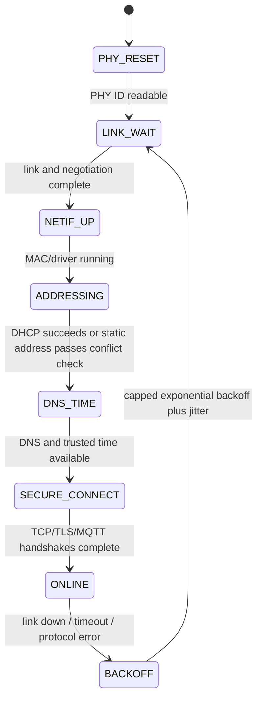

# 27 STM32 networking: Ethernet, lwIP, MQTT, and TLS

> 中文：[27 网络与协议栈](../27-网络与协议栈.md)

> Networking is not “one more peripheral.” It combines PHY clocks, DMA/cache coherence, stack threading, byte-stream framing, reconnect policy, certificate time, and business idempotency in one system.

<p align="center">
  
  <br><sub>▲ One MQTT message crossing the application, lwIP, and Ethernet hardware. Success at one layer only proves that layer.</sub>
</p>

<!-- video:ch27 -->
<p align="center">
  <video width="640" controls poster="../../assets/video/ch27-network.png">
    <source src="../../assets/video/ch27-network.mp4" type="video/mp4">
  </video>
  <br><sub>▲ Chinese voice-over, 3.1 min. Voice: Microsoft Edge neural voice zh-CN-XiaoxiaoNeural via edge-tts (library mostly LGPLv3; the voice model is an online Microsoft service, not an open model). Pictures are generated from this repo's SVGs, not photographs. Subtitles: <a href="../../assets/video/ch27-network.srt">SRT</a>. Rebuild with <code>python3 tools/gen_narrated.py --speak</code>.</sub>
</p>

**Narration script (Chinese, same text as the subtitles)**

1. STM32 联网不是勾一个 lwIP 选项。数据先经过网线、变压器和 PHY，再走 RMII 到 MAC，最后由 DMA 搬进内存。链路灯只证明 PHY 看见链路脉冲，不证明 IP 和应用已经通。
2. 第一层证据是用 MDIO 读到正确的 PHY 标识、链路、速率和双工。地址脚、复位脚或五十兆参考时钟不对时，反复改 DHCP 和 MQTT 没有意义。先找到最底层的第一处分歧。
3. H7 的 Ethernet DMA 不能访问 DTCM。描述符和缓冲要放进 DMA 可达的内存，并独占三十二字节缓存行。只在源码上写一个 section 名不算完成，要从链接 map 核对最终地址。
4. 这一帧是仓库画的消息旅程，不是真实抓包。一条 MQTT 消息向下经过 TLS、TCP 和 IP，再进 Ethernet DMA、RMII 和 PHY；接收时反向上来。每一层只能证明自己的边界。
5. lwIP raw API 必须在核心线程使用，应用任务通常用 Netconn 或 socket。ISR 只投递 DMA 事件，不能直接调用 tcp write。
6. TCP 是可靠有序字节流，不保留消息边界。应用定义长度和业务序号。部分发送或暂时不可写时，所有重试共享一个单调时钟截止点。
7. TCP ACK 只证明字节到了对端协议栈。MQTT QoS 一允许重发，所以仍可能收到重复消息。设备执行命令或写入存储时，要用业务序号和幂等键判断同一动作是否已经完成。
8. TLS 客户端至少要有受信 CA、匹配的主机名、可靠随机数和可信时间。把认证模式关掉虽然可能握手成功，却失去服务器身份保证。时间没有建立前，证书有效期也无法正确判断。
9. 排错从 PHY 和 MDIO 到 ARP、IP、DNS，再到 TCP、TLS、MQTT 和业务 ACK。每一级保留 PCAP、错误码和状态日志，不能用 ping 通替代整条验收。
10. 合上书，三问。链路灯只能证明哪一层？TCP ACK 为什么不能证明业务已经落盘？H7 的 Ethernet 描述符为什么不能随手放进 DTCM？
<!-- /video:ch27 -->
## 📌 Goals

- [ ] Choose explicitly among an on-chip MAC plus PHY, SPI Ethernet, Wi-Fi/cellular socket offload, and PPP.
- [ ] Draw and verify the STM32 → MAC DMA → RMII → PHY → magnetics → RJ45 path.
- [ ] Place descriptors and buffers according to the target bus matrix; explain H7 DTCM, D1/D2 SRAM, and 32-byte cache lines.
- [ ] Respect the thread boundaries of lwIP raw, Netconn, and BSD socket APIs.
- [ ] State what TCP, UDP, DHCP, DNS, MQTT QoS, and TLS do—and do not—guarantee.
- [ ] Implement application framing, deadline-bounded I/O, exponential reconnect backoff, and business idempotency.
- [ ] Locate the first divergence using PHY registers, PCAP, protocol errors, and state-machine logs.

## 🧭 Choose the network path before opening CubeMX

| Path | MCU-facing interface | TCP/IP location | Advantage | Cost and boundary |
| --- | --- | --- | --- | --- |
| On-chip MAC + external PHY | RMII/MII, MDIO/MDC | lwIP/RTOS on MCU | high throughput and complete protocol visibility | PCB, PHY clock, DMA/cache, RAM, and stack are yours |
| W5500-class SPI Ethernet | SPI + IRQ | hardware sockets in the chip | quick bring-up, lower MCU RAM pressure | finite sockets, limited protocols/diagnostics, SPI caps throughput |
| Wi-Fi/4G AT sockets | UART/SPI + commands | module | less RF/certification work | AT state machine, asynchronous URCs, firmware, and recovery dominate |
| Wi-Fi/cellular PPP | PPP netif over UART/USB | lwIP on MCU | one socket API and controllable protocols | RAM, CPU, flow control, and dial state must be verified |
| RTOS network subsystem | driver abstraction | OS subsystem | integrated drivers and components | version, configuration, and threading differ; bare lwIP code is not portable by assumption |

Write throughput, latency, connection count, TLS, power, certification, field update, and diagnosis requirements first. “CubeMX has a checkbox” is not an engineering requirement.

## 🔌 Hardware loop: MAC, RMII, PHY, and RJ45

The MB1364 NUCLEO-H743ZI2 family provides a 10/100 Ethernet PHY and integrated RJ45, as documented by UM2407. It shortens bring-up but does not replace a target-board schematic review. Old H743ZI, ZI2, and custom boards may differ in clock source, solder bridges, PHY address, and reset network.

### RMII signals to reconcile

| Group | Typical signals | First proof |
| --- | --- | --- |
| Reference | 50 MHz `REF_CLK` | frequency, amplitude, startup order, and which side drives it |
| Transmit | `TXD0/1`, `TX_EN` | alternate functions, speed, routing, PHY match |
| Receive | `RXD0/1`, `CRS_DV` | activity after link; whether IRQ/polling drains frames |
| Management | `MDC`, `MDIO` | repeatable PHY ID, BSR link, negotiation result |
| Control | `NRST`, address straps | reset release, address, and strap interference |
| Line side | magnetics, RJ45, differential pairs | center-tap supply, termination, ESD, pair order, layout |

### A link LED is evidence, not acceptance

Firmware should still record:

1. the PHY OUI/model against the BOM;
2. BSR link and auto-negotiation state;
3. negotiated 10/100 and full/half duplex;
4. matching MAC speed/duplex configuration;
5. recovery after cable removal, reinsertion, and switch restart.

If MDIO cannot read the PHY, stop at hardware. Changing IP addresses cannot repair a missing PHY.

## 🧠 H7's critical boundary: CPU and DMA may see different memory

The frozen STM32CubeH7 HTTP Netconn RTOS example states that Ethernet DMA cannot access DTCM at `0x20000000`; data must be in reachable D1/D2 SRAM. Cacheable buffers also need 32-byte line alignment and a coherent ownership protocol.

### The linker map must answer

```text
Where are ETH descriptors?  Can DMA reach them?  Do address/size rules hold?
Where are RX/TX buffers?    Are they cached?      Are both ends 32-byte aligned?
Where are lwIP heap/pbufs?  Could they enter DTCM? What is the peak capacity?
```

A C `section` attribute is not enough. The linker script must create the section, and the map must prove the final addresses.

### Cache maintenance direction

| Ownership transfer | CPU action before handoff | Invariant afterward |
| --- | --- | --- |
| CPU → DMA TX | clean every complete line written by CPU | DMA reads current payload and descriptor |
| DMA → CPU RX | invalidate the receive range after completion | CPU does not reuse a stale line |
| RX buffer returned to DMA | follow driver policy for lines touched by the CPU | no dirty application data enters the next receive |

Invalidating a narrow, unaligned range can discard unrelated dirty variables sharing the first or last line. Give DMA buffers exclusive aligned lines, or centralize maintenance in the driver.

### A pbuf is ownership, not just a pointer

- One owner/reference policy decides when `pbuf_free()` occurs.
- Zero-copy RX cannot expose a buffer while DMA may overwrite it.
- A pbuf may be chained; application data need not be contiguous.
- A successful send normally means “accepted locally,” not “processed by the remote application.”

## 🧵 The three lwIP APIs and their thread boundaries

| API | Model | Valid context | Best fit |
| --- | --- | --- | --- |
| raw callback | event-driven; low-copy potential | the only loop in `NO_SYS`, or `tcpip_thread` / `tcpip_callback()` in OS mode | constrained systems that accept explicit state machines |
| Netconn | blocking sequential API | application tasks communicating with `tcpip_thread` | service tasks; ST's RTOS HTTP example |
| BSD sockets | `socket/connect/send/recv/select` | application tasks, subject to lwIP options | portable application libraries, TLS/HTTP/MQTT |

Do not call raw `tcp_write()` or `udp_send()` from Ethernet IRQs, timer IRQs, or arbitrary tasks. Preserve the event, return descriptors as designed, and wake the correct context.

Keep `LWIP_ASSERT_CORE_LOCKED()` during development. If `LWIP_TCPIP_CORE_LOCKING` is enabled, the lock is not taken from ISR context and the RTOS must handle priority inversion correctly.

## 🌐 Startup state machine: link is not online



Log at least monotonic time, old/new states, reason code, retry count, link, and IP. Production logs must not contain Wi-Fi passwords, private keys, tokens, or complete customer payloads.

### DHCP, static addressing, DNS, and time

- Before DHCP succeeds, `0.0.0.0` is not a usable address. Record which DORA step is absent.
- A static profile includes IP, mask, gateway, and DNS, plus conflict checking or administrative assignment.
- Separate DNS errors from TCP errors. Log the query, return code, resolved address, and TTL; do not permanently cache a transient failure.
- Certificate validation needs trusted time. Begin with a protected manufacturing/RTC estimate, then calibrate over an authenticated SNTP or business channel. Do not disable time checking merely to connect.

## 📦 TCP is a byte stream: define application framing

One `send()` does not correspond to one `recv()`. A 4 KiB message may arrive in pieces; several small messages may arrive together. A protocol needs at least magic/version, length, type, business sequence, and an integrity field.

```text
0               15              31
+---------------+---------------+
| magic 0x534E  | ver |  type   |
+---------------+---------------+
| payload_len (network byte order) |
+-------------------------------+
| sequence                      |
+-------------------------------+
| payload ...                   |
+-------------------------------+
| CRC32 (optional; TLS does not replace storage integrity) |
+-------------------------------+
```

Accumulate the fixed header, reject `payload_len > MAX_PAYLOAD`, then accumulate the payload. On oversize, unknown version, or timeout, close and log; do not search a misaligned stream for a guessed next frame.

A nonblocking send may make partial progress or return `EWOULDBLOCK`. Use `MSG_DONTWAIT` so one send cannot block, then `select()` for writability. Every retry shares one monotonic deadline. This depends on the pinned lwIP default `LWIP_SOCKET_SELECT=1`; it does not depend on the default-disabled `LWIP_SO_SNDTIMEO`.

```c
#include <errno.h>
#include <stddef.h>
#include <stdint.h>

#include "lwip/sockets.h"
#include "lwip/sys.h"

typedef enum {
    SEND_ALL_OK,
    SEND_ALL_TIMEOUT,
    SEND_ALL_CLOSED,
    SEND_ALL_ERROR
} send_all_result_t;

/* Compute deadline_ms once: sys_now() + timeout_ms.
 * For timeout_ms < INT32_MAX, signed subtraction is wrap-safe. */
send_all_result_t send_all_until(int fd, const uint8_t *buf, size_t len,
                                 uint32_t deadline_ms)
{
    size_t sent = 0;

    while (sent < len) {
        int n = lwip_send(fd, buf + sent, len - sent, MSG_DONTWAIT);
        if (n > 0) {
            sent += (size_t)n;
            continue;
        }
        if (n == 0) {
            return SEND_ALL_CLOSED;
        }
        if (errno == EINTR) {
            continue;                   /* original deadline remains */
        }
        if (errno != EAGAIN && errno != EWOULDBLOCK) {
            return SEND_ALL_ERROR;
        }

        uint32_t now = sys_now();
        int32_t remaining_ms = (int32_t)(deadline_ms - now);
        if (remaining_ms <= 0) {
            return SEND_ALL_TIMEOUT;
        }

        fd_set writable;
        FD_ZERO(&writable);
        FD_SET(fd, &writable);
        struct timeval wait = {
            .tv_sec = remaining_ms / 1000,
            .tv_usec = (remaining_ms % 1000) * 1000
        };

        int ready = lwip_select(fd + 1, NULL, &writable, NULL, &wait);
        if (ready > 0) {
            continue;
        }
        if (ready == 0) {
            return SEND_ALL_TIMEOUT;
        }
        if (errno != EINTR) {
            return SEND_ALL_ERROR;
        }
    }
    return SEND_ALL_OK;
}
```

Compute the deadline once, for example `send_all_until(fd, frame, frame_len, sys_now() + 2000U)`. `SEND_ALL_TIMEOUT` means the local send window made no sufficient progress before 2 seconds. It still does not prove remote processing. Durable business completion needs an application ACK carrying the same sequence and idempotent handling on the server.

## 🚀 Choosing UDP or TCP

| Requirement | UDP | TCP |
| --- | --- | --- |
| Message boundaries | preserved per datagram | absent; application frames the stream |
| Loss/reorder/duplicates | handled by application | reliable ordered byte stream per connection |
| Congestion control | application responsibility | built in |
| Multicast/broadcast | supported | unsupported |
| Typical use | discovery, overwriteable telemetry, media, LAN control | configuration, files, HTTP, MQTT, commands |

UDP is not “more real-time TCP.” If you add retransmission, windows, ordering, and fragmentation, you may build a worse TCP. If the next sensor frame can replace the previous one, UDP may avoid head-of-line blocking, but it still needs sequence and time.

## 📨 MQTT: QoS is not business exactly-once

| QoS | Transport meaning | Device responsibility |
| --- | --- | --- |
| 0 | at most once; loss allowed | new periodic data may replace old; do not wait for PUBACK |
| 1 | at least once; duplicates allowed | retain until PUBACK and carry an idempotency key |
| 2 | exactly once in the MQTT protocol flow | more state/messages; still not a database transaction or actuator idempotency |

Also design:

- stable and unique `ClientID` values;
- Clean Start and Session Expiry behavior;
- Keep Alive against device sleep cycles;
- what Last Will means and when it may be a false alarm;
- whether a retained message is latest state or a command—**do not retain side-effect commands**;
- broker packet/receive limits against MCU buffers.

## 🔐 TLS: a completed handshake is not automatically secure

An embedded Mbed TLS client needs a trusted CA, host name, entropy/DRBG, trusted time, allowed algorithms, private-key policy, and bounded I/O callbacks.

Production invariants:

1. `MBEDTLS_SSL_VERIFY_REQUIRED`; `VERIFY_NONE` is only for isolated experiments.
2. Call `mbedtls_ssl_set_hostname()` so chain and destination name are both checked.
3. Seed CTR_DRBG from a real entropy source and handle RNG failures.
4. Never place private keys/tokens in Git or ordinary logs; plan unique credentials, revocation, and rotation.
5. Bound records, chains, and concurrent handshakes; measure peak heap/stack.
6. Distinguish `close_notify`, reset, timeout, and certificate failure; do not rapidly retry certificate errors forever.

A conventional MQTT/TLS port number is not security evidence. Authentication mode, verification result, negotiated version/cipher, and peer identity are.

## 📶 Wi-Fi and cellular modules: the stack moved, the state machine did not

### AT socket offload

Use continuous UART DMA plus a ring buffer. The parser must handle command responses and asynchronous URCs at the same time. Common failures:

- a late `OK` after timeout is consumed by the next command;
- receive URCs interleave with send responses;
- the module reboots while the MCU still believes the socket is online;
- missing RTS/CTS loses bursts;
- firmware changes AT meanings or error codes.

Commands need transaction state, one deadline, cancellation, and a reset path back to a known state. Multiple tasks must not write the same AT UART directly.

### PPP

PPP exposes the serial/cellular link as an lwIP netif and lets applications use sockets. You still manage dialing, authentication, MTU, flow control, cost, and weak-signal recovery. After PPP link-up, verify IP → DNS → TLS → application separately.

## 🧯 Recovery: capped exponential backoff

```text
backoff_n = min(B_max, B_base * 2^min(n, n_cap)) + random(0, jitter)
```

- Do not create sockets while link is down.
- Count DNS, TCP, TLS, and MQTT failures separately.
- Reset the backoff level only after a stable interval.
- Give the complete connection one deadline; do not let each phase block forever.
- Watchdog health should include network progress, not unconditional loop feeding.
- Bound offline queues by bytes and age, with an eviction policy.

Before replaying actuator commands, check expiry, current device state, and idempotency key. “Execute every old command after reconnect” is unsafe.

## 🔍 Layered diagnosis and PCAP evidence

<p align="center">
  
  <br><sub>▲ The first failed layer is the current boundary. Preserve PCAP, register/error snapshots, and configuration, then change one variable.</sub>
</p>

| Symptom | First boundary | Minimum evidence | Next action |
| --- | --- | --- | --- |
| no PHY ID | MDIO/MDC, reset, address | scope plus ID registers | stop changing IP; repair hardware/clock |
| link, no packets | DMA descriptors, IRQ, cache | ownership, ETH status, PCAP | check SRAM domain, alignment, maintenance |
| ARP request, no reply | L2/IP/mask | ARP-filtered PCAP | addresses, VLAN, switch port |
| ping works, TCP fails | port/firewall/listener | SYN and SYN/ACK | server port and server log |
| TCP works, DNS fails | DNS path | query, code, UDP/TCP 53 | fix DNS; do not make a temporary IP permanent |
| TLS fails | time, CA, name, algorithms | Mbed TLS negative code and verify flags | keep verification; fix input/config |
| MQTT repeatedly drops | keepalive, starvation, broker policy | PING, CONNACK/DISCONNECT reason | tasks, packet limits, session values |
| memory decays over time | pbuf/socket/message ownership | lwIP stats, heap low-water, connection count | trace unfreed lifecycle objects |
| low throughput/high CPU | copies, cache, windows, scheduling | goodput, retransmission, window, profile | locate bottleneck before tuning |

Useful Wireshark filters:

```text
arp
icmp
udp.port == 67 || udp.port == 68        # DHCP
udp.port == 53 || tcp.port == 53         # DNS
tcp.flags.syn == 1
tls.handshake.type == 1                  # ClientHello
mqtt                                     # when dissected
```

A report includes board/PHY, firmware commit, MAC/IP, topology, capture point, time range, and expected behavior. One screenshot with green rows is not reproducible evidence.

## 📐 Reproducible capacity and latency accounts

```text
RAM_net = descriptor_bytes + RX_pool + TX_pool + lwIP_heap
        + socket_buffers + TLS_peak + application_offline_queue

goodput = application_payload_bytes / observation_time
loss_or_retry_rate = retried_or_lost_messages / attempted_messages
recovery_time = first_application_success - fault_injection_time
```

Report peaks: minimum free heap, minimum stack per task, maximum pbuf use, maximum concurrent connections, TLS handshake peak, and worst DNS/TCP/TLS latency. Stability acceptance includes cable removal, switch restart, DHCP changes, DNS failure, server restart, certificate error, and lossy links.

## 🧪 Four progressive labs

### A. ARP and ping only

1. Record PHY ID, link, speed, and duplex.
2. Use a static address first and capture ARP/ICMP from a peer on the same subnet.
3. Remove the cable for 10 seconds, reconnect, and measure recovery to ping.
4. Prove L1–L3 without any TCP or MQTT code.

### B. TCP echo and framing

1. Send payloads of 1, MSS−1, MSS, MSS+1, and the maximum application size.
2. Split and coalesce writes on the PC to prove the MCU parser does not rely on `recv()` boundaries.
3. Inject oversize lengths, half-frame timeout, and reset; require distinct reasons and closure.
4. Run 1000 messages without desynchronization; application ACK sequences match requests.

### C. DHCP, DNS, and MQTT

1. Capture DHCP DORA, then remove DHCP and verify capped backoff.
2. Connect by host name; distinguish DNS unreachable, TCP refused, and broker authentication failures.
3. Drop the connection before a QoS 1 PUBACK and prove the repeated publish is deduplicated by the business key.
4. Logs identify the failed layer; retries and offline storage remain bounded.

### D. TLS and long-running operation

1. Connect with a trusted CA, correct name, and trusted time; record peak RAM/stack.
2. Expired, wrong-host, and unknown-CA certificates must fail. Never fall back to `VERIFY_NONE`.
3. Run 24 hours while periodically injecting cable removal, server restart, and DNS changes; retain PCAP and resource low-water marks.
4. Credentials never enter logs; connections recover; heap, pbufs, and stacks do not degrade monotonically with reconnect count.

The complete field list, executable TCP soak/fault peer, and report contract are in [`labs/ethernet-24h/`](../../labs/ethernet-24h/). A localhost smoke validates only the host harness; it is not STM32 hardware evidence.

## ✅ Self-test

1. Why does a link LED not prove that lwIP received a frame?
2. Why can H7 Ethernet DMA not use a DTCM buffer?
3. Why should RX buffers own aligned cache lines?
4. What are the raw, Netconn, and socket thread boundaries?
5. Why does one `send()` not match one `recv()`?
6. Why does a TCP ACK not prove business execution?
7. Why does MQTT QoS 1 require idempotency?
8. Why does TLS require CA, host name, entropy, and trusted time together?
9. If ping works but MQTT fails, what is the next diagnosis order?
10. What MCU state machines remain when an AT module owns TCP/IP?

## 🔗 Authoritative sources and frozen versions

- **RM0433** plus target-revision **ES0392**: H7 bus matrix and Ethernet MAC/MTL/DMA.
- **UM2407**: MB1364 Nucleo-144 PHY, RJ45, solder bridges, and board revisions.
- **UM1713**: STM32Cube/lwIP HAL, middleware, and RTOS/non-RTOS structures.
- **STM32CubeH7** commit `8ec3113d4039d30ba9dc2bf0cb6eefc756b48d06`; lwIP `07680c8172fa5fc135adefa3f7711c14f4938dc9`; Mbed TLS `cdadeb9ba09fd4e913f0f8599832e960545a367d`.
- **lwIP upstream Common pitfalls**: core context, raw API, zero-copy DMA, and cache-line risks.
- **IETF**: RFC 9293 TCP, RFC 768 UDP, RFC 2131 DHCP, RFC 1035 DNS, RFC 8446 TLS 1.3.
- **OASIS MQTT 5.0**: QoS, sessions, Keep Alive, Last Will, errors, and security.
- **Mbed TLS tutorial**: RNG, authentication, host names, CA chains, BIO callbacks, and cleanup.
- Related: [DMA](10-dma.md), [FreeRTOS](15-freertos.md), [debug](17-debug.md), and [H7 pins/memory](25-stm32h7-pins.md).
