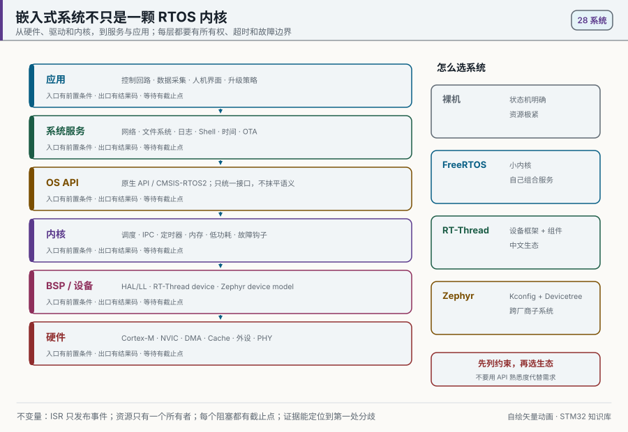

# 28 Embedded systems and the RTOS ecosystem: FreeRTOS, RT-Thread, and Zephyr

> 中文：[28 嵌入式系统与 RTOS 生态](../28-嵌入式系统与RTOS生态.md)

> An RTOS kernel handles only scheduling, synchronization, timing, and memory allocation; who owns a device, how long to wait, whether resources are enough, and how to recover from a fault are yours to design.

<p align="center">
  
  <br><sub>▲ RTOS system layers and ecosystem selection. This is an original vector animation, not a measurement of any target.</sub>
</p>

<!-- video:ch28 -->
<p align="center">
  <video width="640" controls poster="../../assets/video/ch28-rtos-system.png">
    <source src="../../assets/video/ch28-rtos-system.mp4" type="video/mp4">
  </video>
  <br><sub>▲ Chapter video with Chinese voice-over (3.0 min). <a href="../../assets/video/ch28-rtos-system.mp4">MP4</a> · <a href="../../assets/video/ch28-rtos-system.srt">subtitles</a></sub>
</p>

<details>
<summary>Narration script (Chinese, same text as the subtitles)</summary>

1. RTOS 内核解决调度、同步、时间和基础内存问题，不会自动替你设计驱动所有权、启动顺序、升级和诊断。能创建任务，只说明底座能工作，不说明产品系统已经完成。
2. 选系统先列最坏响应、内存、驱动、网络和维护约束。功能少时裸机更容易证明；已有 Cube 工程常用 FreeRTOS；需要完整设备框架，再比较 RT-Thread 与 Zephyr。
3. 把执行上下文分成事件入口、实时控制、系统服务和管理策略。ISR 只取时间戳并发布事实；实时任务做有界计算；服务任务拥有设备；管理任务才决定重连、降级或重启。
4. 这张图展示从硬件、设备层、内核到系统服务和应用的分层。一个有状态外设只给一个所有者。其他任务发送完整事务，不要把片选、DMA 完成和超时恢复拆给多个调用者。
5. 实时性来自预算。区分响应、执行和端到端时延。一个事务只创建一个单调截止点。CPU 利用率小于一，只证明总时间没超额，不证明每个截止时间满足。
6. 队列、邮箱、事件和任务通知不能按名字互换。二值信号量表示事件，互斥量表示所有权并支持优先级继承。CMSIS RTOS2 统一接口名，不统一底层语义。
7. 启动别靠固定延时。先记录复位原因、版本和启动槽，再创建内核对象并探测关键设备，按依赖启动服务。安全前置条件全部满足后，才开放执行器和远程命令。
8. 每个任务自己喂狗会制造假健康。关键任务完成一轮有效工作后，只更新自己的健康纪元。监督者检查所有纪元、队列积压、内存水位和状态机，全部健康时才刷新硬件看门狗。
9. 把 WFI 放进 idle hook 只是入口。能否进入 Stop，还取决于截止点、DMA、Flash 和唤醒时钟。H7 的 M7 加 M4 通常按 AMP 设计，不是对称 SMP。
10. 合上书，三问。有状态外设应该有几个所有者？什么条件满足时，监督者才能刷新看门狗？系统迁移为什么先做硬件事件到任务输出的垂直切片？

</details>
<!-- /video:ch28 -->

## Learning goals

Before this chapter: read chapter 15 (FreeRTOS basics), so you can create tasks and know what queues, semaphores, mutexes, and priority inheritance are; read chapter 04, so you know what an NVIC priority number and preemption mean. DMA from chapter 10, the independent watchdog from chapter 11, and the low-power modes from chapter 16 come up again where they are used. If C structs and pointers are unfamiliar, read the "zero-background primer" in chapter 00 first.

- [ ] Say what the kernel, the component layer, the BSP, and the product system each own, and name two things the kernel will not do for you
- [ ] Sort a project's interrupts and tasks into four layers, and give every stateful peripheral exactly one owner task
- [ ] Work through this chapter's example CPU-utilization account (17.2% in total), and say what a utilization below 1 still does not prove
- [ ] Write down the direction of the priority numbers in NVIC, FreeRTOS, CMSIS-RTOS2, RT-Thread, and Zephyr, and never put a task priority number into the NVIC
- [ ] Decide whether a project should use bare metal, FreeRTOS, RT-Thread, or Zephyr from its device framework, Devicetree/Kconfig, and existing drivers
- [ ] Design a watchdog scheme in which a health supervisor feeds the dog, and test it by injecting three faults: a full queue, a frozen task, and a driver timeout

## The kernel is one layer of the system

**In one sentence: an RTOS kernel handles scheduling, synchronization, timing, and memory allocation; who owns a device, how long one wait may last, whether memory is enough, and how to recover from a fault are yours to design.**

The chapter 15 example runs a few tasks, which shows that the kernel works as a base. A product has more to answer: when two tasks both need the same SPI Flash, who decides; when the network drops, who decides to reconnect; under what conditions may the watchdog be fed.

### An analogy first

Chapter 15 compared the CPU to the only cook in a kitchen, the tasks to order tickets, the scheduler to the head waiter, and interrupts to the server at the door. Once the kitchen has its rules, the restaurant still may not be ready to open:

- The oven belongs to one person. Anyone who needs something baked hands that person a ticket instead of turning the knobs. This is the owner task later in the chapter.
- Every ticket says the latest time the dish may reach the table. Past that time the manager decides whether to cancel or substitute; the cook does not keep redoing it. This is the deadline and the policy layer.
- Ingredients and plates are stocked for the busiest night, not the average one. This is the resource budget.
- Every so often the manager checks that each station is really sending out dishes, and signs the duty sheet only when all are; if the signatures stop, the owner clears the room and reopens. This is a health supervisor feeding the watchdog.

That is as far as the analogy goes. In a real system "the latest time it may reach the table" has to be converted into ticks and microseconds, and it has to be measurable with an instrument; a busy restaurant can hire more staff, but a single-core MCU cannot add CPU time.

### How the software splits into layers

The animation at the top of the chapter draws six layers: hardware, BSP and devices, kernel, OS API, system services, and applications. The table below groups them into four rows by responsibility. The second column is what the layer is responsible for, the third is what it will not do for you. Read the third column first:

| Layer | Responsible for | Not automatically responsible for |
| --- | --- | --- |
| Kernel | task scheduling, inter-task communication (IPC), software timers, critical sections, memory allocation | board drivers, filesystems, networking, secure updates, logging policy |
| Component layer | device model, networking, filesystems, a shell, packages, a POSIX subset | product requirements, resource budgets, fault-recovery policy |
| BSP and drivers | startup, clocks, pins, peripherals, interrupts, DMA, cache | application data frames, task ownership, end-to-end timeouts |
| Product system | state machines, control policy, data model, updates, evidence and acceptance | correctness cannot be handed to an RTOS name |

A BSP (Board Support Package) is the code that makes software run on one particular board: the startup file, the clock setup, the pin assignment, and the peripheral drivers. IPC (Inter-Process Communication) in an RTOS means the objects tasks use to pass data and signals to each other, such as queues and semaphores. POSIX is the standard Unix interface, such as `open`, `read`, and `pthread_create`; the component layer provides part of it so that existing code is easier to port.

### What the three systems are

- **FreeRTOS Kernel**: the one chapter 15 uses. It is only a kernel; networking, TLS (transport-layer encryption), OTA (over-the-air updates), filesystems, and drivers are picked and assembled by the project.
- **RT-Thread**: around its kernel it carries a device framework (one interface for finding, reading, and writing devices), the FinSH/MSH shell, the DFS virtual filesystem (Device File System), the SAL socket abstraction layer (Socket Abstraction Layer), and a package ecosystem.
- **Zephyr**: puts Kconfig (software configuration), Devicetree (hardware description), a device model, drivers, and many subsystems into one build flow and generates the firmware from them together at compile time.

There is also CMSIS-RTOS2. It is not a kernel but a set of generic RTOS function interfaces defined by Arm; FreeRTOS or another kernel can sit underneath it. It gets its own section later.

All three systems can carry a good product, and all three can be brought down by unclear ownership and unbounded waits. The versions frozen for this chapter are FreeRTOS Kernel V11.3.2, RT-Thread v5.3.0, Zephyr v4.4.2, and CMSIS-RTOS2 2.3.0 in CMSIS 6.4.0; the sources are in each one's own section below.

## A four-layer execution model

A system runs interrupts, periodic tasks, driver tasks, and management tasks at once. The previous section was about which software layer code belongs to; this one is about which context it runs in: inside an interrupt, or in which kind of task. Split by responsibility into four layers, each doing only its own job, you know which layer to inspect when something goes wrong. The table has one row per layer; the "allowed" and "forbidden" columns are for checking code line by line in review:

| Layer | Typical execution context | Allowed | Forbidden |
| --- | --- | --- | --- |
| Event entry | ISR, DMA completion callback | take a timestamp, clear hardware flags, publish a fixed-size event | wait on a lock, allocate memory dynamically, format long strings, touch slow devices |
| Real-time control | high-priority periodic task | read a data snapshot, compute the control step, write actuator commands | name resolution (DNS) and encryption handshakes (TLS), erase Flash, unbounded logging, wait on a low-priority service |
| System services | driver owners, networking, storage, logging tasks | serialize device access, run bounded transactions, return result codes | hold a lock for a long time, retry forever, fail silently |
| Management policy | state-machine, update, and diagnostic tasks | decide on reconnecting, degrading, restarting, and persisting | grab the same hardware from several contexts at once |

An actuator is an output the program drives, such as a motor, a valve, or a relay. Five invariants tie the four layers together. An invariant is a condition that must hold at every moment the system runs:

1. **An ISR publishes facts and does not run policy.** It reports "a sample completed, at this timestamp"; it does not decide whether to reconnect.
2. **A stateful peripheral has exactly one owner.** A stateful peripheral is one whose operation takes several steps that nobody else may cut into; one write to an SPI Flash, for example, needs a write enable, then the command and data, then a wait until it is no longer busy. Other tasks send commands to the owner instead of calling the HAL concurrently.
3. **Every wait has a deadline.** On timeout the result goes back to the policy layer; the lower layer does not retry forever.
4. **Every queue has a full policy.** Drop the newest, drop the oldest, make the sender wait (backpressure), or enter a fault state: write it down in advance.
5. **Every crossing between layers carries a sequence number, a timestamp, and a result code that can be matched up.**

### The owner task: one writer per peripheral

Take an SPI Flash. If several tasks call `HAL_SPI_TransmitReceive()` directly, wrapping every call in a mutex is still not enough, because one complete read or write takes several calls: pull chip select low, send the command, send the address, move data by DMA, wait for completion, release chip select. The lock is free between two calls, another task can cut in, and chip select and the DMA state get mixed up. The owner-task approach lets only one task touch this Flash; other tasks pack a whole transaction into one message and send it there:

```c
typedef enum { FLASH_READ, FLASH_WRITE, FLASH_ERASE } flash_op_t;

typedef struct {
    flash_op_t op;
    uint32_t address;
    void *buffer;
    size_t length;
    TaskHandle_t requester;
    uint32_t sequence;
} flash_request_t;

/* Only flash_task may touch SPI, CS, and the DMA state. */
static void flash_task(void *argument)
{
    flash_request_t req;
    (void)argument;
    for (;;) {
        if (xQueueReceive(g_flash_requests, &req, portMAX_DELAY) != pdTRUE) {
            continue;
        }
        flash_result_t result = flash_execute_until(&req, xTaskGetTickCount() + pdMS_TO_TICKS(500));
        xTaskNotify(req.requester, pack_result(req.sequence, result), eSetValueWithOverwrite);
    }
}
```

This is a fragment; it leaves out creating the queue and the bodies of `flash_execute_until()` and `pack_result()`. Piece by piece:

- `flash_request_t` holds everything one transaction needs: the operation, address, buffer, length, who sent the request, and a sequence number. The requester matches the result to the request it sent by that number.
- `xQueueReceive(..., portMAX_DELAY)`: with no request the task blocks and uses no CPU. `portMAX_DELAY` means an unlimited wait only when `INCLUDE_vTaskSuspend` is 1 in FreeRTOSConfig.h ([FreeRTOS V11.3.2](#source-freertos-1132)); when it is 0 it is merely the longest finite wait, so the code still checks the return value.
- `xTaskGetTickCount() + pdMS_TO_TICKS(500)`: gives the whole transaction one absolute deadline; 500 ms is an example setting. Each wait inside the transaction uses only the time that is left and returns a timeout when the time is up.
- `xTaskNotify(..., eSetValueWithOverwrite)`: sends the sequence number and the result code back to the requester with a task notification.

A mutex suits a short critical section, such as updating one struct. When a transaction involves chip select, DMA, a state machine, and recovery steps, use an owner task. The cost is one extra message per request and a capacity to choose for the request queue; in return, the peripheral's state has exactly one writer.

## Interrupt and kernel boundaries

Interrupt priorities and task priorities are two separate numbering schemes, and they run in different directions, so never put a task priority number into the NVIC. The table lists the five schemes this chapter touches. When you port code, look at the "direction" column first and re-rank by "who is more urgent than whom" instead of copying numbers:

| Numbering | Direction | Source |
| --- | --- | --- |
| Cortex-M NVIC interrupt priority | smaller is more urgent; the F1 implements only the top 4 bits of each priority field | [PM0056 Rev 7](#source-pm0056) section 2.3.5, section 4.3.7 Table 42 |
| FreeRTOS task priority | larger runs first | [FreeRTOS V11.3.2](#source-freertos-1132) |
| CMSIS-RTOS2 `osPriority_t` | larger runs first | [CMSIS-RTOS2 2.3.0](#source-cmsis-640) |
| RT-Thread thread priority | smaller runs first, 0 is highest | [RT-Thread v5.3.0](#source-rtthread-530) |
| Zephyr thread priority | smaller runs first; negative numbers are cooperative threads | [Zephyr v4.4.2](#source-zephyr-442) |

Once a cooperative thread runs, other threads wait until it yields the CPU itself; interrupts can still preempt it.

An ISR may call only interfaces marked as usable from an interrupt, and it may not wait. Here is how the four systems spell that; the third column is what an ISR must not do:

| System | Typical entry points usable in an ISR | Must avoid |
| --- | --- | --- |
| FreeRTOS | `FromISR` functions such as `xQueueSendFromISR` and `vTaskNotifyGiveFromISR`, then `portYIELD_FROM_ISR` when needed | ordinary blocking APIs, mutexes, dynamic logging |
| RT-Thread | IPC interfaces and device callbacks documented as callable from interrupt context; call `rt_interrupt_enter/leave` as the port layer specifies | waiting on IPC in an ISR, scheduling-related calls with interrupts disabled |
| Zephyr | APIs documented as callable from an ISR, such as `k_sem_give`, or submitting a `k_work` | waiting with `K_FOREVER`, taking a driver path that may sleep inside an ISR |
| CMSIS-RTOS2 | each API's documentation says whether it can be called from an ISR; when called there, the timeout must be 0 | assuming every `os*` API works in an ISR |

On Cortex-M, FreeRTOS builds its critical sections on the BASEPRI register. Once BASEPRI holds a non-zero value, exceptions whose priority number is greater than or equal to it are not taken ([PM0056 Rev 7](#source-pm0056) section 2.1.3 Table 9). That threshold comes from `configMAX_SYSCALL_INTERRUPT_PRIORITY`. An interrupt that calls a `FromISR` function must not have a priority number smaller than the threshold, or the kernel cannot hold it off when entering a critical section, and the kernel's data structures get corrupted ([FreeRTOS notes on Cortex-M](#source-freertos-priority)). The chapter 15 example sets the threshold to 5, which is 0x50 in the register.

When a task does not respond, walk the path the event took, one stop at a time, until you find the first place that differs from what you expect, the first divergence:

1. Is the hardware pending bit set, for example `EXTI_PR` for EXTI?
2. Is this interrupt enabled in the NVIC?
3. Did the ISR run? Toggle a spare pin at its entry and watch it on a logic analyzer.
4. Did the event go into the queue? Check the return value of `xQueueSendFromISR`.
5. Did the target task become ready?
6. Did the scheduler switch to it, or is a higher-priority task holding the CPU?

Do not jump from "the task printed nothing" straight to "the RTOS is broken".

## Inter-task communication: how the objects of four systems line up

Chapter 15 covered FreeRTOS queues, semaphores, mutexes, event groups, and task notifications. The other three systems have matching objects. The table puts one use per row and answers only "which object do I look for to do this"; objects in the same row do not behave identically, and the differences are listed under the table:

| Use | FreeRTOS | RT-Thread | Zephyr | CMSIS-RTOS2 |
| --- | --- | --- | --- | --- |
| Pass a message (copy its contents) | Queue | message queue | `k_msgq` | Message Queue |
| Notify one particular task | Task Notification | event, semaphore, or mailbox, chosen by the data it must carry | `k_event`, `k_sem`, or `k_poll_signal` | Thread Flags |
| Count a resource | Counting Semaphore | semaphore | `k_sem` | Semaphore |
| Protect a shared resource | Mutex | mutex | `k_mutex` | Mutex |
| Wait on several condition bits | Event Group | event | `k_event` | Event Flags |
| Hand an ISR's follow-up work to a thread | notify a task or send to a queue | wake a thread with IPC | `k_work` and a work queue | wake a thread with flags or a queue |

The same name does not mean the same thing:

- A FreeRTOS task notification is bound to the task that receives it: anyone can send, only that one task can receive. It is lighter than a queue but cannot have several receivers.
- Each letter in an RT-Thread mailbox is one machine word (4 bytes on a 32-bit MCU), usually holding a number or a pointer; a message queue copies the message contents, each message no longer than the limit set when it was created. The names are close; they are not interchangeable.
- Zephyr work items share one work thread. If one work item blocks, every other item in that queue waits.
- CMSIS-RTOS2 unifies function names and parameters; scheduling details, memory layout, and low-level extensions still change with the kernel. Its mutex guarantees priority inheritance through the interface only when `osMutexPrioInherit` is set in the creation attributes ([CMSIS-RTOS2 2.3.0](#source-cmsis-640)).
- A binary semaphore means "the event happened"; a mutex means "this resource is mine right now" and carries priority inheritance ([FreeRTOS V11.3.2](#source-freertos-1132)). Priority inheritance means that when a low-priority task holds the lock and a high-priority task waits on it, the kernel temporarily raises the holder's priority so it releases the lock sooner. Both have only two states, taken and free, and still cannot stand in for each other.

## Real time is proved with budgets

Real time means finishing on time in the worst case, not running fast on average. To call a system real-time you need a time account: how long each job takes at worst, and when at the latest it must be done.

### Keep three kinds of time apart

The three rows below are three different times, with different start and end points. The third column is the most common mistake when measuring them:

| Time | Measured from where to where | Common mistake |
| --- | --- | --- |
| Response time | from the event to the task starting to handle it | measuring only to the ISR entry and missing the stretch spent blocked by higher-priority tasks |
| Execution time | the CPU time the task actually uses | taking the average as the worst case; measuring with logging off, then shipping with it on |
| End-to-end latency | from sensor to actuator, or from sending a request to receiving the network reply | each layer sets its own timeout, and together they far exceed the product requirement |

### The CPU-utilization account

On a single core you can start with a conservative utilization account. C is a task's worst-case execution time per run, T its period, and U the utilization:

```text
U = C1/T1 + C2/T2 + … + Cn/Tn
```

The table below is this chapter's example account. The periods and execution times of all four tasks are example settings, not measurements on any STM32. The CAN service is triggered by frames and has no fixed period, so it is converted to a period using the shortest gap between two frames, 2 ms. The last column is C/T:

| Task | Period or trigger | Budgeted execution time | Utilization |
| --- | ---: | ---: | ---: |
| Current-loop computation | 1 ms | 80 µs | 8% |
| Sensor fusion | 10 ms | 420 µs | 4.2% |
| CAN service | event-driven, counted as 2 ms | 70 µs | 3.5% |
| Log encoding | 100 ms | 1.5 ms | 1.5% |
| Known tasks, total | — | — | 17.2% |

Every cell can be recomputed:

```text
80 µs  / 1 ms   = 0.08  = 8%
420 µs / 10 ms  = 0.042 = 4.2%
70 µs  / 2 ms   = 0.035 = 3.5%
1.5 ms / 100 ms = 0.015 = 1.5%
total 8% + 4.2% + 3.5% + 1.5% = 17.2%
```

17.2% says only that these four tasks together do not fill one core. U below 1 does not prove that every task finishes on time: time blocked on shared resources, time preempted by interrupts, time waiting on cache misses and Flash wait states, and how priorities are ordered all have to be counted separately in a response-time analysis. The account also needs margin for ISRs, the kernel itself, protocol stacks, and bursts of traffic.

### Periods, timeouts, and deadlines

- A periodic task uses an absolute wake-up time. That is what `vTaskDelayUntil` in chapter 15 does: the next wake-up time is the previous one plus the period, so the task's own execution time does not accumulate into period drift.
- A transaction computes its deadline once, from a monotonic clock. A monotonic clock only goes up and is not affected by setting the time; the tick count is one. Each wait in the transaction uses the remaining time, "deadline minus now", instead of waiting a full fixed timeout at every step.
- A timeout does not mean "try again". Whether a retry is safe, how many times to try, and whether the same action might run twice are things only the policy layer knows.
- Converting milliseconds to ticks loses precision. FreeRTOS `pdMS_TO_TICKS()` uses integer division and rounds down: with a 1000 Hz tick `pdMS_TO_TICKS(5)` is 5; with a 100 Hz tick it is 0, and the wait times out at once ([FreeRTOS V11.3.2](#source-freertos-1132)). When you need "wait at least this long", round up yourself.
- Ticks are counted from the moment of the call, and part of the current tick has already gone, so `vTaskDelay(n)` actually blocks for between n − 1 and n tick periods. The kernel cannot guarantee a deadline shorter than one tick.
- Tickless idle stops the periodic tick interrupt while no task needs to run, and adds the ticks slept through on wake-up. It cuts how often the idle CPU is woken by the tick; it does not reduce the power drawn by peripherals and other parts on the board.

## Memory: count stacks, the kernel heap, the C heap, and DMA buffers separately

Chapter 15 covered task stacks in words and the heap_1 to heap_5 heaps. A complete system has more blocks of memory, each with different users, risks, and ways to verify it. One row per region; the last column is how you prove it is big enough:

| Region | Used by | Main risk | How to verify |
| --- | --- | --- | --- |
| Task stacks | call frames, locals, registers saved on a task switch | the deepest call chain, `printf` and floating point, nested interrupts overflowing the stack | stack high-water mark, overflow hook, deliberate stress tests |
| Kernel objects and kernel heap | task control blocks (TCBs), queues, timers, and so on | failures when creating objects dynamically after startup, heap fragmentation | budget before startup, record the minimum free amount at run time |
| C heap | `malloc`, `new`, and some C library functions | whether it is thread-safe, counting it twice with the kernel heap | keep one allocator and write down how it is locked |
| DMA buffers | shared by peripherals and the CPU | whether DMA can reach the address, alignment, cache coherency, who owns it right now | read the link map, add address assertions, fix the cache and MPU rules |
| Persistent storage | Flash, backup SRAM | power lost mid-write, incompatible versions, write amplification | two copies, CRC, version numbers, fault injection |

Terms in the table:

- **Stack high-water mark**: fill the stack with a fixed pattern when the task is created, run for a while, then see how much of the pattern is left; that shows the deepest point the stack reached. FreeRTOS reads this margin with `uxTaskGetStackHighWaterMark()`.
- **Cache coherency**: if the CPU changed data in the cache and has not written it back, DMA reads old data; the other way round, after DMA writes memory the CPU may read an old copy from the cache ([AN4839 Rev 2](#source-an4839)). The F1 has no data cache; the H7 does.
- **MPU** (Memory Protection Unit): sets access permissions and cache attributes for a range of addresses.
- **Link map**: the `.map` file the linker writes, listing where every section and variable is placed and how many bytes it takes.
- **Write amplification**: changing a few bytes still means erasing and writing a whole Flash page.

For production, create long-lived objects statically during initialization where you can. With `configSUPPORT_STATIC_ALLOCATION` turned on in FreeRTOSConfig.h, `xTaskCreateStatic` and `xQueueCreateStatic` use memory you provide, so creation cannot fail for lack of heap ([FreeRTOS V11.3.2](#source-freertos-1132)). For objects that really must be created and deleted at run time, write down who allocates, who frees, how a failure rolls back, and how a double free is caught. Returning empty data after `malloc` fails only hides the exhaustion; it is not recovery.

### A memory account you can recompute

Assume a chip with 256 KiB of SRAM (1 KiB is 1024 bytes). This book's main board, the STM32F103C8T6, has only 20 KB of SRAM ([DS5319 Rev 20](#source-ds5319) Table 2) and cannot hold this account; it only shows the method. Every cell is an example setting, and the second column shows where it comes from:

| Item | Count × each | Budget |
| --- | ---: | ---: |
| 8 thread stacks | `8 × 2 KiB` | 16 KiB |
| Network RX/TX buffers | `16 × 1.6 KiB` | 25.6 KiB |
| Message queues and object storage | summed | 12 KiB |
| Filesystem work area | summed | 8 KiB |
| TLS peak working memory | from a fixed configuration or measurement | 64 KiB |
| DMA non-cacheable region | summed after alignment | 16 KiB |
| Global static data | link map | 28 KiB |
| Fault-dump reserve | fixed | 8 KiB |
| Allocated | — | 177.6 KiB |
| Unallocated margin | `256 - 177.6` | 78.4 KiB |

```text
16 + 25.6 + 12 + 8 + 64 + 16 + 28 + 8 = 177.6 KiB
256 − 177.6 = 78.4 KiB
```

The DMA non-cacheable region is a stretch of SRAM set up to bypass the cache; DMA buffers placed there need no cache maintenance. This account is only a worked example. A real project updates it from the link map, the minimum margin of each task stack, the kernel heap's low-water mark, and the TLS and network peaks. The 78.4 KiB left free now is not a long-term safety margin: a burst of queued messages, a certificate chain, and double buffering for updates can all push the peak up.

## Driver lifecycle: seven states

A driver's `init` returning success says only that it reached the "ready" step. A driver that can recover from faults needs at least the seven states below. The state names stay as they are, and the logs use exactly these words. Each row is one transition, read left to right:

| Current state | Trigger | Next state |
| --- | --- | --- |
| Power-on | system starts | `Absent` (not found) |
| `Absent` | the device is found on the board | `Probing` |
| `Probing` | initialization and self-test both pass | `Ready` |
| `Probing` | an optional feature fails, the core function works | `Degraded` |
| `Ready` | a transaction is accepted | `Busy` |
| `Busy` | the transaction completes | `Ready` |
| `Busy` | timeout or error | `Recovering` |
| `Recovering` | reset and re-probe pass | `Ready` |
| `Recovering` | the recovery budget is used up | `Failed` |
| `Degraded` | the policy layer explicitly asks for a retry | `Probing` |
| `Failed` | the policy layer approves a restart | `Probing` |

The recovery budget is a number of attempts and a total duration written down in advance; once it is used up the driver stops retrying on its own and hands over to the policy layer. Every transition needs its trigger, maximum duration, resources to clean up, error code, and log fields written down. `HAL_OK`, `RT_EOK`, or `device_is_ready()` prove only that their own layer succeeded; they do not prove that a sensor reading is plausible, that Flash has been written, or that the network peer has acknowledged.

## Startup order: prove the base before opening services

After power-on, open the six gates below in order. If one does not pass, the ones after it stay shut:

1. **Reset evidence**: record the reset cause, firmware version, boot slot, and the version of the persistent data. On the F1 the reset cause is in the flag bits of `RCC_CSR`; an independent-watchdog reset sets `IWDGRSTF` ([RM0008 Rev 21](#source-rm0008) section 7.3.10). The boot slot says which copy of the firmware is running: with in-field updates, Flash can hold two copies, so a failed update can fall back to the old one.
2. **Minimum hardware**: clocks, supply monitoring, memory, watchdog. On failure, stop in a safe state that can be diagnosed.
3. **Kernel objects**: static queues, tasks, events, and memory pools. If any of them fails to be created, do not enter normal operation.
4. **Device probing**: critical devices must pass; non-critical devices may enter an explicit degraded state.
5. **Service layer**: logging, storage, networking, time, and updates, started one after another by their dependencies.
6. **Application gating**: only when every safety precondition holds may actuators be driven and remote commands be accepted.

Do not stand in for a dependency with a fixed delay. Assuming after `delay(500)` that the network has an address breaks whenever startup is a little faster or slower. Wait for a state event that carries a result code, and give the whole startup a deadline.

## Observability: reduce a fault to the first divergence

When something fails, the logs should let you find the first place that differs from what you expect. Every important log line carries at least these fields:

```text
monotonic_ms | boot_id | component | event | state | sequence | result | detail
```

- `monotonic_ms`: monotonic milliseconds since this power-on; orders events within one boot and is not affected by RTC time jumps.
- `boot_id`: a new number on every boot, to tell apart sequence numbers reused across a reset.
- `component`, `event`, `state`: which component, what happened, and which state it was in.
- `sequence`: one event carries the same sequence number from the ISR through the queue and the driver transaction to the protocol reply.
- `result`: a fixed enumeration value, not just free text.
- `detail`: a register snapshot or a protocol error code; never private keys or passwords.

### A health-supervisor task feeds the watchdog

The independent watchdog (IWDG) from chapter 11 is a free-running down-counter: writing 0xAAAA to `IWDG_KR` reloads it, and when it reaches 0 the chip resets ([RM0008 Rev 21](#source-rm0008-wdg) section 19.3). Who writes that 0xAAAA decides whether the watchdog can catch a fault.

If every task feeds the dog on its own, you get false health: all the real work is stuck while some interrupt keeps feeding. Let one health-supervisor task do all the feeding instead:

1. Each critical task has a health epoch, which is just a counter. Every time the task finishes a round of useful work, it adds 1 to its epoch. Useful work means actually completing its job, such as the control task finishing one output; merely being woken up does not count.
2. The supervisor checks periodically: has every epoch moved within the longest interval that task is allowed, is any queue backing up, are memory levels and the key state machines normal.
3. Only when everything is normal does the supervisor refresh the hardware watchdog.
4. If anything is wrong, it first writes a minimal fault summary to persistent storage, then stops feeding and lets the watchdog reset the chip. Writing the summary has a deadline too.

After the reset, read the reset flags and the fault summary to see which health condition failed first.

## Low power with an RTOS

When no task is ready, the RTOS runs the idle task, which is where the CPU can go to sleep. How deep it may sleep depends on the whole system:

- how long until the nearest software deadline, and whether that is long enough to sleep;
- whether DMA, a Flash erase or write, the network PHY (the Ethernet physical-layer chip), or another peripheral transaction is still running;
- which clock keeps running in the low-power mode and can wake the chip;
- whether the HAL time base, PLL, cache, peripherals, and network state can be restored after waking;
- whether the clock used to add back the ticks for tickless idle is accurate enough.

With `configUSE_TICKLESS_IDLE` turned on, FreeRTOS stops the tick interrupt while idle and adds back the ticks slept through when it wakes ([FreeRTOS V11.3.2](#source-freertos-1132)). The implementation built into the Cortex-M port times the sleep with SysTick and sleeps with `WFI` (wait for interrupt: the CPU stops until an interrupt arrives). When the F1 enters Stop, every clock in the 1.8 V domain stops, SysTick included; on waking the system clock is HSI and the clocks must be configured again ([RM0008 Rev 21](#source-rm0008-pwr) section 5.3.4). To use tickless idle in Stop, time the sleep and add back the ticks with a clock that keeps running in Stop, such as the RTC.

Putting `WFI` in the idle hook is only an entry point, not a low-power strategy. The evidence for modes, wake-up, and recovery from chapters 16 and 24 is just as necessary under an RTOS.

## FreeRTOS V11.3.2: a small kernel, and you assemble the system

The version frozen for this chapter is [FreeRTOS Kernel V11.3.2](#source-freertos-1132). The kernel provides tasks, queues, mutexes, semaphores, task notifications, event groups, software timers, and several heap implementations (heap_1 to heap_5). It does not prescribe a device model, and it does not ship STM32 drivers, a shell, or a filesystem; the HAL drivers chapter 15 uses come from STM32Cube, not from FreeRTOS.

You assemble the system yourself, and the directories can follow the layers above:

```text
app/        product state machines and application protocols
services/   storage / network / update / log
drivers/    the single owner of each peripheral and its asynchronous transactions
rtos/       FreeRTOSConfig.h, static objects, and hooks
bsp/        clocks, pins, interrupts, linker script, HAL/LL
```

### Configuration checklist: what to freeze and review

`FreeRTOSConfig.h` decides how the kernel works. Write the items below into the review record so every change can be traced:

- `configTICK_RATE_HZ` (tick rate), `configMAX_PRIORITIES` (number of priorities), `configUSE_PREEMPTION` (whether to preempt).
- `configMAX_SYSCALL_INTERRUPT_PRIORITY`, and how many priority bits the chip implements: 4 on the F1 ([PM0056 Rev 7](#source-pm0056) Table 42).
- The static and dynamic allocation switches, and which `heap_x.c` is used.
- Whether stack-overflow checking, the `malloc`-failed hook, the idle hook, and the tick hook are on.
- The software-timer task's priority, stack size, and command-queue length.
- The preconditions for tickless idle and the clock used to wake up.
- Whether the run-time statistics clock is independent of the kernel tick.

The V11 series supports SMP scheduling. SMP needs several identical cores scheduled by one kernel; the M7 and M4 of the STM32H745 are two different cores and are usually designed as AMP, with each core running its own firmware; see the section on dual core later.

## RT-Thread v5.3.0: kernel, device framework, and components

The version frozen for this chapter is [RT-Thread v5.3.0](#source-rtthread-530). For an STM32 project, what it adds beyond a thread API is one shared framework: device access, component initialization, the shell, filesystems, and network abstraction are all organized by it.

### Objects and startup

- Threads: create statically with `rt_thread_init` or dynamically with `rt_thread_create`, then call `rt_thread_startup` before the thread is scheduled. A smaller priority number runs first; 0 is highest.
- Communication objects: semaphore, mutex, event, mailbox, message queue.
- Timers: a hard timer's callback runs in the tick interrupt, so write it by ISR rules and do not block; a soft timer's callback runs in the timer thread, so one slow callback makes every soft timer queued behind it wait. Check the documentation for each mode to confirm whether blocking is allowed.
- Initialization: macros such as `INIT_BOARD_EXPORT`, `INIT_DEVICE_EXPORT`, `INIT_COMPONENT_EXPORT`, and `INIT_APP_EXPORT` register functions into a leveled startup sequence, called level by level after power-on.
- Configuration and build: `menuconfig` generates the configuration, and SCons (a build tool written in Python) organizes the BSP, components, and packages.

### The device framework: find the device, then use one set of calls

An RT-Thread driver registers itself as a named device. The application finds it by name and then operates it through the shared calls `rt_device_open`, `rt_device_read`, `rt_device_write`, and `rt_device_control`. This fragment opens UART 2 during application initialization:

```c
#include <rtthread.h>
#include <rtdevice.h>

static rt_device_t console_uart;

static int app_uart_init(void)
{
    console_uart = rt_device_find("uart2");
    if (console_uart == RT_NULL) {
        return -RT_ENOSYS;
    }
    rt_err_t error = rt_device_open(console_uart, RT_DEVICE_FLAG_RX_NON_BLOCKING);
    if (error != RT_EOK) {
        console_uart = RT_NULL;
        return error;
    }
    return RT_EOK;
}
INIT_APP_EXPORT(app_uart_init);
```

Piece by piece:

- `rt_device_find("uart2")`: looks up a registered device by name and returns `RT_NULL` if there is none. The name is decided when the BSP registers the device.
- `rt_device_open(..., RT_DEVICE_FLAG_RX_NON_BLOCKING)`: opens the device with non-blocking receive. This flag belongs to the serial V2 framework; a BSP on the older serial framework uses different flags, so go by the driver source of the BSP you use in v5.3.0.
- On failure it sets `console_uart` back to `RT_NULL` before returning the error code, so later code can see at a glance that the UART is unavailable.
- `INIT_APP_EXPORT(app_uart_init)`: registers the function in the application-level startup sequence.

The code shows only the lifecycle boundary: find, open, check for failure. For UART DMA, receive callbacks, and buffering, go back to the matching BSP driver in v5.3.0; seeing `rt_device_read` does not mean every driver blocks and times out the same way.

Shared objects and components are RT-Thread's strength, and also where the risk is: turning on DFS, SAL, FinSH, packages, and the POSIX layer adds Flash, RAM, threads, and initialization dependencies. For every component you turn on, add its object count, thread stacks, and failure paths to the system budget.

## Zephyr v4.4.2: configuration, hardware description, and subsystems build the firmware together

The version frozen for this chapter is [Zephyr v4.4.2](#source-zephyr-442). Where Zephyr differs most from the other two is the build: the board, drivers, kernel configuration, and subsystems are tied together at compile time by the build system into one firmware image. Four parts work together:

- **Devicetree**: a text format that describes hardware: which peripheral instances exist, and their addresses, interrupts, GPIOs, clocks, and bus connections.
- **Kconfig**: selects the software features, dependencies, and parameters compiled in, and produces `CONFIG_*` macros.
- **Device model**: binds the hardware instances in Devicetree to driver objects; the application gets devices through it.
- **west + CMake + Ninja**: west is Zephyr's command-line tool, which fetches several code repositories and locks their versions from a manifest file (the west manifest); CMake and Ninja generate and run the build.

### Devicetree describes the hardware, Kconfig selects the software

The two fragments below blink an LED. The first is a Devicetree overlay: it says the LED is on pin 5 of GPIOA, active high, and gives it the alias `status-led`. The second is application code that finds the LED only through the alias and writes no register address:

```dts
/ {
    aliases {
        status-led = &user_led;
    };

    leds {
        compatible = "gpio-leds";
        user_led: led_0 {
            gpios = <&gpioa 5 GPIO_ACTIVE_HIGH>;
        };
    };
};
```

```c
#include <zephyr/device.h>
#include <zephyr/drivers/gpio.h>
#include <zephyr/kernel.h>

static const struct gpio_dt_spec led = GPIO_DT_SPEC_GET(DT_ALIAS(status_led), gpios);

int main(void)
{
    if (!gpio_is_ready_dt(&led)) {
        return -ENODEV;
    }
    int error = gpio_pin_configure_dt(&led, GPIO_OUTPUT_INACTIVE);
    if (error != 0) {
        return error;
    }
    for (;;) {
        gpio_pin_toggle_dt(&led);
        k_msleep(500);
    }
}
```

Piece by piece:

- `status-led = &user_led`: the alias. `DT_ALIAS(status_led)` in the code finds exactly this; a hyphen in Devicetree is written as `_` in the macro.
- `gpios = <&gpioa 5 GPIO_ACTIVE_HIGH>`: pin 5 of GPIOA, active high. A new board changes only this line; the application code stays.
- `gpio_is_ready_dt(&led)`: checks that the driver is ready. A node in Devicetree does not mean the driver initialized successfully.
- `gpio_pin_configure_dt(&led, GPIO_OUTPUT_INACTIVE)`: configures the pin as an output, starting at the inactive level, that is, off.
- `k_msleep(500)`: yields the CPU for 500 ms, so the LED is on for 500 ms and off for 500 ms. 500 ms is an example setting.

Turning on software features such as the GPIO driver goes in Kconfig, not in Devicetree. Do not copy register addresses into the application to get around the device model; that loses the shared boundary for changing boards, power management, and driver ownership.

### Work queues: several work items share one thread

A `k_work` is a work item: an ISR submits it to a work queue, and the follow-up runs in thread context. The system work queue is shared by everyone who submits to it, so one work item doing something slow makes every item behind it wait. Put networking, storage, or anything that may block for a long time in a dedicated work queue or an owner thread, with its own stack and priority budget.

## CMSIS-RTOS2 2.3.0: one interface, not one implementation

CMSIS (Cortex Microcontroller Software Interface Standard) is a set of software interface standards Arm defined for Cortex-M. CMSIS-RTOS2 is the part that gives a generic set of RTOS functions, with a real kernel underneath, such as Arm's RTX5, or FreeRTOS through CMSIS-FreeRTOS. This chapter freezes the CMSIS-RTOS2 API 2.3.0 in CMSIS 6.4.0 ([CMSIS 6.4.0](#source-cmsis-640)). Startup looks like this:

```c
osKernelInitialize();
osThreadId_t worker = osThreadNew(worker_main, NULL, &worker_attributes);
if (worker == NULL) {
    system_init_fail(INIT_THREAD_CREATE);
}
osKernelStart();
```

This is a fragment; `worker_main`, `worker_attributes`, and `system_init_fail()` are defined elsewhere. `osThreadNew` returning `NULL` means the thread was not created, and startup stops here without entering the scheduler.

It makes the application depend less on one kernel's function names. Before changing kernels, still check item by item:

- priority: a larger `osPriority_t` number runs first; see how it maps onto the underlying kernel's priorities;
- the unit of stack size: `stack_size` in `osThreadAttr_t` is in bytes, FreeRTOS `xTaskCreate` is in words, so chapter 15's 128 words are 512 bytes;
- which APIs may be called from an ISR;
- what thread flags, event flags, and message queues return when full and on timeout;
- how large static control blocks and message storage must be, and how they are aligned;
- whether application code still depends on underlying extensions, such as FreeRTOS task notifications or stream buffers.

When an application calls many underlying extensions, wrapping them in same-named functions in a header still means changing code when the kernel changes; that is not portability.

## When to choose which system

Choose in this order: first list the hard constraints, including worst-case response time, RAM and Flash, required drivers, networking, and the maintenance horizon; then look at existing drivers and what the team can maintain; only last, which API feels comfortable. Each row is one constraint, and the four columns after it say how each approach fares under it:

| Constraint | Bare-metal super loop | FreeRTOS | RT-Thread | Zephyr |
| --- | --- | --- | --- | --- |
| Few features, states can be listed exhaustively | fits | works, may be more than needed | usually heavy | usually heavy |
| Cube/HAL project needing a little concurrency | hard to maintain once states multiply | common, direct to adopt | workable | workable |
| Want shared device access, a shell, filesystems, and packages | write them yourself | pick and assemble yourself | built in | built in |
| Chinese documentation, BSPs for Chinese MCUs, RT-Thread Studio | — | plenty of Chinese community material | has all three | depends on the board |
| Multi-vendor boards, Kconfig and Devicetree, protocol subsystems | maintained by hand | assembled by hand | has a device model and components | the build system is designed around this |
| Existing production code and certification evidence | staying put is usually lowest risk | depends on the frozen version and evidence | depends on the frozen version and evidence | depends on the frozen version and evidence |
| Very long maintenance horizon | all maintenance is yours | freeze the kernel and dependencies | freeze the BSP, components, and packages | freeze the west manifest and modules |

The super loop is the bare-metal style from chapter 15: the main loop polls and interrupts set flags. This table is not a ranking. Moving a product that already has stable FreeRTOS drivers and a test system to Zephyr only because "the ecosystem is richer" may cost more than it gains. The other way round, a new product that must support wireless chips from several vendors, a standard device model, and many protocols takes on a long-term maintenance burden if it assembles everything layer by layer on FreeRTOS.

Before you settle, check three more things:

- The target chip or board has a maintainable BSP and the key drivers in the frozen version you chose.
- The versions of the kernel, BSP, components, toolchain, and dependent repositories are all frozen, so the same firmware can be rebuilt.
- Someone keeps tracking CVEs (public security-vulnerability identifiers), chip errata, and upstream fixes, and there is an upgrade process.

## Migrating from one system to another

Do not replace functions one by one mechanically. Migrate in this order:

1. List every thread, ISR, communication object, timer, dynamic object, and driver owner.
2. For each object, write down how it blocks, times out, wakes, how fair it is, whether it inherits priority, and what happens when it is deleted.
3. Migrate one vertical slice first: start from one hardware event, pass through one inter-task communication into one task, and end with one observable output. That path has little code, but it crosses the interrupt boundary, a communication object, and scheduling, so the differences between the two systems show up first.
4. Re-measure latency, stack high-water marks, queue peaks, and fault paths with the same set of inputs.
5. Then migrate large components such as networking and storage, changing only one ownership boundary at a time.
6. Delete the old adaptation layer and duplicate initialization; do not maintain two kernel APIs side by side for long.

The hardest part to migrate is often not which function replaces `xQueueSend`, but behavior the old project never wrote down: whether a full queue blocks, what happens to locks a task holds when it is deleted, which context timer callbacks run in, whether a driver assumes thread-local state (a variable each thread has its own copy of).

## Dual core: SMP and AMP

Everything so far has been single-core: one task running at a time. With two cores there are two ways to use them. The third column is the main new risk each one brings:

| Mode | What it is | Main new risk |
| --- | --- | --- |
| Single-core preemptive | one task runs at a time | priorities, blocking chains, ISRs |
| SMP (symmetric multiprocessing) | one operating system schedules several identical cores | spinlocks, memory ordering, task-to-core affinity, concurrency bugs |
| AMP (asymmetric multiprocessing) | each core runs its own firmware or operating system | startup order, shared memory, cache, inter-core interrupts, version protocol |

A spinlock is a lock that, when taken, keeps checking in place until it gets it; task-to-core affinity means a task is pinned to one core. Recent versions of FreeRTOS and RT-Thread both have multi-core support, and Zephyr supports SMP on some platforms; check item by item whether your chip, port layer, and frozen version support it. The M7 and M4 of the STM32H745 are not identical cores and are usually designed as AMP: shared memory needs defined ownership and cache maintenance, and inter-core messages need a version, a length, and a timeout.

### H745 dual-core cooperation: five contracts

The two cores of the STM32H745 coordinate through HSEM, the hardware semaphore ([RM0399](#source-rm0399), [stm32h745xx.h](#source-stm32h745-header)). HSEM provides atomic acquisition and interrupt notification, but it does not carry data (the payload, what you actually need to pass) and does not maintain the Cortex-M7's data cache for you. When reviewing an inter-core channel, freeze the five layers below separately. The second column is the agreement to fix in writing, the third is the minimum fault injection for acceptance:

| Layer | Agreement to fix in writing | Minimum fault injection for acceptance |
| --- | --- | --- |
| Shared storage | the SRAM both cores can reach: start address, length, alignment, and struct layout. The shared region may not sit in one core's private stack or linker section | inject an out-of-range length, wrong alignment, and an invalid state; the receiver must reject them and not go on to dereference |
| Ownership and visibility | who writes, who reads, and when it is handed over. Whether or not the region is cacheable, both sides run memory barriers in release and acquire order at the handover, and one HSEM release cannot stand in for a barrier; if the region is cacheable, also clean and invalidate by ownership | update the sequence number and data back to back; the reader may accept only data from one generation; the memory-ordering and cache policy go into the linker script, MPU configuration, and review record |
| Synchronization | how HSEM numbers are assigned, who holds them, for how long at most, how notification works, how to degrade after a timeout. An HSEM release does not mean the application message has been handled | deliberately hold one HSEM, or drop one notification; the other core must time out within its deadline and record why |
| Message protocol | `magic`, version, length, sequence number, status, and compatibility rules. A shared C struct is a communication protocol too | inject an unknown version, a truncated length, and a repeated sequence number; the receiver returns rejections that can be told apart |
| Startup and recovery | which core initializes the shared region, the `ready` flag and generation number, the heartbeat, how to resynchronize after one core resets alone, who resets the whole chip | freeze or reset the M7 and the M4 in turn; the surviving core enters its planned degraded or safe state and does not wait forever on the old generation |

Terms in the table:

- **Memory barrier**: an instruction that makes the reads and writes before it complete before the ones after it run. On Cortex-M these are `DMB` and `DSB`.
- **Release and acquire order**: the publisher writes all the data, runs a barrier, then sets the "data ready" flag; the reader reads the flag, runs a barrier, then reads the data.
- **Clean and invalidate**: clean writes data changed in the cache back to memory; invalidate discards the old copy in the cache so the next read comes from memory ([AN4839 Rev 2](#source-an4839)).
- **`magic`**: a fixed value at the start of a struct, used to recognize that this memory really holds the agreed format.
- **Generation number and heartbeat**: the generation number goes up by 1 every time the shared region is reinitialized, so the other side can tell whether this core has just reset; the heartbeat is a regularly updated count by which the other side judges that this core is alive.

This table is a design and acceptance protocol, not H745 hardware measurements this repository has completed. After an HSEM or heartbeat timeout, choose one recovery strategy explicitly: retry, restart one core alone, reset the whole chip, or hold a safe output. "Keep waiting" cannot be the default.

## Hands-on labs

The first three labs each inject one fault: a full queue, a driver timeout, a frozen task; the fourth compares two systems. After each one, fill in a row of the record table at the end of this section.

1. **Lab 1: what a full queue does.** In chapter 15's freertos-task project, create a queue of depth 2. The receiving task starts with `vTaskDelay(pdMS_TO_TICKS(1000))` before it takes anything; the sending task has a higher priority and sends three messages, 1, 2, and 3, back to back. Run the third send once with each of three timeouts: `0`, `pdMS_TO_TICKS(100)`, and `portMAX_DELAY`.
   - What you should see: with timeout 0 the third send returns `errQUEUE_FULL` at once; with 100 ms it returns `errQUEUE_FULL` after about 100 ms; with `portMAX_DELAY` the sender waits until the receiver starts taking and returns `pdPASS` after about 1 s. The receiver gets the messages in the order 1, 2, 3, and the third one gets in only in the third case.
   - How to confirm: read `xTaskGetTickCount()` before and after each send and print the return value and the elapsed time over the serial port (chapter 06). The example's tick is 1000 Hz, so one tick is 1 ms.
   - If it fails, check first: whether the receiver is taking from the start, so the queue never fills; whether `INCLUDE_vTaskSuspend` is 1, since otherwise `portMAX_DELAY` is not an unlimited wait; whether the tick rate is the example's 1000 Hz.
2. **Lab 2: a lock per call versus an owner task.** Use chapter 08's W25Q64 with SPI over DMA (chapter 10), and let two tasks read and write the same Flash. Version A only wraps each HAL call in a mutex; version B uses this chapter's owner task. Trigger the second request after the first transaction has started its DMA and before the DMA completes. Finally, inject one driver timeout in version B: use a debug switch to drop one DMA-complete notification.
   - What you should see: version A shows `HAL_BUSY`, or bytes from both transactions inside one chip-select-low stretch, and the data read back is wrong; in version B each chip-select-low stretch holds one transaction, and the second request queues. After the injected timeout, the owner task returns a timeout at the 500 ms deadline (example setting), and the next request completes normally.
   - How to confirm: capture CS, SCK, and MOSI together on a logic analyzer; have the requester print the sequence number and result code.
   - If it fails, check first: if version A shows no conflict, the second request did not really land before the DMA completed, so move the trigger to just after the DMA starts; if version B hangs after the timeout, first see whether each wait restarted a full 500 ms instead of using the time left, then whether the DMA-complete callback calls the `FromISR` version of the interface.
3. **Lab 3: freeze a task and watch the supervisor stop feeding the dog.** Add a health-supervisor task and chapter 11's IWDG (about 1 s timeout, with LSI at its typical 40 kHz) to the lab 1 project. The supervisor checks every 250 ms. The KEY task normally blocks on a queue; replace its `portMAX_DELAY` with a finite 500 ms timeout, and count a timeout return as a completed round as well. Each task's longest allowed interval is twice its period: 1 s for the LED and KEY tasks, 2 s for the UART task (all example settings). Then freeze the LED, KEY, and UART tasks one at a time: use a debug switch to send the task into an endless loop or an unlimited block.
   - What you should see: the frozen task's epoch stops growing; once its longest allowed interval passes, the supervisor writes the fault summary and stops feeding; about 1 s later the IWDG resets the chip. After the reset, `IWDGRSTF` in `RCC_CSR` is 1, and the fault summary names the task that stopped first.
   - How to confirm: after the reset, first print `RCC_CSR` and the fault summary, then write the `RMVF` bit of `RCC_CSR` to clear the reset flags. Freeze each of the three tasks once; the three summaries should differ.
   - If it fails, check first: if it never resets, something else is still feeding the dog, such as an interrupt or the idle hook, or the debugger has halted the core and `DBG_IWDG_STOP` has frozen the counter (chapter 11). If it resets with no summary, the frozen task is in an endless loop at a higher priority than the supervisor, so the supervisor never gets to run; make the supervisor the highest-priority application task.
4. **Lab 4: the same vertical slice on two systems.** Pick two of FreeRTOS, RT-Thread, and Zephyr, and a board that has a BSP in the frozen versions of both. Implement only one path on each: a GPIO interrupt publishes a fixed-size event, and a worker thread receives it and prints the sequence number and timestamp over the UART. Feed that GPIO from chapter 05's PWM output to fix the input frequency, and keep the log format the same on both sides.
   - What you should see: both sides print consecutive sequence numbers with no lost events; you can list the differences between the two in communication objects, configuration files, stack budgets, and how ISRs are written.
   - How to confirm: compare the sequence numbers and timestamps in both logs; measure the latency from the GPIO edge to the first UART byte with a logic analyzer, one set on each side.
   - If it fails, check first: whether the ISR calls an interface not allowed in an interrupt (see "Interrupt and kernel boundaries"); whether priority numbers were copied from the other system; whether the PWM is so fast that the worker thread cannot keep up, so lower the frequency first.

After the first three labs, fill in this record table. "First divergence" is the earliest step at which the actual result differs from what you expected; if everything matches, write "none":

| Injection | Expected | Actual | First divergence |
| --- | --- | --- | --- |
| Full queue (lab 1) | returns `errQUEUE_FULL` per the timeout setting, or blocks until there is room |  |  |
| Driver timeout (lab 2) | timeout returned at the 500 ms deadline, next request completes normally |  |  |
| Frozen task (lab 3) | supervisor stops feeding, IWDG resets, summary names the task |  |  |

## Pitfalls and sources

One pitfall per row. The "source" column is material you can check, and the last column says how far that material proves the row; whatever it cannot prove is left out of the row:

| Symptom | Cause | Fix | Source | What the source proves |
| --- | --- | --- | --- | --- |
| A high-priority task is still late | it is held off by a higher-priority interrupt or task, or waiting on a lock a lower-priority task holds | record ISR time, task switches, and mutex hold times separately to see who holds the CPU | [PM0056 Rev 7](#source-pm0056) | section 2.3.5: a smaller priority number wins; lock wait times you measure yourself |
| Object creation fails after a few hours | a memory leak or heap fragmentation, not "an unstable kernel" | create long-lived objects statically at initialization; loop with a fixed input and record the minimum free heap and the object count | [FreeRTOS V11.3.2](#source-freertos-1132) | the kernel has static creation APIs and several heap implementations; leaks and fragmentation are found from run-time records |
| The control period jitters once networking is on | the network task's priority or critical sections crowd out the control task, or the cache and DMA access paths changed | turn logging off first, then turn off network traffic and the network task in turn, measuring the control-period distribution with the DWT cycle counter at each step | [PM0056 DWT](#source-pm0056-dwt) | set bit 24 of DEMCR first, then `DWT_CYCCNT` (0xE0001004) counts; at 72 MHz, 72 counts are 1 µs |
| A timeout of `pdMS_TO_TICKS(5)` returns at once | integer division rounds down; with a 100 Hz tick the result is 0 | raise the tick rate, or round up yourself and wait at least 1 tick | [FreeRTOS V11.3.2](#source-freertos-1132) | `pdMS_TO_TICKS()` converts milliseconds to ticks by integer division |
| An interrupt calls `FromISR` and stops in `configASSERT`, or data is occasionally corrupted | this interrupt's priority number is smaller than `configMAX_SYSCALL_INTERRUPT_PRIORITY`, so the kernel's critical section cannot hold it off | give interrupts that call `FromISR` a priority number no smaller than the threshold; chapter 15's example uses 5 | [FreeRTOS notes on Cortex-M](#source-freertos-priority) | the direction of priority numbers on Cortex-M, and how BASEPRI relates to `configMAX_SYSCALL_INTERRUPT_PRIORITY` |
| FreeRTOS priority numbers copied into RT-Thread run in reverse order | in FreeRTOS a larger number runs first, in RT-Thread a smaller one does | re-rank by "who is more urgent than whom" instead of copying numbers | [RT-Thread v5.3.0](#source-rtthread-530) | RT-Thread thread priority 0 is highest |
| Task order changes after moving to CMSIS-RTOS2 | the abstraction layer maps `osPriority_t` onto the underlying kernel differently from the hand-written numbers | print each thread's actual underlying priority and ready order | [CMSIS-RTOS2 2.3.0](#source-cmsis-640) | the interface defines only the `osPriority_t` enumeration, not the underlying kernel's values |
| `rt_device_find()` returns `RT_NULL` | the device is not registered, its component is not enabled in menuconfig, or the name is wrong | list the registered devices in FinSH/MSH and check the name and initialization level before touching application code | [RT-Thread v5.3.0](#source-rtthread-530) | the device framework looks up registered devices by name, and components start by initialization level |
| The node is in Devicetree but the program cannot use the device | the driver failed to initialize, or a device it depends on is not ready | check with `device_is_ready()` first (`gpio_is_ready_dt()` for GPIO), then read the boot log and the dependent devices | [Zephyr v4.4.2](#source-zephyr-442) | the device model binds Devicetree instances to driver objects; a node existing does not mean the driver is ready |
| The application is stuck but the watchdog does not reset | some interrupt or other task is still feeding it | let only the health-supervisor task feed; stall each critical task on purpose and confirm the reset happens | [RM0008 Rev 21](#source-rm0008-wdg) | section 19.3: writing 0xAAAA to `IWDG_KR` reloads the counter, and only reaching 0 resets |
| Time drifts slowly once tickless is on | the clock that times the sleep is not accurate enough, or the ticks are added back wrongly on wake-up | record the tick count, the RTC, and the edges of an external reference signal together and compare all three | [FreeRTOS V11.3.2](#source-freertos-1132) | tickless stops the tick interrupt while idle and adds back the ticks slept through on wake-up; how accurately is yours to measure |

## Self-test

1. Change the current loop's budgeted execution time in the example account from 80 µs to 160 µs. What is the total utilization of the four tasks? It is below 100%; why does that still not show that every task finishes on time?
2. Two tasks read and write the same SPI Flash, and every HAL call is wrapped in a mutex. Why can it still go wrong? How does an owner task avoid it?
3. A FreeRTOS project has three tasks at priorities 3, 2, and 1 (3 most urgent). How should they be ordered after porting to RT-Thread? Does the NVIC priority of the button interrupt have to change with them?
4. In Zephyr, where do you write "the LED is on pin 5 of GPIOA"? Where do you write "compile the GPIO driver into the firmware"?
5. Under what conditions does the health-supervisor task refresh the independent watchdog? Why not let each task feed it on its own?

Answers:

1. 160 µs / 1 ms = 16%, so the total is 16% + 4.2% + 3.5% + 1.5% = 25.2%. Utilization says only that the total CPU time is enough. Time blocked on shared resources, time preempted by interrupts, time waiting on Flash and the cache, and how priorities are ordered all go into a separate response-time analysis, plus margin for ISRs, the kernel, and bursts of traffic.
2. One complete read or write takes several HAL calls: pull chip select low, send the command, send the address, move data by DMA, wait for completion, release chip select. The lock is free between two calls, another task can cut in, and chip select and the DMA state get mixed up. The owner task lets only one task touch SPI, chip select, and DMA; other tasks pack the whole transaction into one message and send it there, and the result comes back with its sequence number in a task notification.
3. In RT-Thread a smaller number runs first, and 0 is highest. The most urgent task takes the smallest number, so the order is reversed; you cannot copy 3, 2, 1. The NVIC is a separate numbering in which a smaller number is more urgent (PM0056 Rev 7 section 2.3.5); it does not change with task priorities, and task priority numbers must not go into it.
4. The pin goes in Devicetree (`gpios = <&gpioa 5 GPIO_ACTIVE_HIGH>`), and the application finds it only through the alias `status-led`. Whether software features such as the GPIO driver are compiled in goes in Kconfig, which produces `CONFIG_*` macros.
5. Each critical task adds 1 to its own health epoch after finishing a round of useful work. Only when the supervisor sees every epoch moving within its allowed interval, no queue backing up, and memory levels and the key state machines normal does it write 0xAAAA to `IWDG_KR`. When every task feeds the dog on its own, as long as one task or interrupt keeps feeding, the watchdog never resets even though other tasks are stuck; that is false health.

## Related resources

- **FreeRTOS Kernel V11.3.2:** official release; scheduling, queues, mutexes, notifications, memory, tickless operation, and SMP are frozen to this version and the official developer documentation.
- **RT-Thread v5.3.0:** official release and documentation center; kernel objects, device framework, component initialization, FinSH, DFS, SAL, and STM32 BSP behavior are version-bound.
- **Zephyr v4.4.2:** official bugfix release; Kernel Services, Kconfig, Devicetree, Device Driver Model, and the west manifest are frozen to 4.4.x documentation/source.
- **CMSIS 6.4.0 / CMSIS-RTOS2 2.3.0:** Arm official release and RTOS2 API documentation.
- **PM0056:** Cortex-M3 NVIC, exception model, and hardware priority boundary; other Cortex-M cores require their corresponding programming manuals.
- **RM0399:** dual-core architecture, shared memory, HSEM, startup, and reset boundaries for STM32H745/755 and STM32H747/757; register details must follow the target's current revision and errata.
- **Frozen `stm32h745xx.h`:** STM32CubeH7 commit `8ec3113d4039d30ba9dc2bf0cb6eefc756b48d06` points to CMSIS Device H7 commit `81db1ec63cdc191fae1565b772da3ea5aa29a683`; used to check HSEM interrupts, registers, and the peripheral inventory.
- Related chapters: [interrupts and NVIC](04-interrupts-nvic.md), [DMA](10-dma.md), [FreeRTOS](15-freertos.md), [low power](16-low-power.md), [debug](17-debug.md), and [networking](27-network.md).
