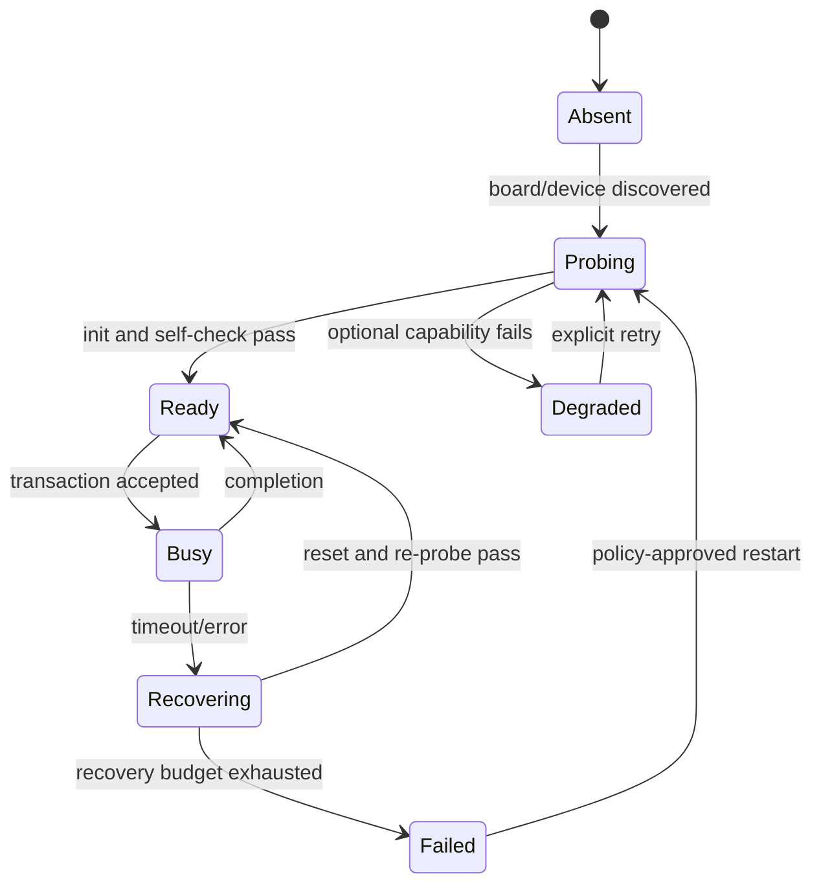

# 28 Embedded systems and the RTOS ecosystem: FreeRTOS, RT-Thread, and Zephyr

> 中文：[28 嵌入式系统与 RTOS 生态](../28-嵌入式系统与RTOS生态.md)

> An RTOS kernel provides fundamental mechanisms such as scheduling, synchronization, time, and memory. A deliverable embedded system must also define driver ownership, startup order, fault isolation, resource budgets, update paths, and observability.

<p align="center">
  
  <br><sub>▲ RTOS system layers and ecosystem selection. This is an original vector animation, not a measurement of any target.</sub>
</p>

<!-- video:ch28 -->
<p align="center">
  <video width="640" controls poster="../../assets/video/ch28-rtos-system.png">
    <source src="../../assets/video/ch28-rtos-system.mp4" type="video/mp4">
  </video>
  <br><sub>▲ Chinese voice-over, 3.0 min. Voice: Microsoft Edge neural voice zh-CN-XiaoxiaoNeural via edge-tts (library mostly LGPLv3; the voice model is an online Microsoft service, not an open model). Pictures are generated from this repo's SVGs, not photographs. Video: <a href="../../assets/video/ch28-rtos-system.mp4">MP4</a> · subtitles: <a href="../../assets/video/ch28-rtos-system.srt">SRT</a>. Rebuild with <code>python3 tools/gen_narrated.py --speak</code>.</sub>
</p>

**Narration script (Chinese, same text as the subtitles)**

1. RTOS 内核解决调度、同步、时间和基础内存问题，不会自动替你设计驱动所有权、启动顺序、升级和诊断。能创建任务，只说明底座能工作，不说明产品系统已经完成。
2. 选系统先列最坏响应、内存、驱动、网络和维护约束。功能少时裸机更容易证明；已有 Cube 工程常用 FreeRTOS；需要完整设备框架，再比较 RT-Thread 与 Zephyr。
3. 把执行上下文分成事件入口、实时控制、系统服务和管理策略。ISR 只取时间戳并发布事实；实时任务做有界计算；服务任务拥有设备；管理任务才决定重连、降级或重启。
4. 这张图展示从硬件、设备层、内核到系统服务和应用的分层。一个有状态外设只给一个所有者。其他任务发送完整事务，不要把片选、DMA 完成和超时恢复拆给多个调用者。
5. 实时性来自预算。区分响应、执行和端到端时延。一个事务只创建一个单调截止点。CPU 利用率小于一，只证明总时间没超额，不证明每个截止时间满足。
6. 队列、邮箱、事件和任务通知不能按名字互换。二值信号量表示事件，互斥量表示所有权并支持优先级继承。CMSIS RTOS2 统一接口名，不统一底层语义。
7. 启动别靠固定延时。先记录复位原因、版本和启动槽，再创建内核对象并探测关键设备，按依赖启动服务。安全前置条件全部满足后，才开放执行器和远程命令。
8. 每个任务自己喂狗会制造假健康。关键任务完成一轮有效工作后，只更新自己的健康纪元。监督者检查所有纪元、队列积压、内存水位和状态机，全部健康时才刷新硬件看门狗。
9. 把 WFI 放进 idle hook 只是入口。能否进入 Stop，还取决于截止点、DMA、Flash 和唤醒时钟。H7 的 M7 加 M4 通常按 AMP 设计，不是对称 SMP。
10. 合上书，三问。有状态外设应该有几个所有者？什么条件满足时，监督者才能刷新看门狗？系统迁移为什么先做硬件事件到任务输出的垂直切片？
<!-- /video:ch28 -->
## 📌 Goals

- [ ] Separate a **real-time kernel, an RTOS distribution, a device framework, and complete system services** instead of treating “a thread can run” as a finished design.
- [ ] Select bare metal, FreeRTOS, RT-Thread, or Zephyr from worst-case response, RAM/Flash, drivers, networking, security maintenance, and team constraints.
- [ ] Divide ISR, real-time, service, and management work, and assign one owner to every shared stateful resource.
- [ ] Build task-stack, queue, heap, CPU-utilization, and end-to-end latency budgets, then correct them with runtime evidence.
- [ ] Map FreeRTOS, RT-Thread, Zephyr, and CMSIS-RTOS2 objects without assuming that similarly named APIs have identical semantics.
- [ ] Design diagnosable startup, degradation, restart, and watchdog health proof instead of feeding the watchdog from every task.

---

## 🧭 Separate four concepts first

| Layer | What it owns | What it does not own automatically |
| --- | --- | --- |
| **Kernel** | thread scheduling, IPC, software timers, critical sections, memory allocation | board drivers, filesystems, networking, secure updates, logging policy |
| **RTOS components** | device model, network, filesystem, shell, packages, a POSIX subset | product requirements, resource budgets, recovery policy |
| **BSP / drivers** | startup, clocks, pins, peripherals, interrupts, DMA, cache | business frames, task ownership, end-to-end deadlines |
| **Product system** | state machines, control policy, data model, updates, evidence, acceptance | correctness cannot be delegated to an RTOS name |

**FreeRTOS Kernel** is a compact real-time kernel; projects normally combine networking, TLS, OTA, filesystems, and drivers themselves. **RT-Thread** adds a device framework, FinSH/MSH, DFS, SAL, and a package ecosystem. **Zephyr** integrates Kconfig, Devicetree, a device model, drivers, and many subsystems into one build system. All three can support a good product, and all three can be defeated by unclear ownership or unbounded waits.

> Decision order: write down hard constraints, inspect existing drivers and the maintenance horizon, and only then consider which API feels familiar.

## ⚖️ When to choose which system

| Constraint | Bare-metal foreground/background | FreeRTOS | RT-Thread | Zephyr |
| --- | --- | --- | --- | --- |
| Very small feature set; state machine can be enumerated | **good fit** | usable but possibly excessive | usually too heavy | usually too heavy |
| Cube/HAL project with limited concurrency | difficult after state growth | **common and direct** | viable | viable |
| Unified device access, shell, filesystem, and packages | build them yourself | compose them yourself | **strength** | **strength** |
| Chinese documentation, domestic MCU/BSP coverage, RT-Thread Studio | weak | broad community material | **strength** | board-dependent |
| Cross-vendor boards, Kconfig/Devicetree, protocol subsystems | manual integration | manual composition | device model and components | **strength** |
| Existing production code and certification evidence | preserving it is often lowest risk | freeze versions and evidence | freeze versions and evidence | freeze versions and evidence |
| Very long maintenance life | you own everything | freeze kernel and dependencies | freeze BSP/components/packages | freeze the west manifest and modules |

This table is not a ranking. Replacing a stable FreeRTOS product and its tested drivers with Zephyr merely because the ecosystem is broader can cost more than it returns. Conversely, assembling every layer manually around FreeRTOS can create long-term debt for a new product that needs several wireless chip families, a standard device model, and many protocol subsystems.

## 🧱 A four-layer execution model

| Layer | Typical execution context | Allowed work | Forbidden work |
| --- | --- | --- | --- |
| Event entry | ISR, DMA callback | timestamp, clear hardware condition, publish a fixed-size event | wait for locks, allocate dynamically, format large logs, access slow devices |
| Real-time control | high-priority periodic task | read snapshots, run control, write actuator commands | DNS/TLS, Flash erase, unbounded logging, waiting for low-priority services |
| System services | driver owner, network, storage, logging task | serialize device access, execute bounded transactions, return results | hold locks for a long time, retry forever, swallow errors silently |
| Management policy | state machine, update, diagnostic task | decide reconnect, degradation, restart, and persistence policy | let several contexts race for the same hardware |

Core invariants:

1. **An ISR publishes facts; it does not execute policy.**
2. **A stateful peripheral has one owner.** Other tasks send commands instead of calling HAL concurrently.
3. **Every wait has a deadline.** A timeout returns to the policy layer; a low layer does not retry forever.
4. **Every queue has a full policy.** Drop newest, drop oldest, apply backpressure, or enter a fault explicitly.
5. **Every layer crossing retains a correlatable sequence, timestamp, and result code.**

### An owner task is easier to prove than scattered mutexes

Consider an SPI Flash. If several tasks call `HAL_SPI_TransmitReceive()` directly, a mutex around each call can still split chip select, commands, DMA completion, and recovery. A stronger boundary is:

```c
typedef enum { FLASH_READ, FLASH_WRITE, FLASH_ERASE } flash_op_t;

typedef struct {
    flash_op_t op;
    uint32_t address;
    void *buffer;
    size_t length;
    TaskHandle_t requester;
    uint32_t sequence;
} flash_request_t;

/* Only flash_task may touch SPI, CS, and DMA state. */
static void flash_task(void *argument)
{
    flash_request_t req;
    (void)argument;
    for (;;) {
        if (xQueueReceive(g_flash_requests, &req, portMAX_DELAY) != pdTRUE) {
            continue;
        }
        flash_result_t result = flash_execute_until(&req, xTaskGetTickCount() + pdMS_TO_TICKS(500));
        xTaskNotify(req.requester, pack_result(req.sequence, result), eSetValueWithOverwrite);
    }
}
```

A mutex is appropriate for a short, reentrant boundary. An owner task is appropriate for a transaction that includes chip select, DMA, a state machine, and recovery. It costs one message transfer and a queue budget; it buys a single writer for the state.

## ⏱️ Real time comes from budgets, not an RTOS name

### Three different times

| Time | Meaning | Common mistake |
| --- | --- | --- |
| Response time | event occurrence to task start | timing only ISR entry and ignoring higher-priority interference |
| Execution time | actual CPU time used by a task | substituting an average for a worst case; leaving logging enabled |
| End-to-end latency | sensor through actuator or network acknowledgement | assigning a timeout to every layer until their sum exceeds the product limit |

A conservative first utilization account for one core is:

$$U = \sum_i \frac{C_i}{T_i}$$

Here $C_i$ is worst-case execution time and $T_i$ is the period. $U<1$ says only that the known CPU demand does not exceed all available CPU time. It does **not** prove that deadlines are met; blocking, ISR load, cache misses, Flash waits, and priority relationships still belong in response-time analysis.

Example budget:

| Task | Period / trigger | Execution budget | Utilization |
| --- | ---: | ---: | ---: |
| Current-loop calculation | 1 ms | 80 µs | 8% |
| Sensor fusion | 10 ms | 420 µs | 4.2% |
| CAN service | event-driven, normalized to 2 ms | 70 µs | 3.5% |
| Log encoding | 100 ms | 1.5 ms | 1.5% |
| **Known task total** | — | — | **17.2%** |

Add ISR, kernel, protocol-stack, and worst-burst margins. These numbers are a reproducible calculation example, not measurements from any STM32.

### Periods, timeouts, and deadlines

- Wake periodic tasks from absolute release points so execution time does not accumulate into drift.
- Create **one monotonic deadline** per transaction and recompute remaining time before each wait.
- A timeout does not mean “retry once.” Only policy knows whether a retry is safe, how many are allowed, and whether it repeats an action.
- Tick conversion must handle upward rounding and overflow. A deadline shorter than one tick is not magically guaranteed by the kernel.
- Tickless idle changes tick generation while idle; it does not automatically reduce the power of every peripheral and board load.

## 🚨 Interrupt and kernel boundaries

Cortex-M exception priority and RTOS task priority are different spaces. Task priorities commonly use a larger number for higher priority; NVIC uses a smaller number. Never put a task-priority number into NVIC configuration.

| System | Typical ISR-safe entry | Must avoid |
| --- | --- | --- |
| FreeRTOS | `xQueueSendFromISR`, `vTaskNotifyGiveFromISR`, then `portYIELD_FROM_ISR` when needed | ordinary blocking APIs, mutexes, dynamic logs |
| RT-Thread | IPC/device callbacks documented as interrupt-safe; follow the port contract for `rt_interrupt_enter/leave` | waiting for IPC in ISR, invoking scheduling work with interrupts masked |
| Zephyr | ISR-ok APIs such as `k_sem_give`, or submit `k_work` | `K_FOREVER` waits and sleep-capable driver paths in ISR |
| CMSIS-RTOS2 | APIs explicitly documented as callable from ISR; wait must be zero | assuming every `os*` API is ISR-safe |

**First-divergence check:** did the hardware pending bit appear → is NVIC enabled → did the ISR run → was the event enqueued → did the target thread become ready → did the scheduler switch? Do not jump from “the task printed nothing” to “the RTOS is broken.”

## 🔄 IPC semantics matter more than names

| Intent | FreeRTOS | RT-Thread | Zephyr | CMSIS-RTOS2 |
| --- | --- | --- | --- | --- |
| Fixed-size message | Queue | message queue | `k_msgq` | Message Queue |
| Lightweight single-consumer notification | Task Notification | event/semaphore/mailbox, selected by payload | `k_event`/`k_sem`/`k_poll_signal` | Thread Flags |
| Counted resource | Counting Semaphore | semaphore | `k_sem` | Semaphore |
| Protect ownership | Mutex | mutex | `k_mutex` | Mutex |
| Multiple condition bits | Event Group | event | `k_event` | Event Flags |
| Defer ISR work | notification/queue to a task | IPC wakes a thread | `k_work`/workqueue | flags/queue wake a thread |

A mapping is not equivalence:

- A FreeRTOS task notification belongs to one task and is often lighter than a queue, but it is not a multi-receiver object.
- An RT-Thread mailbox carries a machine word; a message queue copies fixed-size messages.
- Zephyr work items share a worker thread; one blocking item delays other work on the same queue.
- CMSIS-RTOS2 standardizes names, not every scheduling detail, memory layout, or extension of the underlying kernel.
- A binary semaphore signals an event. A mutex represents ownership and supports priority inheritance. An initial value of one does not make them interchangeable.

## 🧠 Memory: stacks, kernel heap, C heap, and DMA are different

| Region | User | Main risk | Evidence |
| --- | --- | --- | --- |
| Thread stacks | call frames, local variables, saved context | worst call chain, printf/floating point, nested interrupts | fill-pattern watermark, overflow hook, deliberate stress |
| Kernel object pool/heap | TCBs, queues, timers | creation failure after startup, fragmentation | startup budget and runtime minimum-free record |
| C library heap | `malloc/new`, parts of libc | thread safety and double-counting with the RTOS heap | one allocator and an explicit locking policy |
| DMA buffers | shared by peripheral and CPU | reachability, alignment, cache coherence, ownership handoff | link map, address assertions, cache/MPU rules |
| Persistent region | Flash/backup SRAM | torn writes, incompatible versions, write amplification | two copies, CRC, version, fault injection |

Prefer creating long-lived production objects statically during initialization. If objects truly have dynamic lifetimes, define who allocates, who frees, how failure rolls back, and how a double free is detected. Returning empty data after `malloc` fails hides resource exhaustion; it is not recovery.

## 🟦 FreeRTOS V11.3.2: a compact kernel; compose the system

This chapter freezes **FreeRTOS Kernel V11.3.2**. The kernel supplies tasks, queues, mutexes, semaphores, notifications, event groups, software timers, and several heap implementations. It neither requires a device model nor supplies STM32 drivers, a shell, or a filesystem automatically.

A suitable project structure is:

```text
app/        product state machines and business protocols
services/   storage / network / update / log
drivers/    one owner and asynchronous transactions per peripheral
rtos/       FreeRTOSConfig.h, static objects, and hooks
bsp/        clocks, pins, interrupts, linker script, HAL/LL
```

### Configuration must be an auditable contract

Freeze and review at least:

- `configTICK_RATE_HZ`, `configMAX_PRIORITIES`, and `configUSE_PREEMPTION`;
- `configMAX_SYSCALL_INTERRUPT_PRIORITY` against implemented Cortex-M priority bits;
- static/dynamic allocation switches and the selected `heap_x.c`;
- stack-overflow, malloc-failure, idle, and tick hooks;
- software-timer task priority, stack, and command-queue length;
- tickless-idle prerequisites and wake timebase;
- whether the runtime-statistics clock is independent of the kernel tick.

V11 includes SMP scheduling support, but most STM32 Cortex-M projects still use a single-core port. An STM32H745 M7+M4 normally runs independent firmware on unlike cores, exchanges data through shared memory, and uses HSEM hardware semaphores for inter-core synchronization. Two cores do not make it symmetric multiprocessing.

### H745 inter-core collaboration: five contracts, not one “inter-core API”

HSEM provides atomic ownership and interrupt notification. It neither carries the payload nor maintains the Cortex-M7 data cache. Review an inter-core channel as five separate contracts:

| Layer | Freeze explicitly | Minimal fault injection and evidence |
| --- | --- | --- |
| Shared storage | An SRAM region reachable by both cores, its base, length, alignment, and structure layout; shared state must not hide in one core's private stack or linker section | Inject an out-of-range length, bad alignment, and illegal state; the receiver must reject them rather than continue dereferencing |
| Ownership and visibility | Single-writer/reader handoff; either map the shared region non-cacheable or perform target-specific clean/invalidate operations and memory barriers at publish/read boundaries | Update sequence and payload repeatedly; the reader may accept only data from one generation, and the cache policy must appear in the linker, MPU, and review record |
| Synchronization | HSEM ID allocation, owner, maximum hold time, notification path, timeout, and degradation action; releasing HSEM does not mean the business message was processed | Hold one HSEM deliberately or drop one notification; the peer must time out by its deadline and record a distinguishable cause |
| Message protocol | `magic`, version, length, sequence, state, and compatibility rules; a shared C structure is still an on-wire protocol | Inject an unknown version, truncated length, and duplicate sequence; the receiver should reject each with a distinguishable result |
| Startup and recovery | Which core initializes shared state, `ready`/generation values, heartbeat, resynchronization after one-core reset, and responsibility for whole-device reset | Freeze or reset M7 and M4 separately; the surviving core enters the specified degraded/safe state instead of waiting forever on an old generation |

This table is a design and acceptance protocol, not a claim that this repository has completed H745 hardware measurements. An HSEM or heartbeat timeout must choose an explicit retry, one-core restart, whole-device reset, or safe-output action; “keep waiting” is not a default recovery policy.

## 🟩 RT-Thread v5.3.0: kernel, device framework, and components

This chapter freezes **RT-Thread v5.3.0**. Its value to an STM32 project is not only its thread API: device access, component startup, shell, filesystems, and network abstraction can follow one framework.

### Objects and startup

- Threads: static `rt_thread_init` or dynamic `rt_thread_create`, followed by `rt_thread_startup`.
- IPC: semaphore, mutex, event, mailbox, and message queue.
- Timers: a hard-timer callback runs in tick/interrupt-related context; a soft timer runs in the timer thread. Blocking rules depend on the mode.
- Initialization: `INIT_BOARD_EXPORT`, `INIT_DEVICE_EXPORT`, `INIT_COMPONENT_EXPORT`, and `INIT_APP_EXPORT` place components in ordered startup levels.
- Configuration/build: `menuconfig` produces configuration; SCons organizes BSPs, components, and packages.

### Find a device, then use the framework boundary

```c
#include <rtthread.h>
#include <rtdevice.h>

static rt_device_t console_uart;

static int app_uart_init(void)
{
    console_uart = rt_device_find("uart2");
    if (console_uart == RT_NULL) {
        return -RT_ENOSYS;
    }
    rt_err_t error = rt_device_open(console_uart, RT_DEVICE_FLAG_RX_NON_BLOCKING);
    if (error != RT_EOK) {
        console_uart = RT_NULL;
        return error;
    }
    return RT_EOK;
}
INIT_APP_EXPORT(app_uart_init);
```

This demonstrates only lifecycle boundaries: find, open, and check failure. UART DMA, receive callbacks, and buffering must be verified in the v5.3.0 BSP driver; seeing `rt_device_read` does not prove identical blocking or timeout behavior across drivers.

The framework's benefit is unified objects and components. Its risk is equally clear: DFS, SAL, FinSH, packages, and a POSIX layer consume Flash/RAM, threads, and startup dependencies. Every enabled component enters the object, stack, and failure budgets.

## 🟨 Zephyr v4.4.2: configuration, hardware description, and subsystems build together

This chapter freezes **Zephyr v4.4.2**. Zephyr is more than another thread API:

- **Devicetree** describes hardware instances and boot-time properties: addresses, interrupts, GPIOs, clocks, and bus connections.
- **Kconfig** selects software capabilities, dependencies, and parameters, generating `CONFIG_*`.
- The **device model** binds Devicetree instances to driver objects.
- **west + CMake + Ninja** manage the application and pinned multi-repository modules.

### Devicetree describes hardware; Kconfig selects software

```dts
/ {
    aliases {
        status-led = &user_led;
    };

    leds {
        compatible = "gpio-leds";
        user_led: led_0 {
            gpios = <&gpioa 5 GPIO_ACTIVE_HIGH>;
        };
    };
};
```

```c
#include <zephyr/device.h>
#include <zephyr/drivers/gpio.h>
#include <zephyr/kernel.h>

static const struct gpio_dt_spec led = GPIO_DT_SPEC_GET(DT_ALIAS(status_led), gpios);

int main(void)
{
    if (!gpio_is_ready_dt(&led)) {
        return -ENODEV;
    }
    int error = gpio_pin_configure_dt(&led, GPIO_OUTPUT_INACTIVE);
    if (error != 0) {
        return error;
    }
    for (;;) {
        gpio_pin_toggle_dt(&led);
        k_msleep(500);
    }
}
```

A Devicetree node does not prove that the device is ready; driver initialization can fail. Copying register addresses into the application to bypass the device model throws away a coherent boundary for board migration, power management, and ownership.

### A workqueue is not a free thread

`k_work` is useful for deferring ISR follow-up to thread context. The system workqueue is shared: a slow item delays every other item on that queue. Network, storage, or uncontrolled blocking belongs in a dedicated workqueue or owner thread with its own stack and priority budget.

## 🟪 CMSIS-RTOS2 2.3.0: one interface, not one implementation

CMSIS 6.4.0 carries **CMSIS-RTOS2 API 2.3.0**. Typical startup includes:

```c
osKernelInitialize();
osThreadId_t worker = osThreadNew(worker_main, NULL, &worker_attributes);
if (worker == NULL) {
    system_init_fail(INIT_THREAD_CREATE);
}
osKernelStart();
```

CMSIS-RTOS2 can reduce direct application coupling to one kernel's function names and supports CMSIS-FreeRTOS or RTX5. A migration still must check:

- how priority enums map to the underlying kernel;
- stack-size units and alignment;
- which APIs are callable from ISR;
- full/timeout behavior of thread flags, event flags, and message queues;
- size and alignment of static control blocks and message storage;
- whether product code still relies on kernel extensions such as task notifications or stream buffers.

Wrapping heavily used kernel extensions with similarly named functions does not create portability.

## 🔌 Driver lifecycle: initialization is only the first state

A recoverable driver needs at least:



Every transition needs a trigger, maximum duration, resource cleanup, result code, and log fields. `HAL_OK`, `RT_EOK`, or `device_is_ready()` proves only its own boundary—not plausible sensor data, persisted Flash content, or remote business acknowledgement.

## 🚀 Startup order: prove the base before opening services

A useful startup gate is:

1. **Reset evidence:** record reset reason, firmware version, boot slot, and persistent-state version.
2. **Minimum hardware:** clocks, power monitor, memory, watchdog; failure remains in a diagnosable safe state.
3. **Kernel objects:** static queues, threads, events, and pools; any failure blocks normal operation.
4. **Device probe:** critical devices must pass; optional devices enter an explicit degraded state.
5. **Services:** logging, storage, networking, time, and update start in dependency order.
6. **Application gate:** actuators and remote commands open only after every safety prerequisite passes.

Do not simulate a dependency with a fixed delay and assume that the network has an address after `delay(500)`. Wait for a result-bearing state event under a system deadline.

## 🩺 Observability: reduce a fault to the first divergence

Every critical log needs at least:

```text
monotonic_ms | boot_id | component | event | state | sequence | result | detail
```

- `monotonic_ms` orders events within one boot despite RTC corrections.
- `boot_id` separates sequence-number reuse across resets.
- `sequence` follows an event through ISR, queue, driver transaction, and protocol acknowledgement.
- `result` is a stable enum, not only free text.
- `detail` can contain register snapshots or protocol errors, never private keys or passwords.

### Only the health supervisor feeds the watchdog

Letting every task feed the watchdog can report false health while the product is dead. A stronger design is:

1. Each critical task updates its health epoch only after completing meaningful work.
2. A supervisor checks every epoch, queue backlog, memory watermarks, and critical state machines.
3. It refreshes the hardware watchdog only when all health conditions pass.
4. On failure, it persists a minimal bounded fault summary and lets the watchdog reset; persistence also has a deadline.

## 💤 Low power with an RTOS

An RTOS can enter idle when no task is ready, but Stop eligibility depends on the whole system:

- Does the nearest software deadline permit sleep?
- Is DMA, Flash erase, the network PHY, or another peripheral transaction active?
- Which clock remains available for sleep and wake?
- After wake, are the HAL timebase, PLL, cache, peripherals, and network state restored?
- Is the tickless compensation clock accurate enough?

Putting `WFI` in the idle hook is only an entry instruction, not a low-power policy. The mode–wake–restore evidence from chapters 16 and 24 still applies.

## 🧩 Dual core and SMP are not the same thing

| Mode | Property | New primary risks |
| --- | --- | --- |
| Single-core preemption | only one task runs at a time | priorities, blocking chains, ISR load |
| SMP | one OS schedules equivalent cores | spinlocks, memory ordering, affinity, concurrency defects |
| AMP / heterogeneous dual core | each core runs independent firmware or an OS | startup order, shared memory, cache, inter-core interrupt, protocol version |

Recent FreeRTOS and RT-Thread versions have multicore capabilities, and Zephyr supports SMP on selected platforms. Support depends on the target, port, and frozen version. The M7 and M4 in a dual-core STM32H7 are not equivalent; they are normally designed as AMP. Shared memory needs ownership and cache maintenance, and inter-core messages need version, length, and timeout fields.

## 🔁 Migrating from one system to another

Do not mechanically replace functions. Instead:

1. Inventory every thread, ISR, IPC object, timer, dynamic object, and driver owner.
2. Record blocking, timeout, wake, fairness, priority-inheritance, and deletion semantics for every object.
3. Migrate one vertical slice first: hardware event → IPC → task → observable result.
4. Replay the same inputs and compare latency, stack watermarks, queue peaks, and fault paths.
5. Migrate large network and storage components later, changing one ownership boundary at a time.
6. Remove old adapters and double initialization; do not maintain two kernel APIs indefinitely.

The hardest part is usually not which call replaces `xQueueSend`. It is undocumented behavior: what happens when a queue is full, what locks do when a task is deleted, where timer callbacks execute, and whether a driver assumes thread-local state.

## 📐 A reproducible system resource account

For an STM32 with 256 KiB SRAM, begin with a static budget:

| Item | Count × unit | Budget |
| --- | ---: | ---: |
| 8 thread stacks | `8 × 2 KiB` | 16 KiB |
| Network RX/TX buffers | `16 × 1.6 KiB` | 25.6 KiB |
| Message queues and object storage | total | 12 KiB |
| Filesystem workspace | total | 8 KiB |
| TLS peak workspace | fixed configuration / measurement | 64 KiB |
| DMA non-cacheable region | aligned total | 16 KiB |
| Global static data | link map | 28 KiB |
| Reserved fault dump | fixed | 8 KiB |
| **Allocated** | — | **177.6 KiB** |
| **Unallocated margin** | `256 - 177.6` | **78.4 KiB** |

This is a calculation example. A real project must update it from the link map, per-thread minimum stack margin, kernel-heap minimum free space, and TLS/network peaks. A currently free 78.4 KiB is not automatically a long-term safety margin; burst queues, certificate chains, and update double buffers can change the peak.

## ⚠️ Common failure modes

| Symptom | First hypothesis | Distinguishing experiment |
| --- | --- | --- |
| A high-priority task still runs late | higher-priority ISR/task interference or lock blocking | record ISR occupancy, task switches, and mutex hold time separately |
| Object creation fails after hours | leak or fragmentation, not “kernel instability” | loop a fixed input; record minimum heap and object counts |
| Control jitter appears after networking starts | network priority/critical section or cache/DMA path changed | disable logs, then network traffic, then network thread; compare DWT distributions |
| A Zephyr device object exists but is unusable | node exists but driver init failed | check `device_is_ready`, startup logs, and dependency devices |
| RT-Thread `rt_device_find` returns null | device not registered, component disabled, or name differs | list devices and inspect configuration/init level before changing application code |
| Priority order changes after a CMSIS migration | abstraction priority mapping differs | log actual priority and ready order for every thread |
| Watchdog does not reset although the product is dead | the wrong context still refreshes it | allow only the supervisor to feed; block each critical task deliberately |
| Time drifts after tickless is enabled | low-power clock or compensation boundary | record monotonic tick, RTC, and an external reference edge together |

## 🧪 Four progressive labs

### Lab 1: reconcile object semantics

Create a depth-two message queue on the current RTOS. Send three messages and verify non-blocking, finite blocking, and indefinite-wait results. Record return codes, elapsed time, and final ordering. The goal is to know how “queue full” reaches policy, not to memorize names.

### Lab 2: owner task versus concurrent direct calls

Let two tasks access one SPI/I2C device. First protect individual driver calls; then replace that design with an owner task receiving complete transactions. Trigger a second request before DMA completes. The owner version should return stable busy/queued/timeout results without crossing chip-select or state-machine phases.

### Lab 3: fault injection and supervised watchdog

Freeze the control, network, and logging tasks one at a time. The health supervisor must distinguish failures, retain the corresponding state summary, and stop refreshing the watchdog. Acceptance is not merely “it reset,” but evidence of which health condition failed first after reboot.

### Lab 4: one vertical slice on two systems

Keep the current FreeRTOS, RT-Thread, or Zephyr system and choose one other. Implement only GPIO interrupt → fixed-size event → worker thread → UART result. Hold input frequency and log schema constant. Compare object semantics, configuration, stack budget, and ISR boundaries before touching networking or filesystems.

## ✅ Selection review checklist

- [ ] The target MCU/board has a maintainable BSP and every critical driver in the frozen version.
- [ ] Flash, SRAM, thread stacks, network/TLS peaks, and update buffers have budgets.
- [ ] Worst response and end-to-end deadlines have a measurement plan, not merely the word “real-time.”
- [ ] Every stateful peripheral and protocol connection has one owner.
- [ ] Every queue, pool, and retry path has a bound and a full/exhaustion policy.
- [ ] ISR-safe APIs, NVIC priorities, and kernel critical-section rules are reconciled.
- [ ] Startup dependencies, degraded states, recovery budgets, and watchdog health conditions form a state machine.
- [ ] Kernel, BSP, components, toolchain, and dependency repositories are pinned.
- [ ] CVEs, errata, and upstream fixes have a continuing evaluation and upgrade path.
- [ ] Migration or upgrade can replay the same inputs, latency, stack, and fault-injection evidence.

## 🧾 Close the book: ten questions

1. What separates FreeRTOS Kernel from broader ecosystems such as RT-Thread and Zephyr?
2. Why can one mutex per driver call still be harder to prove than an owner task?
3. Why does CPU utilization $U<1$ not prove that every task meets its deadline?
4. Which evidence must survive between ISR and task to locate the first divergence?
5. What is the critical semantic difference between a binary semaphore and a mutex?
6. What should Devicetree describe, and what should Kconfig select?
7. Why does CMSIS-RTOS2 not guarantee identical behavior after changing kernels?
8. Why does tickless idle not prove that the whole board reaches its lowest-power state?
9. Why is an STM32H745-class M7+M4 normally not treated as symmetric SMP?
10. Under which conditions should the health supervisor refresh the hardware watchdog?

## 🔗 Authoritative sources and frozen versions

- **FreeRTOS Kernel V11.3.2:** official release; scheduling, queues, mutexes, notifications, memory, tickless operation, and SMP are frozen to this version and the official developer documentation.
- **RT-Thread v5.3.0:** official release and documentation center; kernel objects, device framework, component initialization, FinSH, DFS, SAL, and STM32 BSP behavior are version-bound.
- **Zephyr v4.4.2:** official bugfix release; Kernel Services, Kconfig, Devicetree, Device Driver Model, and the west manifest are frozen to 4.4.x documentation/source.
- **CMSIS 6.4.0 / CMSIS-RTOS2 2.3.0:** Arm official release and RTOS2 API documentation.
- **PM0056:** Cortex-M3 NVIC, exception model, and hardware priority boundary; other Cortex-M cores require their corresponding programming manuals.
- **RM0399:** dual-core architecture, shared memory, HSEM, startup, and reset boundaries for STM32H745/755 and STM32H747/757; register details must follow the target's current revision and errata.
- **Frozen `stm32h745xx.h`:** STM32CubeH7 commit `8ec3113d4039d30ba9dc2bf0cb6eefc756b48d06` points to CMSIS Device H7 commit `81db1ec63cdc191fae1565b772da3ea5aa29a683`; used to check HSEM interrupts, registers, and the peripheral inventory.
- Related chapters: [interrupts and NVIC](04-interrupts-nvic.md), [DMA](10-dma.md), [FreeRTOS](15-freertos.md), [low power](16-low-power.md), [debug](17-debug.md), and [networking](27-network.md).
