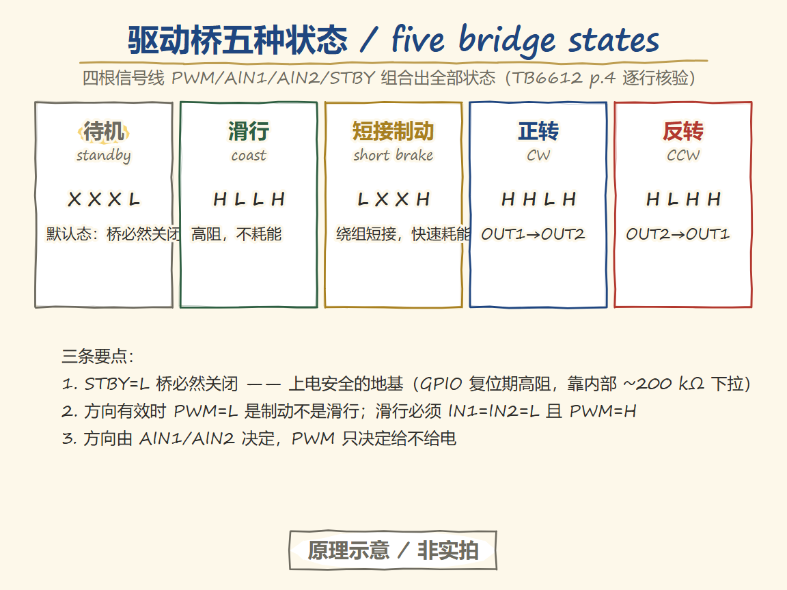
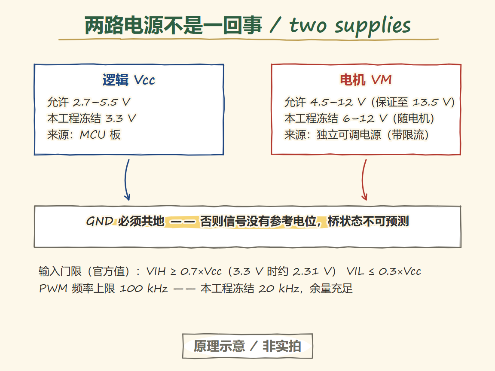
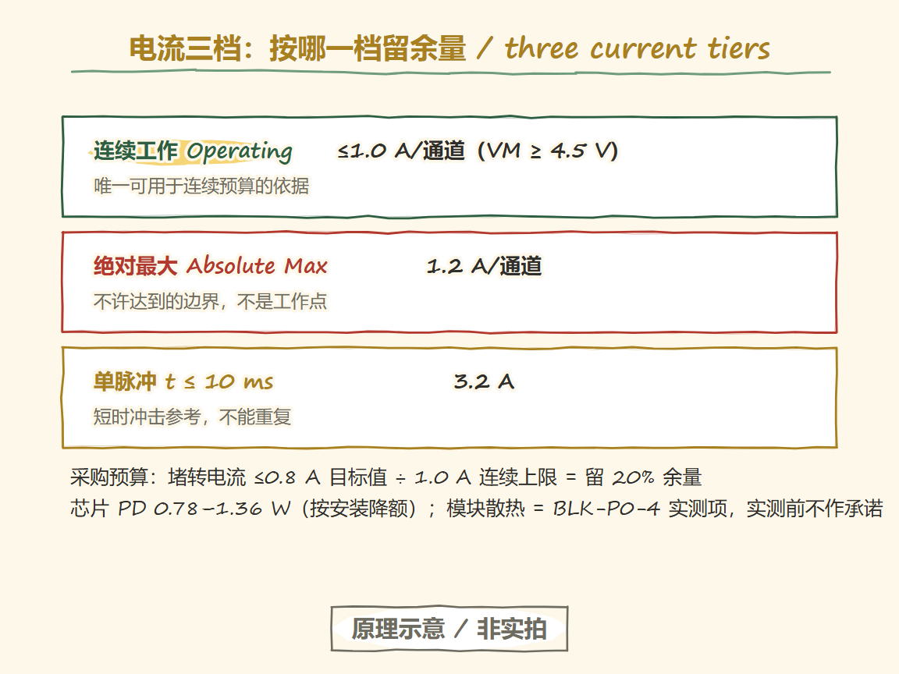
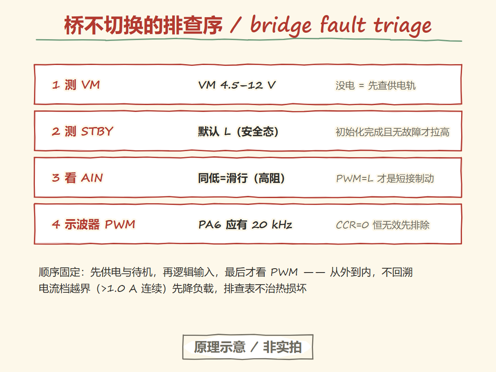

# 29 Motor drive and power: how MCU signals become motor current

> 中文：[电机驱动与供电](../29-电机驱动与供电.md)

> A GPIO pin delivers milliamps of logic level; a motor wants amps of power current. The drive bridge in between decides when the motor is energized and when it is absolutely not.

**Board-level premise of this chapter**: wiring and parameters follow procurement freeze v1.2 (`examples/motor-dc-speed/boards/f103c8-tb6612/`). Until the parts arrive and the P2 on-board verification passes, every pin and electrical value is a frozen candidate, not a verified fact. Program and command behavior refers to the built firmware in `examples/motor-dc-speed/` (STM32CubeF1 v1.8.6; all three ARM presets build locally and in CI).

## Learning goals

- [ ] Explain why a GPIO pin cannot drive a motor directly, and where the drive bridge sits in the circuit.
- [ ] Walk the five output states of an H-bridge — **CW, CCW, coast (high impedance), short brake, standby** — from the official truth table.
- [ ] Separate the logic supply from the motor supply and state the allowed voltage range of each.
- [ ] Distinguish **continuous operating current** from **absolute maximum / pulse current** in a chip rating, and know which row to budget against when buying a motor.
- [ ] List the conditions that keep the drive off at power-on, reset, and program-download time.

---

## The entry question

The program clearly outputs a high level — so why does the motor not turn, and why does the board keep resetting?

The most common answer is not in the program. An MCU pin delivers a few tens of milliamps at 3.3 V logic level, while a small DC motor draws hundreds of milliamps to amps at the instant it starts. Connect a GPIO straight to a motor and, at best, the pin voltage collapses and the MCU resets; at worst, the pin burns out. The correct path is: **GPIOs carry only control signals; power current flows through the drive bridge and a separate motor supply**.

This chapter makes the bridge layer precise: which states it has, which state is the default, and the current path of each stopping state. Before the motor is wired, you must be able to prove that at all three moments — power-on, reset, and code download — the drive never energizes the motor.

## Minimal victory (M29-A: logic-side power and reset check)

**Goal**: motor not connected, logic side only. After power-on, pressing reset, and re-downloading the program, the drive stays off.

1. Wire the logic side per the wiring table: module Vcc to 3.3 V, common ground, STBY/AIN1/AIN2/PWM to their GPIOs; leave **VM (motor supply) disconnected** for now.
2. Power on and measure the VM terminal with a multimeter: it should read 0 V (or near 0 V).
3. Measure the STBY pin: this chapter's firmware pulls STBY low during init, so the reading should be near 0 V.
4. Press reset, re-download the program, and repeat steps 2 and 3 both times.

**Expected evidence**: at all three moments VM has no output and STBY is low — the drive is in standby. The TB6612 STBY pin has an internal pull-down of about 200 kΩ, so it enters standby even when floating — but that is no excuse to skip external initialization.

> Status: this chapter's experiments (M29-A/B/C) run only after the parts arrive and pass the hardware gate; they are candidate steps for now. M29-B (limited-current trial spin) and M29-C (supply-droop observation) must come after M29-A passes.

## How the drive bridge switches among five states

  
   ▲ Knowledge track (Handraw · 原理示意 / not a photo). PWM/AIN1/AIN2/STBY compose standby/coast/short-brake/CW/CCW (TB6612 p.4, row-by-row); STBY=L is the default safe state; PWM=L with a valid direction is brake, not coast; not a photo.

Four MCU signal lines (PWM, AIN1, AIN2, STBY) compose every state of the bridge. This table is the row-by-row verified version of the Toshiba TB6612FNG datasheet (2026-05-13 revision) H-SW Control Function table, page 4:

| PWM | AIN1 | AIN2 | STBY | Output state (channel A shown) |
| --- | --- | --- | --- | --- |
| H | H | L | H | CW (current OUT1→OUT2) |
| H | L | H | H | CCW (current OUT2→OUT1) |
| H | L | L | H | High impedance (coast) |
| L | X | X | H | Short brake (outputs shorted, fast energy dump) |
| X | X | X | L | Standby (high impedance + most circuits off, power saving) |

Three points matter most:

1. **Standby is the default state.** With STBY=L the bridge is necessarily off — this is the foundation of power-on safety. While the STM32 is in reset its GPIOs are high-impedance inputs, and the driver chip's internal pull-down holds the bridge in the off state.
2. **"PWM low" is not coast.** With a direction already applied (AIN1≠AIN2), PWM=L is **short brake**: the motor is shorted through its own windings, back EMF produces a reverse torque, and it decelerates hard — but with regenerative current spikes. To coast you must set IN1=IN2=L with PWM=H, or pull STBY low.
3. **Direction comes from AIN1/AIN2; PWM only decides "energize or not".** So 0% duty with a valid direction is braking, not de-energizing — this decides which semantics your stop routine uses.

This chapter's firmware collects these semantics in `src/motor_bridge.c`: the upper layer passes only "signed duty + enable", and every rule that maps to pin levels lives in this one file; the host tests verify this table line by line.

### Logic supply and motor supply are two different things

  
   ▲ Knowledge track (Handraw · 原理示意 / not a photo). Vcc 2.7–5.5 V (frozen 3.3 V) and VM 4.5–12 V (frozen 6–12 V) are separate rails sharing one ground; VIH ≥ 0.7×Vcc, PWM ceiling 100 kHz; not a photo.

| Supply rail | TB6612 allowed range | This project's frozen value | Source |
| --- | --- | --- | --- |
| Logic Vcc | 2.7–5.5 V | 3.3 V | MCU board |
| Motor VM | 4.5–12 V (guaranteed to 13.5 V) | 6–12 V (set with the motor) | Independent adjustable supply |

The two supplies must share a ground, otherwise the PWM/direction signals have no reference and the bridge state is unpredictable. Input thresholds follow the official values: VIH ≥ 0.7×Vcc (about 2.31 V at 3.3 V supply), VIL ≤ 0.3×Vcc, and a PWM frequency ceiling of 100 kHz — this project freezes 20 kHz, a wide margin.

### Three current ratings: never read the maximum as continuous capability

  
   ▲ Knowledge track (Handraw · 原理示意 / not a photo). Only the ≤1.0 A/channel operating tier budgets continuous run; 1.2 A absolute maximum and 3.2 A pulse tier are not continuous bases; stall ≤0.8 A target keeps 20% margin; module dissipation is the BLK-P0-4 measurement item; not a photo.

A motor-driver chip carries three different current numbers for three different purposes:

| Tier | TB6612 official value | What it is for |
| --- | --- | --- |
| Operating range | ≤1.0 A per channel (VM ≥ 4.5 V) | The **only** basis for continuous-run budgeting |
| Absolute maximum | 1.2 A per channel | A boundary you must never reach, not an operating point |
| Single pulse (t ≤ 10 ms) | 3.2 A | Short transient reference; must not repeat |

Budget the motor purchase against the continuous tier: this project's frozen spec targets a stall current ≤0.8 A, leaving 20% margin against the 1.0 A continuous ceiling. How long stall may last, and how much power the module PCB can dissipate (the chip itself is rated PD 0.78–1.36 W, derated by mounting conditions), is the thermal-budget item BLK-P0-4 — it stays frozen and uncommitted until measured.

### Inrush and stall current

A stationary motor has zero back EMF, so the starting current is limited only by winding resistance and supply internal resistance — typically several times the rated current. Two consequences: the supply voltage dips momentarily (the MCU can brown out and reset), and the driver chip heats. Countermeasures: an adjustable supply **with current limiting**, decoupling near the driver (the official typical application puts 0.1 µF + 10 µF on the VM side), and a low-duty ramp-up in software. A stalled shaft behaves the same — continuous stall must stay within the continuous operating current tier.

### Regeneration and current return

During deceleration or braking the motor becomes a generator, and current flows back into the supply through the driver's freewheeling diodes (official VF ≤ 1.1 V). If the supply cannot absorb that energy, the bus voltage rises. This project's measures and observation items are recorded in the hardware dossier; the quantitative observation is M29-C, and no conclusion is written here before it runs.

## Failure branches and shortest diagnosis

  
   ▲ Knowledge track (Handraw · 原理示意 / not a photo). Fixed order: VM → STBY → AIN logic → PWM scope, outside-in without backtracking; current-tier violation means unloading first; not a photo.

| Symptom | Distinguishing evidence | Next action |
| --- | --- | --- |
| Logic signals toggle but the motor does not turn | Measure STBY: low = standby not released; measure VM: no voltage = motor supply missing | Release STBY first (the firmware raises it after ARM), then check VM wiring |
| MCU resets the moment power is applied | Measure the 3.3 V rail droop at motor start | Disconnect the motor to verify first; then decide between supply internal resistance / current limiting and software driving outputs at boot |
| Driver runs hot and protects immediately | Touch the chip / measure whether current exceeds the 1.0 A continuous tier | Lower the duty cycle; check the motor stall current against the frozen spec |
| Motor hums but does not turn | Insufficient torque at low duty, or mechanical jam | Turn the shaft by hand to rule out jam; try a higher duty under current limit (M29-B conditions) |

## Transfer boundary

- **Changing the driver chip or module**: re-check the official truth table and the power-on default state. Different chips define the "PWM=L" semantics differently (coast / brake / off are all possible); the mapping table in `motor_bridge.c` must be rewritten and the host truth-table tests re-run.
- **Changing the motor**: re-check the stall-current margin against the continuous tier, the VM range, the gear ratio, and the encoder PPR.
- **Changing the MCU**: re-check pin alternate functions (this project's mapping comes from the wiring table, source DS5319 Rev 20 page 29), timer clock, and counter width.
- A chip datasheet rating ≠ a module's continuous thermal capability. The module PCB's copper area and whether a heatsink exists decide how much current it can actually carry continuously — exactly what the thermal budget (BLK-P0-4) exists to measure.

## Memory anchor

**"The drive bridge is the traffic light for current; the MCU only presses the button, it never carries the cargo."**

Where it holds: signals (lights) and power flow (cars) are fully separated; with the light off (STBY=L) no direction lets traffic through.
Where it breaks: a real bridge has five states, not two — "light off" still splits into coast and brake with different energy paths; and after changing chips the light logic can change entirely, so the table must be re-read.

## Experiment register

| Experiment | Content | Hardware gate | Status |
| --- | --- | --- | --- |
| M29-A | Logic side stays off at power-on / reset / download | None | Pending (parts not arrived) |
| M29-B | Short trial spin at low duty under current limit | M29-A passed + supply current limiting | Pending |
| M29-C | Supply droop observation at start / brake | M29-B passed | Pending; instrument gap see BLK-P0-3 |

## Exit check

1. Without the table, name the three stopping states — **standby** (STBY=L, high impedance + power saving, the default), **coast** (IN1=IN2=L with PWM=H, high impedance, no energy dump), **short brake** (valid direction + PWM=L, windings shorted, fast deceleration) — and the current path of each.
2. Explain why the motor can still coast after enable is removed (coast and standby produce no braking torque).
3. Point at the source pin and threshold condition of every signal line in this chapter's wiring table, and explain why a GPIO cannot replace the drive bridge (the current tiers differ by two orders of magnitude).

## Sources

- TB6612FNG official datasheet (2026-05-13 revision) truth table and electrical limits: [source: tb6612-truth-table](#source-tb6612-truth-table), [source: tb6612-electrical](#source-tb6612-electrical), [source: tb6612-current](#source-tb6612-current)
- STM32F103C8T6 pin alternate functions: [source: ds5319-af](#source-ds5319-af)
- Firmware and frozen configuration: `examples/motor-dc-speed/` (protocol and telemetry in that directory's README)
