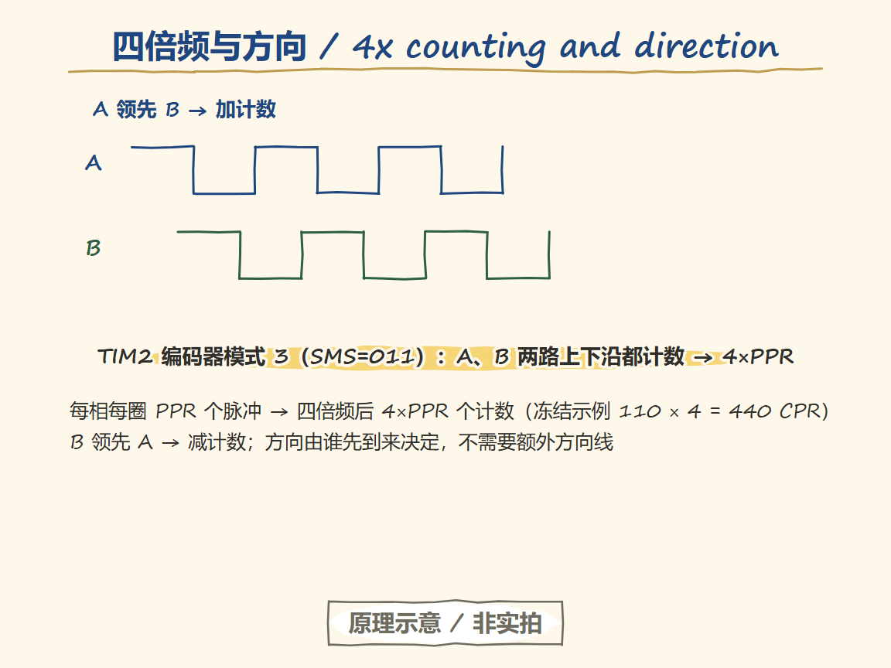
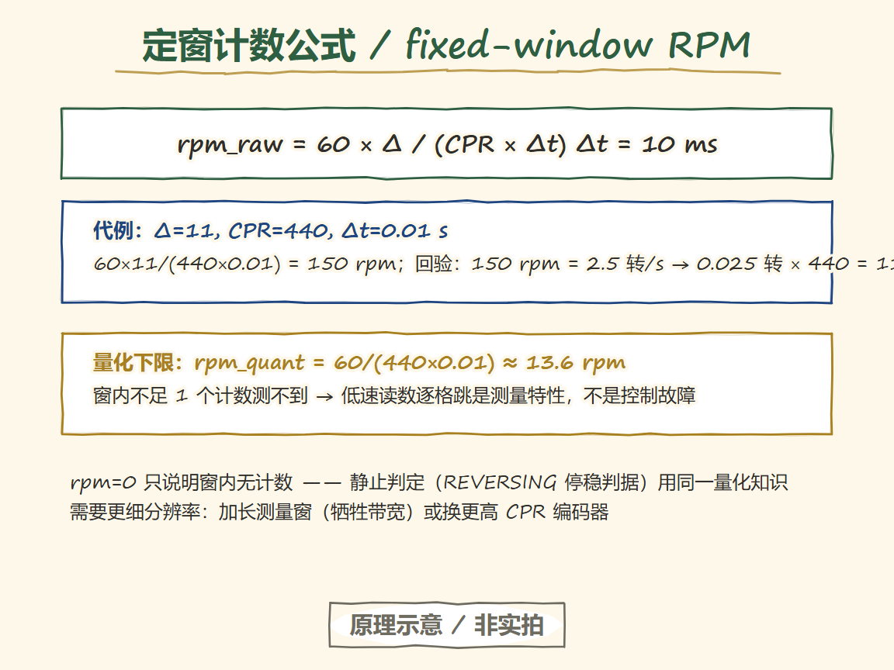
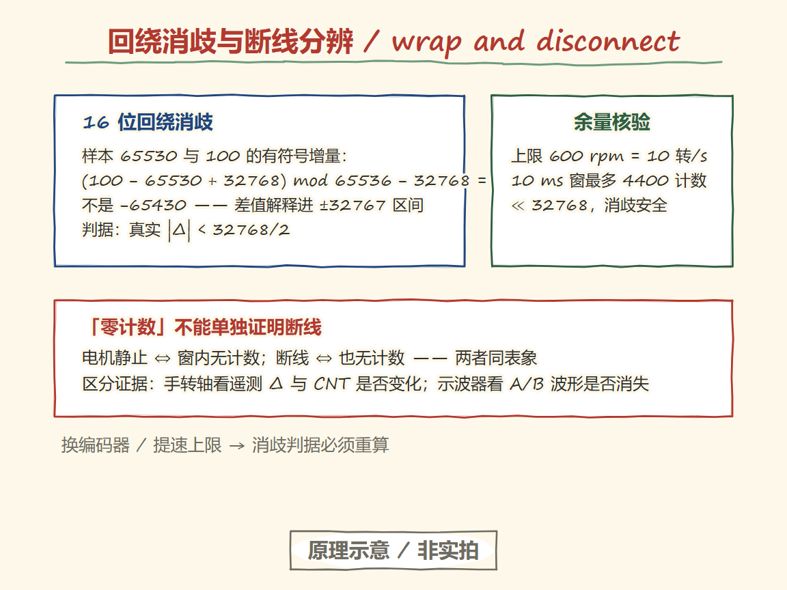

# 31 Encoders and RPM measurement: from pulse counts to a trustworthy RPM

> 中文：[编码器与转速测量](../31-编码器与转速测量.md)

> An encoder only gives you pulses. Get any one of three things wrong — pulses per revolution, the division window, or count disambiguation — and the computed speed is "consistently wrong".

**Board-level premise of this chapter**: wiring and parameters follow procurement freeze v1.2 (candidate values, verified at P2 on-board bring-up). The measurement and validity code referenced here lives in `examples/motor-dc-speed/src/encoder.c` and `src/speed_estimator.c`.

## Learning goals

- [ ] Explain why an A/B quadrature encoder can sense direction, and where 4x counting comes from.
- [ ] Separate three quantities — motor-shaft PPR, gear ratio, output-shaft CPR — and know which shaft "one revolution" refers to.
- [ ] Recompute RPM with the fixed-window formula, and compute the lowest trustworthy speed for a given CPR and sample period.
- [ ] Handle counter wrap: given two 16-bit counts that straddle a wrap, compute the signed delta by hand.
- [ ] Explain why "zero counts at rest" alone cannot prove the encoder cable is broken.

---

## The entry question

The A and B pulses on the scope look right — so why is the program's speed exactly 4× off, or off by one gear ratio?

The two "multipliers" have different origins:

- **4× off**: you counted only the rising edges of one channel, while the firmware counts rising and falling edges of both A and B (4x decoding). Neither side is wrong; the difference is counting convention.
- **One gear ratio off**: the encoder sits on the **motor shaft**, but you compute per **output-shaft** revolution. A gearmotor has a gearbox in between: the motor shaft turns N times per output-shaft turn. Your "revolution" and the pulses' "revolution" are not the same shaft.

Fix the convention first: in this chapter, CPR = **counts per output-shaft revolution**. The frozen example rig uses CPR = 440 (110 PPR per phase × 4x decoding), with a 600 rpm ceiling and a 10 ms control period; every formula below recomputes cleanly from those numbers.

## Minimal victory (M31-A: hand-turn calibration)

**Goal**: no power to the motor; hand-turn the output shaft a set number of turns; the accumulated count matches turns × CPR with the correct sign.

1. Put the firmware in calibration mode (CPR written, loop not enabled) and open telemetry over the serial port.
2. Mark the output shaft and turn it slowly by hand for 3 full turns (slowly, to avoid contact bounce).
3. Read the accumulated count from telemetry: it should be close to ±3 × 440 = ±1320, with the sign matching the turn direction.
4. Turn back 1 revolution: the count should walk back by about 440.

**Expected evidence**: deviation between accumulated value and hand turns under 5%. A large deviation means the PPR convention or gear-ratio memory is wrong — go read the motor's datasheet page; do not fudge the formula to fit.

> Status: M31-A/B/C/D run only after the parts arrive; they are candidate steps for now. Until calibration passes, the firmware boots with CPR=0 and the closed loop is locked out by the F06 fault bit (the default safe behavior).

## Core ideas

### 4x counting and direction


<p align="center">
  
  <br><sub>▲ Knowledge track (Handraw · 原理示意 / not a photo). TIM2 encoder mode 3 (SMS=011) counts both edges on both channels → 4×PPR; frozen example 110×4 = 440 CPR; A leading B counts up; not a photo.</sub>
</p>
A quadrature encoder produces two channels 90° apart. In timer encoder mode (this project uses TIM2, SMS=011, encoder mode 3: counting on both edges), the counter increments when A leads B and decrements when B leads A — after 4x decoding, PPR pulses per channel per turn become 4×PPR counts. The full timing of edge counting and direction is in [RM0008 Rev 21](#source-rm0008-encoder) encoder-interface section.

### The fixed-window formula


<p align="center">
  
  <br><sub>▲ Knowledge track (Handraw · 原理示意 / not a photo). rpm = 60×Δ/(CPR×Δt); Δ=11, CPR=440, 10 ms → 150 rpm, checked backwards; quantization floor 60/(440×0.01) ≈ 13.6 rpm, stepwise low-speed readings are a measurement property; not a photo.</sub>
</p>
For a count delta Δ over the control period Δt (10 ms in this project):

```text
rpm_raw = 60 × Δ / (CPR × Δt)
```

Frozen example: Δ=11, CPR=440, Δt=0.01 s → 60×11/(440×0.01) = 150 rpm. Check backwards: 150 rpm = 2.5 rev/s → 0.025 rev per 10 ms × 440 = 11 counts ✓.

### Low-speed quantization: the floor is set by resolution

Δ is an integer. A change below 1 count within a 10 ms window is invisible, so the lowest speed a single window can resolve is:

```text
rpm_quant = 60 / (CPR × Δt) = 60/(440×0.01) ≈ 13.6 rpm
```

In the firmware, `se_quantization_rpm()` returns exactly this value. When the speed lands near the quantization step, the RPM reading jumps one step at a time — a measurement property, not a control fault; if needed, lengthen the measurement window (giving up bandwidth) or use a higher-CPR encoder. The standstill criterion (the REVERSING contract) uses the same knowledge: rpm=0 only means "no counts in this window".

### Wraparound and the maximum trustworthy speed


<p align="center">
  
  <br><sub>▲ Knowledge track (Handraw · 原理示意 / not a photo). Signed delta of 65530 and 100 is +6, not −65430; rule |Δ|<32768/2; zero counts alone cannot prove a disconnect — distinguish by A/B waveforms; not a photo.</sub>
</p>
TIM2 is a 16-bit counter wrapping at 0→65535. Comparing two samples requires **signed disambiguation**: interpret the difference into the ±32767 range (`enc_delta()`, 16-bit convention). The rule: the true |Δ| must be < 32768/2. This project's ceiling of 600 rpm = 10 rev/s gives at most 4400 counts per 10 ms window — far below 32768, so disambiguation is comfortably safe. Change the encoder or raise the speed ceiling, and this must be recomputed.

### Filtering and validity

Filtering is a first-order IIR: `rpm_filt += α × (rpm_raw − rpm_filt)`, with α=1 meaning no filter (the frozen default). Smaller α gives a smoother curve and more phase lag — closed-loop bandwidth drops with it, so chapter 32 treats α as a known parameter during tuning.

Validity is enforced in three tiers (F02/F03):

| Condition | Verdict | Consequence |
| --- | --- | --- |
| CPR=0 | Illegal configuration (F06) | ARM refused; the loop never engages |
| Δt=0 or >100 ms | This sample invalid (F02) | Not delivered to the PI; baseline not refreshed |
| |Δ| implies a speed above the 600 rpm ceiling | Abnormal jump (F02); not delivered to the PI |
| No valid feedback for 500 ms continuously | Feedback lost (F03) | Fault latched; drive stops |

## Failure branches and shortest diagnosis

| Symptom | Distinguishing evidence | Next action |
| --- | --- | --- |
| Count stays zero | Turn the shaft by hand; do telemetry Δ and CNT change? | Changes = the program reads the wrong window; no change = check wiring / supply / pull-ups |
| Counts in only one direction | Counts forward, holds in reverse | Bidirectional counting not enabled; check the SMS bits and that both channels go to TIM2_CH1/CH2 |
| Sign flipped | Forward rotation shows negative rpm | A/B swapped; swap the wires or negate in software — pick one and record it |
| rpm spikes at high speed | Is it beyond the disambiguation ceiling? | Slow down to verify; confirm CPR matches the ceiling |
| Jumps back and forth at low speed | Reading oscillates around ±13.6 rpm | Quantization behavior; rule out a broken wire by checking that the A/B waveforms are present |

## Transfer boundary

- Changing the encoder: re-check the supply voltage (3.3 V/5 V), push-pull vs open-drain (open-drain needs pull-ups), PPR, and which shaft it mounts on.
- Changing the timer: confirm the real counter width (16/32 bits sets the wrap convention), pin alternate-function mapping, and input-filter sample clock.
- Changing the gear ratio: recompute CPR (output-shaft convention) from scratch and redo the calibration experiment.
- Moving to an RTOS: speed measurement runs inside the control task with a single owner; other tasks read the result but never touch the counter registers.

## Memory anchor

**"The encoder is an odometer, not a speedometer: count the ticks (Δ) first, then divide by how long you watched (Δt)."**

Where it holds: ticks ÷ time is average speed; the denser the ticks (high CPR) and the better-chosen the window, the more trustworthy the reading.
Where it breaks: an odometer wraps around (a 16-bit counter rolls over); with sparse ticks the low-speed reading jumps one step at a time; and a zero reading at rest can mean either "didn't move" or "the cable is broken" — only A/B waveform evidence separates the two.

## Experiment register

| Experiment | Content | Hardware gate | Status |
| --- | --- | --- | --- |
| M31-A | Hand-turn count calibration | None | Pending (parts not arrived) |
| M31-B | Signal-source replay at known frequency/direction | M31-A passed | Pending |
| M31-C | Cross-check against an independent tachometer | M31-B passed | Pending |
| M31-D | Low-speed resolution vs filter-delay comparison | M31-C passed | Pending |

## Exit check

1. Given two 16-bit samples 65530 and 100, compute the signed delta by hand and explain why it is not −65430.
2. Compute the speed resolution for CPR=440 and Δt=10 ms, and state what happens to the closed loop below it.
3. Explain why "zero counts at rest" cannot alone prove the encoder is disconnected, and give the distinguishing evidence (A/B waveforms vs counter registers).

## Sources

- Encoder mode and 4x counting: [source: rm0008-encoder](#source-rm0008-encoder)
- Frozen parameters and implementation: `examples/motor-dc-speed/src/speed_estimator.c`, `include/control_types.h`
