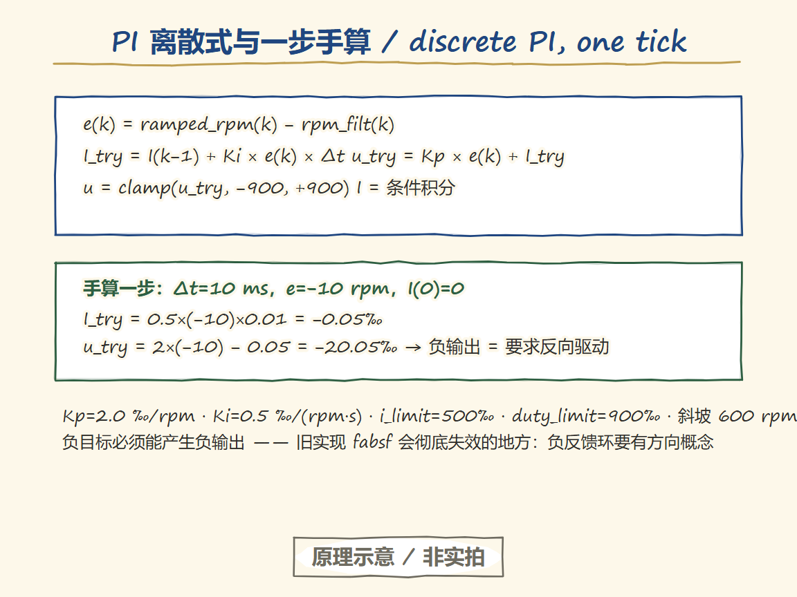
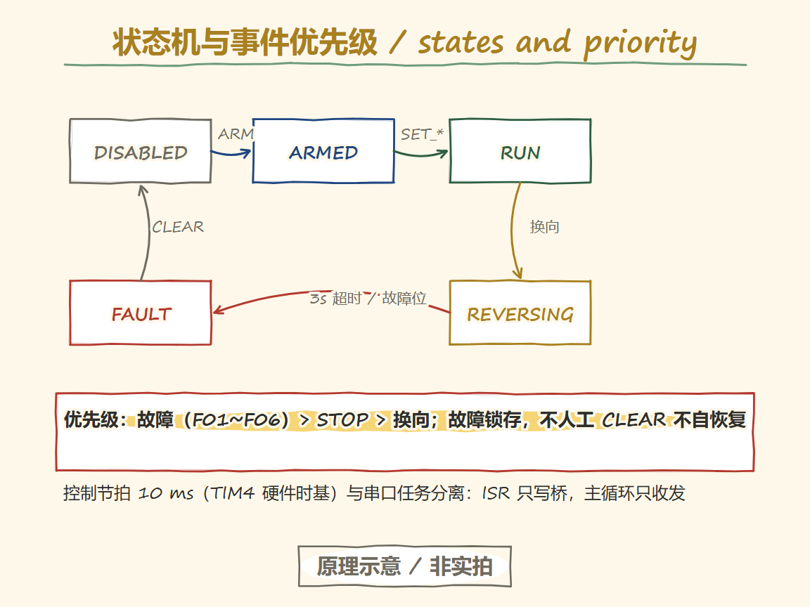
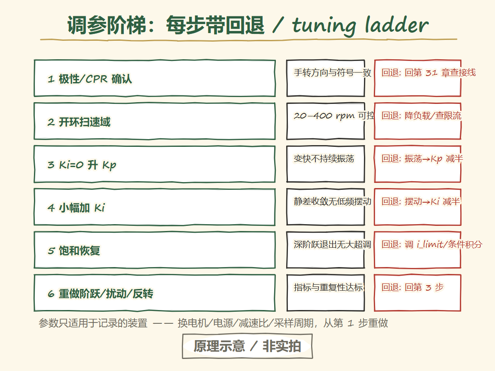
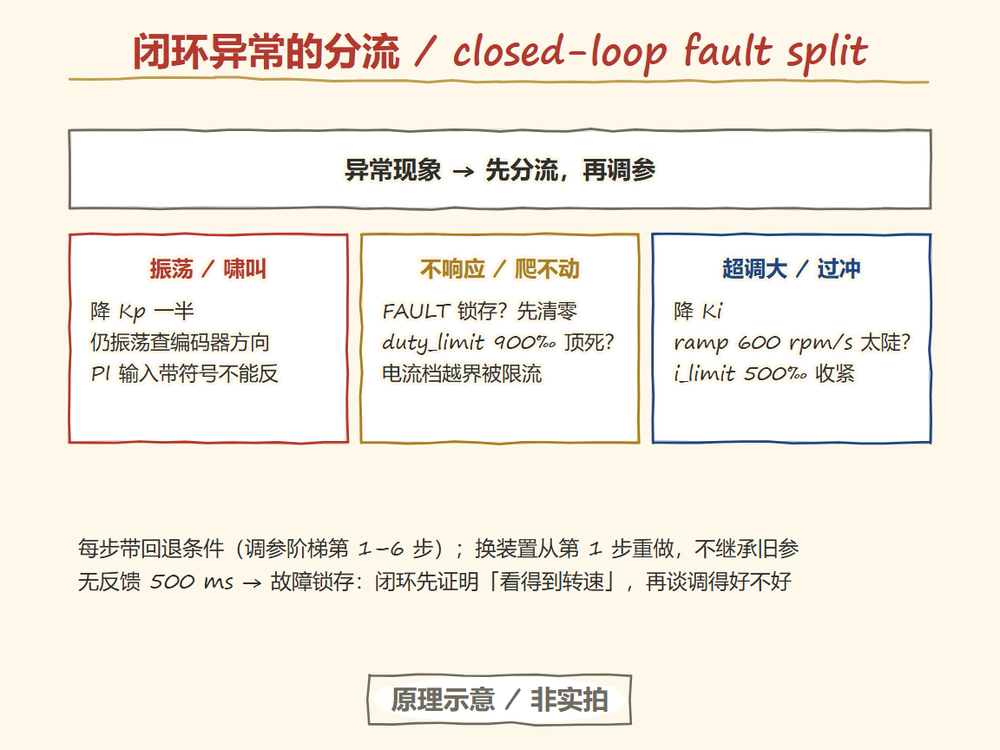

# 32 DC motor speed closed loop: PI, state machine, and anti-windup

> 中文：[直流电机速度闭环](../32-直流电机速度闭环.md)

> The closed loop does exactly one thing: each control tick, compare target with measurement and adjust the output by the error. The hard part is doing it right under saturation, reversal, feedback loss, and latched faults.

**Board-level premise of this chapter**: wiring and parameters follow procurement freeze v1.2 (candidate values, verified at P2 on-board bring-up). The control law and state machine referenced here live in `examples/motor-dc-speed/src/pi_controller.c`, `src/control_tick.c`, and `src/motor_state.c`. All experimental results in this chapter await real-board data from P2/P3; no measured curves are shown yet.

## Learning goals

- [ ] Write this project's discrete PI update equation and hand-compute one 10 ms step.
- [ ] Distinguish output limiting from integral limiting, and explain why conditional integration (anti-windup) is necessary.
- [ ] Draw the run / reverse / fault state machine and state the event priority (fault > stop > reversal).
- [ ] Follow the tuning procedure from polarity check to saturation recovery, knowing the rollback condition of each step.
- [ ] List the four metric definitions for a speed step (overshoot, rise time, steady-state error, settling time) and their data requirements.

---

## The entry question

Under load the speed sags — how does the program pull it back to the target by itself?

Open loop (chapter 30) commands a voltage; the moment load torque rises, the speed is dragged away. A closed loop makes **speed** the target: measure once per control tick, compare with the target to get the error, and let the error drive a PI that produces a new duty. More load → larger error → the duty deepens automatically → the speed is pulled back. This chapter pins down every boundary condition of that "error amplifier".

## Minimal victory (M32-A: one speed step)

**Goal**: on a rig that is calibrated (M31-A passed) and polarity-confirmed, run one 0→150 rpm step, save the target / measurement / output traces on a shared time axis, and compute the four metrics.

1. Prerequisites: M29/M30/M31 all passed; `CONFIG` writes the calibrated CPR; `ARM` replies OK.
2. `SET_RPM 150` and record at least 3 s of telemetry (SAMPLE frames, 43 B, 100 Hz).
3. The host tool `tools/motor_analyze.py` (delivered at P3) computes the metrics from the raw CSV; the raw frames' SHA256 and the input files' are archived together.
4. Repeat once with the reverse step 150→−150 and confirm the REVERSING contract is followed.

**Expected evidence**: three traces on a shared axis; metric values accompanied by input hashes and the analyzer tool version; both repeats kept, not just the pretty one.

> Status: M32-A~F run only after the parts arrive and the P3 toolchain (golden vectors, analyzer) is ready; they are candidate steps for now, and no measured data is shown.

## Core ideas

### The discrete PI and its units


<p align="center">
  
  <br><sub>▲ Knowledge track (Handraw · 原理示意 / not a photo). Five steps: e / I_try / u_try / clamp / conditional integration; hand-computed e=−10 rpm → u_try=−20.05‰ (negative output = reverse drive); Kp=2.0, Ki=0.5, i_limit=500‰, duty_limit=900‰; not a photo.</sub>
</p>
Frozen default parameters (`src/main.c`, to be revised after P2 measurements):

```text
e(k)        = ramped_rpm(k) − rpm_filt(k)          error after target ramp, rpm
I_try(k)    = I(k−1) + Ki × e(k) × Δt              integral trial, output unit(‰)
u_try(k)    = Kp × e(k) + I_try(k)                 output trial, duty ‰
u(k)        = clamp(u_try, −duty_limit, +duty_limit)
I(k)        = conditional-integration result (below)
```

| Parameter | Default | Meaning |
| --- | --- | --- |
| Kp | 2.0 | Proportional gain, ‰/rpm |
| Ki | 0.5 | Integral gain, ‰/(rpm·s) |
| i_limit | 500‰ | The integral's own limit |
| duty_limit | 900‰ | Output limit (<1000, leaving full-pressure headroom) |
| Target ramp | 600 rpm/s | A step target becomes a ramp; the PI only tracks the smoothed target |
| Filter α | 1.0 (no filter) | Re-evaluate during tuning |

Hand-compute one tick: Δt=10 ms, e=−10 rpm, I(0)=0 → I_try = 0.5×(−10)×0.01 = −0.05‰, u_try = 2×(−10) − 0.05 = −20.05‰. A negative output means "drive in reverse" — exactly what the signed duty of chapter 30 is for, and precisely where the old `fabsf` implementation failed completely: **a negative target must be able to produce a negative output, or the feedback loop has no concept of direction**.

### Limiting versus anti-windup

Output limiting only decides "how much at most"; what really winds the integral up is **a persistent error**: if the motor at 900‰ still cannot reach the target, the integral accumulates toward an astronomical number, and when the error finally changes sign the output stays stuck in saturation (slow saturation recovery, showing up as large overshoot or oscillation).

This project's conditional-integration rule: accept the integral when u_try is not saturated; accept it when saturated at the upper bound with e<0 (the error asks the output to fall); accept it when saturated at the lower bound with e>0; reject it otherwise. The integral also has its own ±500‰ limit. The effect: during saturation the integral holds wherever it does not worsen things, and the moment the error changes sign the output leaves saturation immediately. Keep the distinction sharp: **limiting clamps the current output; anti-windup governs the integral's accumulated history** — neither is optional.

### State machine and event priority


<p align="center">
  
  <br><sub>▲ Knowledge track (Handraw · 原理示意 / not a photo). DISABLED→ARMED→RUN/REVERSING→FAULT; faults (F01–F06) outrank STOP, which outranks reversal; faults latch until manual CLEAR; the 10 ms control tick is isolated from the serial task; not a photo.</sub>
</p>
```text
        ARM        SET_*        fault(F01~F06)
DISABLED ──→ ARMED ───→ RUN_OPEN / RUN_SPEED
   ↑            │  STOP          │
   └────────────┴────────────────┤
        CLEAR(DISABLED only)     ↓ sign flip
                              REVERSING(ramp to 0→wait standstill→hold 100ms→reverse)
                                 │ 3s overall timeout→FAULT
                              FAULT(latched, CLEAR→DISABLED→HEARTBEAT→ARMED)
```

Event priority: fault bits (lease F01 / feedback F02 / loss F03 / uncalibrated F06 / reversal timeout) always win; next is STOP (remove enable); reversal comes last. All faults latch — nothing self-recovers without a manual CLEAR, so command chatter cannot restart the motor while a fault is active.

The control tick at 10 ms (TIM4 hardware timebase) is strictly separated from the serial task: the ISR only writes the bridge, the main loop only sends and receives (ownership per design §4). Prints and protocol parsing may slow the main loop, but they can never stretch the control period — the structural answer to the "control period stretched by printing" failure branch.

### Tuning procedure (with a rollback condition per step)


<p align="center">
  
  <br><sub>▲ Knowledge track (Handraw · 原理示意 / not a photo). Six-step ladder — polarity/CPR, open-loop sweep, raise Kp, add Ki, saturation recovery, redo step/disturbance/reversal — each with a pass criterion and a rollback; change the rig and redo from step 1; not a photo.</sub>
</p>
| Step | Action | Pass criterion | Rollback |
| --- | --- | --- | --- |
| 1 | Polarity and CPR check (M31-A) | Hand-turn direction matches the sign | Back to chapter 31; check wiring / mode |
| 2 | Open-loop sweep of the usable speed range (M30-A) | Controllable across 20–400 rpm; starting threshold known | Reduce load / check supply current limiting |
| 3 | Ki=0, raise Kp in steps | Faster response without sustained oscillation | Oscillation → halve Kp and retry |
| 4 | Add a little Ki to remove steady-state error | Error converges with no low-frequency hunting | Hunting → halve Ki |
| 5 | Saturation-recovery test (M32-C) | Deep step exits saturation without large overshoot | Tune i_limit / conditional integration |
| 6 | Redo step / disturbance / reversal (M32-A/B/D) | Metrics and repeatability meet the acceptance protocol | Back to step 3 |

Parameters are valid only for the recorded rig: change the motor, supply, gear ratio, or sample period, and redo from step 1.

## Failure branches and shortest diagnosis


<p align="center">
  
  <br><sub>▲ Knowledge track (Handraw · 原理示意 / not a photo). Split first: oscillation → cut Kp, no response → FAULT/limits, overshoot → Ki/ramp; retune from step 1 on any rig change; not a photo.</sub>
</p>
| Symptom | Distinguishing evidence | Next action |
| --- | --- | --- |
| Positive feedback (runs away) | Output deepens in the wrong direction as the error grows | STOP immediately; polarity is reversed — back to step 1 |
| Large overshoot / oscillation | Does the telemetry integral term sit at i_limit? | Anti-windup not effective or Ki too large; check the conditional-integration implementation and parameters |
| Hunting back and forth at low speed | Reading jumps across quantization steps (chapter 31) | Confirm it is a measurement property; consider lengthening the window |
| Step response turns sluggish | Telemetry control-period field reads >10 ms | Main loop overloaded; check print / protocol-parsing cost |
| Keeps forcing despite bad feedback | Are F02/F03 set in the status word? | The firmware already refuses to feed the PI; if it still forces, that is an implementation bug — report it |
| Spike on reversal | Does it walk through the REVERSING phases? | Same diagnosis table as chapter 30 |

## Transfer boundary

- Sample-period change (10 ms → anything else): rescale Ki proportionally with Δt and redo the step experiments.
- Motor or supply change: redo all parameters from step 1; never copy "example gains" from another motor.
- Moving to an RTOS: the control task is the unique owner of the output; the 10 ms deadline goes into the task configuration; a watchdog supervises independently (verified after IWDG is enabled at P2).
- The D term of PID: a speed loop carries encoder quantization noise, and the D term amplifies it — this project's V1 does not use it; re-evaluate when migrating to a position loop.

## Memory anchor

**"A closed loop is a balance scale: the error is the weight difference, Kp is a quick hand, Ki is patience, the limit is the scale's capacity, and anti-windup forbids the weight from sliding off the pan."**

Where it holds: weigh and adjust once per tick; beyond capacity (duty_limit) more adjustment is useless; when the weight is stuck (saturation), stop accumulating (conditional integration).
Where it breaks: a real scale has no "target ramp" and no "reverse-to-standstill" — slam the target down and the beam swings (the ramp's reason); and changing direction mid-weighing requires returning to zero first (REVERSING).

## Experiment register

| Experiment | Content | Metrics / evidence | Status |
| --- | --- | --- | --- |
| M32-A | Speed step (±150 rpm) | Four metrics + shared-axis traces + input hashes | Pending (parts not arrived) |
| M32-B | Repeatable load add/remove disturbance | Disturbance-recovery time and repeatability | Pending |
| M32-C | Saturation exit (deep step) | Exit overshoot magnitude | Pending |
| M32-D | Controlled reversal | Full REVERSING state record | Pending |
| M32-E | Communication / feedback fault injection | F01–F03 latching and recovery protocol | Pending |
| M32-F | 10-minute continuous run | Thermal stability (depends on BLK-P0-4 thermal budget) | Pending |

Metric definitions and data requirements follow the [acceptance protocol](../../plans/2026-11-11-motor-control/acceptance.md) (overshoot, rise time, steady-state error, settling time; all raw frames kept).

## Exit check

1. Hand-compute one 10 ms tick (given Kp/Ki/e/Δt), writing out u_try and I_try.
2. Explain the difference between output limiting and integral limiting, and why integration must stop during saturation.
3. Demonstrate three manual triggers — command stream cut (F01), abnormal feedback (F02), CLEAR recovery — and state which step needs HEARTBEAT.

## Sources

- Control law and state machine implementation: `examples/motor-dc-speed/src/pi_controller.c`, `src/control_tick.c` (covered by host tests H01–H10, including end-to-end regressions for negative-direction starting and the reversal contract)
- Frozen parameters: the default-value table in `src/main.c` (revised after P2 measurements)
- Metrics and acceptance criteria: [acceptance protocol](../../plans/2026-11-11-motor-control/acceptance.md)
