<div align="center">

# STM32 learning notes

> 中文：[学习知识库](../../README.md)

**Look things up the way you look up a manual. Learn the mechanism the way you watch an animation.**

An STM32 notebook in English, translated from the Chinese edition: 29 chapters (00–28) · 24 mechanism animations · board drawings plus H7/G0/L4 pinouts · 6 raster GIFs · 14 buildable examples · 4 cheatsheets

[](contents.md)
[](../../assets/animations/)
[](../../assets/boards/)
[](../../assets/gif/)
[](../../examples/)
[](cheatsheets/hal.md)
[](../../tools/)
[](../../LICENSE)


<sub>▲ Animation: current path and logic level of a push-pull GPIO (open the SVG if you want it larger)</sub>

</div>

---

## What this repo is for

Tutorials are easy to find and still fail in the same three ways:

| Problem | What this repo does |
| --- | --- |
| **Text only. You never see what the hardware is doing.** | Each peripheral has a **moving diagram** (SVG + CSS). GitHub plays it on the page. |
| **You do not know the board or the pins.** | **Structure drawings**, a full pinout, and a wiring overview. All drawn, not photographed. |
| **Copied examples do not build.** | Each example is HAL you can compile, plus the CubeMX settings and the usual traps. |

> **Honest note:** mechanism figures are original vector drawings or generated GIFs, not vendor product photographs. Two Nucleo-64 photos are CC0 assets with provenance recorded in [`assets/photos/README.md`](../../assets/photos/README.md). For official schematics, use the links in [chapter 21](21-board-maps.md).

## Start here

| You want to… | Go to |
| --- | --- |
| Start from zero | [Chapter 0 · How to learn STM32](00-how-to-learn-stm32.md) |
| Install tools, or the board will not connect | [Chapter 1 · Environment](01-dev-environment.md) |
| Pick a part and read a clock tree | [Chapter 2 · Part, memory, clocks](02-part-and-clock.md) |
| Light the first LED | [Chapter 3 · GPIO](03-gpio-and-led.md) + [examples/gpio-blink](../../examples/gpio-blink/) |
| The program is stuck, or it will not build | [Chapter 18 · FAQ](18-faq.md) |
| Just the cheatsheets | [HAL](cheatsheets/hal.md), [registers](cheatsheets/registers.md), [bus and pins](cheatsheets/bus-and-pins.md), [errors](cheatsheets/errors.md) |
| Every animation and board drawing | [assets/README.md](../../assets/README.md) |
| Change a drawing | [tools/](../../tools/) (Python standard library only) |

The chapter index, with one-line summaries, is [contents.md](contents.md).

## Animations (they play on the GitHub page)

<table>
<tr>
<td width="50%">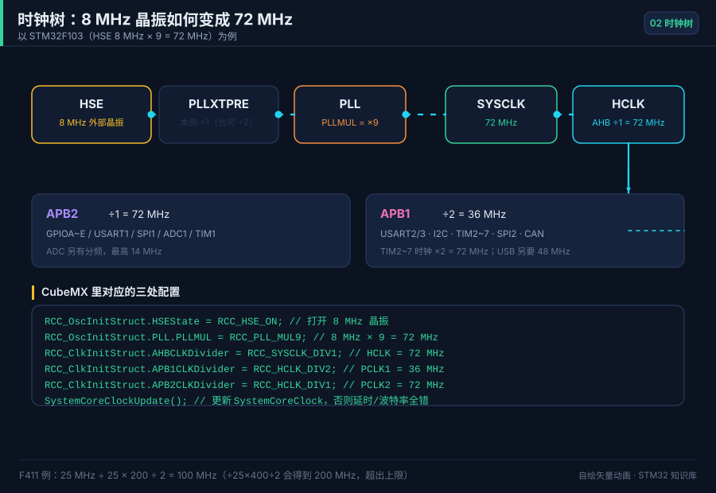<br><sub>▲ Clock tree: 8 MHz crystal → PLL ×9 → 72 MHz</sub></td>
<td width="50%">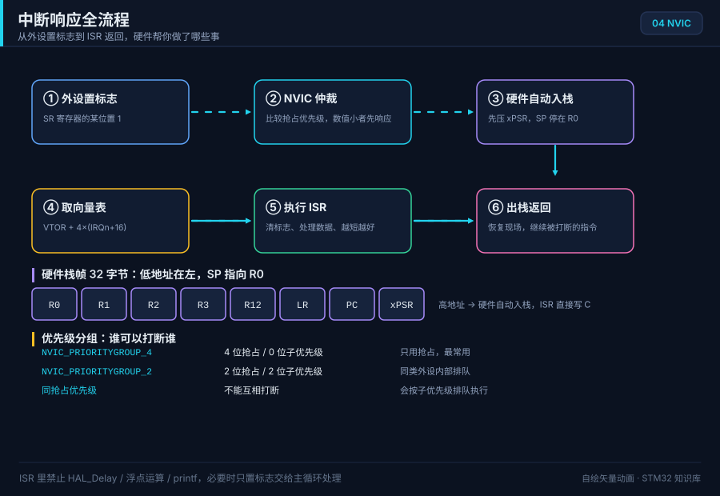<br><sub>▲ Interrupt: flag → NVIC → stack → ISR → return</sub></td>
</tr>
<tr>
<td>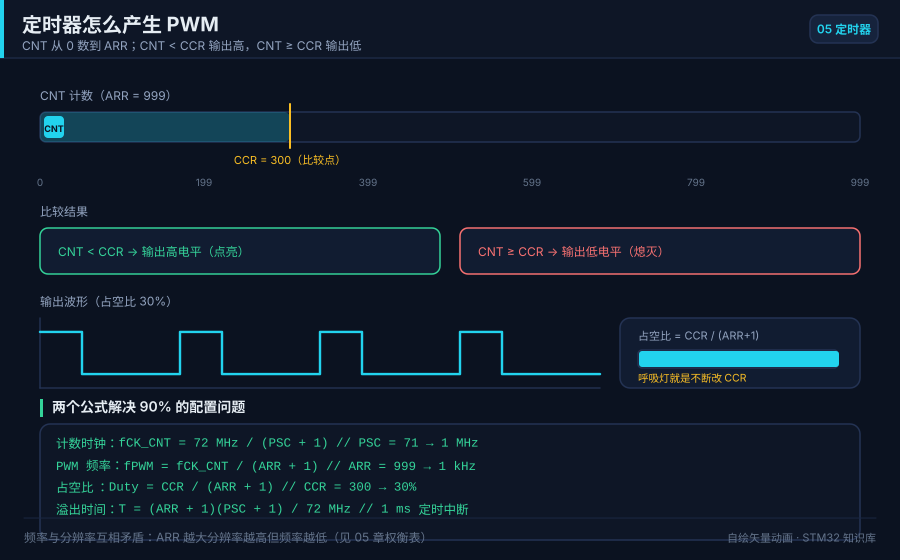<br><sub>▲ PWM: CNT compared with CCR, duty moving over time</sub></td>
<td>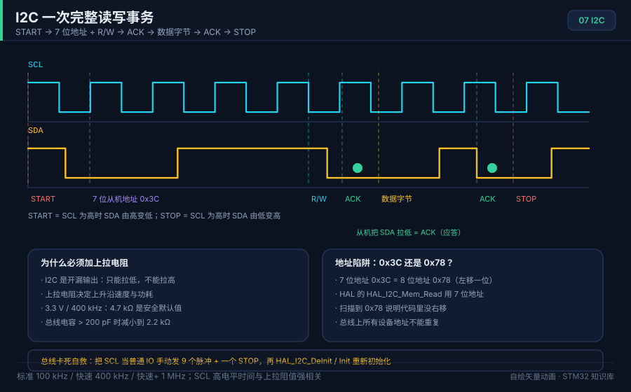<br><sub>▲ I2C: START / address / ACK / data / STOP</sub></td>
</tr>
<tr>
<td>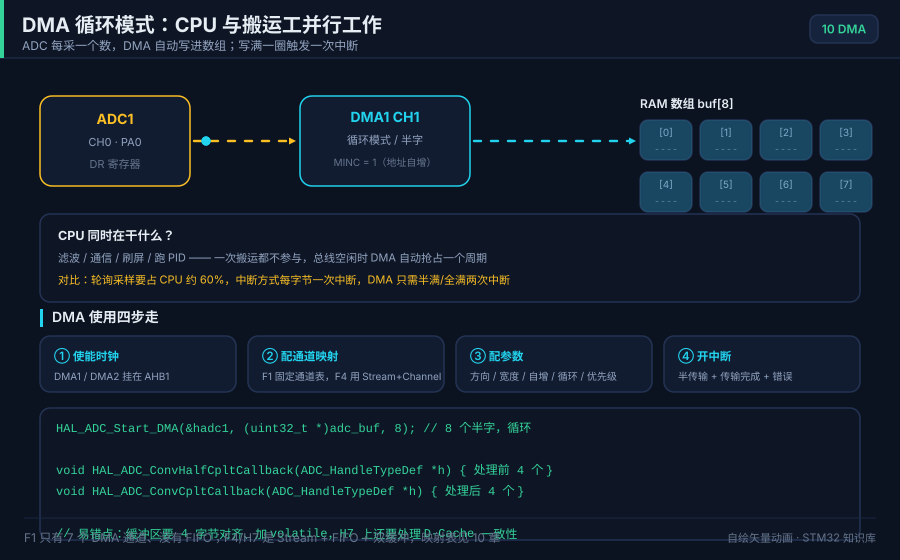<br><sub>▲ DMA circular mode: CPU and DMA at the same time</sub></td>
<td><br><sub>▲ FreeRTOS: task states and a preemptive Gantt chart</sub></td>
</tr>
</table>

The full list of 24 SVG animations is in [assets/README.md](../../assets/README.md). Six more GIFs are generated in pure Python:

<div align="center">
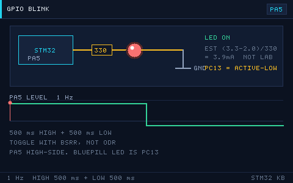
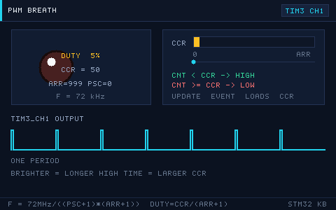
<br>
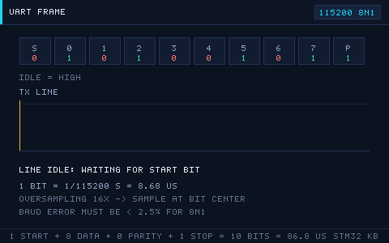
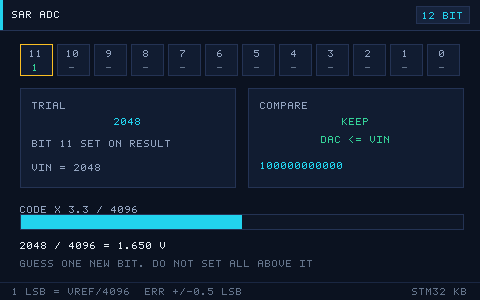
<br>
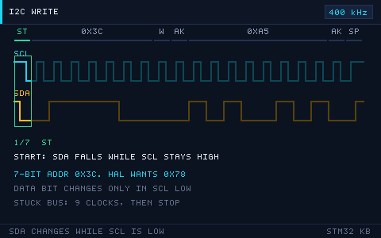
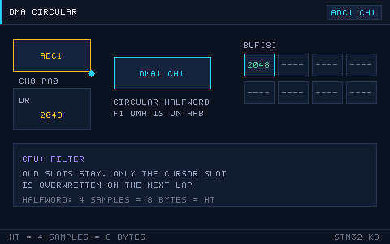
<br>
<sub>▲ GIF89a/LZW encoder in the standard library, with frame deltas and a transparent index. Text is ASCII because the bitmap font is.</sub>
</div>

## Board drawings (vector, not photos)

<div align="center">
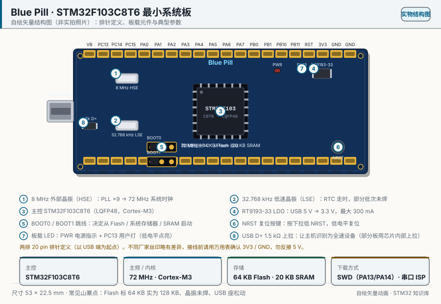
<br><sub>▲ Blue Pill (STM32F103C8T6): 20+20 header names, on-board parts, typical values</sub>
</div>

| Drawing | What it shows |
| --- | --- |
| [bluepill-stm32f103c8t6.svg](../../assets/boards/bluepill-stm32f103c8t6.svg) | Minimum system: headers, BOOT jumpers, the 1.5 kΩ USB pull-up, clone clues |
| [blackpill-stm32f411ce.svg](../../assets/boards/blackpill-stm32f411ce.svg) | WeAct V3.1: Type-C, 25 MHz crystal, 100 MHz core |
| [nucleo-f411re.svg](../../assets/boards/nucleo-f411re.svg) | Official Nucleo-64: ST-Link/V2-1, Morpho and Arduino headers |
| [f4-discovery.svg](../../assets/boards/f4-discovery.svg) | Official F4-Discovery: accelerometer, audio DAC, MEMS mic, four user LEDs |
| [f103zet6-dev.svg](../../assets/boards/f103zet6-dev.svg) | F103ZET6 board: FSMC LCD, SD, CAN/RS485/RS232, two Flash parts |
| [pinout-bluepill.svg](../../assets/boards/pinout-bluepill.svg) | **All 48 LQFP pins**, alternate functions, and five things to check on a pinout |
| [peripheral-wiring.svg](../../assets/boards/peripheral-wiring.svg) | Eight beginner peripherals, and which pins collide |
| [pinout-stm32g071rb-lqfp64.svg](../../assets/boards/pinout-stm32g071rb-lqfp64.svg) | G071RB LQFP64, from DS12232 Rev 5 Table 12 |
| [pinout-stm32l476rg-lqfp64.svg](../../assets/boards/pinout-stm32l476rg-lqfp64.svg) | L476Rx LQFP64, from DS10198 Rev 11 Figure 16 |
| [pinout-stm32h743zi-lqfp144.svg](../../assets/boards/pinout-stm32h743zi-lqfp144.svg) | H743xI LQFP144, from DS12110 Rev 11 Figure 7 |

## Roadmap in three stages

```text
Stage 1 · start          Stage 2 · go deeper         Stage 3 · build
────────────────         ──────────────────          ────────────────
environment, LED         DMA + double buffer         RTOS tasks
GPIO in and out          ADC sample and filter       USB / CAN / Ethernet
NVIC                     RTC, watchdog, low power    IAP
timers and PWM           Flash and IAP               LCD / camera / audio
UART and printf          I2C sensors, SPI Flash      the projects in ch. 19
I2C and SPI              FreeRTOS                    publish a small library
you can bring up         you can read a timing       you can hand someone
5 peripherals            diagram and a manual        a prototype
```

Each chapter ends with a lab and a self-test. The longer version is [chapter 0](00-how-to-learn-stm32.md).

## Chapters

<details open>
<summary><b>Foundations (00–08)</b></summary>

| # | Chapter | Keywords | Animation |
| --- | --- | --- | --- |
| 00 | [How to learn STM32](00-how-to-learn-stm32.md) | roadmap · kit · three styles | `toolchain-flow` |
| 01 | [Environment](01-dev-environment.md) | Keil / CubeIDE / PlatformIO · ST-Link · SWD | `boot-sequence` |
| 02 | [Part, memory, clocks](02-part-and-clock.md) | part number · memory map · clock tree | `memory-map` `clock-tree` |
| 03 | [GPIO and the LED](03-gpio-and-led.md) | 8 modes · push-pull / open-drain · resistor | `gpio-blink` `led-blink.gif` |
| 04 | [Interrupts and the NVIC](04-interrupts-nvic.md) | priority group · EXTI | `nvic-interrupt-flow` |
| 05 | [Timers and PWM](05-timer-pwm.md) | time base · duty · capture | `timer-pwm` `pwm-breath.gif` |
| 06 | [UART](06-uart.md) | frame · baud error · DMA+IDLE | `uart-frame` `uart-bits.gif` |
| 07 | [I2C](07-i2c.md) | open-drain · ACK · stuck bus | `i2c-transaction` |
| 08 | [SPI](08-spi.md) | full duplex · CPOL/CPHA · chip select | `spi-transfer` |

</details>

<details open>
<summary><b>The next layer (09–17)</b></summary>

| # | Chapter | Keywords | Animation |
| --- | --- | --- | --- |
| 09 | [ADC and DAC](09-adc-dac.md) | SAR · sample time · internal temperature | `adc-sar` |
| 10 | [DMA](10-dma.md) | channel / stream · circular · cache | `dma-circular` |
| 11 | [RTC and the watchdog](11-rtc-watchdog.md) | LSE · alarm · IWDG/WWDG | `iwdg-window` |
| 12 | [Flash and IAP](12-flash-iap.md) | sector erase · unlock · two slots | `flash-iap` |
| 13 | [CAN](13-can.md) | arbitration · stuffing · filters | `can-arbitration` |
| 14 | [USB](14-usb.md) | enumeration · descriptors · CDC / HID | `usb-enumeration` |
| 15 | [FreeRTOS](15-freertos.md) | task state · priority · queue | `freertos-scheduler` |
| 16 | [Low power](16-low-power.md) | Sleep / Stop / Standby · WFI | `lowpower-wakeup` |
| 17 | [Debug](17-debug.md) | SWD/SWO · HardFault · DWT | `debug-swo` |

</details>

<details open>
<summary><b>Projects, simulation, family pinouts, SPL, networking, and systems (18–28)</b></summary>

| # | Chapter | Keywords |
| --- | --- | --- |
| 18 | [FAQ](18-faq.md) | 30+ rows of symptom / cause / fix |
| 19 | [Projects](19-projects.md) | 10 projects that stack: car, scope, logger… |
| 20 | [Resources](20-resources.md) | how ST names manuals · community · firmware libs |
| 21 | [Board maps](21-board-maps.md) | five boards and how to read a minimum system |
| 22 | [Wokwi and Renode](22-simulation-wokwi-renode.md) | browser wiring · load an ELF · where DMA stops |
| 23 | [STM32G0 pins](23-stm32g0-pins.md) | G071RB LQFP64 · PA14 is also BOOT0 · no bxCAN |
| 24 | [STM32L4 pins](24-stm32l4-pins.md) | L476RG · VDDUSB · cover typicals for low power |
| 25 | [STM32H7 pins](25-stm32h7-pins.md) | H743ZI pins/supply · Rev Y/W vs V · 400/480 MHz clocks · MCO verification |
| 26 | [STM32F10x SPL](26-spl.md) | V3.5.0 project skeleton · API boundaries · HAL migration |
| 27 | [Networking and protocol stacks](27-network.md) | Ethernet/RMII · lwIP · TCP/UDP · MQTT/TLS · layered diagnosis |
| 28 | [Embedded systems and the RTOS ecosystem](28-system-rtos.md) | ownership · deadlines · FreeRTOS / RT-Thread / Zephyr · startup and watchdog health |

</details>

> Before you add a chapter, read [CONTENT_GUIDE.md](CONTENT_GUIDE.md).

## Examples and cheatsheets

The examples are complete buildable HAL projects, plus one frozen SPL V3.5.0 CMake project. Each README gives wiring, configuration, the lines that matter, expected behavior, and common failures.

| Example | Level | Peripheral | Chapter |
| --- | --- | --- | --- |
| [spl-f1-blink](../../examples/spl-f1-blink/) | ★★ | SPL GPIO + SysTick + CMake | 01 / 26 |
| [gpio-blink](../../examples/gpio-blink/) | ★ | Push-pull GPIO | 03 |
| [exti-key](../../examples/exti-key/) | ★★ | EXTI + NVIC + debounce | 04 |
| [timer-pwm](../../examples/timer-pwm/) | ★★ | TIM PWM | 05 |
| [uart-dma-idle](../../examples/uart-dma-idle/) | ★★★ | UART + DMA + IDLE + ring | 06 / 10 |
| [i2c-oled](../../examples/i2c-oled/) | ★★★ | Hardware I2C + SSD1306 | 07 |
| [spi-flash](../../examples/spi-flash/) | ★★★ | SPI + W25Q64 | 08 |
| [adc-dma](../../examples/adc-dma/) | ★★★ | Multi-channel ADC + DMA | 09 / 10 |
| [rtc-alarm](../../examples/rtc-alarm/) | ★★ | RTC alarm + backup domain | 11 |
| [freertos-task](../../examples/freertos-task/) | ★★★★ | FreeRTOS tasks + a queue | 15 |
| [iap-bootloader](../../examples/iap-bootloader/) | ★★★★ | Flash program + jump to the app | 12 |
| [can-bxcan](../../examples/can-bxcan/) | ★★★★ | bxCAN loopback / filter / bus-off | 13 |
| [usb-cdc](../../examples/usb-cdc/) | ★★★★ | USB CDC virtual COM | 14 |
| [usb-hid](../../examples/usb-hid/) | ★★★★ | USB HID keyboard | 14 |

Cheatsheets:

| Sheet | What is on it |
| --- | --- |
| [HAL](cheatsheets/hal.md) | HAL calls, arguments, return codes |
| [Registers](cheatsheets/registers.md) | GPIO / RCC / TIM / USART / NVIC bits |
| [Bus and pins](cheatsheets/bus-and-pins.md) | F103/F411 bus map, default pins, AF numbers |
| [Errors](cheatsheets/errors.md) | HAL status, 25+ symptom → cause → where to look |

The Chinese originals are in [`../../cheatsheets/`](../../cheatsheets/).

## How the pictures are made

They are generated. After a clone you can rebuild them with no third-party library (no PIL, no ImageMagick, no browser):

```bash
python3 tools/gen_animations.py
python3 tools/gen_boards.py
python3 tools/gen_pinouts.py
python3 tools/gen_diagrams.py
python3 tools/gen_gifs.py
python3 tools/gen_narrated.py --speak   # narrated MP4s; needs network, edge-tts, ffmpeg
python3 tools/check_assets.py
```

Run those from the repository root. `tools/check_assets.py` decodes each GIF and compares pixels with the frame the script just drew.

## Contributing

1. **Corrections.** A wrong bit, timing number, formula, or pin. Please cite the manual page.
2. **A new animation**, using `tools/svgkit.py`, and a row in `assets/README.md`.
3. **A new example** under `examples/xxx/` (`main.c` + `README.md`) that actually compiles.

Read [CONTENT_GUIDE.md](CONTENT_GUIDE.md) first. A useful commit message looks like `docs(05): add the PWM duty formula`.

## License

- **Code** (`examples/`, `tools/`) is [MIT](../../LICENSE).
- **Docs and figures** (`docs/`, `assets/`) are **CC BY 4.0**. Credit the source if you reuse them.
- Figures are drawn or generated, **not vendor photographs**. STM32, Nucleo, and Discovery are trademarks of STMicroelectronics. This repo is for study. It is not affiliated with ST.

## Roadmap

- [x] The chapter set plus the writing guide
- [x] 24 SVG mechanism animations
- [x] Seven board drawings plus three G0/L4/H7 package pinouts
- [x] Six generated GIFs and the asset checker
- [x] 14 buildable examples (including frozen SPL, bxCAN, and USB CDC/HID) and 4 cheatsheets
- [x] A narrated MP4 for chapters 00–28 (`assets/video/`, Chinese voice-over plus SRT)
- [x] Wokwi projects and Renode `.resc` scripts (chapter 22)
- [x] H7 / G0 / L4 pinouts from DS12232, DS10198, and DS12110 (chapters 23–25)
- [x] English edition in `docs/en/`

---

<div align="center">
<sub>If one chapter saved you an afternoon, a star is the thank-you that keeps the notes moving.</sub>
<br><br>
<b>Still being updated · see the commit log for the date</b>
</div>
